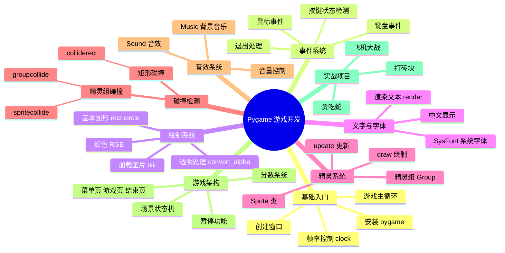
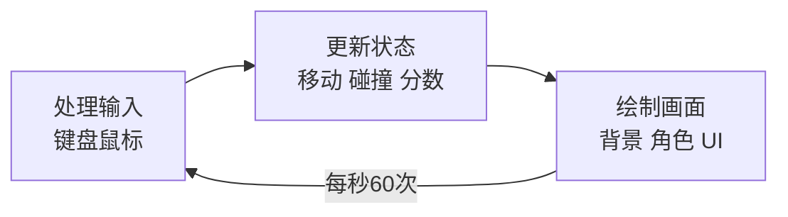
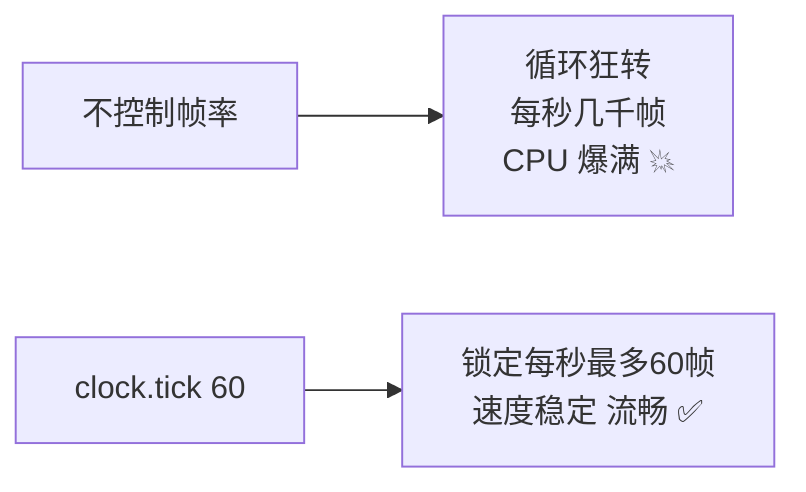
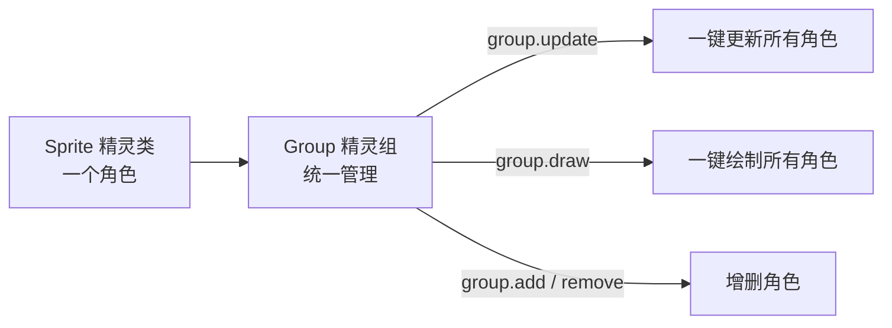
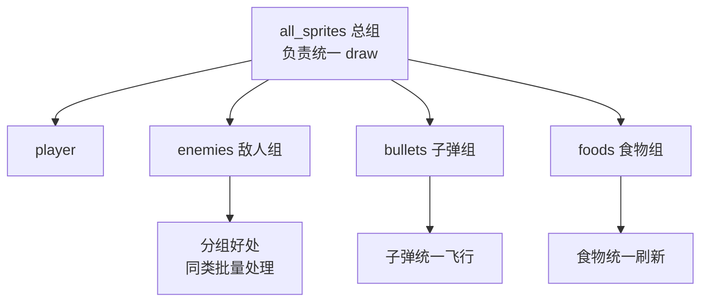
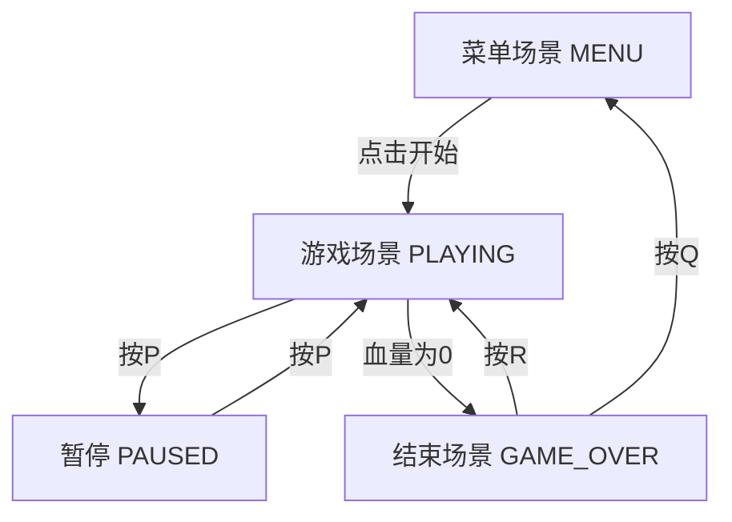
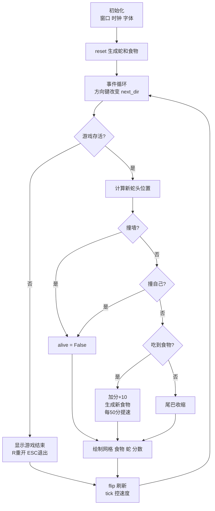
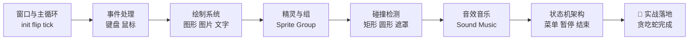

# 🎮 Pygame 游戏开发详解

> 哈喽呀～今天是最欢乐的一课：做游戏！🎮 Pygame 是 Python 最经典的游戏库——画窗口、控角色、放音效、加碰撞，全都难不倒它！学完就能自己搓一个贪吃蛇、飞机大战～冲鸭！(≧∇≦)ﾉ

***

## 🗺️ 知识全景图



***

## 📑 目录

- [一、Pygame 是什么](#一pygame-是什么)
- [二、环境搭建与第一个窗口](#二环境搭建与第一个窗口)
- [三、游戏主循环：心脏！](#三游戏主循环心脏)
- [四、事件处理：听懂玩家的操作](#四事件处理听懂玩家的操作)
- [五、绘制图形与图片](#五绘制图形与图片)
- [六、文字显示](#六文字显示)
- [七、精灵 Sprite：角色管理神器](#七精灵-sprite角色管理神器)
- [八、碰撞检测](#八碰撞检测)
- [九、音效与背景音乐](#九音效与背景音乐)
- [十、游戏架构：状态机管理场景](#十游戏架构状态机管理场景)
- [十一、综合实战：贪吃蛇小游戏](#十一综合实战贪吃蛇小游戏)
- [十二、进阶项目思路](#十二进阶项目思路)
- [十三、常见坑与优化技巧](#十三常见坑与优化技巧)

***

## 一、Pygame 是什么

### 1.1 一句话解释

**Pygame = 基于 SDL 的 Python 游戏开发库** 🎮

它把"画图、放声音、读键盘鼠标"这些底层操作包装成简单接口，你只管写游戏逻辑！

### 1.2 游戏的本质

> 游戏就是一个**不停循环的动画程序**：每秒刷新几十次画面，每次根据玩家操作更新状态～



### 1.3 Pygame 能做什么

| 类型 | 例子 🌰 |
|------|--------|
| 2D 小游戏 | 贪吃蛇、俄罗斯方块、打砖块 |
| 飞行射击 | 飞机大战、太空侵略者 |
| 平台跳跃 | 超级玛丽（简化版）|
| 卡牌/解谜 | 扑克、扫雷、2048 |
| 教学演示 | 可视化算法动画 |

### 1.4 核心概念速查

| 概念 | 通俗解释 |
|------|---------|
| Surface | 一块"画布"，能被绘制的东西 |
| Rect | 矩形区域，描述位置和大小 |
| Event | 事件：按键、点击、退出 |
| Sprite | 精灵：游戏里的角色基类 |
| Clock | 时钟：控制游戏帧率 |
| Blit | 把一个 Surface 贴到另一个上 |

***

## 二、环境搭建与第一个窗口 🛠️

### 2.1 安装

```bash
pip install pygame

# 验证安装（会弹出一个小窗口）
python -m pygame.examples.aliens
```

### 2.2 第一个窗口

```python
import pygame

pygame.init()                                  # 1. 初始化（必须！）

screen = pygame.display.set_mode((800, 600))   # 2. 创建窗口 800x600
pygame.display.set_caption("我的第一个游戏")     # 3. 窗口标题

running = True
while running:                                 # 4. 主循环
    for event in pygame.event.get():           # 5. 处理事件
        if event.type == pygame.QUIT:          # 点右上角 X
            running = False

    screen.fill((255, 255, 255))               # 6. 填充背景色（白色）
    pygame.display.flip()                      # 7. 刷新画面！

pygame.quit()                                  # 8. 退出清理
```

### 2.3 窗口常用设置

```python
import pygame
pygame.init()

# 创建窗口
screen = pygame.display.set_mode((800, 600))

# 标题和图标
pygame.display.set_caption("贪吃蛇大作战")
icon = pygame.image.load("icon.png")
pygame.display.set_icon(icon)

# 全屏 / 可调大小（标志位）
screen = pygame.display.set_mode((800, 600), pygame.FULLSCREEN)      # 全屏
screen = pygame.display.set_mode((800, 600), pygame.RESIZABLE)       # 可拉伸
screen = pygame.display.set_mode((800, 600), pygame.SCALED)          # 等比缩放

# 窗口尺寸
print(screen.get_width(), screen.get_height())   # 800 600
print(screen.get_rect())                          # rect(0, 0, 800, 600)
```

***

## 三、游戏主循环：心脏！ ❤️

### 3.1 标准模板（背下来！）

```python
import pygame

pygame.init()
screen = pygame.display.set_mode((800, 600))
clock = pygame.time.Clock()                     # 帧率控制器

running = True
while running:
    # ===== 1. 帧率控制 =====
    dt = clock.tick(60) / 1000                  # 最多60帧，dt=这帧耗时秒

    # ===== 2. 事件处理 =====
    for event in pygame.event.get():
        if event.type == pygame.QUIT:
            running = False

    # ===== 3. 更新逻辑 =====
    # player.update(dt)
    # check_collisions()

    # ===== 4. 绘制画面 =====
    screen.fill((30, 30, 40))                   # 背景色
    # screen.blit(player_image, player_rect)
    pygame.display.flip()                        # 刷新！

pygame.quit()
```

### 3.2 为什么需要 Clock



```python
clock = pygame.time.Clock()

clock.tick(60)          # 限制最多 60 FPS
fps = clock.get_fps()   # 查看当前实际帧率

# dt（delta time）用法：让速度与帧率无关！
dt = clock.tick(60) / 1000     # 这一帧经过了多少秒
player_x += 300 * dt           # 每秒移动300像素（不管多少帧都一样快）
```

> ⚠️ 新手大坑：`x += 5` 这种写死速度的代码，在 144Hz 显示器上会比 60Hz 快一倍多！用 **dt** 乘速度才科学～

***

## 四、事件处理：听懂玩家的操作 ⌨️

### 4.1 事件循环

```python
for event in pygame.event.get():
    # ===== 窗口事件 =====
    if event.type == pygame.QUIT:               # 点 X 关闭
        running = False

    # ===== 键盘事件（按下/松开那一刻）=====
    if event.type == pygame.KEYDOWN:            # 某键被按下
        if event.key == pygame.K_ESCAPE:        # ESC 键
            running = False
        if event.key == pygame.K_SPACE:         # 空格：跳跃！
            player.jump()
        if event.key == pygame.K_RETURN:        # 回车
            start_game()

    if event.type == pygame.KEYUP:              # 某键被松开
        if event.key == pygame.K_RIGHT:
            player.moving = False

    # ===== 鼠标事件 =====
    if event.type == pygame.MOUSEBUTTONDOWN:    # 按下
        if event.button == 1:                   # 1左键 2中键 3右键
            print("左键点击位置:", event.pos)    # (x, y)
    if event.type == pygame.MOUSEBUTTONUP:      # 松开
        ...
    if event.type == pygame.MOUSEMOTION:        # 移动
        print("鼠标位置:", event.pos, "相对移动:", event.rel)
```

### 4.2 按键状态检测（持续按住）

```python
# 方式一：事件只能捕捉"按下的瞬间"，按住不放要走状态轮询！
keys = pygame.key.get_pressed()

if keys[pygame.K_LEFT]:        # 按住左方向键
    player.x -= 5
if keys[pygame.K_RIGHT]:
    player.x += 5
if keys[pygame.K_UP]:
    player.y -= 5
if keys[pygame.K_DOWN]:
    player.y += 5

# 组合键：同时按住
if keys[pygame.K_LCTRL] and keys[pygame.K_s]:
    save_game()
```

### 4.3 事件 vs 状态轮询怎么选

| 方式 | 时机 | 适用 |
|------|------|------|
| 事件 KEYDOWN | 按下的一瞬 | 跳跃、开火、确认（单次动作）|
| get_pressed | 每帧查询状态 | 移动、长按（持续动作）⭐ |

### 4.4 常用键位速查

| 键 | 常量 |
|----|------|
| 方向键 | K_UP / K_DOWN / K_LEFT / K_RIGHT |
| WASD | K_a / K_w / K_s / K_d |
| 空格 | K_SPACE |
| 回车 | K_RETURN |
| ESC | K_ESCAPE |
| Shift / Ctrl | K_LSHIFT / K_LCTRL |
| 数字键 | K_0 ~ K_9 |

***

## 五、绘制图形与图片 🎨

### 5.1 颜色的三种写法

```python
RED = (255, 0, 0)                    # RGB 元组最常用
GREEN = pygame.Color(0, 255, 0)      # Color 对象
BLUE = "#0000FF"                     # 十六进制字符串

# 透明色（RGBA，第四个是透明度）
TRANS_RED = (255, 0, 0, 128)

# 常用颜色速记
WHITE, BLACK = (255, 255, 255), (0, 0, 0)
GRAY = (128, 128, 128)
```

### 5.2 绘制基本图形

```python
# 矩形：参数（画布, 颜色, Rect, 线宽=0实心）
pygame.draw.rect(screen, RED, (100, 100, 80, 40))         # 实心
pygame.draw.rect(screen, RED, (100, 100, 80, 40), 2)      # 空心线宽2

# 圆形：（画布, 颜色, 圆心, 半径, 线宽）
pygame.draw.circle(screen, GREEN, (400, 300), 50)
pygame.draw.circle(screen, GREEN, (400, 300), 50, 3)

# 直线：（画布, 颜色, 起点, 终点, 线宽）
pygame.draw.line(screen, BLUE, (0, 0), (800, 600), 5)

# 折线：points 点列表
pygame.draw.lines(screen, BLUE, False,
                  [(100, 100), (200, 50), (300, 150)], 2)

# 多边形
pygame.draw.polygon(screen, YELLOW,
                    [(400, 100), (500, 200), (300, 200)])

# 椭圆（画在矩形内）
pygame.draw.ellipse(screen, PURPLE, (100, 100, 120, 80))

# 弧线
pygame.draw.arc(screen, CYAN, (200, 200, 100, 100), 0, 3.14, 2)
```

### 5.3 Rect：游戏中的万能矩形

```python
# 创建 Rect 的四种方式
r1 = pygame.Rect(10, 20, 100, 50)        # (左, 上, 宽, 高)
r2 = pygame.Rect((10, 20), (100, 50))
r3 = pygame.Rect(pygame.Rect(10, 20, 100, 50))    # 复制

r = pygame.Rect(10, 20, 100, 50)

# 常用属性
r.x, r.y            # 左上角坐标
r.left, r.top       # 同上
r.right, r.bottom   # 右边和底边坐标
r.centerx, r.centery    # 中心坐标
r.center             # 中心点 (x, y)
r.width, r.height    # 宽高
r.size               # (w, h)
r.topleft            # 左上角
r.midbottom          # 底部中心

# 常用方法
r.move(10, 5)            # 移动（返回新 Rect）
r.move_ip(10, 5)         # 原地移动（ip = in place）
r.inflate(10, 10)        # 放大/缩小
r.clamp(screen_rect)     # 限制在屏幕内（防出界神器！）
r.colliderect(other)     # 与另一矩形相交？
r.collidepoint(x, y)     # 某点在矩形内？
r.contains(other)        # 完全包含另一矩形？
```

### 5.4 加载与贴图

```python
# 加载图片
bg = pygame.image.load("background.png")           # Surface 对象

# 性能优化（必须在 display.set_mode 之后调用！）
bg = pygame.image.load("background.png").convert()          # 无透明通道
player = pygame.image.load("player.png").convert_alpha()    # 带 PNG 透明 ⭐

# 缩放
player_small = pygame.transform.scale(player, (50, 50))     # 强制尺寸
player_2x = pygame.transform.scale2x(player)                # 放大2倍
player_smooth = pygame.transform.smoothscale(player, (100, 100))  # 平滑缩放

# 旋转/翻转
player_rot = pygame.transform.rotate(player, 90)            # 逆时针90度
player_flip = pygame.transform.flip(player, True, False)    # 水平翻转

# 贴图（blit）：把图片画到画布上
rect = player.get_rect(center=(400, 300))     # 让图片居中
screen.blit(bg, (0, 0))                        # 背景贴在左上角
screen.blit(player, rect)                      # 角色贴到 rect 位置

# 获取图片尺寸
w, h = player.get_size()
```

### 5.5 绘制顺序很重要！

```python
# 后画的会盖住先画的 → 先画背景，再画角色，最后画 UI！
screen.blit(background, (0, 0))     # 1. 背景（最底层）
screen.blit(enemy, enemy_rect)      # 2. 敌人
screen.blit(player, player_rect)    # 3. 玩家
screen.blit(score_text, (10, 10))   # 4. 分数 UI（最顶层）
```

***

## 六、文字显示 ✏️

### 6.1 基本用法

```python
import pygame
pygame.init()

# 创建字体
font = pygame.font.SysFont("simhei", 36)              # 系统黑体 36号
font2 = pygame.font.SysFont(None, 48)                 # 默认字体
font3 = pygame.font.Font("zcool.ttf", 32)             # 自定义字体文件

# 渲染文字 → 得到 Surface
text = font.render("得分: 100", True, (255, 255, 255))   # (内容, 抗锯齿, 颜色)
text_shadow = font.render("得分: 100", True, (0, 0, 0),
                          (255, 255, 100))            # 第四参数=背景色

# 贴到屏幕
screen.blit(text, (100, 50))

# 居中显示
rect = text.get_rect(center=(400, 300))
screen.blit(text, rect)
```

### 6.2 中文显示方案

| 问题 | 原因 | 解决 💊 |
|------|------|--------|
| 中文变方块 | 默认字体不支持中文 | SysFont 用中文字体名 |
| 找不到字体 | 字体名写错 | 用 pygame.font.get_fonts() 查可用字体 |

```python
# 查看系统可用字体
print(pygame.font.get_fonts())     # 列表里找中文相关的

# Windows 常用：simhei(黑体) microsoftyahei(微软雅黑) simsun(宋体)
font = pygame.font.SysFont("microsoftyahei", 36)
text = font.render("你好，Pygame！", True, (255, 100, 100))
```

### 6.3 动态更新文字

```python
score = 0

def draw_score(screen):
    # 每次都重新 render（分数变了要重画！）
    font = pygame.font.SysFont("simhei", 36)
    text = font.render(f"得分: {score}", True, WHITE)
    screen.blit(text, (10, 10))

# 游戏循环里调用
draw_score(screen)
```

***

## 七、精灵 Sprite：角色管理神器 🧚

### 7.1 为什么需要精灵

> 游戏里有 100 个敌人——难道写 100 个变量？用 **Sprite 类 + Group 组**，增删改查一句话搞定！



### 7.2 自定义精灵

```python
import pygame

class Player(pygame.sprite.Sprite):
    def __init__(self, pos):
        super().__init__()
        # 精灵必备两个属性：image 和 rect
        self.image = pygame.image.load("player.png").convert_alpha()
        self.image = pygame.transform.scale(self.image, (50, 50))
        self.rect = self.image.get_rect(center=pos)
        self.speed = 5

    def update(self):
        """每帧自动调用（组更新时）"""
        keys = pygame.key.get_pressed()
        if keys[pygame.K_LEFT]:
            self.rect.x -= self.speed
        if keys[pygame.K_RIGHT]:
            self.rect.x += self.speed
        if keys[pygame.K_UP]:
            self.rect.y -= self.speed
        if keys[pygame.K_DOWN]:
            self.rect.y += self.speed

        # 防止出屏幕
        self.rect.clamp_ip(screen.get_rect())
```

### 7.3 精灵组使用

```python
# 创建精灵和组
player = Player((400, 300))
enemies = pygame.sprite.Group()          # 敌人群
all_sprites = pygame.sprite.Group(player)    # 全部角色

# 生成 5 个敌人
for i in range(5):
    enemy = Enemy((100 + i * 120, 50))
    enemies.add(enemy)
    all_sprites.add(enemy)

# ===== 游戏循环里 =====
all_sprites.update()         # 一键更新所有精灵！
all_sprites.draw(screen)     # 一键绘制所有精灵！

# 增删
enemies.add(new_enemy)       # 添加
enemy.kill()                 # 删除自己（自动从所有组移除）
enemies.empty()              # 清空
len(enemies)                 # 数量
```

### 7.4 分组管理架构



> 💡 一个精灵可以同时属于多个组！角色进"总组"负责绘制，再进"功能组"参与特定逻辑～

***

## 八、碰撞检测 💥

### 8.1 矩形碰撞（最简单）

```python
rect1 = pygame.Rect(100, 100, 50, 50)
rect2 = pygame.Rect(120, 120, 50, 50)

if rect1.colliderect(rect2):         # 两矩形相交？
    print("撞上了！")

# 点是否在矩形内（按钮点击判断）
if rect1.collidepoint(mouse_pos):
    print("点到了按钮上")

# 一次和多个矩形比较
rect_list = [r1, r2, r3]
index = rect1.collidelist(rect_list)         # 返回撞到的索引，没撞返回-1
index = rect1.collidelistall(rect_list)      # 所有撞到的索引列表
```

### 8.2 精灵碰撞（实战首选）

```python
# ===== 单个精灵 vs 精灵组 =====
# 玩家撞到任何一个敌人？
hit = pygame.sprite.spritecollide(
    player,            # 单个精灵
    enemies,           # 精灵组
    False,             # True=撞到的敌人直接 kill 掉
)
if hit:
    print(f"撞到 {len(hit)} 个敌人！")

# dokill 参数对比
pygame.sprite.spritecollide(player, bullets, False)  # 只检测
pygame.sprite.spritecollide(player, bullets, True)   # 检测+删除被撞子弹 ⭐

# ===== 精灵组 vs 精灵组 =====
# 子弹组 vs 敌人组：每一对碰撞都返回（子弹打敌人！）
hits = pygame.sprite.groupcollide(
    bullets,           # 组1
    enemies,           # 组2
    True,              # 组1中被撞的删除（子弹消失）
    True,              # 组2中被撞的删除（敌人死亡）
)
for bullet, enemy_list in hits.items():
    for enemy in enemy_list:
        score += 100                  # 每消灭一个敌人加分
```

### 8.3 更精确的碰撞：圆碰撞/遮罩

```python
# 矩形碰撞会把"透明角落"也算上 → 用圆形更准！

# 方式一：圆形碰撞（设置半径）
class Bullet(pygame.sprite.Sprite):
    def __init__(self, pos):
        super().__init__()
        self.image = ...
        self.rect = self.image.get_rect(center=pos)
        self.radius = 10                  # 自定义碰撞半径

        # 画个圈看看碰撞范围（调试用）
        # pygame.draw.circle(self.image, RED, self.rect.center, self.radius, 1)

hit = pygame.sprite.spritecollide(
    player, bullets, True,
    pygame.sprite.collide_circle)         # 用圆形碰撞检测！

# 方式二：遮罩碰撞（按像素级，最精确但最耗性能）
mask = pygame.mask.from_surface(self.image)   # 精灵 init 里
hit = pygame.sprite.spritecollide(
    player, bullets, True,
    pygame.sprite.collide_mask)               # 像素级检测
```

### 8.4 碰撞方式对比

| 方式 | 精度 | 性能 | 适用 |
|------|------|------|------|
| colliderect 矩形 | 低 | 快 | 方块类游戏 |
| collide_circle 圆形 | 中 | 快 | 圆形角色（球、飞机）⭐ |
| collide_mask 遮罩 | 高 | 慢 | 不规则图形（精确需求）|

***

## 九、音效与背景音乐 🔊

### 9.1 播放音效（短促效果声）

```python
# 音效：适合枪声、爆炸、跳跃这种短声音
laser_sound = pygame.mixer.Sound("laser.wav")
boom_sound = pygame.mixer.Sound("boom.ogg")

laser_sound.play()               # 播放
boom_sound.play()                # 可多个音效同时播
laser_sound.play(3)              # 循环3次
laser_sound.play(-1)             # 无限循环

# 音量（0.0 ~ 1.0）
laser_sound.set_volume(0.5)

# 淡出停止
boom_sound.fadeout(500)          # 500毫秒淡出

# 检查静音模块
if pygame.mixer.get_init() is None:
    print("音频初始化失败（可能没音频设备）")
```

### 9.2 背景音乐（长音频）

```python
# 音乐：适合背景乐（流式播放，省内存）
pygame.mixer.music.load("bgm.mp3")
pygame.mixer.music.set_volume(0.3)
pygame.mixer.music.play(-1)          # -1 无限循环

# 控制播放
pygame.mixer.music.play()            # 播放
pygame.mixer.music.pause()           # 暂停
pygame.mixer.music.unpause()         # 继续
pygame.mixer.music.stop()            # 停止
pygame.mixer.music.fadeout(1000)     # 1秒淡出

# 背景音乐（同一时间只能一首） vs 音效（可多个叠加）
```

### 9.3 Sound vs Music 对比

| 对比 | Sound 音效 | Music 音乐 |
|------|-----------|-----------|
| 加载方式 | 全部载入内存 | 流式播放 |
| 同时播放 | 多个 ✅ | 只能 1 个 |
| 支持格式 | wav/ogg | mp3/ogg |
| 适用 | 枪声 跳跃 金币 | 背景音乐 |

> 💡 兼容性提示：mp3 格式各平台支持不一，**音效用 wav/ogg 最稳**，音乐用 ogg 最稳～

***

## 十、游戏架构：状态机管理场景 🏗️

### 10.1 游戏的多个场景



### 10.2 状态机实现

```python
import pygame

MENU, PLAYING, PAUSED, GAME_OVER = "menu", "playing", "paused", "game_over"
state = MENU

while running:
    for event in pygame.event.get():
        if event.type == pygame.QUIT:
            running = False

        if event.type == pygame.KEYDOWN:
            if state == MENU and event.key == pygame.K_RETURN:
                state = PLAYING                    # 开始游戏
            elif state == PLAYING and event.key == pygame.K_p:
                state = PAUSED                     # 暂停
            elif state == PAUSED and event.key == pygame.K_p:
                state = PLAYING                    # 继续
            elif state == GAME_OVER:
                if event.key == pygame.K_r:
                    state = PLAYING                # 重来
                elif event.key == pygame.K_q:
                    state = MENU                   # 回菜单

    # ===== 按状态分发逻辑 =====
    if state == MENU:
        draw_menu(screen)              # 画标题和"按回车开始"
    elif state == PLAYING:
        all_sprites.update()           # 游戏才更新！
        all_sprites.draw(screen)
    elif state == PAUSED:
        draw_pause_text(screen)        # 只画"已暂停"
    elif state == GAME_OVER:
        draw_game_over(screen)         # 画分数和重新开始提示

    pygame.display.flip()
```

### 10.3 计时器：定时产生事件

```python
# 每 2000 毫秒触发一次自定义事件（比如：生成敌人）
SPAWN_ENEMY = pygame.USEREVENT + 1           # 自定义事件编号
pygame.time.set_timer(SPAWN_ENEMY, 2000)     # 每2秒触发

while running:
    for event in pygame.event.get():
        if event.type == SPAWN_ENEMY:        # 接住定时事件！
            enemies.add(Enemy())
            all_sprites.add(enemies.sprites()[-1])

    ...

# 取消定时器
pygame.time.set_timer(SPAWN_ENEMY, 0)

# 简单等待
pygame.time.wait(1000)           # 暂停1秒
pygame.time.get_ticks()          # 游戏开始至今的毫秒数
```

***

## 十一、综合实战：贪吃蛇小游戏 🐍

> 综合运用前面所有知识：主循环、事件、绘制、碰撞、音效、状态机～一个文件跑起来！

### 11.1 游戏设计

| 项目 | 设定 |
|------|------|
| 网格 | 20x20 格，每格 30 像素 |
| 操作 | 方向键控制，不能反向 |
| 食物 | 随机刷新，吃到 +10 分 + 变长 |
| 死亡 | 撞墙或撞自己 |
| 加速 | 每吃 5 个食物速度加快一点 |

### 11.2 完整代码

```python
"""snake.py 贪吃蛇小游戏
操作：方向键移动，ESC退出，死亡后R重开
"""
import random
import pygame

# ===== 常量 =====
CELL = 30                                # 格子大小
COLS, ROWS = 20, 20                      # 网格数
WIDTH, HEIGHT = COLS * CELL, ROWS * CELL # 窗口尺寸
FPS = 10                                 # 初始帧率（蛇的移动速度）

WHITE = (255, 255, 255)
BLACK = (20, 20, 30)
GREEN = (0, 200, 100)
DARK_GREEN = (0, 130, 70)
RED = (230, 70, 70)
GRAY = (40, 40, 50)

def main():
    pygame.init()
    screen = pygame.display.set_mode((WIDTH, HEIGHT))
    pygame.display.set_caption("贪吃蛇大作战 🐍")
    clock = pygame.time.Clock()
    font = pygame.font.SysFont("microsoftyahei", 28)
    big_font = pygame.font.SysFont("microsoftyahei", 48)

    def reset():
        """重置游戏状态"""
        return {
            "snake": [(COLS // 2, ROWS // 2),                  # 蛇头
                      (COLS // 2 - 1, ROWS // 2),
                      (COLS // 2 - 2, ROWS // 2)],
            "dir": (1, 0),                                     # 初始向右
            "next_dir": (1, 0),
            "food": None,
            "score": 0,
            "fps": FPS,
            "alive": True,
        }

    game = reset()
    game["food"] = spawn_food(game["snake"])

    running = True
    while running:
        # ===== 1. 事件处理 =====
        for event in pygame.event.get():
            if event.type == pygame.QUIT:
                running = False
            if event.type == pygame.KEYDOWN:
                if event.key == pygame.K_ESCAPE:
                    running = False
                if not game["alive"]:
                    if event.key == pygame.K_r:                # 死亡后重开
                        game = reset()
                        game["food"] = spawn_food(game["snake"])
                    continue
                # 方向控制（不能 180 度掉头！）
                head_x, head_y = game["snake"][0]
                cur = game["dir"]
                if event.key == pygame.K_UP and cur != (0, 1):
                    game["next_dir"] = (0, -1)
                elif event.key == pygame.K_DOWN and cur != (0, -1):
                    game["next_dir"] = (0, 1)
                elif event.key == pygame.K_LEFT and cur != (1, 0):
                    game["next_dir"] = (-1, 0)
                elif event.key == pygame.K_RIGHT and cur != (-1, 0):
                    game["next_dir"] = (1, 0)

        # ===== 2. 更新逻辑 =====
        if game["alive"]:
            game["dir"] = game["next_dir"]
            head_x, head_y = game["snake"][0]
            dx, dy = game["dir"]
            new_head = (head_x + dx, head_y + dy)

            # 撞墙检测
            if not (0 <= new_head[0] < COLS and 0 <= new_head[1] < ROWS):
                game["alive"] = False
            # 撞自己检测
            elif new_head in game["snake"]:
                game["alive"] = False
            else:
                game["snake"].insert(0, new_head)              # 头部前进
                if new_head == game["food"]:                   # 吃到食物！
                    game["score"] += 10
                    game["food"] = spawn_food(game["snake"])
                    if game["score"] % 50 == 0:                # 每5个食物加速
                        game["fps"] += 1
                else:
                    game["snake"].pop()                        # 没吃到则尾部收缩

        # ===== 3. 绘制 =====
        screen.fill(BLACK)

        # 网格线（淡淡的）
        for x in range(0, WIDTH, CELL):
            pygame.draw.line(screen, GRAY, (x, 0), (x, HEIGHT))
        for y in range(0, HEIGHT, CELL):
            pygame.draw.line(screen, GRAY, (0, y), (WIDTH, y))

        # 食物（红苹果）
        fx, fy = game["food"]
        pygame.draw.rect(screen, RED,
                         (fx * CELL + 3, fy * CELL + 3, CELL - 6, CELL - 6),
                         border_radius=6)

        # 蛇（头深尾浅）
        for i, (sx, sy) in enumerate(game["snake"]):
            color = DARK_GREEN if i == 0 else GREEN
            pygame.draw.rect(screen, color,
                             (sx * CELL + 2, sy * CELL + 2,
                              CELL - 4, CELL - 4), border_radius=4)

        # 分数
        score_text = font.render(f"得分: {game['score']}", True, WHITE)
        screen.blit(score_text, (10, 10))

        # 死亡画面
        if not game["alive"]:
            over = big_font.render("游戏结束！", True, RED)
            tip = font.render("按 R 重新开始 / ESC 退出", True, WHITE)
            screen.blit(over, over.get_rect(center=(WIDTH // 2, HEIGHT // 2 - 30)))
            screen.blit(tip, tip.get_rect(center=(WIDTH // 2, HEIGHT // 2 + 30)))

        pygame.display.flip()
        clock.tick(game["fps"])                                # 蛇的移动速度

    pygame.quit()

def spawn_food(snake):
    """在空格子里随机生成食物"""
    while True:
        pos = (random.randrange(COLS), random.randrange(ROWS))
        if pos not in snake:                                   # 不生成在蛇身上
            return pos

if __name__ == "__main__":
    main()
```

### 11.3 游戏流程图



### 11.4 运行与打包

```bash
# 直接运行
python snake.py

# 打包成 exe 发给朋友玩！（pip install pyinstaller）
pyinstaller -F -w snake.py
# 生成的 exe 在 dist/ 目录下～
```

***

## 十二、进阶项目思路 🚀

### 12.1 飞机大战

```text
核心元素：
├── 玩家飞机：鼠标/键盘控制，发射子弹
├── 敌机：定时生成（time.set_timer），向下飞
├── 子弹组 vs 敌机组：groupcollide 碰撞
├── 爆炸动画：连续贴多帧图片
├── 血条：红色矩形按比例绘制
└── 分数与最高分存档（json 文件）
```

### 12.2 打砖块

```text
核心元素：
├── 挡板：鼠标/键盘左右移动
├── 球：斜向反弹（撞墙/挡板/砖块变向）
├── 砖块：二维数组布局，多颜色多血量
├── 道具：掉落加长挡板/多球
└── 关卡：砖块布局从文件读取
```

### 12.3 超级玛丽（简化版）

```text
核心元素：
├── 重力系统：vy += gravity * dt
├── 跳跃：vy = -jump_power
├── 平台碰撞：分X轴Y轴两次移动检测
├── 滚动地图：camera_x 跟随玩家
├── 敌人AI：来回巡逻
└── 瓦片地图：二维数组表示关卡
```

### 12.4 通用功能模块

| 模块 | 实现思路 |
|------|---------|
| 最高分 | json.dump/load 存本地 |
| 开始菜单 | 状态机 MENU 场景 |
| 暂停 | 停止 update 只绘制画面 |
| 静音开关 | Sound.set_volume(0) |
| 双人模式 | keys 同时检测 WASD + 方向键 |

***

## 十三、常见坑与优化技巧 🕳️

### 13.1 高频坑速查表

| 坑 🕳️ | 现象 | 解决 💊 |
|------|------|--------|
| 忘了 pygame.init() | 一堆报错 | 代码开头必写 |
| 忘了 flip/update | 窗口一片黑/白 | 每帧结束刷新 |
| 图片加载报错 | 文件路径不对 | 用相对路径确认位置 |
| 没用 convert | 帧率低卡顿 | load 后加 convert/convert_alpha |
| 速度忽快忽慢 | 不同电脑不一样 | 用 clock.tick + dt 计算位移 |
| 中文显示方块 | 字体不支持 | SysFont 用中文字体名 |
| 移动出屏幕 | 角色飞没影了 | rect.clamp_ip(屏幕rect) |
| 闪烁厉害 | 每帧重画全部 | 正常现象；严重时用双缓冲 |
| 音效没声音 | mp3 兼容问题 | 音效改 wav/ogg |
| 碰撞不精准 | 方形图误判 | 圆碰撞/遮罩碰撞 |
| 180度掉头 | 蛇瞬间自杀 | 改向前先判断反方向 |
| 窗口未响应 | 循环里没处理事件 | 事件循环别忘写 |

### 13.2 性能优化技巧

```python
# 1. 图片加载时 convert（一次性优化，帧内提速）
img = pygame.image.load("a.png").convert_alpha()

# 2. 频繁生成的对象提前做好模板（子弹、敌人图片）
BULLET_IMG = pygame.image.load("bullet.png").convert_alpha()
# 每次 new Bullet 直接用 BULLET_IMG，不重复 load！

# 3. 固定字体对象，别在循环里创建
font = pygame.font.SysFont("simhei", 36)     # 循环外创建一次
# 每帧只 render 文字，不重建字体

# 4. 大背景图静态部分可以只画一次（脏矩形更新）
pygame.display.update(dirty_rects)          # 只刷新变化区域

# 5. 精灵用 Group 批量管理，别手动 for 循环画
```

### 13.3 开发检查清单

| 检查项 | 说明 | 重要度 |
|--------|------|--------|
| init / quit 成对出现 | 开始和结尾 | ⭐⭐⭐⭐⭐ |
| 事件循环每帧都执行 | 防未响应 | ⭐⭐⭐⭐⭐ |
| clock.tick 控制帧率 | 稳定流畅 | ⭐⭐⭐⭐⭐ |
| fill 背景在绘制最前 | 清除残影 | ⭐⭐⭐⭐⭐ |
| flip 刷新在最后 | 画面生效 | ⭐⭐⭐⭐⭐ |
| 图片 load + convert | 性能 | ⭐⭐⭐⭐ |
| 边界 clamp 防出界 | 防丢失 | ⭐⭐⭐⭐ |
| 精灵组管理角色 | 架构清晰 | ⭐⭐⭐ |
| 死亡/重开逻辑 | 完整体验 | ⭐⭐⭐ |
| 音效资源异常兜底 | 无声也不崩 | ⭐⭐⭐ |

### 13.4 调试小技巧

```python
# 1. 显示帧率和调试信息
font = pygame.font.SysFont(None, 24)
info = font.render(f"FPS:{clock.get_fps():.0f} pos:{player.rect.center}",
                   True, GREEN)
screen.blit(info, (5, 5))

# 2. 画出碰撞框（看看真实碰撞范围）
pygame.draw.rect(screen, RED, player.rect, 1)      # 矩形框
pygame.draw.circle(screen, RED, player.rect.center,
                   player.radius, 1)               # 圆形范围

# 3. 慢动作观察
clock.tick(5)       # 临时降到5帧看细节
```

***

## 🎓 总结

> 恭喜解锁游戏开发技能！(๑•̀ㅂ•́)و✧ 修炼路线回顾：



**核心心法** 📝
- **主循环三段式**刻进 DNA：处理事件 → 更新逻辑 → 绘制刷新
- 移动用 **get_pressed + dt**，单次动作用 **KEYDOWN 事件**
- 角色多了必上 **Sprite + Group**，一个 update 一个 draw 全搞定
- 碰撞首选 **spritecollide / groupcollide**，不规则用圆/遮罩
- 图片加载记得 **convert_alpha**，字体创建放循环外

写游戏是学编程最快乐的方式——每个 bug 都看得见摸得着！下一步可以做飞机大战、打砖块，或者学 **Godot/Unity** 挑战 3D 游戏～去创造属于你的世界吧！🎮💖
