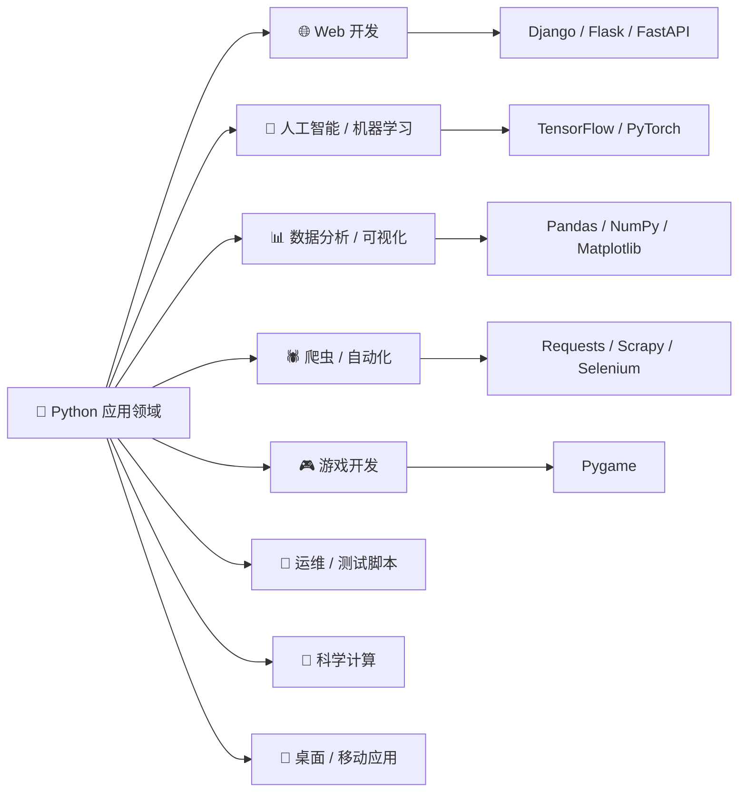
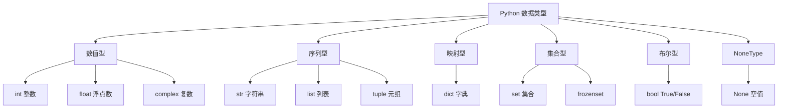
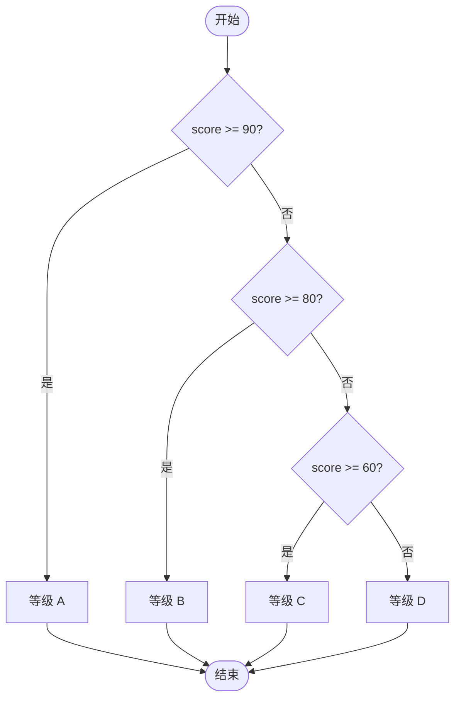
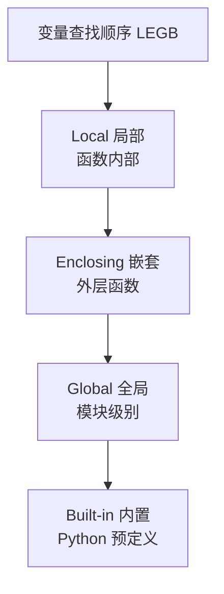
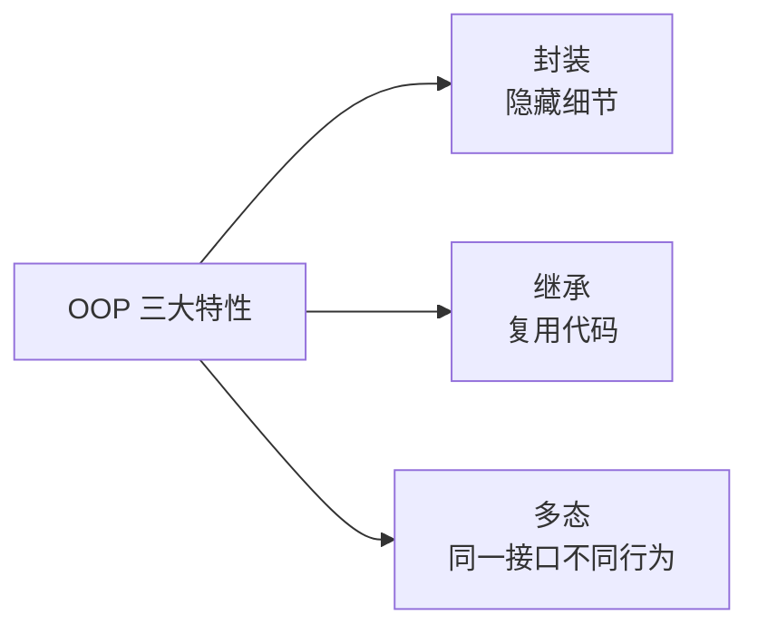
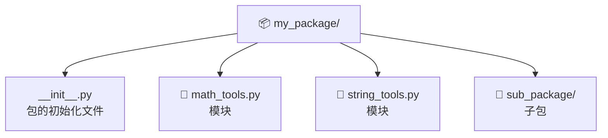
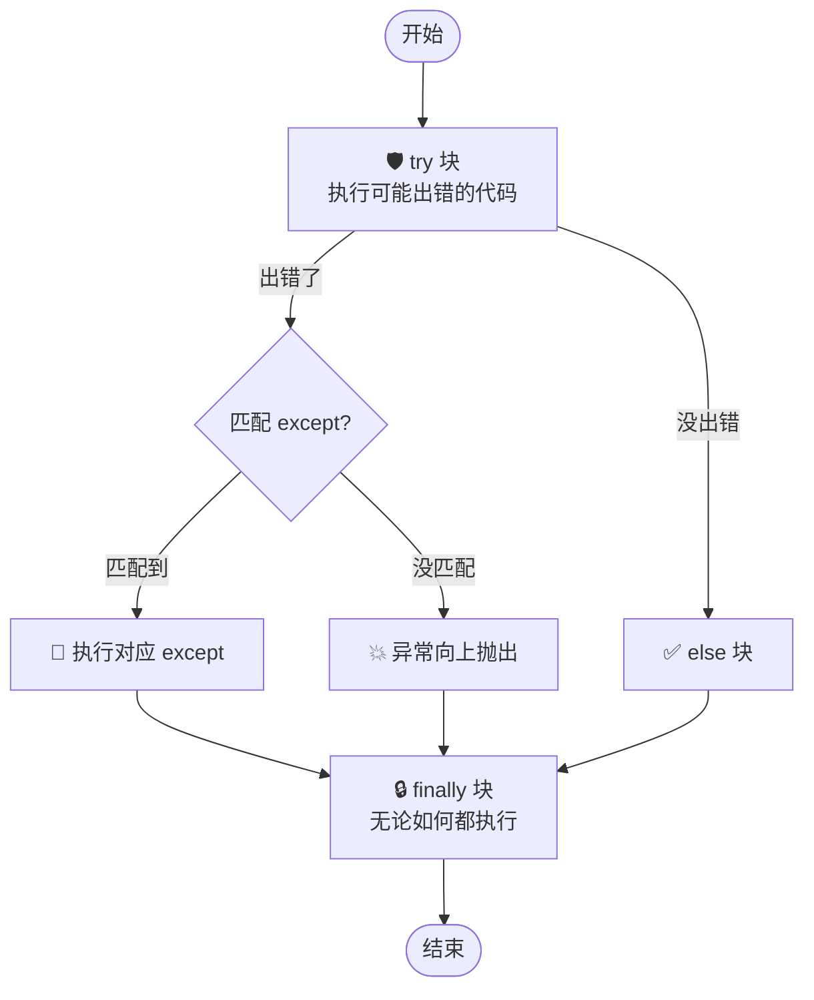
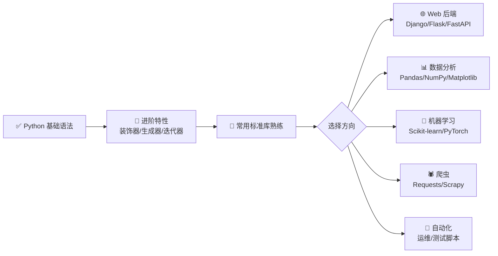

# 🐍 Python 学习笔记

> 嗨嗨～欢迎来到 Python 的魔法世界！✨ 这份笔记会带你从零开始，一步步掌握 Python 这门超棒的语言～准备好了吗？让我们一起出发吧！٩(ˊᗜˋ*)و

---

## 📑 目录

- [一、Python 是什么呀？](#一python-是什么呀)
- [二、环境搭建：给电脑装上 Python](#二环境搭建给电脑装上-python)
- [三、基础语法：和 Python 打个招呼](#三基础语法和-python-打个招呼)
- [四、数据类型：Python 的"积木块"](#四数据类型python-的积木块)
- [五、运算符：让数据动起来](#五运算符让数据动起来)
- [六、流程控制：让程序学会"做决定"](#六流程控制让程序学会做决定)
- [七、数据结构：装数据的"容器"](#七数据结构装数据的容器)
- [八、函数：把代码打包复用](#八函数把代码打包复用)
- [九、面向对象：像造物主一样编程](#九面向对象像造物主一样编程)
- [十、模块与包：站在巨人的肩膀上](#十模块与包站在巨人的肩膀上)
- [十一、文件操作：和硬盘聊聊天](#十一文件操作和硬盘聊聊天)
- [十二、异常处理：给程序穿上"防弹衣"](#十二异常处理给程序穿上防弹衣)
- [十三、常用内置函数与标准库](#十三常用内置函数与标准库)

---

## 一、Python 是什么呀？

### 1.1 自我介绍 🐍

**Python** 是一种**解释型、面向对象、带有动态语义**的高级程序设计语言。说人话就是：

- 📖 **解释型**：代码写完直接运行，不用先编译成机器码，省事儿！
- 🎁 **面向对象**：一切皆对象，可以把数据和功能打包在一起。
- 🔄 **动态语义**：变量类型不用提前声明，运行时自动判断。

它由荷兰大佬 **Guido van Rossum（吉多·范罗苏姆）** 在 **1989 年圣诞节**期间打发时间发明，1991 年正式发布。嗯……果然大佬的假期都用来改变世界了 (￣▽￣)"

### 1.2 Python 的超能力特点 ✨

| 特点 | 说明 | 大白话 |
| :--- | :--- | :--- |
| **简洁优雅** | 语法接近自然语言，缩进表示代码块 | 代码读起来像英语句子 |
| **易学易用** | 关键字少、结构清晰 | 新手友好，入门超快 |
| **开源免费** | 完全开源，社区活跃 | 白嫖！还能改源码 |
| **跨平台** | Windows / macOS / Linux 通吃 | 写一次，到处跑 |
| **丰富的库** | 标准库 + 海量第三方库（PyPI） | "自带电池"，轮子多到用不完 |
| **可扩展** | 可用 C/C++ 编写高性能模块 | 速度不够？用 C 来凑！ |

### 1.3 Python 能干啥？🚀

Python 是个"全能选手"，几乎什么领域都能插一脚：



### 1.4 Python 的版本小知识 📌

- 目前主流是 **Python 3.x**（Python 2 已于 2020 年停止维护，别再用啦！）
- 本笔记基于 **Python 3.10+**，推荐使用最新稳定版～

> 💡 **小贴士**：查看版本可以在命令行输入 `python --version` 或 `python -V`

---

## 二、环境搭建：给电脑装上 Python

### 2.1 安装 Python 📥

#### Windows 系统

1. 去 [python.org](https://www.python.org/downloads/) 下载安装包
2. **运行安装程序时，务必勾选 `Add Python to PATH`**（超重要！🌟）
3. 一路 "Next" 安装完成～

#### macOS 系统

```bash
# 推荐 Homebrew 安装
brew install python
```

#### 验证安装

打开命令行（Windows 用 PowerShell / cmd，Mac 用终端），输入：

```bash
python --version
# 输出类似：Python 3.12.0  就成功啦！🎉
```

### 2.2 选择一个趁手的 IDE 🛠️

| 工具 | 特点 | 适合人群 |
| :--- | :--- | :--- |
| **PyCharm** | 功能强大的专业 IDE，智能提示超全 | 专业开发者 |
| **VS Code** | 轻量、插件丰富、免费 | 大多数人（强烈推荐 ⭐） |
| **Jupyter Notebook** | 逐格运行，适合数据分析 | 数据科学 / 学习者 |
| **IDLE** | Python 自带，简单轻量 | 纯新手体验 |

> 🎀 **推荐**：学习阶段用 **VS Code + Python 插件**，数据分析用 **Jupyter**，都很香！

### 2.3 第一个程序：Hello World 👋

新建一个 `hello.py` 文件，写下：

```python
print("Hello, World!")
print("我开始学 Python 啦！")
```

运行方式：

```bash
python hello.py
```

看到输出那一刻，恭喜你正式踏入编程的大门啦～ 🎊

### 2.4 程序的运行流程


---

## 三、基础语法：和 Python 打个招呼

### 3.1 注释：给代码写"小纸条" 📝

注释是写给人看的，解释器会忽略它。

```python
# 这是单行注释，用井号开头

"""
这是多行注释（其实是多行字符串）
可以写好多好多说明
一般用三个引号包裹
"""

# 推荐写注释，未来的你会感谢现在的你～
age = 18  # 行尾注释也可以哦
```

### 3.2 缩进：Python 的灵魂 🎯

Python **用缩进（一般是 4 个空格）表示代码块的归属**，不像别的语言用 `{}`。这是 Python 最有特色的地方！

```python
if True:
    print("我在 if 里面")      # 缩进的代码属于 if
    print("我也在 if 里面")    # 同样属于 if
print("我在 if 外面")          # 不缩进，是独立的语句
```

> ⚠️ **注意**：同一个代码块的缩进必须**完全一致**，混用空格和 Tab 会报错哦！

### 3.3 变量：装数据的"盒子" 📦

变量就是给数据起个名字，方便后续使用。

```python
# 变量 = 值，用等号赋值，不用声明类型
name = "小明"
age = 18
height = 1.75
is_student = True

# 可以随时改变变量的值（甚至类型）
age = "十八岁"   # 现在变成字符串了，Python 不会拦你（动态类型）

# 多重赋值，超方便
a, b, c = 1, 2, 3
x = y = z = 0
```

#### 变量命名规则

| 规则 | 正确示例 | 错误示例 |
| :--- | :--- | :--- |
| 只能含字母、数字、下划线 | `user_name` | `user-name` |
| 不能以数字开头 | `age2` | `2age` |
| 区分大小写 | `Name ≠ name` | — |
| 不能用关键字 | `my_class` | `class` |
| 建议用下划线命名法（snake_case） | `student_age` | `studentAge`（不推荐） |

### 3.4 输入与输出 💬

```python
# 输出 print()
print("你好")
print("名字是:", name)        # 多个参数用逗号分隔，默认空格隔开
print("a", "b", "c", sep="-") # 用 sep 指定分隔符：a-b-c
print("不换行", end="")       # 用 end 指定结尾，默认是换行 \n

# 输入 input() —— 注意：返回的永远是字符串！
name = input("请输入你的名字：")
print("你好呀，" + name)
```

#### 格式化字符串（f-string，推荐！）🌟

```python
name = "小明"
age = 18
score = 95.5

# f-string：在字符串前加 f，用 {} 嵌入变量（Python 3.6+）
print(f"我叫{name}，今年{age}岁，考了{score}分")

# 控制小数位数
pi = 3.14159265
print(f"圆周率保留两位：{pi:.2f}")  # 输出：3.14

# 还有两种老方法（了解即可）
print("我叫%s，今年%d岁" % (name, age))              # % 格式化
print("我叫{}，今年{}岁".format(name, age))           # str.format()
```

---

## 四、数据类型：Python 的"积木块" 🧱

### 4.1 基本数据类型总览



### 4.2 数值类型 🔢

```python
# int 整数：没有大小限制（不像其他语言会溢出）
a = 10
b = -99
big = 9999999999999999999999999  # 完全没问题

# float 浮点数：带小数点的数
pi = 3.14159
sci = 1.5e3    # 科学计数法 = 1500.0

# complex 复数（数学里那种，用得少）
z = 3 + 4j
print(z.real)  # 实部 3.0
print(z.imag)  # 虚部 4.0

# 类型转换
print(int(3.9))     # 3，直接截断小数部分
print(float(5))     # 5.0
print(int("42"))    # 42
```

### 4.3 字符串：文本处理小能手 📝

```python
s1 = '单引号字符串'
s2 = "双引号字符串"
s3 = """可以
跨多行
的字符串"""
s4 = '''三单引号也可以'''
```

#### 常用转义字符

| 转义字符 | 含义 | 转义字符 | 含义 |
| :---: | :--- | :---: | :--- |
| `\n` | 换行 | `\t` | 制表符（Tab） |
| `\\` | 反斜杠 | `\'` | 单引号 |
| `\"` | 双引号 | `\r` | 回车 |

#### 字符串常用操作

```python
s = "Hello, Python!"

# 1. 索引和切片（下标从 0 开始，负数从末尾算）
print(s[0])       # 'H'，第一个字符
print(s[-1])      # '!'，最后一个字符
print(s[0:5])     # 'Hello'，切片 [起:止]，含头不含尾
print(s[:5])      # 'Hello'，省略开头
print(s[7:])      # 'Python!'，省略结尾
print(s[::2])     # 'Hlo yhn'，步长为 2

# 2. 拼接和重复
print("a" + "b")      # 'ab'
print("ha" * 3)       # 'hahaha'

# 3. 常用方法
print("python".upper())      # 'PYTHON'，转大写
print("PYTHON".lower())      # 'python'，转小写
print("  hi  ".strip())      # 'hi'，去掉两端空白
print("a,b,c".split(","))    # ['a', 'b', 'c']，分割
print("-".join(["a","b"]))   # 'a-b'，连接
print("hello".replace("l","L"))  # 'heLLo'
print("Python".find("th"))   # 2，查找位置，找不到返回 -1
print("abc123".isalnum())    # True，判断是否字母数字

# 4. 长度
print(len(s))    # 14

# 5. 成员判断
print("Python" in s)   # True
```

> 💡 **小知识**：字符串是**不可变**的！任何"修改"操作都会返回一个**新字符串**，原字符串不变哦。

### 4.4 布尔值与 None 🚦

```python
# bool：只有 True 和 False（注意首字母大写！）
is_ok = True
is_empty = False

# None：表示"什么都没有"/"空"，类似其他语言的 null
result = None

# 真值判断：以下都被视为 False，其余都是 True
# False, None, 0, 0.0, "", [], {}, set()
print(bool(0))      # False
print(bool(""))     # False
print(bool([]))     # False
print(bool("hi"))   # True（非空字符串）
```

### 4.5 类型查看与转换 🔍

```python
x = 42
print(type(x))       # <class 'int'>，查看类型
print(isinstance(x, int))  # True，判断是否某类型

# 类型转换
print(str(42))      # '42'，转字符串
print(int("100"))   # 100，转整数
print(float("3.14"))# 3.14，转浮点
print(list("abc"))  # ['a','b','c']，转列表
```

---

## 五、运算符：让数据动起来 ⚡

### 5.1 算术运算符 ➕

```python
print(7 + 2)    # 9   加
print(7 - 2)    # 5   减
print(7 * 2)    # 14  乘
print(7 / 2)    # 3.5 除（结果一定是浮点数）
print(7 // 2)   # 3   整除（向下取整）
print(7 % 2)    # 1   取余（取模）
print(7 ** 2)   # 49  幂运算（7 的 2 次方）
```

> ⚠️ **特别注意**：Python 中 `/` 永远返回浮点数！`10 / 2` 的结果是 `5.0` 不是 `5`。

### 5.2 比较运算符 🔍

比较运算的结果一定是**布尔值** `True` / `False`。

| 运算符 | 含义 | 示例 | 结果 |
| :---: | :--- | :--- | :---: |
| `==` | 等于 | `5 == 5` | `True` |
| `!=` | 不等于 | `5 != 3` | `True` |
| `>` | 大于 | `5 > 3` | `True` |
| `<` | 小于 | `5 < 3` | `False` |
| `>=` | 大于等于 | `5 >= 5` | `True` |
| `<=` | 小于等于 | `5 <= 3` | `False` |

```python
# Python 支持链式比较，超优雅！
age = 18
print(0 < age < 100)   # True，等价于 0 < age and age < 100
```

### 5.3 逻辑运算符 🧠

```python
# and 与（两边都 True 才 True）
print(True and False)   # False

# or 或（一边 True 就 True）
print(True or False)    # True

# not 非（取反）
print(not True)         # False

# 短路特性：and 遇到 False 就停，or 遇到 True 就停
age = 0
print(age and age > 0)  # 0（age 是 0 即 False，直接返回 0，后面不算了）
```

### 5.4 赋值运算符与海象运算符 📝

```python
a = 10
a += 5    # 等价于 a = a + 5 → 15
a -= 3    # a = a - 3 → 12
a *= 2    # a = a * 2 → 24
a //= 5   # a = a // 5 → 4
a **= 2   # a = a ** 2 → 16

# 海象运算符 := （Python 3.8+），赋值的同时返回值
# 传统写法
n = len("hello")
if n > 3:
    print(f"长度{n}，超过3")

# 用海象运算符，一行搞定
if (n := len("hello")) > 3:
    print(f"长度{n}，超过3")
```

### 5.5 成员与身份运算符 🎭

```python
# in / not in：判断是否在序列中
print(3 in [1, 2, 3])        # True
print("a" in "apple")        # True
print("x" not in "apple")    # True

# is / is not：判断是否是同一个对象（内存地址相同）
a = [1, 2]
b = [1, 2]
c = a
print(a == b)   # True，值相等
print(a is b)   # False，不是同一个对象
print(a is c)   # True，c 就是 a
```

> 💡 **区别 `==` 和 `is`**：`==` 比"值"，`is` 比"身份证号"（内存地址）。判断 None 用 `is None`！

### 5.6 运算符优先级（从高到低）📊

| 优先级 | 运算符 | 说明 |
| :---: | :--- | :--- |
| 1 | `**` | 幂运算 |
| 2 | `~` `+` `-` | 按位取反、正负号 |
| 3 | `*` `/` `//` `%` | 乘除、整除、取余 |
| 4 | `+` `-` | 加减 |
| 5 | `<<` `>>` | 位移 |
| 6 | `&` `^` `\|` | 位运算 |
| 7 | `<` `<=` `>` `>=` `!=` `==` | 比较 |
| 8 | `not` | 逻辑非 |
| 9 | `and` | 逻辑与 |
| 10 | `or` | 逻辑或 |

> 🎀 记不住没关系，**多用括号 `()`** 让意图更清晰，比死记硬背靠谱多了！

---

## 六、流程控制：让程序学会"做决定" 🛤️

### 6.1 条件语句 if-elif-else ❓

```python
score = 85

if score >= 90:
    grade = "A"
elif score >= 80:      # elif = else if 的缩写
    grade = "B"
elif score >= 60:
    grade = "C"
else:
    grade = "D"

print(f"等级是：{grade}")   # B
```

#### 条件表达式（三元运算符）

```python
# 一行搞定 if-else
age = 20
status = "成年" if age >= 18 else "未成年"
print(status)   # 成年
```

### 6.2 条件判断流程图



### 6.3 while 循环 🔄

```python
# 基本形式：只要条件为 True，就一直执行
count = 0
while count < 5:
    print(f"第 {count} 次循环")
    count += 1    # 千万别忘了更新条件，否则死循环！

# break：直接跳出整个循环
# continue：跳过本次，进入下一次循环
n = 0
while True:
    n += 1
    if n == 3:
        continue   # 跳过 3
    if n > 5:
        break      # 到 6 跳出
    print(n)       # 输出 1 2 4 5
```

### 6.4 for 循环 🔁

`for` 循环用来遍历"可迭代对象"（如列表、字符串、范围等）。

```python
# 遍历字符串
for ch in "abc":
    print(ch)    # a b c

# 遍历列表
fruits = ["苹果", "香蕉", "橘子"]
for fruit in fruits:
    print(fruit)

# range() 生成数字序列，超常用！
# range(5)       → 0,1,2,3,4
# range(2, 6)    → 2,3,4,5
# range(0, 10, 2)→ 0,2,4,6,8
for i in range(5):
    print(i)    # 0 1 2 3 4

# enumerate()：同时拿到下标和值（超实用！）
for index, value in enumerate(fruits):
    print(f"第{index}个是{value}")
```

### 6.5 循环的 else 子句（Python 特色）✨

```python
# for/while 后面可以接 else，循环"正常结束"（没被 break）时才执行
for i in range(5):
    if i == 3:
        break
else:
    print("循环正常结束")  # 不会执行，因为被 break 了

# 常用于"查找"场景：找到了 break，没找到走 else
```

### 6.6 嵌套循环：九九乘法表 🧮

```python
for i in range(1, 10):
    for j in range(1, i + 1):
        print(f"{j}×{i}={i*j}", end="\t")
    print()   # 每行结束换行
```

输出：
```
1×1=1	
1×2=2	2×2=4	
1×3=3	2×3=6	3×3=9	
...（以此类推）
```

---

## 七、数据结构：装数据的"容器" 📦

Python 有四大内置数据结构，是日常编程的"主力军"！

### 7.1 四大容器对比表 📊

| 特性 | 列表 `list` | 元组 `tuple` | 字典 `dict` | 集合 `set` |
| :--- | :--- | :--- | :--- | :--- |
| **符号** | `[]` | `()` | `{}` | `{}` 或 `set()` |
| **可变？** | ✅ 可变 | ❌ 不可变 | ✅ 可变 | ✅ 可变 |
| **有序？** | ✅ 有序 | ✅ 有序 | ✅ 有序(3.7+) | ❌ 无序 |
| **重复元素** | ✅ 允许 | ✅ 允许 | ❌ 键唯一 | ❌ 元素唯一 |
| **索引访问** | ✅ 支持 | ✅ 支持 | ❌ 用键访问 | ❌ 不支持 |
| **适用场景** | 通用列表 | 不变数据 | 键值映射 | 去重/集合运算 |

### 7.2 列表 list 📋

列表是**有序、可变**的序列，最常用的容器。

```python
# 创建
nums = [1, 2, 3, 4, 5]
mixed = [1, "hello", True, [2, 3]]   # 可以放各种类型
empty = []
```

#### 列表常用操作

```python
fruits = ["苹果", "香蕉", "橘子"]

# —— 增 ——
fruits.append("葡萄")         # 末尾添加
fruits.insert(1, "西瓜")      # 在下标 1 处插入
fruits.extend(["梨", "桃"])   # 合并另一个列表

# —— 删 ——
fruits.remove("西瓜")    # 按值删除
del fruits[0]            # 按下标删除
popped = fruits.pop()    # 弹出末尾元素并返回
fruits.clear()           # 清空

# —— 改 ——
fruits = ["苹果", "香蕉", "橘子"]
fruits[0] = "榴莲"       # 按下标修改

# —— 查 ——
print(fruits[1])              # 按下标取值
print(fruits.index("橘子"))   # 查找值的下标
print(fruits.count("苹果"))   # 统计出现次数
print(len(fruits))            # 长度
```

#### 列表排序与反转

```python
nums = [3, 1, 4, 1, 5, 9, 2, 6]

# sort()：原地排序（修改原列表）
nums.sort()              # 升序 [1, 1, 2, 3, 4, 5, 6, 9]
nums.sort(reverse=True)  # 降序

# sorted()：返回新列表，原列表不变
new = sorted([3, 1, 2])   # [1, 2, 3]

# 自定义排序：用 key 指定规则
words = ["banana", "apple", "cherry"]
words.sort(key=len)       # 按长度排序

nums.reverse()    # 原地反转
```

### 7.3 列表生成式：一行创建列表的魔法 🪄

```python
# 传统写法
squares = []
for i in range(10):
    squares.append(i ** 2)

# 列表生成式，一行搞定！
squares = [i ** 2 for i in range(10)]
# [0, 1, 4, 9, 16, 25, 36, 49, 64, 81]

# 带条件的列表生成式
evens = [i for i in range(20) if i % 2 == 0]   # 0~18 的偶数

# 带条件的表达式
labels = ["偶" if i % 2 == 0 else "奇" for i in range(5)]
# ['偶', '奇', '偶', '奇', '偶']
```

### 7.4 元组 tuple 📌

元组是**有序、不可变**的序列，一旦创建就不能修改。

```python
# 创建
t1 = (1, 2, 3)
t2 = ()            # 空元组
t3 = (1,)          # ⚠️ 单元素元组必须加逗号！不然就是普通括号
t4 = 1, 2, 3       # 不加括号也是元组（自动打包）

# 访问和列表一样
print(t1[0])       # 1
print(t1[1:])      # (2, 3)

# 元组不可变，没有增删改方法
# t1[0] = 9   # ❌ 报错！

# 但如果元素是可变对象，内部可以改
t = (1, [2, 3])
t[1].append(4)     # OK，列表本身可变
```

> 💡 **何时用元组？** 当数据不应被修改时（如坐标、配置、函数多返回值），用元组更安全，且性能略高。

#### 元组的"打包"与"解包" 🎁

```python
# 打包
point = 3, 4          # 自动成元组

# 解包（超常用！）
x, y = point          # x=3, y=4
a, b, c = 1, 2, 3     # 多重赋值本质就是元组解包

# 用 * 收集多余的值
first, *rest = [1, 2, 3, 4]   # first=1, rest=[2,3,4]
*init, last = [1, 2, 3, 4]    # init=[1,2,3], last=4
```

### 7.5 字典 dict 📖

字典是**键值对（key-value）**的集合，通过"键"快速查找"值"。像查字典一样～

```python
# 创建
student = {
    "name": "小明",
    "age": 18,
    "score": 95.5
}
empty = {}
```

#### 字典常用操作

```python
# —— 查 ——
print(student["name"])            # 小明，键不存在会报错 KeyError
print(student.get("name"))        # 小明，推荐用 get
print(student.get("phone", "无"))  # 键不存在返回默认值"无"

# —— 增 / 改 ——
student["gender"] = "男"     # 键不存在 → 新增
student["age"] = 19          # 键已存在 → 修改

# —— 删 ——
del student["gender"]        # 删除键值对
student.pop("score")         # 删除并返回值
student.clear()              # 清空

# —— 遍历 ——
for key in student:                          # 默认遍历键
    print(key)
for key, value in student.items():          # 同时拿键和值
    print(f"{key}: {value}")
for key in student.keys():                  # 只遍历键
    ...
for value in student.values():              # 只遍历值
    ...

# 其他方法
print(len(student))             # 键值对数量
print("name" in student)        # 判断键是否存在
new_dict = dict(a=1, b=2)       # 用 dict() 创建
student.update({"class": "3班"})# 合并另一个字典
```

#### 字典生成式

```python
# 把两个列表"拉链"成字典
keys = ["a", "b", "c"]
values = [1, 2, 3]
d = {k: v for k, v in zip(keys, values)}
# {'a': 1, 'b': 2, 'c': 3}
```

> ⚠️ **注意**：字典的**键必须是不可变类型**（如字符串、数字、元组），不能用列表当键！

### 7.6 集合 set 🔮

集合是**无序、元素唯一**的容器，擅长**去重**和**集合运算**。

```python
# 创建
s1 = {1, 2, 3}
s2 = set([1, 2, 2, 3, 3])   # {1, 2, 3}，自动去重！
empty = set()               # ⚠️ {} 是空字典，空集合必须用 set()
```

#### 集合运算 🎯

```python
A = {1, 2, 3, 4}
B = {3, 4, 5, 6}

print(A | B)     # 并集 {1, 2, 3, 4, 5, 6}   或 A.union(B)
print(A & B)     # 交集 {3, 4}               或 A.intersection(B)
print(A - B)     # 差集 {1, 2}（A 有 B 没有） 或 A.difference(B)
print(A ^ B)     # 对称差集 {1, 2, 5, 6}（不同时存在的）

# 增删
A.add(7)         # 添加
A.remove(4)      # 删除，不存在会报错
A.discard(99)    # 删除，不存在也不报错（更安全）
A.pop()          # 随机删除一个
```

#### 集合的经典应用：去重 🧹

```python
nums = [1, 2, 2, 3, 3, 3, 4]
unique = list(set(nums))         # [1, 2, 3, 4]
unique_sorted = sorted(set(nums))  # 去重并排序，保留顺序更佳
```

### 7.7 深拷贝 vs 浅拷贝 🪞

```python
import copy

a = [1, 2, [3, 4]]

b = a              # 不是拷贝！b 和 a 是同一个对象
c = a.copy()       # 浅拷贝：外层新建，内层共享
d = copy.deepcopy(a)  # 深拷贝：完全独立的新对象

a[2].append(5)
print(c)    # [1, 2, [3, 4, 5]]，内层跟着变了（共享）
print(d)    # [1, 2, [3, 4]]，完全没受影响
```

> 🎀 **记住**：嵌套结构要完全独立，记得用 `copy.deepcopy()`！

---

## 八、函数：把代码打包复用 🎁

函数就是把一段**重复使用的代码**打包起来，起个名字，需要时直接调用。**避免重复造轮子**！

### 8.1 定义和调用函数

```python
# 用 def 关键字定义函数
def greet(name):
    """这是文档字符串，说明函数干嘛用的"""
    print(f"你好呀，{name}！欢迎～")

# 调用函数
greet("小明")    # 你好呀，小明！欢迎～
greet("小红")    # 你好呀，小红！欢迎～

# 查看文档字符串
print(greet.__doc__)
help(greet)
```

### 8.2 参数：函数的"原材料" 📥

Python 函数的参数非常灵活，堪称最强大的特性之一！

```python
# 1. 位置参数：按顺序传递
def add(a, b):
    return a + b
add(1, 2)          # a=1, b=2

# 2. 关键字参数：按名字传递，顺序随意
add(b=2, a=1)

# 3. 默认参数：有默认值，调用时可省略
def power(x, n=2):     # n 默认是 2
    return x ** n
power(3)          # 9，用默认值
power(3, 3)       # 27，覆盖默认值

# 4. 可变位置参数 *args：收集成元组
def sum_all(*args):
    return sum(args)
sum_all(1, 2, 3, 4)    # args=(1,2,3,4)，返回 10

# 5. 可变关键字参数 **kwargs：收集成字典
def info(**kwargs):
    for k, v in kwargs.items():
        print(f"{k}={v}")
info(name="小明", age=18)   # kwargs={'name':'小明','age':18}
```

#### ⚠️ 默认参数的"坑"

```python
# ❌ 错误示范：用可变对象当默认值
def add_item(item, lst=[]):    # 默认列表会被所有调用共享！
    lst.append(item)
    return lst

print(add_item(1))   # [1]
print(add_item(2))   # [1, 2]  ← 上一调用残留！巨坑！

# ✅ 正确做法：用 None
def add_item(item, lst=None):
    if lst is None:
        lst = []
    lst.append(item)
    return lst
```

#### 参数顺序规则 📐

```python
def func(位置参数, 默认参数="x", *args, **kwargs):
    ...
# 顺序：位置参数 → 默认参数 → *args → **kwargs
```

### 8.3 返回值 return ↩️

```python
# 函数遇到 return 就结束，并返回值
# 没有 return 或只写 return，返回 None

# 可以返回多个值（本质是返回元组）
def divide(a, b):
    return a // b, a % b    # 返回 (商, 余数)

quotient, remainder = divide(17, 5)   # 解包
print(quotient, remainder)   # 3 2
```

### 8.4 作用域：变量在哪里能用？🌍



```python
x = "全局变量"

def outer():
    y = "外层函数变量"
    
    def inner():
        z = "局部变量"
        print(z)        # 能访问局部
        print(y)        # 能访问外层
        print(x)        # 能访问全局
    
    inner()

outer()

# global：在函数内修改全局变量
count = 0
def increment():
    global count       # 声明要用全局的 count
    count += 1

# nonlocal：修改外层（非全局）函数的变量
def make_counter():
    n = 0
    def counter():
        nonlocal n     # 声明要用外层的 n
        n += 1
        return n
    return counter
```

### 8.5 匿名函数 lambda 🌀

`lambda` 是一句话写完的"小函数"，适合简单的临时用途。

```python
# 语法：lambda 参数: 表达式
add = lambda a, b: a + b
print(add(3, 5))    # 8

# 最常见的用途：作为排序/过滤的 key
students = [("小明", 90), ("小红", 85), ("小刚", 95)]
students.sort(key=lambda s: s[1])   # 按成绩排序

nums = [1, 2, 3, 4, 5]
doubled = list(map(lambda x: x * 2, nums))   # [2, 4, 6, 8, 10]
evens = list(filter(lambda x: x % 2 == 0, nums))  # [2, 4]
```

### 8.6 递归：函数调用自己 🪆

```python
# 经典：计算阶乘 n!
def factorial(n):
    if n <= 1:           # 终止条件（必须有！否则无限递归）
        return 1
    return n * factorial(n - 1)   # 调用自己

print(factorial(5))    # 120 = 5*4*3*2*1

# 经典：斐波那契数列
def fib(n):
    if n < 2:
        return n
    return fib(n-1) + fib(n-2)
```

> ⚠️ **注意**：递归必须要有**终止条件**，否则会无限调用直到栈溢出（`RecursionError`）。递归虽优雅，但效率不如循环，慎用深递归。

---

## 九、面向对象：像造物主一样编程 🌍

面向对象编程（OOP）是一种编程思想：把现实世界的事物抽象成**"类"**，再用类创造**"对象"**。

### 9.1 核心概念：类与对象 🏭

- **类（Class）**：是"图纸 / 模板"，定义了事物的属性和行为。
- **对象（Object）**：是按图纸造出来的"实物 / 实例"。

```python
# 定义一个类
class Dog:
    """狗狗类"""
    
    # 类属性：所有实例共享
    species = "犬科动物"
    
    # __init__ 是构造方法，创建对象时自动调用
    def __init__(self, name, age):
        self.name = name    # 实例属性
        self.age = age
    
    # 实例方法：第一个参数永远是 self（指向实例本身）
    def bark(self):
        print(f"{self.name} 汪汪叫！汪汪！")
    
    def __str__(self):    # 魔术方法，控制 print 时的显示
        return f"狗狗[{self.name}, {self.age}岁]"

# 创建对象（实例化）
dog1 = Dog("旺财", 3)
dog2 = Dog("小黑", 5)

# 访问属性和方法
print(dog1.name)      # 旺财
dog1.bark()           # 旺财 汪汪叫！汪汪！
print(dog1)           # 狗狗[旺财, 3岁]（调用 __str__）
print(Dog.species)    # 犬科动物（类属性通过类名访问）
```

### 9.2 面向对象三大特性 🏆



#### ① 封装：把数据"藏"起来 🔒

```python
class BankAccount:
    def __init__(self, owner, balance=0):
        self.owner = owner
        self.__balance = balance    # 两个下划线开头 = 私有属性
    
    def deposit(self, amount):
        if amount > 0:
            self.__balance += amount
            print(f"存入{amount}，余额{self.__balance}")
    
    def withdraw(self, amount):
        if 0 < amount <= self.__balance:
            self.__balance -= amount
            print(f"取出{amount}，余额{self.__balance}")
        else:
            print("余额不足或金额无效！")
    
    def get_balance(self):     # 通过方法暴露，可控
        return self.__balance

acc = BankAccount("小明", 100)
acc.deposit(50)         # 存入50，余额150
acc.withdraw(30)        # 取出30，余额120
# acc.__balance = 999   # ❌ 外部无法直接访问私有属性
print(acc.get_balance())  # 120，通过公开方法访问
```

> 💡 **命名约定**：
> - `name`：公开属性
> - `_name`：受保护（约定俗成，技术上仍可访问）
> - `__name`：私有（名称改写为 `_类名__name`，更难访问）

#### ② 继承：子承父业 👨‍👦

子类自动获得父类的属性和方法，还能扩展或修改。

```python
# 父类（基类）
class Animal:
    def __init__(self, name):
        self.name = name
    
    def eat(self):
        print(f"{self.name} 正在吃东西")

# 子类（派生类），括号里写父类名
class Cat(Animal):
    def __init__(self, name, color):
        super().__init__(name)    # 调用父类的构造方法
        self.color = color
    
    def meow(self):
        print(f"{self.name} 喵喵～")
    
    def info(self):
        print(f"我是{self.color}色的{self.name}")

kitty = Cat("咪咪", "白")
kitty.eat()     # 继承自父类的方法
kitty.meow()    # 自己的方法
kitty.info()
```

**多继承**（Python 特色，但要小心）：

```python
class A:
    def hello(self):
        print("A")

class B:
    def hello(self):
        print("B")

class C(A, B):    # 多继承，左边优先
    pass

C().hello()    # A（按 MRO 顺序）
print(C.__mro__)  # 查看方法解析顺序
```

#### ③ 多态：同一个方法，不同的表现 🎭

```python
class Animal:
    def speak(self):
        pass   # 父类只定义接口

class Dog(Animal):
    def speak(self):     # 重写父类方法
        return "汪汪！"

class Cat(Animal):
    def speak(self):
        return "喵喵～"

# 同一个函数，传入不同对象，表现不同
def animal_speak(animal):
    print(animal.speak())    # 调用时才确定具体调哪个

animal_speak(Dog())    # 汪汪！
animal_speak(Cat())    # 喵喵～
```

> 🎀 Python 的多态很灵活——**"鸭子类型"**：只要对象有需要的方法，不管它是什么类，都能用！"如果一个东西走起来像鸭子、叫起来像鸭子，那它就是鸭子。"

### 9.3 常用魔术方法（双下方法）✨

魔术方法以 `__` 开头和结尾，让自定义类支持各种内置操作。

| 魔术方法 | 触发场景 | 用途 |
| :--- | :--- | :--- |
| `__init__(self, ...)` | 创建对象时 | 初始化 |
| `__str__(self)` | `print(obj)` / `str(obj)` | 友好显示 |
| `__repr__(self)` | 调试 / `repr(obj)` | 开发者显示 |
| `__len__(self)` | `len(obj)` | 支持取长度 |
| `__eq__(self, other)` | `obj == other` | 支持相等比较 |
| `__lt__(self, other)` | `obj < other` | 支持大小比较 |
| `__add__(self, other)` | `obj + other` | 支持加法 |
| `__getitem__(self, key)` | `obj[key]` | 支持索引 |
| `__iter__(self)` | `for x in obj` | 支持迭代 |
| `__call__(self, ...)` | `obj(...)` | 让对象像函数一样调用 |

```python
class Vector:
    def __init__(self, x, y):
        self.x = x
        self.y = y
    
    def __str__(self):
        return f"Vector({self.x}, {self.y})"
    
    def __add__(self, other):    # 让向量能用 + 相加
        return Vector(self.x + other.x, self.y + other.y)
    
    def __eq__(self, other):     # 让向量能用 == 比较
        return self.x == other.x and self.y == other.y

v1 = Vector(1, 2)
v2 = Vector(3, 4)
v3 = v1 + v2         # 调用 __add__
print(v3)            # Vector(4, 6)
print(v1 == Vector(1, 2))   # True
```

---

## 十、模块与包：站在巨人的肩膀上 🧩

### 10.1 什么是模块和包？

- **模块（Module）**：一个 `.py` 文件就是一个模块，里面装着函数、类、变量。
- **包（Package）**：一个**包含 `__init__.py` 的文件夹**，里面装着多个模块。



### 10.2 导入模块的几种方式 📥

```python
# 假设有模块 mymath.py，里面有函数 add() 和变量 PI

# 方式 1：import 模块名
import mymath
mymath.add(1, 2)

# 方式 2：import 模块名 as 别名（推荐，避免命名冲突）
import mymath as mm
mm.add(1, 2)

# 方式 3：from 模块 import 具体内容
from mymath import add, PI
add(1, 2)        # 直接用，不用加模块名

# 方式 4：from 模块 import *（不推荐！容易命名冲突）
from mymath import *
```

> ⚠️ **避免** `from xxx import *`，它会把所有内容倒进来，容易"污染"命名空间，还不知道名字哪来的。

### 10.3 自己写一个模块 ✍️

```python
# 文件：mymath.py
"""我的数学工具模块"""

PI = 3.14159

def circle_area(r):
    """计算圆面积"""
    return PI * r ** 2

# 这段代码只在"直接运行"本文件时执行，被 import 时不执行
if __name__ == "__main__":
    # 测试代码放这里
    print(circle_area(5))
```

```python
# 文件：main.py
import mymath
print(mymath.circle_area(5))    # 使用模块
```

> 💡 `if __name__ == "__main__":` 是 Python 的经典写法：让文件既能当模块被导入，又能当脚本直接运行测试！

### 10.4 常用标准库速览 📚

| 模块 | 用途 | 示例 |
| :--- | :--- | :--- |
| `os` | 操作系统接口（文件、路径） | `os.getcwd()` |
| `sys` | 解释器相关（参数、路径） | `sys.argv` |
| `math` | 数学函数 | `math.sqrt(4)` |
| `random` | 随机数 | `random.randint(1,10)` |
| `datetime` | 日期时间 | `datetime.now()` |
| `json` | JSON 读写 | `json.loads(s)` |
| `re` | 正则表达式 | `re.match()` |
| `collections` | 高级容器 | `Counter`、`defaultdict` |
| `itertools` | 迭代工具 | `itertools.chain()` |
| `pathlib` | 面向对象的路径操作 | `Path('.')` |

### 10.5 用 pip 安装第三方包 📦

```bash
# 安装
pip install requests

# 安装指定版本
pip install requests==2.28.0

# 升级
pip install --upgrade requests

# 卸载
pip uninstall requests

# 查看已安装
pip list

# 从 requirements.txt 批量安装
pip install -r requirements.txt

# 换国内镜像加速（告别龟速）
pip install requests -i https://pypi.tuna.tsinghua.edu.cn/simple
```

---

## 十一、文件操作：和硬盘聊聊天 💾

### 11.1 文件读写基本流程


### 11.2 打开模式 🚪

| 模式 | 含义 | 文件不存在时 |
| :---: | :--- | :--- |
| `'r'` | 只读（默认） | 报错 |
| `'w'` | 只写（覆盖） | 创建 |
| `'a'` | 追加（末尾写） | 创建 |
| `'x'` | 独占创建 | 已存在则报错 |
| `'b'` | 二进制模式（搭配上面用） | — |
| `'+'` | 读写模式（搭配上面用） | — |

> 组合示例：`'rb'`（二进制读）、`'w+'`（读写）、`'a+'`（追加可读）

### 11.3 基本读写操作 ✏️

```python
# —— 写文件 ——
f = open("test.txt", "w", encoding="utf-8")   # 推荐指定编码！
f.write("第一行\n")
f.write("第二行\n")
f.close()    # 别忘了关闭！

# —— 读文件 ——
f = open("test.txt", "r", encoding="utf-8")
content = f.read()       # 一次性读完，返回字符串
# line = f.readline()    # 读一行
# lines = f.readlines()  # 读所有行，返回列表
f.close()
```

### 11.4 with 语句：自动关闭文件（强烈推荐！）🌟

用 `with` 语句，文件用完会**自动关闭**，即使中间出错也会关闭，再也不用担心忘记 `close()` 啦！

```python
# 写
with open("test.txt", "w", encoding="utf-8") as f:
    f.write("用 with 自动关闭，超省心！")

# 读
with open("test.txt", "r", encoding="utf-8") as f:
    content = f.read()
print(content)

# 逐行读取（推荐！内存友好）
with open("test.txt", "r", encoding="utf-8") as f:
    for line in f:        # 直接遍历文件对象
        print(line.strip())   # strip() 去掉行尾换行符
```

> 💡 **编码建议**：处理中文一定要加 `encoding="utf-8"`，否则 Windows 默认 GBK 容易乱码！

### 11.5 JSON 文件读写 📋

JSON 是数据交换的通用格式，Python 内置 `json` 模块处理它。

```python
import json

data = {"name": "小明", "age": 18, "hobbies": ["读书", "打游戏"]}

# 写入 JSON 文件（序列化）
with open("data.json", "w", encoding="utf-8") as f:
    json.dump(data, f, ensure_ascii=False, indent=4)
    # ensure_ascii=False 保留中文，indent 缩进美化

# 读取 JSON 文件（反序列化）
with open("data.json", "r", encoding="utf-8") as f:
    loaded = json.load(f)
print(loaded["name"])    # 小明

# 字符串与 JSON 互转
s = json.dumps(data)          # dict → json 字符串
d = json.loads(s)             # json 字符串 → dict
```

### 11.6 文件和目录管理 📁

```python
import os
from pathlib import Path    # 推荐用 pathlib，更优雅！

# —— os 方式 ——
os.getcwd()              # 当前工作目录
os.listdir(".")          # 列出目录内容
os.mkdir("new_dir")      # 创建目录
os.remove("file.txt")    # 删除文件
os.path.exists("file")   # 判断是否存在
os.path.join("a", "b")   # 拼接路径（跨平台）

# —— pathlib 方式（推荐 ⭐）——
p = Path(".")
list(p.iterdir())            # 列出当前目录内容
p / "subdir" / "file.txt"    # 用 / 拼接路径，超优雅
Path("data.txt").exists()    # 是否存在
Path("data.txt").read_text(encoding="utf-8")   # 一行读文本
Path("data.txt").write_text("内容", encoding="utf-8")  # 一行写文本
Path("new_dir").mkdir(exist_ok=True)    # 创建目录（已存在不报错）
```

---

## 十二、异常处理：给程序穿上"防弹衣" 🛡️

程序运行时会遇到各种错误（异常），不处理就会**崩溃退出**。异常处理让程序更健壮！

### 12.1 什么是异常 💥

```python
print(10 / 0)    # ZeroDivisionError：除以零
print(aaa)       # NameError：变量未定义
"abc"[10]        # IndexError：下标越界
int("abc")       # ValueError：值转换失败
open("xxx.txt")  # FileNotFoundError：文件不存在
```

### 12.2 try-except 捕获异常 🥅

```python
try:
    # 可能出错的代码放这里
    num = int(input("输入一个数字："))
    result = 10 / num
    print(f"结果是 {result}")

except ValueError:           # 捕获特定异常
    print("输入的不是数字啦！")

except ZeroDivisionError:    # 捕获另一个异常
    print("不能除以零哦！")

except Exception as e:       # 捕获其他所有异常（兜底）
    print(f"发生错误：{e}")

else:
    print("一切顺利，没出错～")   # try 没异常时执行

finally:
    print("无论如何我都会执行～")  # 无论是否出错都执行（常用于清理）
```

### 12.3 异常处理流程



### 12.4 主动抛出异常 raise ⬆️

```python
def set_age(age):
    if not isinstance(age, int):
        raise TypeError("年龄必须是整数！")    # 主动抛出
    if age < 0 or age > 150:
        raise ValueError("年龄不合理！")
    return age

# 捕获自己抛出的异常
try:
    set_age(-5)
except ValueError as e:
    print(f"出错了：{e}")
```

### 12.5 自定义异常 🎨

```python
# 继承 Exception 类
class WithdrawError(Exception):
    """取款异常"""
    def __init__(self, message, balance):
        super().__init__(message)
        self.balance = balance

# 使用
def withdraw(balance, amount):
    if amount > balance:
        raise WithdrawError("余额不足！", balance)
    return balance - amount

try:
    withdraw(100, 200)
except WithdrawError as e:
    print(f"错误：{e}，当前余额：{e.balance}")
```

### 12.6 常见异常速查表 📋

| 异常 | 说明 | 异常 | 说明 |
| :--- | :--- | :--- | :--- |
| `SyntaxError` | 语法错误 | `NameError` | 变量未定义 |
| `TypeError` | 类型错误 | `ValueError` | 值错误 |
| `IndexError` | 索引越界 | `KeyError` | 字典键不存在 |
| `AttributeError` | 属性不存在 | `ZeroDivisionError` | 除以零 |
| `FileNotFoundError` | 文件不存在 | `ImportError` | 导入失败 |

---

## 十三、常用内置函数与标准库 🧰

### 13.1 高频内置函数 ⭐

```python
# —— 数学相关 ——
print(abs(-5))         # 5，绝对值
print(max(1, 2, 3))    # 3，最大值
print(min([4, 5, 6]))  # 4，最小值
print(sum([1, 2, 3]))  # 6，求和
print(round(3.7))      # 4，四舍五入
print(pow(2, 10))      # 1024，幂运算

# —— 序列相关 ——
print(len("hello"))       # 5，长度
print(sorted([3, 1, 2]))  # [1, 2, 3]，排序
print(list(reversed([1,2,3])))  # [3, 2, 1]，反转
print(list(range(5)))     # [0, 1, 2, 3, 4]
print(list(enumerate("ab")))  # [(0,'a'), (1,'b')]
print(list(zip([1,2], ['a','b'])))  # [(1,'a'), (2,'b')]，拉链

# —— 类型相关 ——
print(type(42))           # <class 'int'>
print(isinstance(42, int))# True
print(int("42"))          # 类型转换

# —— 高阶函数 ——
nums = [1, 2, 3, 4, 5]
print(list(map(lambda x: x**2, nums)))     # [1,4,9,16,25] 映射
print(list(filter(lambda x: x > 2, nums)) )# [3,4,5] 过滤
from functools import reduce
print(reduce(lambda a,b: a+b, nums))       # 15，归约
```

### 13.2 math 数学模块 📐

```python
import math

print(math.pi)        # 3.141592653589793
print(math.e)         # 2.718281828...
print(math.sqrt(16))  # 4.0，平方根
print(math.ceil(3.2)) # 4，向上取整
print(math.floor(3.8))# 3，向下取整
print(math.log(100, 10)) # 2.0，对数
print(math.gcd(12, 8))   # 4，最大公约数
```

### 13.3 random 随机数模块 🎲

```python
import random

print(random.random())           # 0~1 之间的随机浮点数
print(random.randint(1, 100))    # 1~100 的随机整数（含两端）
print(random.choice(["🍎","🍌","🍊"]))  # 随机选一个
print(random.sample(range(1,50), 6))    # 随机选 6 个不重复（彩票号码）
nums = [1, 2, 3, 4, 5]
random.shuffle(nums)             # 原地打乱顺序
print(nums)

# 设置随机种子，让结果可复现（调试用）
random.seed(42)
```

### 13.4 datetime 时间模块 ⏰

```python
from datetime import datetime, date, timedelta

now = datetime.now()          # 当前日期时间
print(now.year, now.month, now.day)
print(now.strftime("%Y-%m-%d %H:%M:%S"))  # 格式化字符串

today = date.today()          # 今天
# 时间差
delta = timedelta(days=7)
next_week = today + delta     # 7 天后
print(next_week)

# 字符串转 datetime
dt = datetime.strptime("2024-01-15", "%Y-%m-%d")

# 两个时间相减
diff = datetime(2024, 12, 31) - datetime(2024, 1, 1)
print(diff.days)    # 365
```

### 13.5 collections 高级容器 🗃️

```python
from collections import Counter, defaultdict, deque

# Counter：计数器，统计元素出现次数
words = ["apple", "banana", "apple", "cherry", "apple"]
c = Counter(words)
print(c)               # Counter({'apple': 3, 'banana': 1, 'cherry': 1})
print(c.most_common(2))# [('apple', 3), ('banana', 1)]

# defaultdict：带默认值的字典，访问不存在的键不报错
dd = defaultdict(list)     # 默认值是空列表
dd["a"].append(1)          # 不用先判断键是否存在
dd["a"].append(2)
print(dd)                  # {'a': [1, 2]}

# deque：双端队列，头尾操作都很快（list 头部操作慢）
dq = deque([1, 2, 3])
dq.appendleft(0)           # 左边加
dq.append(4)               # 右边加
dq.popleft()               # 左边弹
```

### 13.6 itertools 迭代工具 🔧

```python
import itertools

# 无限计数
for i in itertools.count(10, 2):  # 从 10 开始，步长 2
    if i > 20: break
    print(i, end=" ")    # 10 12 14 16 18 20

# 排列组合
print(list(itertools.permutations([1,2,3])))    # 全排列
print(list(itertools.combinations([1,2,3], 2))) # 组合

# 链接多个可迭代对象
print(list(itertools.chain([1,2], [3,4])))  # [1, 2, 3, 4]
```

### 13.7 with 上下文管理器原理 🔬

```python
# 自己实现一个上下文管理器（两种方式）

# 方式 1：实现 __enter__ 和 __exit__ 方法
class MyFile:
    def __init__(self, filename):
        self.filename = filename
    
    def __enter__(self):
        self.f = open(self.filename, "r", encoding="utf-8")
        return self.f        # with ... as xxx 的 xxx 就是这个返回值
    
    def __exit__(self, exc_type, exc_val, exc_tb):
        self.f.close()       # 无论是否异常，都会执行
        return False

with MyFile("test.txt") as f:
    print(f.read())

# 方式 2：用 contextlib 简化（推荐 ⭐）
from contextlib import contextmanager

@contextmanager
def my_open(filename):
    f = open(filename, "r", encoding="utf-8")
    try:
        yield f          # yield 之前 = __enter__，之后 = __exit__
    finally:
        f.close()

with my_open("test.txt") as f:
    print(f.read())
```

---

## 🎓 学习路线建议

恭喜你读到最后啦！🎉 来一份进阶路线图收尾～



> 🌸 **学习心得**：编程就像学外语，**多写多练**比看再多教程都管用！遇到报错别怕，那是进步的信号～祝你学习愉快，加油鸭！(◍•ᴗ•◍)❤

---

> 📌 **本笔记基于 Python 3.10+，持续更新中～ 如有错误欢迎指正！**
