# 🌐 Python Web 开发

> 哈喽呀～欢迎来到 Python Web 开发的精彩世界！🌟 在这里你将学会用 Python 搭建自己的网站和 API 服务，从"会写脚本"进化到"能做产品"！冲鸭！(๑•̀ㅂ•́)و✧

---

## 🗺️ Web 开发全景图

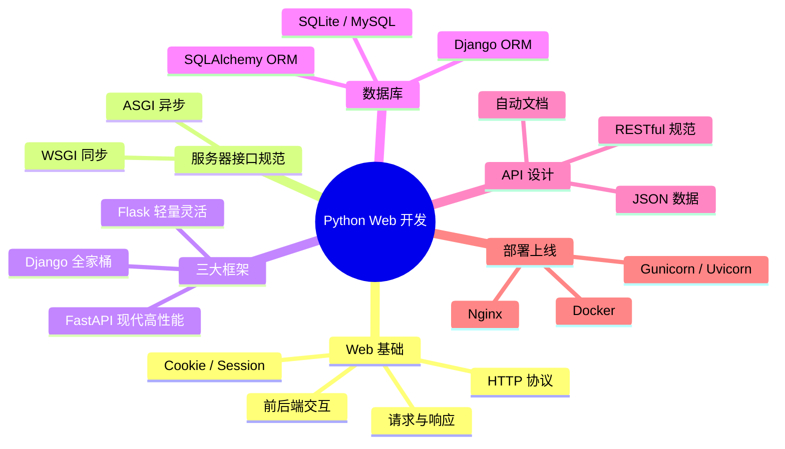

---

## 📑 目录

- [一、Web 开发基础：先搞懂网络是怎么回事](#一web-开发基础先搞懂网络是怎么回事)
- [二、HTTP 协议：浏览器和服务器的"对话规则"](#二http-协议浏览器和服务器的对话规则)
- [三、Cookie 与 Session：记住用户的小本本](#三cookie-与-session记住用户的小本本)
- [四、WSGI 与 ASGI：Python Web 的"插座标准"](#四wsgi-与-asgipython-web-的插座标准)
- [五、Flask：轻量灵活的"小清新"](#五flask轻量灵活的小清新)
- [六、Flask 进阶：模板、表单与蓝图](#六flask-进阶模板表单与蓝图)
- [七、Django：功能齐全的"全家桶"](#七django功能齐全的全家桶)
- [八、FastAPI：现代高性能"新贵"](#八fastapi现代高性能新贵)
- [九、数据库与 ORM：SQLAlchemy](#九数据库与-ormsqlalchemy)
- [十、RESTful API 设计规范](#十restful-api-设计规范)
- [十一、三大框架对比与选型](#十一三大框架对比与选型)
- [十二、部署上线](#十二部署上线)

---

## 一、Web 开发基础：先搞懂网络是怎么回事 🌍

### 1.1 一个比喻秒懂 Web

> 你去餐厅吃饭的过程，就是浏览器访问网站的完整过程！

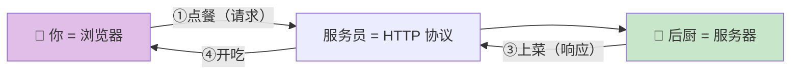

| Web 概念 | 餐厅比喻 | 说明 |
| :--- | :--- | :--- |
| 浏览器 | 顾客 | 发起请求的一方（客户端） |
| 服务器 | 后厨 | 处理请求、返回结果 |
| HTTP | 服务员 | 双方沟通的"规则" |
| URL | 菜名 | 你想要的东西的"地址" |
| HTML/JSON | 菜品 | 服务器返回的"内容" |

### 1.2 前端 vs 后端

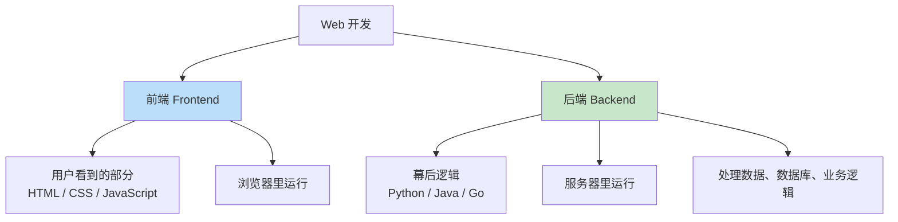

> 💡 **本篇重点**：我们学的是**后端开发**——用 Python 写服务器程序，处理浏览器的请求并返回数据。

### 1.3 一次完整访问的流程

在浏览器输入 `https://www.example.com` 后发生了什么？

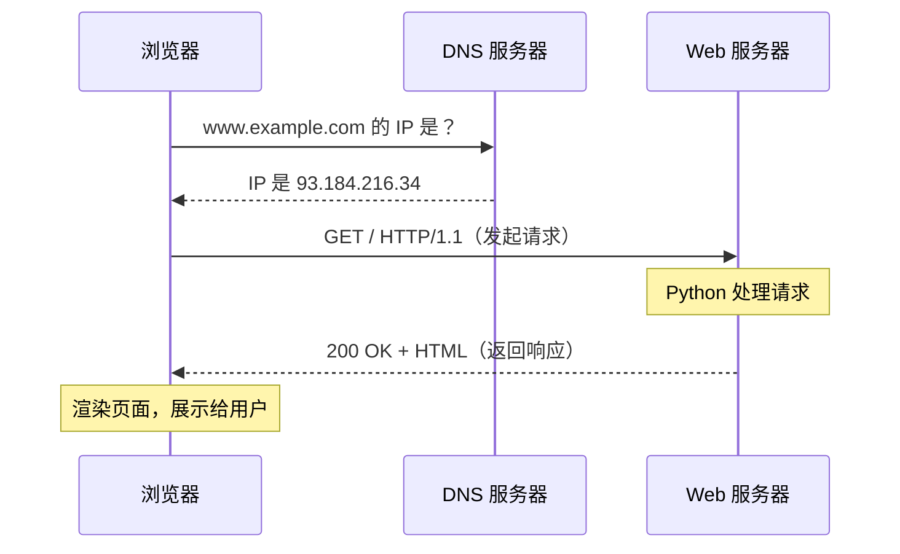

| 步骤 | 做了什么 |
| :--- | :--- |
| ① DNS 解析 | 把域名翻译成 IP 地址（查"通讯录"） |
| ② 建立连接 | 和服务器建立 TCP 连接 |
| ③ 发送请求 | 浏览器发出 HTTP 请求 |
| ④ 服务器处理 | Python 代码处理请求（查数据库等） |
| ⑤ 返回响应 | 服务器返回 HTML/JSON 数据 |
| ⑥ 渲染展示 | 浏览器把 HTML 画成页面 |

---

## 二、HTTP 协议：浏览器和服务器的"对话规则" 📡

> HTTP 是 Web 的基石，所有框架（Flask/Django/FastAPI）都在帮你处理 HTTP，必须搞懂！

### 2.1 请求与响应的结构

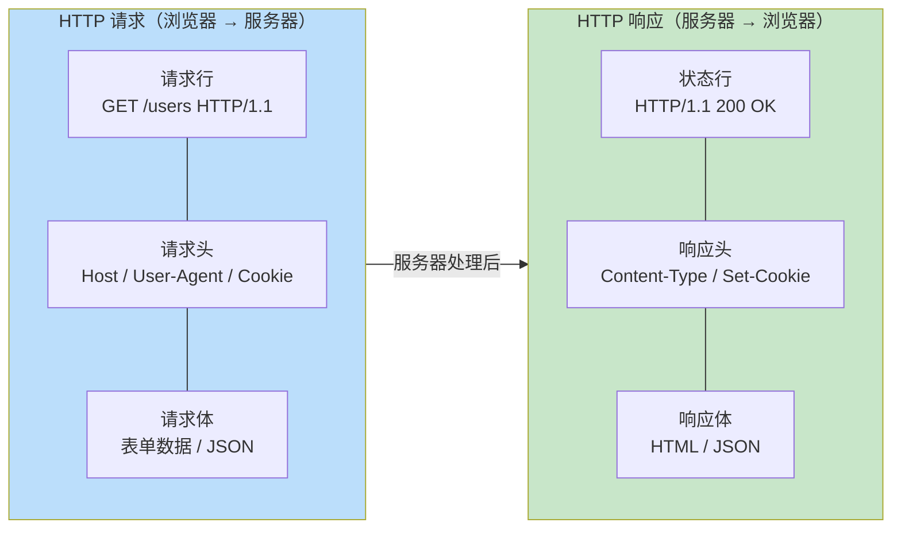

### 2.2 常用请求方法

> 请求方法 = "你想对服务器做什么动作"

| 方法 | 含义 | 比喻 | 使用场景 |
| :---: | :--- | :--- | :--- |
| `GET` | 获取数据 | 👀 看一眼 | 打开网页、搜索 |
| `POST` | 提交数据 | 📝 交作业 | 注册、登录、下单 |
| `PUT` | 更新数据（全量） | ✏️ 重写整篇 | 编辑文章（替换全部） |
| `PATCH` | 更新数据（部分） | 🔧 改几句 | 只改昵称 |
| `DELETE` | 删除数据 | 🗑️ 扔掉 | 删除评论 |

> 💡 **记忆技巧**：GET 只"看"不改数据，POST 会"改"服务器数据。

### 2.3 常见状态码

> 状态码 = 服务器回复的"表情包"

| 状态码 | 类别 | 含义 | 常见场景 |
| :---: | :--- | :--- | :--- |
| `200` | ✅ 成功 | OK | 请求成功处理 |
| `201` | ✅ 成功 | Created | 创建资源成功 |
| `204` | ✅ 成功 | No Content | 删除成功（无内容返回） |
| `301` | 🔀 重定向 | 永久搬家 | 网址永久更换 |
| `302` | 🔀 重定向 | 临时搬家 | 登录后跳转 |
| `400` | ❌ 客户端错 | 参数错误 | 提交的数据格式不对 |
| `401` | ❌ 客户端错 | 未登录 | 没有"身份凭证" |
| `403` | ❌ 客户端错 | 没权限 | 登录了但不能进 VIP 房间 |
| `404` | ❌ 客户端错 | 找不到 | 页面不存在 |
| `500` | 💥 服务器错 | 服务器崩了 | 代码有 Bug |
| `502` | 💥 服务器错 | 网关错误 | 后端服务挂了 |

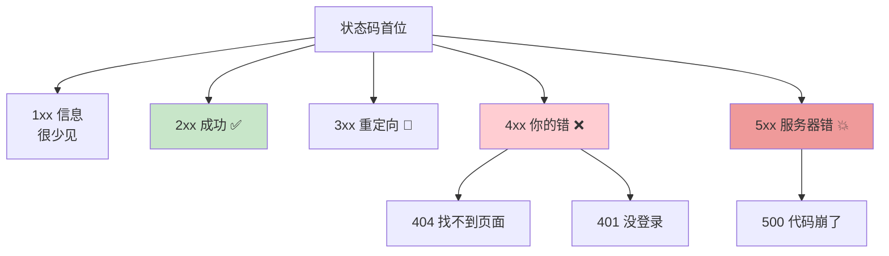

### 2.4 URL 的结构

```text
https:// www.example.com :8080 /users /123 ?page=2&size=10 #comments
└─┬──┘  └──────┬──────┘ └─┬─┘ └─┬─┘ └┬┘ └──────┬──────┘ └───┬───┘
 协议        域名          端口   路径  参数     查询字符串      锚点
```

| 部分 | 说明 | 示例 |
| :--- | :--- | :--- |
| 协议 | 通信规则 | `https`（加密）、`http` |
| 域名 | 服务器的"门牌号" | `www.example.com` |
| 端口 | 服务的"窗口" | `80`（http 默认）、`443`（https 默认）、`8000`（开发常用） |
| 路径 | 资源的位置 | `/users/123` |
| 查询字符串 | 附加参数 | `?page=2&size=10` |

---

## 三、Cookie 与 Session：记住用户的小本本 🍪

> HTTP 是"没有记忆"的——服务器不认识每次来请求的人。Cookie 和 Session 就是用来"记住用户"的！

### 3.1 为什么需要它们？

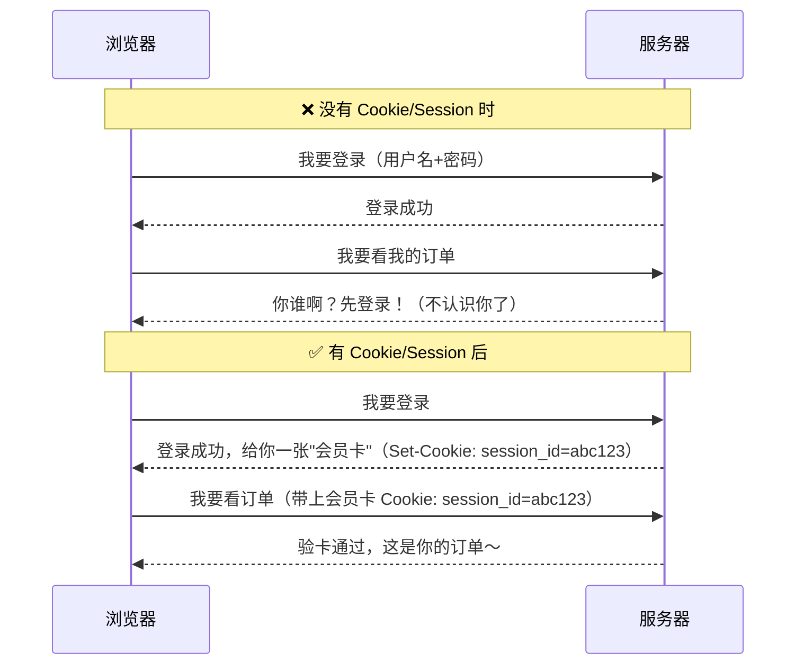

### 3.2 Cookie vs Session 对比

| 对比项 | Cookie 🍪 | Session 🔑 |
| :--- | :--- | :--- |
| **存储位置** | 浏览器（客户端） | 服务器 |
| **安全性** | 较低（用户可见可改） | 较高（数据在服务器） |
| **存什么** | 少量简单数据 | 敏感/复杂数据 |
| **生命周期** | 可设置过期时间 | 可设置超时失效 |
| **典型用途** | 记住用户名、主题偏好 | 登录状态、购物车 |

### 3.3 工作原理

> **Session 通常要配合 Cookie 使用**：Cookie 里只存一个"号码牌"（session_id），真正的数据存在服务器。

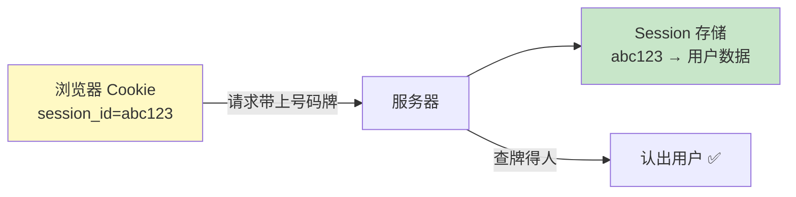

### 3.4 Token（现代替代方案）

> 前后端分离时代，常用 **Token**（如 JWT）替代 Session——数据加密后存在客户端，服务器不用存。

| 方案 | 数据存哪 | 适合场景 |
| :--- | :--- | :--- |
| Cookie/Session | 服务器 | 传统网站 |
| JWT Token | 客户端（加密） | 前后端分离、小程序、App |

---

## 四、WSGI 与 ASGI：Python Web 的"插座标准" 🔌

> 框架（Flask/Django）和服务器（Nginx 等）之间需要一个"标准插座"，这就是 WSGI / ASGI。

### 4.1 为什么需要它们？

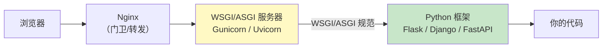

> 💡 有了统一标准，任何框架都能插进任何服务器——就像 USB 接口，手机、鼠标、硬盘都能用！

### 4.2 WSGI vs ASGI

| 对比项 | WSGI | ASGI |
| :--- | :--- | :--- |
| **全称** | Web Server Gateway Interface | Asynchronous Server Gateway Interface |
| **支持异步** | ❌ 同步阻塞 | ✅ 原生异步 |
| **对应框架** | Flask、Django（传统模式） | FastAPI、Django（异步模式） |
| **对应服务器** | Gunicorn、uWSGI | Uvicorn、Hypercorn |
| **性能特点** | 稳定成熟 | 高并发强 |

> 🎀 **一句话理解**：WSGI 是"老式插座"（同步），ASGI 是"新式插座"（异步，支持 WebSocket）。

---

## 五、Flask：轻量灵活的"小清新" 🌸

> Flask 是最流行的轻量级框架，核心简单，想加什么功能自己装"插件"，非常适合入门和小型项目！

### 5.1 安装与第一个程序

```bash
pip install flask
```

```python
from flask import Flask

# 创建 Flask 应用
app = Flask(__name__)

# 路由：把 URL 和函数绑定在一起
@app.route("/")
def index():
    return "你好，欢迎来到我的网站！"

@app.route("/hello/<name>")
def hello(name):
    return f"你好呀，{name}！"

# 启动服务器
if __name__ == "__main__":
    app.run(debug=True)   # debug=True：改代码自动重启，还显示报错
```

运行后访问 `http://127.0.0.1:5000`：

```text
浏览器输入                          →  看到的内容
http://127.0.0.1:5000/             →  你好，欢迎来到我的网站！
http://127.0.0.1:5000/hello/小明   →  你好呀，小明！
```

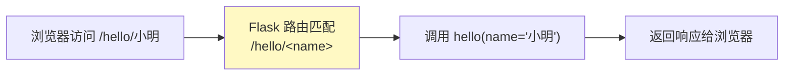

### 5.2 路由与请求方法

```python
from flask import Flask, request

app = Flask(__name__)

# 指定允许的方法
@app.route("/users", methods=["GET"])
def get_users():
    return "用户列表"

@app.route("/users", methods=["POST"])
def create_user():
    return "创建用户", 201     # 第二个参数是状态码

# URL 变量 + 类型转换
@app.route("/users/<int:user_id>")       # int 转换器：只能匹配数字
def get_user(user_id):
    return f"用户 {user_id} 的信息"

# 一个函数处理多种方法
@app.route("/login", methods=["GET", "POST"])
def login():
    if request.method == "GET":
        return "显示登录页面"
    elif request.method == "POST":
        return "处理登录请求"
```

| 转换器 | 匹配规则 | 示例 |
| :---: | :--- | :--- |
| `<name>` | 默认字符串（不含 `/`） | `/hello/小明` |
| `<int:id>` | 整数 | `/users/123` |
| `<float:num>` | 浮点数 | `/price/9.99` |
| `<path:subpath>` | 含 `/` 的路径 | `/files/a/b/c.txt` |

### 5.3 获取请求数据

```python
from flask import Flask, request, jsonify

app = Flask(__name__)

@app.route("/submit", methods=["POST"])
def submit():
    # —— ① 查询字符串：/submit?name=小明&age=18 ——
    name = request.args.get("name")        # '小明'
    age = request.args.get("age", type=int) # 18

    # —— ② 表单数据（HTML form 提交）——
    username = request.form.get("username")

    # —— ③ JSON 数据（前后端分离常用）——
    data = request.get_json()              # 解析 JSON 请求体
    email = data.get("email")

    # —— ④ 请求头 ——
    user_agent = request.headers.get("User-Agent")
    token = request.headers.get("Authorization")

    # —— ⑤ 文件上传 ——
    file = request.files.get("avatar")
    if file:
        file.save(f"uploads/{file.filename}")

    # —— 返回 JSON 响应（前后端分离必备）——
    return jsonify({"code": 0, "msg": "成功", "data": {"name": name}})
```

### 5.4 返回响应的几种方式

```python
from flask import Flask, render_template, jsonify, redirect, url_for

app = Flask(__name__)

# ① 返回字符串
@app.route("/text")
def text():
    return "纯文本内容"

# ② 返回 HTML 模板（会找 templates 文件夹）
@app.route("/page")
def page():
    return render_template("index.html", title="首页", items=["苹果", "香蕉"])

# ③ 返回 JSON（API 常用）
@app.route("/api")
def api():
    return jsonify({"name": "小明", "age": 18})

# ④ 重定向
@app.route("/old")
def old():
    return redirect(url_for("text"))      # 跳转到 /text

# ⑤ 自定义状态码和响应头
@app.route("/custom")
def custom():
    return "created", 201, {"X-Custom": "hello"}
```

### 5.5 Flask 请求处理流程

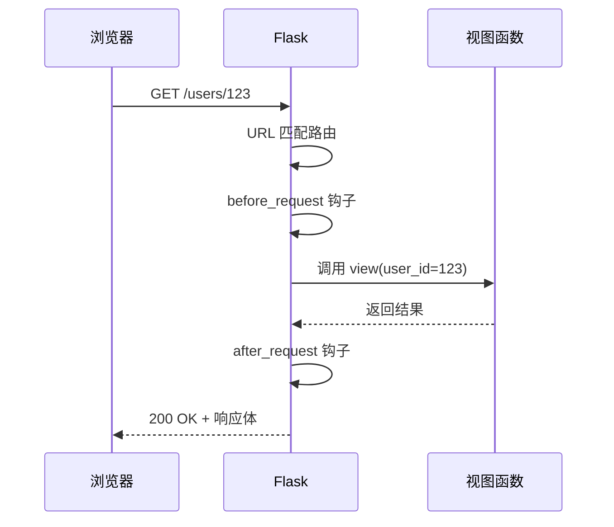

---

## 六、Flask 进阶：模板、表单与蓝图 🎨

### 6.1 Jinja2 模板引擎

> Jinja2 让你把 Python 数据"填"进 HTML 里，实现动态网页！

**项目结构**：

```text
my_project/
├── app.py
├── templates/          ← 模板都放这里
│   ├── index.html
│   └── user.html
└── static/             ← 静态文件（CSS/JS/图片）
    └── style.css
```

**app.py**：

```python
from flask import Flask, render_template

app = Flask(__name__)

@app.route("/")
def index():
    users = [
        {"name": "小明", "age": 18},
        {"name": "小红", "age": 22},
    ]
    return render_template("index.html", title="用户列表", users=users)
```

**templates/index.html**：

```html
<!DOCTYPE html>
<html>
<head>
    <title>{{ title }}</title>          <!-- ② 变量输出 -->
</head>
<body>
    <h1>{{ title }}</h1>

                           <!-- ③ 条件语句 -->
        <ul>
                  <!-- ④ 循环 -->
            <li>{{ user.name }}（{{ user.age }}岁）</li>
        
        </ul>
    
        <p>暂无用户</p>
    

    <p>{{ users | length }} 位用户</p>    <!-- ⑤ 过滤器 -->
</body>
</html>
```

| Jinja2 语法 | 作用 | 示例 |
| :--- | :--- | :--- |
| `{{ 变量 }}` | 输出变量的值 | `{{ title }}` |
| `` | 控制逻辑 | ``、`` |
| `{{ x \| 过滤器 }}` | 处理数据 | `{{ name \| upper }}` |
| `{{ url_for('static', filename='style.css') }}` | 生成静态文件路径 | 防止路径写死 |

**常用过滤器**：

```html
{{ name | upper }}          小明 → 小明（转大写，中文不变）
{{ price | round(2) }}      四舍五入保留 2 位
{{ text | truncate(10) }}   截断为 10 个字符
{{ html | safe }}           标记 HTML 安全（不转义，慎用！）
{{ list | length }}         长度
```

### 6.2 表单处理（GET vs POST）

```python
from flask import Flask, request, render_template, redirect, url_for

app = Flask(__name__)

@app.route("/login", methods=["GET", "POST"])
def login():
    error = None
    if request.method == "POST":              # 提交表单
        username = request.form["username"]
        password = request.form["password"]
        if username == "admin" and password == "123456":
            return redirect(url_for("welcome", name=username))
        error = "用户名或密码错误！"
    return render_template("login.html", error=error)   # GET 显示页面
```

**templates/login.html**：

```html
<form method="POST" action="/login">
    <input type="text" name="username" placeholder="用户名">
    <input type="password" name="password" placeholder="密码">
    <button type="submit">登录</button>
    
        <p style="color: red;">{{ error }}</p>
    
</form>
```

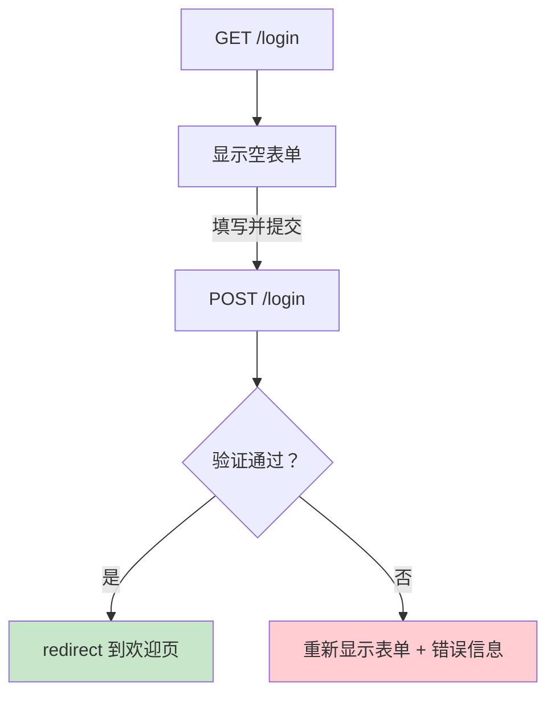

### 6.3 蓝图 Blueprint：项目模块化

> 项目大了以后，所有路由写在一个文件会乱成一锅粥～ 蓝图就是把功能拆分成"模块包"！

**项目结构**：

```text
my_blog/
├── app.py                 ← 主程序
├── blueprints/
│   ├── user_bp.py         ← 用户模块
│   └── article_bp.py      ← 文章模块
└── templates/
```

**blueprints/user_bp.py**：

```python
from flask import Blueprint

# 创建蓝图：名字 + 模块名 + 前缀（可选）
user_bp = Blueprint("user", __name__, url_prefix="/users")

@user_bp.route("/")              # 实际路径：/users/
def user_list():
    return "用户列表"

@user_bp.route("/<int:user_id>") # 实际路径：/users/123
def user_detail(user_id):
    return f"用户 {user_id} 详情"
```

**app.py**：

```python
from flask import Flask
from blueprints.user_bp import user_bp
from blueprints.article_bp import article_bp

app = Flask(__name__)
app.register_blueprint(user_bp)        # 注册用户蓝图
app.register_blueprint(article_bp)     # 注册文章蓝图

if __name__ == "__main__":
    app.run(debug=True)
```

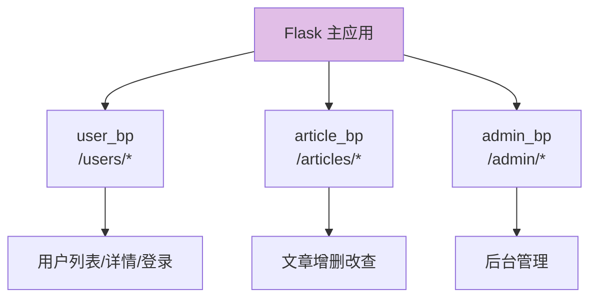

### 6.4 Flask 常用扩展

| 扩展 | 功能 | 安装 |
| :--- | :--- | :--- |
| `Flask-SQLAlchemy` | 数据库 ORM | `pip install flask-sqlalchemy` |
| `Flask-Login` | 用户登录管理 | `pip install flask-login` |
| `Flask-WTF` | 表单验证 + CSRF 防护 | `pip install flask-wtf` |
| `Flask-Migrate` | 数据库迁移 | `pip install flask-migrate` |
| `Flask-RESTful` | 快速构建 REST API | `pip install flask-restful` |

> 🎀 **Flask 的哲学**：核心极简 + 按需扩展。就像搭积木，想要什么自己装什么～

---

## 七、Django：功能齐全的"全家桶" 🏗️

> Django 是"大而全"的重量级框架——ORM、后台管理、用户系统、表单全都自带，适合中大型项目！

### 7.1 Django vs Flask 的风格

| 对比 | Flask 🌸 | Django 🏗️ |
| :--- | :--- | :--- |
| 定位 | 微框架，自由组装 | 全家桶，开箱即用 |
| 自带 ORM | ❌（需装扩展） | ✅ 内置 |
| 后台管理 | ❌ | ✅ 内置（超好用！） |
| 用户系统 | ❌ | ✅ 内置 |
| 学习曲线 | 平缓 | 较陡 |
| 适合项目 | 小型、API、原型 | 中大型、企业级 |

### 7.2 MTV 架构

> Django 把代码分为三层：Model（数据）、Template（页面）、View（逻辑）。

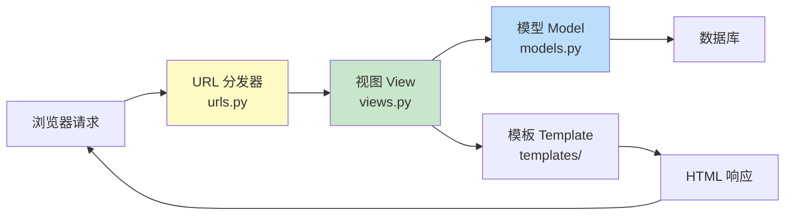

### 7.3 创建项目

```bash
# 安装
pip install django

# 创建项目（会生成 mysite 文件夹）
django-admin startproject mysite

# 进入目录，创建应用（功能模块）
cd mysite
python manage.py startapp blog

# 启动开发服务器
python manage.py runserver
# 访问 http://127.0.0.1:8000
```

**项目结构**：

```text
mysite/
├── manage.py           ← 管理脚本（启动、迁移等）
├── mysite/             ← 项目配置包
│   ├── settings.py     ← 全局配置（数据库、APP 列表等）
│   ├── urls.py         ← 根路由
│   └── wsgi.py         ← 部署入口
└── blog/               ← 应用（App）
    ├── models.py       ← 数据模型（定义表结构）
    ├── views.py        ← 视图（处理逻辑）
    ├── urls.py         ← 应用路由（需自己创建）
    └── admin.py        ← 后台管理配置
```

> 💡 **项目 vs 应用**：项目是"网站整体"，应用是"功能模块"（如博客、评论、用户）。一个项目包含多个应用。

### 7.4 Model：定义数据模型

```python
# blog/models.py
from django.db import models

class Article(models.Model):
    title = models.CharField(max_length=100)              # 字符串（类似 VARCHAR）
    content = models.TextField()                          # 长文本
    author = models.ForeignKey("auth.User", on_delete=models.CASCADE)  # 外键
    created_at = models.DateTimeField(auto_now_add=True)  # 创建时间（自动）
    is_published = models.BooleanField(default=False)     # 布尔值

    def __str__(self):
        return self.title
```

**常用字段类型**：

| 字段 | 对应数据库 | 用途 |
| :--- | :--- | :--- |
| `CharField(max_length=N)` | VARCHAR | 短字符串 |
| `TextField()` | TEXT | 长文本 |
| `IntegerField()` | INT | 整数 |
| `FloatField()` | FLOAT | 浮点数 |
| `BooleanField()` | BOOL | 布尔值 |
| `DateTimeField(auto_now_add=True)` | DATETIME | 创建时间 |
| `ForeignKey(Model)` | 外键 | 一对多关系 |
| `ManyToManyField(Model)` | 中间表 | 多对多关系 |

**同步数据库**：

```bash
# 生成迁移文件（根据 models.py 的变化生成 SQL）
python manage.py makemigrations

# 执行迁移（真正建表/改表）
python manage.py migrate
```

### 7.5 ORM 增删改查

```python
from blog.models import Article

# —— 增 ——
article = Article.objects.create(title="标题", content="内容")

# —— 查 ——
Article.objects.all()                          # 全部
Article.objects.filter(is_published=True)      # 条件查询（WHERE）
Article.objects.get(id=1)                      # 精确查一条（不存在会报错）
Article.objects.filter(title__contains="Python")  # 模糊查询（LIKE）
Article.objects.order_by("-created_at")        # 排序（- 表示倒序）
Article.objects.count()                        # 计数

# —— 改 ——
article.title = "新标题"
article.save()

# —— 删 ——
article.delete()
```

```python
# —— 链式查询（类似流水线）——
Article.objects.filter(
    is_published=True
).exclude(
    title__contains="草稿"
).order_by(
    "-created_at"
)[:10]     # 最新发布的 10 篇
```

### 7.6 View 与 URL

```python
# blog/views.py
from django.shortcuts import render, get_object_or_404, redirect
from .models import Article

def article_list(request):
    articles = Article.objects.filter(is_published=True)
    return render(request, "blog/list.html", {"articles": articles})

def article_detail(request, pk):
    article = get_object_or_404(Article, pk=pk)   # 查不到返回 404
    return render(request, "blog/detail.html", {"article": article})
```

```python
# blog/urls.py
from django.urls import path
from . import views

urlpatterns = [
    path("articles/", views.article_list, name="article_list"),
    path("articles/<int:pk>/", views.article_detail, name="article_detail"),
]
```

```python
# mysite/urls.py（根路由，引入应用路由）
from django.contrib import admin
from django.urls import path, include

urlpatterns = [
    path("admin/", admin.site.urls),
    path("blog/", include("blog.urls")),    # /blog/* 交给 blog 应用处理
]
```

### 7.7 强大的后台管理（Admin）

```python
# blog/admin.py —— 只需几行代码，自动生成管理后台！
from django.contrib import admin
from .models import Article

@admin.register(Article)
class ArticleAdmin(admin.ModelAdmin):
    list_display = ["title", "author", "created_at", "is_published"]  # 列表显示
    list_filter = ["is_published"]                                    # 筛选器
    search_fields = ["title", "content"]                              # 搜索框
```

```bash
# 创建管理员账号
python manage.py createsuperuser

# 启动后访问 /admin 即可管理所有数据！
python manage.py runserver
```

> 💡 **Admin 是 Django 的"杀手锏"**——几行配置就拥有一个完整的数据管理后台，增删改查、搜索、筛选全都有！

---

## 八、FastAPI：现代高性能"新贵" ⚡

> FastAPI 是近年最火的框架：基于类型注解、原生异步、自动生成 API 文档，前后端分离项目的首选！

### 8.1 安装与第一个程序

```bash
pip install fastapi uvicorn[standard]
```

```python
from fastapi import FastAPI

app = FastAPI(title="我的第一个 API")

@app.get("/")
def index():
    return {"message": "Hello FastAPI"}

@app.get("/hello/{name}")
def hello(name: str):
    return {"greeting": f"你好，{name}！"}

# 启动命令（终端执行）：
# uvicorn main:app --reload
#         ↑         ↑
#     文件名:应用对象  改代码自动重启
```

启动后访问：

- `http://127.0.0.1:8000` → API 返回 JSON
- `http://127.0.0.1:8000/docs` → **自动生成的交互式文档**（Swagger UI）✨
- `http://127.0.0.1:8000/redoc` → 另一种风格的文档

> 🎀 **最惊喜的点**：不用写一行文档代码，`/docs` 页面自动生成，还能直接在页面上测试 API！

### 8.2 类型注解驱动的数据验证

```python
from fastapi import FastAPI
from pydantic import BaseModel, Field, EmailStr
from typing import Optional

app = FastAPI()

# —— 定义请求体模型（自动验证数据格式）——
class UserCreate(BaseModel):
    username: str = Field(..., min_length=2, max_length=20, description="用户名")
    age: int = Field(..., ge=0, le=150, description="年龄（0~150）")
    email: EmailStr
    bio: Optional[str] = None     # 可选字段

@app.post("/users")
def create_user(user: UserCreate):
    # 到这里数据已经验证通过了！不合法的请求根本进不来
    return {"code": 0, "msg": "创建成功", "data": user.dict()}
```

**如果提交了不合法数据**（如 age=200）：

```json
{
    "detail": [
        {
            "type": "value_error.number.not_ge",
            "loc": ["body", "age"],
            "msg": "Input should be greater than or equal to 0 and less than or equal to 150"
        }
    ]
}
```

> 💡 自动返回 `422` 状态码 + 详细错误信息，不用手写验证代码！

### 8.3 查询参数与路径参数

```python
from fastapi import FastAPI, Query, Path

app = FastAPI()

@app.get("/items/{item_id}")
def read_item(
    item_id: int = Path(..., description="商品ID"),           # 路径参数
    q: str = Query(None, max_length=50, description="搜索词"),  # 查询参数 ?q=xxx
    page: int = Query(1, ge=1),                                 # ?page=2
    size: int = Query(10, ge=1, le=100),
):
    return {"item_id": item_id, "q": q, "page": page, "size": size}
```

| 参数来源 | 写法 | 示例 |
| :--- | :--- | :--- |
| 路径参数 | 函数参数出现在路径 `{}` 中 | `/items/{item_id}` |
| 查询参数 | 函数参数**不在**路径中 | `?page=2&size=10` |
| 请求体 | 参数类型是 `BaseModel` | POST 的 JSON |
| 请求头 | `Header()` 声明 | `X-Token: xxx` |
| Cookie | `Cookie()` 声明 | `session_id` |

### 8.4 异步支持（高并发）

```python
import asyncio
from fastapi import FastAPI

app = FastAPI()

@app.get("/slow")
async def slow_api():
    await asyncio.sleep(3)     # 异步等待，不阻塞其他请求
    return {"message": "终于好了"}

@app.get("/fast")
def fast_api():                 # 也可以用普通函数（会在线程池运行）
    return {"message": "秒回！"}
```

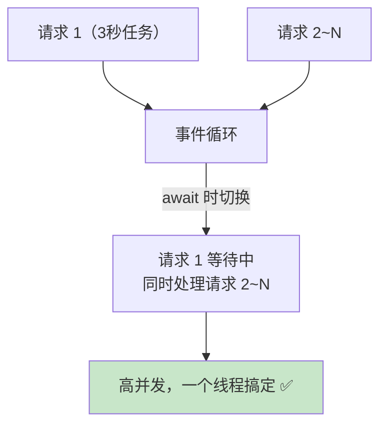

### 8.5 FastAPI 核心特性总结

| 特性 | 说明 |
| :--- | :--- |
| **类型验证** | Pydantic 自动验证数据，错误自动返回 422 |
| **自动文档** | `/docs` 交互式文档，`/redoc` 阅读型文档 |
| **原生异步** | `async/await` 高并发 |
| **依赖注入** | `Depends()` 复用逻辑（如登录校验） |
| **性能强** | 与 NodeJS、Go 同级（Starlette + Pydantic） |

---

## 九、数据库与 ORM：SQLAlchemy 🗄️

> ORM（对象关系映射）让你用 Python 对象操作数据库，不用写 SQL！

### 9.1 ORM 是什么？

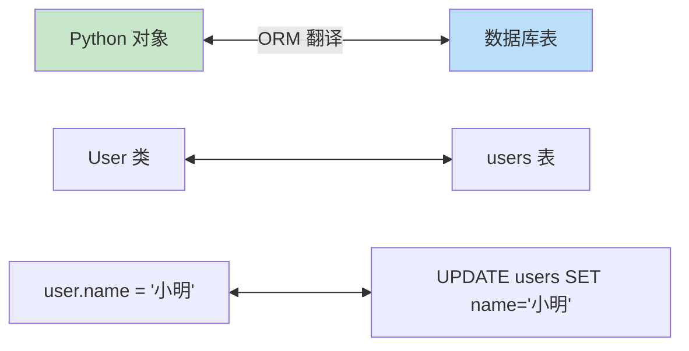

| 不用 ORM（写 SQL） | 用 ORM（写 Python） |
| :--- | :--- |
| `SELECT * FROM users WHERE age > 18;` | `User.query.filter(User.age > 18).all()` |
| `INSERT INTO users ...` | `db.session.add(User(name="小明"))` |
| 容易 SQL 注入 | 自动参数化，安全 ✅ |
| 换数据库要改 SQL | 换数据库基本不用改代码 ✅ |

### 9.2 Flask-SQLAlchemy 快速上手

```bash
pip install flask-sqlalchemy
```

```python
from flask import Flask
from flask_sqlalchemy import SQLAlchemy

app = Flask(__name__)

# 配置数据库连接（这里用 SQLite，无需安装数据库软件）
app.config["SQLALCHEMY_DATABASE_URI"] = "sqlite:///mydb.sqlite3"

db = SQLAlchemy(app)

# —— 定义模型：一个类 = 一张表 ——
class User(db.Model):
    __tablename__ = "users"

    id = db.Column(db.Integer, primary_key=True)        # 主键
    username = db.Column(db.String(50), unique=True, nullable=False)
    age = db.Column(db.Integer, default=0)
    created_at = db.Column(db.DateTime, server_default=db.func.now())

    def __repr__(self):
        return f"<User {self.username}>"

# —— 创建所有表 ——
with app.app_context():
    db.create_all()
```

### 9.3 增删改查（CRUD）

```python
# —— 增（Create）——
user = User(username="小明", age=18)
db.session.add(user)           # 添加到会话
db.session.commit()            # 提交事务（真正写入数据库）

# —— 查（Read）——
User.query.get(1)                             # 按主键查
User.query.filter_by(username="小明").first() # 按条件查第一条
User.query.filter(User.age > 18).all()        # 条件查全部
User.query.count()                            # 计数
User.query.order_by(User.age.desc()).all()    # 排序
User.query.filter(User.name.contains("明")).all()  # 模糊查询

# —— 改（Update）——
user = User.query.get(1)
user.age = 20
db.session.commit()

# —— 删（Delete）——
user = User.query.get(1)
db.session.delete(user)
db.session.commit()
```

### 9.4 关系（一对多 / 多对多）

```python
# —— 一对多：一个作者写多篇文章 ——
class Author(db.Model):
    id = db.Column(db.Integer, primary_key=True)
    name = db.Column(db.String(50))
    articles = db.relationship("Article", backref="author")   # 反向引用

class Article(db.Model):
    id = db.Column(db.Integer, primary_key=True)
    title = db.Column(db.String(100))
    author_id = db.Column(db.Integer, db.ForeignKey("author.id"))  # 外键

# 使用：
author = Author.query.first()
author.articles            # 该作者的所有文章（列表）
article = Article.query.first()
article.author.name        # 这篇文章的作者名
```

---

## 十、RESTful API 设计规范 📐

> RESTful 是一套 API 设计"礼仪规范"——URL 表示资源，方法表示动作，让接口整齐划一！

### 10.1 核心思想

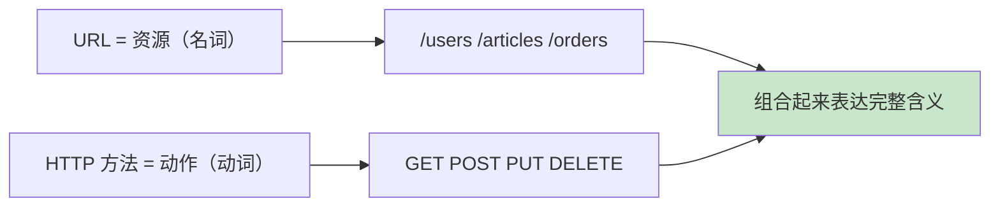

### 10.2 标准接口示例（用户管理）

| 操作 | 方法 | URL | 状态码 |
| :--- | :---: | :--- | :---: |
| 获取用户列表 | `GET` | `/api/users` | 200 |
| 获取单个用户 | `GET` | `/api/users/123` | 200 |
| 创建用户 | `POST` | `/api/users` | 201 |
| 更新用户（全量） | `PUT` | `/api/users/123` | 200 |
| 更新用户（部分） | `PATCH` | `/api/users/123` | 200 |
| 删除用户 | `DELETE` | `/api/users/123` | 204 |

> ⚠️ **注意**：URL 里**只有名词**，没有动词！`/getUser`、`/deleteUser` 都是 ❌ 错误设计～

### 10.3 好 vs 坏的 URL 设计

| ❌ 不推荐 | ✅ 推荐 | 原因 |
| :--- | :--- | :--- |
| `GET /getUserList` | `GET /users` | URL 不该有动词 |
| `POST /createUser` | `POST /users` | POST 本身就是"创建" |
| `GET /users?delete=123` | `DELETE /users/123` | 删除该用 DELETE 方法 |
| `GET /api/v1/get_all_articles` | `GET /api/v1/articles` | 简洁统一 |

### 10.4 统一响应格式

> 实际项目中，通常约定统一的 JSON 响应结构：

```json
// 成功
{
    "code": 0,
    "msg": "success",
    "data": {
        "id": 123,
        "username": "小明"
    }
}

// 失败
{
    "code": 40001,
    "msg": "用户名已存在",
    "data": null
}
```

**FastAPI 实现统一响应**：

```python
from fastapi import FastAPI
from pydantic import BaseModel
from typing import Optional, Any

app = FastAPI()

# —— 统一响应模型 ——
class ApiResponse(BaseModel):
    code: int = 0
    msg: str = "success"
    data: Any = None

@app.get("/users/{user_id}", response_model=ApiResponse)
def get_user(user_id: int):
    if user_id == 1:
        return ApiResponse(data={"id": 1, "username": "小明"})
    return ApiResponse(code=40404, msg="用户不存在")
```

### 10.5 版本管理

```text
/api/v1/users     ← 第一版
/api/v2/users     ← 大改版时升级，旧版继续可用一段时间
```

> 💡 **为什么要版本化**：接口改了（如字段删除），旧版 App 还在用旧接口，不能直接"断电"，要让新旧版本共存～

---

## 十一、三大框架对比与选型 🎯

### 11.1 综合对比表

| 对比项 | Flask 🌸 | Django 🏗️ | FastAPI ⚡ |
| :--- | :--- | :--- | :--- |
| **诞生年份** | 2010 | 2005 | 2018 |
| **定位** | 微框架 | 全家桶 | 现代 API 框架 |
| **性能** | 中 | 中 | 高（异步） |
| **ORM** | 需装扩展 | 内置 | 需装（SQLAlchemy） |
| **后台管理** | 无 | 内置 Admin | 无 |
| **模板引擎** | Jinja2 | Django Template | 无（专注 API） |
| **异步支持** | 部分 | 部分（3.0+） | 原生支持 |
| **自动文档** | 无 | 无 | ✅ Swagger |
| **学习曲线** | ⭐⭐ | ⭐⭐⭐⭐ | ⭐⭐⭐ |
| **适合场景** | 小项目、原型 | 大型全栈项目 | 前后端分离 API |

### 11.2 选型决策图

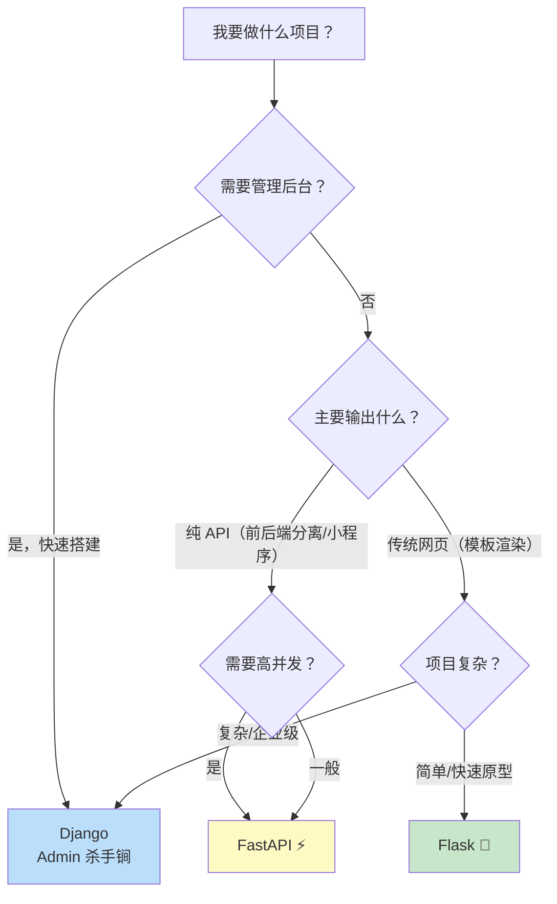

### 11.3 选型口诀

> 🎀 记住这三句话：
>
> 1. **做 API、前后端分离 → FastAPI**（自动文档太香了）
> 2. **要后台管理、大而全 → Django**（Admin 省一半工作量）
> 3. **小项目、灵活自由 → Flask**（几行代码就能跑）

---

## 十二、部署上线 🚀

> 代码写好了怎么让别人访问？这就要"部署"到服务器上啦！

### 12.1 开发 vs 生产

| 场景 | 服务器 | 说明 |
| :--- | :--- | :--- |
| 开发调试 | `app.run()` / `runserver` | 自带服务器，仅供开发 |
| 生产上线 | Gunicorn + Nginx | 稳定、高性能、扛并发 |

> ⚠️ **千万别把 `app.run()` 直接用于生产**！Flask/Django 自带服务器性能很差，也不安全～

### 12.2 部署架构

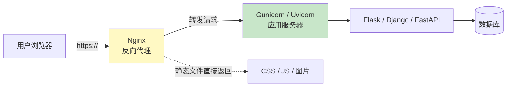

| 组件 | 职责 |
| :--- | :--- |
| **Nginx** | 门卫：处理 HTTPS、静态文件、负载均衡 |
| **Gunicorn** | 管理多个 Python 进程（WSGI 应用） |
| **Uvicorn** | 异步应用服务器（ASGI，FastAPI 用） |
| **数据库** | MySQL / PostgreSQL |

### 12.3 Gunicorn 部署（Flask/Django）

```bash
pip install gunicorn

# 启动：4 个工作进程
gunicorn -w 4 -b 0.0.0.0:8000 app:app
#         ↑       ↑              ↑
#     进程数   监听地址端口   文件:Flask实例
```

### 12.4 Uvicorn 部署（FastAPI）

```bash
# 单进程
uvicorn main:app --host 0.0.0.0 --port 8000

# 多进程（推荐，--workers 数量约等于 CPU 核心数）
uvicorn main:app --host 0.0.0.0 --port 8000 --workers 4
```

### 12.5 Docker 部署（现代方式）

```dockerfile
# Dockerfile
FROM python:3.12-slim

WORKDIR /app

# 先复制依赖文件（利用缓存）
COPY requirements.txt .
RUN pip install --no-cache-dir -r requirements.txt

# 复制项目代码
COPY . .

# 启动命令
CMD ["uvicorn", "main:app", "--host", "0.0.0.0", "--port", "8000"]
```

```bash
# 构建镜像
docker build -t myapp .

# 运行容器
docker run -d -p 8000:8000 --name myapp-container myapp
```

### 12.6 部署检查清单

| 检查项 | 说明 |
| :--- | :--- |
| ✅ 关闭 debug 模式 | `app.run(debug=False)`，生产不要 debug |
| ✅ 使用环境变量存密钥 | 数据库密码等不能写死在代码里 |
| ✅ HTTPS 配置 | 用 Let's Encrypt 免费证书 |
| ✅ 数据库连接池 | 避免每次请求都新建连接 |
| ✅ 日志收集 | 记录访问日志和错误日志 |
| ✅ 域名解析 | DNS 把域名指向服务器 IP |

---

## 📌 知识总结

### Web 开发核心知识图

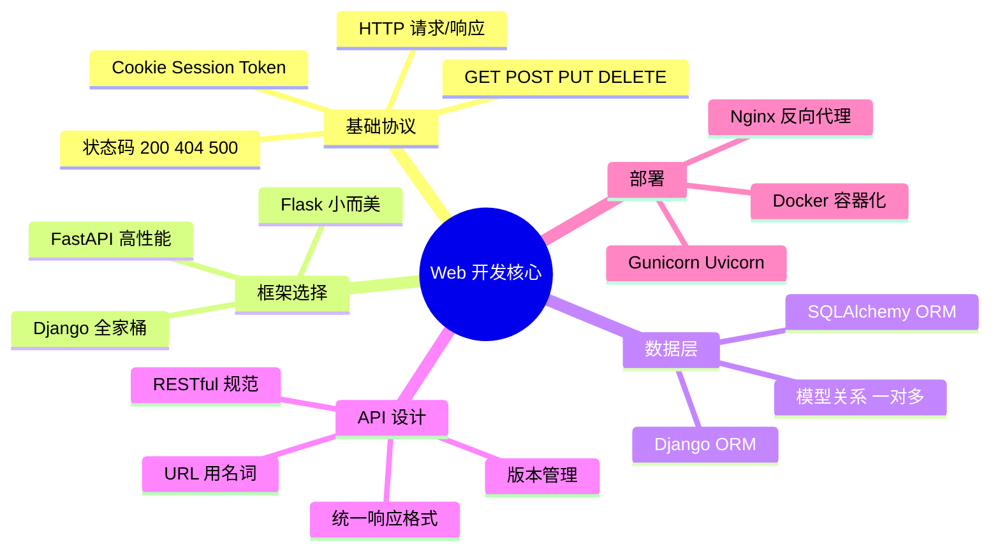

### 快速决策表

| 问题 | 答案 |
| :--- | :--- |
| GET 和 POST 的区别？ | GET 获取数据，POST 提交数据 |
| 404 和 500 分别是谁的错？ | 404 客户端（找不到），500 服务器（代码崩了） |
| Cookie 和 Session 的区别？ | Cookie 存浏览器，Session 存服务器 |
| WSGI 和 ASGI 的区别？ | WSGI 同步，ASGI 异步 |
| 前后端分离用什么框架？ | FastAPI（或 Flask + jsonify） |
| 要后台管理选什么？ | Django（内置 Admin） |
| 生产环境怎么部署？ | Nginx + Gunicorn/Uvicorn |

### 学习路线建议

```mermaid
graph LR
    A["① Flask 入门<br/>理解路由/请求/响应"] --> B["② Jinja2 模板<br/>+ SQLAlchemy"]
    B --> C["③ RESTful API<br/>设计规范"]
    C --> D["④ FastAPI<br/>类型验证+异步"]
    D --> E["⑤ Django<br/>全家桶+Admin"]
    E --> F["⑥ 部署实践<br/>Nginx+Docker"]

    style A fill:#c8e6c9
    style F fill:#fff9c4
```

> 🎀 呼～Web 开发的大门已经为你敞开啦！🎉 建议从 Flask 起步找感觉，再用 FastAPI 做个前后端分离小项目，最后挑战 Django 全家桶。配合之前学的 [Python并发编程.md](file:///d:/A-H2H/Python/Python并发编程.md)，你的异步 API 会跑得飞快～动手做个小项目练练手吧！(◍•ᴗ•◍)❤

