# 📚 Python 常用标准库

> 哈喽呀～欢迎来到 Python 标准库的宝藏地图！🌟 Python 自带了一大堆"免费工具箱"，不用 `pip install` 就能直接用，超级方便！让我们一起来挖宝吧～ (๑•̀ㅂ•́)و✧

---

## 🗺️ 标准库全景图

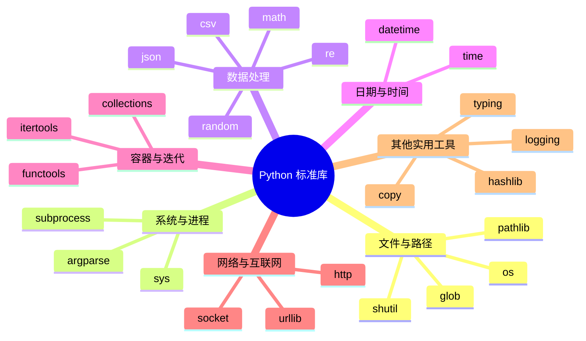

> 💡 **标准库的优势**：无需安装、跨平台稳定、经过充分测试。能用标准库解决的，就不要额外装第三方库！

---

## 📑 目录

- [一、os —— 操作系统交互](#一os--操作系统交互)
- [二、sys —— Python 解释器交互](#二sys--python-解释器交互)
- [三、pathlib —— 现代路径处理](#三pathlib--现代路径处理)
- [四、math —— 数学运算](#四math--数学运算)
- [五、random —— 随机数生成](#五random--随机数生成)
- [六、datetime —— 日期时间处理](#六datetime--日期时间处理)
- [七、json —— JSON 数据处理](#七json--json-数据处理)
- [八、re —— 正则表达式](#八re--正则表达式)
- [九、collections —— 特殊容器](#九collections--特殊容器)
- [十、itertools —— 迭代器工具](#十itertools--迭代器工具)
- [十一、functools —— 函数工具](#十一functools--函数工具)
- [十二、typing —— 类型注解](#十二typing--类型注解)
- [十三、logging —— 日志记录](#十三logging--日志记录)
- [十四、subprocess —— 子进程管理](#十四subprocess--子进程管理)
- [十五、argparse —— 命令行参数解析](#十五argparse--命令行参数解析)
- [十六、csv —— CSV 文件处理](#十六csv--csv-文件处理)
- [十七、shutil —— 高级文件操作](#十七shutil--高级文件操作)
- [十八、hashlib —— 哈希与加密](#十八hashlib--哈希与加密)
- [十九、urllib —— URL 请求处理](#十九urllib--url-请求处理)
- [二十、常用标准库速查表](#二十常用标准库速查表)

---

## 一、os —— 操作系统交互 🖥️

> `os` 模块让你用 Python 代码和操作系统"对话"——操作文件、目录、环境变量等。

### 1.1 常用功能一览

```python
import os

# —— 路径操作 ——
os.getcwd()                    # 获取当前工作目录
os.chdir("/tmp")               # 切换工作目录
os.listdir(".")                # 列出目录下的所有文件和文件夹

# —— 文件/目录操作 ——
os.mkdir("new_dir")            # 创建目录（只能建一层）
os.makedirs("a/b/c")           # 递归创建多级目录
os.rmdir("new_dir")            # 删除空目录
os.remove("file.txt")          # 删除文件
os.rename("old.txt", "new.txt")  # 重命名/移动

# —— 路径拼接（推荐用 os.path.join 而不是字符串拼接）——
path = os.path.join("folder", "sub", "file.txt")  # 自动适配不同系统的路径分隔符

# —— 环境变量 ——
os.environ.get("HOME")         # 获取环境变量
os.environ["MY_VAR"] = "123"   # 设置环境变量

# —— 判断 ——
os.path.exists("file.txt")     # 路径是否存在
os.path.isfile("file.txt")     # 是否是文件
os.path.isdir("folder")        # 是否是目录
os.path.getsize("file.txt")    # 获取文件大小（字节）
```

### 1.2 os.path 路径处理详解

```python
import os

path = "/home/user/docs/readme.md"

os.path.dirname(path)      # '/home/user/docs'   → 取目录部分
os.path.basename(path)     # 'readme.md'          → 取文件名部分
os.path.splitext(path)     # ('/home/user/docs/readme', '.md') → 分离扩展名
os.path.abspath("test.py") # '/当前/绝对/路径/test.py' → 转绝对路径
os.path.join("a", "b", "c")  # 'a/b/c'（Linux）或 'a\\b\\c'（Windows）
```

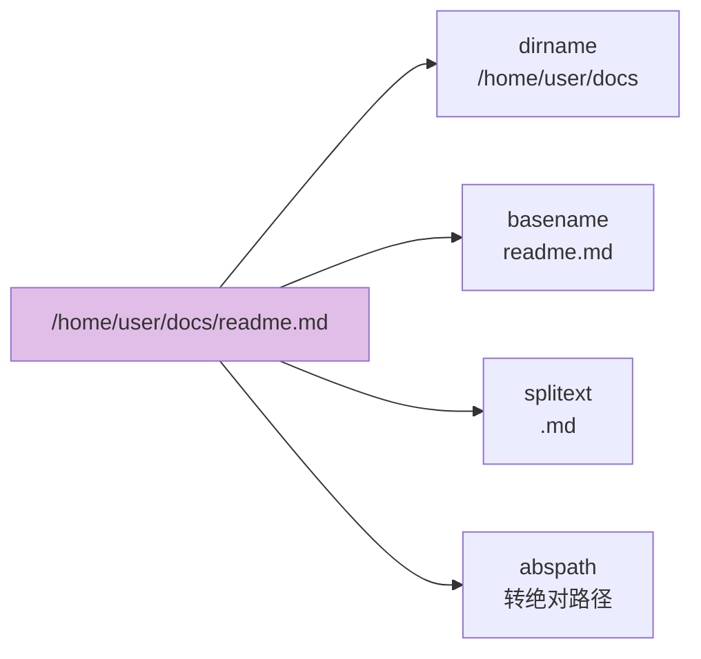

> ⚠️ **重要提醒**：永远用 `os.path.join()` 拼接路径，不要手动写 `/` 或 `\\`，这样代码才能跨平台运行！

### 1.3 遍历目录树

```python
import os

# os.walk 递归遍历目录，每次返回 (当前目录, 子目录列表, 文件列表)
for dirpath, dirnames, filenames in os.walk("."):
    print(f"📁 目录：{dirpath}")
    for filename in filenames:
        filepath = os.path.join(dirpath, filename)
        size = os.path.getsize(filepath)
        print(f"   📄 {filename} ({size} bytes)")
```

---

## 二、sys —— Python 解释器交互 ⚙️

> `sys` 模块提供与 **Python 解释器本身** 交互的功能。

```python
import sys

# —— Python 版本信息 ——
sys.version              # Python 版本字符串
sys.version_info[0]      # 主版本号（3 或 2）

# —— 路径相关 ——
sys.path                 # 模块搜索路径列表
sys.path.insert(0, "/my/modules")  # 添加自定义模块路径

# —— 命令行参数 ——
sys.argv                 # 命令行参数列表，argv[0] 是脚本名

# —— 标准输入/输出/错误流 ——
sys.stdout.write("hello")    # 标准输出
sys.stderr.write("error!")   # 错误输出

# —— 退出程序 ——
sys.exit(0)              # 正常退出（0=成功，非0=出错）
sys.exit("出错了！")     # 打印消息后退出
```

### sys.argv 示例

```python
# 文件 script.py
import sys

# 运行命令：python script.py hello 123
print(sys.argv)
# ['script.py', 'hello', '123']

print(sys.argv[1])   # 'hello'（第一个参数）
print(sys.argv[2])   # '123'（第二个参数）
```

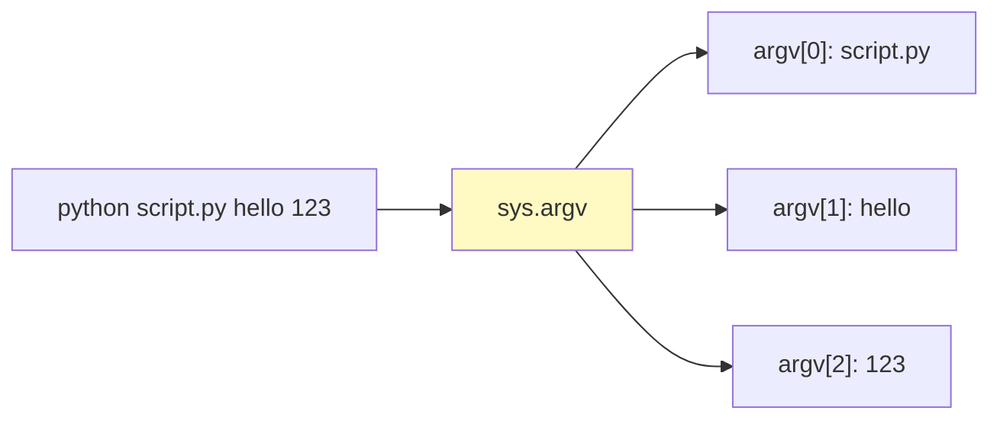

> 💡 `sys.argv` 是最原始的命令行参数处理方式，更推荐用 [argparse 模块](#十五argparse--命令行参数解析) 处理复杂参数。

---

## 三、pathlib —— 现代路径处理 🛤️

> `pathlib` 是 Python 3.4+ 引入的**面向对象**路径处理库，比 `os.path` 更优雅、更直观！

### 3.1 基本用法

```python
from pathlib import Path

# —— 创建 Path 对象 ——
p = Path(".")
p = Path("/home/user/docs/readme.md")
p = Path.home()                  # 用户主目录
p = Path.cwd()                   # 当前工作目录

# —— 路径属性 ——
p.name              # 'readme.md'    → 文件名（含扩展名）
p.stem              # 'readme'       → 文件名（不含扩展名）
p.suffix            # '.md'          → 扩展名
p.parent            # Path('/home/user/docs')  → 父目录
p.parents[0]        # 等同于 p.parent
p.parents[1]        # Path('/home/user')      → 往上两级
p.anchor            # '/' 或 'C:\\'  → 路径根部分

# —— 判断 ——
p.exists()          # 路径是否存在
p.is_file()         # 是否是文件
p.is_dir()          # 是否是目录

# —— 操作 ——
p.mkdir(parents=True, exist_ok=True)   # 创建目录
p.touch()                              # 创建空文件
p.unlink()                             # 删除文件
p.rename("new_name.txt")               # 重命名
p.read_text(encoding="utf-8")          # 读取文本内容（一步到位！）
p.write_text("hello", encoding="utf-8") # 写入文本内容
```

### 3.2 os.path vs pathlib 对比

| 功能 | `os.path`（传统） | `pathlib`（现代 ⭐） |
| :--- | :--- | :--- |
| 当前目录 | `os.getcwd()` | `Path.cwd()` |
| 主目录 | `os.path.expanduser("~")` | `Path.home()` |
| 路径拼接 | `os.path.join("a", "b")` | `Path("a") / "b"` |
| 文件名 | `os.path.basename(p)` | `p.name` |
| 扩展名 | `os.path.splitext(p)[1]` | `p.suffix` |
| 父目录 | `os.path.dirname(p)` | `p.parent` |
| 是否存在 | `os.path.exists(p)` | `p.exists()` |
| 读取文件 | `open(p).read()` | `p.read_text()` |

> 🎀 **推荐**：新项目优先用 `pathlib`！用 `/` 运算符拼接路径超优雅：`Path("folder") / "sub" / "file.txt"`

### 3.3 强大的 glob 模式匹配

```python
from pathlib import Path

# 查找当前目录下所有 .py 文件
for f in Path(".").glob("*.py"):
    print(f)

# 递归查找所有子目录中的 .py 文件
for f in Path(".").rglob("*.py"):
    print(f)

# 查找所有 test_ 开头的文件
for f in Path(".").rglob("test_*.py"):
    print(f)
```

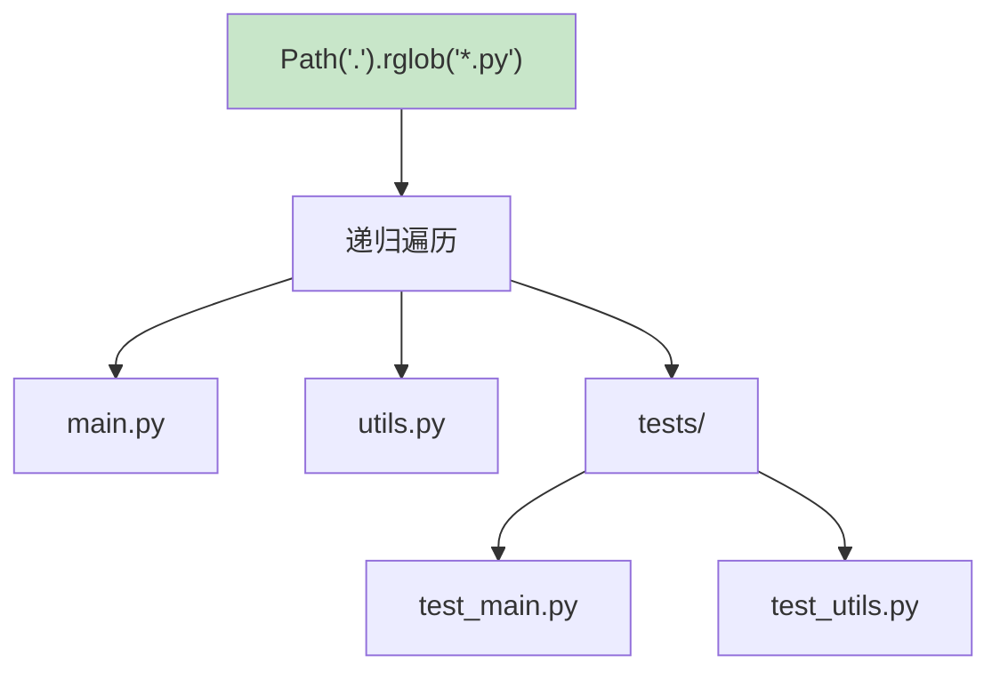

---

## 四、math —— 数学运算 🔢

> `math` 模块提供数学函数，处理浮点数运算、对数、三角函数等。

```python
import math

# —— 取整与特殊值 ——
math.ceil(3.2)       # 4    → 向上取整
math.floor(3.8)      # 3    → 向下取整
math.trunc(3.9)      # 3    → 截断小数部分
math.fabs(-5)        # 5.0  → 绝对值（返回浮点数）
math.factorial(5)    # 120  → 阶乘 5! = 5×4×3×2×1
math.gcd(12, 8)      # 4    → 最大公约数

# —— 对数与指数 ——
math.log(100, 10)    # 2.0  → 以 10 为底的对数
math.log2(8)         # 3.0  → 以 2 为底的对数
math.log(math.e)     # 1.0  → 自然对数
math.exp(1)          # 2.718... → e 的 1 次方
math.sqrt(16)        # 4.0  → 平方根
math.pow(2, 10)      # 1024.0 → 2 的 10 次方

# —— 常量 ——
math.pi              # 3.141592653589793
math.e               # 2.718281828459045
math.inf             # 正无穷
math.nan             # Not a Number（非数字）

# —— 三角函数（参数为弧度，不是角度！）——
math.sin(math.pi / 2)   # 1.0  → sin(90°)
math.cos(0)             # 1.0  → cos(0°)
math.tan(math.pi / 4)   # 1.0  → tan(45°)
math.degrees(math.pi)   # 180.0 → 弧度转角度
math.radians(180)       # 3.14159... → 角度转弧度
```

> 💡 **math vs cmath**：`math` 处理实数，`cmath` 处理复数。如果需要矩阵运算，请用第三方库 `numpy`。

---

## 五、random —— 随机数生成 🎲

> `random` 模块用于生成**伪随机数**，适合日常使用（不适合密码学安全场景）。

```python
import random

# —— 基本随机数 ——
random.random()              # 0.0 ~ 1.0 之间的随机浮点数
random.randint(1, 100)       # 1 ~ 100 之间的随机整数（包含两端）
random.uniform(1.5, 3.5)     # 1.5 ~ 3.5 之间的随机浮点数

# —— 从序列中随机选择 ——
random.choice(["🍎", "🍌", "🍊"])     # 随机选一个
random.choices(["🍎", "🍌", "🍊"], k=2) # 随机选 2 个（可重复）
random.sample(range(1, 50), 6)         # 随机选 6 个（不重复，彩票模拟！）

# —— 打乱顺序 ——
cards = list(range(1, 11))
random.shuffle(cards)        # 原地打乱列表
print(cards)                 # [7, 2, 9, 1, 5, ...]

# —— 设置随机种子（可复现）——
random.seed(42)              # 固定种子后，每次运行结果一样
print(random.randint(1, 100))  # 每次都是同一个数

# —— 加权随机 ——
# weights 表示每个元素被选中的概率权重
result = random.choices(
    ["一等奖", "二等奖", "谢谢参与"],
    weights=[1, 5, 94],       # 一等奖 1%，二等奖 5%，谢谢参与 94%
    k=1
)
```

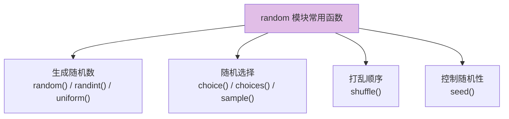

| 函数 | 返回 | 特点 |
| :--- | :--- | :---: |
| `random()` | 0.0~1.0 浮点数 | 基础函数 |
| `randint(a, b)` | a~b 整数 | **包含 b** |
| `choice(seq)` | 序列中 1 个元素 | 不修改原序列 |
| `choices(seq, k=n)` | n 个元素 | **可重复** |
| `sample(seq, k=n)` | n 个元素 | **不重复** |
| `shuffle(seq)` | None | **原地打乱** |

> ⚠️ 密码学安全场景请用 `secrets` 模块（`secrets.token_hex(16)` 生成安全令牌）。

---

## 六、datetime —— 日期时间处理 📅

> `datetime` 是 Python 处理日期时间的核心模块，功能非常强大！

### 6.1 四个核心类

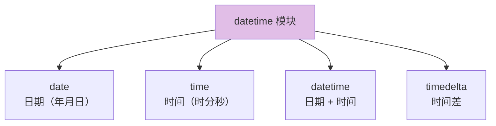

### 6.2 获取当前时间

```python
from datetime import datetime, date, time, timedelta

# —— 当前日期时间 ——
now = datetime.now()           # 本地当前时间（含时区信息）
today = date.today()           # 今天日期
utc_now = datetime.utcnow()    # UTC 时间（已弃用，推荐用下面的）
from datetime import timezone
utc = datetime.now(timezone.utc)  # UTC 时间（推荐写法）

print(now)  # 2026-08-11 14:30:25.123456
```

### 6.3 创建指定日期时间

```python
from datetime import datetime, date, time

# 创建指定日期
d = date(2026, 1, 15)          # 2026-01-15

# 创建指定时间
t = time(14, 30, 0)            # 14:30:00

# 创建指定日期时间
dt = datetime(2026, 1, 15, 14, 30, 0)  # 2026-01-15 14:30:00
```

### 6.4 格式化与解析（超级常用！）

```python
from datetime import datetime

# —— datetime → 字符串（格式化）——
now = datetime.now()
now.strftime("%Y-%m-%d")            # '2026-08-11'
now.strftime("%Y年%m月%d日")          # '2026年08月11日'
now.strftime("%H:%M:%S")             # '14:30:25'
now.strftime("%Y-%m-%d %H:%M:%S")    # '2026-08-11 14:30:25'
now.strftime("%A, %B %d, %Y")        # 'Monday, August 11, 2026'

# —— 字符串 → datetime（解析）——
dt = datetime.strptime("2026-01-15", "%Y-%m-%d")
dt = datetime.strptime("2026/01/15 14:30", "%Y/%m/%d %H:%M")
```

**常用格式化代码**：

| 代码 | 含义 | 示例 |
| :--- | :--- | :--- |
| `%Y` | 四位年份 | 2026 |
| `%m` | 两位月份 | 01~12 |
| `%d` | 两位日期 | 01~31 |
| `%H` | 24小时制时 | 00~23 |
| `%M` | 分钟 | 00~59 |
| `%S` | 秒 | 00~59 |
| `%A` | 星期全名 | Monday |
| `%a` | 星期缩写 | Mon |
| `%B` | 月份全名 | August |
| `%b` | 月份缩写 | Aug |
| `%j` | 一年中第几天 | 001~366 |

> 💡 **记忆技巧**：`strftime` = **str**ing **f**ormat **time**（时间→字符串），`strptime` = **str**ing **p**arse **time**（字符串→时间）。`f` 和 `p` 的区别就是 format 和 parse。

### 6.5 时间差 timedelta

```python
from datetime import datetime, timedelta

now = datetime.now()

# —— 时间加减 ——
tomorrow = now + timedelta(days=1)          # 明天
last_week = now - timedelta(weeks=1)        # 上周
two_hours_later = now + timedelta(hours=2)  # 两小时后

# —— 计算两个日期的差 ——
date1 = datetime(2026, 1, 1)
date2 = datetime(2026, 12, 31)
diff = date2 - date1
print(diff.days)        # 364（相差天数）
print(diff.total_seconds())  # 总秒数
```

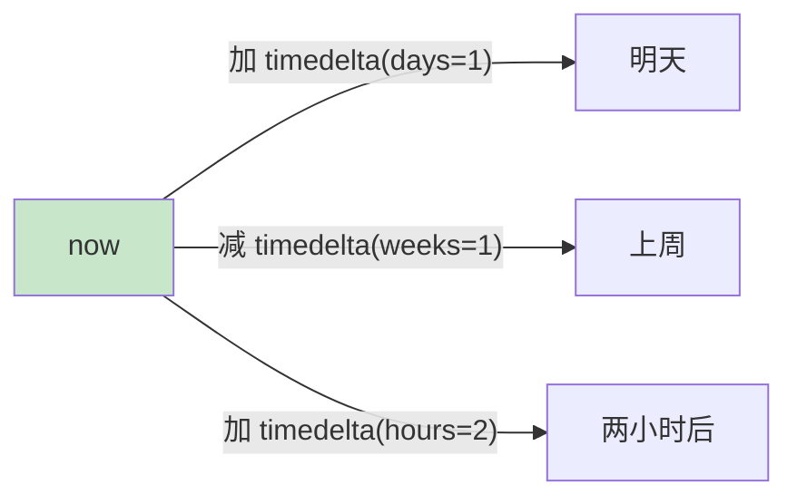

### 6.6 时间戳转换

```python
from datetime import datetime

# —— datetime → 时间戳 ——
ts = datetime.now().timestamp()    # 1723355425.123（秒数）
print(ts)

# —— 时间戳 → datetime ——
dt = datetime.fromtimestamp(ts)    # 转回 datetime 对象
print(dt)
```

---

## 七、json —— JSON 数据处理 📋

> `json` 模块用于在 Python 对象和 JSON 字符串之间转换，接口调试、配置文件的必备工具！

### 7.1 JSON 与 Python 类型对照表

| JSON 类型 | Python 类型 | 示例 |
| :--- | :--- | :--- |
| object | `dict` | `{"key": "value"}` |
| array | `list` | `[1, 2, 3]` |
| string | `str` | `"hello"` |
| number (整数) | `int` | `42` |
| number (浮点) | `float` | `3.14` |
| true/false | `True`/`False` | `true` |
| null | `None` | `null` |

### 7.2 核心操作

```python
import json

# —— Python 对象 → JSON 字符串（序列化）——
data = {
    "name": "小明",
    "age": 25,
    "hobbies": ["编程", "游戏"],
    "is_student": False
}

# 转为 JSON 字符串
json_str = json.dumps(data)
# '{"name": "\u5c0f\u660e", "age": 25, ...}'

# 美化输出 + 确保中文正常显示
json_str = json.dumps(data, ensure_ascii=False, indent=2)
# {
#   "name": "小明",
#   "age": 25,
#   ...

# —— JSON 字符串 → Python 对象（反序列化）——
parsed = json.loads(json_str)
print(parsed["name"])   # 小明

# —— 直接读写文件 ——
# 写入 JSON 文件
with open("data.json", "w", encoding="utf-8") as f:
    json.dump(data, f, ensure_ascii=False, indent=2)

# 读取 JSON 文件
with open("data.json", "r", encoding="utf-8") as f:
    loaded = json.load(f)
    print(loaded["hobbies"])   # ['编程', '游戏']
```

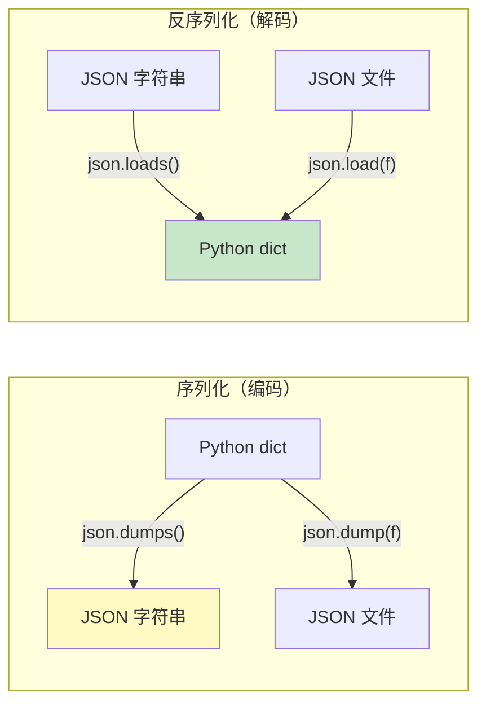

> 💡 **记忆口诀**：`s` 结尾的（`dumps`/`loads`）操作**字符串**，不带 `s` 的（`dump`/`load`）操作**文件**。

### 7.3 处理自定义对象

```python
import json
from datetime import datetime

# —— 方法 1：default 参数处理特殊类型 ——
class Person:
    def __init__(self, name, age):
        self.name = name
        self.age = age

    def to_dict(self):
        return {"name": self.name, "age": self.age}

p = Person("小明", 25)

# 自定义序列化逻辑
json_str = json.dumps(p, default=lambda obj: obj.to_dict(), ensure_ascii=False)
print(json_str)   # {"name": "小明", "age": 25}
```

---

## 八、re —— 正则表达式 🔍

> `re` 模块是文本处理的"瑞士军刀"，用模式匹配来搜索、替换、提取字符串。

### 8.1 常用元字符速查

| 符号 | 含义 | 示例 |
| :--- | :--- | :--- |
| `.` | 任意一个字符（不含换行） | `a.c` → abc, a1c |
| `\d` | 一个数字 | `\d+` → 123 |
| `\D` | 一个非数字 | `\D+` → abc |
| `\w` | 字母/数字/下划线 | `\w+` → hello_1 |
| `\W` | 非字母数字下划线 | `\W` → !, @ |
| `\s` | 空白字符（空格/tab/换行） | `\s+` → 匹配空格 |
| `\S` | 非空白字符 | / |
| `^` | 字符串开头 | `^Hello` |
| `$` | 字符串结尾 | `world$` |
| `*` | 前一个出现 0 次或多次 | `ab*c` → ac, abc, abbc |
| `+` | 前一个出现 1 次或多次 | `ab+c` → abc, abbc |
| `?` | 前一个出现 0 次或 1 次 | `colou?r` → color, colour |
| `{n}` | 精确出现 n 次 | `\d{3}` → 123 |
| `{n,m}` | 出现 n 到 m 次 | `\d{2,4}` → 12, 123, 1234 |
| `[...]` | 字符集合 | `[aeiou]` → 元音字母 |
| `(...)` | 捕获分组 | `(\d+)-(\d+)` |
| `|` | 或 | `cat\|dog` → cat 或 dog |

### 8.2 核心函数

```python
import re

# —— re.search：搜索第一个匹配（返回 Match 对象或 None）——
m = re.search(r"\d+", "电话号码是13800138000")
if m:
    print(m.group())    # '13800138000'

# —— re.match：从字符串开头匹配 ——
m = re.match(r"Hello", "Hello World")   # 匹配成功
m = re.match(r"Hello", "Say Hello")     # 返回 None（不是开头）

# —— re.findall：找到所有匹配，返回列表 ——
numbers = re.findall(r"\d+", "a1b22c333")
print(numbers)   # ['1', '22', '333']

# —— re.finditer：找到所有匹配，返回迭代器（更省内存）——
for m in re.finditer(r"\d+", "a1b22c333"):
    print(m.group(), m.span())   # 值 + 位置范围

# —— re.sub：替换匹配到的内容 ——
# 把所有数字替换为 #
result = re.sub(r"\d", "#", "abc123def456")
print(result)    # 'abc###def###'

# 用函数做更复杂的替换（匹配到的内容传入函数）
def double(match):
    num = int(match.group())
    return str(num * 2)
result = re.sub(r"\d+", double, "a1b22c333")
print(result)    # 'a2b44c666'

# —— re.split：用正则分割字符串 ——
parts = re.split(r"[,;\s]+", "a,b; c d;;e")
print(parts)     # ['a', 'b', 'c', 'd', 'e']
```

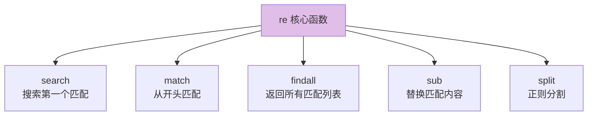

### 8.3 分组与命名捕获

```python
import re

# —— 普通分组 ——
m = re.search(r"(\d{4})-(\d{2})-(\d{2})", "日期：2026-08-11")
print(m.group(0))   # '2026-08-11'（整体匹配）
print(m.group(1))   # '2026'（第 1 组）
print(m.group(2))   # '08'（第 2 组）
print(m.group(3))   # '11'（第 3 组）
print(m.groups())   # ('2026', '08', '11')

# —— 命名分组（更可读！）——
m = re.search(r"(?P<year>\d{4})-(?P<month>\d{2})-(?P<day>\d{2})", "2026-08-11")
print(m.group("year"))    # '2026'
print(m.group("month"))   # '08'
print(m.groupdict())      # {'year': '2026', 'month': '08', 'day': '11'}
```

### 8.4 预编译正则（提升性能）

```python
import re

# 如果同一个正则要用很多次，预编译可以提升性能
email_pattern = re.compile(r"[\w.]+@[\w.]+\.\w+")

# 用预编译的对象调用各种方法
email_pattern.search("联系我：test@example.com")    # 搜索
email_pattern.findall("a@b.com, c@d.com")            # 找全部
email_pattern.sub("[邮箱]", "联系test@example.com")   # 替换
```

### 8.5 实战：常见正则模式

```python
import re

# 手机号（中国大陆）
re.match(r"^1[3-9]\d{9}$", "13800138000")     # ✅

# 邮箱（简化版）
re.match(r"^[\w.+-]+@[\w-]+\.[\w.]+$", "test@gmail.com")  # ✅

# URL（简化版）
re.match(r"^https?://[\w./-]+$", "https://www.python.org")  # ✅

# IP 地址
re.match(r"^(\d{1,3}\.){3}\d{1,3}$", "192.168.1.1")  # ✅

# 提取 HTML 标签内容
html = '<p class="x">Hello</p>'
re.search(r'<p[^>]*>(.*?)</p>', html).group(1)   # 'Hello'
```

---

## 九、collections —— 特殊容器 📦

> `collections` 模块提供了比 `list`/`dict`/`set` 更强大的容器数据类型！

### 9.1 Counter —— 计数器

```python
from collections import Counter

# —— 统计元素出现次数 ——
text = "abracadabra"
counter = Counter(text)
print(counter)
# Counter({'a': 5, 'b': 2, 'r': 2, 'c': 1, 'd': 1})

# 最常见的 N 个
print(counter.most_common(2))   # [('a', 5), ('b', 2)]

# 统计列表
words = ["apple", "banana", "apple", "cherry", "banana", "apple"]
word_count = Counter(words)
print(word_count["apple"])      # 3

# Counter 运算
c1 = Counter(a=3, b=1)
c2 = Counter(a=1, b=2)
print(c1 + c2)   # Counter({'a': 4, 'b': 3})
print(c1 - c2)   # Counter({'a': 2})（只保留正数）
```

### 9.2 defaultdict —— 带默认值的字典

```python
from collections import defaultdict

# —— 传统写法：统计单词频率 ——
words = ["apple", "banana", "apple"]
word_count = {}
for word in words:
    if word not in word_count:
        word_count[word] = 0
    word_count[word] += 1

# —— 用 defaultdict：自动初始化默认值 ——
word_count = defaultdict(int)     # 默认值为 0
for word in words:
    word_count[word] += 1         # 不存在的 key 自动赋 0，再加 1
print(dict(word_count))           # {'apple': 2, 'banana': 1}

# 常见默认工厂
d1 = defaultdict(list)            # 默认值为空列表 []
d1["a"].append(1)                 # 自动创建 d1["a"] = []，再 append
d1["a"].append(2)
print(d1["a"])                    # [1, 2]

d2 = defaultdict(str)             # 默认值为空字符串 ""
print(d2["name"])                 # ''（不会报 KeyError）
```

### 9.3 OrderedDict —— 有序字典

```python
from collections import OrderedDict

# Python 3.7+ 普通 dict 已经保持插入顺序了
# 但 OrderedDict 有额外功能：move_to_end / popitem

od = OrderedDict([("a", 1), ("b", 2), ("c", 3)])

# 把某个键移到末尾
od.move_to_end("a")       # OrderedDict([('b', 2), ('c', 3), ('a', 1)])

# 弹出最后一个元素
od.popitem()              # ('a', 1)

# 弹出第一个元素
od.popitem(last=False)    # ('b', 2)
```

> 💡 Python 3.7+ 后普通 `dict` 已经是有序的，所以 `OrderedDict` 用得少了，但 `move_to_end` 和 `popitem(last=False)` 仍然很有用（比如实现 LRU 缓存）。

### 9.4 namedtuple —— 命名元组

```python
from collections import namedtuple

# —— 创建一个命名元组类 ——
Point = namedtuple("Point", ["x", "y"])
#                       类名      字段名列表

# —— 使用 ——
p = Point(3, 4)
print(p.x)          # 3（用名字访问，比 p[0] 更可读）
print(p.y)          # 4
print(p[0])         # 3（也支持索引访问）

# 解包
x, y = p

# 转字典
print(p._asdict())  # {'x': 3, 'y': 4}

# 替换某个字段（返回新对象，原对象不变）
p2 = p._replace(x=10)
print(p2)           # Point(x=10, y=4)
```

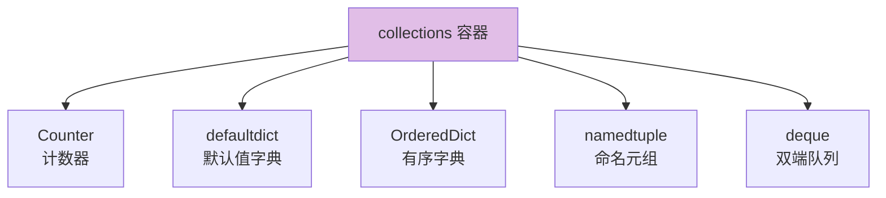

### 9.5 deque —— 双端队列

```python
from collections import deque

# —— 创建 deque ——
dq = deque([1, 2, 3])

# —— 两端都能快速增删（O(1)）——
dq.appendleft(0)       # deque([0, 1, 2, 3])
dq.append(4)           # deque([0, 1, 2, 3, 4])
dq.popleft()           # 0（返回并删除左端）
dq.pop()               # 4（返回并删除右端）

# —— 限制大小（自动丢弃旧元素）——
dq = deque(maxlen=3)
dq.extend([1, 2, 3, 4])  # deque([2, 3, 4])，1 被挤出去了

# —— 旋转 ——
dq = deque([1, 2, 3, 4, 5])
dq.rotate(2)           # deque([4, 5, 1, 2, 3])（右移 2 位）
dq.rotate(-1)          # deque([5, 1, 2, 3, 4])（左移 1 位）
```

> 💡 需要**队列（FIFO）** 或 **栈（LIFO）** 时，`deque` 比 `list` 更高效（`list` 在头部插入/删除是 O(n)）。

---

## 十、itertools —— 迭代器工具 🔧

> `itertools` 提供了一组用于创建和操作迭代器的函数，高效又优雅！

### 10.1 常用函数分类

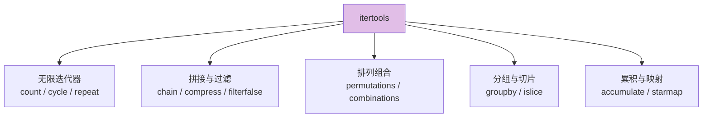

### 10.2 无限迭代器

```python
from itertools import count, cycle, repeat

# count：从 start 开始，无限递增
for i in count(10, 2):      # 从 10 开始，步长 2
    if i > 20:
        break
    print(i)                # 10, 12, 14, 16, 18, 20

# cycle：无限循环遍历可迭代对象
colors = cycle(["红", "绿", "蓝"])
for i, color in enumerate(colors):
    if i >= 5:
        break
    print(color)            # 红, 绿, 蓝, 红, 绿

# repeat：重复一个元素
list(repeat("Hi", 3))       # ['Hi', 'Hi', 'Hi']
```

### 10.3 拼接与过滤

```python
from itertools import chain, chain.from_iterable, compress, filterfalse

# chain：把多个可迭代对象"串联"起来
list(chain([1, 2], [3, 4], [5]))    # [1, 2, 3, 4, 5]

# chain.from_iterable：从一个嵌套的可迭代对象串联
nested = [[1, 2], [3, 4], [5]]
list(chain.from_iterable(nested))   # [1, 2, 3, 4, 5]

# compress：用选择器过滤元素
data = ["a", "b", "c", "d"]
selectors = [True, False, True, False]
list(compress(data, selectors))     # ['a', 'c']

# filterfalse：保留不满足条件的元素（与 filter 相反）
list(filterfalse(lambda x: x % 2, [1, 2, 3, 4]))  # [2, 4]（保留偶数）
```

### 10.4 排列组合（超实用！）

```python
from itertools import permutations, combinations, combinations_with_replacement, product

# permutations：排列（有序，不重复取）
list(permutations("ABC", 2))
# [('A','B'), ('A','C'), ('B','A'), ('B','C'), ('C','A'), ('C','B')]

# combinations：组合（无序，不重复取）
list(combinations("ABC", 2))
# [('A','B'), ('A','C'), ('B','C')]

# combinations_with_replacement：可重复取的组合
list(combinations_with_replacement("AB", 2))
# [('A','A'), ('A','B'), ('B','B')]

# product：笛卡尔积（相当于多层嵌套循环）
list(product("AB", "12"))
# [('A','1'), ('A','2'), ('B','1'), ('B','2')]

# 实用场景：生成所有可能的密码组合
chars = "abc"
list(product(chars, repeat=2))   # aa, ab, ac, ba, bb, bc, ca, cb, cc
```

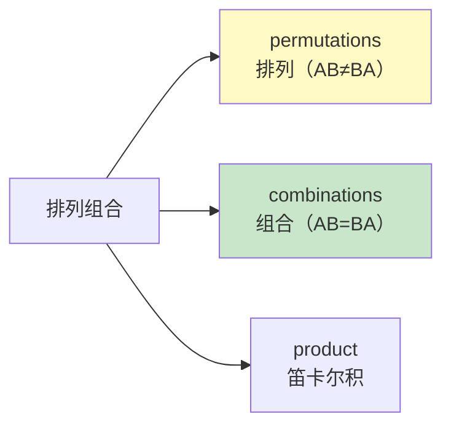

### 10.5 分组与切片

```python
from itertools import groupby, islice

# groupby：按 key 函数分组（注意：需要先排序！）
data = [("苹果", 5), ("香蕉", 3), ("苹果", 2), ("香蕉", 6)]
data.sort(key=lambda x: x[0])   # 先按名字排序

for name, items in groupby(data, key=lambda x: x[0]):
    print(name, list(items))
# 苹果 [('苹果', 5), ('苹果', 2)]
# 香蕉 [('香蕉', 3), ('香蕉', 6)]

# islice：对迭代器切片（不支持下标，用 islice 代替）
list(islice(range(100), 5, 10))     # [5, 6, 7, 8, 9]（第5~9个）
list(islice(range(100), 5))         # [0, 1, 2, 3, 4]（前5个）
```

### 10.6 累积

```python
from itertools import accumulate

# accumulate：累积运算（默认是累加）
list(accumulate([1, 2, 3, 4]))              # [1, 3, 6, 10]

# 累积乘法
import operator
list(accumulate([1, 2, 3, 4], operator.mul)) # [1, 2, 6, 24]

# 累积最大值
list(accumulate([3, 1, 4, 1, 5], max))       # [3, 3, 4, 4, 5]
```

---

## 十一、functools —— 函数工具 🛠️

> `functools` 提供高阶函数，用于函数的缓存、偏函数、装饰器等。

### 11.1 lru_cache —— 自动缓存（超实用！）

```python
from functools import lru_cache

# —— 斐波那契数列：不缓存的话会慢到爆炸 ——
@lru_cache(maxsize=128)   # 缓存最近 128 次调用的结果
def fib(n):
    if n < 2:
        return n
    return fib(n - 1) + fib(n - 2)

print(fib(100))    # 瞬间出结果！不缓存的话要算到天荒地老...

# Python 3.9+ 推荐用更简洁的写法
from functools import cache

@cache              # 无限缓存（等价于 lru_cache(maxsize=None)）
def fib(n):
    if n < 2:
        return n
    return fib(n - 1) + fib(n - 2)

# 查看缓存信息
print(fib.cache_info())   # CacheInfo(hits=98, misses=101, ...)

# 清空缓存
fib.cache_clear()
```

> ⚠️ `lru_cache` 的函数参数必须是**可哈希的**（int/str/tuple 等），不能传 list/dict。

### 11.2 partial —— 偏函数（固定部分参数）

```python
from functools import partial

# 把两数相乘的函数
def multiply(x, y):
    return x * y

# 固定 x=2，创建一个"双倍"函数
double = partial(multiply, 2)
print(double(5))    # 10
print(double(10))   # 20

# 固定 x=3，创建一个"三倍"函数
triple = partial(multiply, 3)
print(triple(5))    # 15

# 实用场景：简化 int(x, base) 调用
int("1010", 2)   # 10（二进制转十进制）

# 创建一个专门的"二进制转十进制"函数
bin_to_dec = partial(int, base=2)
print(bin_to_dec("1010"))   # 10
print(bin_to_dec("1111"))   # 15
```

### 11.3 reduce —— 归约

```python
from functools import reduce
import operator

# reduce：把列表逐次用函数合并，最终得到一个值
# 流程：f(f(f(a, b), c), d) ...

# 求列表元素乘积
reduce(operator.mul, [1, 2, 3, 4])    # 24（= 1*2*3*4）

# 求列表最大值
reduce(max, [3, 1, 4, 1, 5])          # 5

# 带初始值
reduce(operator.add, [1, 2, 3], 100)  # 106（初始值 100 + 1+2+3）

# 展开嵌套列表
reduce(operator.concat, [[1, 2], [3, 4], [5]])  # [1, 2, 3, 4, 5]
```

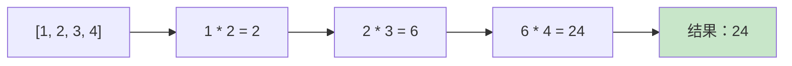

### 11.4 wraps —— 装饰器辅助

```python
from functools import wraps

# 写装饰器时，一定要用 @wraps 保留原函数的信息！
def my_decorator(func):
    @wraps(func)          # ← 这一行很重要！
    def wrapper(*args, **kwargs):
        print("函数执行前")
        result = func(*args, **kwargs)
        print("函数执行后")
        return result
    return wrapper

@my_decorator
def say_hello(name):
    """这是一个打招呼的函数"""
    print(f"Hello, {name}")

# 有了 @wraps，__name__ 和 __doc__ 还是原来的
print(say_hello.__name__)   # 'say_hello'（不是 'wrapper'）
print(say_hello.__doc__)    # '这是一个打招呼的函数'
```

---

## 十二、typing —— 类型注解 🏷️

> `typing` 模块让你给代码加上类型提示，IDE 智能补全、静态检查（mypy）的好帮手！

### 12.1 基本类型注解

```python
from typing import Optional, Union, List, Dict, Tuple, Any, Callable

# —— 变量类型 ——
name: str = "小明"
age: int = 25
height: float = 1.75
is_student: bool = False

# —— 函数注解 ——
def greet(name: str, times: int = 1) -> str:
    return f"Hello, {name}! " * times

# —— 容器类型（Python 3.9+ 可以直接用小写 list/dict）——
names: list[str] = ["Alice", "Bob"]                  # Python 3.9+
scores: dict[str, int] = {"Alice": 90, "Bob": 85}    # Python 3.9+
point: tuple[int, int] = (3, 4)                       # Python 3.9+

# Python 3.8 及更早版本需要从 typing 导入
names_old: List[str] = ["Alice", "Bob"]
scores_old: Dict[str, int] = {"Alice": 90}
```

### 12.2 高级类型

```python
from typing import Optional, Union, Literal, Callable, Any

# Optional：可选（等价于 Union[X, None]）
def find_user(user_id: int) -> Optional[str]:
    if user_id == 1:
        return "Alice"
    return None              # 可以返回 None

# Union：联合类型（可以是多种类型之一）
def process(data: Union[str, bytes]) -> str:
    if isinstance(data, bytes):
        return data.decode()
    return data

# Python 3.10+ 可以用 | 语法
def process(data: str | bytes) -> str:     # 等价于 Union[str, bytes]
    ...

# Literal：字面量类型（限定具体值）
def set_mode(mode: Literal["train", "eval", "test"]) -> None:
    ...

# Callable：可调用对象（函数/lambda）
def apply(func: Callable[[int, int], int], a: int, b: int) -> int:
    return func(a, b)

# Any：任意类型（尽量少用，失去了类型检查的意义）
def log(message: Any) -> None:
    print(message)
```

### 12.3 类型注解速查表

| 类型注解 | 含义 | Python 版本 |
| :--- | :--- | :--- |
| `list[str]` | 字符串列表 | 3.9+ |
| `dict[str, int]` | 键为 str，值为 int | 3.9+ |
| `tuple[int, str]` | 固定长度的元组 | 3.9+ |
| `Optional[str]` | str 或 None | 全版本 |
| `Union[str, int]` | str 或 int | 全版本 |
| `str \| int` | str 或 int（管道语法） | 3.10+ |
| `Literal["a", "b"]` | 只能是 "a" 或 "b" | 3.8+ |
| `Callable[[int], str]` | 参数 int 返回 str | 全版本 |
| `Any` | 任意类型 | 全版本 |

> 💡 类型注解**不影响运行**，只是给开发者和工具看的。用 `mypy` 工具可以静态检查类型是否正确。

---

## 十三、logging —— 日志记录 📝

> `logging` 是 Python 标准日志库，比 `print` 强大得多——支持分级、写入文件、格式化等。

### 13.1 日志级别

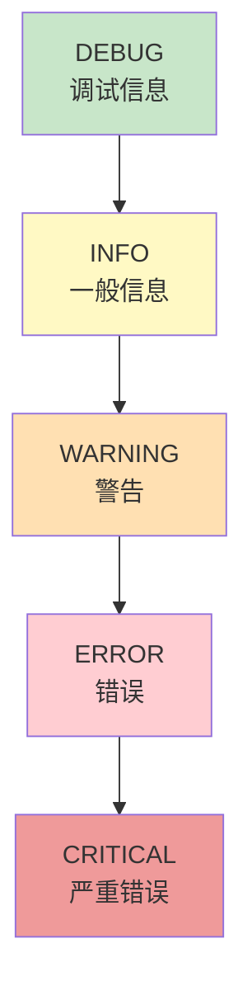

| 级别 | 数值 | 用途 |
| :--- | :---: | :--- |
| `DEBUG` | 10 | 调试细节，最详细 |
| `INFO` | 20 | 确认程序按预期运行 |
| `WARNING` | 30 | 有潜在问题，程序仍运行 |
| `ERROR` | 40 | 出错了，某些功能无法执行 |
| `CRITICAL` | 50 | 严重错误，程序可能无法继续 |

### 13.2 基础用法

```python
import logging

# —— 快速配置 ——
logging.basicConfig(
    level=logging.DEBUG,                   # 最低显示级别
    format="%(asctime)s [%(levelname)s] %(message)s",  # 日志格式
    datefmt="%Y-%m-%d %H:%M:%S",           # 时间格式
    filename="app.log",                    # 写入文件（不设则输出到控制台）
    encoding="utf-8",
)

# —— 使用 ——
logging.debug("这是调试信息")    # 默认不显示（低于 WARNING）
logging.info("程序启动成功")
logging.warning("内存即将不足！")
logging.error("文件不存在！")
logging.critical("系统崩溃！")

# 输出示例：
# 2026-08-11 14:30:00 [INFO] 程序启动成功
# 2026-08-11 14:30:00 [WARNING] 内存即将不足！
```

### 13.3 同时输出到控制台和文件

```python
import logging

# 创建 logger
logger = logging.getLogger("my_app")
logger.setLevel(logging.DEBUG)

# —— 控制台 Handler（只显示 WARNING 及以上）——
console_handler = logging.StreamHandler()
console_handler.setLevel(logging.WARNING)
console_handler.setFormatter(
    logging.Formatter("%(levelname)s: %(message)s")
)

# —— 文件 Handler（记录所有级别）——
file_handler = logging.FileHandler("app.log", encoding="utf-8")
file_handler.setLevel(logging.DEBUG)
file_handler.setFormatter(
    logging.Formatter("%(asctime)s [%(levelname)s] %(name)s: %(message)s")
)

# 添加到 logger
logger.addHandler(console_handler)
logger.addHandler(file_handler)

# 使用
logger.debug("详细调试信息")    # 只写入文件
logger.warning("警告信息")      # 控制台 + 文件都显示
```

> 💡 **最佳实践**：不要在库/模块中调用 `logging.basicConfig()`，应该由最终用户配置。模块中只需要 `logger = logging.getLogger(__name__)` 然后记录日志即可。

---

## 十四、subprocess —— 子进程管理 🚀

> `subprocess` 让你在 Python 中运行外部命令（就像在终端里输入一样）。

### 14.1 基本用法

```python
import subprocess

# —— run：执行命令并等待完成（推荐！）——
result = subprocess.run(
    ["echo", "Hello World"],   # 命令和参数列表
    capture_output=True,       # 捕获输出
    text=True,                 # 输出用文本而非字节
    encoding="utf-8",
)

print(result.returncode)       # 0（返回码，0=成功）
print(result.stdout)           # 'Hello World\n'（标准输出）
print(result.stderr)           # ''（标准错误）

# —— 检查返回码，失败时抛异常 ——
result = subprocess.run(
    ["python", "--version"],
    capture_output=True,
    text=True,
    check=True,                # 返回码非 0 时抛出 CalledProcessError
)
print(result.stdout)   # 'Python 3.12.0\n'

# —— 在 shell 中运行（不推荐，有安全风险！）——
# 只有在需要管道、重定向等 shell 特性时才使用
result = subprocess.run("dir | findstr .py", shell=True, capture_output=True, text=True)
```

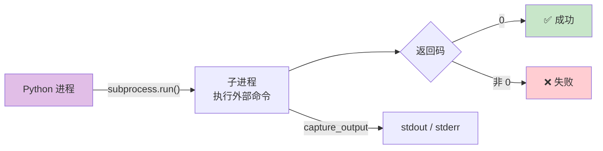

### 14.2 与子进程交互

```python
import subprocess

# —— Popen：更灵活的控制（适合持续交互）——
proc = subprocess.Popen(
    ["python", "-c", "print(input('名字: '))"],
    stdin=subprocess.PIPE,
    stdout=subprocess.PIPE,
    stderr=subprocess.PIPE,
    text=True,
)

# 发送输入，获取输出
stdout, stderr = proc.communicate(input="小明\n")
print(stdout)   # '名字: 小明\n'

# —— 超时控制 ——
try:
    result = subprocess.run(
        ["ping", "google.com"],
        timeout=5,             # 超时 5 秒
        capture_output=True,
        text=True,
    )
except subprocess.TimeoutExpired:
    print("命令执行超时！")
```

> ⚠️ **安全提醒**：永远不要直接把用户输入拼接到 shell 命令中！用列表形式传参可以避免 shell 注入。

---

## 十五、argparse —— 命令行参数解析 🖥️

> `argparse` 让你的 Python 脚本拥有专业的命令行界面。

### 15.1 基本用法

```python
import argparse

# 1. 创建解析器
parser = argparse.ArgumentParser(description="一个示例程序")

# 2. 添加参数
parser.add_argument("name", type=str, help="你的名字")                    # 位置参数
parser.add_argument("-a", "--age", type=int, default=18, help="年龄")     # 可选参数
parser.add_argument("-v", "--verbose", action="store_true", help="详细输出") # 开关参数

# 3. 解析
args = parser.parse_args()

# 4. 使用参数
if args.verbose:
    print(f"详细模式：name={args.name}, age={args.age}")
else:
    print(f"你好，{args.name}！")
```

```bash
# 运行示例
python script.py 小明 --age 25 --verbose
# 详细模式：name=小明, age=25

# 查看帮助（自动生成！超方便）
python script.py -h
# usage: script.py [-h] [-a AGE] [-v] name
#
# 一个示例程序
#
# positional arguments:
#   name                  你的名字
# ...
```

### 15.2 常用参数类型

```python
import argparse

parser = argparse.ArgumentParser()

# —— 位置参数（必填）——
parser.add_argument("input_file", help="输入文件路径")

# —— 可选参数（带默认值）——
parser.add_argument("-o", "--output", default="out.txt", help="输出文件路径")

# —— 开关参数（存在则为 True）——
parser.add_argument("--debug", action="store_true", help="开启调试模式")

# —— 多值参数（nargs）——
parser.add_argument("--files", nargs="+", help="多个文件（至少 1 个）")    # 1 个或多个
parser.add_argument("--nums", nargs="*", help="数字列表（可以 0 个）")     # 0 个或多个
parser.add_argument("--pair", nargs=2, help="一对值")                     # 精确 2 个

# —— 限定取值 ——
parser.add_argument("--mode", choices=["train", "eval", "test"], default="train")

# —— 计数（如 -vvv 表示 verbose 级别 3）——
parser.add_argument("-v", action="count", default=0, help="详细程度")

args = parser.parse_args()
```

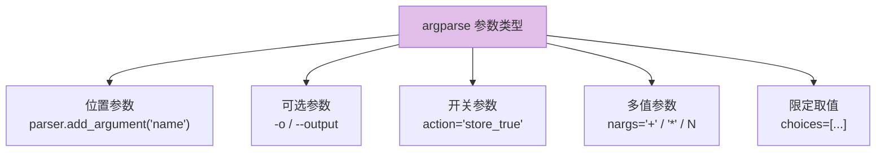

---

## 十六、csv —— CSV 文件处理 📊

> `csv` 模块用于读写 CSV（逗号分隔值）文件，处理表格数据的利器。

### 16.1 读取 CSV

```python
import csv

# —— 用 reader 读取（返回列表）——
with open("data.csv", "r", encoding="utf-8") as f:
    reader = csv.reader(f)
    header = next(reader)          # 第一行是表头
    for row in reader:
        print(row)                 # row 是列表 ['小明', '25', '北京']

# —— 用 DictReader 读取（返回字典，更直观！）——
with open("data.csv", "r", encoding="utf-8") as f:
    reader = csv.DictReader(f)     # 自动用第一行作为 key
    for row in reader:
        print(row["姓名"], row["年龄"])
        # row 是字典 {'姓名': '小明', '年龄': '25', '城市': '北京'}
```

### 16.2 写入 CSV

```python
import csv

# —— 用 writer 写入 ——
with open("output.csv", "w", encoding="utf-8", newline="") as f:
    writer = csv.writer(f)
    writer.writerow(["姓名", "年龄", "城市"])         # 写表头
    writer.writerow(["小明", 25, "北京"])              # 写数据行
    writer.writerows([                                # 批量写入多行
        ["小红", 22, "上海"],
        ["小刚", 28, "广州"],
    ])

# —— 用 DictWriter 写入（更直观）——
data = [
    {"姓名": "小明", "年龄": 25, "城市": "北京"},
    {"姓名": "小红", "年龄": 22, "城市": "上海"},
]

with open("output.csv", "w", encoding="utf-8", newline="") as f:
    writer = csv.DictWriter(f, fieldnames=["姓名", "年龄", "城市"])
    writer.writeheader()            # 写表头
    writer.writerows(data)          # 写所有行
```

> ⚠️ 写入 CSV 时一定要加 `newline=""`，否则在 Windows 上会多出空行！

---

## 十七、shutil —— 高级文件操作 📁

> `shutil` 提供了比 `os` 更高级的文件操作，支持复制、移动、删除目录、压缩等。

```python
import shutil

# —— 复制文件 ——
shutil.copy("source.txt", "dest.txt")       # 复制文件内容和权限
shutil.copy2("source.txt", "dest.txt")      # 复制文件 + 保留所有元数据（修改时间等）

# —— 复制目录（递归）——
shutil.copytree("folder_a", "folder_b")     # 把 folder_a 整个复制到 folder_b

# —— 移动/重命名 ——
shutil.move("old_path", "new_path")

# —— 删除目录（递归删除，小心使用！）——
shutil.rmtree("folder_to_delete")           # 删除整个目录树（不可恢复！）

# —— 压缩/解压 ——
shutil.make_archive("backup", "zip", "folder_to_compress")  # 压缩为 backup.zip
shutil.unpack_archive("backup.zip", "extracted")             # 解压到 extracted 目录

# —— 获取磁盘使用情况 ——
total, used, free = shutil.disk_usage("/")
print(f"总空间：{total // (1024**3)} GB")
print(f"已使用：{used // (1024**3)} GB")
print(f"可用：{free // (1024**3)} GB")
```

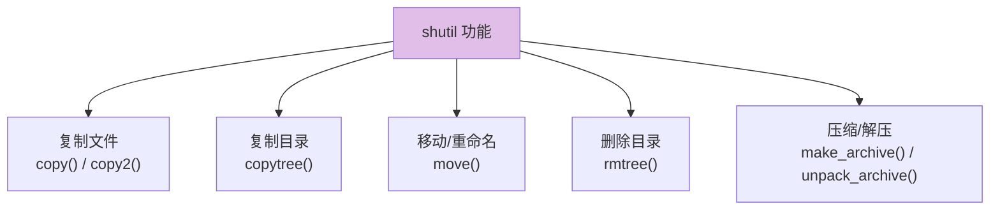

> ⚠️ `shutil.rmtree()` 会永久删除，不进回收站！使用时务必确认路径正确。

---

## 十八、hashlib —— 哈希与加密 🔐

> `hashlib` 提供常见的哈希算法（MD5、SHA-256 等），用于数据完整性校验和密码存储。

### 18.1 基本用法

```python
import hashlib

# —— MD5（速度快，但不安全，不要用于密码存储）——
md5 = hashlib.md5()
md5.update("hello".encode("utf-8"))
print(md5.hexdigest())
# '5d41402abc4b2a76b9719d911017c592'

# 一步到位
hashlib.md5("hello".encode()).hexdigest()

# —— SHA-256（推荐！安全性高）——
sha256 = hashlib.sha256()
sha256.update("hello".encode("utf-8"))
print(sha256.hexdigest())
# '2cf24dba5fb0a30e26e83b2ac5b9e29e1b161e5c1fa7425e73043362938b9824'

# —— SHA-512（更安全，哈希值更长）——
hashlib.sha512("hello".encode()).hexdigest()

# —— 大文件哈希（分块读取，不占内存）——
def file_hash(filepath, algorithm="sha256"):
    h = hashlib.new(algorithm)
    with open(filepath, "rb") as f:
        while chunk := f.read(8192):    # 每次读 8KB
            h.update(chunk)
    return h.hexdigest()

print(file_hash("large_file.zip"))
```

### 18.2 密码存储（加盐）

```python
import hashlib
import os

def hash_password(password: str, salt: bytes = None) -> tuple[str, str]:
    """密码加盐哈希，返回 (salt, hash)"""
    if salt is None:
        salt = os.urandom(32)     # 生成随机盐
    key = hashlib.pbkdf2_hmac(
        "sha256",
        password.encode("utf-8"),
        salt,
        100000,                   # 迭代次数（越大越安全，也越慢）
    )
    return salt.hex(), key.hex()

def verify_password(password: str, salt_hex: str, key_hex: str) -> bool:
    """验证密码"""
    salt = bytes.fromhex(salt_hex)
    _, computed_key = hash_password(password, salt)
    return computed_key == key_hex

# 使用
salt, key = hash_password("mypassword123")
print(f"盐：{salt}")
print(f"哈希：{key}")

# 验证
print(verify_password("mypassword123", salt, key))    # True
print(verify_password("wrongpassword", salt, key))    # False
```

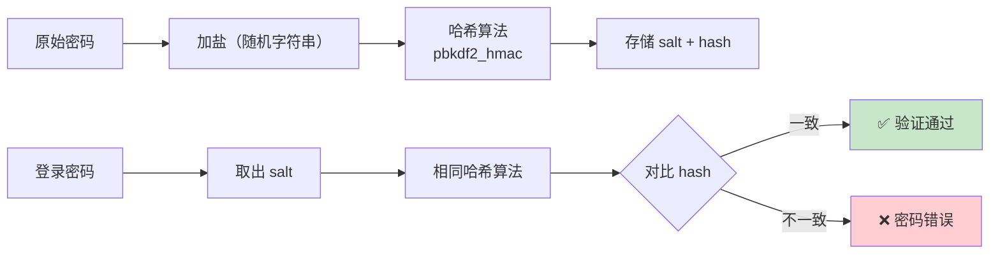

> 💡 **安全建议**：永远不要明文存储密码！用 `pbkdf2_hmac` 或第三方库 `bcrypt`。MD5/SHA-256 直接哈希密码容易被彩虹表破解。

---

## 十九、urllib —— URL 请求处理 🌐

> `urllib` 是 Python 内置的 HTTP 请求库（功能基础，复杂场景推荐用第三方 `requests` 库）。

### 19.1 发送请求

```python
from urllib.request import urlopen, Request
from urllib.parse import urlencode, quote, unquote
import json

# —— GET 请求 ——
response = urlopen("https://httpbin.org/get")
content = response.read().decode("utf-8")
print(json.loads(content))

# —— 带自定义头的请求 ——
req = Request(
    "https://httpbin.org/get",
    headers={
        "User-Agent": "MyApp/1.0",
        "Accept": "application/json",
    }
)
response = urlopen(req)
data = json.loads(response.read().decode("utf-8"))
print(response.status)       # 200
print(response.headers)      # 响应头

# —— POST 请求（发送表单数据）——
data = urlencode({"name": "小明", "age": 25}).encode("utf-8")
req = Request("https://httpbin.org/post", data=data, method="POST")
response = urlopen(req)
print(json.loads(response.read().decode("utf-8")))

# —— POST 请求（发送 JSON）——
json_data = json.dumps({"name": "小明"}).encode("utf-8")
req = Request(
    "https://httpbin.org/post",
    data=json_data,
    headers={"Content-Type": "application/json"},
    method="POST",
)
response = urlopen(req)
```

### 19.2 URL 编码与解析

```python
from urllib.parse import urlencode, quote, unquote, urlparse, parse_qs

# —— URL 编码 ——
# urlencode：把字典转为查询字符串
query = urlencode({"name": "小明", "age": 25})
print(query)   # 'name=%E5%B0%8F%E6%98%8E&age=25'

# quote：编码单个字符串（用于 URL 路径中的中文等特殊字符）
encoded = quote("文件 名称.txt")
print(encoded)  # '%E6%96%87%E4%BB%B6%20%E5%90%8D%E7%A7%B0.txt'

# unquote：解码
print(unquote(encoded))   # '文件 名称.txt'

# —— URL 解析 ——
url = "https://www.example.com:8080/path/to/page?key=value&name=小明#section"
parsed = urlparse(url)
print(parsed.scheme)    # 'https'
print(parsed.netloc)    # 'www.example.com:8080'
print(parsed.path)      # '/path/to/page'
print(parsed.query)     # 'key=value&name=小明'

# parse_qs：解析查询字符串为字典
print(parse_qs(parsed.query))   # {'key': ['value'], 'name': ['小明']}
```

> 💡 `urllib` 虽然内置但 API 比较繁琐，实际开发推荐用第三方库 `requests`（`pip install requests`），更简洁好用。

---

## 二十、常用标准库速查表 📖

| 模块 | 用途 | 常用函数/类 |
| :--- | :--- | :--- |
| `os` | 操作系统交互 | `getcwd()`, `listdir()`, `path.join()` |
| `sys` | 解释器交互 | `argv`, `path`, `exit()` |
| `pathlib` | 现代路径处理 | `Path()`, `.read_text()`, `.glob()` |
| `math` | 数学运算 | `sqrt()`, `ceil()`, `pi`, `factorial()` |
| `random` | 随机数 | `randint()`, `choice()`, `shuffle()`, `seed()` |
| `datetime` | 日期时间 | `now()`, `strftime()`, `strptime()`, `timedelta` |
| `json` | JSON 处理 | `dumps()`, `loads()`, `dump()`, `load()` |
| `re` | 正则表达式 | `search()`, `match()`, `findall()`, `sub()` |
| `collections` | 特殊容器 | `Counter`, `defaultdict`, `namedtuple`, `deque` |
| `itertools` | 迭代器工具 | `chain()`, `permutations()`, `groupby()` |
| `functools` | 函数工具 | `lru_cache`, `partial`, `reduce`, `wraps` |
| `typing` | 类型注解 | `Optional`, `Union`, `List`, `Callable` |
| `logging` | 日志记录 | `basicConfig()`, `getLogger()`, `info()` |
| `subprocess` | 子进程 | `run()`, `Popen()` |
| `argparse` | 命令行参数 | `ArgumentParser`, `add_argument()` |
| `csv` | CSV 文件 | `reader()`, `DictReader()`, `writer()` |
| `shutil` | 高级文件操作 | `copy()`, `copytree()`, `rmtree()`, `make_archive()` |
| `hashlib` | 哈希加密 | `md5()`, `sha256()`, `pbkdf2_hmac()` |
| `urllib` | URL 请求 | `urlopen()`, `urlencode()`, `urlparse()` |

> 🎀 这张表建议收藏！写代码时随时查阅，不用死记硬背～

---

> 呼～一口气把最常用的标准库都过了一遍！🎉 标准库就像 Python 的"自带百宝箱"，掌握这些你就能应对大部分日常需求啦！后续遇到更复杂的场景（如 Web 开发、数据分析），再学第三方库就水到渠成啦～ (◍•ᴗ•◍)❤