# 🧵 Python 并发编程

> 哈喽呀～欢迎来到 Python 并发编程的冒险世界！🌟 在这里你将学会如何让程序"一心多用"，同时处理多件事情，效率翻倍！准备好了吗？出发吧！(๑•̀ㅂ•́)و✧

---

## 🗺️ 并发编程全景图

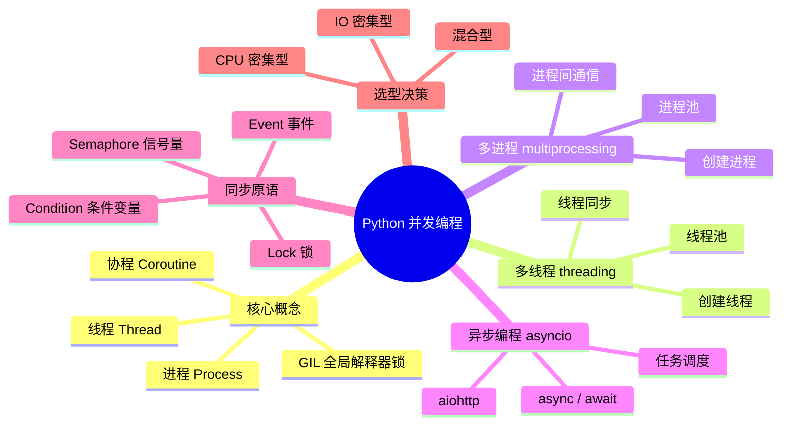

---

## 📑 目录

- [一、核心概念：进程、线程、协程](#一核心概念进程线程协程)
- [二、GIL：Python 并发的"紧箍咒"](#二gilpython-并发的紧箍咒)
- [三、threading —— 多线程编程](#三threading--多线程编程)
- [四、multiprocessing —— 多进程编程](#四multiprocessing--多进程编程)
- [五、concurrent.futures —— 线程池与进程池](#五concurrentfutures--线程池与进程池)
- [六、asyncio —— 异步编程](#六asyncio--异步编程)
- [七、同步原语详解](#七同步原语详解)
- [八、Queue —— 线程安全的队列](#八queue--线程安全的队列)
- [九、三种并发模型对比与选型](#九三种并发模型对比与选型)
- [十、实战案例](#十实战案例)

---

## 一、核心概念：进程、线程、协程 🧠

> 在学具体代码之前，先搞懂三个最核心的概念！它们是并发编程的"地基"～

### 1.1 一个比喻秒懂三者

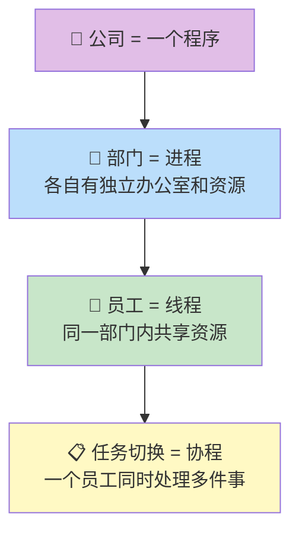

| 概念 | 比喻 | 特点 | 切换成本 |
| :--- | :--- | :--- | :---: |
| **进程** | 公司里的独立部门 | 内存独立，互不干扰 | 高（最重） |
| **线程** | 部门里的员工 | 共享进程内存，能直接通信 | 中 |
| **协程** | 员工的多任务切换 | 用户态切换，极轻量 | 低（最轻） |

### 1.2 进程 vs 线程 vs 协程

| 对比项 | 进程 | 线程 | 协程 |
| :--- | :--- | :--- | :--- |
| **内存** | 独立内存空间 | 共享进程内存 | 共享线程内存 |
| **创建开销** | 大（~MB 级） | 中（~KB 级） | 极小（~字节级） |
| **通信方式** | 管道/队列/共享内存 | 直接读写共享变量 | 直接读写共享变量 |
| **并发数** | 几十~几百 | 几百~几千 | 几千~几万 |
| **是否受 GIL 限制** | ❌ 不受 | ✅ 受限 | ✅ 受限（单线程内） |
| **适合场景** | CPU 密集型 | IO 密集型 | IO 密集型（高并发） |

### 1.3 并发 vs 并行

> 这两个词经常被搞混，一定要分清！

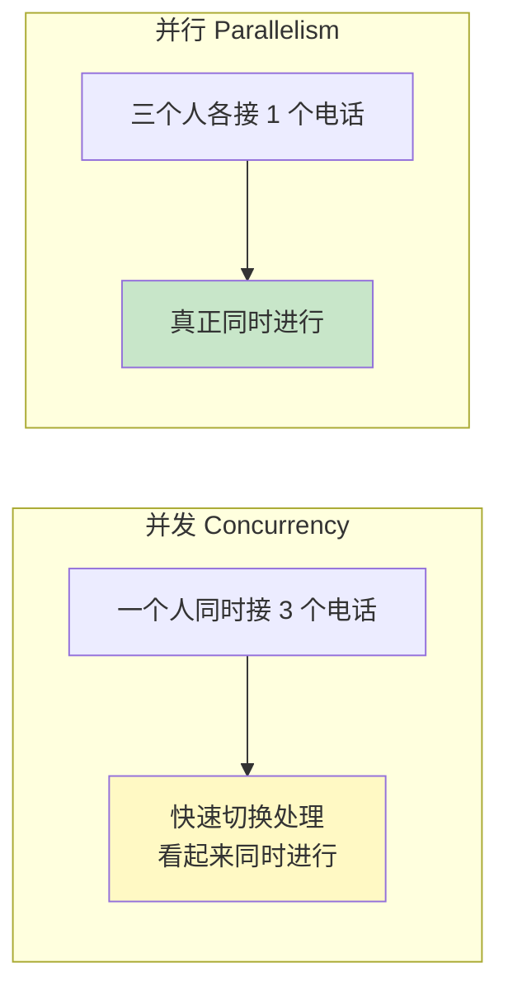

| 概念 | 本质 | 例子 |
| :--- | :--- | :--- |
| **并发** | 多任务**交替**执行（同一时间只做一个，但切换快） | 一个 CPU 核心跑多个线程 |
| **并行** | 多任务**同时**执行（多个核心各做各的） | 多核 CPU 跑多个进程 |

> 💡 **通俗记忆**：并发是"一个人同时处理多件事"（快速切换），并行是"多个人各做各的事"（真正同时）。

---

## 二、GIL：Python 并发的"紧箍咒" 🔒

> 学 Python 并发绕不开 GIL，它影响了多线程的性能表现，必须搞懂！

### 2.1 什么是 GIL？

**GIL（Global Interpreter Lock，全局解释器锁）** 是 CPython（官方 Python）中的一个**互斥锁**，它保证**同一时刻只有一个线程在执行 Python 字节码**。

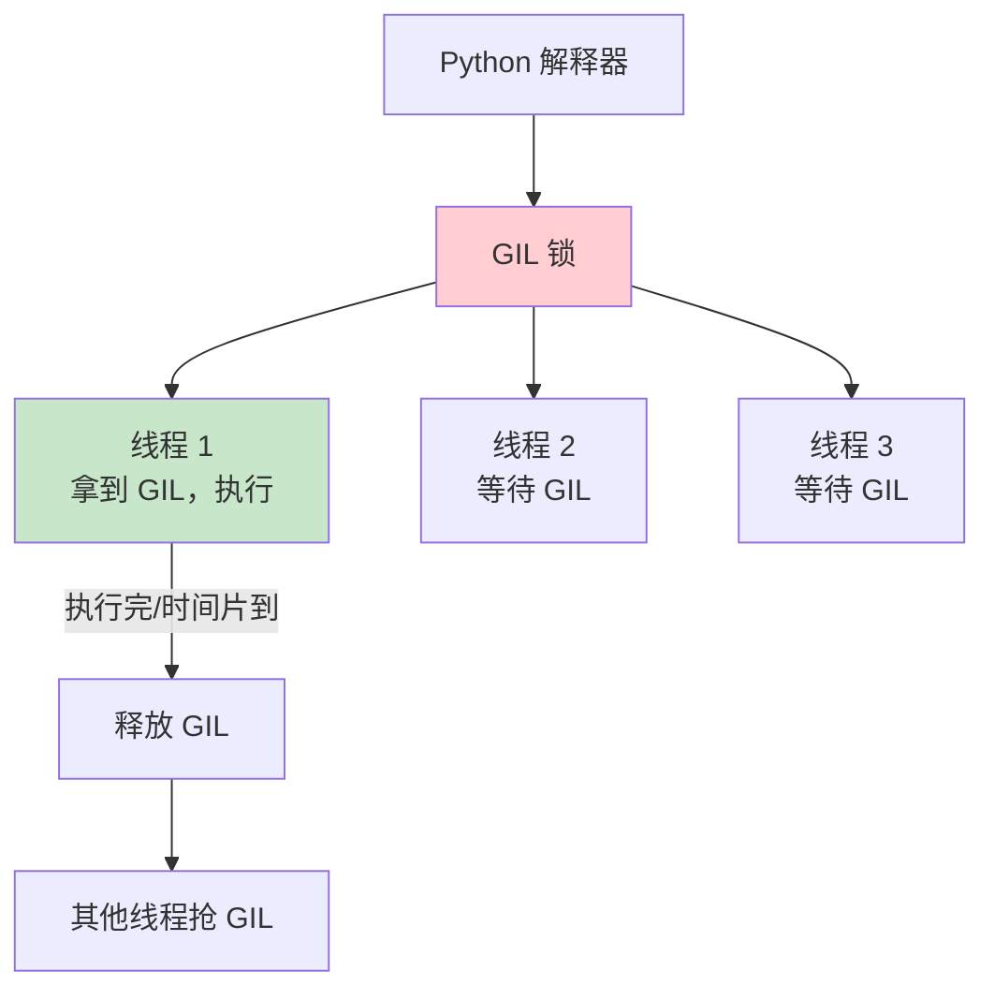

### 2.2 为什么有 GIL？

Python 的**内存管理**（特别是引用计数垃圾回收）**不是线程安全**的。有了 GIL，就不用在每个对象上加锁了，简化了实现。

| 有 GIL 的好处 | 有 GIL 的坏处 |
| :--- | :--- |
| 单线程程序更快（不用频繁加锁） | 多线程无法利用多核 CPU |
| C 扩展开发更简单 | CPU 密集型任务多线程没效果 |

### 2.3 GIL 的影响

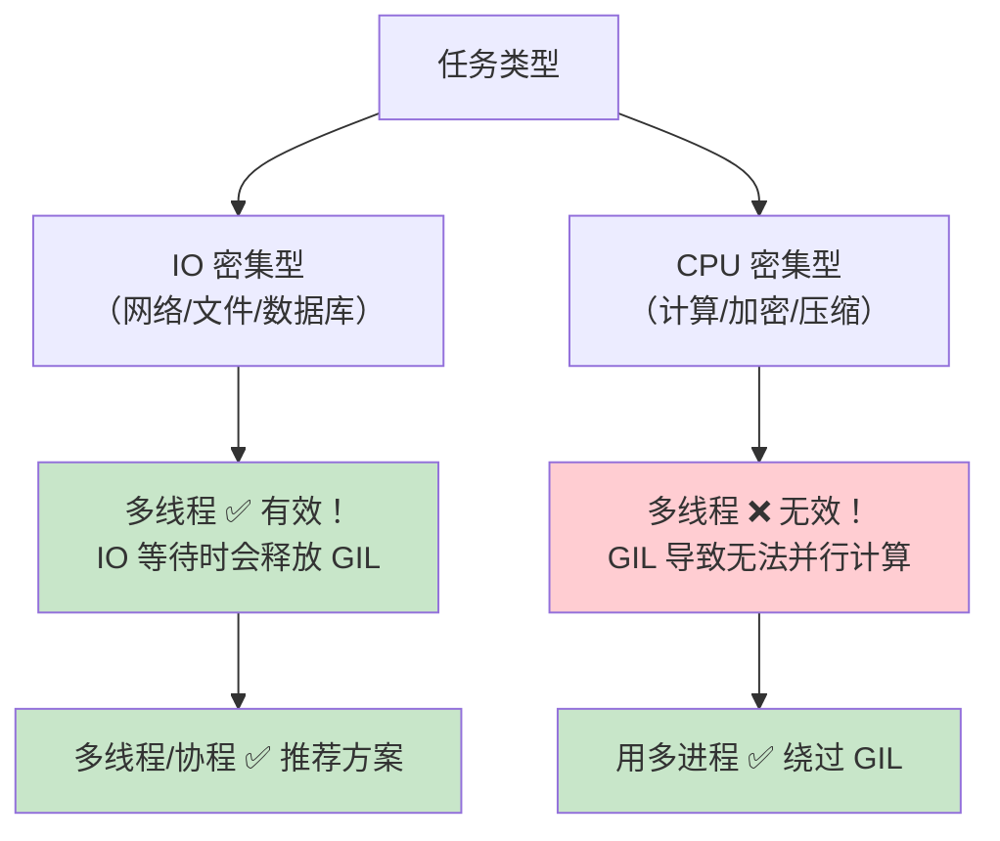

> 💡 **关键认知**：
> - **IO 密集型**（网络请求、文件读写、数据库）→ **多线程有效**（IO 等待时会释放 GIL）
> - **CPU 密集型**（数值计算、加密、图像处理）→ **用多进程**（绕过 GIL）
> - GIL 只影响 **CPython**，**Jython、IronPython** 没有 GIL

### 2.4 如何绕过 GIL？

| 方案 | 适用场景 |
| :--- | :--- |
| 使用 `multiprocessing` 多进程 | CPU 密集型（每个进程有独立 GIL） |
| 使用 C 扩展（如 numpy） | 计算密集型（C 代码中释放 GIL） |
| 使用协程 asyncio | IO 密集型高并发 |

---

## 三、threading —— 多线程编程 🧵

> `threading` 是 Python 标准的多线程模块，适合 IO 密集型任务。

### 3.1 创建线程的两种方式

```python
import threading
import time

# —— 方式 1：函数 + Thread（推荐，简洁）——
def download_file(url, filename):
    print(f"开始下载 {filename}...")
    time.sleep(2)           # 模拟下载耗时
    print(f"{filename} 下载完成！")

# 创建线程
t = threading.Thread(target=download_file, args=("http://example.com", "file.zip"))
t.start()      # 启动线程
t.join()       # 等待线程完成（主线程阻塞）

# —— 方式 2：继承 Thread 类（适合复杂逻辑）——
class DownloadThread(threading.Thread):
    def __init__(self, url, filename):
        super().__init__()
        self.url = url
        self.filename = filename

    def run(self):         # 重写 run 方法
        print(f"开始下载 {self.filename}...")
        time.sleep(2)
        print(f"{self.filename} 下载完成！")

t = DownloadThread("http://example.com", "file.zip")
t.start()
t.join()
```

### 3.2 多线程并发执行

```python
import threading
import time

def task(name, duration):
    print(f"[{name}] 开始")
    time.sleep(duration)
    print(f"[{name}] 完成（耗时 {duration}s）")

# —— 串行执行（一个一个来）——
start = time.time()
task("A", 2)
task("B", 3)
task("C", 1)
print(f"串行总耗时：{time.time() - start:.1f}s")   # ~6s

# —— 并发执行（同时跑）——
start = time.time()
threads = []
for name, dur in [("A", 2), ("B", 3), ("C", 1)]:
    t = threading.Thread(target=task, args=(name, dur))
    threads.append(t)
    t.start()

for t in threads:
    t.join()                # 等待所有线程完成

print(f"并发总耗时：{time.time() - start:.1f}s")   # ~3s（取最长的那个）
```

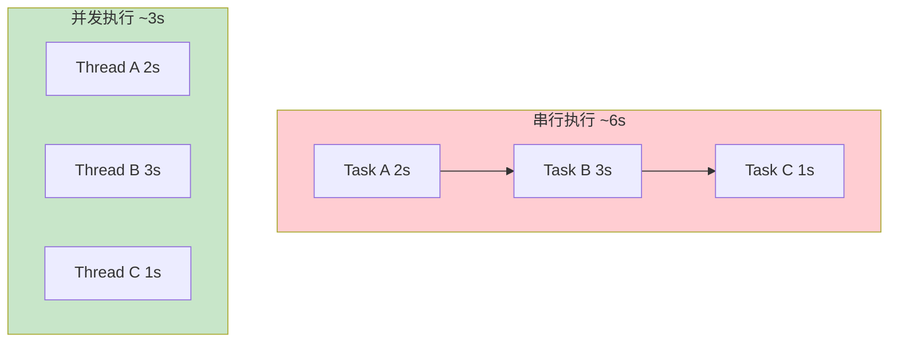

### 3.3 线程的常用方法

```python
import threading
import time

def worker():
    time.sleep(2)
    print("工作完成")

t = threading.Thread(target=worker, daemon=True)   # daemon=True 守护线程

# 常用方法
t.start()              # 启动线程
t.join(timeout=5)      # 等待线程结束（最多等 5 秒）
t.is_alive()           # 线程是否还在运行
t.name = "my-thread"   # 设置线程名
t.daemon               # 是否为守护线程

# threading 模块的实用功能
threading.current_thread()       # 获取当前线程对象
threading.main_thread()          # 获取主线程对象
threading.active_count()         # 当前活跃线程数
threading.enumerate()            # 列出所有活跃线程
```

| 方法/属性 | 作用 |
| :--- | :--- |
| `t.start()` | 启动线程（只能调用一次） |
| `t.join(timeout)` | 等待线程结束 |
| `t.is_alive()` | 线程是否存活 |
| `t.daemon = True` | 设为守护线程（主线程结束就跟着退出） |
| `t.name` | 线程名称 |

> ⚠️ **守护线程**：`daemon=True` 的线程会在主线程结束时**自动退出**，适合后台任务（如心跳检测）。非守护线程会阻止程序退出。

### 3.4 线程安全问题

```python
import threading

# —— 危险！多线程操作共享变量 ——
counter = 0

def increment():
    global counter
    for _ in range(100000):
        counter += 1    # 不是原子操作！可能被其他线程打断

# 创建 5 个线程同时 +1
threads = [threading.Thread(target=increment) for _ in range(5)]
for t in threads:
    t.start()
for t in threads:
    t.join()

print(f"期望值：500000，实际值：{counter}")
# 实际值很可能小于 500000！因为 += 不是原子操作
```

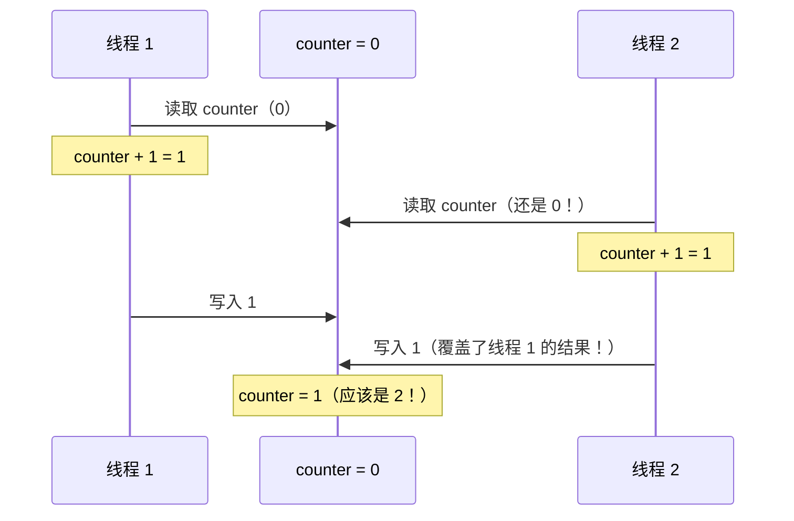

> 💡 `counter += 1` 实际上是三步操作：①读取 counter ②加 1 ③写回 counter。在这三步之间可能被其他线程打断，导致数据不一致。

**解决方法：加锁！**

```python
import threading

counter = 0
lock = threading.Lock()      # 创建锁

def increment():
    global counter
    for _ in range(100000):
        lock.acquire()       # 获取锁
        counter += 1
        lock.release()       # 释放锁

# 或者用 with 语法（推荐！自动加锁解锁，不会忘记释放）
def increment_safe():
    global counter
    for _ in range(100000):
        with lock:           # 进入时自动加锁，离开时自动解锁
            counter += 1

threads = [threading.Thread(target=increment_safe) for _ in range(5)]
for t in threads:
    t.start()
for t in threads:
    t.join()

print(f"期望值：500000，实际值：{counter}")  # ✅ 500000
```

详见 [第七节：同步原语详解](#七同步原语详解)。

---

## 四、multiprocessing —— 多进程编程 🏭

> `multiprocessing` 创建独立进程，每个进程有自己的 GIL，能真正利用多核 CPU！

### 4.1 创建进程

```python
from multiprocessing import Process
import os
import time

def worker(name, duration):
    print(f"[{name}] 进程 PID={os.getpid()}，父进程 PPID={os.getppid()}")
    time.sleep(duration)
    print(f"[{name}] 完成")

# 创建并启动进程
p = Process(target=worker, args=("Worker-A", 2))
p.start()       # 启动子进程
p.join()        # 等待子进程完成
print(f"主进程 PID={os.getpid()}")
```

> ⚠️ **Windows 注意**：多进程代码必须放在 `if __name__ == "__main__":` 中，否则会无限递归创建进程！

```python
from multiprocessing import Process

def worker(n):
    print(f"工作 {n}")

if __name__ == "__main__":      # Windows 必须加这行！
    processes = [Process(target=worker, args=(i,)) for i in range(4)]
    for p in processes:
        p.start()
    for p in processes:
        p.join()
```

### 4.2 进程 vs 线程对比

```python
import time
from multiprocessing import Process
from threading import Thread

# CPU 密集型任务
def cpu_heavy(n):
    total = 0
    for i in range(n):
        total += i * i
    return total

def run_workers(worker_class, count=4, n=5_000_000):
    workers = [worker_class(target=cpu_heavy, args=(n,)) for _ in range(count)]
    start = time.time()
    for w in workers:
        w.start()
    for w in workers:
        w.join()
    return time.time() - start

if __name__ == "__main__":
    t_thread = run_workers(Thread)
    t_process = run_workers(Process)
    print(f"多线程耗时：{t_thread:.2f}s")
    print(f"多进程耗时：{t_process:.2f}s")
    # CPU 密集型任务：多进程通常更快（能利用多核）
```

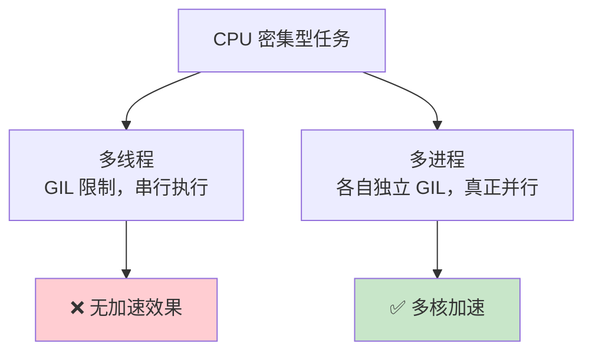

### 4.3 进程间通信

进程的内存是**独立的**，不能像线程那样直接共享变量，需要用专门的通信方式。

```python
from multiprocessing import Process, Queue, Pipe, Value, Array

# —— 方式 1：Queue（最常用）——
def producer(q):
    q.put("来自子进程的消息")

def consumer(q):
    msg = q.get()       # 阻塞直到有数据
    print(f"收到：{msg}")

if __name__ == "__main__":
    q = Queue()
    p1 = Process(target=producer, args=(q,))
    p2 = Process(target=consumer, args=(q,))
    p1.start(); p2.start()
    p1.join(); p2.join()

# —— 方式 2：共享变量（Value / Array）——
def increment(counter):
    for _ in range(10000):
        counter.value += 1

if __name__ == "__main__":
    counter = Value("i", 0)     # 'i' = 整数，初始值 0
    ps = [Process(target=increment, args=(counter,)) for _ in range(4)]
    for p in ps:
        p.start()
    for p in ps:
        p.join()
    print(f"结果：{counter.value}")  # 可能不到 40000（Value 也不保证原子性）
```

| 通信方式 | 特点 | 适用场景 |
| :--- | :--- | :--- |
| `Queue` | 进程安全队列，FIFO | 最常用，生产者-消费者 |
| `Pipe` | 双向管道（两端） | 两个进程间双向通信 |
| `Value` | 共享单个值 | 简单数值共享 |
| `Array` | 共享数组 | 大量数据共享 |
| `Manager` | 共享 Python 对象 | dict/list 等复杂对象 |

### 4.4 进程池

```python
from multiprocessing import Pool
import time

def task(n):
    time.sleep(1)
    return n * n

if __name__ == "__main__":
    # 创建 4 个进程的进程池
    with Pool(processes=4) as pool:
        # —— map：批量处理，按顺序返回结果 ——
        results = pool.map(task, range(10))
        print(results)    # [0, 1, 4, 9, 16, 25, 36, 49, 64, 81]

        # —— map_async：异步版本 ——
        result = pool.map_async(task, range(10))
        print(result.get(timeout=10))   # 阻塞获取结果

        # —— apply：单个任务 ——
        result = pool.apply(task, args=(5,))
        print(result)    # 25
```

> 💡 **进程池的好处**：不用手动创建/销毁进程，池中的进程会被**复用**，避免创建进程的开销。

---

## 五、concurrent.futures —— 线程池与进程池 🎯

> `concurrent.futures` 提供了**统一的线程池和进程池接口**，是最推荐的并发方案！API 统一、简洁优雅。

### 5.1 两种 Executor

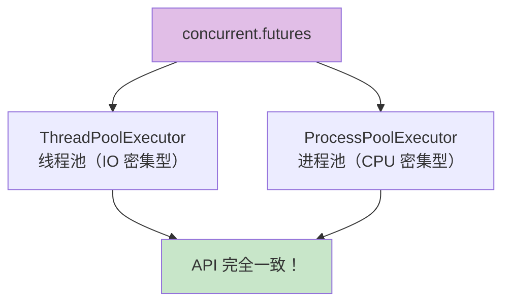

### 5.2 基本用法

```python
from concurrent.futures import ThreadPoolExecutor, as_completed
import time

def fetch_url(url):
    time.sleep(1)           # 模拟网络请求
    return f"{url} 的内容"

urls = ["url1", "url2", "url3", "url4", "url5"]

# —— 方式 1：submit + as_completed（灵活控制）——
with ThreadPoolExecutor(max_workers=3) as executor:
    # 提交所有任务
    futures = {executor.submit(fetch_url, url): url for url in urls}

    # 哪个先完成就先处理哪个
    for future in as_completed(futures):
        url = futures[future]
        try:
            result = future.result()
            print(f"✅ {url} → {result}")
        except Exception as e:
            print(f"❌ {url} 出错：{e}")

# —— 方式 2：map（简洁，保持顺序）——
with ThreadPoolExecutor(max_workers=3) as executor:
    # map 会按提交顺序返回结果（即使后面的先完成）
    results = executor.map(fetch_url, urls)
    for url, result in zip(urls, results):
        print(f"✅ {url} → {result}")
```

### 5.3 submit vs map 对比

| 特性 | `submit` + `as_completed` | `map` |
| :--- | :--- | :--- |
| 返回顺序 | **谁先完成谁先返回** | **按提交顺序** |
| 异常处理 | 需要手动 `future.result()` 捕获 | 异常会在迭代时抛出 |
| 灵活性 | 高（可回调、取消任务） | 低（但代码更简洁） |
| 推荐场景 | 需要灵活控制 | 顺序处理批量任务 |

```python
from concurrent.futures import ThreadPoolExecutor

def task(n):
    if n == 3:
        raise ValueError("故意出错！")
    return n * 2

# —— submit 方式：可以捕获单个任务的异常 ——
with ThreadPoolExecutor(max_workers=4) as executor:
    futures = [executor.submit(task, i) for i in range(5)]
    for f in futures:
        try:
            print(f.result())
        except ValueError as e:
            print(f"出错：{e}")
    # 输出：0, 2, 4, 出错：故意出错！, 8

# —— map 方式：一个出错就抛异常 ——
with ThreadPoolExecutor(max_workers=4) as executor:
    try:
        for result in executor.map(task, range(5)):
            print(result)
    except ValueError as e:
        print(f"出错：{e}")
```

### 5.4 ThreadPoolExecutor vs ProcessPoolExecutor

```python
from concurrent.futures import ThreadPoolExecutor, ProcessPoolExecutor

# IO 密集型 → 用线程池
with ThreadPoolExecutor(max_workers=10) as executor:
    executor.map(fetch_url, urls)

# CPU 密集型 → 用进程池
def heavy_compute(n):
    return sum(i * i for i in range(n))

if __name__ == "__main__":
    with ProcessPoolExecutor() as executor:
        # max_workers 默认 = CPU 核心数
        results = list(executor.map(heavy_compute, [10**6, 10**6, 10**6]))
```

> 💡 **最佳实践**：`concurrent.futures` 是日常并发编程的**首选方案**。API 统一，切线程池/进程池只需改一行代码！

---

## 六、asyncio —— 异步编程 ⚡

> `asyncio` 是 Python 的异步 IO 框架，用**协程**实现极高并发（上万并发量），是 IO 密集型场景的终极武器！

### 6.1 async / await 基础

```python
import asyncio

# —— 定义协程函数 ——
async def hello(name):
    print(f"你好，{name}！")
    await asyncio.sleep(1)       # 模拟异步等待（非阻塞！）
    print(f"{name}，再见！")
    return f"{name} 完成"

# —— 运行协程（Python 3.7+）——
async def main():
    # 方式 1：await 直接调用
    result = await hello("小明")
    print(result)

asyncio.run(main())
```

| 关键字 | 作用 | 说明 |
| :--- | :--- | :--- |
| `async def` | 定义协程函数 | 函数名前加 `async` |
| `await` | 等待协程完成 | 只能在 `async def` 函数内使用 |
| `asyncio.run()` | 运行主协程 | 程序入口，启动事件循环 |

### 6.2 并发执行多个协程

```python
import asyncio
import time

async def fetch_data(name, delay):
    print(f"[{name}] 开始获取...")
    await asyncio.sleep(delay)      # 非阻塞等待
    print(f"[{name}] 完成")
    return f"{name} 的数据"

async def main():
    start = time.time()

    # —— gather：并发执行多个协程 ——
    results = await asyncio.gather(
        fetch_data("API-1", 2),
        fetch_data("API-2", 3),
        fetch_data("API-3", 1),
    )
    print(f"结果：{results}")
    print(f"总耗时：{time.time() - start:.1f}s")  # ~3s（取最长的）

asyncio.run(main())
```

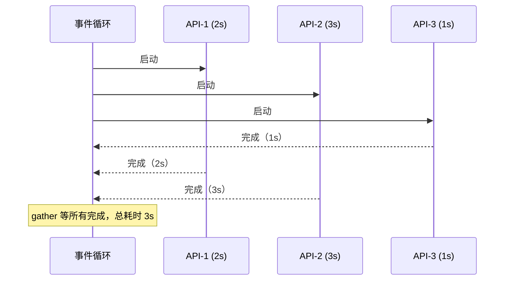

### 6.3 Task —— 任务调度

```python
import asyncio

async def work(name, duration):
    await asyncio.sleep(duration)
    return f"{name} 完成（{duration}s）"

async def main():
    # —— create_task：立即调度协程 ——
    task1 = asyncio.create_task(work("A", 2))
    task2 = asyncio.create_task(work("B", 1))

    # 此时 task1 和 task2 已经在并发执行了
    print("任务已提交...")

    # 等待所有完成
    r1 = await task1
    r2 = await task2
    print(r1, r2)

    # —— Task 常用方法 ——
    task = asyncio.create_task(work("C", 5))
    task.cancel()               # 取消任务
    task.cancelled()            # 是否被取消
    task.done()                 # 是否已完成
```

| 方式 | 特点 | 适用场景 |
| :--- | :--- | :--- |
| `await coro()` | 串行等待 | 需要顺序执行 |
| `asyncio.gather()` | 并发执行多个，等全部完成 | 批量并发（最常用） |
| `asyncio.create_task()` | 创建独立任务 | 精细控制任务（取消/超时） |

### 6.4 asyncio 超时控制

```python
import asyncio

async def slow_operation():
    await asyncio.sleep(10)
    return "终于完成了"

async def main():
    # —— 方式 1：wait_for（Python 3.11 前）——
    try:
        result = await asyncio.wait_for(slow_operation(), timeout=3)
        print(result)
    except asyncio.TimeoutError:
        print("⏰ 超时了！")

    # —— 方式 2：timeout（Python 3.11+，推荐）——
    try:
        async with asyncio.timeout(3):
            result = await slow_operation()
            print(result)
    except TimeoutError:
        print("⏰ 超时了！")

asyncio.run(main())
```

### 6.5 异步上下文管理器与迭代器

```python
import asyncio

# —— 异步上下文管理器 ——
class AsyncDB:
    async def __aenter__(self):
        print("连接数据库...")
        await asyncio.sleep(0.5)
        return self

    async def __aexit__(self, *args):
        print("关闭数据库连接...")
        await asyncio.sleep(0.5)

    async def query(self, sql):
        await asyncio.sleep(0.3)
        return f"结果：{sql}"

async def main():
    async with AsyncDB() as db:     # 异步 with
        result = await db.query("SELECT * FROM users")
        print(result)

asyncio.run(main())
```

> 💡 `asyncio` 适合**高并发 IO 场景**（如爬虫、Web 服务器）。但它要求所有 IO 操作都必须是**异步的**（用 aiohttp 替代 requests，用 aiomysql 替代 pymysql）。

---

## 七、同步原语详解 🔐

> 多线程/协程操作共享资源时需要"排队"，同步原语就是控制排队的工具。

### 7.1 Lock —— 互斥锁

> 最基本的锁，同一时间只允许一个线程访问。

```python
import threading

lock = threading.Lock()

def safe_increment():
    with lock:          # 获取锁 → 执行代码 → 自动释放锁
        # 这段代码同一时间只有一个线程在执行
        do_something()

# —— acquire / release（手动方式，不推荐）——
lock.acquire()
try:
    do_something()
finally:
    lock.release()      # 必须放在 finally 中！
```

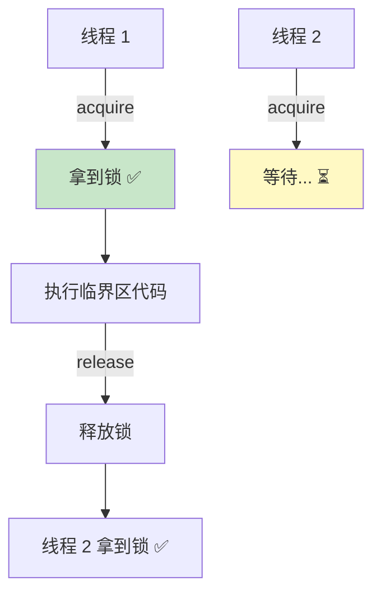

### 7.2 RLock —— 可重入锁

> 同一个线程可以多次 acquire 而不会死锁。

```python
import threading

rlock = threading.RLock()

def func_a():
    with rlock:
        print("func_a 执行")

def func_b():
    with rlock:         # 同一个线程再次加锁（Lock 会死锁，RLock 不会）
        func_a()        # 内部又用了 rlock

func_b()
```

| 锁类型 | 同线程多次加锁 | 不同线程竞争 |
| :---: | :---: | :---: |
| `Lock` | ❌ 会死锁 | ✅ 互斥 |
| `RLock` | ✅ 可重入 | ✅ 互斥 |

### 7.3 Semaphore —— 信号量

> 限制同时访问的线程数量（如限制最多 3 个并发请求）。

```python
import threading
import time

# 允许同时 3 个线程访问
sem = threading.Semaphore(3)

def fetch(url):
    with sem:               # 超过 3 个就要等
        print(f"开始处理 {url}")
        time.sleep(2)
        print(f"完成 {url}")

# 10 个线程，但同时只有 3 个在执行
threads = [threading.Thread(target=fetch, args=(f"url-{i}",)) for i in range(10)]
for t in threads:
    t.start()
for t in threads:
    t.join()
```

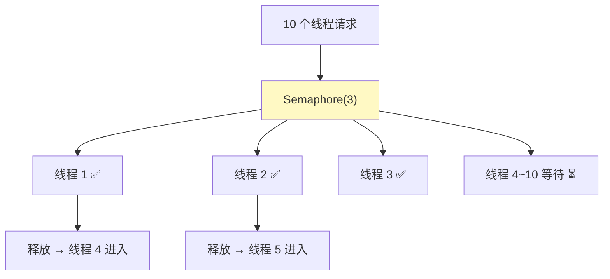

### 7.4 Event —— 事件

> 线程间发送"信号"，一个线程通知另一个线程可以开始了。

```python
import threading
import time

event = threading.Event()

def waiter():
    print("等待信号...")
    event.wait()          # 阻塞，直到 event.set() 被调用
    print("收到信号！继续执行")

def setter():
    time.sleep(2)
    print("发送信号！")
    event.set()           # 通知所有等待的线程

t1 = threading.Thread(target=waiter)
t2 = threading.Thread(target=setter)
t1.start(); t2.start()
t1.join(); t2.join()
```

| Event 方法 | 作用 |
| :--- | :--- |
| `event.set()` | 发送信号（标记为 True） |
| `event.clear()` | 清除信号（标记为 False） |
| `event.wait(timeout)` | 等待信号（阻塞） |
| `event.is_set()` | 检查信号状态 |

### 7.5 同步原语速查表

| 原语 | 作用 | 典型场景 |
| :--- | :--- | :--- |
| `Lock` | 互斥访问 | 保护共享变量 |
| `RLock` | 可重入互斥 | 递归函数加锁 |
| `Semaphore(n)` | 限制并发数 | 连接池、限流 |
| `Event` | 线程间通知 | 启动/停止信号 |
| `Condition` | 条件变量 | 生产者-消费者模型 |
| `Barrier` | 屏障（凑齐再执行） | 多线程同步起点 |

---

## 八、Queue —— 线程安全的队列 📨

> `queue.Queue` 是线程安全的 FIFO 队列，是实现**生产者-消费者模式**的最佳选择。

### 8.1 基本用法

```python
from queue import Queue, LifoQueue, PriorityQueue
import threading
import time

# —— 三种队列 ——
q1 = Queue(maxsize=10)          # FIFO 先进先出（最常用）
q2 = LifoQueue(maxsize=10)      # LIFO 后进先出（栈）
q3 = PriorityQueue(maxsize=10)  # 优先级队列（最小的先出）

# 基本操作
q = Queue(maxsize=5)
q.put("任务1")                  # 入队
q.put("任务2", timeout=2)      # 带超时（队列满时等待 2 秒）
q.get()                         # 出队（FIFO，返回 "任务1"）
q.qsize()                       # 队列大小
q.empty()                       # 是否为空
q.full()                        # 是否已满
q.task_done()                   # 标记任务完成（配合 join 使用）
q.join()                        # 等待所有任务完成
```

### 8.2 生产者-消费者模式

```python
from queue import Queue
import threading
import time
import random

queue = Queue(maxsize=5)

# —— 生产者 ——
def producer(name):
    for i in range(3):
        item = f"{name}-产品{i}"
        queue.put(item)         # 队列满时自动阻塞等待
        print(f"🏭 [{name}] 生产了 {item}")
        time.sleep(random.random())

# —— 消费者 ——
def consumer(name):
    while True:
        item = queue.get()      # 队列空时自动阻塞等待
        print(f"🛒 [{name}] 消费了 {item}")
        queue.task_done()       # 标记任务完成
        time.sleep(random.random())

# 启动 2 个生产者 + 3 个消费者
for name in ["工厂A", "工厂B"]:
    threading.Thread(target=producer, args=(name,)).start()

for name in ["消费者1", "消费者2", "消费者3"]:
    threading.Thread(target=consumer, args=(name,), daemon=True).start()

queue.join()    # 等待所有产品被消费完
print("所有产品消费完毕！")
```

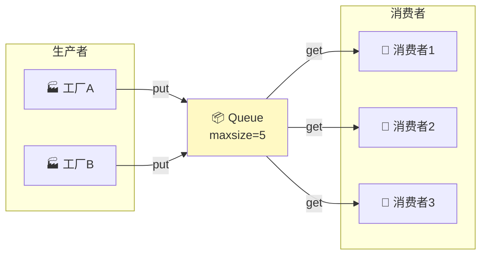

> 💡 **Queue 的好处**：内部已经实现了锁，不需要手动加锁！`put()` 在队列满时自动等待，`get()` 在队列空时自动等待。

---

## 九、三种并发模型对比与选型 🎯

### 9.1 综合对比表

| 对比项 | 多线程 threading | 多进程 multiprocessing | 协程 asyncio |
| :--- | :--- | :--- | :--- |
| **并发原理** | OS 调度线程 | OS 调度进程 | 用户态事件循环 |
| **GIL 影响** | 受限 | 不受限 | 受限（但单线程无争抢） |
| **创建开销** | 中 | 大 | 极小 |
| **最大并发数** | 几百~几千 | 几十~几百 | 几千~几万 |
| **通信方式** | 共享变量 + Queue | Queue/Pipe/Manager | await + Queue |
| **编程难度** | 中（需加锁） | 高（需进程间通信） | 高（全链路异步） |
| **适合场景** | IO 密集型 | CPU 密集型 | IO 密集型高并发 |

### 9.2 选型决策图

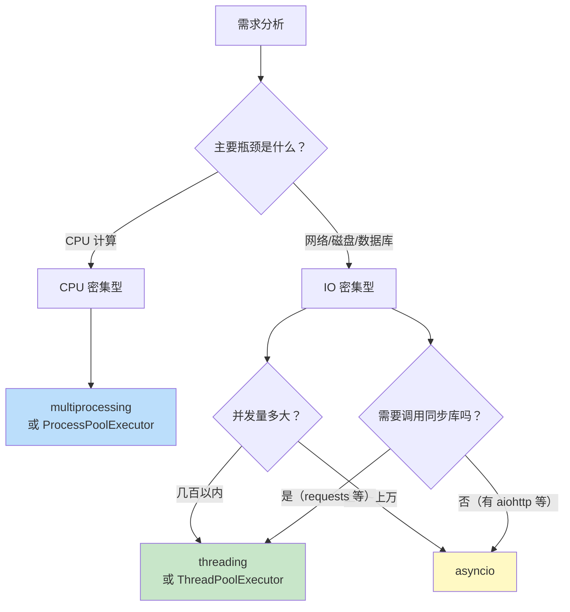

### 9.3 选型口诀

> 🎀 记住这三句话就够了：
>
> 1. **CPU 密集型 → 多进程**（算术、加密、压缩）
> 2. **IO 密集型 + 简单 → 线程池**（requests 批量请求）
> 3. **IO 密集型 + 高并发 → asyncio**（Web 服务器、爬虫）

---

## 十、实战案例 🔥

### 10.1 并发下载网页（IO 密集型）

```python
from concurrent.futures import ThreadPoolExecutor, as_completed
import time

# 模拟下载
def download(url):
    time.sleep(1)  # 模拟网络延迟
    return f"{url} 的内容（{len(url)} 字节）"

urls = [f"https://example.com/page/{i}" for i in range(20)]

# —— 串行下载 ——
start = time.time()
results_serial = [download(url) for url in urls]
print(f"串行：{time.time() - start:.2f}s")  # ~20s

# —— 并发下载（线程池）——
start = time.time()
with ThreadPoolExecutor(max_workers=10) as executor:
    results = list(executor.map(download, urls))
print(f"并发：{time.time() - start:.2f}s")  # ~2s（10 倍提速！）
```

### 10.2 并行计算（CPU 密集型）

```python
from concurrent.futures import ProcessPoolExecutor
import math
import time

# 判断质数（CPU 密集型）
def is_prime(n):
    if n < 2:
        return False
    for i in range(2, int(math.sqrt(n)) + 1):
        if n % i == 0:
            return False
    return True

def count_primes(start, end):
    return sum(1 for n in range(start, end) if is_prime(n))

if __name__ == "__main__":
    ranges = [(1, 250000), (250000, 500000), (500000, 750000), (750000, 1000000)]

    # 串行
    start = time.time()
    total = sum(count_primes(s, e) for s, e in ranges)
    print(f"串行：{time.time() - start:.2f}s，质数 {total} 个")

    # 并行（进程池）
    start = time.time()
    with ProcessPoolExecutor() as executor:
        results = list(executor.map(count_primes, *zip(*ranges)))
    total = sum(results)
    print(f"并行：{time.time() - start:.2f}s，质数 {total} 个")
    # 并行通常快 2~3 倍（取决于 CPU 核心数）
```

### 10.3 asyncio 高并发请求

```python
import asyncio
import aiohttp  # pip install aiohttp

async def fetch(session, url):
    async with session.get(url) as response:
        status = response.status
        data = await response.text()
        return url, status, len(data)

async def main():
    urls = [f"https://httpbin.org/delay/{i % 3}" for i in range(20)]

    async with aiohttp.ClientSession() as session:
        tasks = [fetch(session, url) for url in urls]
        results = await asyncio.gather(*tasks)

        for url, status, length in results:
            print(f"{url} → {status} ({length} bytes)")

asyncio.run(main())
```

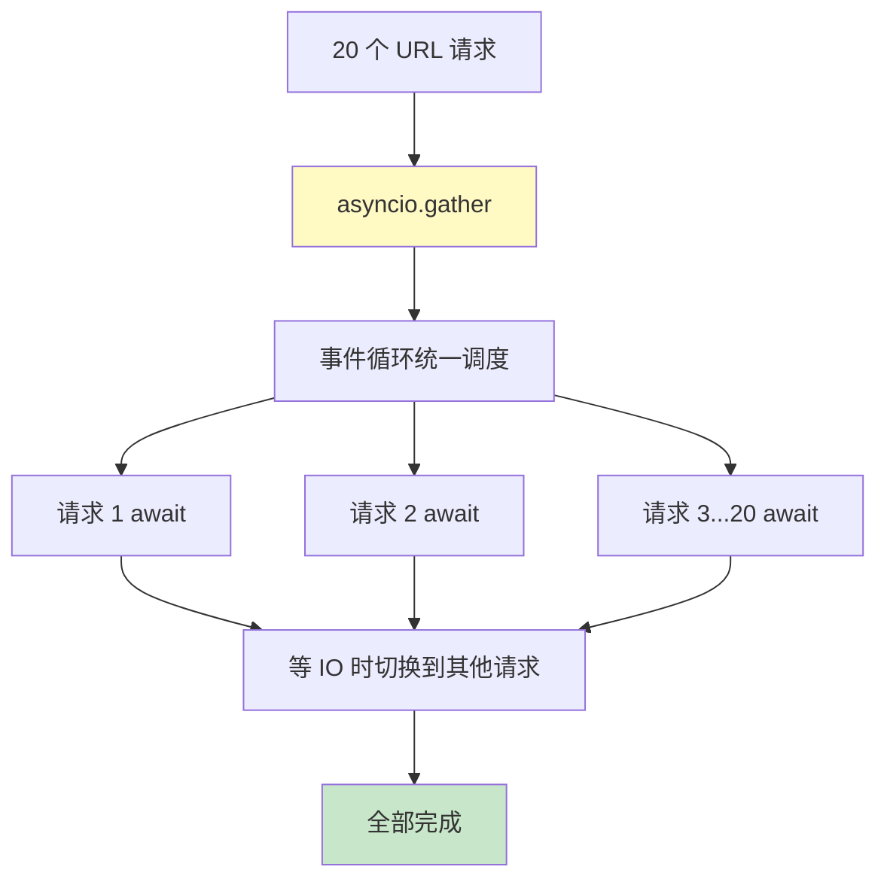

### 10.4 实战选型总结

| 场景 | 推荐方案 | 原因 |
| :--- | :--- | :--- |
| 批量 HTTP 请求 | `ThreadPoolExecutor` | requests 库是同步的，用线程池最方便 |
| 数值计算/加密 | `ProcessPoolExecutor` | CPU 密集型，绕过 GIL |
| Web 服务器 | `asyncio` + 异步框架 | 高并发，单线程高效率 |
| 爬虫（几百页） | `ThreadPoolExecutor` | 简单，够用 |
| 爬虫（上万页） | `asyncio` + aiohttp | 性能更高 |
| 文件批量读写 | `ThreadPoolExecutor` | IO 密集型 |
| 图像处理 | `ProcessPoolExecutor` | CPU 密集型 |

---

## 📌 知识总结

### 并发编程核心知识图

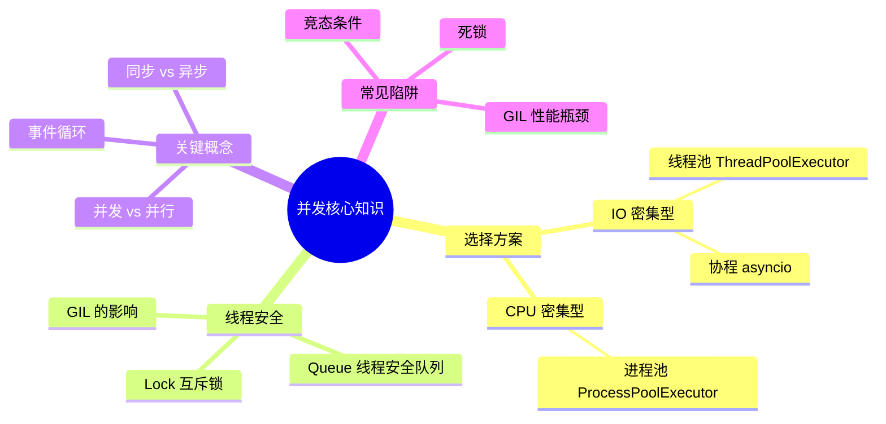

### 快速决策表

| 问题 | 答案 |
| :--- | :--- |
| 多线程能加速 CPU 计算吗？ | ❌ 不能，GIL 限制 |
| 多进程能用多核 CPU 吗？ | ✅ 能，每个进程独立 GIL |
| asyncio 能用 requests 吗？ | ❌ 会阻塞事件循环，用 aiohttp |
| 什么时候用 Queue？ | 多线程间安全传递数据 |
| Windows 多进程要注意什么？ | 必须加 `if __name__ == "__main__":` |

> 🎀 呼～并发编程是 Python 进阶路上的一道大关卡，但你已经闯过来啦！🎉 记住核心口诀：**CPU 密集用进程，IO 密集用线程，高并发用协程**。多动手实践，慢慢就熟练啦～ (◍•ᴗ•◍)❤
