# 📊 Python 数据分析

> 哈喽呀～欢迎来到数据分析的魔法世界！🌟 NumPy 算得快、Pandas 玩得转、Matplotlib 画得美——三剑客在手，数据任你走！(๑•̀ㅂ•́)و✧

---

## 🗺️ 知识全景图

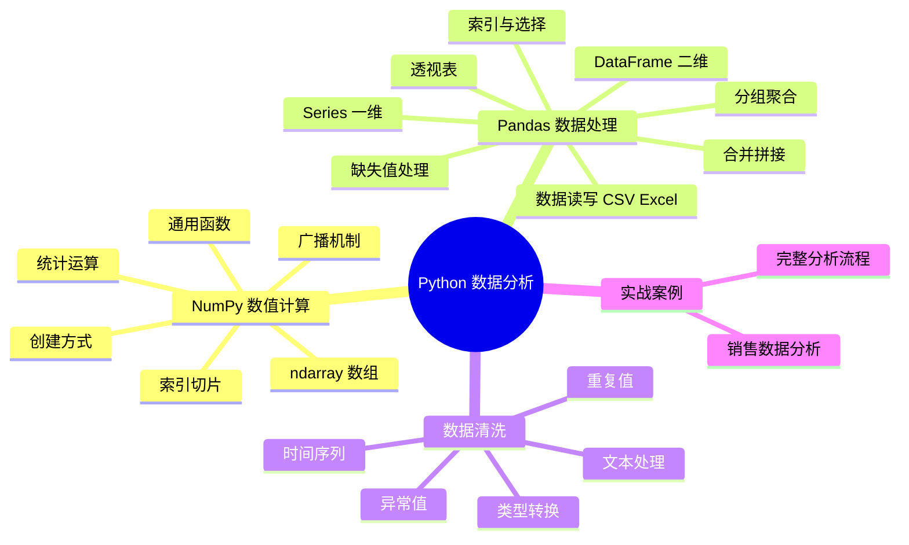

---

## 📑 目录

- [一、数据分析概述](#一数据分析概述)
- [二、环境搭建](#二环境搭建)
- [三、NumPy：数值计算基石](#三numpy数值计算基石)
- [四、Pandas 基础：Series 与 DataFrame](#四pandas-基础series-与-dataframe)
- [五、数据读写：CSV 与 Excel](#五数据读写csv-与-excel)
- [六、数据索引与选择](#六数据索引与选择)
- [七、数据预处理](#七数据预处理)
- [八、分组聚合 groupby](#八分组聚合-groupby)
- [九、数据合并与拼接](#九数据合并与拼接)
- [十、透视表与交叉表](#十透视表与交叉表)
- [十一、时间序列处理](#十一时间序列处理)
- [十二、综合实战：销售数据分析](#十二综合实战销售数据分析)
- [十三、知识总结](#十三知识总结)

---

## 一、数据分析概述 🌍

### 1.1 什么是数据分析？

> 🎀 用一句话说：从一堆"杂乱"的数据里，找出"有用"的信息，帮助做决策！


### 1.2 为什么用 Python 做数据分析？

| 优势 | 说明 |
| :--- | :--- |
| 生态强大 | NumPy/Pandas/Matplotlib 完整工具链 |
| 上手简单 | 语法简洁，几行代码搞定复杂处理 |
| 社区活跃 | 遇到问题基本都能搜到答案 |
| 可扩展 | 分析完可以直接接入机器学习 |

### 1.3 数据分析三剑客

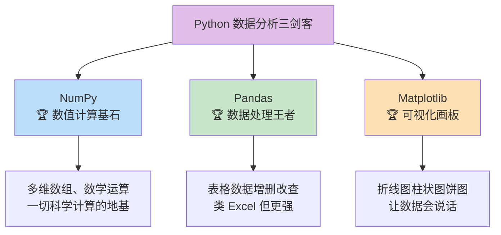

### 1.4 分析流程

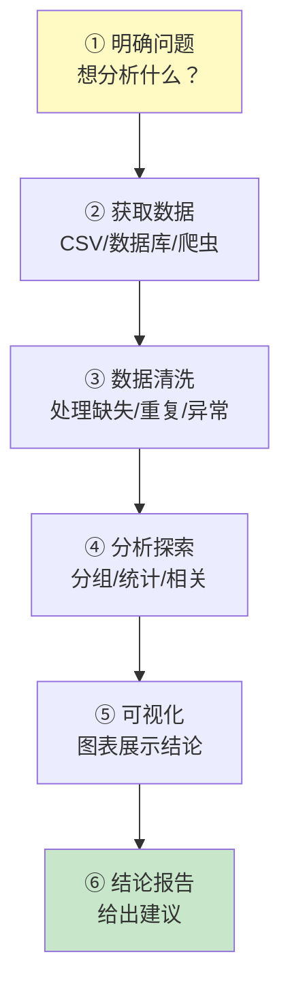

---

## 二、环境搭建 🔧

### 2.1 安装三剑客

```bash
# —— 推荐直接装 Anaconda（全家桶，包含一切）——
# 官网下载：https://www.anaconda.com/download

# —— 或用 pip 按需安装 ——
pip install numpy pandas matplotlib

# —— 常用补充 ——
pip install openpyxl      # 读写 Excel 需要
pip install jupyter       # 交互式笔记本（强烈推荐！）
```

### 2.2 Jupyter Notebook：数据分析神器

```bash
# 启动
jupyter notebook
# 浏览器自动打开 http://localhost:8888
```

> 💡 **为什么分析师都爱 Jupyter？**
> - 代码和结果在一起，所见即所得
> - 单元格逐步执行，方便调试
> - 支持 Markdown 笔记和图表内嵌
> - 数据分析的标准工作环境！

### 2.3 导入约定

```python
# 全世界的统一约定（别问，照做就对了～）
import numpy as np
import pandas as pd
import matplotlib.pyplot as plt
```

---

## 三、NumPy：数值计算基石 🧮

### 3.1 为什么需要 NumPy？

```python
# —— 用列表把 100 万个数翻倍 ——
import time

big_list = list(range(1_000_000))

start = time.time()
result = [x * 2 for x in big_list]
print(f"列表耗时: {time.time() - start:.3f}s")

# —— 用 NumPy ——
import numpy as np

big_array = np.arange(1_000_000)

start = time.time()
result = big_array * 2
print(f"NumPy 耗时: {time.time() - start:.3f}s")
# 快几十倍！
```

> 🎀 NumPy 快的秘密：列表是"一个个对象"，数组是"连续内存 + C 语言循环"，天生就快！

### 3.2 创建数组

```python
import numpy as np

# —— 从列表创建 ——
a = np.array([1, 2, 3, 4, 5])           # 一维数组
b = np.array([[1, 2, 3], [4, 5, 6]])    # 二维数组（2行3列）

# —— 快速创建 ——
np.zeros(5)                    # [0. 0. 0. 0. 0.]
np.ones((2, 3))                # 2行3列全1
np.full((2, 2), 7)             # 2行2列全是 7
np.arange(0, 10, 2)            # [0 2 4 6 8]
np.linspace(0, 1, 5)           # [0.   0.25 0.5  0.75 1.  ] 均分
np.eye(3)                      # 3x3 单位矩阵
np.random.rand(3)              # 3 个 0~1 随机数
np.random.randint(1, 100, 5)   # 5 个 1~99 随机整数
np.random.randn(2, 3)          # 正态分布
```

### 3.3 数组属性

```python
a = np.array([[1, 2, 3], [4, 5, 6]])

a.shape       # (2, 3)    形状：2行3列
a.ndim        # 2         维度
a.size        # 6         元素总数
a.dtype       # int32/int64  数据类型
a.itemsize    # 4/8       每个元素字节数

# 改变形状
a.reshape(3, 2)      # 变 3行2列（元素总数不变）
a.reshape(-1)        # 拉平成一维（-1 自动计算）
a.T                  # 转置（行列互换）
a.flatten()          # 拉平（返回副本）
```

### 3.4 索引与切片

```python
a = np.array([[10, 20, 30],
              [40, 50, 60],
              [70, 80, 90]])

# —— 基本索引 ——
a[0, 0]        # 10（第0行第0列）
a[1, 2]        # 60（第1行第2列）
a[-1, -1]      # 90（最后一行最后一列）

# —— 切片 ——
a[0, :]        # [10 20 30]  第0行全部
a[:, 1]        # [20 50 80]  第1列全部
a[0:2, 1:3]    # [[20 30], [50 60]] 前2行、第1~2列
a[::-1]        # 行倒序

# —— 花式索引 ——
a[[0, 2]]              # 第0行和第2行
a[[0, 2], [1, 2]]      # 取 (0,1) 和 (2,2) → [20 90]

# —— 布尔索引（超好用！）——
a[a > 50]      # [60 70 80 90]
a[(a > 20) & (a < 80)]   # [30 40 50 60 70]  注意用 & 和 |，别用 and/or！
```

> ⚠️ **切片是"视图"不是副本**——修改切片会改到原数组！要副本用 `.copy()`。

### 3.5 广播机制：不同形状如何运算？

> 形状不同的数组运算时，NumPy 自动"复制扩展"成相同形状——这就是广播！

```python
a = np.array([[1, 2, 3],
              [4, 5, 6]])      # 形状 (2, 3)

b = np.array([10, 20, 30])     # 形状 (3,)

a + b
# [[11 22 33]     b 被"广播"成两行
#  [14 25 36]]

c = np.array([[10],
              [20]])            # 形状 (2, 1)

a + c
# [[11 12 13]     c 被"广播"成三列
#  [24 25 26]]
```

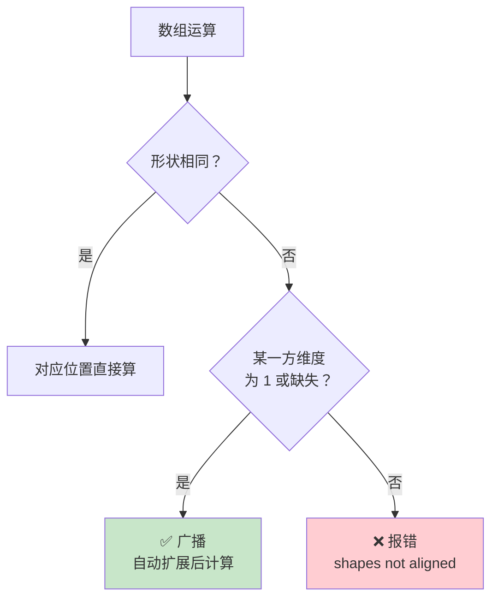

### 3.6 通用函数与统计

```python
a = np.array([1, 2, 3, 4, 5])

# —— 数学函数（逐元素）——
np.sqrt(a)      # 平方根
np.exp(a)       # e 的 x 次方
np.log(a)       # 自然对数
np.abs([-1, 2]) # [1 2]
np.round([3.14, 2.56], 1)   # [3.1 2.6]

# —— 统计函数 ——
a.sum()         # 15     总和
a.mean()        # 3.0    平均
a.max()         # 5      最大
a.min()         # 1      最小
a.argmax()      # 4      最大值的索引
a.argmin()      # 0      最小值的索引
a.std()         # 标准差
a.var()         # 方差
a.median()      # 中位数（注意是 np.median(a)）
np.percentile(a, 50)   # 50 分位数

# —— 二维数组按轴统计 ——
b = np.array([[1, 2, 3], [4, 5, 6]])
b.sum(axis=0)    # [5 7 9]   按列求和（压缩行）
b.sum(axis=1)    # [6 15]    按行求和（压缩列）
b.mean(axis=1)   # [2. 5.]   每行的平均
```

| 轴 | 方向 | 记忆 |
| :---: | :--- | :--- |
| `axis=0` | 沿着行方向（跨行） | **列**统计 |
| `axis=1` | 沿着列方向（跨列） | **行**统计 |

### 3.7 常用操作速查

```python
# —— 排序 ——
np.sort([3, 1, 2])                  # [1 2 3]
np.argsort([3, 1, 2])               # [1 2 0] 返回排序后索引

# —— 唯一化 ——
np.unique([1, 2, 2, 3, 3])          # [1 2 3]

# —— 拼接 ——
np.concatenate([a, a])              # 上下/左右拼接
np.vstack([a, a])                   # 垂直拼接（vertical）
np.hstack([a, a])                   # 水平拼接（horizontal）

# —— 条件替换 ——
np.where(a > 3, "大", "小")          # 满足取"大"，否则取"小"

# —— 判断 ——
(a > 2).any()      # 有任意一个满足 → True
(a > 4).all()      # 全部满足 → False
np.isnan([1, np.nan, 3])            # [False True False]
```

---

## 四、Pandas 基础：Series 与 DataFrame 🐼

### 4.1 两大核心数据结构

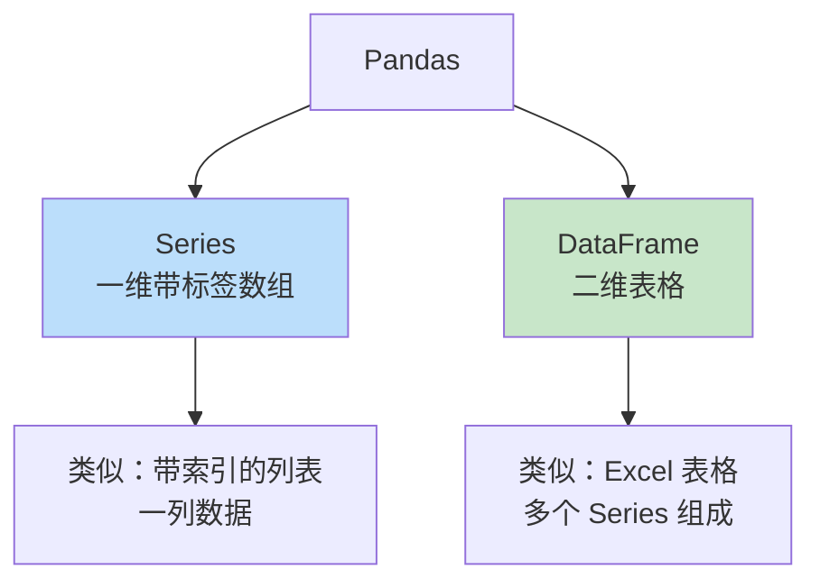

### 4.2 Series：一维数据

```python
import pandas as pd

# —— 创建 ——
s = pd.Series([85, 92, 78, 90], index=["语文", "数学", "英语", "物理"])
s
# 语文    85
# 数学    92
# 英语    78
# 物理    90
# dtype: int64

# —— 访问 ——
s["数学"]              # 92（按索引名）
s[0]                  # 85（按位置，未来版本不推荐）
s.loc["数学"]          # 92（显式按标签）✅
s.iloc[1]             # 92（显式按位置）✅
s[["语文", "数学"]]     # 多个值

# —— 切片 ——
s.loc["语文":"英语"]    # 标签切片：包含结尾！
s.iloc[0:2]           # 位置切片：不包含结尾

# —— 运算（保留索引）——
s + 5                 # 每个值 +5
s * 2
s[s > 85]             # 布尔筛选：数学92、物理90

# —— 统计 ——
s.describe()          # 统计摘要（count/mean/std/min/max...）
s.mean(), s.max(), s.sum()
s.idxmax()            # 最大值的索引名："数学"
```

### 4.3 DataFrame：二维表格（重点！）

```python
import pandas as pd

# —— 从字典创建（最常用）——
df = pd.DataFrame({
    "姓名": ["小明", "小红", "小刚", "小美"],
    "年龄": [18, 22, 25, 20],
    "城市": ["北京", "上海", "北京", "广州"],
    "工资": [8000, 12000, 15000, 10000],
})
df
#    姓名  年龄  城市    工资
# 0  小明  18  北京   8000
# 1  小红  22  上海  12000
# 2  小刚  25  北京  15000
# 3  小美  20  广州  10000
```

### 4.4 查看数据

```python
df.head()          # 前 5 行
df.head(2)         # 前 2 行
df.tail()          # 后 5 行
df.shape           # (4, 4) 行数列数
df.columns         # 列名列表
df.index           # 行索引
df.dtypes          # 每列数据类型
df.info()          # 概览：类型 + 非空数量
df.describe()      # 数值列统计摘要
df.sample(2)       # 随机抽 2 行
```

| 方法 | 作用 | 使用场景 |
| :--- | :--- | :--- |
| `head(n)` | 前几行 | 先看数据长啥样 |
| `info()` | 类型+非空数 | 检查缺失情况 |
| `describe()` | 统计摘要 | 快速了解分布 |
| `shape` | 行×列 | 数据规模 |

---

## 五、数据读写：CSV 与 Excel 📁

### 5.1 读取文件

```python
import pandas as pd

# —— CSV ——
df = pd.read_csv("data.csv")
df = pd.read_csv("data.csv", encoding="gbk")          # 中文乱码试试 gbk
df = pd.read_csv("data.csv", index_col=0)             # 第0列作为行索引
df = pd.read_csv("data.csv", nrows=100)               # 只读前100行（大文件快）
df = pd.read_csv("data.csv", usecols=["姓名", "工资"])  # 只读指定列
df = pd.read_csv("data.csv", parse_dates=["日期"])     # 日期列自动解析

# —— Excel（需要 openpyxl）——
df = pd.read_excel("data.xlsx")
df = pd.read_excel("data.xlsx", sheet_name="销售表")   # 指定工作表

# —— 其他 ——
df = pd.read_json("data.json")
df = pd.read_sql("SELECT * FROM users", conn)          # 数据库
df = pd.read_html("https://...")[0]                    # 网页表格
```

### 5.2 写出文件

```python
# —— CSV ——
df.to_csv("output.csv", index=False)     # index=False 不写行号！
df.to_csv("output.csv", index=False, encoding="utf-8-sig")  # Excel 打开不乱码

# —— Excel ——
df.to_excel("output.xlsx", index=False)

# —— 多表写入一个 Excel ——
with pd.ExcelWriter("report.xlsx") as writer:
    df1.to_excel(writer, sheet_name="销售", index=False)
    df2.to_excel(writer, sheet_name="库存", index=False)
```

> 💡 **新手两大坑**：
> 1. `to_csv` 忘写 `index=False` → 多出一列没用的行号
> 2. 中文乱码 → 写出用 `encoding="utf-8-sig"`，读入试试 `encoding="gbk"`

---

## 六、数据索引与选择 🎯

### 6.1 三种选择方式

```python
df = pd.DataFrame({
    "姓名": ["小明", "小红", "小刚"],
    "年龄": [18, 22, 25],
    "城市": ["北京", "上海", "北京"],
    "工资": [8000, 12000, 15000],
})
```

| 方式 | 语法 | 说明 |
| :--- | :--- | :--- |
| `[]` | `df["姓名"]` | 选列（最常用） |
| `loc` | `df.loc[行标签, 列标签]` | **按标签**选 |
| `iloc` | `df.iloc[行位置, 列位置]` | **按位置**选 |

### 6.2 选列

```python
df["姓名"]                      # 选单列 → Series
df[["姓名", "工资"]]             # 选多列 → DataFrame（注意双括号！）

# 选数值列（快速查看可计算的列）
df.select_dtypes(include="number")
df.select_dtypes(include="object")
```

### 6.3 选行与区域

```python
# —— loc：按标签 ——
df.loc[0]                       # 行标签 0（一行 → Series）
df.loc[0:2]                     # 标签切片：0,1,2 行（含2！）
df.loc[0:1, ["姓名", "工资"]]    # 行 + 列组合
df.loc[df["年龄"] > 20]         # 布尔条件选行 ⭐

# —— iloc：按位置 ——
df.iloc[0]                      # 第 0 行
df.iloc[0:2]                    # 前 2 行（不含 2！和列表切片一致）
df.iloc[0, 1]                   # 第0行第1列的值
df.iloc[:, 0:2]                 # 所有行，前2列

# —— 条件筛选（最实用！）——
df[df["城市"] == "北京"]                        # 单条件
df[(df["年龄"] > 18) & (df["工资"] > 10000)]    # 多条件（& | ~，每个条件要括号！）
df[df["城市"].isin(["北京", "上海"])]            # 在集合中
df[df["姓名"].str.contains("小")]               # 文本包含
df.query("年龄 > 20 and 工资 > 10000")          # query 语法（像 SQL）
```

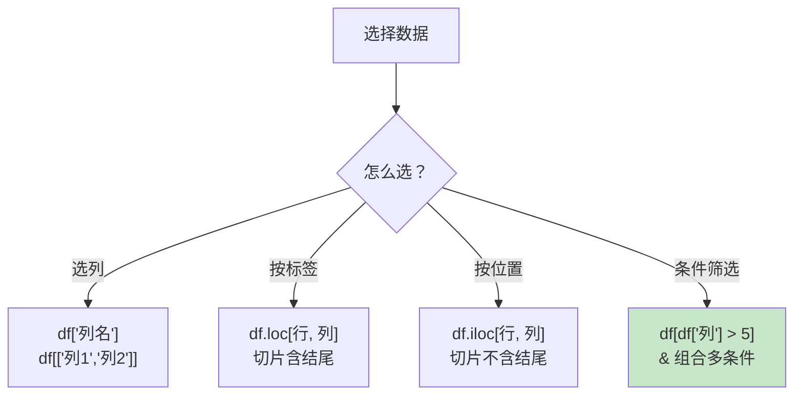

### 6.5 修改数据

```python
# —— 新增列 ——
df["年终奖"] = df["工资"] * 2
df["级别"] = df["工资"].apply(lambda x: "高" if x > 10000 else "普通")

# —— 修改列 ——
df["工资"] = df["工资"] + 1000

# —— 修改单个值 ——
df.loc[0, "年龄"] = 19

# —— 重命名列 ——
df.rename(columns={"姓名": "name"}, inplace=True)
df.columns = ["A", "B", "C", "D"]          # 全部重命名

# —— 删除 ——
df.drop("年终奖", axis=1)                   # 删列（axis=1）
df.drop([0, 1])                            # 删行
df.drop(columns=["年终奖", "级别"])          # 删多列（更直观）

# —— 设置索引 ——
df.set_index("姓名")                        # 某列变行索引
df.reset_index()                            # 索引变回普通列
```

### 6.6 排序

```python
df.sort_values("工资")                       # 按工资升序
df.sort_values("工资", ascending=False)      # 降序
df.sort_values(["城市", "工资"], ascending=[True, False])  # 多列排序

df.sort_index()                              # 按索引排序
df["工资"].rank()                            # 排名（1 是最小）
df["工资"].rank(ascending=False)             # 降序排名
```

---

## 七、数据预处理 🧹

> 真实数据 80% 的时间都在清洗！缺失、重复、异常、类型混乱……一个个解决！

### 7.1 缺失值处理

```python
df = pd.DataFrame({
    "姓名": ["小明", "小红", None, "小美"],
    "年龄": [18, None, 25, 20],
    "工资": [8000, 12000, None, None],
})

# —— 检测缺失 ——
df.isnull()          # 每个位置是否缺失（DataFrame）
df.isnull().sum()    # 每列缺失数量 ⭐（最常用）
df.isnull().any()    # 每列是否有缺失
df.notnull()         # 非缺失

# —— 删除缺失 ——
df.dropna()                       # 删除含缺失的行
df.dropna(subset=["工资"])         # 只看"工资"列的缺失
df.dropna(thresh=2)               # 至少 2 个非空值才保留
df.dropna(axis=1)                 # 删除含缺失的列（慎用）

# —— 填充缺失 ——
df.fillna(0)                              # 全部填 0
df["年龄"].fillna(df["年龄"].mean())       # 填平均值（数值列常用）
df["年龄"].fillna(df["年龄"].median())     # 填中位数（有异常值时更稳）
df["姓名"].fillna("未知")                  # 文本列填默认值
df.fillna(method="ffill")                 # 用前一个值填（时间序列常用）
df.fillna(method="bfill")                 # 用后一个值填
df["工资"].interpolate()                  # 插值（线性填充，平滑）
```

| 策略 | 写法 | 适用场景 |
| :--- | :--- | :--- |
| 删除 | `dropna()` | 缺失占比很小 |
| 填均值 | `fillna(mean())` | 数值列、分布均匀 |
| 填中位数 | `fillna(median())` | 数值列、有异常值 |
| 前向填充 | `ffill` | 时间序列 |
| 插值 | `interpolate()` | 连续数据、平滑 |

### 7.2 重复值处理

```python
df = pd.DataFrame({
    "姓名": ["小明", "小红", "小明", "小明"],
    "成绩": [90, 85, 90, 88],
})

df.duplicated()                  # 标记重复行（第一次出现不算）
df.duplicated().sum()            # 重复行数量
df.drop_duplicates()             # 删除完全重复的行
df.drop_duplicates(subset=["姓名"])           # 按"姓名"去重（保留第一条）
df.drop_duplicates(subset=["姓名"], keep="last")  # 保留最后一条
df.drop_duplicates(ignore_index=True)        # 去重后重排行号
```

### 7.3 类型转换

```python
df = pd.DataFrame({
    "价格": ["9.9", "19.9", "29.9"],
    "数量": ["10", "20", "30"],
    "日期": ["2026-08-01", "2026-08-02", "2026-08-03"],
})

df.dtypes        # 全是 object（字符串）！

# —— 转数值 ——
df["价格"] = df["价格"].astype(float)
df["数量"] = pd.to_numeric(df["数量"])       # 遇到无法转换的会报错
df["数量"] = pd.to_numeric(df["数量"], errors="coerce")  # 转不了变 NaN ✅

# —— 转日期 ——
df["日期"] = pd.to_datetime(df["日期"])
df["日期"] = pd.to_datetime(df["日期"], format="%Y/%m/%d")  # 指定格式

# —— 转字符串/分类 ——
df["数量"].astype(str)
df["城市"] = df["城市"].astype("category")   # 省内存、排序快

# —— 数值列转字符串（如手机号、身份证）——
df["手机号"] = df["手机号"].astype(str)
```

### 7.4 异常值检测与处理

```python
df = pd.DataFrame({"工资": [8000, 12000, 15000, 10000, 500000]})

# —— 方法 1：3σ 原则 ——
mean, std = df["工资"].mean(), df["工资"].std()
outliers = df[(df["工资"] > mean + 3 * std) | (df["工资"] < mean - 3 * std)]

# —— 方法 2：IQR 四分位距（更稳）——
Q1 = df["工资"].quantile(0.25)
Q3 = df["工资"].quantile(0.75)
IQR = Q3 - Q1
lower = Q1 - 1.5 * IQR        # 下限
upper = Q3 + 1.5 * IQR        # 上限

normal = df[(df["工资"] >= lower) & (df["工资"] <= upper)]   # 正常数据

# —— 处理方式 ——
df["工资"] = df["工资"].clip(lower, upper)     # 超限的截断到边界
df["工资"] = df["工资"].mask(df["工资"] > upper, upper)  # 替换
```

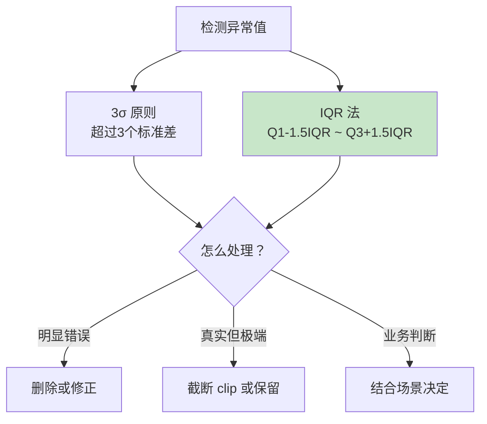

### 7.5 apply / map / applymap

```python
df = pd.DataFrame({
    "姓名": ["小明", "小红"],
    "工资": [8000, 12000],
    "城市": ["北京", "上海"],
})

# —— map：Series 逐元素映射 ——
df["城市"].map({"北京": "BJ", "上海": "SH"})     # 字典映射
df["工资"].map(lambda x: x * 2)                  # 函数映射

# —— apply：Series 或 DataFrame 按行/列应用 ——
df["税后"] = df["工资"].apply(lambda x: x * 0.9)  # 单列
df.apply(lambda col: col.max(), axis=0)          # 每列最大值

# 逐行处理（axis=1）——最灵活！
def get_level(row):
    if row["工资"] > 10000:
        return "高薪"
    return "普通"
df["级别"] = df.apply(get_level, axis=1)

# —— 向量化（能用就别用 apply，快很多！）——
df["税后"] = df["工资"] * 0.9     # 直接运算 ✅ 推荐
df["级别"] = np.where(df["工资"] > 10000, "高薪", "普通")  # ✅ 推荐
```

### 7.6 文本处理 .str

```python
s = pd.Series(["  小明 ", "XiaoHong", " xiaogang "])

s.str.strip()                    # 去首尾空格
s.str.lower()                    # 转小写
s.str.upper()                    # 转大写
s.str.replace("xiao", "小")       # 替换
s.str.contains("小")              # 是否包含 → 布尔
s.str.startswith("小")            # 开头
s.str.len()                      # 长度
s.str.split("o")                 # 分割
s.str[0:2]                       # 切片取前2字符

# 链式操作
s.str.strip().str.lower().str.capitalize()
```

---

## 八、分组聚合 groupby 📊

> groupby 是数据分析的"灵魂"——拆分→应用→合并，像 Excel 的数据透视！

### 8.1 分组思想

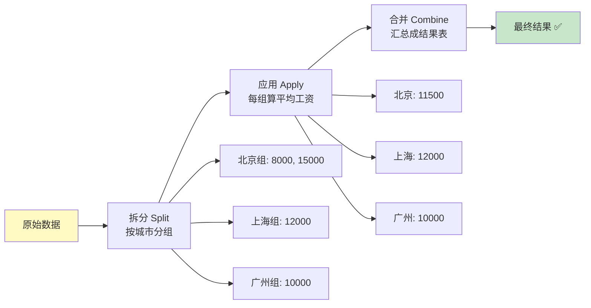

### 8.2 基本用法

```python
import pandas as pd

df = pd.DataFrame({
    "城市": ["北京", "上海", "北京", "广州", "上海"],
    "产品": ["A", "B", "A", "C", "B"],
    "销量": [100, 200, 150, 80, 300],
    "销售额": [5000, 8000, 7500, 4000, 12000],
})

# —— 单列分组 + 单聚合 ——
df.groupby("城市")["销售额"].sum()
# 上海    20000
# 北京    12500
# 广州     4000

# —— 单列分组 + 多聚合 ——
df.groupby("城市")["销售额"].agg(["sum", "mean", "max"])
#        sum    mean     max
# 上海  20000  10000.0  12000
# 北京  12500   6250.0   7500
# 广州   4000   4000.0   4000

# —— 多列分组 ——
df.groupby(["城市", "产品"])["销量"].sum()
# 城市  产品
# 北京  A      250
# 上海  B      500
# 广州  C       80

# —— 不同列不同聚合 ——
df.groupby("城市").agg({
    "销量": "sum",
    "销售额": ["mean", "max"],
})

# —— 自定义聚合名（推荐！结果列名清晰）——
df.groupby("城市").agg(
    总销量=("销量", "sum"),
    平均销售额=("销售额", "mean"),
    最高销售额=("销售额", "max"),
)
#       总销量  平均销售额  最高销售额
# 上海    500    10000.0   12000
# 北京    250     6250.0    7500
# 广州     80     4000.0    4000
```

### 8.3 groupby 常用操作

```python
g = df.groupby("城市")

g.size()                     # 每组行数
g.count()                    # 每组非空数量
g.first()                    # 每组第一条
g.last()                     # 每组最后一条
g.mean()                     # 数值列平均
g.sum()                      # 数值列求和

g.cumsum()                   # 组内累计求和（累计销量常用）
g.rank()                     # 组内排名
g.idxmax()                   # 每组最大值的索引

# —— transform：返回与原表等长的结果（组内归一化/占比常用！）——
df["城市平均"] = df.groupby("城市")["销售额"].transform("mean")
df["占比"] = df["销售额"] / df["城市平均"]

# —— filter：过滤组 ——
df.groupby("城市").filter(lambda x: x["销量"].sum() > 100)

# —— 遍历分组 ——
for city, group in df.groupby("城市"):
    print(f"{city}: {len(group)} 条记录")
```

### 8.4 agg vs transform vs filter

| 方法 | 返回 | 典型场景 |
| :--- | :--- | :--- |
| `agg` | 每组一行 | 汇总统计 |
| `transform` | 与原表**等长** | 组内归一化、加"组平均"列 |
| `filter` | 整组的行 | 筛选满足条件的组 |
| `apply` | 任意形状 | 最灵活（但慢） |

```python
# transform 直观对比
df["城市销售额"] = df.groupby("城市")["销售额"].transform("sum")
#        城市  销售额  城市销售额
# 0      北京   5000     12500
# 1      上海   8000     20000
# 2      北京   7500     12500
# 3      广州   4000      4000
# 4      上海  12000     20000
# 每行都带上了自己组的汇总值！
```

---

## 九、数据合并与拼接 🔗

### 9.1 merge：按键合并（像 SQL JOIN）

```python
import pandas as pd

df1 = pd.DataFrame({
    "工号": [1, 2, 3],
    "姓名": ["小明", "小红", "小刚"],
})
df2 = pd.DataFrame({
    "工号": [2, 3, 4],
    "部门": ["技术部", "销售部", "人事部"],
})

# —— 内连接：两边都有的才保留 ——
pd.merge(df1, df2, on="工号", how="inner")
#    工号  姓名   部门
# 0    2  小红  技术部
# 1    3  小刚  销售部

# —— 左连接：以左表为主，右表没有填 NaN ——
pd.merge(df1, df2, on="工号", how="left")
#    工号  姓名   部门
# 0    1  小明   NaN
# 1    2  小红  技术部
# 2    3  小刚  销售部

# —— 外连接：全保留 ——
pd.merge(df1, df2, on="工号", how="outer")
#    工号  姓名   部门
# 0    1  小明   NaN
# 1    2  小红  技术部
# 2    3  小刚  销售部
# 3    4  NaN  人事部
```

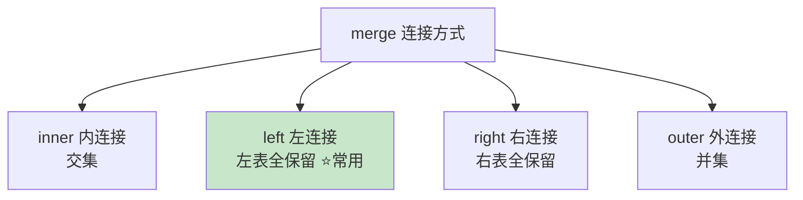

### 9.2 merge 进阶

```python
# —— 列名不同时 ——
pd.merge(df1, df2, left_on="工号", right_on="emp_id")

# —— 索引连接 ——
pd.merge(df1, df2, left_index=True, right_index=True)

# —— 验证：检查是否意外产生一对多 ——
pd.merge(df1, df2, on="工号", validate="one_to_one")

# —— 指示列：看每行来自哪种匹配 ——
pd.merge(df1, df2, on="工号", how="outer", indicator=True)
#    工号  姓名   部门     _merge
# 0    1  小明   NaN   left_only
# 1    2  小红  技术部        both
# 2    4  NaN  人事部  right_only

# —— 后缀处理重名列 ——
pd.merge(df1, df2, on="工号", suffixes=("_左", "_右"))
```

### 9.3 concat：物理拼接

```python
df1 = pd.DataFrame({"A": [1, 2], "B": [3, 4]})
df2 = pd.DataFrame({"A": [5, 6], "B": [7, 8]})

# —— 上下拼接（行增加）——
pd.concat([df1, df2])                   # 保留原索引（会重复！）
pd.concat([df1, df2], ignore_index=True)  # 重排索引 ✅

# —— 左右拼接（列增加）——
pd.concat([df1, df2], axis=1)

# —— 拼接时标记来源 ——
pd.concat([df1, df2], keys=["1月", "2月"])   # 多层索引，方便追溯

# —— join 方法（按索引拼接的简写）——
df1.join(df2, lsuffix="_左", rsuffix="_右")
```

### 9.4 merge vs concat 选择

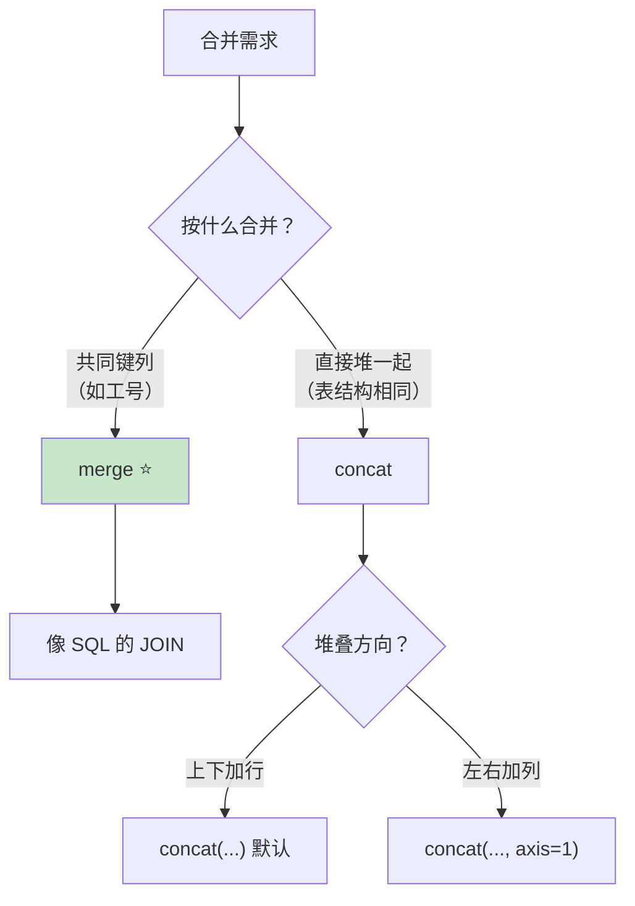

---

## 十、透视表与交叉表 📐

### 10.1 pivot_table：数据透视表

> pivot_table 就是 Excel 那个"数据透视表"——行、列、值三个维度自由组合！

```python
df = pd.DataFrame({
    "城市": ["北京", "北京", "上海", "上海", "广州"],
    "产品": ["A", "B", "A", "B", "A"],
    "销量": [100, 150, 200, 300, 80],
    "销售额": [5000, 7500, 8000, 12000, 4000],
})

# —— 基本透视 ——
pd.pivot_table(df, values="销售额", index="城市", columns="产品", aggfunc="sum")
# 产品      A      B
# 城市
# 上海   8000  12000
# 北京   5000   7500
# 广州   4000    NaN

# —— 填充空值 ——
pd.pivot_table(df, values="销售额", index="城市", columns="产品",
               aggfunc="sum", fill_value=0)
# 产品      A      B
# 上海   8000  12000
# 北京   5000   7500
# 广州   4000      0

# —— 多层索引 + 多值 ——
pd.pivot_table(df,
    values=["销量", "销售额"],
    index=["城市"],
    columns=["产品"],
    aggfunc={"销量": "sum", "销售额": "mean"},
    fill_value=0,
    margins=True,          # 添加汇总行/列（All）
)
```

| 参数 | 作用 | 示例 |
| :--- | :--- | :--- |
| `values` | 要聚合的值列 | `"销售额"` |
| `index` | 行分组 | `"城市"` |
| `columns` | 列分组 | `"产品"` |
| `aggfunc` | 聚合函数 | `"sum"` / `["sum","mean"]` |
| `fill_value` | 空值填充 | `0` |
| `margins` | 汇总行/列 | `True` |

### 10.2 crosstab：交叉计数表

```python
df = pd.DataFrame({
    "性别": ["男", "女", "男", "女", "男"],
    "是否购买": ["是", "是", "否", "是", "否"],
})

pd.crosstab(df["性别"], df["是否购买"])
# 性别  否  是
# 女    0   2
# 男    2   1

# —— 带占比 ——
pd.crosstab(df["性别"], df["是否购买"], normalize="index")   # 按行占比
pd.crosstab(df["性别"], df["是否购买"], normalize="columns") # 按列占比
pd.crosstab(df["性别"], df["是否购买"], normalize="all")     # 整体占比

# —— 带汇总 ——
pd.crosstab(df["性别"], df["是否购买"], margins=True)
```

### 10.3 groupby vs pivot_table

| 对比 | groupby | pivot_table |
| :--- | :--- | :--- |
| 结果形状 | 长表（堆叠） | 宽表（二维交叉） |
| 行+列交叉 | 不直接支持 | ✅ 天然支持 |
| 类比 | SQL GROUP BY | Excel 数据透视表 |

> 💡 口诀：**要看"行×列"交叉结果 → pivot_table；要继续链式处理 → groupby**

---

## 十一、时间序列处理 ⏰

### 11.1 日期基础

```python
import pandas as pd

# —— 创建日期 ——
pd.Timestamp("2026-08-11")              # 2026-08-11 00:00:00
pd.Timestamp("2026/08/11 14:30")
pd.Timestamp("2026年8月11日")             # 中文也认！（部分版本）

pd.to_datetime("2026-08-11 14:30:00")   # 字符串转 Timestamp

# —— 日期范围 ——
pd.date_range(start="2026-08-01", end="2026-08-07")              # 每天
pd.date_range(start="2026-08-01", periods=7)                     # 从 8.1 起 7 天
pd.date_range(start="2026-01-01", periods=12, freq="MS")         # 每月第一天
pd.date_range(start="2026-08-11", periods=5, freq="h")           # 每小时
```

| 频率别名 | 含义 |
| :---: | :--- |
| `D` | 每天 |
| `h` | 每小时 |
| `W` | 每周（周日） |
| `MS` | 每月第一天 |
| `ME` | 每月最后一天 |
| `QS` | 每季度第一天 |
| `YE` | 每年最后一天 |
| `B` | 工作日（Business day） |

### 11.2 提取日期信息

```python
df = pd.DataFrame({
    "日期": pd.to_datetime(["2026-08-11", "2026-12-25", "2026-01-01"]),
})
s = df["日期"]

s.dt.year            # 年 [2026, 2026, 2026]
s.dt.month           # 月 [8, 12, 1]
s.dt.day             # 日 [11, 25, 1]
s.dt.hour            # 时
s.dt.minute          # 分
s.dt.dayofweek       # 星期几（0=周一）[1, 4, 3]
s.dt.day_name()      # 星期名 ["Tuesday", "Friday", "Thursday"]
s.dt.dayofyear       # 一年中第几天
s.dt.quarter         # 季度
s.dt.is_month_end    # 是否月末
s.dt.date            # 只取日期部分（去掉时间）
s.dt.time            # 只取时间部分

# —— 派生特征（数据分析常用）——
df["年"] = s.dt.year
df["月份"] = s.dt.month
df["星期"] = s.dt.day_name()
df["是否周末"] = s.dt.dayofweek >= 5
```

### 11.3 时间索引与重采样

```python
# —— 设为时间索引（时间序列标准姿势）——
ts = pd.DataFrame({
    "销量": [100, 120, 110, 130, 125, 140],
}, index=pd.date_range("2026-08-06", periods=6, freq="D"))

# 按日期区间选数据（超方便！）
ts.loc["2026-08-08"]              # 一天的数据
ts.loc["2026-08-08":"2026-08-10"] # 日期区间（含两端！）
ts.loc["2026-08"]                 # 整个月！

# —— 重采样 resample（升降频神器）——
ts.resample("D").sum()            # 按天汇总
ts.resample("W").mean()           # 按周平均
ts.resample("ME").sum()           # 按月汇总

# 降频（聚合）：天 → 周
weekly = ts.resample("W").agg({"销量": ["sum", "mean"]})

# 升频（填充）：天 → 小时
ts.resample("h").ffill()          # 前向填充
ts.resample("h").interpolate()    # 线性插值

# —— 移动窗口（趋势分析）——
ts["7日移动平均"] = ts["销量"].rolling(window=7).mean()    # 滑动平均
ts["累计销量"] = ts["销量"].cumsum()                        # 累计
ts["环比"] = ts["销量"].pct_change()                       # 百分比变化
```

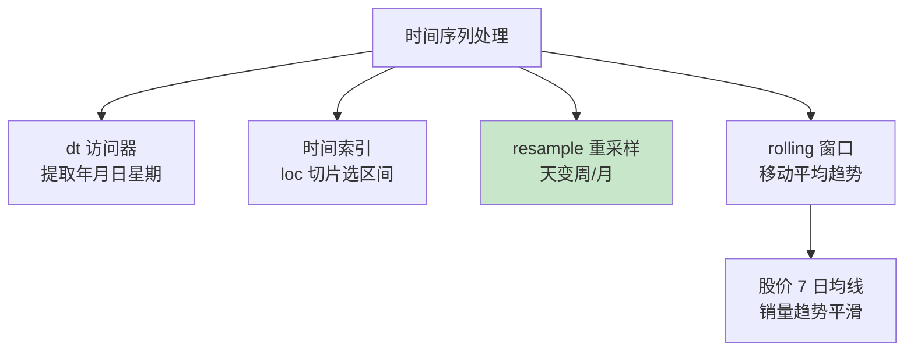

---

## 十二、综合实战：销售数据分析 💼

> 把前面所有知识串起来，完整走一遍分析流程！

### 12.1 场景设定

一家电商公司的 8 月份销售数据，要回答老板三个问题：
1. 哪个城市卖得最好？
2. 哪个产品最赚钱？
3. 销售趋势如何？

### 12.2 第一步：准备数据

```python
import pandas as pd
import numpy as np

# —— 模拟生成销售数据（真实场景用 read_csv 读取）——
np.random.seed(42)

df = pd.DataFrame({
    "订单号": [f"ORD-{i:04d}" for i in range(1, 101)],
    "日期": pd.date_range("2026-08-01", periods=100, freq="h"),
    "城市": np.random.choice(["北京", "上海", "广州", "深圳"], 100),
    "产品": np.random.choice(["手机", "耳机", "充电器"], 100, p=[0.3, 0.4, 0.3]),
    "销量": np.random.randint(1, 10, 100),
})

# 单价表
price_map = {"手机": 5999, "耳机": 899, "充电器": 99}
df["单价"] = df["产品"].map(price_map)
df["销售额"] = df["销量"] * df["单价"]

# —— 故意弄脏数据（模拟真实情况）——
df.loc[5, "城市"] = np.nan            # 缺失
df.loc[10, "销量"] = -999             # 异常
df = pd.concat([df, df.iloc[[0]]])    # 重复行

print(df.shape)      # (101, 7)
```

### 12.3 第二步：数据清洗

```python
# ====== ① 检查数据质量 ======
print(df.info())                  # 类型概览
print(df.isnull().sum())          # 缺失统计：城市 1
print(df.duplicated().sum())      # 重复行：1

# ====== ② 处理重复 ======
df = df.drop_duplicates(ignore_index=True)

# ====== ③ 处理缺失 ======
# 城市缺失：占比极小，直接删
df = df.dropna(subset=["城市"])

# ====== ④ 处理异常值 ======
# 销量不可能为负
df["销量"] = df["销量"].clip(lower=0)   # 负数截断为 0
# 或：df = df[df["销量"] > 0]

# ====== ⑤ 类型确认 ======
df["日期"] = pd.to_datetime(df["日期"])
print(df.dtypes)
print(f"清洗后：{df.shape}")
```

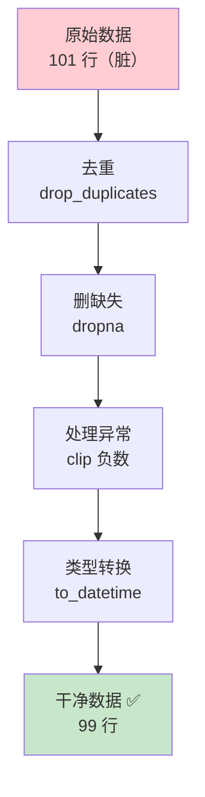

### 12.4 第三步：分析探索

```python
# ====== 问题 1：哪个城市卖得最好？ ======
city_sales = (df.groupby("城市")
    .agg(总销售额=("销售额", "sum"),
         订单数=("订单号", "count"),
         平均客单价=("销售额", "mean"))
    .sort_values("总销售额", ascending=False)
)
print(city_sales)
#       总销售额  订单数     平均客单价
# 上海    8xxxx    2x     2xxxx.xx
# 北京    7xxxx    2x     1xxxx.xx
# ...

# ====== 问题 2：哪个产品最赚钱？ ======
product_sales = df.groupby("产品").agg(
    总销售额=("销售额", "sum"),
    总销量=("销量", "sum"),
    订单数=("订单号", "count"),
)
product_sales["销售额占比"] = (
    product_sales["总销售额"] / product_sales["总销售额"].sum() * 100
).round(2)

# 交叉分析：城市 × 产品（透视表登场！）
pivot = pd.pivot_table(
    df,
    values="销售额",
    index="城市",
    columns="产品",
    aggfunc="sum",
    fill_value=0,
    margins=True,          # 加汇总
)
print(pivot)
```

```python
# ====== 问题 3：销售趋势如何？ ======
# 按天重采样
daily = df.set_index("日期").resample("D")["销售额"].sum()

# 7 日移动平均看趋势
trend = daily.rolling(window=3).mean()

# 环比变化
day_change = daily.pct_change()

# ====== 附加分析：时段规律 ======
df["小时"] = df["日期"].dt.hour
hour_sales = df.groupby("小时")["销售额"].sum()
print(f"销售高峰时段：{hour_sales.idxmax()} 点")
```

### 12.5 第四步：可视化呈现

```python
import matplotlib.pyplot as plt

# —— 中文显示配置 ——
plt.rcParams["font.sans-serif"] = ["SimHei"]     # 显示中文
plt.rcParams["axes.unicode_minus"] = False        # 显示负号

fig, axes = plt.subplots(2, 2, figsize=(14, 10))

# ① 城市销售额对比（柱状图）
city_sales["总销售额"].plot(kind="bar", ax=axes[0, 0],
                    color="skyblue", title="各城市销售额")

# ② 产品占比（饼图）
product_sales["总销售额"].plot(kind="pie", ax=axes[0, 1],
                       autopct="%.1f%%", title="产品销售额占比")

# ③ 每日销售趋势（折线图）
daily.plot(ax=axes[1, 0], color="coral",
           marker="o", title="每日销售额趋势")

# ④ 小时分布（柱状图）
hour_sales.plot(kind="bar", ax=axes[1, 1],
                color="mediumpurple", title="各时段销售额")

plt.tight_layout()
plt.savefig("sales_report.png", dpi=150)   # 保存报告图
plt.show()
```

### 12.6 第五步：输出结论报告

```python
# —— 自动生成分析报告 ——
best_city = city_sales.index[0]
best_product = product_sales["总销售额"].idxmax()
growth = daily.pct_change().mean() * 100

report = f"""
╔══════════════════════════════════╗
║     📊 8 月销售数据分析报告        ║
╠══════════════════════════════════╣
║ 总销售额: ¥{df['销售额'].sum():,.0f}
║ 总订单数: {len(df)} 单
║ 最优城市: {best_city}
║ 明星产品: {best_product}
║ 日均增长: {growth:.1f}%
╚══════════════════════════════════╝
"""
print(report)

# —— 导出 Excel 报告（多工作表）——
with pd.ExcelWriter("销售分析报告.xlsx") as writer:
    df.to_excel(writer, sheet_name="明细数据", index=False)
    city_sales.to_excel(writer, sheet_name="城市分析")
    product_sales.to_excel(writer, sheet_name="产品分析")
    pivot.to_excel(writer, sheet_name="交叉透视")
print("报告已导出：销售分析报告.xlsx ✅")
```

### 12.7 分析全流程图

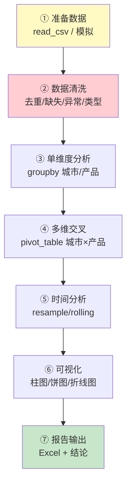

---

## 十三、知识总结 📌

### 核心知识图

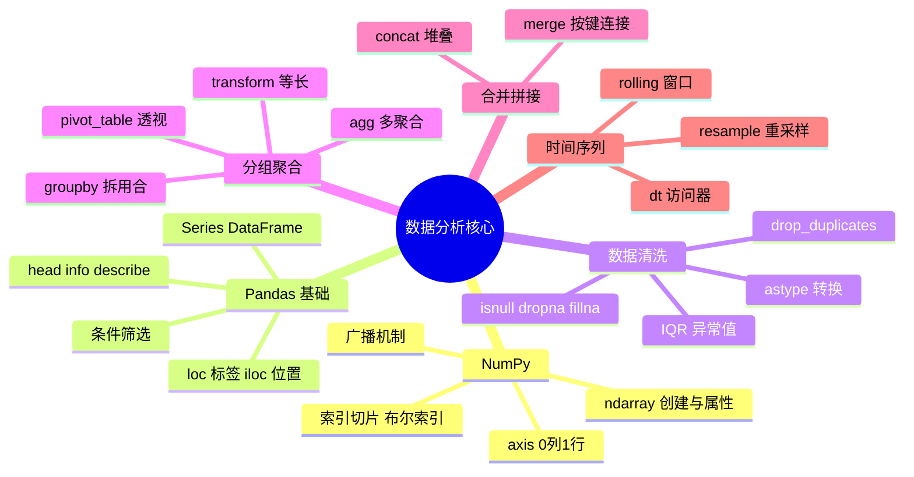

### 高频操作速查表

| 需求 | 写法 |
| :--- | :--- |
| 读 CSV | `pd.read_csv("x.csv")` |
| 写 CSV 不带行号 | `df.to_csv("x.csv", index=False)` |
| 看数据概况 | `df.info()` / `df.describe()` |
| 选列 | `df["列"]` / `df[["列1","列2"]]` |
| 条件筛选 | `df[df["列"] > 5]` |
| 多条件 | `df[(条件1) & (条件2)]` |
| 缺失统计 | `df.isnull().sum()` |
| 填均值 | `df["列"].fillna(df["列"].mean())` |
| 去重 | `df.drop_duplicates()` |
| 分组汇总 | `df.groupby("列").agg(新名=("值","sum"))` |
| 组内广播 | `df.groupby("列")["值"].transform("mean")` |
| 按键合并 | `pd.merge(df1, df2, on="键", how="left")` |
| 上下拼接 | `pd.concat([df1, df2], ignore_index=True)` |
| 透视表 | `pd.pivot_table(df, values=, index=, columns=, aggfunc=)` |
| 交叉计数 | `pd.crosstab(df["A"], df["B"])` |
| 提取年份 | `df["日期"].dt.year` |
| 按月汇总 | `df.resample("MS").sum()` |
| 移动平均 | `df["列"].rolling(7).mean()` |
| 类型转换 | `pd.to_numeric(列, errors="coerce")` |

### 避坑指南

| 坑 | 解法 |
| :--- | :--- |
| `SettingWithCopyWarning` | 用 `df = df[df[...]].copy()` |
| to_csv 多一列行号 | 加 `index=False` |
| 中文乱码 | 读 gbk / 写 utf-8-sig |
| matplotlib 中文方块 | `plt.rcParams["font.sans-serif"]=["SimHei"]` |
| 链式调用后修改不生效 | 链式返回新对象，要赋值！ |
| 大文件读取慢 | `usecols` + `nrows` + `dtype` 指定 |

### 学习路线建议


> 🎀 呼～数据分析全套武功秘籍到手啦！🎉 NumPy 的广播、Pandas 的 groupby 三步曲、透视表、时间序列、还有完整实战案例——你现在可以独立完成一份数据分析报告了！接下来可以挑战 [机器学习] 或深入 [数据可视化]，数据分析这条路越走越宽哦～快找个真实数据集练手吧！(◍•ᴗ•◍)❤

