# 🤖 Python 机器学习

> 哈喽呀～今天进入魔法世界：机器学习！✨ 让程序从数据里自己学规律，预测房价、识别垃圾邮件、判断肿瘤良恶性……听起来超酷对吧？其实用 Python + sklearn 入门并不难，跟着小讲师一步步来，从"什么是机器学习"讲到"完整实战项目"，冲鸭！(≧∇≦)ﾉ

***

## 🗺️ 知识全景图

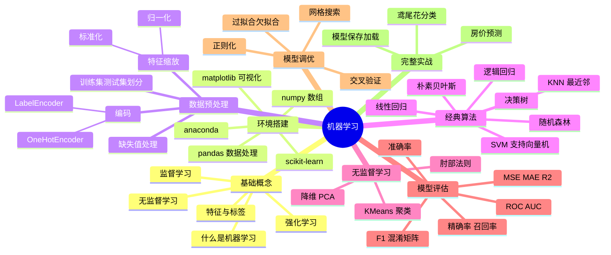

***

## 📑 目录

- [一、机器学习是什么](#一机器学习是什么)
- [二、环境搭建](#二环境搭建)
- [三、机器学习三大门派](#三机器学习三大门派)
- [四、数据预处理](#四数据预处理)
- [五、线性回归：预测数值](#五线性回归预测数值)
- [六、逻辑回归：二分类入门](#六逻辑回归二分类入门)
- [七、KNN：近朱者赤](#七knn近朱者赤)
- [八、决策树与随机森林](#八决策树与随机森林)
- [九、朴素贝叶斯与 SVM](#九朴素贝叶斯与-svm)
- [十、无监督学习：聚类与降维](#十无监督学习聚类与降维)
- [十一、模型评估全解](#十一模型评估全解)
- [十二、模型调优：过拟合与交叉验证](#十二模型调优过拟合与交叉验证)
- [十三、综合实战：鸢尾花分类项目](#十三综合实战鸢尾花分类项目)
- [十四、常见坑与学习路线](#十四常见坑与学习路线)

***

## 一、机器学习是什么

### 1.1 一句话解释

**机器学习 = 让程序从数据中自动总结规律，再用规律预测新数据** 🪄

传统编程：人写规则 + 数据进 → 结果出
机器学习：数据 + 结果进 → 机器自己总结规则！

### 1.2 两种编程思维对比

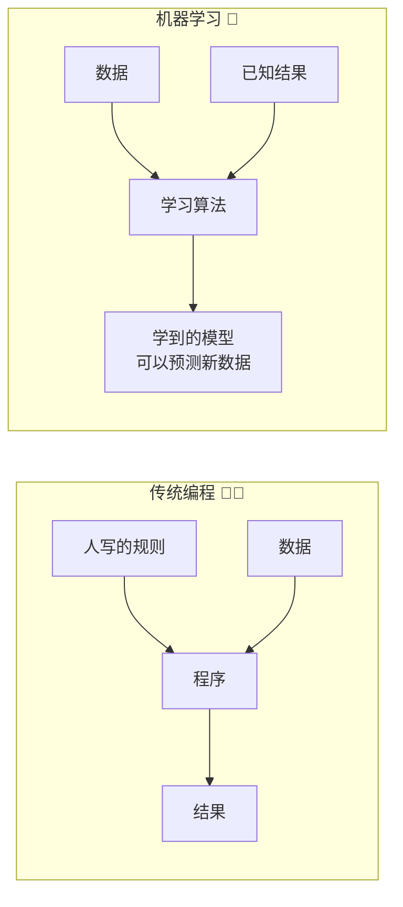

### 1.3 生活化例子

| 场景 | 输入特征 | 预测目标 |
|------|---------|---------|
| 房价预测 | 面积、位置、楼层、房龄 | 价格（数值） |
| 垃圾邮件识别 | 发件人、关键词、链接数 | 是否垃圾（是/否） |
| 肿瘤诊断 | 肿瘤大小、边缘、密度 | 良性/恶性 |
| 用户推荐 | 浏览历史、购买记录 | 感兴趣的商品 |
| 人脸识别 | 像素矩阵 | 是谁的脸 |

### 1.4 核心术语速查

| 术语 | 通俗解释 🌰 |
|------|-----------|
| 特征 Feature | 模型的"输入"：面积、房龄这些 |
| 标签 Label | 模型的"答案"：房价本身 |
| 样本 Sample | 一条完整数据：一套房子的所有信息 |
| 训练集 | 给模型"上课刷题"用的数据 |
| 测试集 | 给模型"期末考试"用的数据（不许偷看！）|
| 模型 Model | 学出来的"规律公式" |
| 训练 Training | 学习的过程 |
| 预测 Predict | 用学到的规律算新数据 |

***

## 二、环境搭建 🛠️

### 2.1 安装全家桶

```bash
# 方式一：pip 逐个装
pip install numpy pandas matplotlib scikit-learn

# 方式二：一步到位（推荐新手）
pip install numpy pandas matplotlib scikit-learn jupyter

# 验证安装
python -c "import sklearn; print(sklearn.__version__)"
```

### 2.2 四大金刚分工

| 库 | 角色 | 干什么 |
|----|------|--------|
| numpy | 计算地基 | 数组运算、矩阵乘法 |
| pandas | 数据处理 | 读表格、清洗数据 |
| matplotlib | 画图 | 可视化数据分布 |
| **scikit-learn** | 机器学习本体 | 算法、评估、预处理 ⭐ |

### 2.3 万能代码开头模板

```python
import numpy as np                    # 数值计算
import pandas as pd                   # 数据处理
import matplotlib.pyplot as plt       # 画图
from sklearn.datasets import load_iris          # 自带数据集
from sklearn.model_selection import train_test_split
from sklearn.preprocessing import StandardScaler
from sklearn.linear_model import LinearRegression

plt.rcParams["font.family"] = "SimHei"      # 中文显示（Windows）
plt.rcParams["axes.unicode_minus"] = False  # 负号显示
```

### 2.4 sklearn 自带练手数据集

```python
from sklearn import datasets

iris = datasets.load_iris()            # 鸢尾花（分类）
boston_like = datasets.fetch_california_housing()  # 加州房价（回归）
digits = datasets.load_digits()        # 手写数字（分类）
wine = datasets.load_wine()            # 红酒分类

# 数据长什么样？
print(iris.data.shape)       # (150, 4) 150条样本 4个特征
print(iris.feature_names)    # 特征名：花萼长宽 花瓣长宽
print(iris.target_names)     # 标签名：3种鸢尾花
print(iris.data[:3])         # 看前 3 条数据
print(iris.target[:10])      # 前 10 个标签
```

***

## 三、机器学习三大门派 🥋

### 3.1 三大门派总览

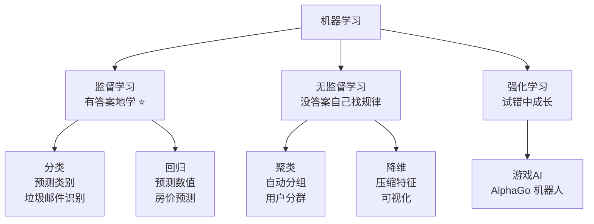

### 3.2 监督学习（本课主角！）

> 特点：训练数据**带标签**（有标准答案），像有老师批改作业～

| 任务 | 输出 | 例子 |
|------|------|------|
| 分类 | 离散类别 | 是不是垃圾邮件 / 猫还是狗 |
| 回归 | 连续数值 | 明天多少度 / 房价多少万 |

### 3.3 三大流派对比表

| 门派 | 数据特点 | 典型算法 | 应用 |
|------|---------|---------|------|
| 监督学习 | 有特征有标签 | 线性回归、随机森林 | 预测、分类 |
| 无监督学习 | 只有特征没标签 | KMeans、PCA | 分群、降维 |
| 强化学习 | 环境给奖励反馈 | Q-Learning | 游戏、机器人 |

### 3.4 机器学习标准工作流

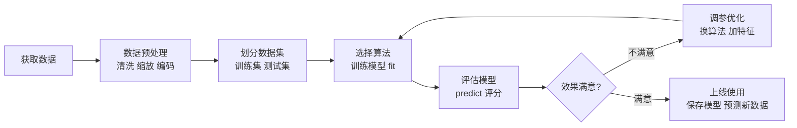

> 💡 这个流程就是机器学习的"武功心法"，后面所有实战都按这个套路打！

***

## 四、数据预处理 🧹

> 真实数据又脏又乱：有缺失、量纲不一、文字没法算——先洗干净才能喂给模型！

### 4.1 缺失值处理

```python
import pandas as pd
import numpy as np

df = pd.DataFrame({
    "面积": [80, 100, np.nan, 120, 90],
    "房龄": [5, np.nan, 10, 15, 8],
    "价格": [300, 400, 350, 500, 380],
})

# 1. 查看缺失情况
print(df.isnull().sum())           # 每列缺几个

# 2. 处理方式一：删除（数据多时任性）
df_drop = df.dropna()

# 3. 处理方式二：填充（常用！）
df["面积"] = df["面积"].fillna(df["面积"].mean())      # 均值填充
df["房龄"] = df["房龄"].fillna(df["房龄"].median())    # 中位数填充（更抗异常值）

# 4. sklearn 方式（管道友好）
from sklearn.impute import SimpleImputer
imp = SimpleImputer(strategy="mean")       # mean/median/most_frequent
df_filled = pd.DataFrame(imp.fit_transform(df), columns=df.columns)
```

### 4.2 特征缩放：量纲统一

> 面积是 80~500，房龄是 1~30——不统一量纲，模型会被大数字特征"带偏"！

```python
from sklearn.preprocessing import StandardScaler, MinMaxScaler

X = [[80, 5], [100, 10], [120, 15]]    # 面积 房龄

# 标准化：变成均值0 标准差1（最常用 ⭐）
scaler = StandardScaler()
X_std = scaler.fit_transform(X)
# fit_transform = 先学规律 再转换

# 归一化：压缩到 0~1 区间
mm = MinMaxScaler()
X_mm = mm.fit_transform(X)
```

| 方法 | 公式 | 结果范围 | 适用 |
|------|------|---------|------|
| 标准化 StandardScaler | (x-均值)/标准差 | 无固定范围，均值0 | 大多数场景 ⭐ |
| 归一化 MinMaxScaler | (x-最小)/(最大-最小) | 0~1 | 图像像素、神经网络 |

> ⚠️ 大坑预警：**scaler 只能在训练集上 fit**，测试集用同一个 scaler 的 transform！否则等于偷看了测试集信息（数据泄露）！

```python
# 正确姿势
scaler = StandardScaler()
X_train_std = scaler.fit_transform(X_train)   # 训练集：fit + transform
X_test_std  = scaler.transform(X_test)        # 测试集：只 transform！
```

### 4.3 文本转数字：编码

```python
from sklearn.preprocessing import LabelEncoder, OneHotEncoder

# LabelEncoder：类别 → 数字（适合"标签"列）
le = LabelEncoder()
colors = ["红", "绿", "蓝", "红"]
print(le.fit_transform(colors))        # [2 1 0 2]

# OneHotEncoder：类别 → 独热向量（适合"特征"列）
# "城市"列：北京/上海/广州 → 3个0/1列，避免模型误以为有大小关系
df = pd.DataFrame({"城市": ["北京", "上海", "广州", "北京"]})
print(pd.get_dummies(df, columns=["城市"]))
#    城市_上海  城市_北京  城市_广州
# 0      0      1      0
# 1      1      0      0 ...
```

| 编码方式 | 原理 | 适用场景 |
|---------|------|---------|
| LabelEncoder | 红→0 绿→1 蓝→2 | 标签列、有序类别（小中大）|
| OneHot / get_dummies | 每个类别变一列 0/1 | 特征列、无序类别 ⭐ |

### 4.4 训练集测试集划分

```python
from sklearn.model_selection import train_test_split

X_train, X_test, y_train, y_test = train_test_split(
    X,                    # 特征
    y,                    # 标签
    test_size=0.2,        # 测试集占 20%
    random_state=42,      # 随机种子（固定后每次切分一样，可复现）
    stratify=y,           # 分层抽样：保持各类别比例（分类任务建议加！）
)
print(len(X_train), len(X_test))   # 8:2
```

***

## 五、线性回归：预测数值 📈

### 5.1 原理：画一条最贴合的直线

> 房价 ≈ w1×面积 + w2×房龄 + b —— 模型要学的就是那些 w（权重）和 b（截距），让预测误差最小！


### 5.2 代码实战

```python
from sklearn.linear_model import LinearRegression
from sklearn.model_selection import train_test_split
import numpy as np

# 模拟数据：面积 → 价格
X = np.array([[50], [60], [70], [80], [90], [100], [110], [120]])
y = np.array([150, 190, 230, 260, 300, 340, 370, 410])   # 万

X_train, X_test, y_train, y_test = train_test_split(
    X, y, test_size=0.25, random_state=42)

model = LinearRegression()
model.fit(X_train, y_train)             # 训练！

print("斜率 w:", model.coef_)          # 约 3.7 万/平米
print("截距 b:", model.intercept_)

pred = model.predict(X_test)            # 预测
print("预测:", pred.round(1))
print("真实:", y_test)

# 评估：R2 越接近 1 越好
print("R2:", model.score(X_test, y_test))     # 0.99+
```

### 5.3 多特征回归（更贴近现实）

```python
# 3 个特征预测房价
X = df[["面积", "房龄", "房间数"]]
y = df["价格"]

model = LinearRegression()
model.fit(X_train, y_train)

# 每个特征的权重：正负代表"促进/拖累"房价
for name, w in zip(X.columns, model.coef_):
    print(f"{name}: {w:.2f}")
# 面积: 3.52 (面积越大越贵)
# 房龄: -1.80 (越老越便宜)
```

***

## 六、逻辑回归：二分类入门 🎯

### 6.1 原理：还是直线，但输出概率

> 名字叫"回归"，其实是**分类算法**！它算出一个 0~1 的概率，超过阈值（默认0.5）就判为正类～

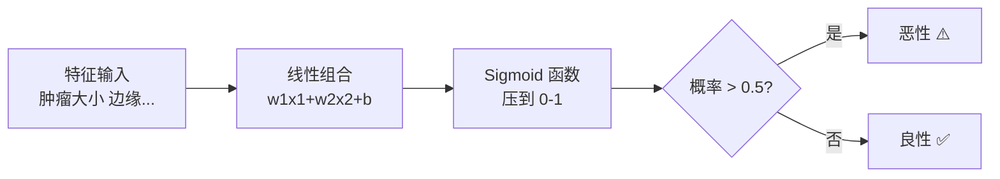

### 6.2 代码实战：乳腺癌检测

```python
from sklearn.datasets import load_breast_cancer
from sklearn.linear_model import LogisticRegression
from sklearn.model_selection import train_test_split
from sklearn.preprocessing import StandardScaler

data = load_breast_cancer()
X, y = data.data, data.target          # 569样本 30特征

X_train, X_test, y_train, y_test = train_test_split(
    X, y, test_size=0.2, random_state=42, stratify=y)

# 特征缩放（逻辑回归对量纲敏感！）
scaler = StandardScaler()
X_train = scaler.fit_transform(X_train)
X_test = scaler.transform(X_test)

model = LogisticRegression(max_iter=1000)
model.fit(X_train, y_train)

print("准确率:", model.score(X_test, y_test))    # 约 0.97

# 看概率
prob = model.predict_proba(X_test[:3])
print("恶性概率:", prob[:, 1].round(3))          # [0.997 0.02 0.88]
```

### 6.3 线性回归 vs 逻辑回归

| 对比 | 线性回归 | 逻辑回归 |
|------|---------|---------|
| 任务 | 回归（预测数值）| **分类**（预测类别）|
| 输出 | 任意实数 | 0~1 概率 |
| 损失 | 均方误差 MSE | 对数损失 |
| 典型场景 | 房价、销量 | 检测、风控 |

***

## 七、KNN：近朱者赤 👥

### 7.1 原理：看看邻居都是谁

> 新来的点，数一数它周围 K 个邻居——邻居大多是好人，它就是好人！简单粗暴但意外地好用～

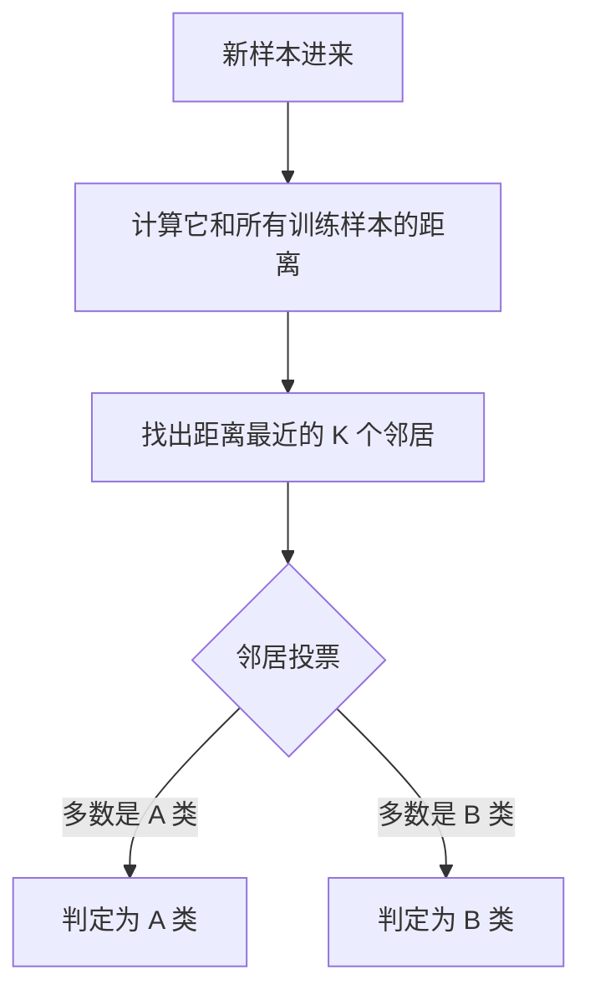

### 7.2 代码实战

```python
from sklearn.neighbors import KNeighborsClassifier
from sklearn.datasets import load_iris
from sklearn.model_selection import train_test_split

iris = load_iris()
X_train, X_test, y_train, y_test = train_test_split(
    iris.data, iris.target, test_size=0.2, random_state=42)

knn = KNeighborsClassifier(n_neighbors=5)     # K=5
knn.fit(X_train, y_train)
print("准确率:", knn.score(X_test, y_test))   # 约 1.0

# 预测一朵新花
new_flower = [[5.1, 3.5, 1.4, 0.2]]
print("预测类别:", knn.predict(new_flower))            # [0] 山鸢尾
print("各类概率:", knn.predict_proba(new_flower))
```

### 7.3 K 值怎么选

```python
# 试不同的 K，看谁表现好
scores = []
for k in range(1, 21):
    knn = KNeighborsClassifier(n_neighbors=k)
    knn.fit(X_train, y_train)
    scores.append(knn.score(X_test, y_test))

best_k = scores.index(max(scores)) + 1
print(f"最佳 K = {best_k}，准确率 = {max(scores):.3f}")
```

| K 值 | 效果 |
|------|------|
| 太小（K=1） | 过拟合：对噪声敏感，紧张过度 |
| 适中（K=5~11） | 平衡 ✅ |
| 太大（K=全部） | 欠拟合：全靠大多数，失去分辨力 |

> 💡 KNN 是"惰性学习"：训练秒完成（只存数据），预测时才算距离——数据量大时预测慢哦！

***

## 八、决策树与随机森林 🌳

### 8.1 决策树：像玩"二十个问题"

> 一连串 if-else：房龄>10？面积>100？……一层层问下去，最后给出答案。可解释性满分！

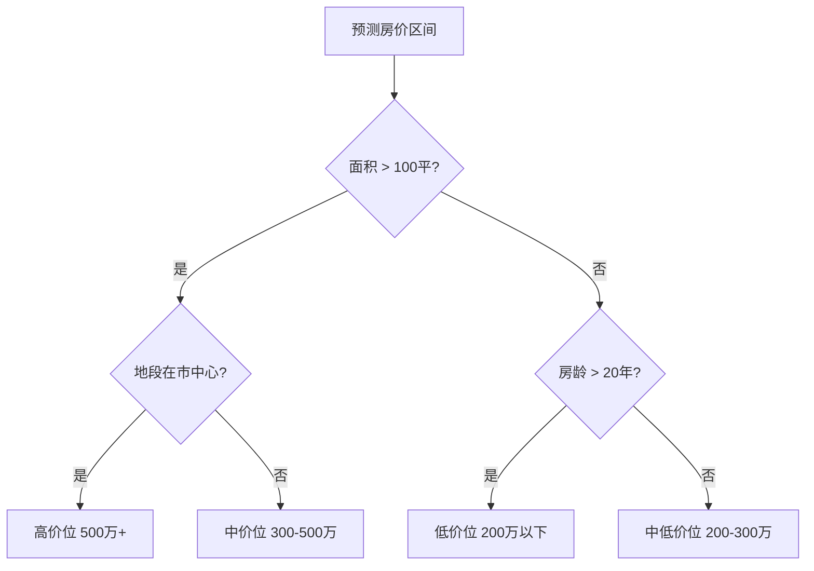

### 8.2 代码实战

```python
from sklearn.tree import DecisionTreeClassifier, plot_tree
from sklearn.datasets import load_iris
import matplotlib.pyplot as plt

tree = DecisionTreeClassifier(
    max_depth=3,              # 限制深度防止过拟合！
    random_state=42,
)
tree.fit(X_train, y_train)
print("准确率:", tree.score(X_test, y_test))

# 特征重要性：哪个特征最有话语权
for name, imp in zip(iris.feature_names, tree.feature_importances_):
    print(f"{name}: {imp:.3f}")        # 花瓣长度权重最高！

# 可视化树（直观到爆炸）
plt.figure(figsize=(12, 8))
plot_tree(tree, feature_names=iris.feature_names,
          class_names=iris.target_names, filled=True)
plt.savefig("tree.png", dpi=100)
```

### 8.3 随机森林：三个臭皮匠顶个诸葛亮

> 单棵树容易过拟合 → 种 100 棵树，每棵看一部分数据，最后投票——这就是"集成学习"！

```python
from sklearn.ensemble import RandomForestClassifier

rf = RandomForestClassifier(
    n_estimators=100,       # 100 棵树
    max_depth=5,
    random_state=42,
)
rf.fit(X_train, y_train)
print("准确率:", rf.score(X_test, y_test))

# 特征重要性（比单棵树更稳定可信）
for name, imp in zip(iris.feature_names, rf.feature_importances_):
    print(f"{name}: {imp:.3f}")
```

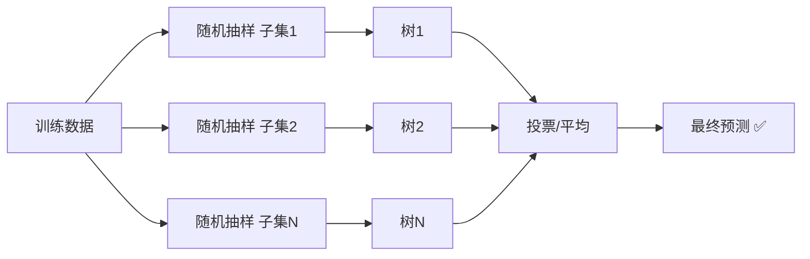

### 8.4 树模型对比

| 模型 | 可解释性 | 抗过拟合 | 准确率 | 推荐度 |
|------|---------|---------|--------|--------|
| 单棵决策树 | ⭐⭐⭐⭐⭐ 一看就懂 | ❌ 弱 | 中 | 教学/分析 |
| 随机森林 | ⭐⭐⭐ 特征重要性 | ✅ 强 | 高 | 表格数据首选 ⭐ |

> 💡 江湖经验：**拿到表格数据不知道用什么？先上随机森林！** 基线稳了再试别的～

***

## 九、朴素贝叶斯与 SVM 📐

### 9.1 朴素贝叶斯：概率算命先生

> 原理：根据"朴素"假设（特征相互独立），用贝叶斯公式算后验概率。文本分类老牌王者！

```python
from sklearn.naive_bayes import MultinomialNB
from sklearn.feature_extraction.text import CountVectorizer

# 垃圾邮件分类
texts = ["免费 中奖 点击 链接", "会议 纪要 请查收",
         "免费 领取 优惠券", "项目 进度 更新"]
labels = [1, 0, 1, 0]           # 1=垃圾 0=正常

vec = CountVectorizer()          # 文字 → 词频矩阵
X = vec.fit_transform(texts)

nb = MultinomialNB()
nb.fit(X, labels)

new_mail = vec.transform(["免费 抽奖 点击"])
print(nb.predict(new_mail))      # [1] 垃圾邮件！
```

### 9.2 SVM：找最宽的分界线

> 原理：在两类点之间画一条"最宽马路"的分界线，甚至能升维把缠在一起的数据切开！

```python
from sklearn.svm import SVC
from sklearn.preprocessing import StandardScaler

svm = SVC(kernel="rbf", C=1.0)     # rbf 核：处理非线性
svm.fit(X_train_scaled, y_train)
print("准确率:", svm.score(X_test_scaled, y_test))
```

| 核函数 | 适用 |
|--------|------|
| linear | 线性可分、高维稀疏（文本）|
| rbf | 万金油，非线性首选 ⭐ |
| poly | 多项式边界 |

### 9.3 各算法选型速查

| 算法 | 类型 | 优势 | 劣势 | 首选场景 |
|------|------|------|------|---------|
| 线性回归 | 回归 | 简单可解释 | 只能拟合直线 | 趋势预测 |
| 逻辑回归 | 分类 | 快、输出概率 | 线性边界 | 二分类基线 |
| KNN | 分类 | 无需训练、直觉 | 预测慢、怕量纲 | 小数据 |
| 决策树 | both | 可解释王 | 易过拟合 | 规则分析 |
| **随机森林** | both | 强、稳、免调参 | 稍慢、黑一点 | 表格数据 ⭐ |
| 朴素贝叶斯 | 分类 | 快、文本强 | 独立假设太天真 | 文本分类 |
| SVM | 分类 | 小样本强 | 大数据慢、要缩放 | 中小规模 |

***

## 十、无监督学习：聚类与降维 🔍

### 10.1 KMeans：自动分组

> 没有标签？让相似的数据自动抱团！K 个"班长"（中心点）不断吸引组员、重新站位，直到稳定～

```python
from sklearn.cluster import KMeans
import numpy as np

# 模拟用户数据：消费金额 到店次数
X = np.array([[1000, 2], [1200, 3], [200, 10], [300, 12],
              [800, 3], [250, 11], [1100, 2], [280, 10]])

km = KMeans(n_clusters=2, random_state=42, n_init=10)
labels = km.fit_predict(X)            # 直接返回分组结果
print("分组:", labels)                # [0 0 1 1 0 1 0 1]

# 用户画像解读
for g in [0, 1]:
    members = X[labels == g]
    print(f"第{g}组 平均消费{members[:,0].mean():.0f} 平均到店{members[:,1].mean():.1f}次")
# 第0组：高消费低频 = 大客户 💎
# 第1组：低消费高频 = 活跃散客
```

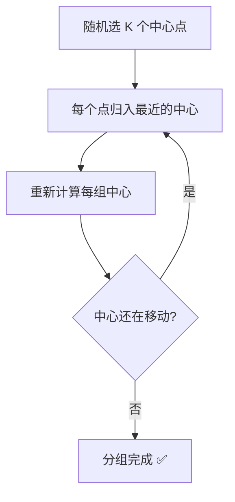

### 10.2 肘部法则：K 选几组？

```python
import matplotlib.pyplot as plt

inertias = []
for k in range(1, 9):
    km = KMeans(n_clusters=k, random_state=42, n_init=10)
    km.fit(X)
    inertias.append(km.inertia_)     # 组内距离总和，越小越紧

plt.plot(range(1, 9), inertias, "bo-")
plt.xlabel("K")
plt.ylabel("inertia")
plt.savefig("elbow.png")
# 拐点像"手肘"的地方就是最佳 K！
```

### 10.3 PCA 降维：数据压缩

> 30 个特征画不了图？PCA 把它压到 2 维还能保留大部分信息，可视化神器！

```python
from sklearn.decomposition import PCA
from sklearn.datasets import load_iris
import matplotlib.pyplot as plt

iris = load_iris()
pca = PCA(n_components=2)              # 压到 2 维
X_2d = pca.fit_transform(iris.data)

print("保留信息比例:", pca.explained_variance_ratio_)   # [0.92, 0.05]

plt.scatter(X_2d[:, 0], X_2d[:, 1], c=iris.target, cmap="viridis")
plt.xlabel("主成分1")
plt.ylabel("主成分2")
plt.savefig("pca.png")
# 三种花自动分成三坨，肉眼可见！
```

***

## 十一、模型评估全解 📊

### 11.1 分类评估：别只看准确率！

```python
from sklearn.metrics import (
    accuracy_score, precision_score, recall_score, f1_score,
    confusion_matrix, classification_report, roc_auc_score,
)

y_pred = model.predict(X_test)

print("准确率:", accuracy_score(y_test, y_pred))
print("精确率:", precision_score(y_test, y_pred))
print("召回率:", recall_score(y_test, y_pred))
print("F1:", f1_score(y_test, y_pred))

# 一键全家桶报告
print(classification_report(y_test, y_pred))
```

### 11.2 混淆矩阵：四个格子看清一切

```python
cm = confusion_matrix(y_test, y_pred)
print(cm)
# [[真负TN  假正FP]
#  [假负FN  真正TP]]
```

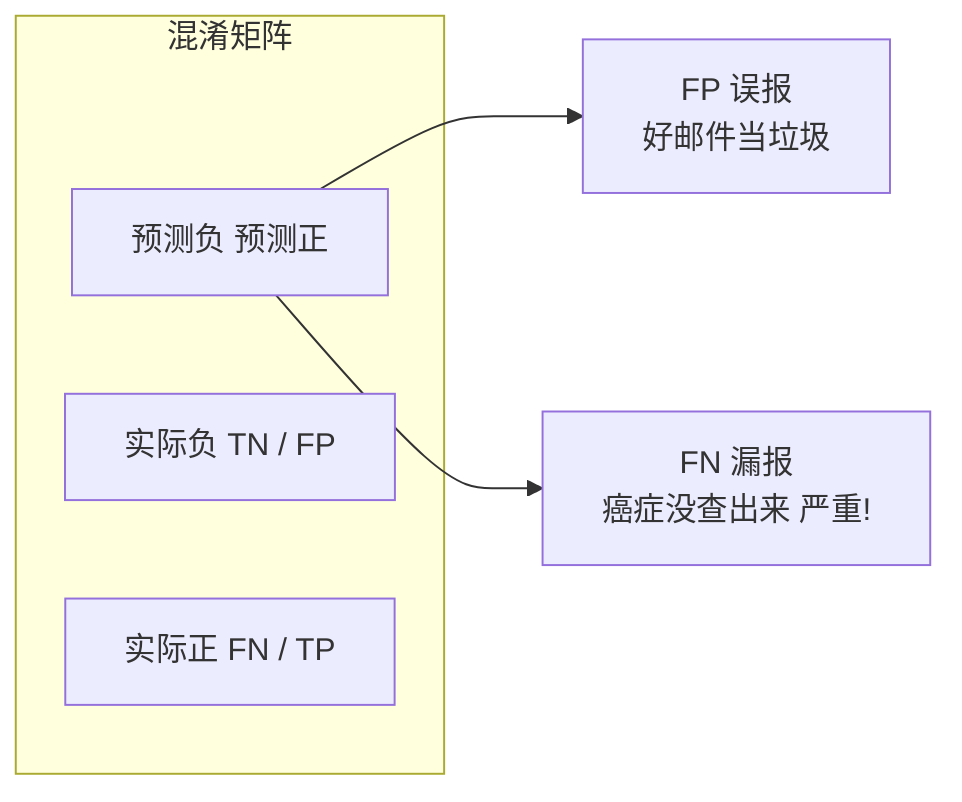

### 11.3 指标含义与取舍

| 指标 | 通俗含义 | 高了意味着 | 什么场景重要 |
|------|---------|-----------|-------------|
| 准确率 Accuracy | 总体猜对比例 | 整体靠谱 | 类别均衡时 |
| 精确率 Precision | 报告为正的里面多少真是 | 误报少 | 广告投放（怕骚扰用户）|
| 召回率 Recall | 真正的里面抓到多少 | 漏报少 | 癌症检测、风控 ⭐ |
| F1 | 精确率和召回率的调和平均 | 两者兼顾 | 不平衡数据 |
| ROC-AUC | 综合排序能力 | 区分度强 | 模型对比 |

> 💡 骗局案例：1000 人里 5 个病人，模型无脑全判"健康"→ 准确率 99.5%！但召回率 0，一个病人没抓到——这就是不平衡数据只看准确率的坑！要看 F1 和 AUC～

### 11.4 回归评估

```python
from sklearn.metrics import mean_absolute_error, mean_squared_error, r2_score

print("MAE 平均绝对误差:", mean_absolute_error(y_test, y_pred))
print("MSE 均方误差:", mean_squared_error(y_test, y_pred))
print("RMSE:", mean_squared_error(y_test, y_pred) ** 0.5)
print("R2 拟合优度:", r2_score(y_test, y_pred))    # 越接近1越好
```

| 指标 | 含义 | 单位 |
|------|------|------|
| MAE | 平均差多少（好理解）| 与原数据一致 |
| MSE | 平方后平均（放大极端误差）| 平方单位 |
| RMSE | MSE 开根号 | 与原数据一致 |
| R2 | 模型解释了多少变化 | 0~1 |

***

## 十二、模型调优：过拟合与交叉验证 🎛️

### 12.1 过拟合 vs 欠拟合

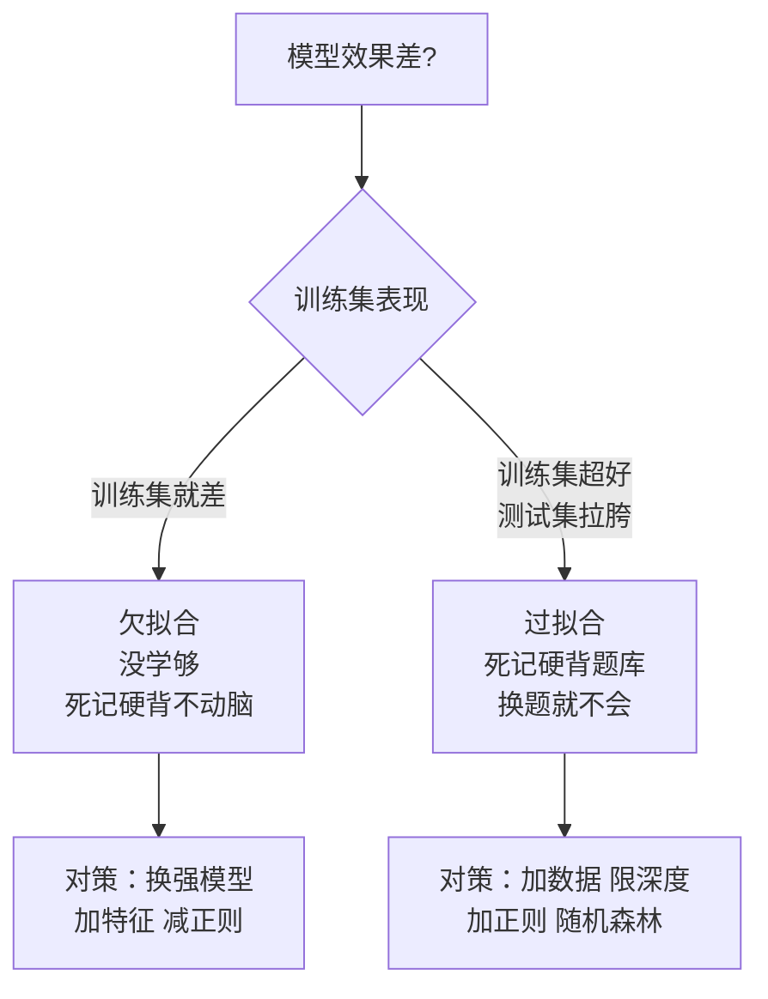

| 现象 | 训练集 | 测试集 | 类比 |
|------|--------|--------|------|
| 欠拟合 | 差 | 差 | 上课没听懂 |
| 恰到好处 | 好 | 好 | 学会了 ✅ |
| 过拟合 | 超好 | 差 | 背下了答案原题 |

### 12.2 交叉验证：多次考试取平均

> 只切一次训练/测试集，运气成分大；交叉验证切 5 份轮流考试，结果更可信！

```python
from sklearn.model_selection import cross_val_score

scores = cross_val_score(model, X, y, cv=5)      # 5 折交叉验证
print("每折得分:", scores.round(3))
print("平均:", scores.mean().round(3), "±", scores.std().round(3))
```

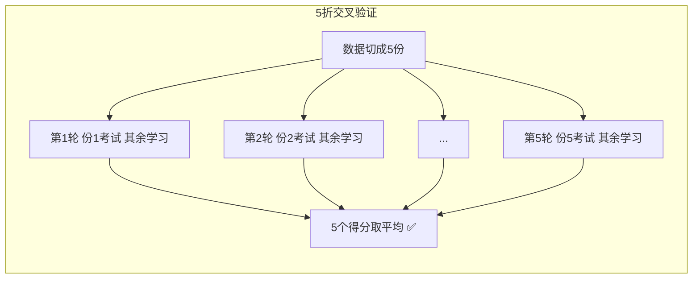

### 12.3 网格搜索：自动找最佳参数

```python
from sklearn.model_selection import GridSearchCV
from sklearn.ensemble import RandomForestClassifier

param_grid = {
    "n_estimators": [50, 100, 200],       # 树的数量
    "max_depth": [3, 5, 10, None],        # 深度
}

grid = GridSearchCV(
    RandomForestClassifier(random_state=42),
    param_grid,
    cv=5,                                 # 每组参数跑 5 折
    n_jobs=-1,                            # 并行加速！
)
grid.fit(X_train, y_train)

print("最佳参数:", grid.best_params_)
print("最佳得分:", grid.best_score_)
best_model = grid.best_estimator_          # 拿到最佳模型
print("测试集:", best_model.score(X_test, y_test))
```

### 12.4 Pipeline：防止数据泄露的神器

```python
from sklearn.pipeline import Pipeline
from sklearn.preprocessing import StandardScaler
from sklearn.svm import SVC

# 把"缩放+建模"串成一条流水线
# 交叉验证时每折都自动只 fit 训练部分，杜绝泄露！
pipe = Pipeline([
    ("scaler", StandardScaler()),
    ("svm", SVC()),
])

pipe.fit(X_train, y_train)
print("测试集:", pipe.score(X_test, y_test))

# 配合网格搜索（参数名用 双下划线 连接）
GridSearchCV(pipe, {"svm__C": [0.1, 1, 10]}, cv=5)
```

***

## 十三、综合实战：鸢尾花分类项目 🌸

> 学了这么多，来打一场完整的仗！按标准流程走一遍～

### 13.1 项目结构总览

```text
iris_project.py
├── 1. 加载数据
├── 2. 探索数据 EDA
├── 3. 划分数据集
├── 4. 训练多个模型对比
├── 5. 交叉验证 + 网格搜索精调
├── 6. 最终评估
└── 7. 保存模型备用
```

### 13.2 完整代码

```python
"""鸢尾花分类：从数据到模型保存的完整流程"""
import joblib
import numpy as np
import pandas as pd
import matplotlib.pyplot as plt
from sklearn.datasets import load_iris
from sklearn.model_selection import train_test_split, GridSearchCV, cross_val_score
from sklearn.preprocessing import StandardScaler
from sklearn.pipeline import Pipeline
from sklearn.linear_model import LogisticRegression
from sklearn.neighbors import KNeighborsClassifier
from sklearn.tree import DecisionTreeClassifier
from sklearn.ensemble import RandomForestClassifier
from sklearn.svm import SVC
from sklearn.metrics import classification_report, confusion_matrix

plt.rcParams["font.family"] = "SimHei"

# ===== 1. 加载数据 =====
iris = load_iris()
df = pd.DataFrame(iris.data, columns=iris.feature_names)
df["species"] = [iris.target_names[t] for t in iris.target]

# ===== 2. 探索数据 =====
print(df.head())                        # 看看长啥样
print(df.describe())                    # 统计信息
print(df["species"].value_counts())     # 类别均衡吗？各50条 ✅

# 可视化：两两特征散点
pd.plotting.scatter_matrix(df.iloc[:, :4], c=iris.target,
                           figsize=(10, 10), diagonal="hist")
plt.savefig("scatter.png", dpi=80)

# ===== 3. 划分数据集 =====
X_train, X_test, y_train, y_test = train_test_split(
    iris.data, iris.target, test_size=0.2,
    random_state=42, stratify=iris.target)

# ===== 4. 多模型对比（都用 Pipeline 防泄露）=====
models = {
    "逻辑回归": Pipeline([("sc", StandardScaler()),
                          ("m", LogisticRegression(max_iter=1000))]),
    "KNN":      Pipeline([("sc", StandardScaler()),
                          ("m", KNeighborsClassifier())]),
    "决策树":   DecisionTreeClassifier(max_depth=4, random_state=42),
    "随机森林": RandomForestClassifier(random_state=42),
    "SVM":      Pipeline([("sc", StandardScaler()),
                          ("m", SVC())]),
}

print("\n===== 5折交叉验证对比 =====")
for name, model in models.items():
    scores = cross_val_score(model, X_train, y_train, cv=5)
    print(f"{name}: {scores.mean():.3f} ± {scores.std():.3f}")

# ===== 5. 网格搜索精调 SVM =====
pipe = Pipeline([("sc", StandardScaler()), ("m", SVC())])
grid = GridSearchCV(pipe,
                    {"m__C": [0.1, 1, 10, 100],
                     "m__gamma": [0.01, 0.1, 1]},
                    cv=5, n_jobs=-1)
grid.fit(X_train, y_train)
print("\n最佳参数:", grid.best_params_)
print("交叉验证最佳分:", grid.best_score_.round(4))

# ===== 6. 最终评估 =====
best = grid.best_estimator_
y_pred = best.predict(X_test)
print("\n===== 测试集报告 =====")
print(classification_report(y_test, y_pred,
                            target_names=iris.target_names))
print("混淆矩阵:\n", confusion_matrix(y_test, y_pred))

# ===== 7. 保存模型 =====
joblib.dump(best, "iris_model.pkl")
print("模型已保存 iris_model.pkl")

# ===== 加载使用 =====
loaded = joblib.load("iris_model.pkl")
new_flower = [[6.5, 3.0, 5.2, 2.0]]
pred = loaded.predict(new_flower)
print(f"新花预测: {iris.target_names[pred[0]]}")   # virginica
```

### 13.3 项目流程图

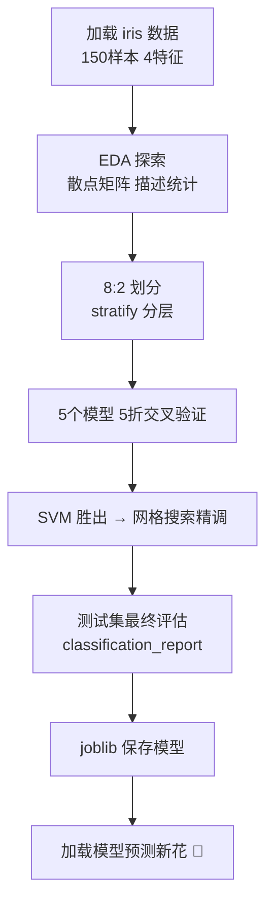

***

## 十四、常见坑与学习路线 🧭

### 14.1 新手高频坑速查表

| 坑 🕳️ | 现象 | 解决 💊 |
|------|------|--------|
| 数据泄露 | scaler 在全量数据上 fit | 只 fit 训练集 / 用 Pipeline |
| 准确率陷阱 | 不平衡数据 99% 也可能是垃圾 | 看 F1、AUC、混淆矩阵 |
| 忘设 random_state | 每次结果不一样 | 划分和建模都固定种子 |
| 用测试集调参 | 变相作弊，上线翻车 | 调参用交叉验证 |
| 过拟合不处理 | 训练好测试差 | 限深度 / 随机森林 / 加数据 |
| KNN 忘缩放 | 被大数特征支配 | StandardScaler 走起 |
| 只试一个模型 | 错过更优解 | 先跑 5 个模型基线对比 |
| 分类任务用回归指标 | 拿 MSE 评分类 | 分类用准确率/F1，回归用 MSE/R2 |

### 14.2 学习路线图

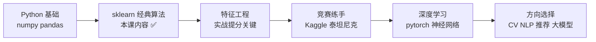

### 14.3 检查清单

| 检查项 | 说明 | 重要度 |
|--------|------|--------|
| 看过数据再建模 | head/describe/散点 | ⭐⭐⭐⭐⭐ |
| train/test 分开 | 且测试集只在最后用 | ⭐⭐⭐⭐⭐ |
| 缩放只在训练集 fit | 或直接 Pipeline | ⭐⭐⭐⭐⭐ |
| 多模型基线对比 | 至少跑 3-5 个 | ⭐⭐⭐⭐ |
| 交叉验证选模型 | 不靠单次划分 | ⭐⭐⭐⭐ |
| 不平衡数据看 F1/AUC | 别迷信准确率 | ⭐⭐⭐⭐ |
| 固定 random_state | 结果可复现 | ⭐⭐⭐ |
| 模型保存 joblib | 方便部署 | ⭐⭐⭐ |

***

## 🎓 总结

> 恭喜完成机器学习入门！(๑•̀ㅂ•́)و✧ 修炼路线回顾：


**核心心法** 📝
- 牢记标准流程：**数据 → 预处理 → 划分 → 训练 → 评估 → 调优 → 保存**
- 表格数据先上**随机森林**做基线，稳！
- **Pipeline 防数据泄露**，交叉验证选模型，网格搜索调参数
- 不平衡数据别只看准确率，**F1 和 AUC** 才靠谱
- 机器学习 80% 时间在**处理数据和特征**，算法只是最后一哆嗦

下一步可以挑战 Kaggle 泰坦尼克/房价竞赛练手，或者踏入深度学习（神经网络、PyTorch）的奇幻世界～算法会过时，但"数据思维"永远保值！🤖💖
