# 🕷️ Python 爬虫

> 哈喽呀～欢迎来到爬虫的奇妙世界！🕸️ 爬虫就像一只勤劳的小蜘蛛，在网上到处"爬"，把你想要的数据打包带回家！本教程从零开始，一步步带你解锁数据采集技能，冲鸭！(๑•̀ㅂ•́)و✧

***

## 🗺️ 知识全景图

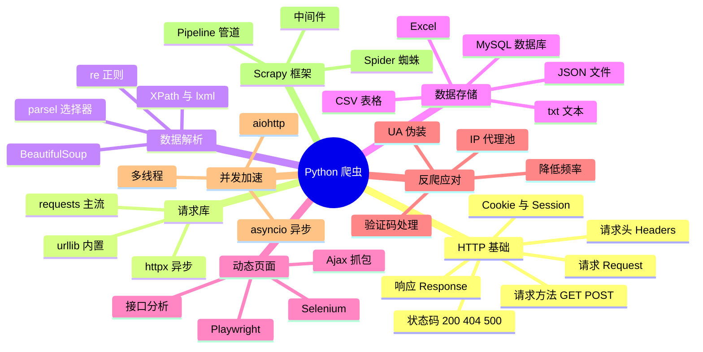

***

## 📑 目录

- [一、爬虫是什么](#一爬虫是什么)
- [二、HTTP 基础：爬虫的"交通规则"](#二http-基础爬虫的交通规则)
- [三、requests：最好用的请求库](#三requests最好用的请求库)
- [四、urllib：内置的原生方案](#四urllib内置的原生方案)
- [五、数据解析四大法宝](#五数据解析四大法宝)
- [六、数据存储](#六数据存储)
- [七、动态页面爬取](#七动态页面爬取)
- [八、反爬虫与应对策略](#八反爬虫与应对策略)
- [九、并发爬虫：提速！](#九并发爬虫提速)
- [十、Scrapy 框架初体验](#十scrapy-框架初体验)
- [十一、综合实战：爬取豆瓣电影 Top250](#十一综合实战爬取豆瓣电影-top250)
- [十二、法律与道德红线](#十二法律与道德红线)

***

## 一、爬虫是什么

### 1.1 一句话解释

**爬虫（Web Crawler / Spider）= 自动化获取网页数据的程序** 🤖

你平时打开浏览器看网页，是"人手动看"；爬虫就是让程序模仿你发请求、拿数据、存下来，全程自动！

### 1.2 爬虫的工作流程

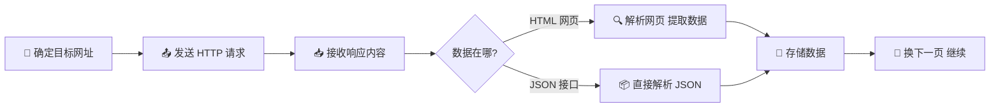

> 💡 记住这个流程，所有爬虫都是这个套路，变的只是工具和细节！

### 1.3 爬虫的应用场景

| 场景 | 举例 🌰 |
|------|--------|
| 数据分析 | 爬取房价、股票、票房数据做分析 |
| 舆情监控 | 监控新闻、微博热点话题 |
| 价格比较 | 各电商平台商品比价 |
| 学术研究 | 收集论文、专利信息 |
| AI 训练 | 获取文本、图片数据集 |

***

## 二、HTTP 基础：爬虫的"交通规则" 🚦

爬虫的本质就是 **HTTP 请求 + 响应**，不懂 HTTP 等于开车不懂交规哦！

### 2.1 请求与响应模型

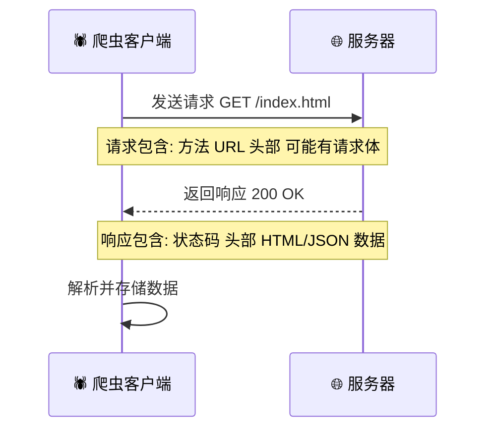

### 2.2 常见请求方法

| 方法 | 用途 | 携带数据位置 | 使用频率 |
|------|------|------------|---------|
| GET | 获取数据（看网页） | URL 参数 | ⭐⭐⭐⭐⭐ |
| POST | 提交数据（登录、上传） | 请求体 Body | ⭐⭐⭐⭐ |
| PUT | 更新数据 | 请求体 | ⭐ |
| DELETE | 删除数据 | URL | ⭐ |

> 💡 爬虫 90% 的场景就是 GET 拿数据，POST 模拟登录或提交表单～

### 2.3 必须认识的状态码

| 状态码 | 含义 | 爬虫视角 🕷️ |
|--------|------|-----------|
| 200 | 成功 | 太好了，拿数据！✅ |
| 301 / 302 | 重定向 | 网页搬家了，跟着走 |
| 403 | 禁止访问 | 被反爬拦住了！🙈 |
| 404 | 页面不存在 | 网址写错了 |
| 429 | 请求太频繁 | 爬太快，歇会儿～ |
| 500 | 服务器错误 | 服务器自己出问题了 |

### 2.4 请求头（Headers）：爬虫的"身份证" 🪪

服务器通过请求头判断"你是谁"，最重要的几个：

| 字段 | 作用 | 示例 |
|------|------|------|
| `User-Agent` | 浏览器身份标识（最重要！） | `Mozilla/5.0 (Windows...)` |
| `Referer` | 从哪个页面跳来的 | `https://www.google.com` |
| `Cookie` | 登录凭证、身份信息 | `session_id=abc123` |
| `Host` | 目标服务器域名 | `www.example.com` |

> ⚠️ **不带 User-Agent 的请求 = 裸奔**，服务器一眼看出你是爬虫，直接拒绝！

### 2.5 Cookie 与 Session

- **Cookie**：服务器发给浏览器的"会员卡"💳，存在客户端，之后每次请求都带上
- **Session**：服务器端的"登记簿"📖，记录你是谁

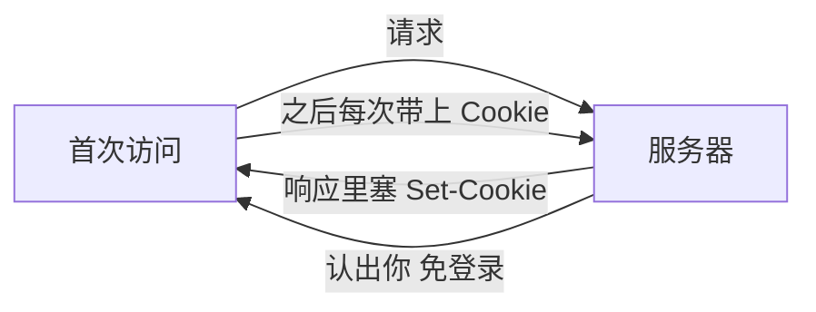

> 💡 想爬"登录后才能看"的页面？把浏览器里的 Cookie 复制过来带上就行！

***

## 三、requests：最好用的请求库 ⭐

> `requests` 是 Python 最流行的 HTTP 库，人称"给人类用的 HTTP 库"，简洁到哭！(≧∇≦)ﾉ

### 3.1 安装

```bash
pip install requests
```

### 3.2 第一个爬虫：GET 请求

```python
import requests

# 1. 目标网址
url = "https://httpbin.org/get"

# 2. 伪装浏览器（防止被识别为爬虫）
headers = {
    "User-Agent": "Mozilla/5.0 (Windows NT 10.0; Win64; x64) AppleWebKit/537.36"
}

# 3. 发送 GET 请求
response = requests.get(url, headers=headers)

# 4. 查看结果
print(response.status_code)  # 200 状态码
print(response.text)         # 响应文本内容
print(response.json())       # 如果是 JSON，直接转成字典
```

### 3.3 带参数的 GET 请求

URL 里的查询参数（`?key=value&key2=value2`）不用手动拼，用 `params`：

```python
url = "https://httpbin.org/get"
params = {"keyword": "python", "page": 1}

response = requests.get(url, params=params, headers=headers)
print(response.url)
# https://httpbin.org/get?keyword=python&page=1
```

### 3.4 POST 请求：提交表单

```python
url = "https://httpbin.org/post"

# 表单数据（比如模拟登录）
data = {"username": "xiaomei", "password": "123456"}
response = requests.post(url, data=data, headers=headers)

# 提交 JSON 数据（很多现代接口用这种）
import json
payload = {"title": "你好", "content": "爬虫笔记"}
response = requests.post(url, json=payload)
```

### 3.5 response 对象常用属性

| 属性/方法 | 说明 | 示例 |
|----------|------|------|
| `status_code` | 状态码 | `200` |
| `text` | 文本内容（自动猜编码） | HTML 源码 |
| `content` | 二进制内容（图片/视频） | `b'\x89PNG...'` |
| `json()` | 转 JSON（接口常用） | `{"code": 0}` |
| `encoding` | 编码方式 | `utf-8` |
| `headers` | 响应头 | 字典 |
| `cookies` | 响应 Cookie | `RequestsCookieJar` |

### 3.6 中文乱码？一行解决！

```python
response = requests.get(url, headers=headers)
response.encoding = "utf-8"   # 或 "gbk"，看网页的 charset
print(response.text)
```

### 3.7 下载图片/文件（二进制）

```python
img_url = "https://httpbin.org/image/png"
response = requests.get(img_url, headers=headers)

with open("picture.png", "wb") as f:   # 注意是 "wb" 二进制写入
    f.write(response.content)
```

### 3.8 Session：保持登录状态 🔑

```python
session = requests.Session()

# 登录（Cookie 会自动保存在 session 里）
session.post("https://example.com/login", data={"user": "me", "pwd": "123"})

# 之后的请求自动带上 Cookie，就像已登录状态
profile = session.get("https://example.com/profile")
```

> 💡 `requests.get()` 每次都是"新面孔"，`session.get()` 是"老熟人"，自动管理 Cookie！

### 3.9 超时与异常处理

```python
import requests
from requests.exceptions import Timeout, ConnectionError

try:
    response = requests.get(url, headers=headers, timeout=5)  # 5 秒超时
    response.raise_for_status()  # 状态码不是 2xx 就抛异常
except Timeout:
    print("请求超时啦～")
except ConnectionError:
    print("网络连接出问题了～")
```

> ⚠️ **爬虫守则第一条：一定要写 timeout！** 不然程序可能卡死一整天哦～

***

## 四、urllib：内置的原生方案 📦

> `urllib` 是 Python 自带的，不用安装，但没有 requests 好用，了解即可～

```python
from urllib.request import urlopen, Request

url = "https://httpbin.org/get"
headers = {"User-Agent": "Mozilla/5.0"}

# urllib 不认 headers 参数，要包装成 Request 对象
req = Request(url, headers=headers)
response = urlopen(req, timeout=5)

print(response.status)      # 200
print(response.read().decode("utf-8"))  # 要手动解码成字符串
```

### requests vs urllib 对比

| 对比项 | requests | urllib |
|--------|----------|--------|
| 安装 | 需要 pip 安装 | Python 自带 |
| 代码量 | 少，一行搞定 | 多，要包装对象 |
| 编码 | 自动处理 | 手动 decode |
| Cookie 管理 | Session 很方便 | 麻烦 |
| 推荐度 | ⭐⭐⭐⭐⭐ | ⭐⭐ |

***

## 五、数据解析四大法宝 🔍

> 拿到 HTML 之后，怎么把"标题"、"价格"这些数据抠出来呢？四大法宝登场！(ﾉ>ω<)ﾉ

### 5.1 法宝总览

| 法宝 | 特点 | 上手难度 | 适用场景 |
|------|------|---------|---------|
| **re 正则** | 万能但难写 | ⭐⭐⭐⭐⭐ | 数据格式固定、没有标签 |
| **BeautifulSoup** | 语法简单好懂 | ⭐⭐ | 简单页面、新手首选 |
| **XPath** | 强大精准 | ⭐⭐⭐ | 复杂页面、Scrapy 常用 |
| **CSS 选择器** | 前端知识复用 | ⭐⭐⭐ | 熟悉 CSS 的同学 |

### 5.2 准备：示例 HTML

后面都用这段 HTML 做演示：

```html
<div class="movie-list">
    <div class="item">
        <h2 class="title">肖申克的救赎</h2>
        <span class="rating">9.7</span>
        <a href="/movie/1292052">详情页</a>
    </div>
    <div class="item">
        <h2 class="title">霸王别姬</h2>
        <span class="rating">9.6</span>
        <a href="/movie/1291546">详情页</a>
    </div>
</div>
```

### 5.3 法宝一：正则表达式 re

```python
import re

html = """...上面的 HTML..."""

# 提取所有电影名：非贪婪匹配 .*?
titles = re.findall(r'<h2 class="title">(.*?)</h2>', html)
print(titles)  # ['肖申克的救赎', '霸王别姬']

# 提取评分
ratings = re.findall(r'<span class="rating">(.*?)</span>', html)
print(ratings)  # ['9.7', '9.6']

# 提取链接
links = re.findall(r'href="(.*?)"', html)
```

> 💡 常用正则速记：`.` 任意字符 | `*?` 非贪婪 | `\d+` 数字 | `()` 只取括号里的内容

### 5.4 法宝二：BeautifulSoup

```bash
pip install beautifulsoup4 lxml
```

```python
from bs4 import BeautifulSoup

soup = BeautifulSoup(html, "lxml")  # 用 lxml 解析器，速度快

# 1. 按标签找
title = soup.find("h2")                     # 第一个 h2
titles = soup.find_all("h2")                # 所有 h2
print(titles[0].text)                       # 肖申克的救赎

# 2. 按 class 找（class 是关键字，要写 class_）
ratings = soup.find_all("span", class_="rating")

# 3. 链式查找 + 取属性
item = soup.find("div", class_="item")
link = item.find("a")
print(link["href"])                         # /movie/1292052
print(link.get("href"))                     # 同上，推荐（不存在不报错）

# 4. select：CSS 选择器写法
titles = soup.select(".movie-list .title")  # 所有 .title
first = soup.select_one(".item .rating")    # 只取第一个
```

### 5.5 法宝三：XPath（配合 lxml 或 parsel）

```bash
pip install lxml
```

```python
from lxml import etree

tree = etree.HTML(html)

# XPath 语法：/ 直接子级  // 后代任意层级  @ 取属性  text() 取文本
titles = tree.xpath('//h2[@class="title"]/text()')
print(titles)  # ['肖申克的救赎', '霸王别姬']

ratings = tree.xpath('//span[@class="rating"]/text()')

links = tree.xpath('//div[@class="item"]/a/@href')
print(links)  # ['/movie/1292052', '/movie/1291546']
```

> 💡 XPath 去哪抄？浏览器里 **F12 → 右键元素 → Copy → Copy XPath**，直接复制不用自己写！

### 5.6 XPath 常用语法表

| 表达式 | 含义 | 示例 |
|--------|------|------|
| `/` | 从根开始/直接子级 | `/html/body/div` |
| `//` | 任意位置的子孙节点 | `//div` |
| `@属性` | 选属性 | `//a/@href` |
| `text()` | 选文本 | `//h2/text()` |
| `[@class="x"]` | 按属性筛选 | `//span[@class="rating"]` |
| `[1]` | 取第几个（从1开始） | `//div[1]` |
| `[last()]` | 取最后一个 | `//div[last()]` |
| `[contains(@x,"y")]` | 模糊匹配 | `//a[contains(@href,"movie")]` |

### 5.7 解析方式选择指南

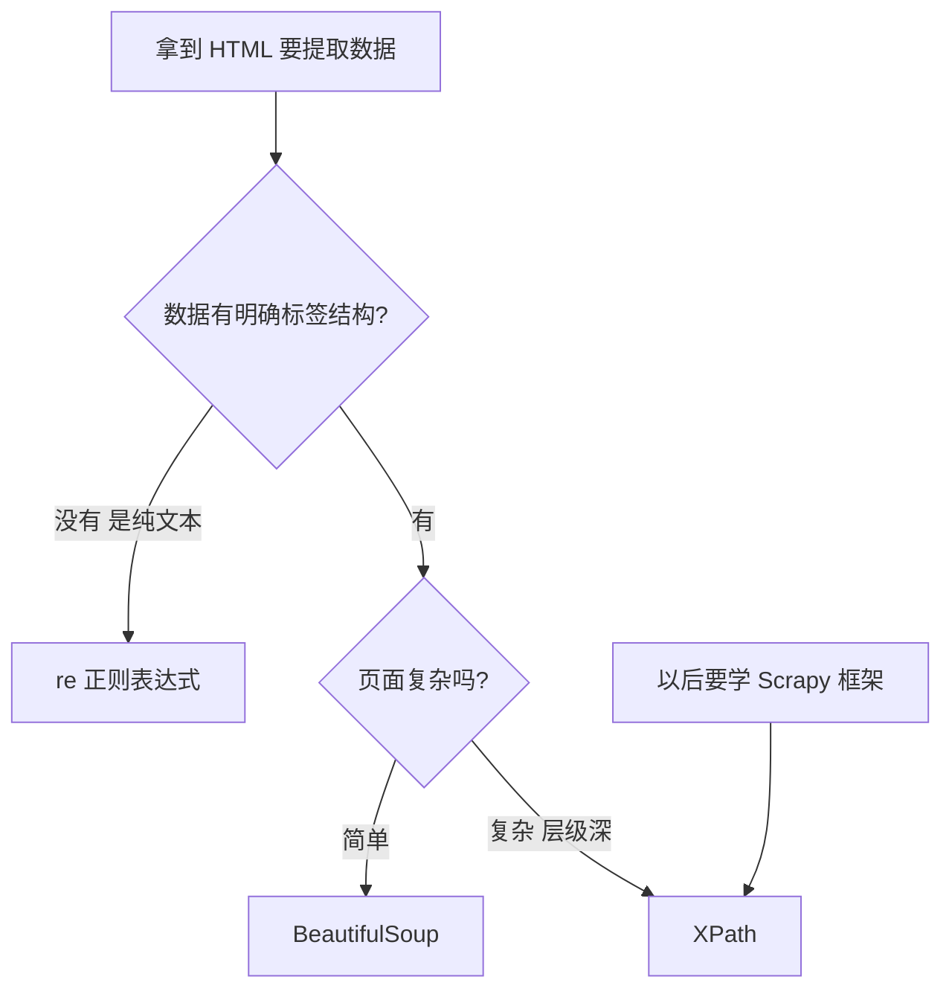

***

## 六、数据存储 💾

> 数据爬下来了，总不能 print 完就扔吧？存起来才是自己的！(๑¯∀¯๑)

### 6.1 存 CSV（最常用！）

```python
import csv

data = [
    {"title": "肖申克的救赎", "rating": "9.7"},
    {"title": "霸王别姬", "rating": "9.6"},
]

with open("movies.csv", "w", encoding="utf-8-sig", newline="") as f:
    writer = csv.DictWriter(f, fieldnames=["title", "rating"])
    writer.writeheader()   # 写表头
    writer.writerows(data) # 一次写多行
```

> ⚠️ **Excel 打开 CSV 乱码？** 编码用 `utf-8-sig` 就好啦！`newline=""` 是防止多出空行～

### 6.2 存 JSON

```python
import json

# 写
with open("movies.json", "w", encoding="utf-8") as f:
    json.dump(data, f, ensure_ascii=False, indent=2)
    # ensure_ascii=False 才能正常显示中文！

# 读
with open("movies.json", "r", encoding="utf-8") as f:
    data = json.load(f)
```

### 6.3 存 Excel（openpyxl 或 pandas）

```python
# 方式一：pandas 一行搞定（推荐）
import pandas as pd
df = pd.DataFrame(data)
df.to_excel("movies.xlsx", index=False)

# 方式二：openpyxl 原生
from openpyxl import Workbook
wb = Workbook()
ws = wb.active
ws.append(["title", "rating"])       # 表头
for item in data:
    ws.append([item["title"], item["rating"]])
wb.save("movies.xlsx")
```

### 6.4 存 MySQL 数据库

```bash
pip install pymysql
```

```python
import pymysql

# 1. 连接数据库
conn = pymysql.connect(
    host="localhost", user="root",
    password="123456", database="spider", charset="utf8mb4"
)
cursor = conn.cursor()

# 2. 建表
cursor.execute("""
    CREATE TABLE IF NOT EXISTS movies(
        id INT PRIMARY KEY AUTO_INCREMENT,
        title VARCHAR(100),
        rating FLOAT
    )
""")

# 3. 插入数据（用占位符防 SQL 注入！）
sql = "INSERT INTO movies (title, rating) VALUES (%s, %s)"
for item in data:
    cursor.execute(sql, (item["title"], item["rating"]))

conn.commit()      # 别忘了提交！
cursor.close()
conn.close()
```

### 6.5 存储方式对比

| 方式 | 适合 | 打开工具 | 推荐度 |
|------|------|---------|--------|
| CSV | 表格数据、中小规模 | Excel / WPS | ⭐⭐⭐⭐⭐ |
| JSON | 层级数据、接口数据 | 文本编辑器 | ⭐⭐⭐⭐ |
| Excel | 要给人看、要美化 | Excel | ⭐⭐⭐ |
| MySQL | 大量数据、要查询 | Navicat 等 | ⭐⭐⭐⭐ |

***

## 七、动态页面爬取 🎬

> 辛辛苦苦拿到 HTML，发现数据根本不在里面？！因为很多网站的数据是 **JavaScript 动态加载** 的！别慌，有办法～ (｀・ω・´)

### 7.1 为什么 requests 拿不到数据？

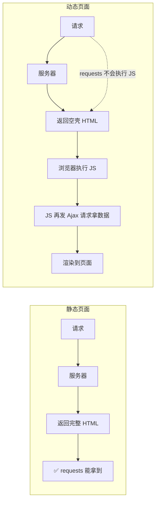

### 7.2 破解思路一：找 Ajax 接口（首选！）

数据不在 HTML 里，但**肯定在某个接口里**！用浏览器抓包找出来：

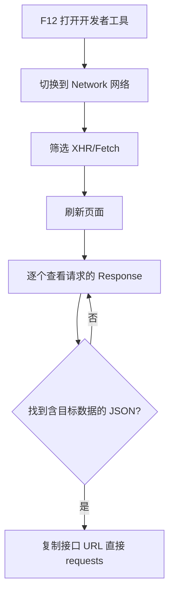

找到接口后，直接请求它，返回的就是干净的 JSON：

```python
import requests

# 很多网站有翻页参数，改改就能爬下一页
api = "https://example.com/api/movies"
params = {"page": 1, "size": 20}
resp = requests.get(api, params=params, headers=headers)
data = resp.json()   # 接口一般直接返回 JSON，都不用解析 HTML！
```

> 💡 接口爬虫的优点：**数据干净、速度快、代码少**，能用接口就用接口！

### 7.3 破解思路二：Selenium 模拟浏览器

接口找不到/加密了？那就上"真浏览器"，让程序像人一样操作！

```bash
pip install selenium
```

```python
from selenium import webdriver
from selenium.webdriver.common.by import By
from selenium.webdriver.support.ui import WebDriverWait
from selenium.webdriver.support import expected_conditions as EC

# 新版 selenium 4.6+ 会自动管理浏览器驱动，不用单独下载！
driver = webdriver.Chrome()
driver.get("https://www.baidu.com")

# 1. 找元素
driver.find_element(By.ID, "kw").send_keys("Python 爬虫")      # 输入框打字
driver.find_element(By.ID, "su").click()                        # 点搜索按钮

# 2. 显式等待：等元素出现（比 sleep 靠谱）
WebDriverWait(driver, 10).until(
    EC.presence_of_element_located((By.CSS_SELECTOR, "#content_left"))
)

# 3. 拿数据（拿到的已经是渲染好的页面）
results = driver.find_elements(By.CSS_SELECTOR, "h3.t a")
for r in results:
    print(r.text)

driver.quit()   # 记得关浏览器！
```

### 7.4 元素定位方式

| 定位方式 | 代码写法 | 特点 |
|---------|---------|------|
| ID | `By.ID, "kw"` | 最快，但 id 常没有 |
| CSS 选择器 | `By.CSS_SELECTOR, ".item a"` | 灵活强大 ⭐ |
| XPath | `By.XPATH, "//div[@class='x']"` | 最强，可复制 |
| 类名 | `By.CLASS_NAME, "title"` | 简单场景 |
| 文本 | `By.LINK_TEXT, "下一页"` | 找链接很方便 |

### 7.5 Selenium 常用操作

```python
element.clear()                          # 清空输入框
element.send_keys("内容")                 # 输入文字
element.click()                          # 点击
element.text                             # 获取文本
element.get_attribute("href")            # 获取属性
driver.execute_script("window.scrollTo(0, 2000)")  # 执行 JS 滚动
driver.switch_to.window(handles[-1])     # 切换新标签页
ActionChains(driver).move_to_element(e).perform()  # 悬停（触发菜单）
```

### 7.6 Playwright：更现代的选择

```bash
pip install playwright
playwright install chromium
```

```python
from playwright.sync_api import sync_playwright

with sync_playwright() as p:
    browser = p.chromium.launch(headless=False)  # False = 显示浏览器窗口
    page = browser.new_page()
    page.goto("https://www.baidu.com")
    page.fill("#kw", "Python 爬虫")
    page.click("#su")
    page.wait_for_selector("#content_left")
    print(page.title())
    browser.close()
```

### 7.7 三种方案对比

| 方案 | 速度 | 资源占用 | 适用场景 |
|------|------|---------|---------|
| requests + 接口 | 🚀 超快 | 极低 | 能找到 Ajax 接口 ⭐首选 |
| Selenium | 🐢 慢 | 高（开浏览器） | 接口加密、需复杂交互 |
| Playwright | 🚗 较快 | 中 | Selenium 替代品，更现代 |

***

## 八、反爬虫与应对策略 🛡️⚔️

> 网站不想被爬，爬虫想尽办法爬，这是一场猫鼠游戏～我们学习应对方法，但也要守规矩哦！

### 8.1 常见反爬手段 vs 应对方法

| 反爬手段 | 表现 | 应对方法 🕷️ |
|---------|------|-----------|
| UA 检测 | 403 Forbidden | 伪装 User-Agent |
| IP 频率限制 | 403 / 429 | 降低速度、用代理 IP |
| Cookie 校验 | 数据缺失 | 带 Cookie、用 Session |
| 动态参数加密 | 接口带奇怪参数 | 分析 JS / 用 Selenium |
| 字体反爬 | 文字显示乱码 | 分析字体映射文件 |
| 验证码 | 弹验证码 | 打码平台 / 降低频率 |
| 数据加密 | 返回密文 | 逆向解密 JS |

### 8.2 应对一：请求头伪装全家桶

```python
headers = {
    "User-Agent": "Mozilla/5.0 (Windows NT 10.0; Win64; x64) AppleWebKit/537.36 (KHTML, like Gecko) Chrome/120.0.0.0 Safari/537.36",
    "Referer": "https://www.example.com/",
    "Accept": "text/html,application/xhtml+xml,application/xml;q=0.9,*/*;q=0.8",
    "Accept-Language": "zh-CN,zh;q=0.9",
}

# 进阶：随机 UA（安装 pip install fake-useragent）
from fake_useragent import UserAgent
ua = UserAgent()
headers = {"User-Agent": ua.random}   # 每次随机一个 UA
```

### 8.3 应对二：控制请求频率（爬虫礼仪！）

```python
import time
import random

for page in range(1, 100):
    response = requests.get(url.format(page), headers=headers)
    # 随机等待 1~3 秒，模拟人类行为
    time.sleep(random.uniform(1, 3))
```

> ⚠️ **不控制频率 = 对服务器发起攻击**，这已经超出"爬虫"的范畴了！控制节奏既是技术也是素质！

### 8.4 应对三：IP 代理池

```python
# 免费代理质量差，仅作学习演示；生产用付费代理
proxies = {
    "http": "http://127.0.0.1:7890",
    "https": "http://127.0.0.1:7890",
}
response = requests.get(url, headers=headers, proxies=proxies, timeout=5)
```

### 8.5 应对四：重试机制

```python
import time
from requests.adapters import HTTPAdapter

session = requests.Session()
# 请求失败自动重试 3 次
session.mount("http://", HTTPAdapter(max_retries=3))
session.mount("https://", HTTPAdapter(max_retries=3))

def safe_get(url, try_times=3):
    for i in range(try_times):
        try:
            resp = session.get(url, headers=headers, timeout=5)
            if resp.status_code == 200:
                return resp
        except Exception:
            time.sleep(2)   # 失败歇会儿再试
    return None
```

***

## 九、并发爬虫：提速！🚀

> 一页一页爬太慢了？学会并发，效率翻倍翻倍再翻倍！✨

### 9.1 三种执行方式对比

| 方式 | 原理 | 适合 | 难度 |
|------|------|------|------|
| 串行 | 一个接一个 | 页数少 | ⭐ |
| 多线程 | 多个线程同时请求 | IO 密集（爬虫就是！） | ⭐⭐ |
| 异步 asyncio | 单线程切换任务 | 海量请求 | ⭐⭐⭐ |

```mermaid
gantt
    title 串行 vs 并发（爬 3 个页面）
    dateFormat X
    axisFormat %s秒
    section 串行 😢
    页面1 :0, 2
    页面2 :2, 4
    页面3 :4, 6
    section 多线程 🚀
    页面1 :0, 2
    页面2 :0, 2
    页面3 :0, 2
```

### 9.2 多线程版本

```python
from concurrent.futures import ThreadPoolExecutor
import requests

urls = [f"https://httpbin.org/get?page={i}" for i in range(1, 21)]

def crawl(url):
    resp = requests.get(url, headers=headers, timeout=5)
    return resp.status_code

# 10 个线程一起爬，with 会自动等待全部完成
with ThreadPoolExecutor(max_workers=10) as pool:
    results = list(pool.map(crawl, urls))

print(results)  # [200, 200, 200, ...]
```

### 9.3 异步版本（aiohttp）

```bash
pip install aiohttp
```

```python
import asyncio
import aiohttp

async def crawl(session, url):
    async with session.get(url) as resp:   # 异步请求，等待时不阻塞
        return resp.status

async def main():
    urls = [f"https://httpbin.org/get?page={i}" for i in range(1, 21)]
    async with aiohttp.ClientSession() as session:
        tasks = [crawl(session, url) for url in urls]
        results = await asyncio.gather(*tasks)   # 一起跑！
    print(results)

asyncio.run(main())
```

> 💡 语法小抄：`async def` 定义协程，`await` 等待结果，`gather` 收集所有任务～

***

## 十、Scrapy 框架初体验 🏗️

> 页数多了、逻辑复杂了？该请出专业级爬虫框架 Scrapy 了！它是爬虫界的"变形金刚"～

### 10.1 Scrapy 架构图

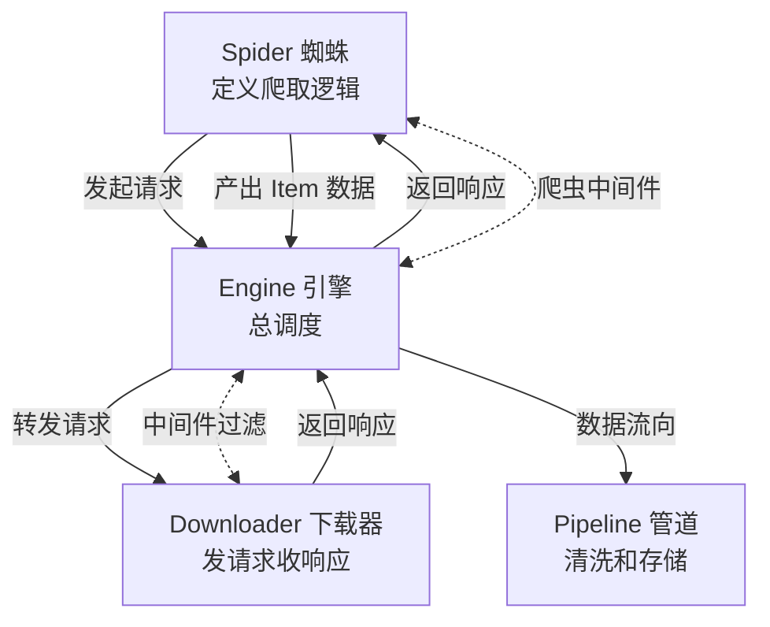

| 组件 | 职责 | 类比 🏭 |
|------|------|--------|
| Engine | 流程总调度，连起所有组件 | 厂长 |
| Spider | 定义爬哪些页、怎么解析 | 工人 |
| Downloader | 真正发请求的 | 快递员 |
| Pipeline | 处理/存储爬到的数据 | 仓库管理员 |
| Middleware | 中间加工（换 UA、上代理） | 安检员 |

### 10.2 快速上手

```bash
pip install scrapy

scrapy startproject myspider      # 创建项目
cd myspider
scrapy genspider demo example.com # 创建一个蜘蛛
scrapy crawl demo                 # 运行蜘蛛
```

### 10.3 Spider 示例

```python
import scrapy

class DemoSpider(scrapy.Spider):
    name = "demo"                              # 蜘蛛名字
    start_urls = ["https://example.com/page/1"]

    def parse(self, response):                 # 自动回调
        # XPath 提取数据
        for item in response.xpath('//div[@class="item"]'):
            yield {
                "title": item.xpath('.//h2/text()').get(),
                "rating": item.xpath('.//span/text()').get(),
            }
        # 自动翻页
        next_page = response.xpath('//a[@class="next"]/@href').get()
        if next_page:
            yield response.follow(next_page, self.parse)
```

### 10.4 开启 Pipeline 存数据

```python
# settings.py 里打开开关
ITEM_PIPELINES = {
    "myspider.pipelines.MyspiderPipeline": 300,
}
```

```python
# pipelines.py
class MyspiderPipeline:
    def open_spider(self, spider):        # 开始时执行：建连接/开文件
        self.file = open("out.json", "w", encoding="utf-8")

    def process_item(self, item, spider): # 每条数据都会经过这里
        return item

    def close_spider(self, spider):       # 结束时执行：关文件/断连接
        self.file.close()
```

### 10.5 requests vs Scrapy

| 对比 | requests 手写 | Scrapy 框架 |
|------|--------------|------------|
| 上手难度 | 简单 | 需要学习框架 |
| 并发 | 要自己写 | 内置异步并发 |
| 去重 | 自己写 | 内置 |
| 断点续爬 | 自己写 | 内置 |
| 适合 | 小任务、学习 | 大型爬虫项目 |

***

## 十一、综合实战：爬取豆瓣电影 Top250 🎬

> 把前面学的全部串起来！完整代码可以直接跑～（记得控制频率，友好爬取哦）

```python
"""
豆瓣电影 Top250 爬虫
技术栈：requests + XPath + csv + 随机延时
"""
import csv
import time
import random
import requests
from lxml import etree

HEADERS = {
    "User-Agent": ("Mozilla/5.0 (Windows NT 10.0; Win64; x64) "
                   "AppleWebKit/537.36 (KHTML, like Gecko) "
                   "Chrome/120.0.0.0 Safari/537.36")
}

def crawl_page(page: int) -> list:
    """爬取单页，返回电影信息列表"""
    url = f"https://movie.douban.com/top250?start={page * 25}"
    resp = requests.get(url, headers=HEADERS, timeout=10)
    resp.raise_for_status()
    resp.encoding = "utf-8"

    tree = etree.HTML(resp.text)
    items = tree.xpath('//ol[@class="grid_view"]/li')

    movies = []
    for item in items:
        movies.append({
            "排名":  item.xpath('.//em[@class=""]/text()')[0],
            "标题":  item.xpath('.//span[@class="title"][1]/text()')[0],
            "评分":  item.xpath('.//span[@class="rating_num"]/text()')[0],
            "引言":  (item.xpath('.//span[@class="inq"]/text()') or [""])[0],
        })
    return movies

def main():
    all_movies = []
    for page in range(10):                      # 共 10 页
        try:
            movies = crawl_page(page)
            all_movies.extend(movies)
            print(f"第 {page + 1} 页爬取成功，共 {len(movies)} 条 ✅")
        except Exception as e:
            print(f"第 {page + 1} 页失败：{e} ❌")
        time.sleep(random.uniform(2, 5))        # 礼貌延时！

    # 存 CSV
    with open("douban_top250.csv", "w", encoding="utf-8-sig", newline="") as f:
        writer = csv.DictWriter(f, fieldnames=["排名", "标题", "评分", "引言"])
        writer.writeheader()
        writer.writerows(all_movies)
    print(f"完成！共爬取 {len(all_movies)} 部电影 🎉")

if __name__ == "__main__":
    main()
```

### 实战流程回顾

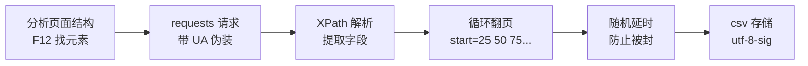

***

## 十二、法律与道德红线 ⚖️

> 技术无罪，使用有度！最后聊聊每个爬虫工程师必须知道的红线～

### 12.1 这些事情不能做 ❌

| 禁止行为 | 原因 |
|---------|------|
| 爬取个人隐私信息 | 侵犯隐私权，违法！ |
| 爬取付费/版权内容并传播 | 侵犯知识产权 |
| 高频请求压垮服务器 | 涉嫌破坏计算机信息系统 |
| 倒卖爬取的数据 | 商业违法 |
| 绕过付费墙白嫖内容 | 违反服务协议 |

### 12.2 合规爬虫守则 ✅

1. **看 robots.txt**：访问 `网站域名/robots.txt` 查看网站允许爬什么
2. **控制频率**：像人一样温柔地访问
3. **只用公开数据**：不碰隐私、不碰付费内容
4. **数据仅用于学习研究**：不商用、不传播
5. **标注来源**：尊重原站劳动成果

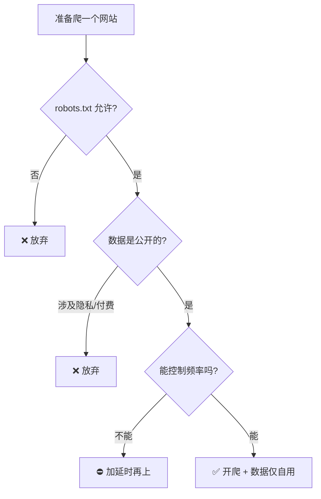

### 12.3 学习资源推荐 📚

| 资源 | 说明 |
|------|------|
| httpbin.org | 专门测试 HTTP 请求的练习场 |
| requests 官方文档 | 最权威的 requests 手册 |
| Scrapy 官方文档 | 框架深度学习必看 |
| jsonplaceholder.typicode.com | 假 REST API 练习接口 |

***

## 🎓 总结

> 恭喜你爬完这座大山！(๑•̀ㅂ•́)و✧ 回顾一下爬虫修炼路线：

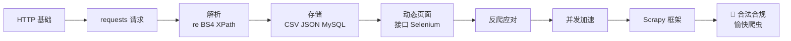

**核心心法** 📝
- 万变不离其宗：**请求 → 解析 → 存储**
- 能用接口就不碰 HTML，能用静态就不开浏览器
- UA 必带、超时必写、延时必有、异常必抓
- 技术要强，姿势要稳，红线不碰！

去征服数据的世界吧，小蜘蛛们！🕸️💖
