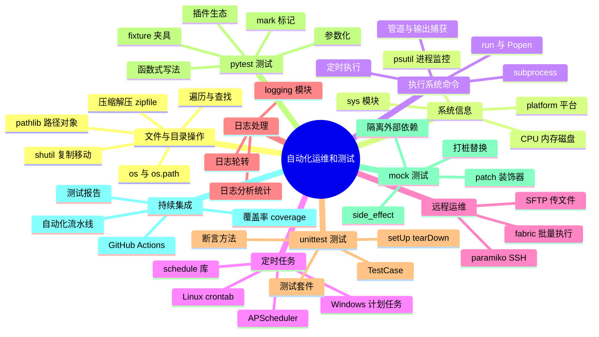
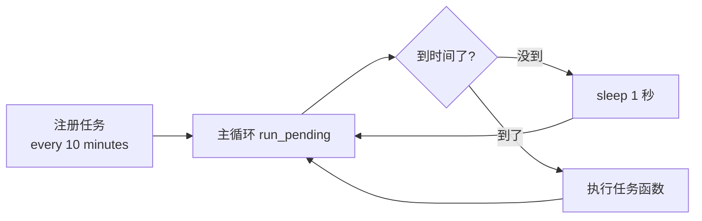
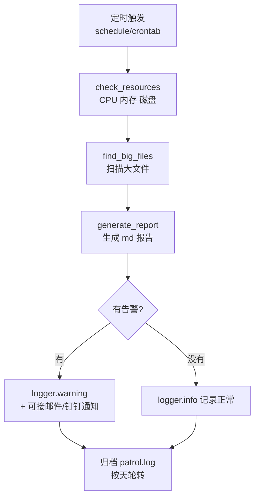
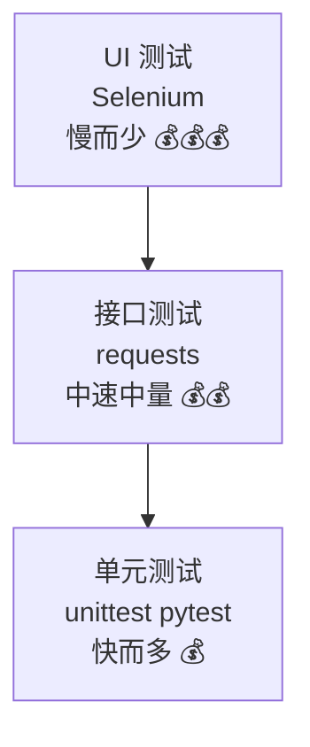
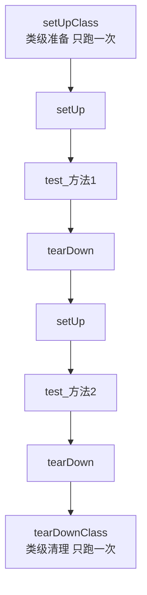
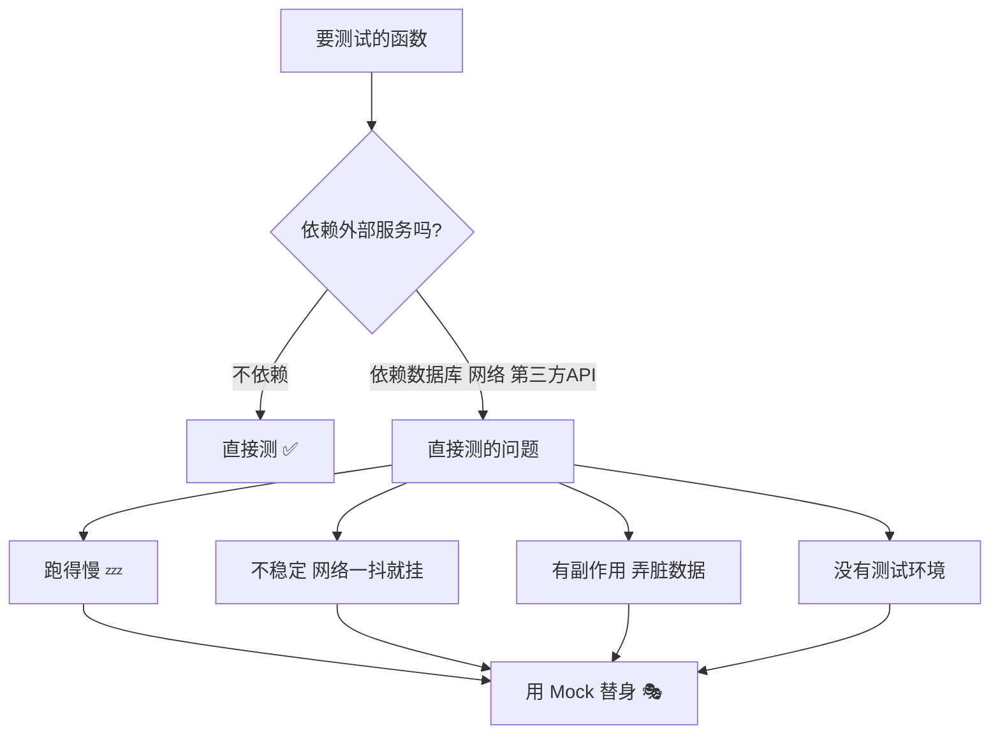
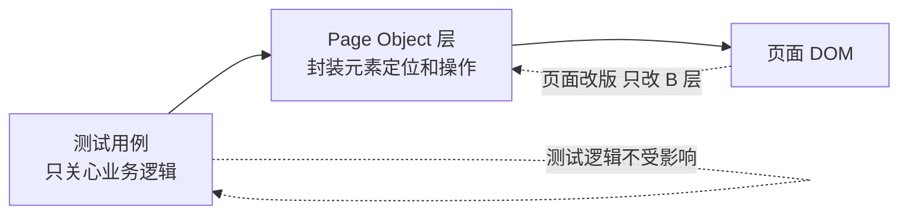
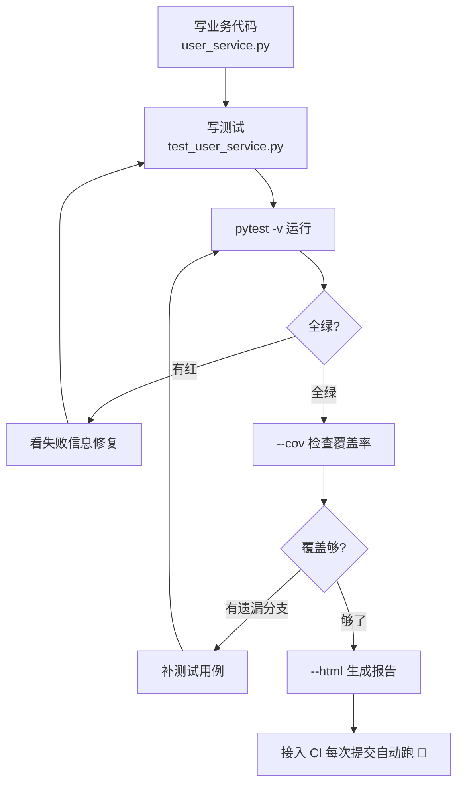
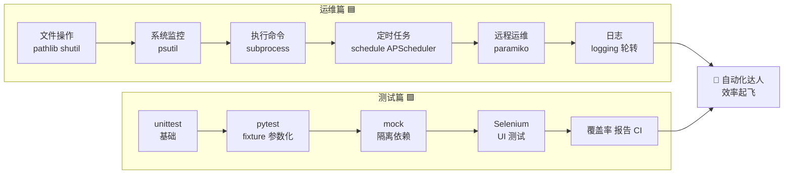

# 🔧 Python 自动化运维和测试

> 哈喽呀～今天开启"解放双手"计划！🤖 运维同学每天重复部署、巡检、清理文件？测试同学天天手动点点点？让 Python 替你打工吧！这门课分"自动化运维"和"自动化测试"两大板块，学完你就是团队的效率之星！冲鸭！(≧∇≦)ﾉ

***

## 🗺️ 知识全景图



***

## 📑 目录

**上篇：自动化运维篇**

- [一、自动化运维是什么](#一自动化运维是什么)
- [二、文件与目录操作](#二文件与目录操作)
- [三、系统信息监控 psutil](#三系统信息监控-psutil)
- [四、执行系统命令 subprocess](#四执行系统命令-subprocess)
- [五、定时任务：让程序自己跑](#五定时任务让程序自己跑)
- [六、远程运维：SSH 与文件传输](#六远程运维ssh-与文件传输)
- [七、日志处理](#七日志处理)
- [八、运维实战：服务器巡检脚本](#八运维实战服务器巡检脚本)

**下篇：自动化测试篇**

- [九、自动化测试是什么](#九自动化测试是什么)
- [十、unittest：内置测试框架](#十unittest内置测试框架)
- [十一、pytest：更流行的选择](#十一pytest更流行的选择)
- [十二、Mock：隔离测试的魔法](#十二mock隔离测试的魔法)
- [十三、Selenium 自动化测试](#十三selenium-自动化测试)
- [十四、测试实战：完整项目示例](#十四测试实战完整项目示例)

***

# 🟦 上篇：自动化运维篇

## 一、自动化运维是什么

### 1.1 一句话解释

**自动化运维 = 用脚本代替人工重复操作** 🤖

凡是你要做三遍以上的事——备份、清理、部署、监控、发报告——都值得写个脚本让它自动跑！

### 1.2 哪些活儿可以自动化

| 重复劳动 😫    | 自动化方案 ✨          |
| ---------- | ---------------- |
| 每天备份日志/数据库 | 定时任务 + shutil 压缩 |
| 磁盘满了手动删文件  | 脚本监控 + 自动清理      |
| 部署要敲十几个命令  | 一键部署脚本           |
| 检查服务器状态    | 巡检脚本 + 报告        |
| 批量改配置文件    | 遍历 + 正则替换        |
| 手动测试网页功能   | Selenium 自动点点点   |

### 1.3 运维脚本编写流程


***

## 二、文件与目录操作 📁

### 2.1 os：老牌系统接口

```python
import os

# ===== 目录操作 =====
os.getcwd()                       # 当前工作目录
os.chdir("/tmp")                  # 切换目录
os.listdir(".")                   # 列出目录内容（文件名列表）
os.mkdir("newdir")                # 创建单层目录
os.makedirs("a/b/c")              # 递归创建多层目录
os.rmdir("empty_dir")             # 删空目录
os.removedirs("a/b/c")            # 递归删空目录

# ===== 路径操作 =====
os.path.exists("/etc/hosts")      # 存在吗
os.path.isfile("a.txt")           # 是文件吗
os.path.isdir("/tmp")             # 是目录吗
os.path.join("/var", "log", "a.log")   # 拼路径（跨平台正确）
os.path.split("/a/b/c.txt")       # ('/a/b', 'c.txt')
os.path.splitext("a.tar.gz")      # ('a.tar', '.gz')
os.path.basename("/a/b/c.txt")    # 'c.txt'
os.path.dirname("/a/b/c.txt")     # '/a/b'
os.path.getsize("a.txt")          # 文件大小（字节）
os.path.abspath("a.txt")          # 绝对路径
os.rename("old.txt", "new.txt")   # 重命名
os.remove("a.txt")                # 删文件
```

### 2.2 pathlib：现代路径对象（推荐！）

```python
from pathlib import Path

p = Path("/var/log/app")

# 链式调用，优雅！
p.exists()                        # 存在吗
p.is_file()                       # 是文件吗
p.mkdir(parents=True, exist_ok=True)   # 递归建目录，存在不报错

# 拼路径：用 / 运算符！
config = p / "app.conf"
str(config)                       # '/var/log/app/app.conf'

# 遍历目录
for f in p.iterdir():             # 一层
    print(f.name, f.stat().st_size)

for f in p.glob("*.log"):         # 匹配一层
    print(f)

for f in p.rglob("*.log"):        # 递归匹配所有子目录！
    print(f)

# 读写文件也行
(p / "note.txt").write_text("你好", encoding="utf-8")
content = (p / "note.txt").read_text(encoding="utf-8")
```

### 2.3 os.path vs pathlib 对比

| 操作  | os.path 😩               | pathlib ✨               |
| --- | ------------------------ | ----------------------- |
| 拼路径 | `os.path.join(a, b)`     | `Path(a) / b`           |
| 文件名 | `os.path.basename(p)`    | `Path(p).name`          |
| 后缀  | `os.path.splitext(p)[1]` | `Path(p).suffix`        |
| 遍历  | `os.walk()` 循环           | `glob()` / `rglob()` 一行 |
| 风格  | 函数堆叠                     | 面向对象链式                  |

### 2.4 shutil：复制移动删除全家桶

```python
import shutil

shutil.copy("a.txt", "b.txt")             # 复制文件（不含权限）
shutil.copy2("a.txt", "b.txt")            # 复制 + 保留元数据（时间等）
shutil.copytree("dir1", "dir2")           # 复制整个目录树
shutil.move("a.txt", "/tmp/a.txt")        # 移动/重命名
shutil.rmtree("dir")                      # 删除整个目录（危险！不可恢复）

# 磁盘使用情况
total, used, free = shutil.disk_usage("C:\\")
print(f"总 {total//2**30}GB 已用 {used//2**30}GB 剩余 {free//2**30}GB")
```

### 2.5 压缩与解压

```python
import shutil
import zipfile

# ===== 方式一：shutil 打包 =====
shutil.make_archive("backup", "zip", "/var/log")   # log 目录 → backup.zip
shutil.unpack_archive("backup.zip", "restore_dir") # 解压

# ===== 方式二：zipfile 精细控制 =====
with zipfile.ZipFile("data.zip", "w", zipfile.ZIP_DEFLATED) as zf:
    zf.write("a.log")
    zf.write("b.log", arcname="dir/b.log")         # 指定包内路径

with zipfile.ZipFile("data.zip") as zf:
    print(zf.namelist())                # 查看包内文件
    zf.extractall("out")                # 全部解压
    zf.extract("a.log", "out")          # 解压单个
    info = zf.getinfo("a.log")
    print(info.file_size, info.compress_size)      # 压缩前后大小
```

### 2.6 实战：批量整理下载文件夹

```python
"""把下载目录按文件类型自动归类"""
from pathlib import Path
import shutil

TYPE_MAP = {
    "图片": {".jpg", ".png", ".gif", ".webp"},
    "文档": {".pdf", ".docx", ".xlsx", ".pptx", ".txt"},
    "安装包": {".exe", ".msi", ".zip", ".rar"},
    "视频": {".mp4", ".mkv", ".avi"},
}

def organize(download_dir: str):
    src = Path(download_dir)
    for file in src.iterdir():
        if file.is_file():
            suffix = file.suffix.lower()
            for folder, exts in TYPE_MAP.items():
                if suffix in exts:
                    target_dir = src / folder
                    target_dir.mkdir(exist_ok=True)
                    shutil.move(str(file), target_dir / file.name)
                    print(f"{file.name} → {folder}/")
                    break

if __name__ == "__main__":
    organize(r"C:\Users\lenovo\Downloads")
```

***

## 三、系统信息监控 psutil 📊

> psutil（process and system utilities）= 跨平台的系统信息宝库，Linux/Windows/Mac 通吃！

### 3.1 安装

```bash
pip install psutil
```

### 3.2 系统信息采集

```python
import psutil
import datetime

# ===== CPU =====
psutil.cpu_count()               # 逻辑核数
psutil.cpu_count(logical=False)  # 物理核数
psutil.cpu_percent(interval=1)   # CPU 使用率（采样1秒）
psutil.cpu_times()               # CPU 时间明细

# ===== 内存 =====
mem = psutil.virtual_memory()
mem.total       # 总内存（字节）
mem.used        # 已用
mem.available   # 可用
mem.percent     # 使用率 %

# ===== 磁盘 =====
psutil.disk_usage("/")           # 磁盘使用情况
psutil.disk_partitions()         # 分区列表

# ===== 网络 =====
psutil.net_io_counters()         # 网络收发流量
psutil.net_if_addrs()            # 网卡信息（含 IP）

# ===== 开机时间 =====
boot = psutil.boot_time()
print(datetime.datetime.fromtimestamp(boot))   # 2026-08-19 08:00:00

# ===== 人性化输出 =====
def fmt(n):
    """字节转可读单位"""
    for unit in ["B", "KB", "MB", "GB", "TB"]:
        if n < 1024:
            return f"{n:.1f}{unit}"
        n /= 1024

mem = psutil.virtual_memory()
print(f"内存: {fmt(mem.total)} 总 / 使用率 {mem.percent}%")
```

### 3.3 进程管理

```python
import psutil

# 遍历所有进程
for proc in psutil.process_iter(["pid", "name", "memory_percent"]):
    print(proc.info)

# 查找指定进程
for proc in psutil.process_iter(["pid", "name"]):
    if proc.info["name"] == "chrome":
        print("找到 chrome:", proc.info["pid"])

# 单个进程详情
p = psutil.Process(pid=1234)
p.name()                  # 进程名
p.status()                # 运行状态
p.cpu_percent()           # CPU 占用
p.memory_percent()        # 内存占用 %
p.create_time()           # 启动时间戳
p.cmdline()               # 启动命令
p.kill()                  # 杀掉进程（危险！先确认）
```

### 3.4 实战：资源告警脚本

```python
import psutil

def check_system():
    """巡检，超阈值就告警"""
    problems = []
    cpu = psutil.cpu_percent(interval=1)
    mem = psutil.virtual_memory().percent
    disk = psutil.disk_usage("/" if psutil.WINDOWS is False else "C:\\").percent

    if cpu > 80:
        problems.append(f"CPU 使用率过高: {cpu}%")
    if mem > 85:
        problems.append(f"内存使用率过高: {mem}%")
    if disk > 90:
        problems.append(f"磁盘使用率过高: {disk}%")

    if problems:
        print("⚠️ 告警:")
        for p in problems:
            print(" -", p)
    else:
        print("✅ 一切正常")
    return problems

if __name__ == "__main__":
    check_system()
```

***

## 四、执行系统命令 subprocess 💻

### 4.1 为什么不用 os.system

```python
import os
os.system("dir")     # 😩 只能拿到退出码，拿不到输出内容！
```

### 4.2 subprocess.run：标准姿势

```python
import subprocess

# 基本用法：拿到完整结果
r = subprocess.run(["ping", "-n", "2", "baidu.com"],
                   capture_output=True, text=True, timeout=10)
print(r.returncode)    # 退出码：0 成功
print(r.stdout)        # 标准输出（字符串）
print(r.stderr)        # 错误输出

# 常用参数
r = subprocess.run(
    ["ipconfig"],              # 命令列表（推荐，防注入）
    capture_output=True,       # 捕获 stdout/stderr
    text=True,                 # 自动解码成 str（否则是 bytes）
    timeout=15,                # 超时秒数
    cwd="/tmp",                # 工作目录
    env={"PATH": "/usr/bin"},  # 环境变量
    shell=False,               # False=安全（默认）；True 才支持管道通配符
)

# 失败时直接抛异常（配合 check=True）
subprocess.run(["ping", "不存在的域名"], check=True)  # CalledProcessError
```

### 4.3 shell=True 的坑

```python
# 危险示例 ⚠️：命令来自用户输入时，shell=True 可能被注入！
cmd = input("输入文件名: ")
subprocess.run(f"del {cmd}", shell=True)   # 用户输入 "a.txt & format C:" 就完了

# 安全姿势：列表形式 + shell=False，参数会被安全转义
subprocess.run(["del", cmd])               # 文件名再怪也只是一个参数
```

### 4.4 Popen：需要实时输出时

```python
import subprocess

# run() 要等命令跑完才有输出；Popen 可以边跑边读
p = subprocess.Popen(
    ["ping", "-n", "10", "baidu.com"],
    stdout=subprocess.PIPE, stderr=subprocess.PIPE, text=True
)
for line in p.stdout:            # 一行行实时读
    print(line.strip())          # 立刻打印，不等结束
p.wait()                         # 等待结束
print("退出码:", p.returncode)
```

### 4.5 实战：批量执行命令并汇报

```python
import subprocess

COMMANDS = {
    "查看 Python 版本": ["python", "--version"],
    "查看 pip 版本":    ["pip", "--version"],
    "列出当前目录":     ["dir"],       # Linux/Mac 用 ls
}

def run_all():
    for desc, cmd in COMMANDS.items():
        try:
            r = subprocess.run(cmd, capture_output=True,
                               text=True, timeout=10)
            status = "✅" if r.returncode == 0 else "❌"
            out = (r.stdout or r.stderr).strip().splitlines()[0]
            print(f"{status} {desc}: {out}")
        except FileNotFoundError:
            print(f"❌ {desc}: 命令不存在")
        except subprocess.TimeoutExpired:
            print(f"⏰ {desc}: 执行超时")

run_all()
```

***

## 五、定时任务：让程序自己跑 ⏰

### 5.1 schedule：人类友好的定时库

```bash
pip install schedule
```

```python
import schedule
import time

def backup():
    print("执行备份任务～")

def check_health():
    print("执行健康检查～")

# ===== 各种时间安排 =====
schedule.every(10).minutes.do(backup)             # 每 10 分钟
schedule.every().hour.do(backup)                  # 每小时
schedule.every().day.at("09:30").do(backup)       # 每天 9:30
schedule.every().monday.do(backup)                # 每周一
schedule.every().wednesday.at("13:15").do(backup) # 每周三 13:15
schedule.every().day.at("09:00", "Asia/Shanghai").do(check_health)  # 指定时区

# ===== 主循环 =====
while True:
    schedule.run_pending()    # 检查有没有到点该跑的任务
    time.sleep(1)             # 每秒检查一次
```

### 5.2 schedule 运行原理



### 5.3 带异常保护的定时任务

```python
import schedule
import time
import traceback

def job():
    try:
        print("干活中...")
        # 可能出错的业务逻辑
    except Exception:
        traceback.print_exc()          # 打错但不让程序崩！
        # 定时任务崩了 = 后面全停摆，必须兜住

schedule.every(5).seconds.do(job)

while True:
    try:
        schedule.run_pending()
    except Exception:
        traceback.print_exc()
    time.sleep(1)
```

### 5.4 APScheduler：生产级选择

```bash
pip install apscheduler
```

```python
from apscheduler.schedulers.blocking import BlockingScheduler
from datetime import datetime

scheduler = BlockingScheduler()

# interval 触发：每隔一段时间
@scheduler.scheduled_job("interval", minutes=30, id="backup")
def backup():
    print(f"[{datetime.now():%H:%M:%S}] 备份完成")

# cron 触发：像 crontab 一样指定时刻
@scheduler.scheduled_job("cron", hour=2, minute=30, id="clean")
def clean_logs():
    print("凌晨 2:30 清理日志")

# date 触发：一次性任务
@scheduler.scheduled_job("date", run_date="2026-12-31 23:59:00")
def new_year():
    print("新年快乐！🎉")

scheduler.start()      # 阻塞运行（还有 BackgroundScheduler 后台版）
```

### 5.5 定时方案对比

| 方案            | 特点         | 适用场景        |
| ------------- | ---------- | ----------- |
| schedule      | 简单纯 Python | 小脚本、单机学习 ⭐  |
| APScheduler   | 功能全、支持持久化  | 正式项目        |
| Linux crontab | 系统级，程序不用常驻 | 服务器部署       |
| Windows 任务计划  | 图形界面系统级    | Windows 服务器 |

```bash
# Linux crontab 示例：每天凌晨 3 点跑脚本
# crontab -e 编辑，添加一行：
0 3 * * * /usr/bin/python3 /opt/scripts/backup.py >> /var/log/backup.log 2>&1
```

***

## 六、远程运维：SSH 与文件传输 🌐

### 6.1 paramiko：Python 的 SSH 客户端

```bash
pip install paramiko
```

```python
import paramiko

# 1. 建立 SSH 连接
client = paramiko.SSHClient()
client.set_missing_host_key_policy(paramiko.AutoAddPolicy())  # 自动接受主机指纹
client.connect(
    hostname="192.168.1.100",
    port=22,
    username="root",
    password="your_password",      # 或用密钥：key_filename="/path/id_rsa"
)

# 2. 执行远程命令
stdin, stdout, stderr = client.exec_command("df -h")
print(stdout.read().decode())      # 命令输出
print(stderr.read().decode())      # 错误信息

# 3. 关闭连接
client.close()
```

### 6.2 SFTP：远程传文件

```python
import paramiko

transport = paramiko.Transport(("192.168.1.100", 22))
transport.connect(username="root", password="your_password")
sftp = paramiko.SFTPClient.from_transport(transport)

# 上传
sftp.put("local/app.jar", "/opt/app/app.jar")
# 下载
sftp.get("/opt/logs/app.log", "local/app.log")
# 列目录 / 建目录 / 删文件
print(sftp.listdir("/opt"))
sftp.mkdir("/opt/backup")
sftp.remove("/opt/old.log")

sftp.close()
transport.close()
```

### 6.3 实战：批量远程执行巡检

```python
import paramiko

SERVERS = [
    {"host": "192.168.1.101", "user": "root", "pwd": "pass1"},
    {"host": "192.168.1.102", "user": "root", "pwd": "pass2"},
]

def remote_exec(server, cmd):
    """在单台服务器执行命令，返回输出"""
    client = paramiko.SSHClient()
    client.set_missing_host_key_policy(paramiko.AutoAddPolicy())
    try:
        client.connect(server["host"], username=server["user"],
                       password=server["pwd"], timeout=10)
        _, stdout, _ = client.exec_command(cmd, timeout=30)
        return stdout.read().decode()
    finally:
        client.close()

def patrol():
    for s in SERVERS:
        print(f"===== {s['host']} =====")
        uptime = remote_exec(s, "uptime")
        disk = remote_exec(s, "df -h / | tail -1")
        print("负载:", uptime.strip())
        print("磁盘:", disk.strip())

if __name__ == "__main__":
    patrol()
```

> ⚠️ 密码别硬编码在脚本里！用环境变量或配置文件（gitignore 掉）保管～生产环境更推荐 SSH 密钥认证。

***

## 七、日志处理 📜

### 7.1 logging：标准日志模块

```python
import logging

# 基础配置
logging.basicConfig(
    level=logging.INFO,
    format="%(asctime)s [%(levelname)s] %(message)s",
    datefmt="%Y-%m-%d %H:%M:%S",
)

logging.debug("调试信息")     # 排查用，一般不输出
logging.info("普通信息")      # 常规记录
logging.warning("警告")       # 有隐患
logging.error("出错了")       # 出问题
logging.critical("严重错误")  # 系统要挂

# 记录异常（自动带堆栈）
try:
    1 / 0
except ZeroDivisionError:
    logging.exception("计算失败")   # 只能在 except 里用
```

### 7.2 日志轮转：防止日志文件无限膨胀

```python
import logging
from logging.handlers import RotatingFileHandler, TimedRotatingFileHandler

logger = logging.getLogger("ops")
logger.setLevel(logging.INFO)
fmt = logging.Formatter("%(asctime)s [%(levelname)s] %(message)s")

# 方式一：按大小轮转（10MB × 保留 5 个）
handler = RotatingFileHandler(
    "app.log", maxBytes=10 * 1024 * 1024, backupCount=5, encoding="utf-8")

# 方式二：按时间轮转（每天一个，保留 7 天）
handler = TimedRotatingFileHandler(
    "app.log", when="midnight", backupCount=7, encoding="utf-8")

handler.setFormatter(fmt)
logger.addHandler(handler)

logger.info("这条会写进文件")
```


### 7.3 实战：分析 Nginx 访问日志

```python
"""统计访问最频繁的 IP 和接口"""
from collections import Counter
import re

LOG_PATTERN = re.compile(r'(\d+\.\d+\.\d+\.\d+).*?"\w+ (\S+)')

def analyze(path):
    ips, urls = Counter(), Counter()
    with open(path, encoding="utf-8", errors="ignore") as f:
        for line in f:
            m = LOG_PATTERN.search(line)
            if m:
                ips[m.group(1)] += 1
                urls[m.group(2)] += 1

    print("🏆 Top5 访问 IP:")
    for ip, cnt in ips.most_common(5):
        print(f"  {ip:<20} {cnt} 次")
    print("🔥 Top5 热门接口:")
    for url, cnt in urls.most_common(5):
        print(f"  {url:<40} {cnt} 次")

if __name__ == "__main__":
    analyze("access.log")
```

***

## 八、运维实战：服务器巡检脚本 🛠️

> 把上篇知识串起来！本地 + 远程巡检，生成报告，可挂定时任务～

```python
"""
server_patrol.py 服务器巡检脚本
功能：CPU/内存/磁盘检查 + 大文件扫描 + 报告生成
用法：python server_patrol.py  （可配合 schedule 每小时跑一次）
"""
import datetime
import logging
import psutil
from pathlib import Path
from logging.handlers import TimedRotatingFileHandler

# ===== 日志配置 =====
logger = logging.getLogger("patrol")
logger.setLevel(logging.INFO)
_handler = TimedRotatingFileHandler("patrol.log", when="midnight",
                                    backupCount=7, encoding="utf-8")
_handler.setFormatter(logging.Formatter("%(asctime)s [%(levelname)s] %(message)s"))
logger.addHandler(_handler)

THRESHOLDS = {"cpu": 80, "mem": 85, "disk": 90}   # 告警阈值

def check_resources() -> list:
    """检查系统资源，返回问题列表"""
    problems = []
    cpu = psutil.cpu_percent(interval=1)
    mem = psutil.virtual_memory().percent
    disk = psutil.disk_usage("C:\\").percent

    if cpu > THRESHOLDS["cpu"]:
        problems.append(f"CPU 使用率 {cpu}% 超过 {THRESHOLDS['cpu']}%")
    if mem > THRESHOLDS["mem"]:
        problems.append(f"内存使用率 {mem}% 超过 {THRESHOLDS['mem']}%")
    if disk > THRESHOLDS["disk"]:
        problems.append(f"磁盘使用率 {disk}% 超过 {THRESHOLDS['disk']}%")

    logger.info(f"CPU {cpu}% | 内存 {mem}% | 磁盘 {disk}%")
    return problems

def find_big_files(directory: str, size_mb: int = 500) -> list:
    """找出超过指定大小的文件"""
    big = []
    for f in Path(directory).rglob("*"):
        try:
            if f.is_file() and f.stat().st_size > size_mb * 1024 * 1024:
                big.append((f, f.stat().st_size // 1024 // 1024))
        except (PermissionError, OSError):
            continue          # 无权限的跳过
    return sorted(big, key=lambda x: -x[1])[:10]

def generate_report(problems: list, big_files: list):
    """生成 markdown 巡检报告"""
    now = datetime.datetime.now().strftime("%Y-%m-%d %H:%M:%S")
    lines = [f"# 服务器巡检报告", f"", f"> 时间：{now}", ""]
    if problems:
        lines.append("## ⚠️ 告警项")
        lines += [f"- {p}" for p in problems]
    else:
        lines.append("## ✅ 系统资源正常")
    if big_files:
        lines += ["", "## 📦 大文件 Top10"]
        lines += [f"- {f} ({size}MB)" for f, size in big_files]
    report = "\n".join(lines)
    Path("patrol_report.md").write_text(report, encoding="utf-8")
    logger.info("报告已生成 patrol_report.md")

def main():
    problems = check_resources()
    big_files = find_big_files("D:\\")
    generate_report(problems, big_files)
    if problems:
        logger.warning(f"发现 {len(problems)} 个告警！")

if __name__ == "__main__":
    main()
```

### 巡检脚本架构



***

# 🟩 下篇：自动化测试篇

## 九、自动化测试是什么

### 9.1 测试金字塔



> 💡 越底层的测试跑得越快、成本越低、越该多写！UI 自动化只覆盖核心流程就好～

### 9.2 单元测试要测什么

| 测试对象 | 举例 🌰          |
| ---- | -------------- |
| 函数   | 输入参数 → 返回值对不对  |
| 边界条件 | 空列表、0、负数、超长字符串 |
| 异常路径 | 该抛异常时抛了吗       |
| 类的方法 | 状态变化是否符合预期     |

### 9.3 一个待测的例子

后面所有测试都围绕这个"计算器"模块（保存为 `calculator.py`）：

```python
class Calculator:
    """简易计算器（待测代码）"""

    def add(self, a, b):
        return a + b

    def divide(self, a, b):
        if b == 0:
            raise ValueError("除数不能为零！")
        return a / b

    def is_positive(self, n):
        return n > 0
```

***

## 十、unittest：内置测试框架

### 10.1 最小可用示例

```python
# test_calculator_unittest.py
import unittest
from calculator import Calculator

class TestCalculator(unittest.TestCase):     # 必须继承 TestCase

    def setUp(self):                          # 每个测试方法前执行
        self.calc = Calculator()

    def tearDown(self):                       # 每个测试方法后执行
        pass

    def test_add(self):                       # 方法名必须 test 开头！
        self.assertEqual(self.calc.add(1, 2), 3)        # 断言相等
        self.assertEqual(self.calc.add(-1, 1), 0)

    def test_add_float(self):
        self.assertAlmostEqual(self.calc.add(0.1, 0.2), 0.3)  # 浮点专用！

    def test_divide(self):
        self.assertEqual(self.calc.divide(6, 3), 2)

    def test_divide_by_zero(self):            # 测试异常抛出
        with self.assertRaises(ValueError):
            self.calc.divide(1, 0)

    def test_is_positive(self):
        self.assertTrue(self.calc.is_positive(5))       # 断言为真
        self.assertFalse(self.calc.is_positive(-5))     # 断言为假

if __name__ == "__main__":
    unittest.main()
```

```bash
python -m unittest test_calculator_unittest.py -v    # -v 显示详情
```

### 10.2 断言方法速查表

| 断言方法                      | 检查内容     | 示例                                |
| ------------------------- | -------- | --------------------------------- |
| `assertEqual(a, b)`       | a == b   | `assertEqual(1+1, 2)`             |
| `assertNotEqual(a, b)`    | a != b   | —                                 |
| `assertTrue(x)`           | x 为真     | —                                 |
| `assertFalse(x)`          | x 为假     | —                                 |
| `assertIsNone(x)`         | x 是 None | —                                 |
| `assertIn(a, b)`          | a 在 b 里  | `assertIn(3, [1,2,3])`            |
| `assertAlmostEqual(a, b)` | 浮点近似相等   | `assertAlmostEqual(0.1+0.2, 0.3)` |
| `assertRaises(异常)`        | 抛出指定异常   | 配合 with 使用                        |
| `assertIsInstance(a, 类型)` | 类型检查     | `assertIsInstance(x, int)`        |

### 10.3 执行顺序与钩子



```python
class TestSomething(unittest.TestCase):

    @classmethod
    def setUpClass(cls):          # 注意是 classmethod！
        print("所有测试开始前：连数据库")

    @classmethod
    def tearDownClass(cls):
        print("所有测试结束后：断开数据库")
```

***

## 十一、pytest：更流行的选择 ⭐

> pytest 是目前 Python 测试的事实标准——代码更少、报告更美、插件超多！

### 11.1 安装与运行

```bash
pip install pytest

pytest                        # 自动发现并运行所有测试
pytest -v                     # 显示每个测试的名字
pytest -s                     # 显示 print 输出
pytest test_calc.py           # 指定文件
pytest test_calc.py::test_add # 只跑一个函数
pytest -k "divide"            # 按关键字筛选
pytest -x                     # 遇到第一个失败就停
pytest --lf                   # 只重跑上次失败的
```

### 11.2 函数式写法（比 unittest 简洁！）

```python
# test_calculator_pytest.py
from calculator import Calculator

def test_add():
    calc = Calculator()
    assert calc.add(1, 2) == 3        # 直接用 assert！不需要 self.assertEqual

def test_divide():
    calc = Calculator()
    assert calc.divide(6, 3) == 2

def test_divide_by_zero():
    calc = Calculator()
    try:
        calc.divide(1, 0)
        assert False, "应该抛异常但没有"
    except ValueError:
        pass
```

### 11.3 fixture：优雅的准备工作

```python
import pytest
from calculator import Calculator

@pytest.fixture
def calc():                        # 定义夹具：名字就是函数名
    return Calculator()            # 有 yield 时，yield 前是准备，后是清理

def test_add(calc):                # 参数名 = 夹具名，自动注入！
    assert calc.add(1, 2) == 3

# 带清理工作的夹具
@pytest.fixture
def db_conn():
    conn = connect_database()      # 准备：连接数据库
    yield conn                     # 把连接交给测试用
    conn.close()                   # 清理：测试完自动执行

# 夹具作用域
@pytest.fixture(scope="module")    # function=每个测试(默认) / module=每文件 / session=全程一次
def expensive_resource():
    return load_big_data()
```

### 11.4 参数化：一次写，多组测

```python
import pytest
from calculator import Calculator

@pytest.mark.parametrize("a, b, expected", [
    (1, 2, 3),           # 正数
    (-1, -2, -3),        # 负数
    (0, 0, 0),           # 零
    (1.5, 2.5, 4.0),     # 浮点
])
def test_add_many(a, b, expected):
    calc = Calculator()
    assert calc.add(a, b) == expected
    # 一组参数跑一次，报告里显示 4 个测试项！

# 参数化异常测试
@pytest.mark.parametrize("a, b", [(1, 0), (0, 0), (-5, 0)])
def test_divide_zero(a, b):
    calc = Calculator()
    with pytest.raises(ValueError):
        calc.divide(a, b)
```

### 11.5 mark：给测试打标签

```python
import pytest

@pytest.mark.slow                          # 自定义标记
def test_heavy_computation():
    ...

@pytest.mark.skip(reason="接口还没开发完")
def test_future_feature():
    ...

@pytest.mark.skipif(sys.platform == "win32", reason="只在 Linux 跑")
def test_linux_only():
    ...

@pytest.mark.xfail                         # 预期失败（失败不算挂）
def test_known_bug():
    ...
```

```bash
pytest -m "not slow"      # 跳过 slow 标记的
pytest -m slow            # 只跑 slow 标记的
```

### 11.6 unittest vs pytest 对比

| 对比项  | unittest           | pytest              |
| ---- | ------------------ | ------------------- |
| 安装   | 内置 ✅               | 需要 pip              |
| 写法   | 类 + self.assertXxx | 纯函数 + assert ✨      |
| 前置后置 | setUp/tearDown     | fixture（更灵活）        |
| 参数化  | 要写 subTest 循环      | `@parametrize` 一行 ✅ |
| 报告   | 原始输出               | 彩色 + 插件增强           |
| 插件生态 | 少                  | 超丰富（覆盖率/并行/...）     |
| 兼容性  | —                  | 能直接跑 unittest 的测试 ✅ |
| 推荐   | 简单场景/无网环境          | 新项目首选 ⭐⭐⭐⭐⭐         |

### 11.7 实用插件

```bash
pip install pytest-cov            # 覆盖率
pip install pytest-xdist          # 并行执行
pip install pytest-html           # HTML 报告
pip install pytest-mock           # 内置 mock 支持
```

```bash
# 覆盖率报告
pytest --cov=calculator --cov-report=term-missing

# 4 个进程并行跑（测试多时飞快！）
pytest -n 4

# 生成 HTML 报告
pytest --html=report.html --self-contained-html
```

***

## 十二、Mock：隔离测试的魔法 🎭

### 12.1 为什么需要 Mock



### 12.2 unittest.mock 基础

```python
from unittest.mock import Mock

# Mock 对象：随便调用，随便取属性，不会报错
m = Mock()
m.some_method()               # 返回一个 Mock，不报错
m.some_method.return_value = 42
print(m.some_method())        # 42

# 检查有没有被调用过
m.some_method.assert_called()                  # 被调用过吗
m.some_method.assert_called_once()             # 只被调用一次吗
m.some_method.assert_called_with(1, 2)         # 是用参数 (1,2) 调的吗
print(m.some_method.call_count)                # 调用次数
```

### 12.3 实战场景：mock 掉网络请求

```python
# 待测代码 notify.py
import requests

def send_alert(url, message):
    """发告警：依赖外部服务，测试时不能真发！"""
    resp = requests.post(url, json={"msg": message})
    if resp.status_code == 200:
        return "success"
    return "failed"
```

```python
# 测试：用 patch 替换 requests.post
from unittest.mock import patch, Mock
from notify import send_alert

@patch("notify.requests.post")           # 注意：patch 定义处，不是 requests 定义处！
def test_send_alert_success(mock_post):
    # 安排：让替身返回假响应
    fake_resp = Mock()
    fake_resp.status_code = 200
    mock_post.return_value = fake_resp

    # 行动：调用被测函数（不会真的发请求！）
    result = send_alert("http://x.com/api", "磁盘满了")

    # 断言
    assert result == "success"
    mock_post.assert_called_once_with(
        "http://x.com/api", json={"msg": "磁盘满了"})
```

### 12.4 side\_effect：模拟不同行为

```python
from unittest.mock import patch, Mock
from notify import send_alert

@patch("notify.requests.post")
def test_send_alert_retry(mock_post):
    # 第一次抛异常，第二次成功 → 测重试逻辑
    mock_post.side_effect = [ConnectionError("断网"), Mock(status_code=200)]
    assert send_alert("http://x.com/api", "hello") == "success"
    assert mock_post.call_count == 2       # 确实调了两次

# side_effect=异常类 = 每次都抛这个异常
@patch("notify.requests.post")
def test_send_alert_error(mock_post):
    mock_post.side_effect = ConnectionError
    assert send_alert("http://x.com/api", "hello") == "failed"
```

### 12.5 patch 的三种用法

```python
from unittest.mock import patch

# 方式一：装饰器（推荐）
@patch("notify.requests.post")
def test_a(mock_post):
    ...

# 方式二：上下文管理器
def test_b():
    with patch("notify.requests.post") as mock_post:
        ...

# 方式三：手动 start/stop（ setUp/tearDown 里用）
class TestC:
    def setUp(self):
        self.patcher = patch("notify.requests.post")
        self.mock_post = self.patcher.start()

    def tearDown(self):
        self.patcher.stop()
```

> ⚠️ **新手最常见错误**：patch 的路径写错！要 patch"被测模块里引用的名字"，而不是"原始定义的地方"。比如 notify.py 里 `import requests`，就 patch `notify.requests.post`。

***

## 十三、Selenium 自动化测试 🖥️

### 13.1 测试金字塔中 UI 层的王

```bash
pip install selenium
```

### 13.2 一个完整的 UI 测试

```python
# test_web_ui.py
import pytest
from selenium import webdriver
from selenium.webdriver.common.by import By
from selenium.webdriver.support.ui import WebDriverWait
from selenium.webdriver.support import expected_conditions as EC

@pytest.fixture
def driver():
    """每个测试一个干净浏览器"""
    d = webdriver.Chrome()
    d.implicitly_wait(5)             # 全局隐式等待
    yield d
    d.quit()                         # 测试完自动关浏览器

def test_baidu_search(driver):
    driver.get("https://www.baidu.com")
    driver.find_element(By.ID, "kw").send_keys("pytest")
    driver.find_element(By.ID, "su").click()

    # 显式等待：等标题变化（比 sleep 靠谱一百倍！）
    WebDriverWait(driver, 10).until(
        EC.title_contains("pytest"))
    assert "pytest" in driver.title

def test_result_count(driver):
    driver.get("https://www.baidu.com")
    driver.find_element(By.ID, "kw").send_keys("selenium")
    driver.find_element(By.ID, "su").click()
    WebDriverWait(driver, 10).until(
        EC.presence_of_element_located((By.ID, "content_left")))
    results = driver.find_elements(By.CSS_SELECTOR, "#content_left .result")
    assert len(results) > 0          # 搜索结果不为空
```

```bash
pytest test_web_ui.py -v --html=ui_report.html
```

### 13.3 隐式等待 vs 显式等待

| 方式              | 写法                              | 特点                 |
| --------------- | ------------------------------- | ------------------ |
| `time.sleep(5)` | 固定睡 5 秒                         | 😫 太傻：不管加载完没完都等    |
| 隐式等待            | `driver.implicitly_wait(5)`     | 找不到元素就最多等 5 秒，全局生效 |
| 显式等待            | `WebDriverWait(...).until(...)` | ⭐ 精准：等到条件满足为止，首选！  |

### 13.4 常用 expected\_conditions

| 条件                                      | 含义        |
| --------------------------------------- | --------- |
| `presence_of_element_located(定位)`       | 元素出现在 DOM |
| `visibility_of_element_located(定位)`     | 元素可见      |
| `element_to_be_clickable(定位)`           | 可点击       |
| `title_contains("xx")`                  | 标题包含 xx   |
| `text_to_be_present_in_element(定位, 文本)` | 元素里出现指定文本 |

### 13.5 Page Object 模式：UI 测试最佳实践

```python
# pages.py：把页面操作封装成类，页面改了只改这里！
from selenium.webdriver.common.by import By

class BaiduPage:
    URL = "https://www.baidu.com"
    SEARCH_INPUT = (By.ID, "kw")
    SEARCH_BUTTON = (By.ID, "su")
    RESULTS = (By.CSS_SELECTOR, "#content_left .result")

    def __init__(self, driver):
        self.driver = driver

    def open(self):
        self.driver.get(self.URL)

    def search(self, keyword):
        self.driver.find_element(*self.SEARCH_INPUT).send_keys(keyword)
        self.driver.find_element(*self.SEARCH_BUTTON).click()

    def result_count(self):
        return len(self.driver.find_elements(*self.RESULTS))

# test 里只写业务，不写定位细节
def test_search(driver):
    page = BaiduPage(driver)
    page.open()
    page.search("pytest")
    assert page.result_count() > 0
```



***

## 十四、测试实战：完整项目示例 🎯

> 一个"用户服务"模块 + 完整测试套件，展示真实项目怎么测！

### 14.1 被测代码

```python
# user_service.py
import re

class UserService:
    """用户服务：注册、登录（简化版）"""

    def __init__(self):
        self.users = {}          # 内存版数据库 {username: password}

    def register(self, username, password):
        # 校验用户名
        if not re.match(r"^\w{3,16}$", username):
            raise ValueError("用户名需为 3-16 位字母数字下划线")
        if username in self.users:
            raise ValueError("用户名已存在")
        # 校验密码
        if len(password) < 6:
            raise ValueError("密码至少 6 位")
        self.users[username] = password
        return True

    def login(self, username, password):
        if username not in self.users:
            return "用户不存在"
        if self.users[username] != password:
            return "密码错误"
        return "登录成功"

    def user_count(self):
        return len(self.users)
```

### 14.2 测试代码

```python
# test_user_service.py
import pytest
from user_service import UserService

class TestRegister:
    """注册功能测试组"""

    @pytest.fixture
    def service(self):
        return UserService()          # 每个测试全新服务，互不干扰

    @pytest.mark.parametrize("username, password", [
        ("xiaomei", "123456"),        # 正常
        ("user_01", "abcdef"),        # 带下划线
        ("a" * 16, "123456"),         # 最长用户名
    ])
    def test_register_success(self, service, username, password):
        assert service.register(username, password) is True
        assert service.user_count() == 1

    @pytest.mark.parametrize("username, password, msg", [
        ("ab", "123456",   "用户名需为 3-16 位"),      # 太短
        ("a" * 17, "123456", "用户名需为 3-16 位"),    # 太长
        ("坏用户!", "123456", "用户名需为 3-16 位"),   # 非法字符
        ("xiaomei", "12345",  "密码至少 6 位"),        # 密码太短
    ])
    def test_register_invalid(self, service, username, password, msg):
        with pytest.raises(ValueError, match=msg):
            service.register(username, password)

    def test_register_duplicate(self, service):
        service.register("xiaomei", "123456")
        with pytest.raises(ValueError, match="已存在"):
            service.register("xiaomei", "888888")

class TestLogin:

    @pytest.fixture
    def service_with_user(self):
        s = UserService()
        s.register("xiaomei", "123456")     # 准备一个已注册用户
        return s

    def test_login_success(self, service_with_user):
        assert service_with_user.login("xiaomei", "123456") == "登录成功"

    def test_login_wrong_password(self, service_with_user):
        assert service_with_user.login("xiaomei", "wrong1") == "密码错误"

    def test_login_no_user(self, service_with_user):
        assert service_with_user.login("nobody", "123456") == "用户不存在"
```

### 14.3 运行并查看覆盖率

```bash
# 运行全部测试（10 个测试项！）
pytest test_user_service.py -v

# 带覆盖率
pytest test_user_service.py --cov=user_service --cov-report=term-missing
```

```text
Name              Stmts   Miss  Cover   Missing
-----------------------------------------------
user_service.py      18      0   100%          ← 全覆盖！🎉
```

### 14.4 测试流程全景



### 14.5 CI 集成：GitHub Actions 示例

```yaml
# .github/workflows/test.yml
name: Python Tests

on: [push, pull_request]        # 每次推送/PR 自动触发

jobs:
  test:
    runs-on: ubuntu-latest
    steps:
      - uses: actions/checkout@v4       # 拉代码
      - uses: actions/setup-python@v5   # 装 Python
        with:
          python-version: "3.12"
      - run: pip install -r requirements.txt
      - run: pip install pytest pytest-cov
      - run: pytest --cov=. --cov-report=term-missing   # 跑测试
```

> 💡 push 代码 → CI 自动跑全部测试 → 有失败立刻知道 → 再也说不清"我改的东西影响谁"了！

***

## 🎓 总结

> 恭喜完成运维 + 测试双修！(๑•̀ㅂ•́)و✧ 修炼路线回顾：



**核心心法** 📝

运维篇：

- 文件操作优先 **pathlib**（现代）+ **shutil**（复制移动）
- 定时任务：小脚本用 schedule，正式项目用 APScheduler
- **日志必须记、异常必须兜**，无人值守的程序崩了都不知道
- 密码密钥不要硬编码！

测试篇：

- 新项目直接上 **pytest**：函数式写法 + fixture + 参数化三件套
- **不依赖外部服务的测试才是好测试**——用 mock 隔离
- UI 测试用**显式等待**，永远别用 sleep
- 覆盖率不是目的，**信心**才是——敢不敢一键重构看测试全绿就知道了

让脚本替你值班，让测试替你守夜，从此准时下班不是梦！💼✨
