# 🚀 Python 进阶特性

> 哈喽呀～欢迎来到 Python 的进阶修炼场！🌟 如果你已经掌握基础语法，那这里的特性会让你写出更**优雅、高效、Pythonic** 的代码～准备好了吗？我们一起进阶吧！(๑•̀ㅂ•́)و✧

---

## 📑 目录

- [零、前置知识：那些常见符号与关键字](#零前置知识那些常见符号与关键字)
- [一、闭包：函数"记住"它的环境](#一闭包函数记住它的环境)
- [二、装饰器：给函数套上"外衣"](#二装饰器给函数套上外衣)
- [三、迭代器：自己控制遍历](#三迭代器自己控制遍历)
- [四、生成器：惰性求值的魔法](#四生成器惰性求值的魔法)
- [五、上下文管理器深入](#五上下文管理器深入)
- [六、描述符：属性的"管家"](#六描述符属性的管家)
- [七、元类：制造类的"工厂"](#七元类制造类的工厂)
- [八、魔术方法深入](#八魔术方法深入)
- [九、类型注解：让代码更清晰](#九类型注解让代码更清晰)
- [十、dataclass：数据类的福音](#十dataclass数据类的福音)
- [十一、并发编程：让程序"一心多用"](#十一并发编程让程序一心多用)
- [十二、函数式编程工具](#十二函数式编程工具)

---

## 零、前置知识：那些常见符号与关键字 🧭

> 在正式进入进阶特性之前，咱们先把几个**到处出现但可能还一知半解**的符号和关键字搞清楚！它们是后续所有章节的"地基"哦～ 🏗️

### 0.1 `with` —— 自动善后的"好管家" 🧹

**一句话理解**：`with` 能帮你**自动清理资源**（关文件、释放锁、断开连接），就算中间出错了也不会忘记收拾！

```python
# —— 不用 with（容易忘记关闭）——
f = open("test.txt", "w")
f.write("hello")
# 如果这里出异常，文件就永远不会关闭 ❌
f.close()

# —— 用 with（自动关闭，推荐 ✅）——
with open("test.txt", "w") as f:
    f.write("hello")
# 离开 with 块后，文件自动关闭，即使出错也会关闭！
```

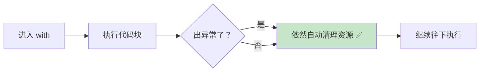

> 💡 **原理**：`with` 要求对象实现上下文管理协议（`__enter__` 和 `__exit__`），进入时调用 `__enter__`，离开时**无论是否出错**都调用 `__exit__`。详见 [第五节：上下文管理器深入](#五上下文管理器深入)。

---

### 0.2 `as` —— 给东西"起别名" 🏷️

**一句话理解**：`as` 就是"**取个小名**"，把某个东西用另一个名字来引用。

```python
# ① with ... as：给打开的文件起个名
with open("test.txt") as f:    # f 就是这个文件的"小名"
    data = f.read()

# ② import ... as：给模块起个简短的别名
import numpy as np              # np 就是 numpy 的"小名"
import pandas as pd             # pd 就是 pandas 的"小名"

# ③ except ... as：给捕获的异常起个名
try:
    1 / 0
except ZeroDivisionError as e:  # e 就是这个错误对象
    print(f"出错啦：{e}")

# ④ 类型注解中（Python 3.10+）
from typing import Union
my_type = Union[int, str]       # 定义一个联合类型
```

| 使用场景 | 写法 | `as` 的作用 |
| :--- | :--- | :--- |
| `with` 语句 | `with open(...) as f` | 给 `__enter__()` 的返回值起名 |
| `import` 语句 | `import numpy as np` | 给模块起别名 |
| `except` 语句 | `except Error as e` | 给捕获到的异常对象起名 |

> 🎀 简单来说，看到 `as` 就翻译成"**作为**"或"**取名为**"就对啦～

---

### 0.3 `yield` —— 函数的"暂停键" ⏸️

**一句话理解**：`yield` 让函数能**暂停执行、吐出一个值**，下次调用时从暂停的地方**继续往下**。

```python
def count_up_to(max):
    count = 1
    while count <= max:
        yield count       # 暂停！把 count 的值吐出去
        count += 1        # 下次从这里继续执行

for num in count_up_to(3):
    print(num)
# 输出：1 2 3
```

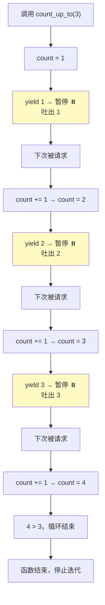

**`yield` vs `return` 的区别**：

| 特性 | `return` | `yield` |
| :--- | :--- | :--- |
| 执行后 | 函数**彻底结束** | 函数**暂停**，可恢复 |
| 返回值 | 一个值 | 一个**生成器**（可逐个取值） |
| 再次调用 | 从头开始 | 从上次暂停处继续 |
| 适用场景 | 计算完返回结果 | 按需生成一系列值 |

> 💡 使用了 `yield` 的函数叫**生成器函数**，详见 [第四节：生成器](#四生成器惰性求值的魔法)。

---

### 0.4 `__方法名__` —— 前后双下划线是什么？ ✨

**一句话理解**：前后各有**两个下划线**的方法叫**魔术方法（Dunder Methods）**，它们是 Python 内置的**"约定暗号"**，让你自定义的对象支持各种内置操作。

> **Dunder** = **D**ouble **Under**score（双下划线）的缩写

```python
class Book:
    def __init__(self, title, price):    # 🎯 构造函数：创建对象时自动调用
        self.title = title
        self.price = price

    def __str__(self):                    # 🎯 print() 时自动调用
        return f"《{self.title}》"

    def __add__(self, other):             # 🎯 使用 + 运算符时自动调用
        return Book(f"{self.title}&{other.title}", self.price + other.price)

book1 = Book("Python入门", 50)
book2 = Book("进阶指南", 80)

print(book1)           # 《Python入门》     → 自动调用 __str__
print(book1 + book2)   # 《Python入门&进阶指南》 → 自动调用 __add__
```

**为什么用双下划线？**

Python 的设计者选择 `__xxx__` 这种格式，有两个原因：

1. **避免冲突**：你的普通方法不太可能取这种名字，所以不会和内置协议撞车
2. **一眼识别**：看到双下划线就知道这是"特殊方法"，Python 会在特定时机自动调用

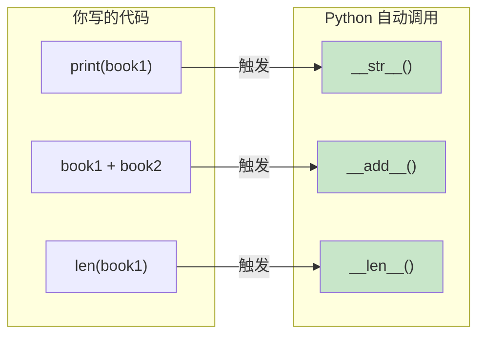

**常见的魔术方法速查**：

| 魔术方法 | 什么时候触发 | 示例 |
| :--- | :--- | :--- |
| `__init__` | 创建对象时 | `Book("标题")` |
| `__str__` | `print()` 或 `str()` 时 | `print(book)` |
| `__len__` | `len()` 时 | `len(book)` |
| `__add__` | 使用 `+` 时 | `book1 + book2` |
| `__eq__` | 使用 `==` 时 | `book1 == book2` |
| `__getitem__` | 使用 `[索引]` 时 | `book[0]` |
| `__iter__` | `for` 循环时 | `for x in book` |
| `__next__` | `next()` 时 | `next(it)` |
| `__enter__` | 进入 `with` 时 | `with book as b` |
| `__exit__` | 离开 `with` 时 | `with` 块结束 |

> ⚠️ **注意区分三种下划线**：
> - `__xxx__`（前后各两个）：**魔术方法**，Python 预定义的协议
> - `_xxx`（前面一个）：**约定私有**，提示别人"别在外面直接访问"（但不强制）
> - `__xxx`（前面两个，后面没有）：**名称改写**，避免子类冲突

---

### 0.5 `@` —— 装饰器语法糖 🍬

**一句话理解**：`@` 是**装饰器的简写符号**，用来在函数上方"贴标签"，表示"给这个函数加一层包装"。

```python
# @ 就是下面这行代码的语法糖
@decorator
def func():
    pass

# 等价于（没有 @，效果完全一样）
def func():
    pass
func = decorator(func)     # 手动把函数传给装饰器，再赋值回去
```

**带参数的装饰器**：

```python
@decorator(arg1, arg2)     # 装饰器自己也要接收参数
def func():
    pass

# 等价于
def func():
    pass
func = decorator(arg1, arg2)(func)
```

**`@` 的其他用途——内置装饰器**：

```python
# ① @staticmethod：静态方法（不需要 self）
class Math:
    @staticmethod
    def add(a, b):
        return a + b

# ② @classmethod：类方法（接收 cls 而不是 self）
class Person:
    count = 0
    @classmethod
    def create(cls):
        cls.count += 1
        return cls()

# ③ @property：把方法变成属性访问
class Circle:
    def __init__(self, r):
        self.r = r
    @property
    def area(self):            # 用 c.area 访问，不用 c.area()
        return 3.14 * self.r ** 2
```

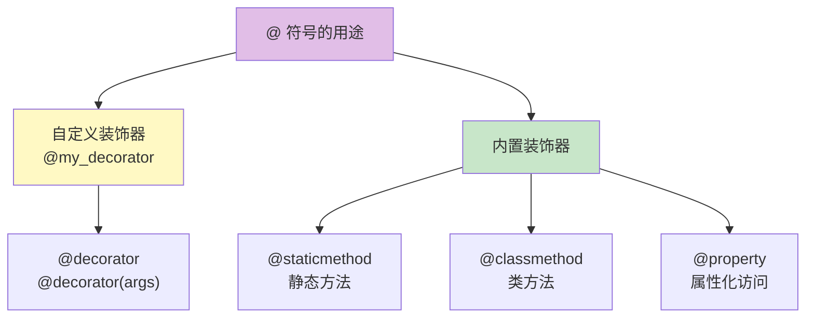

| `@` 用法 | 作用 | 详见 |
| :--- | :--- | :--- |
| `@decorator` | 自定义装饰器 | [第二节：装饰器](#二装饰器给函数套上外衣) |
| `@staticmethod` | 定义静态方法 | Python 基础（面向对象） |
| `@classmethod` | 定义类方法 | Python 基础（面向对象） |
| `@property` | 方法变属性 | [第六节：描述符](#六描述符属性的管家) |
| `@dataclass` | 自动生成数据类 | [第十节：dataclass](#十dataclass数据类的福音) |
| `@contextmanager` | 简化上下文管理器 | [第五节：上下文管理器](#五上下文管理器深入) |

> 🎀 **一句话总结**：看到 `@` 就理解为"**给下面的函数/类贴一个功能标签**"，让 Python 自动帮你做额外的事情～

---

### 📌 本节小结

| 符号/关键字 | 一句话记忆 | 进阶章节 |
| :--- | :--- | :--- |
| `with` | 自动帮你收拾残局的"管家" 🧹 | 第五节 |
| `as` | 给东西取个"小名" 🏷️ | / |
| `yield` | 函数的"暂停键"，吐出一个值 ⏸️ | 第四节 |
| `__xxx__` | Python 的"暗号"，自动触发特殊行为 ✨ | 第八节 |
| `@` | 给函数/类"贴标签"加功能 🍬 | 第二节 |

> 好啦～这些"地基"打好了，后面学进阶特性就轻松多啦！冲冲冲！(๑•̀ㅂ•́)و✧

---

## 一、闭包：函数"记住"它的环境 🔒

### 1.1 什么是闭包？

**闭包（Closure）** 是指：一个**内部函数**引用了**外部函数**的变量，并且在外部函数返回后依然能访问这些变量。

大白话：函数"记住"了它出生时的环境，即使环境没了，它还记得那些变量～ 🧠

```python
def make_multiplier(factor):
    """外部函数：创建一个乘法器"""
    def multiplier(x):
        # 内部函数引用了外部函数的 factor 变量 → 这就是闭包！
        return x * factor
    return multiplier   # 返回内部函数（不调用，只返回）

# 外部函数执行完了，但 factor 被"记住"了
double = make_multiplier(2)    # double 记住了 factor=2
triple = make_multiplier(3)    # triple 记住了 factor=3

print(double(5))    # 10  → 5 * 2
print(triple(5))    # 15  → 5 * 3
```

### 1.2 为什么要用闭包？

| 优点 | 说明 |
| :--- | :--- |
| **数据封装** | 把变量藏起来，不暴露在全局，类似轻量级类 |
| **状态保持** | 函数能"记住"上一次的状态 |
| **函数工厂** | 动态生成功能相似的函数 |
| **回调函数** | 带上下文信息的回调 |

#### 经典应用：计数器

```python
def make_counter():
    count = 0                    # 这个变量被"封闭"起来
    def counter():
        nonlocal count           # 声明修改外层变量
        count += 1
        return count
    return counter

c = make_counter()
print(c())   # 1
print(c())   # 2
print(c())   # 3
# count 变量外部访问不到，只能通过 counter() 操作 → 数据被保护了！
```

### 1.3 闭包的"陷阱"：延迟绑定 🪤

闭包引用的是**变量本身**，不是变量当时的值。在循环中要特别小心！

```python
# ❌ 经典错误：所有函数都返回 3
funcs = []
for i in range(3):
    funcs.append(lambda: i)      # lambda 引用的是 i 这个变量

print([f() for f in funcs])     # [2, 2, 2]  ← 不是 [0,1,2]！
# 因为循环结束后 i = 2，所有 lambda 都返回 2

# ✅ 正确做法：用默认参数固定当时的值
funcs = []
for i in range(3):
    funcs.append(lambda x=i: x)  # 用默认参数捕获当前 i 的值

print([f() for f in funcs])     # [0, 1, 2]  ← 正确！
```

> 💡 **原理**：闭包在**调用时**才查找变量的值，而不是定义时。用默认参数能在**定义时**就锁定值。

### 1.4 图解：延迟绑定的执行过程 🔍

#### ① 错误写法的内存模型

关键在于：lambda 捕获的是 **`i` 这个变量（单元格 cell）的引用**，而不是当时 `i` 的值！

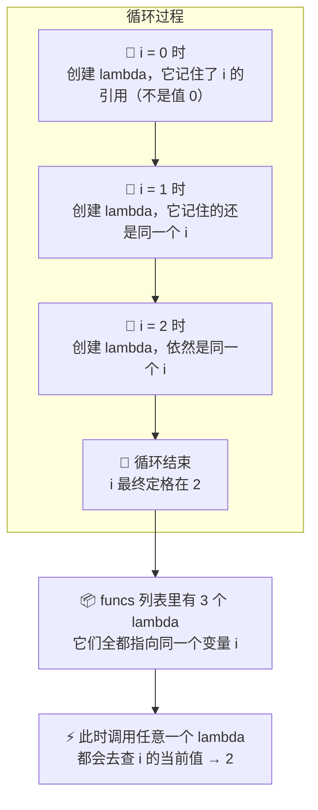

#### ② 逐帧分析：为什么返回 [2, 2, 2]

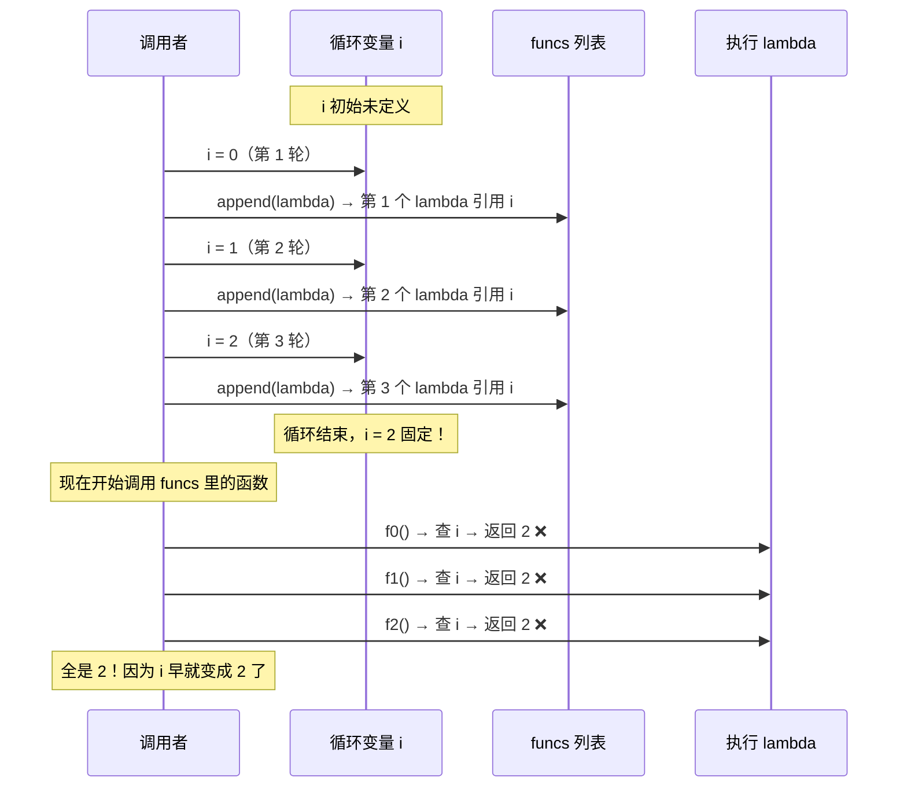

#### ③ 正确写法：默认参数"锁定"值

```python
lambda x=i: x
#         ↑    ↑
#    默认参数  返回 x
# 定义时就把 i 的值复制给 x
```

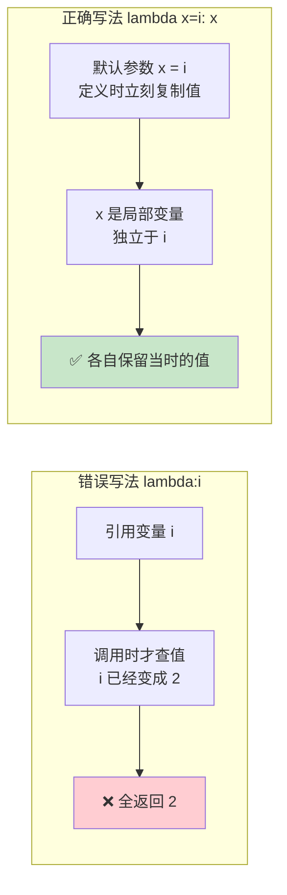

#### ④ 两种写法对比表 📊

| 对比项 | `lambda: i`（错误） | `lambda x=i: x`（正确） |
| :--- | :--- | :--- |
| **捕获的是什么** | 变量 `i` 的**引用** | 当时 `i` 的**值副本** |
| **何时确定值** | 调用时（`f()` 时） | 定义时（`lambda` 创建时） |
| **i 后续变化有影响？** | ✅ 有，跟着变 | ❌ 无，已经锁定 |
| **结果** | `[2, 2, 2]` ❌ | `[0, 1, 2]` ✅ |

> 🎀 **一句话记忆**：闭包记的是**"变量的地址"**不是**"值"**。想锁值？用默认参数 `x=i` 立刻拍快照！

#### ⑤ 其他解决方案

```python
# 方法 1：默认参数（推荐，最简洁）
funcs = [lambda i=i: i for i in range(3)]

# 方法 2：用 functools.partial 固定参数
from functools import partial
funcs = [partial(lambda x: x, i) for i in range(3)]

# 方法 3：用工厂函数，让每次循环都有独立作用域
def make_func(i):
    return lambda: i    # 这里的 i 是 make_func 的局部变量，每次调用都独立
funcs = [make_func(i) for i in range(3)]

print([f() for f in funcs])   # [0, 1, 2] 三种方法都正确
```

#### 🧩 三种解决方案逐个拆解

这三种方法思路不同，但核心目标一致：**让每个函数记住"当时"的值，而不是引用同一个变量**。

---

**方法 1：默认参数（最推荐 ⭐）**

```python
funcs = [lambda i=i: i for i in range(3)]
```

原理：`i=i` 看起来很奇怪，左边是**参数名**，右边是**默认值**。

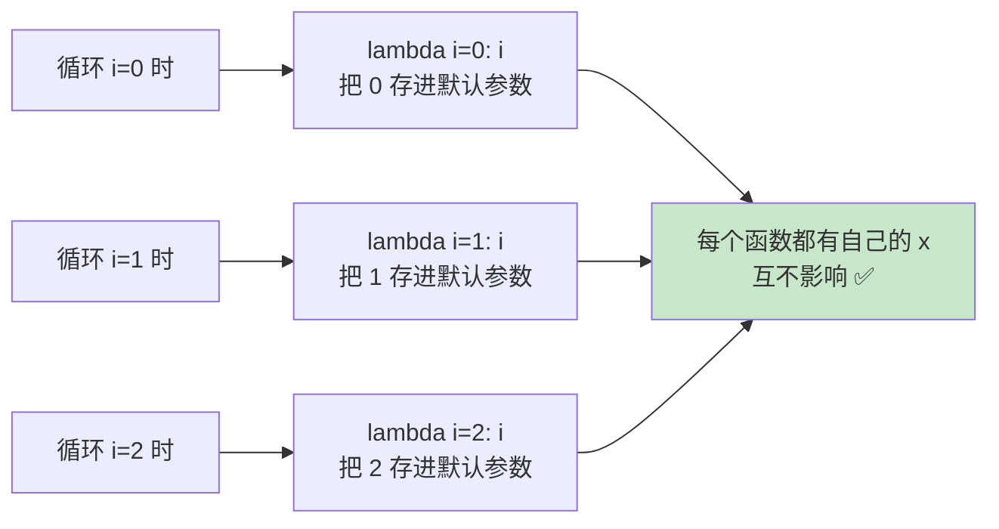

- 这里的 `i=i`，**左边的 `i`** 是 lambda 的**形参**（局部变量），**右边的 `i`** 是循环变量
- 默认参数在**函数定义时**就求值，所以立刻把当时的 `i` 复制了一份
- 调用 `f()` 时不传参，就用默认值——每个函数的默认值都不同！

> 💡 相当于给每个函数拍了一张"快照"，定格了当时的 `i`。

---

**方法 2：functools.partial**

```python
from functools import partial
funcs = [partial(lambda x: x, i) for i in range(3)]
```

原理：`partial` 的作用是**固定函数的部分参数**，返回一个新函数。

```python
# partial 的效果相当于：
def 固定了参数的函数():
    return 原函数(固定的值)

# 具体拆解：
# 原函数：lambda x: x（接收 x，返回 x）
# partial(lambda x: x, i) → 固定 x = 当时的 i 值
# 每次循环 i 不同，所以创建了 3 个不同的"固定函数"

# 循环 i=0：partial(lambda x: x, 0) → f() 等价于 lambda调用(x=0) → 返回 0
# 循环 i=1：partial(lambda x: x, 1) → f() 等价于 lambda调用(x=1) → 返回 1
# 循环 i=2：partial(lambda x: x, 2) → f() 等价于 lambda调用(x=2) → 返回 2
```

- `partial` 在**创建的那一刻**就把 `i` 的值"焊死"在函数里了
- 比 `i=i` 更明确地表达"我要固定参数"的意图
- 缺点是稍微啰嗦一点，需要 import

---

**方法 3：工厂函数（最符合直觉）**

```python
def make_func(i):
    return lambda: i    # 这里的 i 是 make_func 的局部变量

funcs = [make_func(i) for i in range(3)]
```

原理：利用**函数调用会创建独立作用域**的特性。

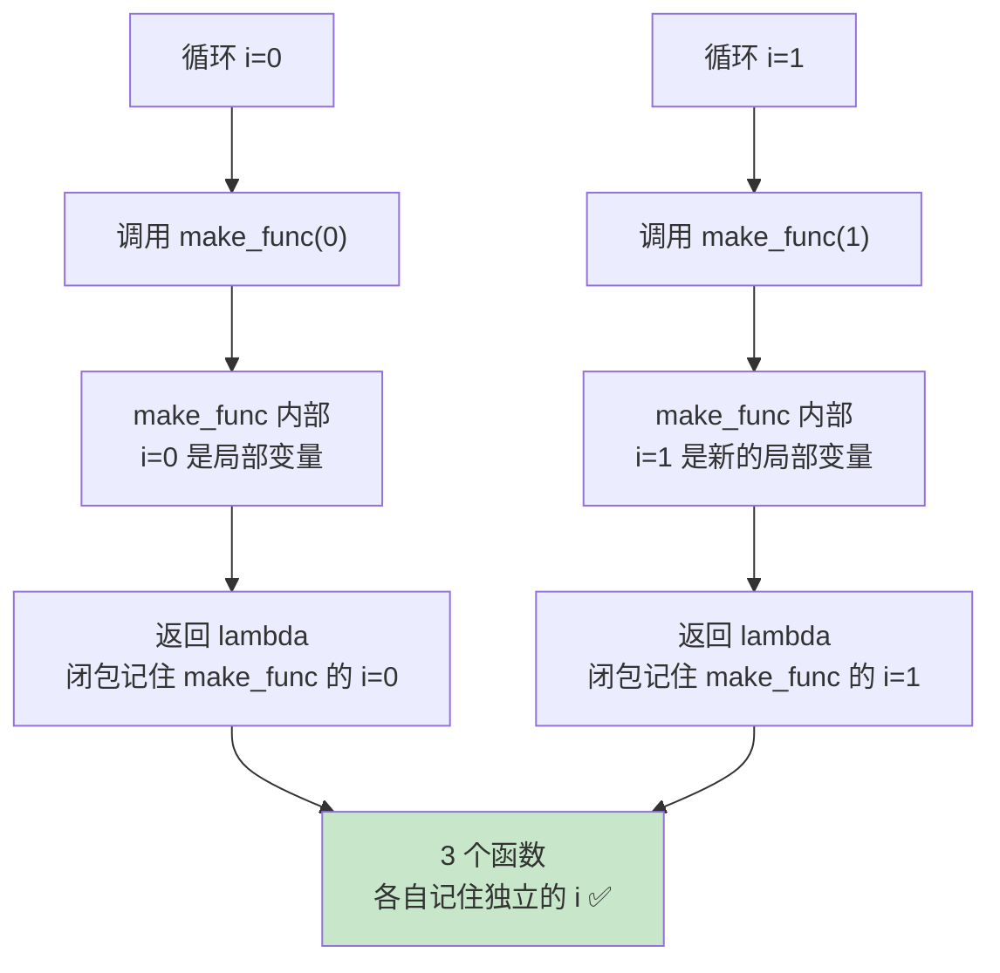

- 每次调用 `make_func(i)` 都会**创建一个全新的函数作用域**
- 每个作用域里的 `i` 是**独立的局部变量**，互不干扰
- 返回的 lambda 形成闭包，"记住"的是**自己那次调用的 `i`**

> 💡 对比直接在循环里写 lambda：循环用的是**同一个作用域**的 `i`，而工厂函数每次调用产生**不同作用域**的 `i`。

---

**📊 三种方法对比**

| 方法 | 核心思路 | 简洁度 | 可读性 | 适用场景 |
| :--- | :--- | :---: | :---: | :--- |
| **默认参数** `i=i` | 定义时复制值 | ⭐⭐⭐ | ⭐⭐ | 通用（推荐） |
| **partial** | 固定参数 | ⭐⭐ | ⭐⭐⭐ | 需要固定多个参数时 |
| **工厂函数** | 独立作用域 | ⭐⭐ | ⭐⭐⭐ | 逻辑复杂时 |

> 🎀 **总结**：三种方法本质都在做同一件事——**把"共享的循环变量"变成"每个函数私有的值"**。日常用方法 1 最简洁，逻辑复杂时用方法 3 最清晰～

---

## 二、装饰器：给函数套上"外衣" 🎭

### 2.1 什么是装饰器？

**装饰器（Decorator）** 本质上是一个**接收函数、返回函数**的函数。它能在**不修改原函数代码**的前提下，给函数增加额外功能。

大白话：给函数套一件"外衣"，让它拥有了新能力，但核心还是那个函数～ 🧥

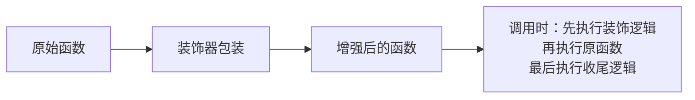

### 2.2 装饰器的基本写法

```python
# 装饰器：本质是"闭包 + 函数作为参数"
def my_decorator(func):
    def wrapper(*args, **kwargs):
        print("=== 函数执行前 ===")
        result = func(*args, **kwargs)    # 调用原函数
        print("=== 函数执行后 ===")
        return result                      # 别忘了返回结果
    return wrapper

# 用 @ 语法糖应用装饰器
@my_decorator
def say_hi(name):
    print(f"你好，{name}！")
    return "done"

# 等价于：say_hi = my_decorator(say_hi)
say_hi("小明")
# 输出：
# === 函数执行前 ===
# 你好，小明！
# === 函数执行后 ===
```

> ⚠️ **注意**：`wrapper` 一定要用 `*args, **kwargs` 接收任意参数，这样装饰器才能适用于各种函数！

### 2.3 实用装饰器示例

#### ① 计时装饰器 ⏱️

```python
import time

def timer(func):
    def wrapper(*args, **kwargs):
        start = time.time()
        result = func(*args, **kwargs)
        elapsed = time.time() - start
        print(f"⏱️ {func.__name__} 耗时 {elapsed:.4f} 秒")
        return result
    return wrapper

@timer
def slow_function():
    time.sleep(1)
    print("我执行完啦～")

slow_function()
# 输出：我执行完啦～
#      ⏱️ slow_function 耗时 1.0012 秒
```

#### ② 日志装饰器 📝

```python
import functools

def log(func):
    @functools.wraps(func)    # 保留原函数的元信息（名字、文档等）
    def wrapper(*args, **kwargs):
        print(f"📋 调用 {func.__name__}，参数：{args}, {kwargs}")
        result = func(*args, **kwargs)
        print(f"✅ {func.__name__} 返回：{result}")
        return result
    return wrapper

@log
def add(a, b):
    """两数相加"""
    return a + b

add(1, 2)
print(add.__name__)    # add（没有 @functools.wraps 会变成 wrapper！）
print(add.__doc__)     # 两数相加
```

> 💡 **重要**：装饰器记得加 `@functools.wraps(func)`，否则原函数的名字、文档字符串都会变成 wrapper 的，调试时会很混乱！

#### ③ 带参数的装饰器 🎛️

带参数的装饰器需要**三层嵌套**：最外层接收参数，中间层接收函数，最内层执行逻辑。

```python
def repeat(times):                 # 第 1 层：接收装饰器参数
    def decorator(func):           # 第 2 层：接收被装饰函数
        @functools.wraps(func)
        def wrapper(*args, **kwargs):   # 第 3 层：实际包装
            for _ in range(times):
                result = func(*args, **kwargs)
            return result
        return wrapper
    return decorator

@repeat(3)    # 让下面的函数执行 3 次
def greet(name):
    print(f"嗨，{name}！")

greet("小明")
# 输出 3 次：嗨，小明！
```

#### 🎛️ 三层嵌套详解：参数装饰器的执行过程

带参数的装饰器看起来复杂，其实只要理解了**每一层的职责**，就豁然开朗啦！

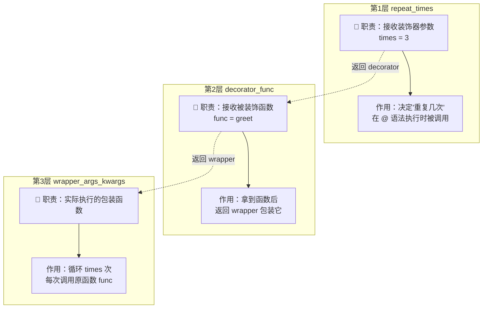

#### 📋 逐步拆解：`@repeat(3)` 到底发生了什么

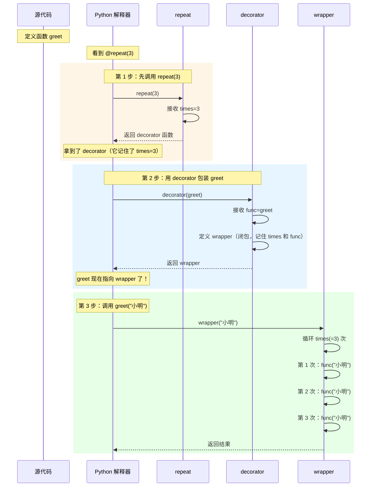

#### 🔑 一个关键认知：`@repeat(3)` 是"先调用，再装饰"

很多人误以为 `@repeat(3)` 是直接把 `greet` 传给 `repeat`，其实不是！它分两步：

```python
# 你写的代码
@repeat(3)
def greet(name):
    ...

# Python 实际执行的等价代码（分两步！）
greet = repeat(3)(greet)
#          ↑    ↑
#     第1步：调用 repeat(3)，返回 decorator
#                    ↑      ↑
#               第2步：用 decorator 包装 greet

# 更直观的拆分：
decorator = repeat(3)        # 先调用，拿到真正的装饰器
greet = decorator(greet)     # 再装饰
```

#### 📊 普通装饰器 vs 带参数装饰器

| 对比项 | 普通装饰器 `@deco` | 带参数装饰器 `@deco(args)` |
| :--- | :--- | :--- |
| **嵌套层数** | 2 层 | 3 层 |
| **调用时机** | 定义函数时直接包装 | 定义函数时**先调用**再包装 |
| **等价代码** | `func = deco(func)` | `func = deco(args)(func)` |
| **参数传递** | 只有 `*args, **kwargs` | 装饰器参数 + 函数参数 |
| **适用场景** | 固定行为（如统一日志） | 可配置行为（如重复次数、日志级别） |

#### 🎨 图像记忆法：把装饰器想象成"定制工厂"

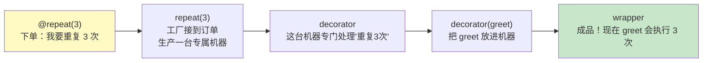

> 🎀 **记忆口诀**：**外层定参数，中层拿函数，内层干实事**！
> - 第 1 层 `repeat(times)` → 接收**配置参数**
> - 第 2 层 `decorator(func)` → 接收**被装饰函数**
> - 第 3 层 `wrapper(*args)` → 执行**真正的逻辑**

#### ④ 类作为装饰器 🏛️

```python
class Counter:
    """用类实现装饰器，靠 __call__ 方法"""
    def __init__(self, func):
        self.func = func
        self.count = 0
    
    def __call__(self, *args, **kwargs):
        self.count += 1
        print(f"📊 {self.func.__name__} 被调用了 {self.count} 次")
        return self.func(*args, **kwargs)

@Counter
def hello():
    print("Hello!")

hello()   # 第 1 次调用
hello()   # 第 2 次调用
```

### 2.4 装饰器的应用场景 🎯

| 场景 | 示例 |
| :--- | :--- |
| **性能监控** | `@timer` 统计函数耗时 |
| **日志记录** | `@log` 记录函数调用 |
| **权限校验** | `@login_required` 检查登录 |
| **缓存加速** | `@functools.cache` / `@lru_cache` |
| **重试机制** | `@retry` 失败自动重试 |
| **路由注册** | Flask 的 `@app.route()` |

#### 内置缓存装饰器 🚀

```python
from functools import lru_cache

@lru_cache(maxsize=128)   # 缓存最近 128 次结果
def fib(n):
    if n < 2:
        return n
    return fib(n-1) + fib(n-2)

print(fib(100))    # 瞬间出结果（没缓存的话要算到天荒地老）
print(fib.cache_info())   # 查看缓存命中情况
```

### 2.5 多个装饰器的执行顺序

```python
@decorator_a
@decorator_b
@decorator_c
def func():
    pass

# 等价于：func = decorator_a(decorator_b(decorator_c(func)))
# 装饰顺序：从下往上（c → b → a）
# 执行顺序：从外往里（a 的前置 → b 的前置 → c 的前置 → 原函数 → c 的后置 → b 的后置 → a 的后置）
```


---

## 三、迭代器：自己控制遍历 🔄

### 3.1 可迭代对象 vs 迭代器

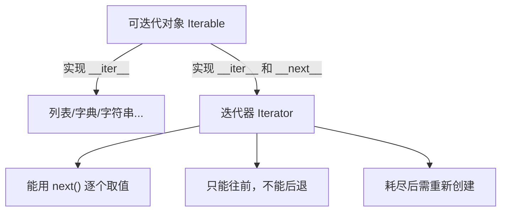

| 概念 | 判断方法 | 特点 |
| :--- | :--- | :--- |
| **可迭代对象 Iterable** | `hasattr(obj, '__iter__')` | 能用 `for` 遍历 |
| **迭代器 Iterator** | `hasattr(obj, '__next__')` | 能用 `next()` 取下一个值 |

```python
# 可迭代对象不一定是迭代器
nums = [1, 2, 3]
print(hasattr(nums, '__iter__'))    # True，是可迭代对象
print(hasattr(nums, '__next__'))    # False，不是迭代器！

# 用 iter() 把可迭代对象变成迭代器
it = iter(nums)
print(hasattr(it, '__next__'))      # True，现在是迭代器了

# 用 next() 逐个取值
print(next(it))   # 1
print(next(it))   # 2
print(next(it))   # 3
print(next(it))   # ❌ StopIteration 异常！迭代器耗尽了
```

### 3.2 for 循环的真相 🔍

`for` 循环的本质其实就是：调用 `iter()` 拿到迭代器，然后不断调用 `next()`，直到捕获 `StopIteration`。

```python
# 下面两段代码等价

# 写法 1：for 循环
for x in [1, 2, 3]:
    print(x)

# 写法 2：手动迭代
it = iter([1, 2, 3])
while True:
    try:
        x = next(it)
        print(x)
    except StopIteration:
        break
```

### 3.3 自定义迭代器

实现 `__iter__()` 和 `__next__()` 两个方法即可。

```python
class CountDown:
    """倒计时迭代器"""
    def __init__(self, start):
        self.current = start
    
    def __iter__(self):
        return self    # 迭代器返回自己
    
    def __next__(self):
        if self.current <= 0:
            raise StopIteration    # 结束信号！
        self.current -= 1
        return self.current + 1

# 使用
for n in CountDown(5):
    print(n, end=" ")    # 5 4 3 2 1
```

### 3.4 无限迭代器

迭代器是**惰性求值**的，所以可以实现"无限"序列，用到才算，不占内存～

```python
class NaturalNumbers:
    """自然数序列：1, 2, 3, ... 无限"""
    def __init__(self):
        self.n = 0
    def __iter__(self):
        return self
    def __next__(self):
        self.n += 1
        return self.n

nats = NaturalNumbers()
print(next(nats))   # 1
print(next(nats))   # 2
print(next(nats))   # 3
# ... 永远不会耗尽（记得用 break 跳出！）
```

> 🎀 **迭代器的好处**：**惰性计算**——用到才算，不用不算。处理大数据时不用全部加载进内存！

---

## 四、生成器：惰性求值的魔法 🪄

生成器是**创建迭代器的简便方式**，有两种写法：生成器函数和生成器表达式。

### 4.1 生成器函数：用 yield 代替 return

```python
def my_range(start, end):
    """生成器函数：用 yield 暂停并返回值"""
    current = start
    while current < end:
        yield current      # yield：暂停函数，返回值；下次 next() 从这里继续
        current += 1

# 生成器函数返回的是一个生成器对象（也是迭代器）
gen = my_range(1, 4)
print(next(gen))   # 1
print(next(gen))   # 2
print(next(gen))   # 3
print(next(gen))   # StopIteration

# 用 for 遍历更方便
for x in my_range(1, 4):
    print(x)    # 1 2 3
```

#### yield 的执行原理

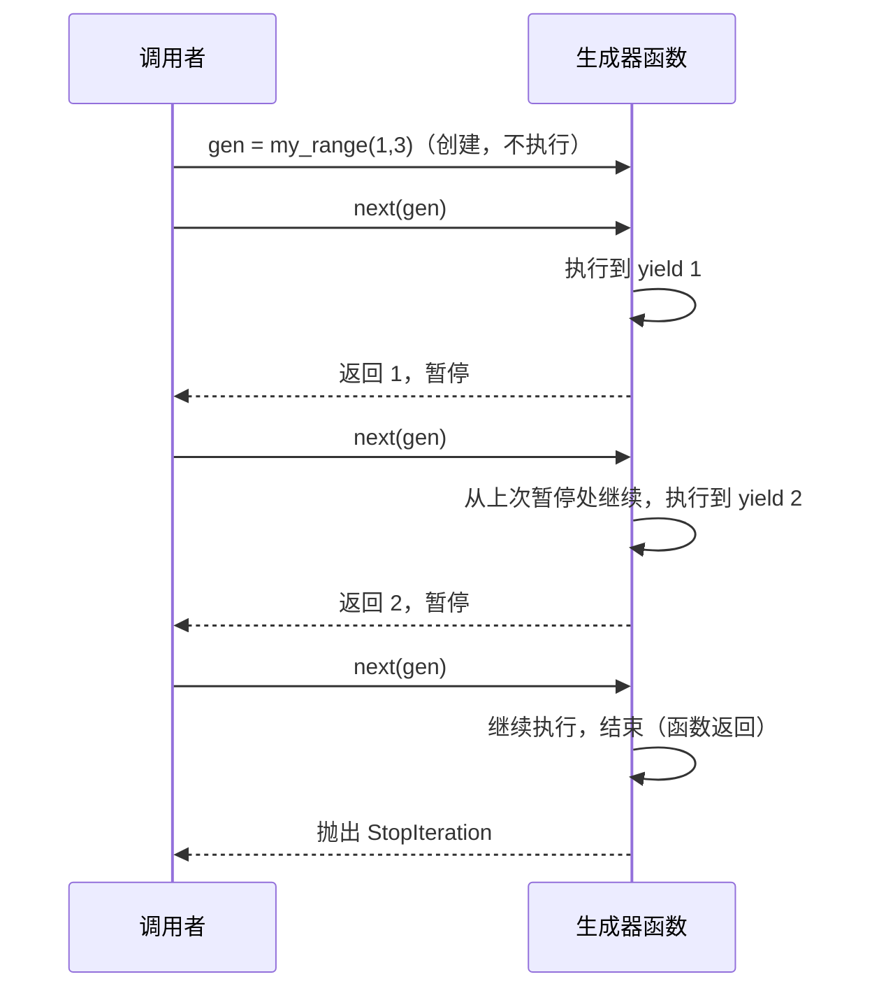

### 4.2 生成器表达式：列表生成式的"惰性版"

把列表生成式的 `[]` 换成 `()`，就变成生成器表达式——**不立即生成所有数据**。

```python
# 列表生成式：立即创建所有元素，占内存
squares_list = [x**2 for x in range(1000000)]   # 立即占用大量内存

# 生成器表达式：惰性，几乎不占内存
squares_gen = (x**2 for x in range(1000000))    # 只是"配方"，没真正计算

# 用 next() 或 for 取值
print(next(squares_gen))   # 0
print(next(squares_gen))   # 1

# 常用于 sum()、max() 等函数，避免创建中间列表
total = sum(x**2 for x in range(100))   # 高效！不会创建列表
```

| 对比 | 列表生成式 `[...]` | 生成器表达式 `(...)` |
| :--- | :--- | :--- |
| **立即创建？** | ✅ 是 | ❌ 否，惰性 |
| **可重复遍历？** | ✅ 可以 | ❌ 只能一次 |
| **内存占用** | 大（全在内存） | 小（边算边用） |
| **索引访问** | ✅ 支持 | ❌ 不支持 |
| **适用场景** | 需要多次访问、随机访问 | 大数据、流式处理 |

### 4.3 生成器的高级用法

#### ① yield from：委托给子生成器

```python
def sub_gen():
    yield 1
    yield 2
    yield 3

def main_gen():
    yield 0
    yield from sub_gen()    # 相当于把子生成器的值全部 yield 出来
    yield 4

for x in main_gen():
    print(x, end=" ")    # 0 1 2 3 4
```

#### ② 生成器的 send()：双向通信 📡

`send()` 可以向生成器内部**发送数据**，`yield` 表达式会返回这个数据。

```python
def echo():
    while True:
        received = yield    # yield 不仅能"产"值，还能"收"值！
        print(f"收到：{received}")

gen = echo()
next(gen)            # 先"启动"生成器（到第一个 yield 暂停）
gen.send("你好")     # 发送数据，输出：收到：你好
gen.send("世界")     # 输出：收到：世界
```

#### ③ 用生成器处理大文件

```python
def read_large_file(filepath, chunk_size=1024):
    """逐块读取大文件，不会一次性加载进内存"""
    with open(filepath, 'r', encoding='utf-8') as f:
        while True:
            chunk = f.read(chunk_size)
            if not chunk:
                break
            yield chunk

# 处理几个 GB 的文件，内存占用极小
for chunk in read_large_file("huge_file.txt"):
    process(chunk)    # 逐块处理
```

### 4.4 协程的雏形

`send()` 让生成器变成了**协程（Coroutine）** 的雏形——函数可以暂停、恢复、双向通信。这是 `asyncio` 异步编程的基础，后面会讲到！

---

## 五、上下文管理器深入 🔬

### 5.1 回顾 with 语句

```python
with open("file.txt") as f:
    data = f.read()
# 离开 with 块，f.close() 自动调用
```

### 5.2 自定义上下文管理器（两种方式）

#### 方式 1：实现 `__enter__` 和 `__exit__`

```python
class Timer:
    """计时上下文管理器"""
    def __enter__(self):
        import time
        self.start = time.time()
        return self    # as xxx 拿到的就是这个返回值
    
    def __exit__(self, exc_type, exc_val, exc_tb):
        import time
        self.elapsed = time.time() - self.start
        print(f"⏱️ 耗时 {self.elapsed:.4f} 秒")
        # exc_type: 异常类型（没异常是 None）
        # 返回 True 表示"吞掉"异常，返回 False/None 异常继续传播
        return False

with Timer() as t:
    sum(range(1000000))
# 自动输出耗时
```

#### 方式 2：用 `@contextmanager`（推荐 ⭐）

```python
from contextlib import contextmanager

@contextmanager
def my_open(filepath, mode='r'):
    """用生成器实现的上下文管理器，更简洁"""
    f = open(filepath, mode, encoding='utf-8')
    try:
        yield f         # yield 之前 = __enter__，yield 的值 = as 拿到的
    finally:
        f.close()       # yield 之后 = __exit__

with my_open("test.txt") as f:
    print(f.read())
```

### 5.3 实用场景

#### ① 数据库事务

```python
@contextmanager
def db_transaction(conn):
    try:
        yield conn
        conn.commit()       # 没异常就提交
    except Exception:
        conn.rollback()     # 有异常就回滚
        raise

with db_transaction(db_conn):
    db_conn.execute("INSERT ...")
    db_conn.execute("UPDATE ...")
# 全部成功 → 提交；任一失败 → 回滚
```

#### ② 临时切换状态

```python
import os

@contextmanager
def temp_chdir(path):
    """临时切换工作目录，用完自动切回来"""
    old_dir = os.getcwd()
    os.chdir(path)
    try:
        yield
    finally:
        os.chdir(old_dir)

with temp_chdir("/tmp"):
    # 在 /tmp 目录下操作
    print(os.getcwd())   # /tmp
# 出了 with 块自动切回原目录
```

---

## 六、描述符：属性的"管家" 👨‍💼

### 6.1 什么是描述符？

**描述符（Descriptor）** 是一个实现了 `__get__`、`__set__`、`__delete__` 中任意一个方法的类。它能**控制属性的访问、赋值和删除**。

大白话：给属性配一个"管家"，每次访问/修改都经过它～ 🏠

```python
class Validator:
    """描述符：验证赋值的值"""
    def __init__(self, min_value=0):
        self.min_value = min_value
    
    def __set_name__(self, owner, name):    # Python 3.6+，获取属性名
        self.name = name
    
    def __get__(self, obj, objtype=None):
        return obj.__dict__.get(self.name)
    
    def __set__(self, obj, value):
        if value < self.min_value:
            raise ValueError(f"{self.name} 不能小于 {self.min_value}")
        obj.__dict__[self.name] = value

class Student:
    age = Validator(min_value=0)     # 类级别定义描述符
    score = Validator(min_value=0)
    
    def __init__(self, age, score):
        self.age = age       # 会调用 Validator.__set__
        self.score = score

s = Student(18, 95)
print(s.age)       # 18，调用 Validator.__get__
s.age = 20         # 调用 Validator.__set__
# s.age = -1       # ❌ ValueError: age 不能小于 0
```

### 6.2 描述符的分类

| 类型 | 实现方法 | 控制能力 |
| :--- | :--- | :--- |
| **数据描述符** | `__get__` + `__set__` | 完全控制读写 |
| **非数据描述符** | 只 `__get__` | 只读控制（实例字典优先级更高） |

> 💡 Python 的 `property`、`classmethod`、`staticmethod` 底层都是描述符实现的！

### 6.3 property：描述符的语法糖

```python
class Temperature:
    def __init__(self, celsius):
        self._celsius = celsius
    
    @property                    # getter：把方法变成属性访问
    def fahrenheit(self):
        return self._celsius * 9/5 + 32
    
    @fahrenheit.setter           # setter：控制赋值
    def fahrenheit(self, value):
        self._celsius = (value - 32) * 5/9
    
    @fahrenheit.deleter          # deleter：控制删除
    def fahrenheit(self):
        print("不准删！")

t = Temperature(100)
print(t.fahrenheit)    # 212.0（像属性一样访问，不带括号）
t.fahrenheit = 32      # 自动调用 setter，_celsius 变成 0
```

---

## 七、元类：制造类的"工厂" 🏭

### 7.1 万物皆对象，类也是对象

在 Python 中，**类本身也是对象**（`type` 的实例）。而**元类（Metaclass）就是用来创建类的类**。

```python
class Dog:
    pass

d = Dog()           # Dog 类创建了实例 d
print(type(d))      # <class '__main__.Dog'>
print(type(Dog))    # <class 'type'>  ← Dog 类是 type 的实例！
print(type(type))   # <class 'type'>  ← type 是它自己的实例（套娃）
```

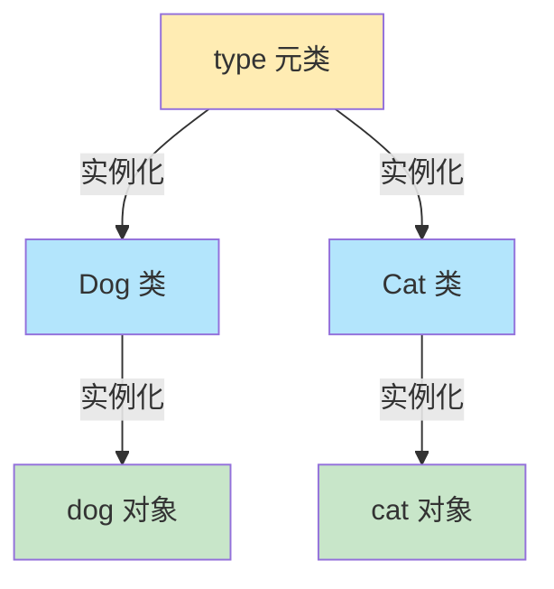

### 7.2 用 type 动态创建类

```python
# 普通方式定义类
class Dog:
    species = "犬科"
    def bark(self):
        return "汪汪"

# 等价的 type 动态创建方式
Dog = type(
    "Dog",                  # 类名
    (object,),              # 父类元组
    {"species": "犬科", "bark": lambda self: "汪汪"}   # 属性字典
)

d = Dog()
print(d.bark())    # 汪汪
```

### 7.3 自定义元类

```python
class MyMeta(type):
    """自定义元类：创建类时自动把方法名变大写（演示用）"""
    def __new__(mcs, name, bases, namespace):
        # 创建类时拦截，可以修改类的定义
        print(f"🔨 正在创建类：{name}")
        return super().__new__(mcs, name, bases, namespace)

class MyClass(metaclass=MyMeta):    # 用 metaclass 指定元类
    pass
# 输出：🔨 正在创建类：MyClass

# 元类的常见用途：ORM 框架（如 Django）、接口校验、自动注册
```

### 7.4 `__init_subclass__`：更简单的类定制

Python 3.6+ 提供了更简单的方式来拦截子类创建，不用写元类：

```python
class PluginBase:
    registry = []
    
    def __init_subclass__(cls, **kwargs):
        super().__init_subclass__(**kwargs)
        PluginBase.registry.append(cls)    # 自动注册子类
        print(f"📦 注册插件：{cls.__name__}")

class PluginA(PluginBase):    # 创建子类时自动触发
    pass
class PluginB(PluginBase):
    pass

print(PluginBase.registry)   # [<class 'PluginA'>, <class 'PluginB'>]
```

> 🎀 **元类慎用**！99% 的场景用普通类、继承、装饰器就够了。元类是"深魔法"，主要是框架作者用的。

---

## 八、魔术方法深入 🎩

### 8.1 让自定义类像内置类型一样用

魔术方法让我们的对象支持各种 Python 内置操作，实现"运算符重载"等高级功能。

#### ① 容器协议：让对象像列表/字典

```python
class Deck:
    """一副扑克牌，支持索引和迭代"""
    suits = "♠♥♣♦"
    ranks = "23456789JQKA"
    
    def __init__(self):
        self.cards = [f"{s}{r}" for s in self.suits for r in self.ranks]
    
    def __len__(self):                    # len(deck)
        return len(self.cards)
    
    def __getitem__(self, index):         # deck[0]、deck[1:5]
        return self.cards[index]
    
    def __contains__(self, card):         # card in deck
        return card in self.cards

deck = Deck()
print(len(deck))         # 52
print(deck[0])           # ♠2
print("♥A" in deck)      # True
for card in deck[:5]:    # 支持切片和迭代（因为有 __getitem__）
    print(card)
```

#### ② 运算符重载

```python
class Matrix:
    def __init__(self, data):
        self.data = data
    
    def __add__(self, other):         # a + b
        return Matrix([
            [a + b for a, b in zip(r1, r2)]
            for r1, r2 in zip(self.data, other.data)
        ])
    
    def __mul__(self, scalar):        # a * 2
        return Matrix([[x * scalar for x in row] for row in self.data])
    
    def __eq__(self, other):          # a == b
        return self.data == other.data
    
    def __repr__(self):               # 开发者显示
        return f"Matrix({self.data})"

m1 = Matrix([[1,2],[3,4]])
m2 = Matrix([[5,6],[7,8]])
print(m1 + m2)         # Matrix([[6, 8], [10, 12]])
print(m1 * 3)          # Matrix([[3, 6], [9, 12]])
```

### 8.2 对象生命周期相关

```python
class MyClass:
    def __new__(cls, *args, **kwargs):
        """创建实例（很少重写，单例模式会用）"""
        print("1️⃣ __new__: 分配内存创建对象")
        instance = super().__new__(cls)
        return instance
    
    def __init__(self):
        """初始化实例"""
        print("2️⃣ __init__: 初始化对象")
    
    def __del__(self):
        """对象被回收时调用（不保证时机，慎用）"""
        print("3️⃣ __del__: 对象被销毁")

obj = MyClass()
del obj    # 触发 __del__
```

### 8.3 常用魔术方法速查表 📋

| 类别 | 方法 | 触发 |
| :--- | :--- | :--- |
| **字符串** | `__str__`, `__repr__` | `print()`, `repr()` |
| **比较** | `__eq__`, `__lt__`, `__gt__` | `==`, `<`, `>` |
| **算术** | `__add__`, `__sub__`, `__mul__` | `+`, `-`, `*` |
| **容器** | `__len__`, `__getitem__`, `__setitem__` | `len()`, `obj[k]` |
| **迭代** | `__iter__`, `__next__` | `for x in obj` |
| **上下文** | `__enter__`, `__exit__` | `with obj` |
| **调用** | `__call__` | `obj()` |
| **属性** | `__getattr__`, `__setattr__` | `obj.xxx` |
| **生命周期** | `__new__`, `__init__`, `__del__` | 创建/销毁 |

---

## 九、类型注解：让代码更清晰 📝

Python 是动态类型语言，但从 3.5 开始支持**类型注解（Type Hints）**，让代码更易读、易维护，还能配合工具做静态检查。

### 9.1 基本类型注解

```python
# 变量注解
name: str = "小明"
age: int = 18
height: float = 1.75
is_student: bool = True

# 函数注解：参数类型 + 返回类型
def greet(name: str, times: int = 1) -> str:
    return f"你好{name}！" * times

def add(a: int, b: int) -> int:
    return a + b
```

> 💡 **注意**：类型注解**只是提示**，Python 运行时**不会强制检查**！传错类型照样能跑（但会有隐患）。要真正检查需用 `mypy` 等工具。

### 9.2 复杂类型注解

```python
from typing import (
    List, Dict, Tuple, Set,        # 容器类型（Python 3.9+ 可直接用小写）
    Optional, Union,               # 可选/联合类型
    Any,                           # 任意类型
    Callable,                      # 可调用对象
    TypeVar, Generic               # 泛型
)

# 列表、字典、元组
names: list[str] = ["小明", "小红"]               # Python 3.9+ 写法
scores: dict[str, int] = {"小明": 90}            # 字典
point: tuple[int, int] = (3, 4)                  # 固定长度元组
nums: tuple[int, ...] = (1, 2, 3)                # 变长元组

# Optional：可能为 None
def find(name: str) -> Optional[str]:            # 等价于 Union[str, None]
    ...

# Union：多种类型之一
def process(data: Union[str, bytes]) -> None:    # Python 3.10+ 可用 str | bytes
    ...

# Callable：函数类型
handler: Callable[[int, int], int] = lambda a, b: a + b   # 参数[int,int]，返回int
```

### 9.3 Python 3.10+ 新语法 `|`

```python
# 旧写法
from typing import Union, Optional
def foo(x: Union[int, str]) -> Optional[str]: ...

# 新写法（3.10+），更简洁
def foo(x: int | str) -> str | None: ...
```

### 9.4 用 mypy 做静态检查 🔍

```bash
# 安装
pip install mypy

# 检查代码
mypy my_script.py
```

```python
# 有类型错误的代码
def add(a: int, b: int) -> int:
    return a + b

add(1, "2")    # mypy 会报错：参数类型不对！
```

---

## 十、dataclass：数据类的福音 🎁

`dataclass`（Python 3.7+）是一个装饰器，能**自动生成** `__init__`、`__repr__`、`__eq__` 等方法，省去大量样板代码。

### 10.1 基本用法

```python
from dataclasses import dataclass

@dataclass
class Student:
    name: str
    age: int
    score: float = 0.0    # 有默认值的字段放后面

# 自动生成 __init__，直接创建
s = Student("小明", 18, 95.5)

# 自动生成 __repr__，打印友好
print(s)    # Student(name='小明', age=18, score=95.5)

# 自动生成 __eq__，可直接比较
print(s == Student("小明", 18, 95.5))    # True
```

### 10.2 对比：手写 vs dataclass

```python
# —— 手写（啰嗦）——
class StudentOld:
    def __init__(self, name, age, score=0.0):
        self.name = name
        self.age = age
        self.score = score
    def __repr__(self):
        return f"StudentOld(name={self.name}, age={self.age}, score={self.score})"
    def __eq__(self, other):
        if not isinstance(other, StudentOld):
            return False
        return (self.name, self.age, self.score) == (other.name, other.age, other.score)

# —— dataclass（简洁！）——
@dataclass
class StudentNew:
    name: str
    age: int
    score: float = 0.0
```

### 10.3 dataclass 的高级选项

```python
from dataclasses import dataclass, field

@dataclass(frozen=True)      # frozen=True → 不可变（像元组一样）
class Point:
    x: float
    y: float
# p = Point(1, 2); p.x = 3   # ❌ 会报错，不可修改！

@dataclass
class Course:
    name: str
    students: list = field(default_factory=list)   # 可变默认值用 default_factory
    tags: list = field(default_factory=lambda: ["必选"])

@dataclass(order=True)       # order=True → 自动生成比较方法（<、>、sorted 可用）
class Priority:
    level: int

tasks = [Priority(3), Priority(1), Priority(2)]
tasks.sort()   # 自动排序，因为实现了 __lt__
```

### 10.4 dataclass 与类型注解配合

```python
from dataclasses import dataclass
from typing import Optional

@dataclass
class User:
    id: int
    username: str
    email: str
    age: Optional[int] = None
    is_active: bool = True

# 转 dict（Python 3.13+ 或用 dataclasses.asdict）
from dataclasses import asdict
u = User(1, "admin", "a@b.com")
print(asdict(u))   # {'id': 1, 'username': 'admin', ...}
```

---

## 十一、并发编程：让程序"一心多用" 🧵

### 11.1 三种并发方式对比

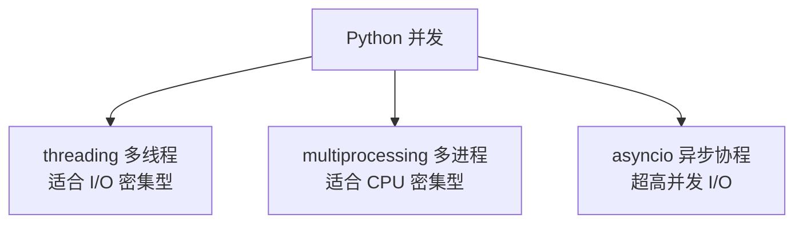

| 方式 | 原理 | 适合场景 | 是否绕过 GIL |
| :--- | :--- | :--- | :--- |
| **多线程** | 多个线程共享内存 | 网络请求、文件读写等 I/O | ❌ 受 GIL 限制 |
| **多进程** | 多个独立进程 | 计算密集任务 | ✅ 真并行 |
| **协程** | 单线程内切换任务 | 海量 I/O（如爬虫） | ✅ 单线程无 GIL 问题 |

> 💡 **GIL（全局解释器锁）**：CPython 的限制，同一时刻只有一个线程执行 Python 字节码。所以多线程**不能**加速 CPU 密集任务！

### 11.2 多线程 threading

```python
import threading
import time

def download(url, duration):
    print(f"⬇️ 开始下载 {url}")
    time.sleep(duration)    # 模拟网络耗时
    print(f"✅ 完成 {url}")

# —— 串行（慢）——
start = time.time()
download("a.zip", 2)
download("b.zip", 2)
print(f"串行耗时：{time.time()-start:.1f}s")   # 约 4 秒

# —— 多线程（快！）——
start = time.time()
t1 = threading.Thread(target=download, args=("a.zip", 2))
t2 = threading.Thread(target=download, args=("b.zip", 2))
t1.start()    # 启动线程
t2.start()
t1.join()     # 等待线程完成
t2.join()
print(f"并发耗时：{time.time()-start:.1f}s")   # 约 2 秒！
```

#### 线程安全与锁 🔐

多个线程访问共享数据会有**竞态条件**，需要加锁。

```python
import threading

balance = 0
lock = threading.Lock()

def deposit(amount, times):
    global balance
    for _ in range(times):
        with lock:            # 加锁，同一时刻只有一个线程进入
            balance += amount

threads = [threading.Thread(target=deposit, args=(1, 100000)) for _ in range(5)]
for t in threads: t.start()
for t in threads: t.join()
print(balance)    # 500000（加锁才正确，不加可能小于 500000）
```

### 11.3 多进程 multiprocessing

```python
from multiprocessing import Pool
import time

def cpu_task(n):
    """CPU 密集任务：计算平方和"""
    return sum(i**2 for i in range(n))

if __name__ == "__main__":
    start = time.time()
    # 串行
    results = [cpu_task(10**6) for _ in range(4)]
    print(f"串行：{time.time()-start:.2f}s")
    
    start = time.time()
    # 多进程（真并行，利用多核）
    with Pool(4) as pool:               # 4 个进程
        results = pool.map(cpu_task, [10**6]*4)
    print(f"多进程：{time.time()-start:.2f}s")   # 快很多！
```

### 11.4 协程与 asyncio 🌟

`asyncio` 是 Python 的异步 I/O 框架，用 `async`/`await` 语法，**单线程**实现高并发。

```python
import asyncio

async def download(url):
    print(f"⬇️ 开始 {url}")
    await asyncio.sleep(2)    # 模拟异步等待（不阻塞！）
    print(f"✅ 完成 {url}")
    return f"{url} 的数据"

async def main():
    # 并发执行 3 个下载任务（总耗时约 2 秒，而不是 6 秒）
    results = await asyncio.gather(
        download("a.zip"),
        download("b.zip"),
        download("c.zip"),
    )
    print(results)

asyncio.run(main())    # 运行异步程序
```

#### async/await 执行流程

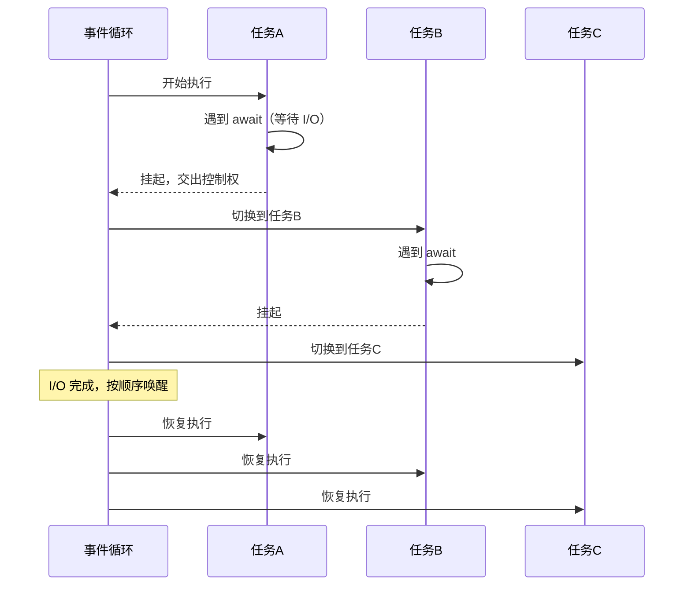

### 11.5 ThreadPoolExecutor：更简单的线程池

```python
from concurrent.futures import ThreadPoolExecutor, as_completed
import requests

urls = ["url1", "url2", "url3"]

with ThreadPoolExecutor(max_workers=5) as executor:
    # 提交所有任务
    futures = {executor.submit(requests.get, url): url for url in urls}
    # 逐个获取结果
    for future in as_completed(futures):
        url = futures[future]
        try:
            result = future.result()
            print(f"{url}: {result.status_code}")
        except Exception as e:
            print(f"{url} 失败：{e}")
```

### 11.6 怎么选？🤔

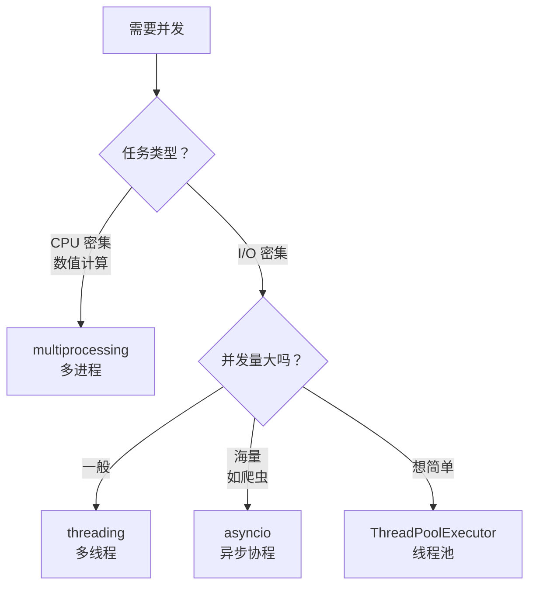

---

## 十二、函数式编程工具 🧰

### 12.1 函数作为"一等公民"

在 Python 中，函数和整数、字符串一样，是**一等对象**：
- 可以赋值给变量
- 可以作为参数传递
- 可以作为返回值
- 可以存在数据结构里

```python
# 函数可以赋值、传递、返回
def shout(text):
    return text.upper()

yell = shout           # 赋值给变量
print(yell("hi"))      # HI

def apply(func, value): # 函数作为参数
    return func(value)
print(apply(shout, "hello"))   # HELLO
```

### 12.2 map / filter / reduce

```python
from functools import reduce

nums = [1, 2, 3, 4, 5]

# map：对每个元素应用函数
squares = list(map(lambda x: x**2, nums))      # [1, 4, 9, 16, 25]
# 等价列表生成式：[x**2 for x in nums]

# filter：过滤满足条件的元素
evens = list(filter(lambda x: x % 2 == 0, nums))  # [2, 4]
# 等价列表生成式：[x for x in nums if x % 2 == 0]

# reduce：逐步归约为单个值
total = reduce(lambda a, b: a + b, nums)       # 15
product = reduce(lambda a, b: a * b, nums)     # 120
```

> 🎀 **趋势**：现在更推荐用**列表/生成器生成式**代替 map/filter，可读性更好！

### 12.3 偏函数 partial

```python
from functools import partial

# 固定部分参数，生成新函数
def power(base, exponent):
    return base ** exponent

square = partial(power, exponent=2)    # 固定 exponent=2
cube = partial(power, exponent=3)      # 固定 exponent=3

print(square(5))    # 25
print(cube(3))      # 27

# 实用：创建特定编码的 int 转换器
basetwo = partial(int, base=2)
print(basetwo("1010"))   # 10（把二进制字符串转十进制）
```

### 12.4 排序的进阶用法

```python
# 用 key 指定排序规则
students = [
    {"name": "小明", "score": 90, "age": 18},
    {"name": "小红", "score": 85, "age": 17},
    {"name": "小刚", "score": 90, "age": 19},
]

# 按分数排序
sorted(students, key=lambda s: s["score"])

# 多条件排序：先按分数降序，分数相同按年龄升序
sorted(students, key=lambda s: (-s["score"], s["age"]))

# 用 operator 更高效
from operator import itemgetter
sorted(students, key=itemgetter("score"))    # 等价 lambda

# cmp_to_key：支持自定义比较函数
from functools import cmp_to_key
sorted([3, 1, 2], key=cmp_to_key(lambda a, b: b - a))   # 降序
```

---

## 🎓 进阶学习总结

恭喜你读完啦！🎉 这些进阶特性是写出**Pythonic**代码的关键～

```mermaid
graph LR
    A[✅ 掌握基础] --> B[闭包 & 装饰器]
    B --> C[迭代器 & 生成器]
    C --> D[描述符 & 元类]
    D --> E[类型注解 & dataclass]
    E --> F[并发编程]
    
    style B fill:#fff9c4
    style C fill:#c8e6c9
    style D fill:#bbdefb
    style E fill:#e1bee7
    style F fill:#ffcdd2
```

### 💡 学习建议

| 特性 | 重要程度 | 建议 |
| :--- | :---: | :--- |
| 闭包、装饰器 | ⭐⭐⭐⭐⭐ | **必学**，日常开发天天用 |
| 生成器、迭代器 | ⭐⭐⭐⭐⭐ | **必学**，大数据处理核心 |
| 上下文管理器 | ⭐⭐⭐⭐ | 很常用，资源管理必备 |
| 类型注解、dataclass | ⭐⭐⭐⭐ | 大型项目必备，提高可维护性 |
| 并发编程 | ⭐⭐⭐⭐ | 性能优化必备 |
| 描述符、元类 | ⭐⭐ | 了解原理即可，框架开发才深用 |

> 🌸 **进阶心得**：不要为了炫技而用这些特性！**合适的场景用合适的工具**，代码**可读性**永远第一位～ 一起加油鸭！(◍•ᴗ•◍)❤

---

> 📌 **本笔记基于 Python 3.10+，持续更新中～ 如有错误欢迎指正！**
