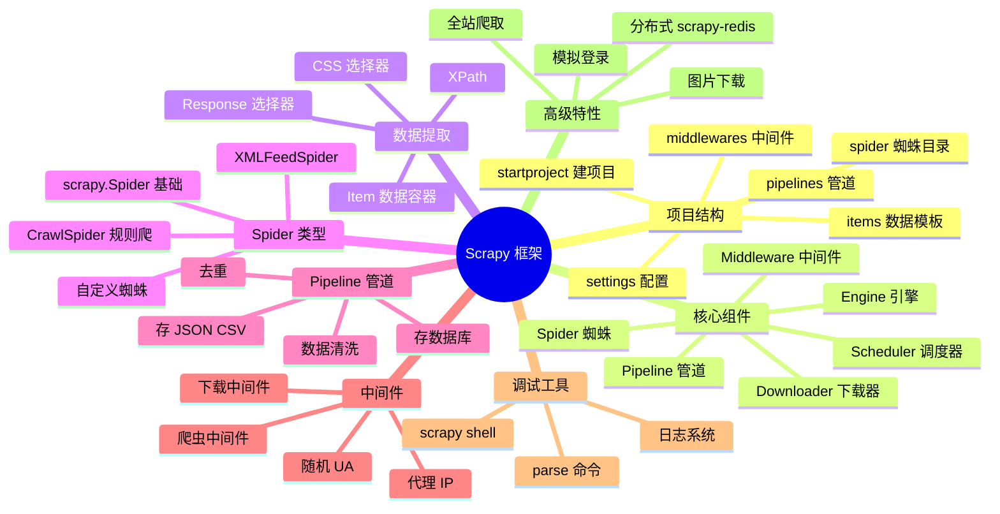
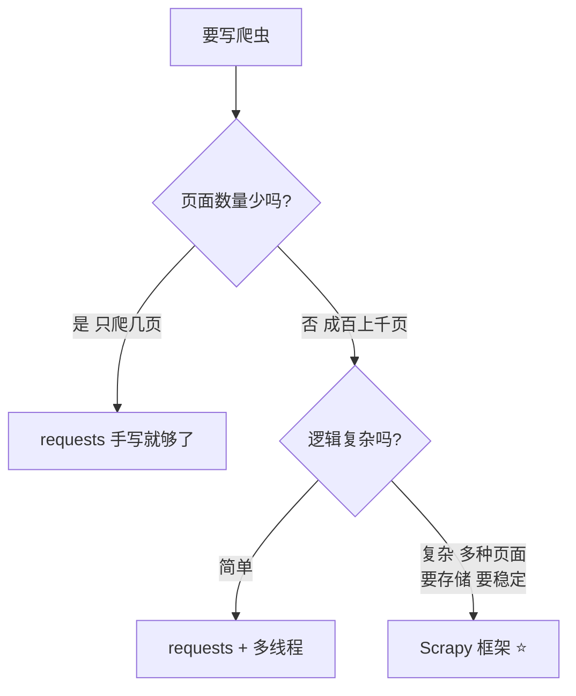
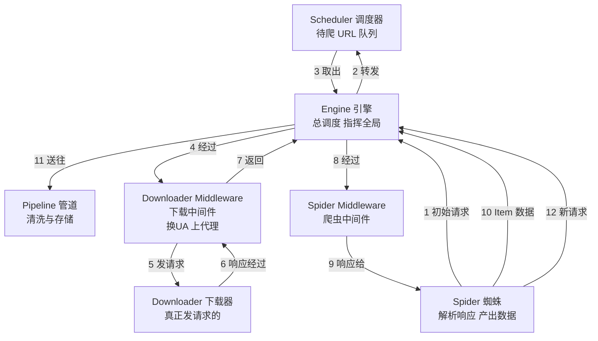
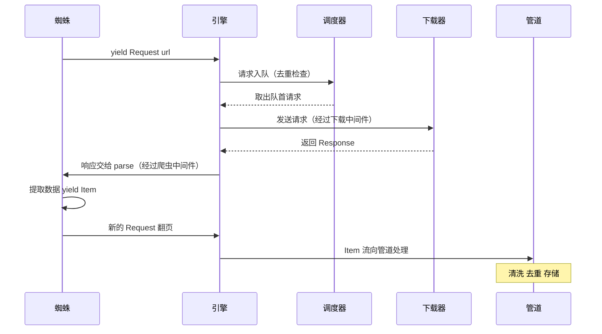
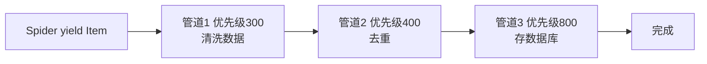
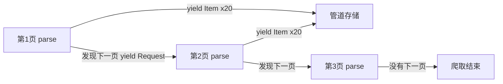
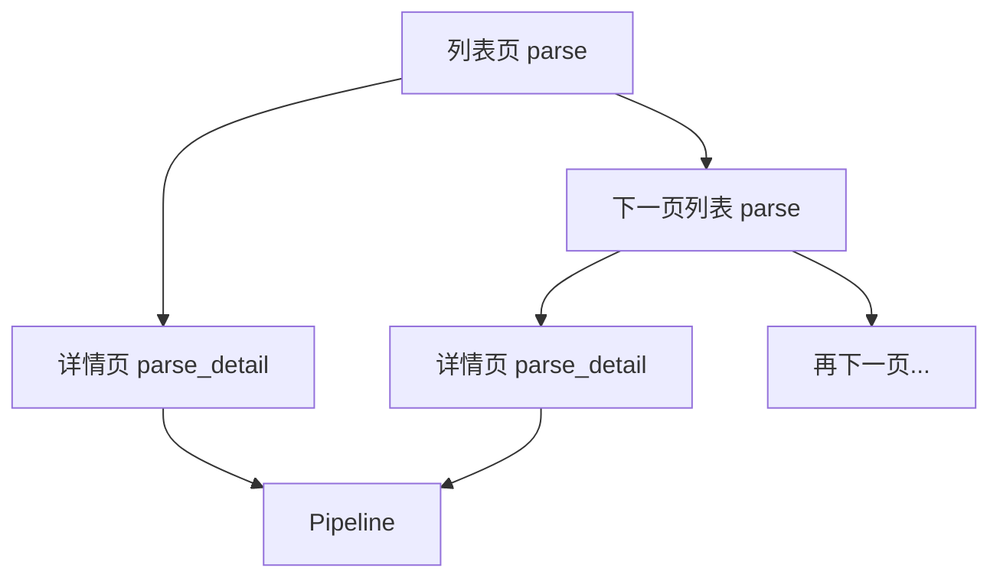
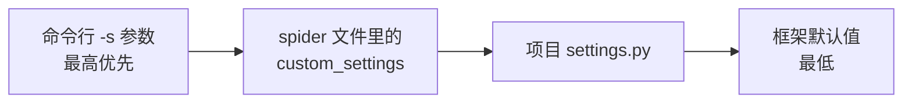
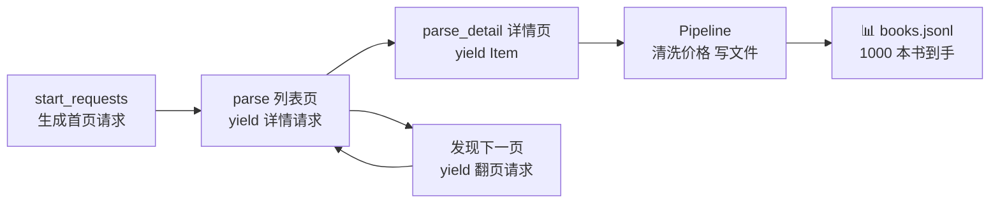
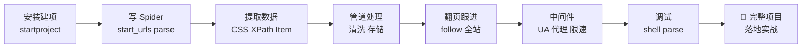

# 🏗️ Scrapy 爬虫框架详解

> 哈喽呀～requests 手写爬虫学会了，该升级"重装备"了！Scrapy 是 Python 最专业的爬虫框架——内置并发、去重、管道、中间件，就像一条自动化流水线，你只管定义"爬什么"，剩下的脏活累活它全包！冲鸭！(≧∇≦)ﾉ

***

## 🗺️ 知识全景图



***

## 📑 目录

- [一、Scrapy 是什么](#一scrapy-是什么)
- [二、安装与项目创建](#二安装与项目创建)
- [三、项目结构解析](#三项目结构解析)
- [四、核心架构：数据流转图](#四核心架构数据流转图)
- [五、第一个 Spider](#五第一个-spider)
- [六、数据提取：Selector 与 Item](#六数据提取selector-与-item)
- [七、Pipeline：数据处理管道](#七pipeline数据处理管道)
- [八、翻页与全站爬取](#八翻页与全站爬取)
- [九、中间件 Middleware](#九中间件-middleware)
- [十、settings.py 常用配置](#十settingspy-常用配置)
- [十一、调试神器 scrapy shell](#十一调试神器-scrapy-shell)
- [十二、进阶技巧](#十二进阶技巧)
- [十三、综合实战：爬取读书网书籍信息](#十三综合实战爬取读书网书籍信息)
- [十四、常见坑与排错](#十四常见坑与排错)

***

## 一、Scrapy 是什么

### 1.1 一句话解释

**Scrapy = 一个功能齐全的专业爬虫框架** 🏭

requests 是"手动挡"——每一步都要自己写；Scrapy 是"自动驾驶"——框架把并发、重试、去重、存储都安排好了，你只需要告诉它"爬哪些页、怎么解析"。

### 1.2 Scrapy vs requests 手写

| 对比项 | requests 手写 | Scrapy 框架 |
|--------|--------------|------------|
| 并发请求 | 自己写线程/协程 | 内置异步并发 🚀 |
| URL 去重 | 自己维护集合 | 内置过滤器 ✅ |
| 失败重试 | 自己写循环 | Retry 中间件 |
| 数据管道 | 自己组织代码 | Pipeline 插件化 |
| 断点续爬 | 很难实现 | Job 暂停恢复 |
| 分布式 | 完全自己搞 | 配合 scrapy-redis |
| 学习成本 | 低 | 中等 |
| 适合场景 | 小任务、简单页面 | 中大型爬虫项目 ⭐ |

### 1.3 什么时候用 Scrapy



***

## 二、安装与项目创建

### 2.1 安装

```bash
pip install scrapy

# 验证安装
scrapy version        # 2.11.0
scrapy version -v     # 详细信息（含依赖版本）
```

> ⚠️ Windows 下如果报 Twisted 编译错误，去 [lfd.uci.edu](https://www.lfd.uci.edu/~gohlke/pythonlibs/#twisted) 下载对应版本的 whl 文件安装～

### 2.2 三条命令创建项目

```bash
# 1. 创建项目（会生成一个文件夹）
scrapy startproject bookspider

# 2. 进入项目
cd bookspider

# 3. 创建一个蜘蛛（名字 + 允许的域名）
scrapy genspider demo books.toscrape.com
```

### 2.3 常用命令速查

| 命令 | 作用 |
|------|------|
| `scrapy startproject 项目名` | 创建新项目 |
| `scrapy genspider 名 域名` | 生成蜘蛛模板 |
| `scrapy crawl 蜘蛛名` | 运行蜘蛛 |
| `scrapy list` | 列出所有蜘蛛 |
| `scrapy shell 网址` | 交互式调试环境 |
| `scrapy fetch 网址` | 查看框架抓取的结果 |
| `scrapy parse 网址 --callback=parse` | 调试解析函数 |
| `scrapy crawl 蜘蛛 -o out.json` | 运行并导出数据 |

***

## 三、项目结构解析 📁

### 3.1 目录树

```text
bookspider/                  # 项目根目录
├── scrapy.cfg               # 部署配置文件（基本不用动）
└── bookspider/              # Python 包（真正的项目）
    ├── __init__.py
    ├── items.py             # 数据模板：定义要爬哪些字段
    ├── middlewares.py       # 中间件：请求/响应的加工车间
    ├── pipelines.py         # 管道：数据的后处理流水线
    ├── settings.py          # 全局配置中心
    └── spiders/             # 蜘蛛目录：每个爬虫一个文件
        ├── __init__.py
        └── demo.py          # scrapy genspider 生成的蜘蛛
```

### 3.2 各文件职责类比工厂 🏭

| 文件 | 职责 | 类比 |
|------|------|------|
| `spiders/` | 定义爬哪些页、怎么解析 | 车间工人（干活的） |
| `items.py` | 定义数据的字段格式 | 产品图纸 |
| `pipelines.py` | 清洗、去重、存储数据 | 质检 + 仓库 |
| `middlewares.py` | 改装请求（UA/代理） | 安检 + 改装车间 |
| `settings.py` | 总开关配置 | 厂规制度 |

***

## 四、核心架构：数据流转图

### 4.1 六大组件



### 4.2 一次请求的完整旅程



> 💡 **引擎是"心脏"**，所有数据都从它手里过；蜘蛛只管"解析"，下载器只管"请求"——各司其职，这就是框架的美！

### 4.3 组件职责表

| 组件 | 职责 | 需要你写吗 |
|------|------|-----------|
| Engine | 连接所有组件、驱动数据流 | ❌ 不用动 |
| Scheduler | 排队 + 去重 | ❌ 不用动 |
| Downloader | 发请求收响应 | ❌ 不用动 |
| **Spider** | 定义起始 URL + 解析逻辑 | ✅ 必写 |
| **Pipeline** | 处理 yield 出来的 Item | ✅ 常写 |
| Middleware | 加工请求/响应 | 按需写 |
| **settings** | 总配置 | ✅ 必调 |

***

## 五、第一个 Spider

### 5.1 genspider 生成的模板

```python
import scrapy

class DemoSpider(scrapy.Spider):
    name = "demo"                                # 蜘蛛唯一名字（运行时用）
    allowed_domains = ["books.toscrape.com"]     # 只爬这个域名的页（防跑偏）
    start_urls = ["https://books.toscrape.com/"] # 起始 URL 列表

    def parse(self, response):                   # 默认解析函数
        pass
```

### 5.2 三个关键点

| 属性 | 说明 | 注意 ⚠️ |
|------|------|--------|
| `name` | 蜘蛛身份证，`scrapy crawl 名字` 靠它 | 项目内必须唯一 |
| `allowed_domains` | 白名单，不在名单的请求直接丢弃 | 不写 = 不限制 |
| `start_urls` | 起点，框架会自动生成请求 | 内部其实调 `start_requests()` |

### 5.3 自定义 start_requests（进阶写法）

```python
import scrapy

class DemoSpider(scrapy.Spider):
    name = "demo"

    # start_urls 的底层实现就是这个方法，重写它可以做任何定制
    def start_requests(self):
        for page in range(1, 11):
            url = f"https://books.toscrape.com/catalogue/page-{page}.html"
            yield scrapy.Request(url, callback=self.parse)
            # 不指定 callback 默认就是 parse

    def parse(self, response):
        self.logger.info(f"成功抓取: {response.url}")
```

### 5.4 运行蜘蛛

```bash
scrapy crawl demo

# 运行并导出数据（四种格式任选）
scrapy crawl demo -o books.json
scrapy crawl demo -o books.csv
scrapy crawl demo -o books.jsonl
scrapy crawl demo -o books.xml
```

***

## 六、数据提取：Selector 与 Item

### 6.1 response 自带选择器

Spider 的 parse 收到的 `response` 已经内置了 CSS 和 XPath 两种选择器：

```python
def parse(self, response):
    # ===== CSS 选择器 =====
    titles = response.css("h3 a::attr(title)").getall()   # 取属性，返回列表
    price  = response.css("p.price_color::text").get()    # 取文本，只取第一个
    href   = response.css("h3 a::attr(href)").getall()

    # ===== XPath 选择器 =====
    titles = response.xpath("//h3/a/@title").getall()
    prices = response.xpath('//p[@class="price_color"]/text()').getall()

    # ===== 通用方法 =====
    node = response.css("article.product_pod")   # 选中的是 Selector 列表
    node.xpath(".//h3/a/@title").get()           # 注意 .// 表示节点内查找！
```

### 6.2 CSS vs XPath API 速查

| 操作 | CSS 写法 | XPath 写法 |
|------|---------|-----------|
| 选标签 | `css("h2")` | `xpath("//h2")` |
| 按 class | `css(".price")` | `xpath('//*[contains(@class,"price")]')` |
| 按 id | `css("#main")` | `xpath('//*[@id="main"]')` |
| 取文本 | `css("h2::text")` | `xpath("//h2/text()")` |
| 取属性 | `css("a::attr(href)")` | `xpath("//a/@href")` |
| 取第一个 | `.get()` 或 `.getall()[0]` | 同左 |
| 取全部 | `.getall()` / `.extract()` | 同左 |
| 节点内查找 | `css("div a")` | `xpath(".//a")` ⚠️ 别忘 `.` |

> 💡 `get()` 返回 `str 或 None`，`getall()` 返回 `list`——记住这句就不会取错！

### 6.3 定义 Item：数据的"模具"

```python
# items.py
import scrapy

class BookItem(scrapy.Item):
    title = scrapy.Field()     # 书名
    price = scrapy.Field()     # 价格
    url   = scrapy.Field()     # 详情链接
    # scrapy.Field() 就是占位符，理解为"这个字段随便存什么类型"
```

### 6.4 在蜘蛛中使用 Item

```python
# spiders/demo.py
import scrapy
from bookspider.items import BookItem

class DemoSpider(scrapy.Spider):
    name = "demo"
    allowed_domains = ["books.toscrape.com"]
    start_urls = ["https://books.toscrape.com/"]

    def parse(self, response):
        for book in response.css("article.product_pod"):
            item = BookItem()                          # 实例化模具
            item["title"] = book.css("h3 a::attr(title)").get()
            item["price"] = book.css(".price_color::text").get()
            item["url"]   = response.urljoin(           # 相对地址转绝对地址！
                book.css("h3 a::attr(href)").get())
            yield item                                  # 交给管道处理
```

> ⚠️ `response.urljoin()` 千万别忘！网页里的链接经常是 `page-2.html` 这种相对路径，直接存就废了～

### 6.5 为什么用 Item 而不是字典

| 对比 | 普通字典 | scrapy.Item |
|------|---------|-------------|
| 字段名写错 | 静默埋雷 💣 | 直接报 KeyError，早发现 ✅ |
| 导出到文件 | 随机顺序 | 按 items.py 定义顺序输出 |
| 配合 Pipeline | 字段对不上 | 类型统一好处理 |
| 内存占用 | 稍大 | item 内部有优化 |

***

## 七、Pipeline：数据处理管道

### 7.1 三个钩子函数

```python
# pipelines.py

class BookspiderPipeline:
    def open_spider(self, spider):
        """蜘蛛启动时执行一次：建连接、开文件"""
        self.file = open("books.json", "w", encoding="utf-8")
        self.file.write("[")
        self.first = True

    def process_item(self, item, spider):
        """每条 Item 都会流过这里（核心！）"""
        # 1. 清洗数据
        if item.get("price"):
            item["price"] = item["price"].replace("£", "").strip()
        # 2. 简单校验
        if not item.get("title"):
            from scrapy.exceptions import DropItem
            raise DropItem(f"丢掉没标题的数据: {item}")   # 丢弃不合格数据
        # 3. 写文件
        if not self.first:
            self.file.write(",")
        import json
        self.file.write(json.dumps(dict(item), ensure_ascii=False))
        self.first = False
        return item     # ⚠️ 必须 return！不然后面的管道拿不到数据

    def close_spider(self, spider):
        """蜘蛛结束时执行一次：关文件、断连接"""
        self.file.write("]")
        self.file.close()
```

### 7.2 开启管道（两步走）

```python
# settings.py
ITEM_PIPELINES = {
    "bookspider.pipelines.BookspiderPipeline": 300,    # 数字 = 优先级，越小越先执行
    "bookspider.pipelines.MysqlPipeline": 400,         # 第二个管道
}
```



> 💡 优先级数字习惯按 100 递增，方便以后在中间插新管道～

### 7.3 实用管道：存 MySQL

```python
# pipelines.py
import pymysql
from scrapy.exceptions import NotConfigured

class MysqlPipeline:
    def open_spider(self, spider):
        self.conn = pymysql.connect(
            host="localhost", user="root",
            password="123456", database="spider", charset="utf8mb4"
        )
        self.cursor = self.conn.cursor()
        self.cursor.execute("""
            CREATE TABLE IF NOT EXISTS books(
                id INT PRIMARY KEY AUTO_INCREMENT,
                title VARCHAR(200),
                price VARCHAR(20)
            )
        """)

    def process_item(self, item, spider):
        sql = "INSERT INTO books (title, price) VALUES (%s, %s)"
        try:
            self.cursor.execute(sql, (item["title"], item["price"]))
            self.conn.commit()
        except Exception as e:
            spider.logger.error(f"入库失败: {e}")
            self.conn.rollback()
        return item

    def close_spider(self, spider):
        self.cursor.close()
        self.conn.close()
```

### 7.4 实用管道：去重过滤器

```python
class DuplicatePipeline:
    def __init__(self):
        self.seen = set()          # 简单内存去重（海量数据用 Redis）

    def process_item(self, item, spider):
        key = item.get("title")
        if key in self.seen:
            from scrapy.exceptions import DropItem
            raise DropItem(f"重复数据: {key}")
        self.seen.add(key)
        return item
```

***

## 八、翻页与全站爬取

### 8.1 手动翻页（最常用）

```python
def parse(self, response):
    # ...先提取本页数据的 Item 都 yield 出去...

    # 找到下一页链接
    next_page = response.css("li.next a::attr(href)").get()
    if next_page:
        # urljoin 拼完整地址，回调还是 parse，自动滚雪球 ♻️
        yield response.follow(next_page, callback=self.parse)
```

### 8.2 翻页滚雪球原理



### 8.3 二级页面爬取（列表页 → 详情页）

```python
def parse(self, response):
    """第一层：列表页，提取详情链接"""
    for link in response.css("h3 a::attr(href)").getall():
        yield response.follow(link, callback=self.parse_detail)
    # 同时照常翻页
    next_page = response.css("li.next a::attr(href)").get()
    if next_page:
        yield response.follow(next_page, callback=self.parse)

def parse_detail(self, response):
    """第二层：详情页，提取详细字段"""
    item = BookItem()
    item["title"] = response.css("h1::text").get()
    item["price"] = response.css(".price_color::text").get()
    yield item
```



### 8.4 CrawlSpider：规则式全站爬取

```bash
scrapy genspider -t crawl books books.toscrape.com
```

```python
import scrapy
from scrapy.linkextractors import LinkExtractor
from scrapy.spiders import CrawlSpider, Rule

class BooksSpider(CrawlSpider):
    name = "books"
    allowed_domains = ["books.toscrape.com"]
    start_urls = ["https://books.toscrape.com/"]

    rules = (
        # 规则1：匹配 catalogue/xxx.html 的链接 → 进详情解析
        Rule(
            LinkExtractor(allow=r"catalogue/\w+-\d+/index\.html"),
            callback="parse_detail",
        ),
        # 规则2：匹配翻页链接 → 继续跟进（follow 默认 True）
        Rule(LinkExtractor(allow=r"catalogue/page-\d+\.html")),
    )

    def parse_detail(self, response):
        item = {}
        item["title"] = response.css("h1::text").get()
        yield item
```

| Rule 参数 | 含义 |
|----------|------|
| `LinkExtractor(allow=正则)` | 提取匹配正则的链接 |
| `LinkExtractor(deny=正则)` | 排除匹配的链接 |
| `callback` | 匹配到的链接交给谁解析 |
| `follow=True` | 从匹配页继续提取新链接（滚雪球） |
| `LinkExtractor(restrict_css=".pager")` | 只在指定区域内找链接 |

> 💡 没写 callback 的规则默认 `follow=True`——只"路过"收集链接不解析；写了 callback 的默认不再跟进，需要就显式加 `follow=True`。

***

## 九、中间件 Middleware

### 9.1 两种中间件

| 类型 | 位置 | 干什么 | 常见用途 |
|------|------|--------|---------|
| Downloader Middleware | 引擎 ↔ 下载器之间 | 改装请求/响应 | 随机 UA、代理 IP、重试 |
| Spider Middleware | 引擎 ↔ 蜘蛛之间 | 处理 spiders 的输入输出 | 过滤响应、处理异常 |

### 9.2 下载中间件的钩子

```python
# middlewares.py

class RandomUaMiddleware:
    """每次请求随机换 UA"""

    USER_AGENTS = [
        "Mozilla/5.0 (Windows NT 10.0; Win64; x64) Chrome/120.0.0.0",
        "Mozilla/5.0 (Macintosh; Intel Mac OS X 10_15_7) Safari/17.1",
        "Mozilla/5.0 (X11; Linux x86_64) Firefox/121.0",
    ]

    def process_request(self, request, spider):
        """请求发出前：改装请求"""
        import random
        request.headers["User-Agent"] = random.choice(self.USER_AGENTS)

    def process_response(self, request, response, spider):
        """响应回来后：检查要不要重发"""
        if response.status in (403, 429):
            return request      # 返回 request = 重新请求！
        return response

    def process_exception(self, request, exception, spider):
        """请求出异常时：换代理重试"""
        spider.logger.warning(f"请求失败: {request.url}")
        return request          # 返回 request 会重新入队
```

### 9.3 启用自定义中间件

```python
# settings.py
DOWNLOADER_MIDDLEWARES = {
    "bookspider.middlewares.RandomUaMiddleware": 543,
    # 数字越小越靠近引擎，越大越靠近下载器
}
```

### 9.4 内置中间件：重试与自动限速

```python
# settings.py 开箱即用的功能！

# 1. 重试中间件（默认开启）
RETRY_ENABLED = True
RETRY_TIMES = 3                  # 最多重试 3 次
RETRY_HTTP_CODES = [500, 502, 503, 504, 408, 429]

# 2. 自动限速（AutoThrottle，对服务器温柔点～）
AUTOTHROTTLE_ENABLED = True
AUTOTHROTTLE_START_DELAY = 1     # 初始延迟 1 秒
AUTOTHROTTLE_MAX_DELAY = 10      # 最大延迟 10 秒
```

***

## 十、settings.py 常用配置

### 10.1 必知配置项

```python
# ===== 基础身份 =====
BOT_NAME = "bookspider"
USER_AGENT = "bookspider (+http://www.yourdomain.com)"   # 建议改成浏览器 UA！

# ===== 礼貌爬取 =====
ROBOTSTXT_OBEY = True           # 遵守 robots.txt 协议（默认 True）
DOWNLOAD_DELAY = 1              # 下载间隔 1 秒（默认 0，太快啦！）
CONCURRENT_REQUESTS = 16        # 总并发数
CONCURRENT_REQUESTS_PER_DOMAIN = 8   # 单域名并发（更礼貌）
DOWNLOAD_TIMEOUT = 15           # 单请求超时

# ===== 重试与容错 =====
RETRY_ENABLED = True
RETRY_TIMES = 3

# ===== 管道与中间件开关 =====
ITEM_PIPELINES = {
    "bookspider.pipelines.BookspiderPipeline": 300,
}
DOWNLOADER_MIDDLEWARES = {}

# ===== 日志 =====
LOG_LEVEL = "INFO"              # DEBUG / INFO / WARNING / ERROR
LOG_FILE = "spider.log"         # 输出到文件（不写则打印到控制台）

# ===== 默认请求头 =====
DEFAULT_REQUEST_HEADERS = {
    "Accept": "text/html,application/xhtml+xml",
    "Accept-Language": "zh-CN,zh;q=0.9",
}
```

### 10.2 配置优先级（同名变量谁说了算）



```python
class DemoSpider(scrapy.Spider):
    name = "demo"
    custom_settings = {          # 只对这只蜘蛛生效
        "DOWNLOAD_DELAY": 2,
        "ITEM_PIPELINES": {"bookspider.pipelines.DetailPipeline": 300},
    }
```

***

## 十一、调试神器 scrapy shell

### 11.1 进入交互环境

```bash
scrapy shell "https://books.toscrape.com/"

# 会自动请求网页，进入 Python 交互式环境
# 直接可用对象：response / request / spider
```

### 11.2 边试边调选择器

```python
>>> response.css("h1::text").get()
'Scrapinghub | Home'

>>> response.css("article.product_pod").count()
20

>>> response.xpath('//p[@class="price_color"]/text()').getall()[:3]
['£51.77', '£53.74', '£50.10']

>>> response.url
'https://books.toscrape.com/'

>>> view(response)      # 用浏览器打开当前响应，肉眼看对不对！
```

### 11.3 调试单页解析（不跑完整蜘蛛）

```bash
scrapy parse "https://books.toscrape.com/" --callback=parse
# 会打印 parse 函数 yield 出的所有 Item 和 Request
```

> 💡 工作流推荐：先 `scrapy shell` 调对选择器 → 再写进蜘蛛 → `scrapy parse` 验证逻辑 → 最后 `scrapy crawl` 全量运行，一步都不瞎！

***

## 十二、进阶技巧 🚀

### 12.1 模拟登录（Cookies 方式最简单）

```python
class LoginSpider(scrapy.Spider):
    name = "login"
    start_urls = ["https://example.com/login"]

    def start_requests(self):
        # 方式一：直接带浏览器复制的 Cookie
        yield scrapy.Request(
            self.start_urls[0],
            headers={"Cookie": "session_id=abc123; token=xyz"},
            callback=self.after_login,
        )

    # 方式二：POST 表单登录
    def parse(self, response):
        token = response.css('input[name="csrf_token"]::attr(value)').get()
        return scrapy.FormRequest.from_response(
            response,
            formdata={
                "csrf_token": token,      # 别忘了 CSRF 令牌！
                "username": "xiaomei",
                "password": "123456",
            },
            callback=self.after_login,
        )

    def after_login(self, response):
        # 登录后框架自动维护 Cookie，正常爬就行
        yield from self.parse_list(response)
```

### 12.2 下载图片（ImagesPipeline）

```python
# items.py
import scrapy

class BookItem(scrapy.Item):
    title = scrapy.Field()
    image_urls = scrapy.Field()    # 注意字段名必须是 image_urls
    images = scrapy.Field()

# settings.py
ITEM_PIPELINES = {
    "scrapy.pipelines.images.ImagesPipeline": 300,
}
IMAGES_STORE = "images"            # 图片保存目录
IMAGES_MIN_HEIGHT = 100            # 过滤太小的图
IMAGES_MIN_WIDTH = 100

# spider 里
item["image_urls"] = [response.urljoin(img_src)]
```

> 💡 ImagesPipeline 自动：下载 → 去重（SHA1 哈希命名）→ 过滤小图 → 存到 IMAGES_STORE，简直不要太省心！

### 12.3 断点续爬（暂停恢复）

```bash
# Ctrl+C 中断后，用 job 参数恢复：
scrapy crawl demo -s JOBDIR=crawls/demo-1

# 下次运行同样的命令，会从断点继续（请求队列 + 去重集合都存盘了）
```

### 12.4 不同页面结构？多个 parse 函数分工

```python
def parse(self, response):
    """路由器：根据 URL 特征分发给不同解析器"""
    if "/catalogue/" in response.url:
        yield from self.parse_detail(response)
    else:
        yield from self.parse_list(response)
```

### 12.5 传递数据给下一个请求（meta）

```python
def parse(self, response):
    # 列表页拿到了标题，但价格在详情页
    for link in response.css("h3 a::attr(href)").getall():
        yield response.follow(
            link,
            callback=self.parse_detail,
            meta={"title": response.css("h1::text").get()},  # 捎带数据
        )

def parse_detail(self, response):
    item = BookItem()
    item["title"] = response.meta["title"]       # 取出捎带来的数据
    item["price"] = response.css(".price_color::text").get()
    yield item
```

***

## 十三、综合实战：爬取读书网书籍信息 📚

> 完整项目示例：books.toscrape.com（专为练习爬虫设计的网站，可放心爬）

### 13.1 创建项目

```bash
scrapy startproject bookspider
cd bookspider
scrapy genspider books books.toscrape.com
```

### 13.2 定义数据模板

```python
# items.py
import scrapy

class BookItem(scrapy.Item):
    title = scrapy.Field()      # 书名
    price = scrapy.Field()      # 价格
    rating = scrapy.Field()     # 星级
    stock = scrapy.Field()      # 库存
    url = scrapy.Field()        # 详情页链接
```

### 13.3 编写蜘蛛

```python
# spiders/books.py
import scrapy
from bookspider.items import BookItem

# 星级单词 → 数字映射
RATING_MAP = {"One": 1, "Two": 2, "Three": 3, "Four": 4, "Five": 5}

class BooksSpider(scrapy.Spider):
    name = "books"
    allowed_domains = ["books.toscrape.com"]
    start_urls = ["https://books.toscrape.com/"]

    custom_settings = {
        "DOWNLOAD_DELAY": 0.5,                    # 本蜘蛛专属限速
    }

    def parse(self, response):
        """列表页：提取详情链接 + 翻页"""
        for link in response.css("h3 a::attr(href)").getall():
            yield response.follow(link, callback=self.parse_detail)

        next_page = response.css("li.next a::attr(href)").get()
        if next_page:
            yield response.follow(next_page, callback=self.parse)

    def parse_detail(self, response):
        """详情页：提取完整字段"""
        item = BookItem()
        item["title"] = response.css("h1::text").get()
        item["price"] = response.css(".price_color::text").get()
        # class="star-rating Three" → 提取最后一个单词转数字
        rating_class = response.css("p.star-rating::attr(class)").get()
        item["rating"] = RATING_MAP.get(rating_class.split()[-1], 0)
        # 库存文本 "In stock (22 available)" → 抠出数字
        stock_text = response.css(".instock.availability::text").get()
        item["stock"] = "".join(filter(str.isdigit, stock_text or ""))
        item["url"] = response.url
        yield item
```

### 13.4 编写管道

```python
# pipelines.py
import json

class BookPipeline:
    def open_spider(self, spider):
        self.file = open("books.jsonl", "w", encoding="utf-8")

    def process_item(self, item, spider):
        # 清洗：价格 £51.77 → 51.77
        if item.get("price"):
            item["price"] = item["price"].replace("£", "").replace("Â", "")
        self.file.write(json.dumps(dict(item), ensure_ascii=False) + "\n")
        return item

    def close_spider(self, spider):
        self.file.close()
        spider.logger.info("数据已保存到 books.jsonl")
```

### 13.5 开启管道

```python
# settings.py（只列改动项）
ITEM_PIPELINES = {
    "bookspider.pipelines.BookPipeline": 300,
}
DOWNLOAD_DELAY = 0.5
LOG_LEVEL = "INFO"
```

### 13.6 运行！

```bash
scrapy crawl books

# 或直接导出 CSV
scrapy crawl books -o books.csv
```

### 13.7 完整流程回顾



***

## 十四、常见坑与排错 🕳️

### 14.1 高频问题速查表

| 现象 | 原因 | 解决方案 💊 |
|------|------|-----------|
| `DNS lookup failed` | 域名写错 / 网络问题 | 检查 allowed_domains 和 URL |
| 只爬到一半就停 | allowed_domains 拦截了跳转 | 检查是否缺域名 |
| 403 被拒 | 默认 UA 暴露身份 | settings 里改 USER_AGENT |
| `Filtered offsite request` | 请求域名不在白名单 | 补充 allowed_domains |
| 数据字段全是 None | 选择器写错 | scrapy shell 里调对再写入 |
| 相对链接 404 | 忘了 urljoin | 用 response.follow 自动拼 |
| Item 没进管道 | settings 没开管道 | 配置 ITEM_PIPELINES |
| 管道拿不到数据 | process_item 忘了 return | 必须 return item |
| 爬太快被 ban | 没限速 | DOWNLOAD_DELAY + AUTOTHROTTLE |
| 中文导出乱码 | 编码问题 | Pipeline 里 ensure_ascii=False |

### 14.2 日志排查三步法

```bash
# 1. 降低日志级别看细节
scrapy crawl books -s LOG_LEVEL=DEBUG

# 2. 只跑一页快速验证
scrapy parse "https://books.toscrape.com/" --callback=parse

# 3. 输出日志到文件慢慢查
scrapy crawl books -s LOG_FILE=run.log
```

### 14.3 debug 技巧：丢弃统计

运行结束时的 stats 里藏着宝藏，重点看：

```text
'downloader/response_status_count/200': 50,   # 成功 50 个请求
'item_scraped_count': 1000,                   # 收获 1000 条数据
'item_dropped_count': 3,                      # 丢了 3 条（去重/校验）
'downloader/exception_count': 0,              # 无网络异常
```

> 💡 200 数量对、item 数量对 = 爬虫健康；出现大量 403/超时 = 反爬或网络问题，查中间件和配置！

***

## 🎓 总结

> 恭喜打通 Scrapy 全关！(๑•̀ㅂ•́)و✧ 修炼路线回顾：



**核心心法** 📝
- 记住数据流：**Spider → 引擎 → 调度器 → 下载器 → 回 Spider → 管道**
- 选择器先在 `scrapy shell` 调对，再写进蜘蛛
- `response.follow` 翻页，`meta` 传数据，`urljoin` 拼链接
- Pipeline 三钩子：`open_spider` 开场、`process_item` 干活、`close_spider` 收尾
- 礼貌三件套：`DOWNLOAD_DELAY` + `AUTOTHROTTLE` + 随机 UA
- 想再进阶？去玩 **scrapy-redis 分布式** 和 **Playwright 中间件** 吧！

从手写 requests 到驾驭框架，你已经不是萌新啦！去构建属于自己的数据帝国吧～ 🏗️💖
