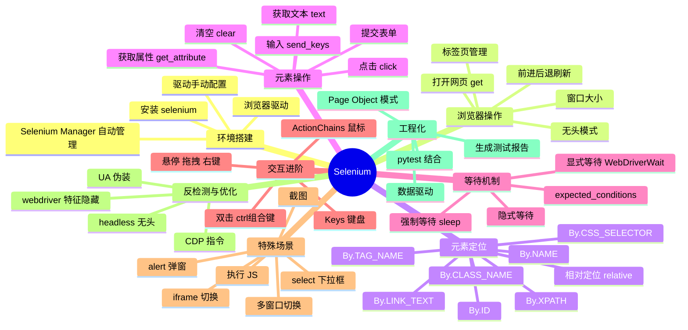
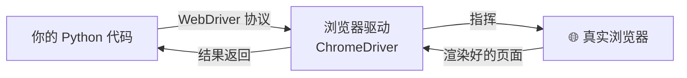
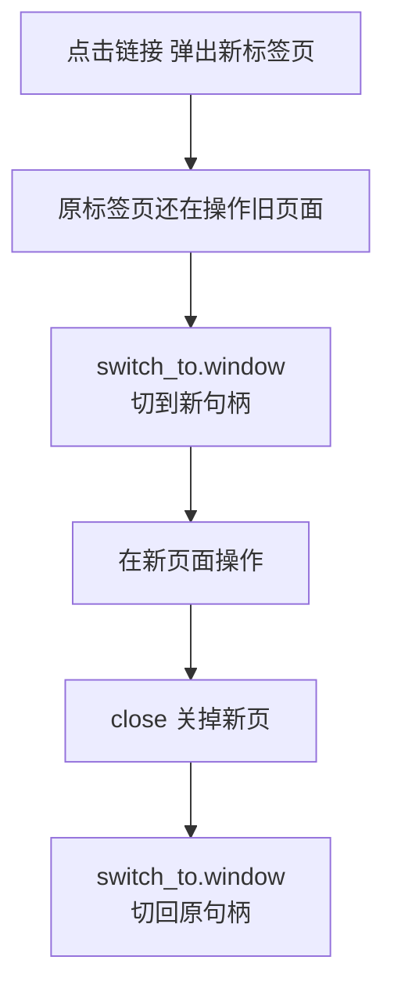
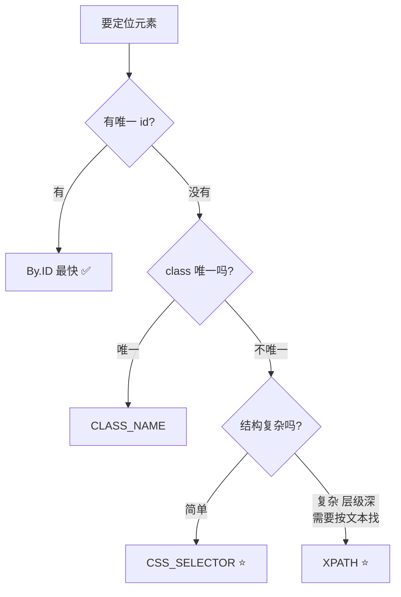
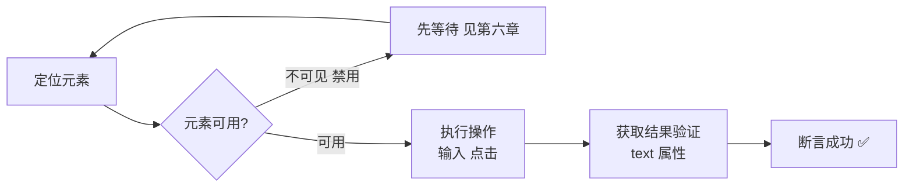
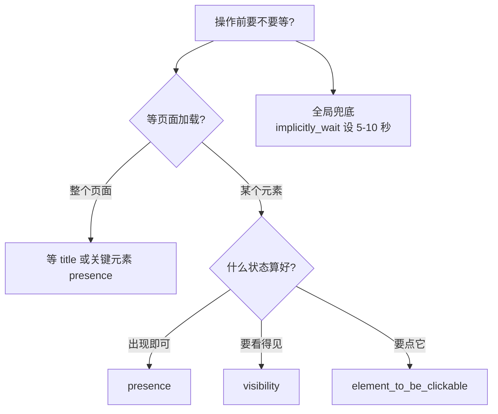
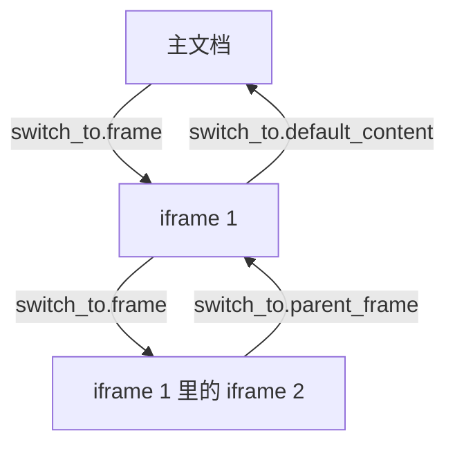
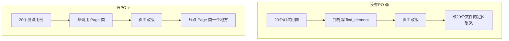
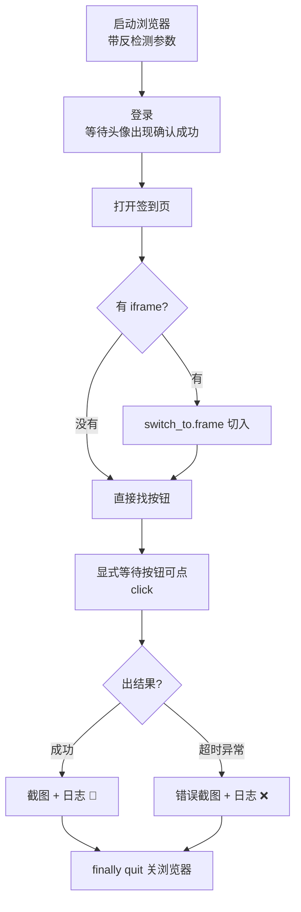
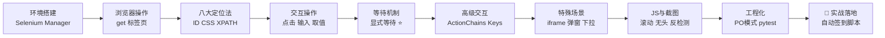

# 🖥️ Selenium 自动化详解

> 哈喽呀～今天的主角是浏览器自动化界的"老大哥"Selenium！它能操控真浏览器：点击、输入、截图、拖拽样样精通～爬动态页面、自动化测试、批量填表单，全都靠它！冲鸭！(≧∇≦)ﾉ

***

## 🗺️ 知识全景图



***

## 📑 目录

- [一、Selenium 是什么](#一selenium-是什么)
- [二、环境搭建](#二环境搭建)
- [三、浏览器基本操作](#三浏览器基本操作)
- [四、元素定位八大法](#四元素定位八大法)
- [五、元素交互操作](#五元素交互操作)
- [六、等待机制：自动化的灵魂](#六等待机制自动化的灵魂)
- [七、鼠标与键盘高级操作](#七鼠标与键盘高级操作)
- [八、特殊场景处理](#八特殊场景处理)
- [九、执行 JS 与截图](#九执行-js-与截图)
- [十、无头模式与反检测](#十无头模式与反检测)
- [十一、Page Object 工程化](#十一page-object-工程化)
- [十二、综合实战：自动签到脚本](#十二综合实战自动签到脚本)
- [十三、常见坑与排错](#十三常见坑与排错)

***

## 一、Selenium 是什么

### 1.1 一句话解释

**Selenium = 操控真实浏览器的自动化工具** 🤖

requests 只能拿"服务器返回的数据"，Selenium 直接开一个真浏览器，像人一样点点点——JS 渲染的动态页面？不存在的！

### 1.2 Selenium 家族组成



| 组件         | 作用                                |
| ---------- | --------------------------------- |
| Selenium 库 | Python 控制接口                       |
| WebDriver  | 通信协议标准（W3C）                       |
| 浏览器驱动      | ChromeDriver / geckodriver 等"翻译官" |
| 浏览器        | Chrome / Edge / Firefox 被操控对象     |

### 1.3 Selenium vs requests

| 对比项         | requests    | Selenium    |
| ----------- | ----------- | ----------- |
| 本质          | HTTP 请求     | 真浏览器渲染      |
| 动态页面（JS 渲染） | ❌ 拿不到       | ✅ 轻松拿       |
| 需要登录交互的页面   | 难（搞 Cookie） | ✅ 直接模拟操作    |
| 速度          | 🚀 超快       | 🐢 慢（要开浏览器） |
| 资源占用        | 极低          | 高（几百 MB 内存） |
| 反爬难度        | 高（要破解）      | 中（有特征要隐藏）   |
| 适合          | 接口、静态页      | 动态页、复杂交互    |

> 💡 选择口诀：**能 requests 就别 Selenium**，速度差十倍；但 JS 渲染 + 复杂交互的页面，Selenium 无可替代！

***

## 二、环境搭建 🔧

### 2.1 安装

```bash
pip install selenium
```

### 2.2 驱动问题：新版不用管！

```python
# Selenium 4.6+ 内置 Selenium Manager
# 会自动下载匹配的浏览器驱动，开箱即用！
from selenium import webdriver

driver = webdriver.Chrome()    # 自动找 Chrome + 对应驱动
driver.get("https://www.baidu.com")
```

| 情况             | 方案                   |
| -------------- | -------------------- |
| Selenium ≥ 4.6 | ✅ 什么都不用做，全自动         |
| 老版本 / 离线环境     | 手动下载驱动，放入 PATH 或指定路径 |

```python
# 手动指定驱动路径（离线环境用）
from selenium import webdriver
from selenium.webdriver.chrome.service import Service

service = Service(executable_path=r"D:\tools\chromedriver.exe")
driver = webdriver.Chrome(service=service)
```

### 2.3 第一个自动化脚本

```python
from selenium import webdriver
from selenium.webdriver.common.by import By

driver = webdriver.Chrome()
driver.get("https://www.baidu.com")            # 打开网页

# 找到输入框，输入文字
driver.find_element(By.ID, "kw").send_keys("Selenium 教程")
# 找到按钮，点击
driver.find_element(By.ID, "su").click()

input("按回车关闭浏览器...")                     # 卡住看效果
driver.quit()                                   # 关闭并退出
```

### 2.4 各浏览器启动方式

```python
from selenium import webdriver

webdriver.Chrome()                       # 谷歌
webdriver.Edge()                         # 微软 Edge（Win 自带）
webdriver.Firefox()                      # 火狐
webdriver.Safari()                       # 苹果（Mac 自带）
```

***

## 三、浏览器基本操作 🌐

### 3.1 页面导航

```python
driver.get("https://www.baidu.com")   # 打开网页（会等页面加载完）

driver.back()          # 后退
driver.forward()       # 前进
driver.refresh()       # 刷新

driver.current_url     # 当前网址
driver.title           # 页面标题
driver.page_source     # 页面源码（渲染后的！）
```

### 3.2 窗口管理

```python
driver.maximize_window()                 # 最大化
driver.minimize_window()                 # 最小化
driver.set_window_size(1024, 768)        # 指定大小
driver.set_window_position(100, 100)     # 指定位置
driver.get_window_size()                 # 获取大小 {"width":.., "height":..}

# 只关闭当前窗口（还有别的窗口时进程不退出）
driver.close()
# 彻底退出：关窗口 + 结束驱动进程（推荐用这个收尾）
driver.quit()
```

### 3.3 标签页操作

```python
# 打开新标签页（window.open）
driver.switch_to.new_window("tab")       # 新标签页
driver.switch_to.new_window("window")    # 新窗口

# 查看所有标签页句柄
print(driver.window_handles)             # ['CDwindow-xxx', 'CDwindow-yyy']

# 切换到最新打开的标签页
driver.switch_to.window(driver.window_handles[-1])

# 切回第一个
driver.switch_to.window(driver.window_handles[0])

# 关闭当前标签页后，记得手动切回去！
driver.close()
driver.switch_to.window(driver.window_handles[0])
```

### 3.4 标签页切换流程



> ⚠️ 新手最常见坑：点击后元素找不到——因为页面在新标签页打开了，不切过去怎么找都找不到！

***

## 四、元素定位八大法 🎯

### 4.1 By 全家福

```python
from selenium import webdriver
from selenium.webdriver.common.by import By

driver.find_element(By.ID, "kw")                    # 1. 按 id（最快最稳）
driver.find_element(By.NAME, "wd")                  # 2. 按 name
driver.find_element(By.CLASS_NAME, "s_ipt")         # 3. 按 class（单个类名）
driver.find_element(By.TAG_NAME, "input")           # 4. 按标签名
driver.find_element(By.LINK_TEXT, "新闻")            # 5. 链接完整文字
driver.find_element(By.PARTIAL_LINK_TEXT, "闻")      # 6. 链接部分文字
driver.find_element(By.CSS_SELECTOR, "#kw")         # 7. CSS 选择器 ⭐
driver.find_element(By.XPATH, "//input[@id='kw']")  # 8. XPath ⭐

# find_elements（复数）：找所有匹配的，返回列表
results = driver.find_elements(By.CSS_SELECTOR, ".result")
print(len(results))         # 匹配数量，没找到返回空列表

# find_element（单数）：只找第一个，找不到抛 NoSuchElementException
```

### 4.2 定位方式选择指南



### 4.3 CSS 选择器常用语法

| 语法                | 含义          | 示例                  |
| ----------------- | ----------- | ------------------- |
| `#kw`             | id=kw       | `#username`         |
| `.btn`            | class 含 btn | `.submit-btn`       |
| `div`             | 标签名         | `input`             |
| `div > p`         | 直接子级        | `ul > li`           |
| `div p`           | 所有后代        | `table td`          |
| `[type="text"]`   | 属性匹配        | `a[href*="detail"]` |
| `input[name="q"]` | 标签+属性       | 组合使用                |
| `:nth-child(2)`   | 第几个子元素      | `li:nth-child(3)`   |

### 4.4 XPath 常用语法

| 语法                                 | 含义          | 示例         |
| ---------------------------------- | ----------- | ---------- |
| `/html/body/div`                   | 绝对路径（脆弱❌）   | 尽量别用       |
| `//div`                            | 相对路径：所有 div | ⭐          |
| `//input[@id="kw"]`                | 属性匹配        | ⭐          |
| `//a[text()="登录"]`                 | 按完整文本       | ⭐          |
| `//div[contains(text(), "价格")]`    | 文本包含        | 部分文字匹配     |
| `//a[contains(@class, "btn")]`     | class 包含    | class 有多个时 |
| `//div[@id="list"]/div[3]`         | 父节点下第 3 个   | 从 1 开始数    |
| `//input[@id="kw" and @name="wd"]` | 多条件与        | 组合定位       |

> 💡 懒人福利：F12 → 右键元素 → Copy → **Copy XPath / Copy selector**，直接抄！但自动生成的可能很长很脆，重要的自己写精简版～

### 4.5 相对定位（Selenium 4 新增）

```python
# 像说人话一样定位：在某个元素的 上/下/左/右/附近
from selenium.webdriver.support.relative_locator import locate_with, with_tag_name

pwd = driver.find_element(
    with_tag_name("input").below(username_box)      # 在用户名输入框下面
)
btn = driver.find_element(
    with_tag_name("button").near(login_text)        # 在"登录"文字附近
)

# 五个方向：above / below / to_left_of / to_right_of / near
```

### 4.6 定位速查技巧

```python
# 验证选择器写对没：len() 一测便知
elements = driver.find_elements(By.CSS_SELECTOR, ".my-class")
print(len(elements))          # 0 = 选择器错了 / 页面没加载好

# F12 控制台里先验证 CSS
# document.querySelectorAll(".my-class").length

# F12 控制台里先验证 XPath
# $x("//div[@class='item']")
```

***

## 五、元素交互操作 ✋

### 5.1 基础操作四件套

```python
from selenium import webdriver
from selenium.webdriver.common.by import By

driver = webdriver.Chrome()
driver.get("https://example.com/login")

username = driver.find_element(By.ID, "username")

username.send_keys("xiaomei")     # 1. 输入内容
username.clear()                  # 2. 清空输入框（输入前先清空更稳）
username.send_keys("new_name")

driver.find_element(By.ID, "login-btn").click()   # 3. 点击

text = driver.find_element(By.CSS_SELECTOR, ".welcome").text   # 4. 取文本
```

### 5.2 获取元素信息

```python
element = driver.find_element(By.CSS_SELECTOR, "a.detail")

element.text                        # 显示文本（人眼看到的）
element.get_attribute("href")       # 任意属性值 ⭐
element.get_attribute("value")      # 输入框的内容（text 拿不到！）
element.get_attribute("innerHTML")  # 内部 HTML
element.get_attribute("outerHTML")  # 含自己的完整 HTML
element.is_displayed()              # 是否可见
element.is_enabled()                # 是否可用（没禁用）
element.is_selected()               # 是否选中（复选框/单选框）
element.tag_name                    # 标签名
element.size                        # 尺寸 {"width":.., "height":..}
element.location                    # 坐标 {"x":.., "y":..}
element.rect                        # 坐标+尺寸 一起拿
```

> ⚠️ **text vs get\_attribute("value")**：`text` 拿的是页面显示文字；输入框里用户输入的内容要用 `get_attribute("value")` 才能拿到！

### 5.3 表单操作

```python
# 输入框：先清空再输入（防止默认值残留）
search = driver.find_element(By.ID, "kw")
search.clear()
search.send_keys("Python")

# 模拟回车提交（不用找搜索按钮）
from selenium.webdriver.common.keys import Keys
search.send_keys(Keys.ENTER)

# 复选框勾选（先判断状态，避免重复点击取消）
checkbox = driver.find_element(By.ID, "agree")
if not checkbox.is_selected():
    checkbox.click()

# 文件上传：input[type=file] 直接 send_keys 文件路径！
driver.find_element(By.CSS_SELECTOR, "input[type=file]").send_keys(
    r"D:\pictures\avatar.png")      # 不需要 click 再选文件！
```

### 5.4 操作流程模板



***

## 六、等待机制：自动化的灵魂 ⏳

> 页面加载需要时间！不等待就操作 = 大概率报 NoSuchElementException！等待写得好，脚本稳如老狗～

### 6.1 三种等待对比

| 方式   | 写法                              | 原理             | 评价                  |
| ---- | ------------------------------- | -------------- | ------------------- |
| 强制等待 | `time.sleep(3)`                 | 无脑睡 3 秒        | 😫 该等不该等都等，慢且不稳     |
| 隐式等待 | `driver.implicitly_wait(10)`    | 找不到元素时最多等 10 秒 | 😐 全局兜底，但不能等"可见/可点" |
| 显式等待 | `WebDriverWait(...).until(...)` | 等到**条件满足**为止   | ⭐ 首选！精准高效           |

### 6.2 显式等待标准写法

```python
from selenium.webdriver.support.ui import WebDriverWait
from selenium.webdriver.support import expected_conditions as EC
from selenium.webdriver.common.by import By

# 等最多 10 秒，直到元素出现在 DOM 中
element = WebDriverWait(driver, 10).until(
    EC.presence_of_element_located((By.ID, "content"))
)

# 等最多 10 秒，直到元素可见（显示在页面上）
element = WebDriverWait(driver, 10).until(
    EC.visibility_of_element_located((By.ID, "content"))
)

# 等最多 10 秒，直到元素可点击
button = WebDriverWait(driver, 10).until(
    EC.element_to_be_clickable((By.CSS_SELECTOR, ".submit-btn"))
)
button.click()

# 等元素消失（如加载中的转圈图标消失）
WebDriverWait(driver, 10).until(
    EC.invisibility_of_element_located((By.CSS_SELECTOR, ".loading"))
)
```

> ⚠️ 注意元组：`(By.ID, "content")` 是**一个参数**（元组），别写成两个参数啦！

### 6.3 常用等待条件速查

| 条件                                       | 含义           | 典型场景     |
| ---------------------------------------- | ------------ | -------- |
| `presence_of_element_located`            | 元素在 DOM 里    | 页面结构加载   |
| `visibility_of_element_located`          | 元素可见         | 内容真正显示出来 |
| `element_to_be_clickable`                | 可点击          | 按钮从禁用变可用 |
| `invisibility_of_element_located`        | 元素消失         | 等加载动画结束  |
| `title_contains("xx")`                   | 标题包含 xx      | 页面跳转完成   |
| `url_contains("xx")`                     | 网址包含 xx      | 跳转到目标页   |
| `text_to_be_present_in_element`          | 元素出现指定文字     | 等异步数据渲染  |
| `element_to_be_selected`                 | 元素被选中        | 复选框勾选    |
| `alert_is_present`                       | 出现弹窗         | 处理系统对话框  |
| `frame_to_be_available_and_switch_to_it` | iframe 可用并切入 | 内嵌页面     |

### 6.4 自定义等待条件

```python
# lambda 写简单条件：等某个元素的文本变成"完成"
WebDriverWait(driver, 15).until(
    lambda d: d.find_element(By.ID, "status").text == "完成"
)

# 超时会抛 TimeoutException，记得捕获
from selenium.common.exceptions import TimeoutException
try:
    WebDriverWait(driver, 10).until(
        EC.visibility_of_element_located((By.ID, "result"))
    )
except TimeoutException:
    print("等了 10 秒还没出现，可能页面有问题")
```

### 6.5 等待策略选择



***

## 七、鼠标与键盘高级操作 🖱️⌨️

### 7.1 ActionChains：鼠标动作链

```python
from selenium.webdriver.common.action_chains import ActionChains

actions = ActionChains(driver)

# 悬停（hover）：鼠标移到元素上，触发下拉菜单
menu = driver.find_element(By.CSS_SELECTOR, ".nav-menu")
ActionChains(driver).move_to_element(menu).perform()   # perform 才真正执行！

# 右键
ActionChains(driver).context_click(element).perform()

# 双击
ActionChains(driver).double_click(element).perform()

# 拖拽：把 source 拖到 target 上
ActionChains(driver).drag_and_drop(source, target).perform()

# 按坐标拖拽（相对当前元素偏移 x=100, y=50）
ActionChains(driver).drag_and_drop_by_offset(element, 100, 50).perform()

# 链式组合：先移动到 A，再移动到 B，再点击
ActionChains(driver).move_to_element(a).move_to_element(b).click().perform()
```

> ⚠️ 常见错误：只写 `ActionChains(driver).move_to_element(menu)` 没有 `.perform()` —— 动作根本没执行！链最后必须 `.perform()`。

### 7.2 Keys：键盘操作

```python
from selenium.webdriver.common.keys import Keys

input_box = driver.find_element(By.ID, "kw")

# 单键
input_box.send_keys(Keys.ENTER)      # 回车
input_box.send_keys(Keys.ESCAPE)     # ESC
input_box.send_keys(Keys.BACK_SPACE) # 退格删除
input_box.send_keys(Keys.TAB)        # Tab 切换

# 组合键：Keys.CONTROL + 字母（Mac 用 Keys.COMMAND）
input_box.send_keys(Keys.CONTROL, "a")   # 全选
input_box.send_keys(Keys.CONTROL, "c")   # 复制
input_box.send_keys(Keys.CONTROL, "v")   # 粘贴
input_box.send_keys(Keys.CONTROL, "x")   # 剪切

# 输入中文 + 回车一步到位
input_box.send_keys("Python 爬虫", Keys.ENTER)

# 模拟"慢慢输入"（触发搜索联想）
from selenium.webdriver.common.action_chains import ActionChains
import time
for char in "python":
    input_box.send_keys(char)
    time.sleep(0.3)
```

### 7.3 常用按键速查

| Keys 值                           | 按键            |
| -------------------------------- | ------------- |
| `ENTER` / `RETURN`               | 回车            |
| `ESCAPE`                         | 退出            |
| `TAB`                            | 制表            |
| `BACK_SPACE`                     | 退格            |
| `SPACE`                          | 空格            |
| `DELETE`                         | 删除            |
| `CONTROL` / `COMMAND`            | Ctrl / Cmd    |
| `SHIFT`                          | 上档            |
| `F1 ~ F12`                       | 功能键           |
| `DOWN` / `UP` / `LEFT` / `RIGHT` | 方向键（下拉联想选择常用） |

***

## 八、特殊场景处理 🧩

### 8.1 iframe：内嵌网页切换

> iframe 是"页面中的页面"，**不切进去就永远找不到里面的元素**！报错 NoSuchElement 但 F12 明明看得到？九成是 iframe！

```python
from selenium.webdriver.common.by import By

# 方式一：按定位切换
driver.switch_to.frame(driver.find_element(By.CSS_SELECTOR, "#login-frame"))

# 方式二：按 iframe 的 name 或 id 直接切
driver.switch_to.frame("login_frame")

# 方式三：按索引（第几个 iframe，从 0 开始）
driver.switch_to.frame(0)

# 切回主文档
driver.switch_to.default_content()

# 切回上一级（从嵌套 iframe 返回父级）
driver.switch_to.parent_frame()
```



### 8.2 多窗口切换

```python
# 点击后弹出新窗口
driver.find_element(By.LINK_TEXT, "打开新页").click()

# 拿到所有窗口句柄
handles = driver.window_handles
driver.switch_to.window(handles[-1])       # 切到最新的
print("新窗口标题:", driver.title)

# 操作完关掉，切回原窗口
driver.close()
driver.switch_to.window(handles[0])
```

### 8.3 alert 弹窗（系统级对话框）

```python
from selenium.webdriver.common.alert import Alert

# 注意：alert 不在 DOM 里，find_element 找不到！
alert = driver.switch_to.alert

print(alert.text)          # 弹窗文字
alert.accept()             # 点【确定】
# alert.dismiss()          # 点【取消】
# alert.send_keys("输入")  # prompt 型弹窗可输入

# 标准姿势：等待弹窗出现再处理
from selenium.webdriver.support.ui import WebDriverWait
from selenium.webdriver.support import expected_conditions as EC

WebDriverWait(driver, 5).until(EC.alert_is_present())
driver.switch_to.alert.accept()
```

### 8.4 select 下拉框

```python
from selenium.webdriver.support.ui import Select

# 普通 div 模拟的下拉框：点击展开 → 点击选项（两次 click）
# 原生 select 标签：用 Select 类，优雅！

sel = Select(driver.find_element(By.ID, "city"))

sel.select_by_visible_text("上海")    # 按显示文字 ⭐ 最常用
sel.select_by_value("shanghai")       # 按 value 属性
sel.select_by_index(2)                # 按索引（从 0 开始）

print(sel.first_selected_option.text) # 当前选中项的文字

# 多选下拉框（multiple）
sel.deselect_all()                    # 取消全部选中
sel.deselect_by_value("beijing")      # 取消单个
```

### 8.5 特殊元素处理汇总

| 场景         | 关键操作                     | 易错点 ⚠️             |
| ---------- | ------------------------ | ------------------ |
| iframe 内元素 | `switch_to.frame` 先切     | 忘了切 / 忘了切回         |
| 新标签页       | `switch_to.window` 切句柄   | close 后忘切回         |
| 系统弹窗 alert | `switch_to.alert`        | 用 find\_element 去找 |
| 原生下拉框      | `Select` 类               | 直接 click 选项        |
| 文件上传       | input 直接 `send_keys(路径)` | 去点"浏览"按钮           |
| 富文本编辑器     | 切 iframe 后对 body 输入      | 编辑器通常是 iframe      |
| 滚动加载更多     | 执行 JS 滚到底                | 见第九章               |

***

## 九、执行 JS 与截图 📸

### 9.1 execute\_script：万能后门

```python
# 滚动到页面底部（加载更多内容）
driver.execute_script("window.scrollTo(0, document.body.scrollHeight);")

# 平滑滚动
driver.execute_script("window.scrollTo({top: 1000, behavior: 'smooth'});")

# 滚动到某个元素的位置
element = driver.find_element(By.ID, "target")
driver.execute_script("arguments[0].scrollIntoView();", element)
# arguments[0] 就是传进来的第一个参数！

# 直接改元素属性（移除遮挡、解除禁用）
driver.execute_script("arguments[0].removeAttribute('disabled');", btn)

# 移除 target=_blank（让链接在当前页打开）
driver.execute_script("arguments[0].setAttribute('target','_self');", link)

# 获取执行结果
title = driver.execute_script("return document.title;")
height = driver.execute_script("return document.body.scrollHeight;")
```

### 9.2 截图

```python
# 整页截图
driver.save_screenshot("full_page.png")

# 指定区域截图（x, y, width, height）
from PIL import Image
driver.save_screenshot("page.png")
img = Image.open("page.png")
img.crop((100, 200, 500, 600)).save("crop.png")   # 需要 pip install pillow

# 元素截图（验证码、局部区域常用）
element = driver.find_element(By.ID, "captcha")
element.screenshot("captcha.png")

# 二进制截图（传接口/保存数据库用）
png_bytes = driver.get_screenshot_as_png()
```

### 9.3 实战：滚动+截图采集长图

```python
import time

def scroll_and_capture(driver, filename="long_page.png"):
    """滚动到底部触发加载，再整页截图"""
    last_height = 0
    while True:
        driver.execute_script(
            "window.scrollTo(0, document.body.scrollHeight);")
        time.sleep(1.5)                       # 等新内容加载
        new_height = driver.execute_script(
            "return document.body.scrollHeight;")
        if new_height == last_height:         # 高度不变 = 到底了
            break
        last_height = new_height
    driver.save_screenshot(filename)
    print(f"已保存 {filename}")
```

***

## 十、无头模式与反检测 🥷

### 10.1 无头模式：不开窗口跑

```python
from selenium import webdriver
from selenium.webdriver.chrome.options import Options

options = Options()
options.add_argument("--headless=new")        # 新版无头（Chrome 109+）
options.add_argument("--disable-gpu")         # Windows 建议
options.add_argument("--window-size=1920,1080")

driver = webdriver.Chrome(options=options)
driver.get("https://www.baidu.com")
print(driver.title)      # 正常拿数据，但没有窗口弹出～
driver.quit()
```

| 参数                                              | 作用             |
| ----------------------------------------------- | -------------- |
| `--headless=new`                                | 无界面运行          |
| `--disable-gpu`                                 | 禁用 GPU 加速      |
| `--no-sandbox`                                  | Linux root 下需要 |
| `--disable-blink-features=AutomationControlled` | 隐藏自动化特征 ⭐      |
| `--window-size=1920,1080`                       | 指定窗口大小         |
| `--user-agent=xxx`                              | 自定义 UA         |
| `--proxy-server=http://ip:port`                 | 走代理            |
| `--incognito`                                   | 无痕模式           |

### 10.2 隐藏 webdriver 特征

```python
from selenium import webdriver
from selenium.webdriver.chrome.options import Options

options = Options()
# 1. 去掉 navigator.webdriver = true 特征
options.add_argument("--disable-blink-features=AutomationControlled")
options.add_experimental_option("excludeSwitches", ["enable-automation"])
options.add_experimental_option("useAutomationExtension", False)

driver = webdriver.Chrome(options=options)

# 2. CDP 指令进一步隐藏（Selenium 4）
driver.execute_cdp_cmd("Page.addScriptToEvaluateOnNewDocument", {
    "source": """
        Object.defineProperty(navigator, 'webdriver', {get: () => undefined})
    """
})
```

### 10.3 检测手段 vs 对策

| 检测手段                 | 表现           | 对策 🥷                                |
| -------------------- | ------------ | ------------------------------------ |
| navigator.webdriver  | JS 查特征为 true | CDP 注入改写                             |
| UA 含 HeadlessChrome  | 一眼看穿         | 自定义 UA                               |
| 窗口尺寸异常               | 默认 800x600   | 设置 1920x1080                         |
| 鼠标轨迹太直               | 真人会抖动        | ActionChains 加偏移                     |
| 操作速度太快               | 毫秒级点击不像人     | 元素操作间加随机等待                           |
| Chrome DevTools 协议端口 | 高级站点检测       | 换 Playwright/undetected-chromedriver |

### 10.4 ChromeOptions 常用配置汇总

```python
from selenium import webdriver
from selenium.webdriver.chrome.options import Options

options = Options()

# 用户数据目录：保留登录状态！（复用已登录的 Chrome 配置）
options.add_argument(r"--user-data-dir=C:\chrome_profile\bot")
# 指定浏览器二进制
options.add_binary_location(r"C:\Program Files\Google\Chrome\Application\chrome.exe")

# 下载目录定制
prefs = {
    "download.default_directory": r"D:\downloads",
    "download.prompt_for_download": False,
    "profile.managed_default_content_settings.images": 2,   # 2=不加载图片（提速！）
}
options.add_experimental_option("prefs", prefs)

driver = webdriver.Chrome(options=options)
```

> 💡 不加载图片 = 页面加载快一倍，爬数据时超好用（要截图就别关）！

***

## 十一、Page Object 工程化 🏗️

### 11.1 为什么需要 PO 模式



### 11.2 三层结构

```text
project/
├── pages/              # 页面对象层：定位 + 操作
│   ├── base_page.py
│   └── login_page.py
├── tests/              # 测试层：业务逻辑 + 断言
│   └── test_login.py
└── data/               # 数据层：测试数据
    └── users.json
```

### 11.3 代码实现

```python
# pages/base_page.py：所有页面类的爹
from selenium.webdriver.support.ui import WebDriverWait
from selenium.webdriver.support import expected_conditions as EC

class BasePage:
    def __init__(self, driver):
        self.driver = driver

    def open(self, url):
        self.driver.get(url)

    def find(self, locator, timeout=10):
        """带显式等待的查找"""
        return WebDriverWait(self.driver, timeout).until(
            EC.visibility_of_element_located(locator))

    def click(self, locator, timeout=10):
        self.find(locator, timeout).click()

    def input(self, locator, text, timeout=10):
        el = self.find(locator, timeout)
        el.clear()
        el.send_keys(text)

    def text(self, locator, timeout=10):
        return self.find(locator, timeout).text
```

```python
# pages/login_page.py：登录页面
from selenium.webdriver.common.by import By
from pages.base_page import BasePage

class LoginPage(BasePage):
    URL = "https://example.com/login"

    # 元素定位集中定义
    USERNAME = (By.ID, "username")
    PASSWORD = (By.ID, "password")
    LOGIN_BTN = (By.CSS_SELECTOR, ".btn-login")
    ERROR_MSG = (By.CSS_SELECTOR, ".error-tip")

    def login(self, user, pwd):
        """业务动作：一步到位"""
        self.open(self.URL)
        self.input(self.USERNAME, user)
        self.input(self.PASSWORD, pwd)
        self.click(self.LOGIN_BTN)

    def error_text(self):
        return self.text(self.ERROR_MSG)
```

```python
# tests/test_login.py：测试只关心业务！
import pytest
from selenium import webdriver
from pages.login_page import LoginPage

class TestLogin:

    @pytest.fixture
    def driver(self):
        d = webdriver.Chrome()
        yield d
        d.quit()

    @pytest.mark.parametrize("user, pwd, expected", [
        ("xiaomei", "123456", "欢迎回来"),        # 正确账号
        ("xiaomei", "wrong!!", "密码错误"),        # 密码错
        ("nobody",  "123456", "用户不存在"),       # 无此用户
    ])
    def test_login(self, driver, user, pwd, expected):
        page = LoginPage(driver)
        page.login(user, pwd)
        assert expected in page.driver.page_source
```

```bash
pytest tests/ -v --html=report.html --self-contained-html
```

### 11.4 PO 模式六大原则

| 原则          | 说明                                  |
| ----------- | ----------------------------------- |
| 公共方法暴露      | 页面类只给 login() 这种动作，不给 find\_element |
| 不暴露内部实现     | 定位器是类的私有属性                          |
| 断言放测试层      | Page 类不做断言，只做操作                     |
| 方法可返回新 Page | login() 成功 return HomePage()        |
| 一个页面一个类     | 页面元素变化只改对应类                         |
| 不同结果同一方法    | login() 失败留在本页，成功去首页                |

***

## 十二、综合实战：自动签到脚本 🎯

> 综合运用：等待 + 定位 + iframe + 截图 + 异常处理 + 日志～

```python
"""
auto_checkin.py 自动签到脚本
功能：打开网站 → 登录 → 进入签到页 → 点击签到 → 截图留证
"""
import logging
import datetime
from selenium import webdriver
from selenium.webdriver.common.by import By
from selenium.webdriver.chrome.options import Options
from selenium.webdriver.support.ui import WebDriverWait
from selenium.webdriver.support import expected_conditions as EC
from selenium.common.exceptions import TimeoutException

# ===== 日志配置 =====
logging.basicConfig(
    level=logging.INFO,
    format="%(asctime)s [%(levelname)s] %(message)s",
    handlers=[
        logging.FileHandler("checkin.log", encoding="utf-8"),
        logging.StreamHandler(),
    ],
)
logger = logging.getLogger("checkin")

ACCOUNT = {"username": "your_name", "password": "your_pass"}

def make_driver():
    options = Options()
    options.add_argument("--window-size=1920,1080")
    options.add_argument("--disable-blink-features=AutomationControlled")
    # options.add_argument("--headless=new")     # 调试通过后放开，后台静默跑
    return webdriver.Chrome(options=options)

def wait_clickable(driver, locator, timeout=15, desc=""):
    """显式等待并返回可点击元素"""
    try:
        return WebDriverWait(driver, timeout).until(
            EC.element_to_be_clickable(locator))
    except TimeoutException:
        logger.error(f"等待超时: {desc} {locator}")
        raise

def login(driver):
    """登录流程"""
    driver.get("https://example.com/login")
    wait_clickable(driver, (By.ID, "username"), desc="用户名框") \
        .send_keys(ACCOUNT["username"])
    driver.find_element(By.ID, "password").send_keys(ACCOUNT["password"])
    driver.find_element(By.CSS_SELECTOR, ".btn-login").click()

    # 等登录成功标志出现
    WebDriverWait(driver, 15).until(
        EC.presence_of_element_located((By.CSS_SELECTOR, ".user-avatar")))
    logger.info("登录成功 ✅")

def checkin(driver):
    """签到流程"""
    driver.get("https://example.com/checkin")

    # 若签到按钮在 iframe 里，先切进去
    iframes = driver.find_elements(By.TAG_NAME, "iframe")
    if iframes:
        driver.switch_to.frame(0)
        logger.info("检测到 iframe，已切入")

    try:
        btn = wait_clickable(driver,
                             (By.CSS_SELECTOR, ".checkin-btn"),
                             desc="签到按钮")
        btn.click()
        # 等签到结果提示
        WebDriverWait(driver, 10).until(
            EC.text_to_be_present_in_element(
                (By.CSS_SELECTOR, ".checkin-tip"), "成功"))
        logger.info("签到成功 🎉")
    finally:
        if iframes:
            driver.switch_to.default_content()   # 切回主文档

    # 截图留证
    today = datetime.date.today().strftime("%Y%m%d")
    driver.save_screenshot(f"checkin_{today}.png")
    logger.info(f"截图已保存 checkin_{today}.png")

def main():
    driver = make_driver()
    try:
        login(driver)
        checkin(driver)
    except Exception:
        logger.exception("签到失败 ❌")
        driver.save_screenshot("error.png")      # 失败现场截图
        raise
    finally:
        driver.quit()                            # 无论如何都关浏览器

if __name__ == "__main__":
    main()
```

### 脚本执行流程



### 挂上定时任务全自动

```python
# 配合 schedule 每天 9 点自动签到
import schedule, time

schedule.every().day.at("09:00").do(lambda: main())

while True:
    schedule.run_pending()
    time.sleep(30)
```

***

## 十三、常见坑与排错 🕳️

### 13.1 高频报错速查表

| 报错                                      | 原因                      | 解决 💊                       |
| --------------------------------------- | ----------------------- | --------------------------- |
| `NoSuchElementException`                | 定位错了 / 没等待 / 在 iframe 里 | 加显式等待；查 iframe；F12 验证选择器    |
| `TimeoutException`                      | 等待条件一直没满足               | 延长等待；检查条件对不对；截图看现场          |
| `ElementNotInteractableException`       | 元素不可见/被遮挡               | 滚动到元素；等 visibility；移除遮挡层    |
| `StaleElementReferenceException`        | 元素已刷新（页面重渲染）            | 重新 find\_element；用显式等待刷新引用  |
| `ElementClickInterceptedException`      | 点击被别的元素拦住               | JS 点击兜底（见下）                 |
| `SessionNotCreatedException`            | 驱动和浏览器版本不匹配             | 升级 selenium 到最新             |
| `WebDriverException: ... not reachable` | 驱动路径/网络问题               | 检查驱动；让 Selenium Manager 自动管 |
| `InvalidArgumentException`              | send\_keys 传了非字符串       | 文件上传传 r"原始字符串" 路径           |

### 13.2 点击被拦截？JS 点击兜底

```python
element = driver.find_element(By.CSS_SELECTOR, ".btn")

# 普通点击被浮窗/广告遮挡时，用 JS 强制点击
driver.execute_script("arguments[0].click();", element)

# 或者先关掉遮挡物
close_btn = driver.find_element(By.CSS_SELECTOR, ".ad-close")
close_btn.click()
element.click()
```

### 13.3 StaleElement 处理模板

```python
from selenium.common.exceptions import StaleElementReferenceException
import time

def safe_find(driver, locator, retries=3):
    """元素失效自动重试"""
    for i in range(retries):
        try:
            return driver.find_element(*locator)
        except StaleElementReferenceException:
            time.sleep(0.5)      # 页面在刷新，歇会儿重找
    raise RuntimeError("重试用尽还是拿不到元素")
```

### 13.4 调试三板斧

```python
# 1. 报错时立刻截图 + 打印源码片段，还原现场
driver.save_screenshot("debug.png")
print(driver.page_source[:3000])

# 2. 用 input() 断点：肉眼检查当前状态
input("浏览器里看看对不对，回车继续...")

# 3. 降低速度方便观察（旧版专用，新版用 JS 等效实现）
driver.execute_script(
    "document.body.style.zoom='1'")
time.sleep(2)
```

### 13.5 稳定性检查清单

| 检查项                   | 说明                | 重要度   |
| --------------------- | ----------------- | ----- |
| 所有关键操作前有显式等待          | 不裸奔 find\_element | ⭐⭐⭐⭐⭐ |
| 用 try/finally 保证 quit | 崩了也不留一堆僵尸浏览器      | ⭐⭐⭐⭐⭐ |
| 选择器优先 id / 精简 CSS     | 越短越稳              | ⭐⭐⭐⭐  |
| 失败自动截图                | 排错神器              | ⭐⭐⭐⭐  |
| 操作间加合理延时              | 拟人 + 等渲染          | ⭐⭐⭐   |
| 定位器集中在 PO 类           | 页面改版好维护           | ⭐⭐⭐   |
| 测试数据与代码分离             | 换数据不改代码           | ⭐⭐⭐   |
| 隐藏 webdriver 特征       | 减少被识别概率           | ⭐⭐⭐   |

***

## 🎓 总结

> 恭喜拿下 Selenium 全家桶！(๑•̀ㅂ•́)و✧ 修炼路线回顾：



**核心心法** 📝

- **显式等待是灵魂**：`WebDriverWait + EC` 写熟，脚本稳定度提升 90%
- 找不到元素三板斧：**查 iframe → 查等待 → F12 验证选择器**
- 点击被拦就 **JS 点击**，元素失效就**重试重找**
- 工程化必上 **Page Object**：页面改版只改一处
- finally 里 **quit()**，别留僵尸浏览器吃内存

爬虫卡在 JS 渲染？测试还在手点？交给 Selenium 吧！进阶可玩 **Playwright**（更快更现代）和 **undetected-chromedriver**（反检测加强）～ 🖥️💖
