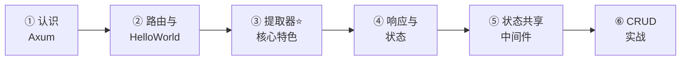
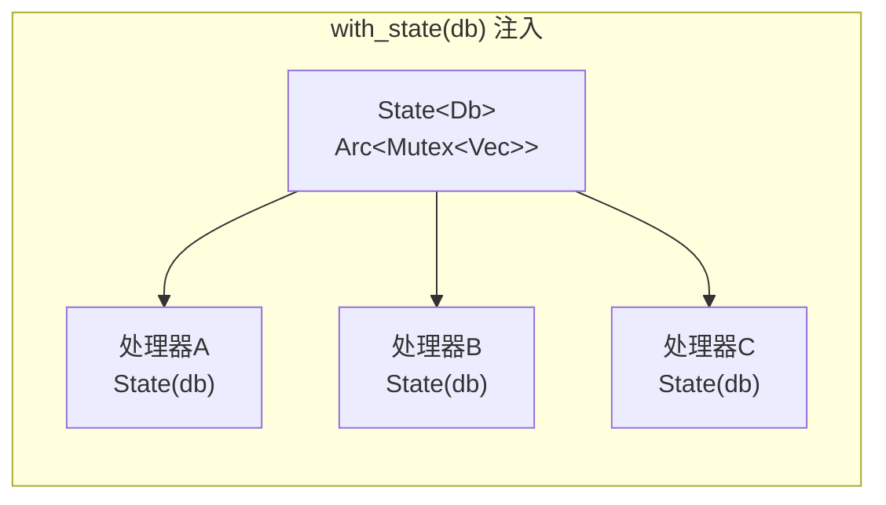
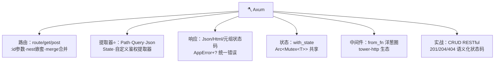

# 🪓 Axum 学习笔记

> 一句话介绍：**Axum = tokio 团队出品的现代化 Web 框架**——无宏路由、类型安全提取器、错误早暴露在编译期！写起来像 Python Flask 一样轻快，性能却是 Rust 级别的火箭 🚀
>
> 📌 前置知识：[Rust基础语法.md](./Rust基础语法.md)（所有权/Trait）+ [Rust并发编程.md](./Rust并发编程.md)（Arc/Mutex 在本篇大显身手！）+ 异步 async/await 基础。本文基于 Axum 0.7+（2024 版）✨

---

## 📖 开篇：学习路线总览



| 章节 | 内容 | 难度 |
|------|------|------|
| 一 | Axum 定位、三大卖点、框架对比 | ⭐ |
| 二 | 第一个服务 + 路由全解 | ⭐⭐ |
| 三 | **提取器：Axum 的灵魂** | ⭐⭐⭐⭐ |
| 四 | 响应类型与错误处理 | ⭐⭐⭐ |
| 五 | State 共享 + 中间件 | ⭐⭐⭐ |
| 六 | 完整 CRUD 实战 | ⭐⭐⭐⭐ |

---

## 一、认识 Axum 🪓

### 1.1 三大卖点

| 卖点 | 说明 |
|------|------|
| **无宏路由** | 路由用普通方法 `Router::new().route("/", get(h))`——IDE 补全、重构、跳转全支持 |
| **类型安全提取器** | 参数类型错了？**编译期**报错，不用等运行时 500 😎 |
| **Tower 生态直通** | 中间件、负载均衡、超时重试……和 tokio 生态无缝拼装 |

### 1.2 Rust Web 框架对比

| 框架 | 出品方 | 风格 | 特点 |
|------|--------|------|------|
| **Axum** ⭐ | tokio 官方 | 无宏、类型安全 | 生态最现代、文档好、社区活跃 |
| Actix-web | actix | Actor 模型 | 性能榜常年霸主、API 稍老派 |
| Rocket | 社区 | 宏驱动 | 上手最爽、宏限制灵活性 |

> 🎀 选型建议：新项目**默认 Axum**——tokio 亲儿子 + tower 生态 + 类型安全，就是 Rust Web 的"主流答案"～

---

## 二、第一个服务与路由 🚀

### 2.1 Hello World（十行起步！）

```toml
# Cargo.toml
[dependencies]
axum = "0.7"
tokio = { version = "1", features = ["full"] }   # 异步运行时
serde = { version = "1", features = ["derive"] } # 序列化
```

```rust
use axum::{routing::get, Router};

#[tokio::main]                       // tokio 异步入口
async fn main() {
    let app = Router::new()
        .route("/", get(hello))     // GET / → hello 处理器
        .route("/bye", get(bye));   // GET /bye → bye 处理器

    let listener = tokio::net::TcpListener::bind("0.0.0.0:3000")
        .await
        .unwrap();
    println!("🚀 服务已启动: http://localhost:3000");
    axum::serve(listener, app).await.unwrap();   // 开始监听！
}

async fn hello() -> &'static str {
    "Hello, Axum! 🪓"
}

async fn bye() -> &'static str {
    "再见～"
}
```

```bash
cargo run
curl http://localhost:3000/      # Hello, Axum! 🪓
```

### 2.2 请求处理流程（心智模型）🧠


> 🎀 记住这个流水线，Axum 的一切都围绕它展开：**路由找到人 → 提取器备料 → 处理器干活 → 返回响应**～

### 2.3 路由进阶

```rust
use axum::{routing::{get, post, put, delete}, Router};

let app = Router::new()
    // RESTful 风格：同一路径不同方法
    .route("/users", get(list_users).post(create_user))   // 链式写法
    .route("/users/:id", get(get_user))                   // 路径参数 :id
    .route("/users/:id", put(update_user).delete(remove_user))
    // 通配符：匹配任意剩余路径（如静态文件服务）
    .route("/assets/*path", get(serve_asset))             // *path 抓整段
    // 嵌套路由：前缀统一管理（告别重复！）
    .nest("/api", api_routes())                          // /api/xxx 全挂进来
    // 合并路由：模块化大项目必备
    .merge(user_routes())
    .merge(order_routes());

fn api_routes() -> Router {
    Router::new()
        .route("/health", get(|| async { "OK ✅" }))      // 闭包也能当处理器！
        .route("/version", get(|| async { "v1.0" }))
}
```

| 路由语法 | 匹配 | 例子 |
|----------|------|------|
| `/` | 精确路径 | `/` |
| `/users/:id` | 单段参数 | `/users/42` ✅ `/users/a/b` ❌ |
| `/assets/*path` | 任意剩余路径 | `/assets/css/main.css` |
| `.nest("/api", r)` | 前缀挂载 | `/api/health` |
| `.merge(r)` | 平级合并 | 模块化路由 |

---

## 三、提取器：Axum 的灵魂 ⭐

> 提取器（Extractor）= **自动把请求数据"拆包"成强类型参数**——声明即所得，类型错编译期就炸！

### 3.1 常用提取器全家福 📦

```rust
use axum::extract::{Path, Query, Json, State, ConnectInfo};
use std::net::SocketAddr;

// ① Path：路径参数（强类型自动转换！）
async fn get_user(Path(id): Path<u32>) -> String {
    format!("用户 ID: {}", id)        // /users/42 → "用户 ID: 42"
}                                     // /users/abc → 400 自动返回 ✅

// ② Query：查询参数（需 serde 反序列化）
#[derive(serde::Deserialize)]
struct PageQuery {
    page: Option<u32>,               // Option = 可省略
    size: Option<u32>,
}
async fn list(Query(q): Query<PageQuery>) -> String {
    format!("第{}页 每页{}条", q.page.unwrap_or(1), q.size.unwrap_or(20))
}                                     // /list?page=3&size=50

// ③ Json：请求体（POST/PUT 的 JSON 自动解析）
#[derive(serde::Deserialize, serde::Serialize)]
struct CreateUser {
    name: String,
    email: String,
}
async fn create(Json(payload): Json<CreateUser>) -> String {
    format!("创建用户: {} <{}>", payload.name, payload.email)
}                                     // JSON 格式错 → 422 自动返回 ✅

// ④ Header：请求头
use axum::http::HeaderMap;
async fn with_headers(headers: HeaderMap) -> String {
    let token = headers.get("authorization")
        .and_then(|v| v.to_str().ok())
        .unwrap_or("没带 token");
    format!("token: {}", token)
}

// ⑤ State：共享状态（第五章详解）
async fn with_state(State(db): State<Db>) -> String { ... }
```

| 提取器 | 提取什么 | 失败时 |
|--------|----------|--------|
| `Path<T>` | 路径参数 `:id` | 400 Bad Request |
| `Query<T>` | `?a=1&b=2` | 400 |
| `Json<T>` | 请求体 JSON | 422 Unprocessable |
| `HeaderMap` | 全部请求头 | — |
| `State<T>` | 应用共享状态 | 500 |
| `ConnectInfo<SocketAddr>` | 客户端 IP | — |

### 3.2 提取器顺序规则（必考！）📋

```rust
// ✅ 正确：最多【最后一个】参数可以是"消耗请求体"的提取器（Json）
async fn handler(Path(id): Path<u32>, Json(body): Json<CreateUser>) -> ... { }

// ❌ 错误：Json 之后再来别的提取器 → 编译错误！
// async fn bad(Json(b): Json<T>, Path(id): Path<u32>) -> ... { }
// 因为请求体只能被读一次，Json 必须殿后～
```

| 类别 | 提取器 | 位置 |
|------|--------|------|
| 无限制（随便放）| Path、Query、State、Header | 任意位置 |
| **必须最后**（消耗 body）| Json、Bytes、Form、String | 只能是最后一个参数 |

### 3.3 自定义提取器（进阶）

```rust
use axum::{
    extract::FromRequestParts,
    http::{request::Parts, StatusCode},
    async_trait,
};

// 从请求头提取登录用户（鉴权中间件常用套路）
struct CurrentUser { id: u32 }

#[async_trait]
impl<S> FromRequestParts<S> for CurrentUser {
    type Rejection = (StatusCode, &'static str);

    async fn from_request_parts(parts: &mut Parts, _s: &S) -> Result<Self, Self::Rejection> {
        parts.headers.get("x-user-id")
            .and_then(|v| v.to_str().ok())
            .and_then(|v| v.parse().ok())
            .map(|id| CurrentUser { id })
            .ok_or((StatusCode::UNAUTHORIZED, "请先登录"))
    }
}

// 用起来和官方提取器一模一样！
async fn profile(user: CurrentUser) -> String {
    format!("当前用户: {}", user.id)
}
```

---

## 四、响应与错误处理 💬

### 4.1 丰富响应类型

```rust
use axum::{Json, http::StatusCode, response::{Html, IntoResponse}};

// 字符串 / &'static str → 200 text/plain
async fn text() -> &'static str { "纯文本" }

// Html → 200 text/html
async fn page() -> Html<&'static str> {
    Html("<h1>你好，Axum 🪓</h1>")
}

// Json → 200 application/json（自动序列化）
async fn data() -> Json<User> {
    Json(User { id: 1, name: "小花".into() })
}

// 元组：状态码 + 响应体（想要自定义状态码）
async fn created() -> (StatusCode, Json<User>) {
    (StatusCode::CREATED, Json(User { id: 1, name: "新用户".into() }))
}

// 也能返回 Result！
async fn maybe(ok: bool) -> Result<Json<User>, StatusCode> {
    if ok { Ok(Json(User { id: 1, name: "OK".into() })) }
    else { Err(StatusCode::NOT_FOUND) }
}
```

| 返回类型 | 效果 |
|----------|------|
| `&'static str` / `String` | 200 text/plain |
| `Html<T>` | 200 text/html |
| `Json<T>` | 200 application/json |
| `(StatusCode, X)` | 自定义状态码 + X |
| `Result<T, E>` | Ok→T 响应；Err→E 响应 |
| `impl IntoResponse` | 万能兜底 |

### 4.2 统一错误类型（实战标配）🎯

```rust
use axum::{http::StatusCode, response::{IntoResponse, Response}, Json};

struct AppError(anyhow::Error);          // 包装任意错误

// 告诉 Axum 怎么把错误变成 HTTP 响应
impl IntoResponse for AppError {
    fn into_response(self) -> Response {
        (
            StatusCode::INTERNAL_SERVER_ERROR,
            Json(serde_json::json!({ "error": self.0.to_string() })),
        ).into_response()
    }
}

// 让 ? 自动包装错误（From 转换）
impl<E: Into<anyhow::Error>> From<E> for AppError {
    fn from(e: E) -> Self { AppError(e.into()) }
}

// 处理器从此可以优雅地用 ? 了！
async fn read_config() -> Result<Json<Config>, AppError> {
    let cfg = std::fs::read_to_string("config.json")?;   // io::Error 自动变 AppError
    let cfg: Config = serde_json::from_str(&cfg)?;        // serde 错误也自动变
    Ok(Json(cfg))
}
```

> 🎀 这就是 Rust Web 的**错误处理三板斧**：`Result` + `?` + `IntoResponse`——异常不再被吞，错误链一路传到顶层统一格式化 ✅

---

## 五、状态共享与中间件 🏗️

### 5.1 State：全局共享数据 🌍

真实应用总要有数据库连接、配置……用 `with_state` 注入：

```rust
use std::sync::{Arc, Mutex};
use axum::{extract::State, routing::get, Router};

// 内存"数据库"（并发篇学的组合拳！）
type Db = Arc<Mutex<Vec<User>>>;

#[derive(Clone, serde::Serialize, serde::Deserialize)]
struct User { id: u32, name: String }

#[tokio::main]
async fn main() {
    let db: Db = Arc::new(Mutex::new(vec![
        User { id: 1, name: "小花".into() },
    ]));

    let app = Router::new()
        .route("/users", get(list_users))
        .with_state(db);                // ⭐ 注入状态（处理器通过 State<T> 领取）

    let listener = tokio::net::TcpListener::bind("0.0.0.0:3000").await.unwrap();
    axum::serve(listener, app).await.unwrap();
}

async fn list_users(State(db): State<Db>) -> Json<Vec<User>> {
    let users = db.lock().unwrap().clone();   // 拿锁→复制→自动解锁
    Json(users)
}
```



| 状态类型 | 适用 |
|----------|------|
| `Arc<Mutex<T>>` | 内存数据、简单场景 ⭐ |
| `Arc<tokio::sync::RwLock<T>>` | 读多写少（异步友好）|
| 连接池（sqlx::Pool）| 真实数据库 |

> ⚠️ 注意：`.with_state()` 必须在所有用到该状态的**路由定义之后**调用～

### 5.2 中间件：洋葱圈 🧅

```rust
use axum::{middleware::{self, Next}, extract::Request, response::Response};

// 自定义中间件：记录每个请求
async fn logger(req: Request, next: Next) -> Response {
    let method = req.method().clone();
    let path = req.uri().path().to_string();
    println!("--> {} {}", method, path);

    let start = std::time::Instant::now();
    let res = next.run(req).await;          // 交给下一层（洋葱穿心 ⬇️）
    println!("<- {} {} 耗时 {:?} 状态 {}", 
             method, path, start.elapsed(), res.status());
    res                                      // 返回途中再处理（洋葱穿心 ⬆️）
}

// 挂载中间件
let app = Router::new()
    .route("/", get(hello))
    .layer(middleware::from_fn(logger))               // 全局中间件
    .layer(tower_http::trace::TraceLayer::new_for_http()); // 官方生态中间件
```


### 5.3 常用 tower-http 中间件

```toml
tower-http = { version = "0.5", features = ["fs", "trace", "cors"] }
```

```rust
use tower_http::services::ServeDir;
use tower_http::cors::CorsLayer;

let app = Router::new()
    .route("/api/hello", get(hello))
    // 静态文件服务：/assets/* 自动读 ./static 目录
    .nest_service("/assets", ServeDir::new("./static"))
    .layer(CorsLayer::permissive())       // CORS 跨域
    .layer(TraceLayer::new_for_http());   // 请求追踪
```

---

## 六、综合实战：RESTful CRUD 🛠️

> 需求：内存数据库版"用户管理"——增删改查一步到位，综合前面所有知识点！

```rust
use axum::{
    extract::{Path, State},
    http::StatusCode,
    routing::{get, post, delete},
    Json, Router,
};
use std::sync::{Arc, Mutex};

type Db = Arc<Mutex<Vec<User>>>;

#[derive(Clone, serde::Serialize, serde::Deserialize)]
struct User {
    id: u32,
    name: String,
    #[serde(skip_serializing_if = "Option::is_none")]
    email: Option<String>,
}

#[derive(serde::Deserialize)]
struct CreateUser {
    name: String,
    email: Option<String>,
}

#[tokio::main]
async fn main() {
    let db: Db = Arc::new(Mutex::new(vec![]));

    let app = Router::new()
        .route("/users", get(list_users).post(create_user))
        .route("/users/:id", get(get_user).delete(delete_user))
        .with_state(db);

    let listener = tokio::net::TcpListener::bind("0.0.0.0:3000").await.unwrap();
    println!("🚀 http://localhost:3000/users");
    axum::serve(listener, app).await.unwrap();
}

// GET /users —— 查全部
async fn list_users(State(db): State<Db>) -> Json<Vec<User>> {
    Json(db.lock().unwrap().clone())
}

// POST /users —— 新增
async fn create_user(
    State(db): State<Db>,
    Json(payload): Json<CreateUser>,      // Json 殿后 ✅
) -> (StatusCode, Json<User>) {
    let mut users = db.lock().unwrap();
    let user = User {
        id: (users.len() as u32) + 1,    // 简易自增 ID
        name: payload.name,
        email: payload.email,
    };
    users.push(user.clone());
    (StatusCode::CREATED, Json(user))
}

// GET /users/:id —— 查单个
async fn get_user(State(db): State<Db>, Path(id): Path<u32>) -> Result<Json<User>, StatusCode> {
    db.lock().unwrap()
        .iter()
        .find(|u| u.id == id)
        .cloned()
        .map(Json)
        .ok_or(StatusCode::NOT_FOUND)    // 找不到 → 404 ✨
}

// DELETE /users/:id —— 删除
async fn delete_user(State(db): State<Db>, Path(id): Path<u32>) -> StatusCode {
    let mut users = db.lock().unwrap();
    let before = users.len();
    users.retain(|u| u.id != id);
    if users.len() < before { StatusCode::NO_CONTENT }   // 204 删成功
    else { StatusCode::NOT_FOUND }                       // 404 没这人
}
```

**测试一把** 🧪：

```bash
# 新增
curl -X POST http://localhost:3000/users \
     -H "Content-Type: application/json" \
     -d '{"name":"小花","email":"hua@x.com"}'
# → 201 {"id":1,"name":"小花","email":"hua@x.com"}

# 查询全部
curl http://localhost:3000/users
# 查单个
curl http://localhost:3000/users/1
# 删除
curl -X DELETE http://localhost:3000/users/1 -i   # 204
```

| 请求 | 处理器 | 提取器组合 | 成功响应 |
|------|--------|-----------|----------|
| GET /users | list_users | State | 200 + Json |
| POST /users | create_user | State + Json（殿后）| **201** + Json |
| GET /users/:id | get_user | State + Path | 200 / 404 |
| DELETE /users/:id | delete_user | State + Path | **204** / 404 |

---

## 七、高频问题速查 🎯

| 问题 | 要点 |
|------|------|
| Axum 是什么？ | tokio 团队出品的 Web 框架：无宏路由 + 类型安全提取器 + tower 生态 |
| 处理器必须 async 吗？ | 是，处理器都是 async fn（闭包也行）|
| 提取器是什么？ | 自动把请求（路径/查询/请求体/头部）转成强类型参数 |
| 为什么 Json 提取器必须放最后？ | 请求体只能读一次，"消耗体"的提取器必须殿后，否则编译错误 |
| Path 参数类型错了会怎样？ | 自动返回 400（如 /users/abc 但提取 u32）|
| 全局状态怎么共享？ | `with_state(db)` 注入 + 处理器用 `State<T>` 提取 |
| 内存数据用什么包？ | `Arc<Mutex<Vec<T>>>`（并发篇组合拳）⭐ |
| 错误处理推荐姿势？ | 自定义 AppError 实现 IntoResponse + `?` 链式传播 |
| 中间件怎么写？ | `middleware::from_fn`：next.run(req) 前后夹击（洋葱圈）|
| 静态文件怎么服务？ | `nest_service("/assets", ServeDir::new("./static"))` |
| 路由前缀重复太长怎么办？ | `.nest("/api", api_router())` 嵌套或 `.merge()` 合并 |
| Axum 性能如何？ | tokio + 零成本抽象，吞吐量第一梯队（与 actix 相当）|
| 真实项目数据库用什么？ | sqlx（异步、编译期校验 SQL）配合 State<Pool> 共享 |

---

## 八、结语 🌸

Axum 的知识树收好啦：



> 🎀 学习建议：
> 1. **第六章 CRUD 亲手跑通**——改一改加个"更新 PUT"接口，跑 curl 测试，一套下来 Axum 就真正属于你了！
> 2. 提取器报错别慌，**读编译器提示**——Axum 的报错信息精确到"哪个提取器哪个位置"，都是复习 Rust 类型的机会 😆
> 3. 进阶方向：接 **sqlx 数据库**（把 Mutex 换成连接池）、加 **JWT 鉴权中间件**、用 **tower-http** 补全生产级功能（限流/压缩/超时）！
>
> Rust 全家桶圆满收官 🎉：[基础语法](./Rust基础语法.md) → [匹配模式](./Rust匹配模式.md) → [切片](./Rust切片.md) → [生命周期](./Rust生命周期.md) → [并发编程](./Rust并发编程.md) → **Axum 实战**——从语言地基到 Web 服务，一条龙点亮！接下来想学什么尽管吩咐～(๑•̀ㅂ•́)و✧
