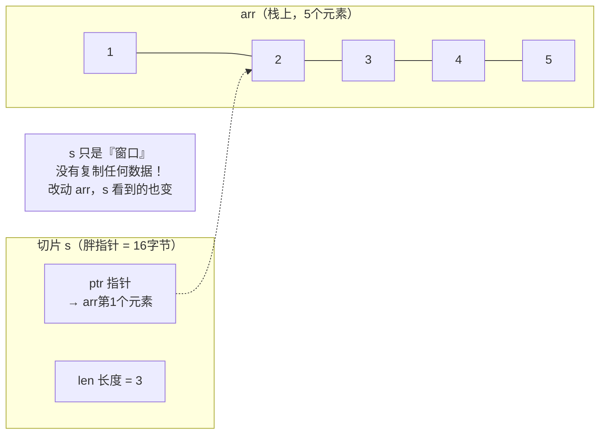
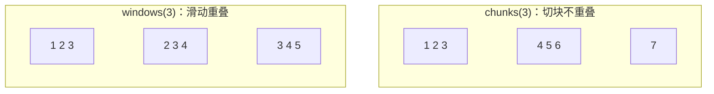
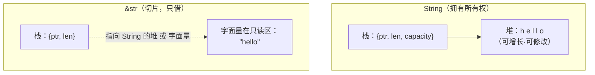
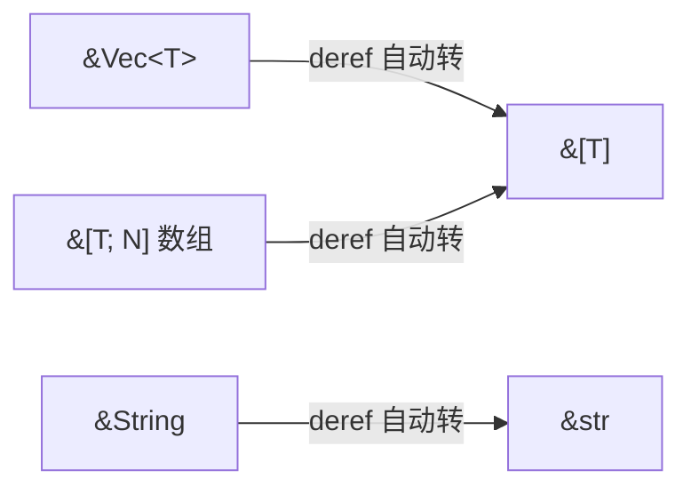
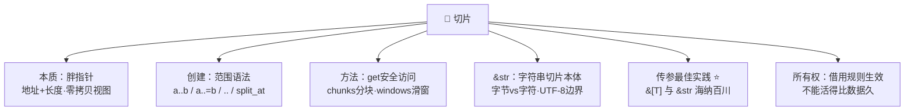

# 🍰 Rust 切片学习笔记

> 一句话介绍：**切片（Slice）= 指向一段连续数据的"零拷贝视图"**——不拥有数据、只借来看（胖指针：地址+长度）。它是 Rust 里 `&str` 的本质、函数传参的标配、零拷贝性能的秘密武器！✨
>
> 📌 前置知识：[Rust基础语法.md](./Rust基础语法.md) 第四章（所有权与借用），本篇把切片一网打尽～

---

## 📖 开篇：学习路线总览


| 章节 | 内容 | 难度 |
|------|------|------|
| 一 | 胖指针概念、零拷贝视图 | ⭐⭐ |
| 二 | 创建方式与范围语法大全 | ⭐⭐ |
| 三 | 常用方法 + chunks/windows | ⭐⭐ |
| 四 | &str 本质、字节 vs 字符 | ⭐⭐⭐ |
| 五 | API 设计：为什么参数用切片 | ⭐⭐⭐ |
| 六 | 切片与所有权、生命周期初见 | ⭐⭐⭐ |

---

## 一、切片是什么？🍰

### 1.1 胖指针：地址 + 长度

```rust
let arr = [1, 2, 3, 4, 5];
let s: &[i32] = &arr[1..4];    // 切片：指向 arr 中 [2, 3, 4] 那一段

println!("{:?}", s);           // [2, 3, 4]
println!("{}", s.len());       // 3
```



| 关键点 | 说明 |
|--------|------|
| 胖指针 | 切片变量 = **数据地址 + 长度**（普通引用只有地址）|
| 零拷贝 | 不复制数据，只是"窗口"👀 |
| 不拥有数据 | 离开作用域不释放任何东西（它只是借用）|
| 类型写法 | `&[T]`（不可变）/ `&mut [T]`（可变）|

### 1.2 谁能被"切"？连续内存都行 🍕

```rust
let arr = [1, 2, 3, 4, 5];
let s1: &[i32] = &arr[..];            // 数组切片

let v = vec![10, 20, 30];
let s2: &[i32] = &v[1..];             // Vec 切片

let s = String::from("hello");
let s3: &str = &s[0..2];              // 字符串切片 → &str！

let bytes: &[u8] = b"hello";          // 字节串切片
```

> 🎀 最大的认知颠覆：**`&str` 不是什么特殊类型，它就是 `&[u8]` 的"字符串版"**——指向 UTF-8 字节序列的切片！所以 `&str` 也叫"字符串切片"～

---

## 二、创建切片：范围语法大全 ✂️

### 2.1 七种范围写法

```rust
let arr = [0, 1, 2, 3, 4];

let a = &arr[1..4];     // [1, 2, 3]    （含头不含尾）
let b = &arr[1..=4];    // [1, 2, 3, 4] （含头又含尾）
let c = &arr[..3];      // [0, 1, 2]    （从头开始）
let d = &arr[2..];      // [2, 3, 4]    （到末尾）
let e = &arr[..];       // [0, 1, 2, 3, 4]（全部）
let f = &arr[0..0];     // []           （空切片，合法！）
let g = &arr[3..1];     // ❌ panic！开始 > 结束
```

| 语法 | 含义 | 类比 |
|------|------|------|
| `a..b` | [a, b) 左闭右开 | 数学区间 ⭐最常用 |
| `a..=b` | [a, b] 闭区间 | |
| `..b` / `a..` / `..` | 省略头/尾/全部 | |
| ⚠️ 越界 | `&arr[1..10]`（len=5）| **运行时 panic**（Rust 替你检查！）|

### 2.2 其他创建姿势

```rust
let v = vec![1, 2, 3, 4];

let s1 = v.as_slice();              // 整个 Vec 转切片（写法最省）
let s2 = &v[..];                    // 等价

let (left, right) = v.split_at(2);  // 从下标2一刀切两段：[1,2] [3,4]
println!("{:?} {:?}", left, right);

// Range 切片（可用变量！）
let start = 1;
let s3 = &v[start..v.len()];

// 由裸数组直接引用
let s4: &[i32] = &[9, 9, 9];        // 指向静态数据的切片也行
```

---

## 三、切片常用方法速查 🧰

```rust
let mut s = [5, 3, 8, 1, 9];

// ---------- 读取 ----------
s.first();          // Option<&i32> → Some(&5)（空切片安全！）
s.last();           // Option<&i32> → Some(&9)
s.get(1);           // Option<&i32> → Some(&3)（越界返回 None ✅）
s[0];               // 直接索引（越界 panic 💀）

// ---------- 查找判断 ----------
s.contains(&8);                     // true
s.iter().position(|&x| x == 8);     // Some(2)：找下标
s.is_empty();                       // false
s.starts_with(&[5, 3]);             // true
s.ends_with(&[9]);                  // true

// ---------- 修改（需要 &mut）----------
s.sort();                           // 排序 → [1,3,5,8,9]
s.reverse();                        // 反转
s.swap(0, 1);                       // 交换两个元素
s.fill(0);                          // 全部填 0

// ---------- 转换 ----------
s.to_vec();                         // 复制出一个新 Vec（脱离原数据）
s.iter().sum::<i32>();              // 借迭代器聚合

// ---------- 二分（前提：已排序！）----------
let sorted = [1, 3, 5, 7, 9];
sorted.binary_search(&7);           // Ok(3) ⚡ O(log n)
```

### 3.1 分块三兄弟：chunks / windows / chunks_exact 🧩

```rust
let data = [1, 2, 3, 4, 5, 6, 7];

// chunks：按步长"切块"，最后不足一块算小块
for chunk in data.chunks(3) {
    println!("{:?}", chunk);
}
// [1, 2, 3] [4, 5, 6] [7]

// windows：滑动窗口（步长1，重叠！）
for w in data.windows(3) {
    println!("{:?}", w);
}
// [1,2,3] [2,3,4] [3,4,5] [4,5,6] [5,6,7]

// chunks_exact：严格等大，剩余的用 remainder() 单独拿
let mut iter = data.chunks_exact(3);
println!("{:?}", iter.remainder());  // [7]（先取剩余！）
```



| 方法 | 行为 | 典型场景 |
|------|------|----------|
| `chunks(n)` | 依次取 n 个，尾巴小块 | 分批处理、分页 |
| `chunks_exact(n)` | 严格 n 个 + remainder | 均分任务 |
| `windows(n)` | 步长 1 滑动 | 移动平均、DNA 序列 |
| `split(predicate)` | 按条件切多段 | 按分隔符拆 |
| `split_at(i)` | 一刀两半 | 二分/并行处理 |

> 💡 `chunks` 是**分批处理**神器：上传文件分块、批量插入数据库分批、并行计算分片——都是它！

---

## 四、&str 深挖：字符串切片的本体 🧵

### 4.1 String vs &str



| 对比 | `String` | `&str` |
|------|----------|--------|
| 所有权 | **拥有**数据（堆）| 只**借用** |
| 可变 | `mut` 后可 push/insert | 不可变 |
| 内存 | 栈三元组 + 堆 | 胖指针（指向堆或字面量区）|
| 类比 | 自有房 🏠 | 租的视角 👀 |
| 用途 | 构建/存储/修改 | 传参/读取（**默认首选** ⭐）|

```rust
let s1 = "hello";                    // &str：指向编译期字面量（只读区）
let s2 = String::from("hello");      // String：堆上新建
let s3: &str = &s2;                  // String → &str：Deref 自动转换 ✅
let s4 = s3.to_string();             // &str → String：复制一份
```

### 4.2 UTF-8 的坑：切的是"字节"不是"字符" ⚠️

```rust
let s = "你好";      // 每个汉字 UTF-8 占 3 字节

println!("{}", s.len());        // 6！（字节数，不是 2）
println!("{}", s.chars().count());  // 2 ✅（字符数）

let hi = &s[0..3];               // ✅ "你"（正好切在字符边界）
// let broken = &s[0..2];        // ❌ 运行时 panic！切在"你"的中间
```

| 需求 | 正确姿势 |
|------|----------|
| 按字符遍历 | `s.chars()` |
| 按字节遍历 | `s.bytes()` |
| 字符数 | `s.chars().count()`（`len()` 是字节数！）|
| 安全取前 n 个**字符** | `s.chars().take(n).collect::<String>()` |
| 字节切片 | `&s[a..b]`（**必须落在 UTF-8 边界**，否则 panic）|

### 4.3 字符串常用操作

```rust
let s = String::from("Hello, Rust!");

s.contains("Rust");            // true
s.starts_with("Hello");        // true
s.find(',');                   // Some(5)：字节下标
s.replace("Rust", "World");    // "Hello, World!"

for word in "a b  c".split_whitespace() {   // 按空白拆分
    print!("[{}] ", word);     // [a] [b] [c]
}

// &str 切片照用不误（它本来就是切片！）
let hello = &s[0..5];
```

---

## 五、函数传参最佳实践：拥抱切片 🎯

### 5.1 为什么参数写 `&[T]` / `&str`？

```rust
// ❌ 不好的设计：绑死了调用方
fn bad1(v: &Vec<i32>) { }          // 传数组的切片就不行了
fn bad2(s: &String) { }            // 传 &str 字面量就麻烦了

// ✅ 好的设计：切片最通用
fn good1(v: &[i32]) { }            // Vec、数组、切片全都能传！
fn good2(s: &str) { }              // String、&str 全都能传！

fn main() {
    let v = vec![1, 2, 3];
    let arr = [4, 5, 6];
    let s = vec![7, 8];

    good1(&v);          // ✅ &Vec<i32> → &[i32]（Deref 强制转换）
    good1(&arr);        // ✅ 数组直接转
    good1(&s[0..1]);    // ✅ 传一部分也行（零拷贝！）
    good1(&v[1..]);     // ✅ 想传哪段传哪段

    let name = String::from("小花");
    good2(&name);       // ✅
    good2("字面量");     // ✅
    good2(&name[0..1]); // ✅
}
```

> 🎀 记住口诀：**读参数用切片（`&[T]` / `&str`），存数据用容器（`Vec<T>` / `String`）**——切片是"最大公约数"，任何连续数据都能自动转换过来，你的 API 从此海纳百川 🌊

### 5.2 Deref 强制转换：自动"降级"链条



编译器自动完成，调用方**零成本、零感知**——这就是切片参数好用的底层原因！

---

## 六、切片与所有权、生命周期 👑

### 6.1 借用规则对切片同样生效

```rust
let mut v = vec![1, 2, 3, 4];

let s = &v[0..2];        // 不可变借用
// v.push(5);            // ❌ 编译错误！push 需要 &mut，但 s 还活着
println!("{:?}", s);     // s 最后一次使用……

v.push(5);               // ✅ 之后就能改了（NLL 非词法作用域）
```

### 6.2 生命周期初见：切片不能活得比数据久 ⏳

```rust
fn longest_word(s: &str) -> &str {          // 编译器自动推断：返回值与参数同生命周期
    s.split_whitespace().next().unwrap()
}

// ❌ 经典错误：想返回局部变量的切片
// fn make() -> &str {
//     let s = String::from("temp");
//     &s[0..2]      // s 在函数结束就被释放，切片就悬垂了！编译器直接拒绝
// }

fn main() {
    let owned = String::from("hello world");
    let word = longest_word(&owned);    // word 借用 owned
    println!("{}", word);               // ✅ owned 活得比 word 久
}
```

| 规则 | 一句话 |
|------|--------|
| 切片只是借用 | **数据主人活着，切片才能活着** |
| 悬垂切片 | 返回局部变量切片 → 编译器直接拦下 ✅ |
| 生命周期标注 | 函数返回切片时可能要写 `<'a>`（进阶话题，先混个脸熟）|

### 6.3 可变切片：独占修改权 ✍️

```rust
let mut v = vec![3, 1, 2];

{
    let s = &mut v[..];     // 可变切片：独占！
    s.sort();
    s[0] = 100;
}                           // s 借用结束
println!("{:?}", v);        // [2, 3, 100] ✅
```

---

## 七、高频问题速查 🎯

| 问题 | 要点 |
|------|------|
| 切片和数组区别？ | 数组 `[T; N]` 定长拥有数据；切片 `&[T]` 是"视图"胖指针（地址+长度）|
| 切片和 Vec 区别？ | Vec 拥有+可增长；切片只借用，长度固定（但原数据变了长度可变）|
| 什么是胖指针？ | 普通引用=1个地址；切片=地址+长度 两个字的"胖"指针 |
| `&str` 是什么？ | 指向 UTF-8 字节序列的字符串切片（胖指针）|
| String 和 &str 怎么选？ | 存储用 String；传参/读取用 &str ⭐ |
| `s.len()` 是字符数吗？ | ❌ 是**字节数**！字符数用 `chars().count()` |
| 中文能下标切片吗？ | 能但小心：按**字节**切，切在字符中间会 panic |
| 为什么参数不用 &Vec<T>？ | `&[T]` 是最大公约数：Vec/数组/切片全自动转换，还能只传一段 |
| Deref 强制转换是什么？ | `&Vec<T>→&[T]`、`&String→&str` 编译器自动降级，零成本 |
| chunks 和 windows 区别？ | chunks 分块不重叠；windows 步长1滑动重叠 |
| 切片越界会怎样？ | `s[i]` 和非法范围 → 运行时 panic；`s.get(i)` 返回 None 更安全 |
| 能返回局部变量的切片吗？ | ❌ 悬垂引用，编译错误；切片必须来自活得久的原数据 |

---

## 八、结语 🌸

Rust 切片的知识树收好啦：



> 🎀 学习建议：
> 1. 把第五章的**传参最佳实践**刻进 DNA——写函数参数时默认 `&[T]` / `&str`，这是 Rust 社区的通用礼仪，也是库设计的第一课！
> 2. 中文字符串练一练：`len()` vs `chars().count()`、安全切前 N 个字符——**踩过 UTF-8 的坑才算入门 Rust 字符串** 😆
> 3. `chunks` 写个小练习：把 1~100 分成每批 10 个处理——**分批/分页/并行**的真实代码里到处都是它！
>
> Rust 技能树已点亮三盏 🦀：[基础语法](./Rust基础语法.md) + [匹配模式](./Rust匹配模式.md) + 切片～下一站？（闭包与迭代器 / 智能指针 / 异步编程 / Axum）(๑•̀ㅂ•́)و✧
