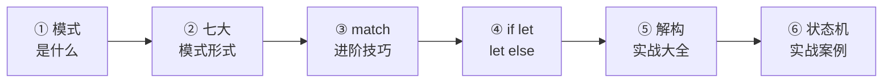
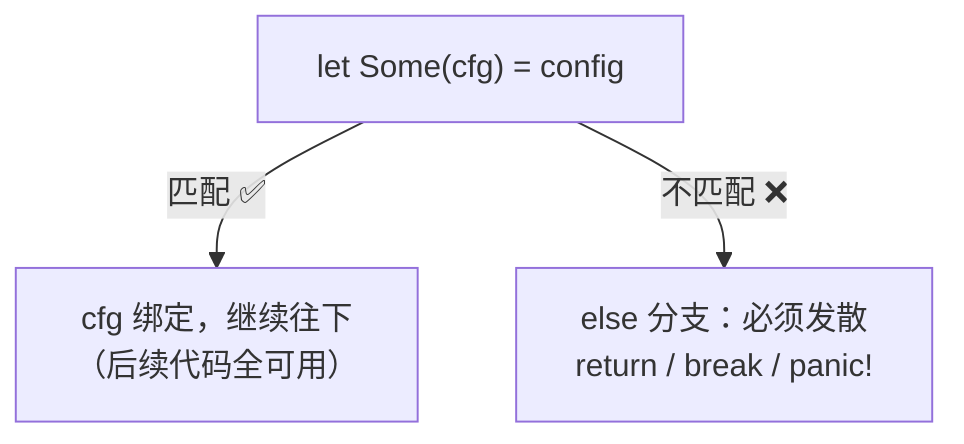
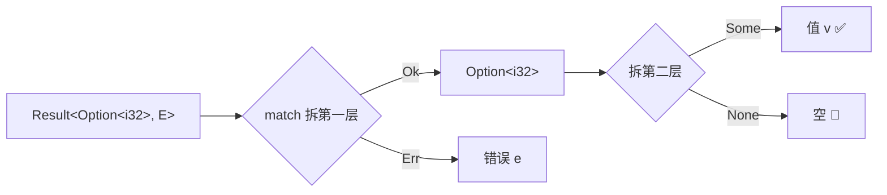
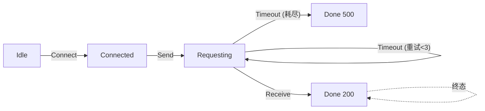
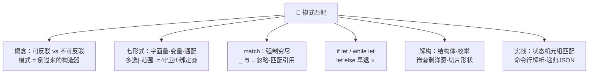

# 🎰 Rust 匹配模式学习笔记

> 一句话介绍：**模式匹配 = Rust 的"瑞士军刀"**——解构数据、分支逻辑、类型判断、状态机……全靠它！比 C 的 switch 强一个次元：能**拆解数据结构、绑定值、加条件守卫**，还强制你考虑所有情况，漏分支直接编译不过！✨
>
> 📌 前置知识：[Rust基础语法.md](./Rust基础语法.md) 第五章（枚举与 match 入门），本篇全面深挖～

---

## 📖 开篇：学习路线总览



| 章节 | 内容 | 难度 |
|------|------|------|
| 一 | 模式 vs 表达式、可反驳性 | ⭐⭐ |
| 二 | 七种模式形式大全 | ⭐⭐⭐ |
| 三 | match 进阶：守卫、绑定、忽略 | ⭐⭐⭐ |
| 四 | if let / let else | ⭐⭐ |
| 五 | 解构一切：结构体/枚举/嵌套 | ⭐⭐⭐⭐ |
| 六 | 实战：状态机 + 消息分发 | ⭐⭐⭐⭐ |

---

## 一、模式是什么？🧩

### 1.1 模式 vs 表达式

```rust
match x {
    1..=5 => ...          // "1..=5" 是模式：描述"值长什么样"
    n if n > 0 => ...     // "n if n > 0" 也是模式（带守卫）
}
```

| 概念 | 说明 | 例子 |
|------|------|------|
| **表达式** | 算出一个值 | `1 + 2` |
| **模式** | 描述"值的形状"，**匹配则绑定变量** | `Some(x)`、`(a, b)`、`Point { x, .. }` |

> 🎀 一句话：**模式是"倒过来的构造器"**——`Point { x: 1, y: 2 }` 构造值，`Point { x, y }` 把值拆开拿字段！

### 1.2 可反驳 vs 不可反驳（超重要概念！）⚖️

| 类型 | 含义 | 例子 | 能用在哪 |
|------|------|------|----------|
| **不可反驳** irrefutable | 能匹配**任何**值，永不失败 | `x`、`(a, b)`、`Point { x, y }` | `let`、函数参数、`for` |
| **可反驳** refutable | 可能匹配失败 | `Some(x)`、`1..=5`、`Ok(v)` | `if let`、`while let`、`match` |

```rust
let Some(x) = value;      // ❌ 编译错误！Some(x) 可能失败，let 必须万无一失
if let Some(x) = value {} // ✅ if let 允许失败（失败就走 else）

let (a, b) = (1, 2);      // ✅ 元组模式必然匹配
```

> 🎀 理解这条规则，90% 的"模式匹配编译报错"都能秒懂——**编译器在阻止你写出"万一不匹配咋办"的悬空代码**！

---

## 二、七种模式形式大全 🃏

### 2.1 字面量模式：精确匹配

```rust
let code = 404;
match code {
    200 => println!("OK"),
    404 => println!("Not Found"),
    500 => println!("Server Error"),
    _   => println!("其他"),       // _ 通配符：兜底
}
```

### 2.2 命名变量模式：匹配并绑定

```rust
match age {
    n => println!("年龄是 {}", n),   // n 绑定整个值（啥都能匹配 = 不可反驳）
}
```

### 2.3 多选一：`|`

```rust
match c {
    'a' | 'e' | 'i' | 'o' | 'u' => println!("元音"),
    _ => println!("辅音"),
}
```

### 2.4 范围模式：`..=`（闭区间）

```rust
match score {
    0..=59   => "不及格",
    60..=79  => "及格",
    80..=100 => "优秀",
    _        => "非法分数",
}

match c {
    'a'..='z' => "小写字母",     // char 也能用范围！
    'A'..='Z' => "大写字母",
    _ => "其他",
}
```

### 2.5 解构模式（第五章详解）：拆开数据

```rust
match point {
    Point { x: 0, y: 0 }     => println!("原点"),      // 字段值匹配
    Point { x, y }           => println!("({x}, {y})"), // 字段绑定
}
```

### 2.6 守卫模式：match guard（额外 if 条件）

```rust
match n {
    x if x < 0        => "负数",
    x if x % 2 == 0   => "正偶数",
    _                 => "正奇数",     // ⚠️ 守卫不参与穷尽性检查，_ 兜底必须有
}
```

### 2.7 绑定模式：`@`（匹配同时捕获值）

```rust
match age {
    n @ 1..=12   => println!("儿童（{}岁）", n),   // 既判断范围又拿到具体值！
    n @ 13..=18  => println!("青少年（{}岁）", n),
    n @ 19..=    => println!("成人（{}岁）", n),   // ..= 到无穷（新写法）
    _            => unreachable!(),
}
```

| 形式 | 语法 | 作用 |
|------|------|------|
| 字面量 | `42`、`"hi"`、`'a'` | 精确相等 |
| 变量 | `x` | 匹配一切并绑定 |
| 通配符 | `_` | 匹配一切不绑定 |
| 多选 | `a \| b` | 任一匹配 |
| 范围 | `1..=5` | 闭区间 |
| 守卫 | `p if cond` | 模式 + 布尔条件 |
| 绑定 | `n @ 1..=5` | 匹配范围且捕获值 |

---

## 三、match 进阶技巧 🎯

### 3.1 穷尽性：编译器的强迫症 🔍

```rust
enum Shape { Circle(f64), Rect(f64, f64) }

fn area(s: Shape) -> f64 {
    match s {
        Shape::Circle(r) => 3.14 * r * r,
        // ❌ 忘了 Rect？编译错误：
        // error[E0004]: non-exhaustive patterns: `Rect(_, _)` not covered
    }
}
```

> 🎀 新增枚举变体后，所有 match 处会**集体报错**逼你处理——重构的安全网就是这么织出来的！

### 3.2 忽略的艺术：`_` 和 `..`

```rust
// _ 忽略单个值
let (x, _) = (1, 2);

// .. 忽略"剩余所有"（解构时超好用）
struct Point3 { x: i32, y: i32, z: i32 }

match p {
    Point3 { x, .. } => println!("只要 x: {}", x),   // y、z 都不要
}

match tuple {
    (first, .., last) => println!("头 {} 尾 {}", first, last),  // 只要头尾
}
```

| 语法 | 用途 |
|------|------|
| `_` | 忽略一个值（可多个）|
| `..` | 忽略剩余全部（一条模式里只能用一个）|
| `_x` | "我知道没用"的具名忽略（未使用警告消除）|

### 3.3 match 与所有权 👑

```rust
let s = Some(String::from("hello"));

// 匹配引用时，绑定的也是引用
match &s {
    Some(txt) => println!("借来用: {}", txt),   // txt: &String，s 还能用 ✅
    None => {}
}
println!("{:?}", s);   // ✅

// 匹配值本身 = 所有权移进 match
match s {
    Some(txt) => drop(txt),        // txt 拿走了 String
    None => {}
}
// println!("{:?}", s);   // ❌ s 的值已被移走（部分移动）
```

| 写法 | 绑定得到 | 所有权 |
|------|----------|--------|
| `match &value` | `&T` 引用 | 原值不动 ✅（日常首选）|
| `match value` | 值本身 | Move 进 match |
| `Some(ref x)` | `&T`（老写法，少见）| 原值不动 |

### 3.4 match 是表达式：可以直接产值

```rust
let describe = match n {
    0 => "零",
    1 | 2 => "小",
    _ => "大",
};   // 每个分支类型必须相同！

// 替代连环 if-else 的优雅写法
let grade = match score / 10 {
    9 | 10 => 'A',
    8      => 'B',
    7      => 'C',
    _      => 'D',
};
```

---

## 四、if let 与 let else 🌊

### 4.1 if let：只关心一种情况

```rust
// 完整 match 版（啰嗦）
match config {
    Some(c) => apply(c),
    None => {},
}

// if let 版（精简）
if let Some(c) = config {
    apply(c);
}

// 带 else
if let Some(c) = config {
    apply(c);
} else {
    println!("没有配置，用默认值");
}
```

### 4.2 while let：循环直到不匹配

```rust
let mut stack = vec![1, 2, 3];

while let Some(top) = stack.pop() {   // pop 返回 None 时循环自动结束！
    println!("弹出：{}", top);
}
```

### 4.3 let else（1.65+）：早退神器 ⭐

```rust
// 痛点：从 Option 拿值，没有就提前返回
fn process(config: Option<Config>) -> Result<(), Error> {
    // 老写法1：嵌套 if let（层层缩进地狱 😭）
    // 老写法2：match + return（啰嗦）

    // let else：不匹配就走 else 分支（必须发散：return/break/panic）
    let Some(cfg) = config else {
        return Err(Error::NoConfig);
    };

    // 这里 cfg 一直可用（比 if let 作用域大！）
    apply(cfg);
    run(cfg);
    Ok(())
}
```



| 语法 | 场景 | 特点 |
|------|------|------|
| `match` | 多分支 | 强制穷尽 |
| `if let` | 只关心一种 | 失败进 else（可省）|
| `while let` | 循环取值 | 不匹配自动停 |
| `let else` | 早退检查 | 变量作用域延伸到后面 ⭐ |

---

## 五、解构实战大全 💥

### 5.1 解构结构体

```rust
struct User { name: String, age: u32, vip: bool }

let u = User { name: "小花".into(), age: 18, vip: true };

let User { name, age, .. } = &u;   // 字段简写：同名绑定
println!("{} {}", name, age);

// 带条件的解构（match 中）
match u {
    User { age, vip: true, .. } if age >= 18 => println!("成年VIP"),
    User { name, .. }                       => println!("普通用户 {}", name),
}
```

### 5.2 解构枚举：模式的绝对主场 🏆

```rust
enum Message {
    Quit,                          // 无数据
    Move { x: i32, y: i32 },       // 结构体式变体
    Write(String),                 // 单值变体
    ChangeColor(u8, u8, u8),       // 元组式变体
}

fn handle(msg: Message) {
    match msg {
        Message::Quit => println!("退出"),
        Message::Move { x: 0, y: 0 }        => println!("原地不动"),
        Message::Move { x, y }              => println!("移动到 ({x},{y})"),
        Message::Write(text)                => println!("写入：{}", text),
        Message::ChangeColor(r, g, 0)       => println!("无蓝分量！"),
        Message::ChangeColor(r, g, b)       => println!("RGB({r},{g},{b})"),
    }
}
```

### 5.3 解构嵌套：一层层剥洋葱 🧅

```rust
let events = vec![
    ("click", Some((120, 30))),
    ("scroll", None),
];

for (kind, pos) in &events {
    match pos {
        Some((x, y)) => println!("{} 在 ({}, {})", kind, x, y),   // 元组再解构！
        None         => println!("{} 无坐标", kind),
    }
}

// 嵌套枚举也能一层拆到底
match result {
    Ok(Some(value))  => println!("成功且有值：{}", value),
    Ok(None)         => println!("成功但没值"),
    Err(e)           => println!("失败：{}", e),
}
```



### 5.4 解构数组与切片

```rust
// 定长数组：完全解构
let arr = [1, 2, 3, 4, 5];
let [first, second, .., last] = arr;      // 拿头尾
println!("{} {}", first, last);            // 1 5

// 切片：按"形状"匹配（超实用！）
fn sum(nums: &[i32]) -> i32 {
    match nums {
        []            => 0,                     // 空切片
        [single]      => *single,               // 只有一个元素
        [head, rest @ ..] => head + sum(rest),  // 第一个 + 剩余（rest 绑定子切片）
    }
}
```

> 🎀 `rest @ ..`：**模式绑定 + 剩余模式**组合技——head 拿第一个，rest 拿剩下整个切片，递归处理序列的经典写法！

---

## 六、实战案例 🚀

### 6.1 案例一：HTTP 请求状态机 🌐

```rust
enum State {
    Idle,
    Connected,
    Requesting { retries: u8 },
    Done { status: u16 },
}

enum Event {
    Connect,
    Send,
    Timeout,
    Receive(u16),
}

fn transition(state: State, event: Event) -> State {
    use State::*;
    use Event::*;

    match (state, event) {            // 匹配元组：状态机核心技巧！
        (Idle, Connect)                        => Connected,
        (Connected, Send)                      => Requesting { retries: 0 },
        (Requesting { retries }, Timeout) if retries < 3
                                               => Requesting { retries: retries + 1 },  // 重试+1
        (Requesting { retries: n }, Timeout)   => Done { status: 500 },   // 重试耗尽
        (Requesting { .. }, Receive(code))     => Done { status: code },
        (Done { .. }, _)                       => Done { status: 200 },   // 终态不可逆
        (s, _)                                 => s,                     // 其他组合：保持原状态
    }
}
```



> 💡 `(state, event)` 元组匹配是写状态机的**万能套路**：所有合法转移一行一个，非法组合 `_` 兜底——逻辑清晰得像流程图！

### 6.2 案例二：命令行解析器 🎛️

```rust
enum Command {
    Help,
    Get { key: String },
    Set { key: String, value: String },
    Delete { key: String },
}

fn parse(args: &[String]) -> Result<Command, String> {
    match args {
        [] | [_] => Err("用法: app get|set|delete <key> [value]".into()),
        [cmd] if cmd == "help" => Ok(Command::Help),
        [cmd, key] if cmd == "get"    => Ok(Command::Get    { key: key.clone() }),
        [cmd, key] if cmd == "delete" => Ok(Command::Delete { key: key.clone() }),
        [cmd, key, value] if cmd == "set" => Ok(Command::Set {
            key: key.clone(), value: value.clone(),
        }),
        _ => Err(format!("未知命令: {}", args[0])),
    }
}
```

> 💡 切片模式 `[cmd, key]` 按参数**个数+内容**分发——不用手写 `args.len()` 判断，模式本身就是逻辑！

### 6.3 案例三：JSON 值遍历（递归 + 解构）🌲

```rust
enum Json {
    Null,
    Num(f64),
    Str(String),
    Arr(Vec<Json>),
    Obj(Vec<(String, Json)>),
}

fn json_to_string(json: &Json) -> String {
    match json {
        Json::Null          => "null".to_string(),
        Json::Num(n)        => n.to_string(),
        Json::Str(s)        => format!("\"{}\"", s),
        Json::Arr(items)    => {
            let inner: Vec<String> = items.iter().map(json_to_string).collect();
            format!("[{}]", inner.join(","))
        }
        Json::Obj(pairs)    => {
            let inner: Vec<String> = pairs.iter()
                .map(|(k, v)| format!("\"{}\":{}", k, json_to_string(v)))   // 解构 (k, v)
                .collect();
            format!("{{{}}}", inner.join(","))
        }
    }
}
```

---

## 七、高频问题速查 🎯

| 问题 | 要点 |
|------|------|
| match 和 switch 区别？ | match 匹配"模式"（解构/范围/守卫）且强制穷尽；switch 只比标量 |
| 什么是可反驳模式？ | 可能失败的模式（`Some(x)`）；let 只接受不可反驳（必然成功的）模式 |
| `_` 和 `..` 区别？ | `_` 忽略单个值；`..` 忽略剩余全部（一条模式仅一个）|
| match guard 是什么？ | 模式后加 `if cond`：先模式匹配再条件过滤；不参与穷尽检查 |
| `@` 绑定干嘛用？ | `n @ 1..=5`：既验证范围又把值捕获到变量 n |
| match 会拿走所有权吗？ | 匹配值本身会 Move；日常用 `match &value` 只借不拿 ⭐ |
| let else 是什么？ | `let Some(x) = v else { return... }`：失败即发散（早退），成功后变量作用域延续 |
| while let 什么时候停？ | 模式匹配失败自动退出循环（如 pop 返回 None）|
| 怎么解构嵌套 Option/Result？ | `Ok(Some(v))` 一路写到底，一层层剥 |
| 切片能模式匹配吗？ | ✅ `[]`、`[a]`、`[head, rest @ ..]` 按长度和元素匹配 |
| 字符串能匹配吗？ | 字面量/变量可以；**范围不支持 String**（只支持整型和 char）|
| 新增枚举变体会怎样？ | 所有 match 处编译报错——逼你处理新情况（重构安全网 ✅）|

---

## 八、结语 🌸

Rust 模式匹配的知识树收好啦：



> 🎀 学习建议：
> 1. **枚举 + match 是 Rust 的心脏**——把 `Message` 枚举和 `handle` 函数自己写一遍，感受"数据即流程"！
> 2. `let else` 和 `[head, rest @ ..]` 是现代 Rust 代码的**高频新姿势**，看源码（如 Axum/tokio）到处都是～
> 3. 状态机案例值得手抄：**`(state, event)` 元组匹配**是协议解析、游戏 AI、工作流引擎的万能公式！
>
> 模式匹配通关后，看 Rust 标准库和主流框架源码就不再迷路啦 🚀 下一站可以学 **闭包与迭代器**（函数式三件套）或直接冲 **Axum Web 开发**！还想学什么尽管吩咐～(๑•̀ㅂ•́)و✧
