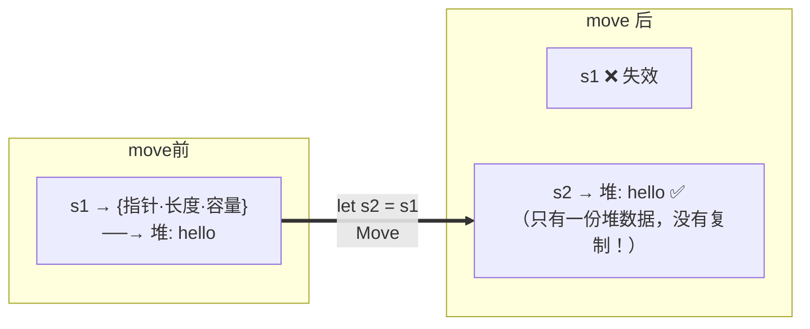
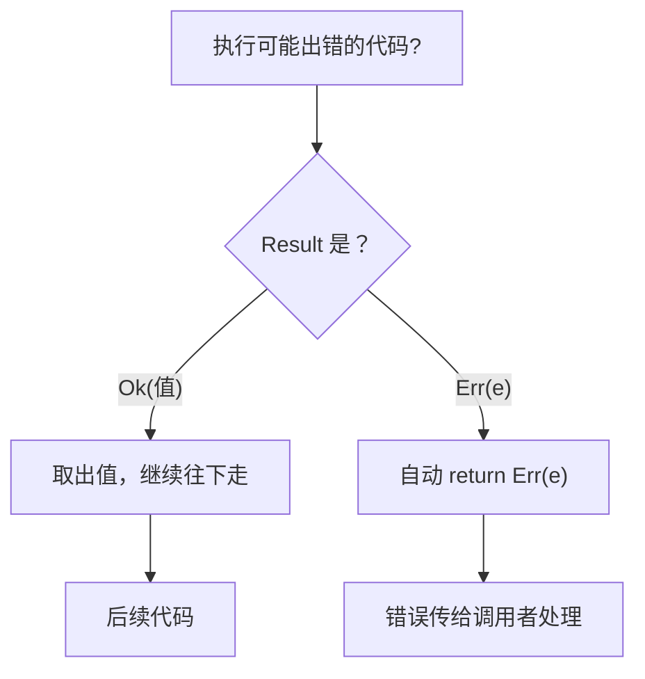
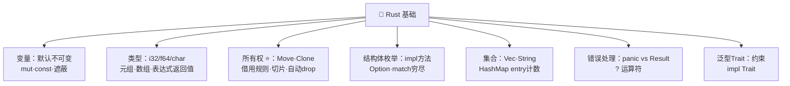

# 🦀 Rust 基础语法学习笔记

> 一句话介绍：**Rust = 性能比肩 C/C++ + 内存安全无 GC + 现代工具链**——用"所有权"在编译期就消灭空指针、悬垂指针、内存泄漏，被誉为"最受喜爱语言"连年霸榜 🏆！
>
> 📌 零基础可学；有 [C 语言](../C/C基础语法.md)底子的同学学所有权时会疯狂点头——**它解决的就是 C 里手动管内存的痛**！本文基于 Rust 2021 Edition～

---

## � 开篇：学习路线总览


| 章节 | 内容 | 难度 |
|------|------|------|
| 一 | 第一个程序 + Cargo 工具链 | ⭐ |
| 二 | 变量与可变性（let/mut/const）| ⭐ |
| 三 | 数据类型 + 函数 + 控制流 | ⭐⭐ |
| 四 | **所有权与借用（全篇灵魂！）** | ⭐⭐⭐⭐⭐ |
| 五 | 结构体 + 枚举 + match | ⭐⭐⭐ |
| 六 | 集合（Vec/String/HashMap）| ⭐⭐ |
| 七 | 错误处理（Result 与 `?`）| ⭐⭐⭐ |
| 八 | 泛型与 Trait | ⭐⭐⭐ |

---

## 一、第一个程序与 Cargo 🚀

### 1.1 Hello, World!

```rust
fn main() {
    println!("Hello, World!");   // println! 是宏（带!），不是函数
}
```

| 要素 | 说明 |
|------|------|
| `fn main()` | 程序入口（和 C 一样必须有）|
| `println!` | 宏：编译期展开代码（`!` 是宏的标志）|
| `;` | 语句结尾 |

### 1.2 Cargo：Rust 的官方管家 🧰

```bash
cargo new hello_app      # 创建项目（自带 git + 标准目录结构）
cargo build              # 编译（debug 模式）
cargo run                # 编译 + 运行一步到位 ⭐
cargo build --release    # 发布优化编译
cargo check              # 只查错误不生成产物（超快，写码神器 ⚡）
cargo test               # 跑测试
```

```toml
# Cargo.toml：项目说明书（依赖管理）
[package]
name = "hello_app"
version = "0.1.0"
edition = "2021"

[dependencies]
rand = "0.8"    # 依赖写这里，cargo build 自动下载
```

> 🎀 对比 C 手写 Makefile：Cargo 把**创建、编译、依赖、测试、发布**一条龙包办——这是 Rust 上手体验碾压 C/C++ 的第一站！

---

## 二、变量与可变性 📦

### 2.1 默认不可变：贴了封条的箱子 🔒

```rust
let x = 5;
x = 6;          // ❌ 编译报错！默认不可变

let mut y = 5;  // mut = 我声明我要改它
y = 6;          // ✅

const MAX: u32 = 100_000;   // 常量：必须标类型、编译期确定
```

### 2.2 变量遮蔽：同名可以再 let

```rust
let x = 5;
let x = x + 1;          // 遮蔽：新建同名变量，旧的自然失效
let spaces = "   ";
let spaces = spaces.len();   // ✅ 遮蔽还能换类型！（mut 做不到）
```

| 方式 | 关键字 | 可改值 | 可换类型 | 类型标注 |
|------|--------|--------|----------|----------|
| 不可变变量 | `let` | ❌ | 遮蔽时 ✅ | 可省略 |
| 可变变量 | `let mut` | ✅ | ❌ | 可省略 |
| 常量 | `const` | ❌ | ❌ | **必须** |

> 🎀 为什么默认不可变？——**不可变 = 编译器能证明的安全**！想改必须大声说出 `mut`，代码审查时一眼看出"谁动了状态"🔍

---

## 三、数据类型、函数与控制流 🧮

### 3.1 基本类型速查

```rust
// 整数（i有符号/u无符号 + 位数）
let a = 42;            // 默认 i32
let b: u8 = 255;
let c = 0xff;          // 十六进制
let d = 0b1010;        // 二进制

// 浮点：默认 f64
let x = 2.5;
let y: f32 = 3.14;

// 布尔与字符（char 是 4 字节 Unicode，emoji 也能装 🦀）
let t = true;
let e = '🦀';
```

| 类别 | 类型 | 备注 |
|------|------|------|
| 整数 | `i8~i128`、`u8~u128`、`isize/usize` | 溢出默认 panic（安全！）|
| 浮点 | `f32` / `f64`（默认）| |
| 布尔 | `bool` | if 条件**必须**是 bool |
| 字符 | `char` | 4 字节 Unicode |
| 元组 | `(i32, f64, char)` | 定长、可不同类型，`.0` 访问 |
| 数组 | `[i32; 5]` | **定长**、同类型，栈上 |

```rust
let tup: (i32, f64, char) = (500, 6.4, 'y');
let (x, y, z) = tup;           // 解构
let arr = [1, 2, 3, 4, 5];
println!("{}", arr[0]);
```

### 3.2 函数：表达式 vs 语句（重点！）

```rust
fn add(a: i32, b: i32) -> i32 {
    a + b      // ⚠️ 没有分号！最后一行是"表达式" = 返回值
}              // 写成 a + b; 就变成语句返回 ()，报错！

fn main() {
    let y = {
        let x = 3;
        x + 1  // 块的最后一个表达式 = 块的值
    };         // y = 4
}
```

| 概念 | 说明 | 例子 |
|------|------|------|
| 语句 | 执行动作，**不产生值** | `let x = 5;` |
| 表达式 | 计算**产生值** | `a + b`、`{ ... }` 块、函数调用 |

> 🎀 口诀：**表达式不加分号，加了分号变语句**～

### 3.3 控制流

```rust
// if 是表达式！可以这么赋值（三元运算符的替代）
let x = if cond { 5 } else { 6 };

// loop：无限循环，break 能带返回值！
let mut counter = 0;
let result = loop {
    counter += 1;
    if counter == 10 { break counter * 2; }   // result = 20
};

// while / for
let mut n = 3;
while n != 0 { n -= 1; }

for i in 1..=5 { print!("{} ", i); }     // 1 2 3 4 5（含5）
for i in [1, 2, 3] { print!("{} ", i); } // 遍历数组最安全 ⭐
```

| 循环 | 场景 | 特点 |
|------|------|------|
| `loop` | 无限循环 | `break 值` 可返回结果 |
| `while` | 条件循环 | 可能忘改条件 |
| `for` | 遍历 | **最推荐**，编译期防越界 ✅ |

---

## 四、所有权 ⭐（灵魂关卡！）

> Rust 用三条规则 + 编译期检查，替代了 C 的手动 free 和 Java 的 GC——**性能无损，安全拉满**！

### 4.1 三条铁律 📜

1. 每个值都有一个**所有者**（owner）
2. 同一时刻只能有**一个**所有者
3. 所有者离开作用域，值自动 **drop**（释放）

### 4.2 移动 Move：赋值 = 转让所有权

```rust
let s1 = String::from("hello");
let s2 = s1;              // 所有权从 s1 移动到 s2！

println!("{}", s1);       // ❌ 编译错误：s1 已失效（不会出现"双重释放"）
println!("{}", s2);       // ✅
```



### 4.3 Clone 与 Copy

```rust
let s1 = String::from("hello");
let s2 = s1.clone();              // 深拷贝，明确且昂贵（代码里看得见！）
println!("{} {}", s1, s2);        // ✅ 都能用

let x = 5;
let y = x;                        // 栈上简单类型：自动 Copy（便宜）
println!("{} {}", x, y);          // ✅ 都能用
```

| 操作 | s1 还能用吗？ | 原因 |
|------|:---:|------|
| `let s2 = s1;`（String）| ❌ | 堆数据 Move |
| `let s2 = s1.clone();` | ✅ | 显式深拷贝 |
| `let y = x;`（i32）| ✅ | 栈数据自动 Copy |

### 4.4 引用与借用 🔗

> 不想交出所有权？**借**来用用——这就是 90% 的日常写法！

```rust
fn calc_len(s: &String) -> usize {   // &String：借来只读
    s.len()
}   // s 只是引用，不拥有数据，离开时不释放任何东西

fn push_world(s: &mut String) {      // &mut：借来可写
    s.push_str(", world");
}

fn main() {
    let mut s = String::from("hello");
    let len = calc_len(&s);          // 借出不可变引用
    push_world(&mut s);              // 借出可变引用
    println!("{} 长度 {}", s, len);  // ✅ s 还是我的！
}
```

**借用规则（同一时刻二选一）**：

| 规则 | 内容 |
|------|------|
| ✅ 组合一 | 任意多个**不可变引用** `&T`（大家一起读）|
| ✅ 组合二 | **恰好一个**可变引用 `&mut T`（独占写）|
| ❌ 禁止 | 读写引用同时存在 |

```rust
let mut s = String::from("hi");
let r1 = &s;
let r2 = &s;        // ✅ 多个读者
let r3 = &mut s;    // ❌ 编译错误！r1/r2 还没结束，不能有人写
```

> 🎀 这条规则直接消灭了**数据竞争（Data Race）**——C/C++ 运行时才炸的并发 bug，Rust 编译时就拦下！

### 4.5 切片

```rust
let s = String::from("hello world");
let hello = &s[0..5];    // "hello"（不拥有数据，只是"视图"）
let world = &s[6..];
let whole = &s[..];
```

### 4.6 和 C 对照：Rust 替你做了什么？🪞

| C 里的痛 💀 | Rust 的答案 ✅ |
|------------|----------------|
| malloc 忘 free → 泄漏 | 作用域结束自动 drop |
| free 后继续用 → UAF | 所有权已转移，编译报错 |
| 两个指针指向同一块，都 free → double free | Move 语义让旧引用失效 |
| 多线程同时读写 → 数据竞争 | 借用规则编译期禁止 |
| 悬垂指针 | 函数不能返回局部变量的引用（编译报错）|

---

## 五、结构体与枚举 🏗️

### 5.1 结构体 + 方法

```rust
#[derive(Debug)]          // 派生 Debug，才能用 {:?} 打印
struct Rectangle {
    width: u32,
    height: u32,
}

impl Rectangle {
    fn area(&self) -> u32 {              // 方法：&self = 借来读
        self.width * self.height
    }
    fn scale(&mut self, k: u32) {        // &mut self = 借来改
        self.width *= k; self.height *= k;
    }
    fn square(size: u32) -> Self {       // 关联函数（无self≈静态方法）常用作构造器
        Self { width: size, height: size }
    }
}

fn main() {
    let mut r = Rectangle::square(10);   // :: 调关联函数
    r.scale(2);
    println!("{:?} 面积 {}", r, r.area());   // . 调方法
}
```

| 成员 | 调用 | 类比 |
|------|------|------|
| 方法 `fn xxx(&self)` | `r.area()` | 实例方法 |
| 关联函数 `fn xxx()` | `Rect::square(3)` | 静态方法/构造器 |

### 5.2 枚举：能带数据的超能力枚举 🎰

```rust
enum IpAddr {
    V4(u8, u8, u8, u8),        // 每个变体可以带不同类型的数据！
    V6(String),
}
let home = IpAddr::V4(127, 0, 0, 1);
```

### 5.3 Option：Rust 没有 null！

```rust
enum Option<T> {
    Some(T),   // 有值
    None,      // 没值
}

fn find(id: u32) -> Option<String> {
    if id == 1 { Some(String::from("小明")) } else { None }
}
// 你【必须】处理 None 才能取出值 → 空指针异常从根上灭绝 💥
```

### 5.4 match：必须穷尽的模式匹配

```rust
fn value(coin: Coin) -> u8 {
    match coin {
        Coin::Penny => 1,
        Coin::Quarter => 25,
    }   // ❌ 漏了 Nickel？编译不过！编译器逼你考虑所有情况
}

// 解构 + 绑定 + 默认
match home {
    IpAddr::V4(a, b, c, d) => println!("{}.{}.{}.{}", a, b, c, d),
    IpAddr::V6(s) => println!("{}", s),
}

// 只关心一种：if let 简写
if let Some(n) = some_value {
    println!("值是 {}", n);
}
```

| 特性 | match | if let |
|------|-------|--------|
| 穷尽检查 | ✅ 强制 | ❌ 只处理一种 |
| 代码量 | 多 | 精简 |
| 场景 | 多分支 | 单一模式 |

---

## 六、常用集合 📚

### 6.1 Vec：动态数组

```rust
let mut v: Vec<i32> = Vec::new();
let v2 = vec![1, 2, 3];            // 宏创建 ⭐

v.push(4);

let a = v2[0];                      // 越界 panic 💀
let b = v2.get(10);                 // 返回 Option<&i32>，越界得 None ✅ 安全

for x in &v2 { print!("{} ", x); }  // 借用遍历
let mut v3 = vec![100, 200];
for x in &mut v3 { *x += 50; }      // 可变遍历要解引用
```

### 6.2 String

```rust
let mut s = String::from("你好");
s.push_str("世界");
s.push('🦀');

let s1 = String::from("Hello, ");
let s2 = String::from("Rust");
let s3 = s1 + &s2;                      // ⚠️ + 会拿走 s1 所有权！
let s4 = format!("{}-{}", s2, s3);      // ⭐ format! 不动所有权，推荐

for c in "你好🦀".chars() { print!("{} ", c); }
```

### 6.3 HashMap

```rust
use std::collections::HashMap;

let mut scores = HashMap::new();
scores.insert(String::from("小花"), 95);

match scores.get(&String::from("小花")) {
    Some(s) => println!("分数：{}", s),
    None => println!("查无此人"),
}

for (name, score) in &scores {
    println!("{}: {}", name, score);
}

// entry：不存在才插入（计数神器 ⭐）
let text = "a b a c a b";
let mut count = HashMap::new();
for word in text.split_whitespace() {
    *count.entry(word).or_insert(0) += 1;
}
```

| 集合 | 特点 | 典型场景 |
|------|------|----------|
| `Vec<T>` | 有序动态数组 | 列表 |
| `String` | UTF-8 可增长 | 文本（⚠️ 不支持索引取字符）|
| `HashMap<K,V>` | 键值对 | 映射、计数 |

---

## 七、错误处理 💥

### 7.1 两种错误

| 方式 | 场景 | 行为 |
|------|------|------|
| `panic!` | 不可恢复的 Bug | 程序崩溃退出（数组越界等）|
| `Result` | 预料中的失败（文件不存在、网络断）| 优雅处理/传播 ✅ |

### 7.2 Result + `?` 运算符

```rust
enum Result<T, E> {
    Ok(T),     // 成功带值
    Err(E),    // 失败带错误
}

use std::fs;

// 传统 match 写法（啰嗦）
fn read_v1() -> Result<String, std::io::Error> {
    match fs::read_to_string("config.txt") {
        Ok(s) => Ok(s),
        Err(e) => Err(e),
    }
}

// ? 运算符：Ok 就取值继续，Err 就自动 return ⭐
fn read_v2() -> Result<String, std::io::Error> {
    let s = fs::read_to_string("config.txt")?;
    Ok(s)
}
```



> 🎀 `?` 只能用在返回 `Result`/`Option` 的函数里～它让错误处理像写普通代码一样顺滑，但**绝不吞异常**！

---

## 八、泛型与 Trait 🔧

### 8.1 泛型

```rust
fn largest<T: PartialOrd>(list: &[T]) -> &T {   // T 是类型占位符
    let mut max = &list[0];
    for item in list {
        if item > max { max = item; }
    }
    max
}

struct Point<T> { x: T, y: T }

largest(&[1, 5, 3]);          // T = i32
largest(&['a', 'z', 'm']);    // T = char
```

### 8.2 Trait：定义共同行为（≈接口）

```rust
trait Summary {
    fn summarize(&self) -> String;          // 必须实现

    fn preview(&self) -> String {           // 默认实现（可直接用或覆盖）
        format!("预览：{}", self.summarize())
    }
}

struct Article { title: String, content: String }

impl Summary for Article {
    fn summarize(&self) -> String {
        format!("《{}》：{}", self.title, self.content)
    }
}
```

### 8.3 Trait 约束

```rust
fn notify(item: &impl Summary) { ... }         // 语法糖写法
fn notify2<T: Summary>(item: &T) { ... }       // 完整等价写法
fn notify3<T: Summary + Clone>(item: &T) {}    // 多约束用 +
```

| 概念 | 作用 | 类比 |
|------|------|------|
| 泛型 `<T>` | 类型占位，一份代码多种类型 | 模板 |
| Trait | 方法集合的契约 | 接口 |
| Trait 约束 | 限制泛型必须有哪些能力 | 准入门槛 |

---

## 九、高频问题速查 �

| 问题 | 要点 |
|------|------|
| 变量默认可变吗？ | ❌ 默认不可变；要改加 `mut` |
| let 和 const 区别？ | let 运行期、可推断类型可遮蔽；const 编译期必须标类型 |
| Move / Copy / Clone？ | 堆数据赋值即转移；栈简单类型自动复制；clone 显式深拷贝 |
| 借用规则？ | 要么 N 个 `&T`，要么 1 个 `&mut T`，读写不共存 |
| Rust 为什么没有 null？ | `Option<T>`：必须处理 None 才能拿值，空指针灭绝 |
| match 和 if let？ | match 强制穷尽所有分支；if let 只处理关心的一种 |
| `?` 运算符干嘛的？ | Ok 取值继续，Err 自动向上传播；只能用于返回 Result/Option 的函数 |
| panic 还是 Result？ | 不可恢复 Bug → panic；预期内失败 → Result |
| String 能用索引吗？ | ❌ UTF-8 变长编码，用 chars() 遍历 |
| Trait 和接口区别？ | 可默认实现、可给外部类型实现（孤儿规则内）、可作参数约束 |
| `&self` / `&mut self` / `Self::`？ | 只读方法 / 可变方法 / 关联函数（静态）|
| entry().or_insert()？ | 键不存在才插入——HashMap 计数标准姿势 |

---

## 十、结语 �

Rust 基础语法的知识树收好啦：



> 🎀 学习建议：
> 1. **所有权一章反复读**——它是 Rust 的灵魂，也是和 C/Java 最大的分水岭；画一画"值在堆上、引用在栈上"的图，豁然开朗！
> 2. **把编译器当老师**：Rust 的报错信息全宇宙最友好（会手把手告诉你怎么改），报错=免费教学 💡
> 3. 每章代码 `cargo run` 亲手跑，故意写错看看编译器怎么骂你——**被骂多了就会了** 😆
>
> 下一站预告：**生命周期标注 → 闭包与迭代器 → 智能指针 → 并发/异步 → 实战项目**！还想学什么尽管吩咐～冲鸭！(๑•̀ㅂ•́)و✧
