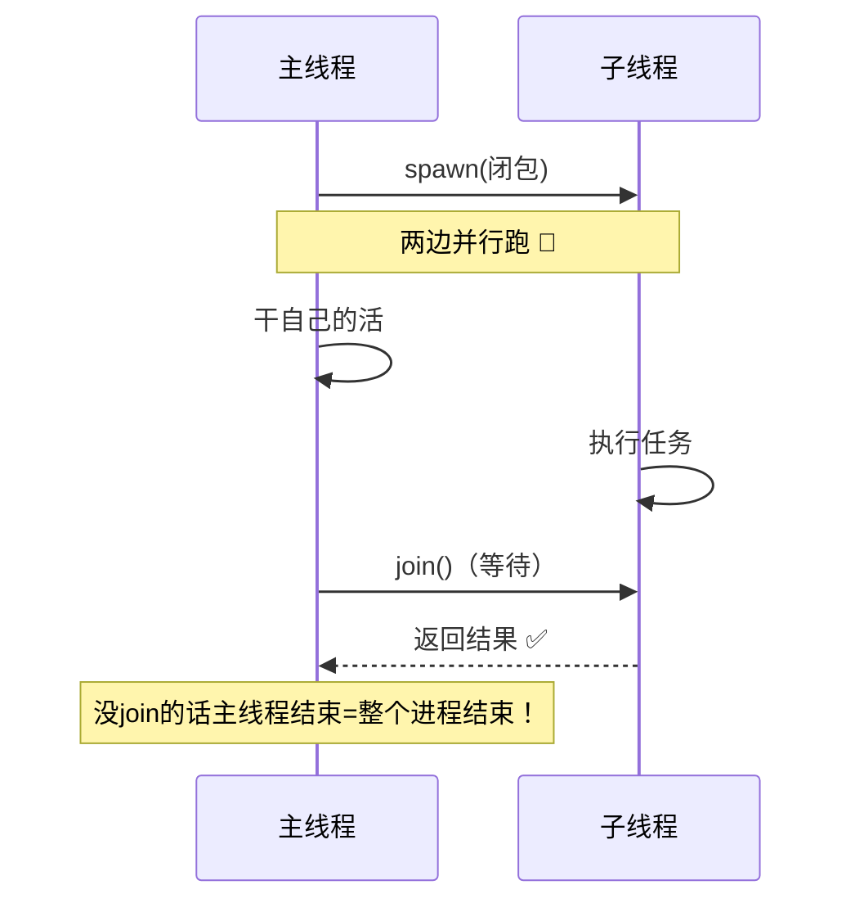
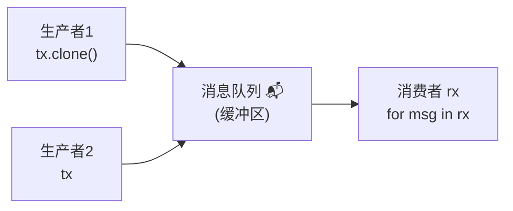
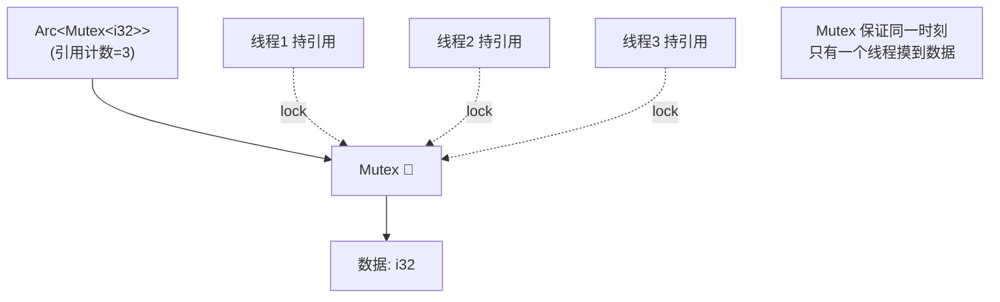
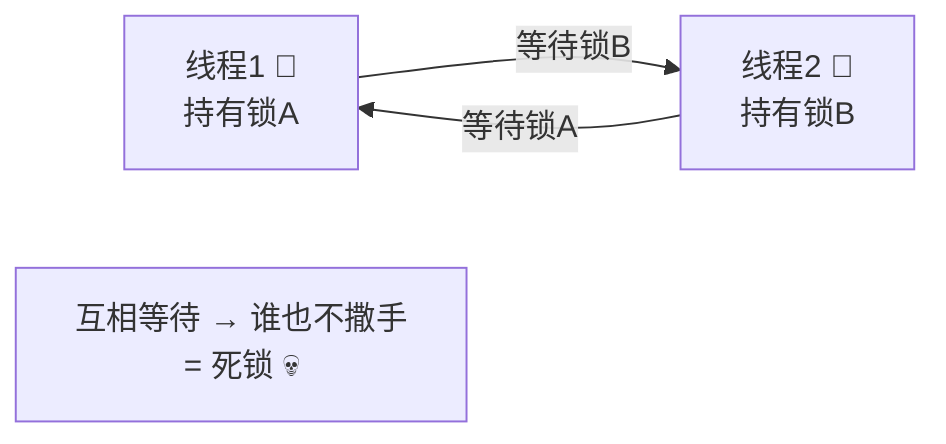
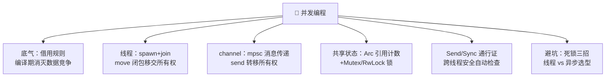

# 🧵 Rust 并发编程学习笔记

> 一句话介绍：**Rust 并发 = "无畏并发"（Fearless Concurrency）**——借用检查器把数据竞争（Data Race）在**编译期**就消灭掉，多线程该开就开，出不了内存事故！C/C++ 并发 bug 运行时才爆炸，Rust 直接不让编译过 ✨
>
> 📌 前置知识：[Rust基础语法.md](./Rust基础语法.md)（所有权/借用规则是并发的地基！）+ [Rust生命周期.md](./Rust生命周期.md)

---

## 📖 开篇：学习路线总览


| 章节 | 内容 | 难度 |
|------|------|------|
| 一 | 并发 vs 并行、Rust 的底气 | ⭐⭐ |
| 二 | 线程创建与 join、move 闭包 | ⭐⭐ |
| 三 | 消息传递：mpsc channel | ⭐⭐⭐ |
| 四 | 共享状态：Mutex + Arc + RwLock | ⭐⭐⭐ |
| 五 | Send / Sync：安全的通行证 | ⭐⭐⭐ |
| 六 | 死锁避坑 + 线程 vs 异步选型 | ⭐⭐⭐ |

---

## 一、并发概念与 Rust 的底气 💪

### 1.1 基础词汇表

| 术语 | 含义 | 类比 |
|------|------|------|
| 并发 Concurrency | **任务交替处理**（单核也可并发）| 一个厨师交替做两道菜 🍳 |
| 并行 Parallelism | **任务同时执行**（需多核）| 两个厨师各做一道菜 👨‍🍳👩‍🍳 |
| 数据竞争 Data Race | 多线程同时读写同一数据，至少一个在写 | 两人同时改一份文档还互不知情 💥 |
| 竞态条件 Race Condition | 时序不同导致结果不同 | 谁先到谁得奖 🏁 |

### 1.2 Rust 的底气：编译期消灭数据竞争 🛡️

还记得借用规则吗？**它就是并发安全的根基**：

| 借用规则（单线程） | 并发时的效果 |
|--------------------|----------------|
| N 个 `&T` 可共存 | 多线程同时**读** ✅ |
| 只有 1 个 `&mut T` | 同一时刻只有 1 个线程**写** ✅ |
| 读写不共存 | **读写互斥** → 数据竞争不可能发生 ✅ |

> 🎀 其他语言的锁纪律（"记得加锁哦"）靠自觉；Rust 的锁纪律靠**编译器强制**——不加锁想 `&mut`？门都没有！这就是"无畏并发"的含义：**安全是类型系统送的，不是程序员祈祷来的** 🙏

---

## 二、线程：spawn 与 join 🚀

### 2.1 创建线程

```rust
use std::thread;
use std::time::Duration;

fn main() {
    let handle = thread::spawn(|| {              // 返回 JoinHandle
        for i in 1..=3 {
            println!("子线程: {}", i);
            thread::sleep(Duration::from_millis(10));
        }
        "子线程的返回值"                          // 闭包返回值 = join 的返回值
    });

    for i in 1..=3 {
        println!("主线程: {}", i);
        thread::sleep(Duration::from_millis(10));
    }

    let result = handle.join().unwrap();         // join：等子线程干完活
    println!("收到: {}", result);
}
```

| API | 作用 |
|-----|------|
| `thread::spawn(closure)` | 开新线程执行闭包 |
| `handle.join()` | 阻塞等待线程结束（拿到返回值）⭐ |
| `thread::sleep(dur)` | 睡眠（让出 CPU）|
| `thread::current().id()` | 当前线程 ID |



> ⚠️ **主线程结束 = 整个进程结束**，子线程会被直接带走——想让子线程跑完，必须 `join()`！

### 2.2 move 闭包：线程所有权必考点 ⭐

```rust
use std::thread;

fn main() {
    let data = vec![1, 2, 3];

    // ❌ 编译报错：闭包借用了 data，但主线程可能先把它释放了！
    // thread::spawn(|| println!("{:?}", data));

    // ✅ move：把 data 的所有权【移交】给子线程
    let handle = thread::spawn(move || {
        println!("{:?}", data);       // 子线程独占拥有
    });

    // println!("{:?}", data);        // ❌ 主线程已失去所有权

    handle.join().unwrap();
}
```

> 🎀 为什么必须 move？——子线程活多久不确定，编译器无法保证"借用期间主线程活着"——**干脆把所有权搬过去，彻底了断**！这是 spawn 的黄金搭档～

---

## 三、消息传递：channel 📬

> Go 名言："不要通过共享内存来通信，而要通过通信来共享内存"——Rust 的 mpsc channel 就是这个思路的代言人！

### 3.1 mpsc：多生产者单消费者

```rust
use std::sync::mpsc;
use std::thread;

fn main() {
    let (tx, rx) = mpsc::channel();          // tx = 发送端，rx = 接收端

    // 生产者1
    let tx1 = tx.clone();                    // clone 出多个发送端
    thread::spawn(move || {
        tx1.send("来自线程A 🅰️").unwrap();    // send 会【转移所有权】！
    });

    // 生产者2
    thread::spawn(move || {
        tx.send("来自线程B 🅱️").unwrap();
    });

    // 消费者（主线程）
    for msg in rx {                          // rx 当迭代器用：收到一条处理一条
        println!("收到: {}", msg);
    }                                        // 所有 tx drop 后循环自动结束
}
```



| 特性 | 说明 |
|------|------|
| mpsc | **m**ulti-**p**roducer **s**ingle-**c**onsumer 多发一收 |
| `send()` | 发送消息，**值的所有权转移给接收方** ⭐ |
| `rx.recv()` | 阻塞收一条（返回 `Result`：通道关闭则 Err）|
| `for msg in rx` | 循环收直到所有发送端关闭 |
| `try_recv()` | 非阻塞收（没消息立即返回 Err）|

### 3.2 send 转移所有权：并发安全的精髓 💎

```rust
let s = String::from("宝贵数据");

tx.send(s).unwrap();
// println!("{}", s);    // ❌ 编译错误！s 的所有权已经给接收方了
```

> 🎀 神来之笔：**消息一旦发出，发送方就摸不到它了**——两个线程同时读写同一条数据的可能性从根上被掐灭！对比 C++ 传指针：发出去你还能偷偷改，炸弹随时引爆 💣

### 3.3 传输任意类型

```rust
#[derive(Debug)]
struct Task { id: u32, name: String }

let (tx, rx) = mpsc::channel();
thread::spawn(move || {
    tx.send(Task { id: 1, name: "备份日志".into() }).unwrap();
});
if let Ok(task) = rx.recv() {
    println!("执行任务: {:?}", task);
}
```

---

## 四、共享状态：Mutex + Arc 🔐

### 4.1 单线程 Mutex 初体验

```rust
use std::sync::Mutex;

fn main() {
    let m = Mutex::new(5);

    {
        let mut num = m.lock().unwrap();   // 上锁，拿到守卫（Guard）
        *num += 1;                          // 通过守卫改数据
    }                                       // 守卫离开作用域 → 自动解锁 ✅

    println!("m = {:?}", m);                // m = Mutex(6)
}
```

| 要点 | 说明 |
|------|------|
| `Mutex::new(v)` | 创建互斥锁，包裹数据 |
| `.lock()` | 上锁并返回 `MutexGuard` 守卫（RAII）|
| 守卫自动解锁 | 离开作用域自动释放锁——**忘解锁？不存在的** ✅ |
| `Deref` | 守卫可当 `&mut T` 用（`*num += 1`）|

> 🎀 和 C 的对比：C 忘了 `pthread_mutex_unlock` 就死锁；Rust 的锁和守卫绑定，**编译器逼你按规矩来**！

### 4.2 多线程共享：Arc 登场 🤝

问题：`Mutex` 需要被多个线程**拥有**，但所有权只有一个——怎么办？

```rust
use std::sync::{Arc, Mutex};
use std::thread;

fn main() {
    // Arc：原子引用计数的 Rc（线程安全版）
    //           ┌─ 克隆的是"引用"，不是数据
    let counter = Arc::new(Mutex::new(0));
    let mut handles = vec![];

    for _ in 0..10 {
        let counter = Arc::clone(&counter);        // 每个线程发一份引用
        handles.push(thread::spawn(move || {
            let mut num = counter.lock().unwrap(); // 拿锁改数
            *num += 1;
        }));                                       // 守卫 drop → 解锁
    }

    for h in handles { h.join().unwrap(); }

    println!("结果: {}", *counter.lock().unwrap());  // 稳定输出 10 ✅
}
```



### 4.3 Rc / Arc / Mutex 选型表 🧭

| 类型 | 线程安全 | 用途 | 场景 |
|------|:---:|------|------|
| `Rc<T>` | ❌ | 单线程引用计数 | 单线程共享只读 |
| `Arc<T>` | ✅ | 原子引用计数 | **多线程共享只读** |
| `Mutex<T>` | ✅ | 互斥锁包裹 | **多线程共享可变** |
| `Arc<Mutex<T>>` | ✅ | 组合拳 ⭐ | 多线程读**写**共享数据 |
| `Rc<RefCell<T>>` | ❌ | 单线程内部可变性 | 单线程共享可变 |

> ⚠️ 错误示范：多线程用 `Rc<Mutex<T>>` → 编译器直接报错 "`Rc<T>` cannot be sent between threads safely"——**Rc 不是 Send，跨线程必用 Arc**！

### 4.4 RwLock：读写锁（读多写少用它）

```rust
use std::sync::RwLock;

let lock = RwLock::new(vec![1, 2, 3]);

// 读锁：多个读者可同时持有
{
    let r1 = lock.read().unwrap();
    let r2 = lock.read().unwrap();      // ✅ 读读共存
    println!("{:?} {:?}", r1, r2);
}

// 写锁：独占
{
    let mut w = lock.write().unwrap();
    w.push(4);
}
```

| 锁 | 规则 | 适用 |
|----|------|------|
| `Mutex` | 一次一个（不管读写）| 写多 |
| `RwLock` | 多读共存 / 写独占 | **读多写少** ⭐ |

---

## 五、Send 与 Sync：安全的通行证 🛂

这两个 trait 是"无畏并发"的幕后功臣——**大部分情况自动推导，不用手写**，但必须懂含义：

| Trait | 含义 | 通俗版 |
|-------|------|--------|
| `Send` | 类型的**所有权可以跨线程转移** | 这件行李可以换车厢 🧳 |
| `Sync` | 类型可以**安全地被多线程同时引用**（`&T` 可跨线程）| 大家可以一起看这张海报 👀 |

| 类型 | Send | Sync | 说明 |
|------|:---:|:---:|------|
| `i32`、`String`、`Vec<T>` 等大多数 | ✅ | ✅ | 自动实现 |
| `Rc<T>` | ❌ | ❌ | 引用计数非原子 → 跨线程报错 |
| `Arc<T>` | ✅ | ✅ | 原子计数 |
| `RefCell<T>` | ✅ | ❌ | 借用检查是运行时单线程的 |
| `Mutex<T>`（T: Send）| ✅ | ✅ | 锁保证互斥 |

```rust
// 编译器自动当门卫：
use std::rc::Rc;
let rc = Rc::new(5);
thread::spawn(move || println!("{}", rc));
// ❌ error: `Rc<i32>` cannot be sent between threads safely
//    （数据竞争风险 → 编译期拦截，这就是 Rust 的底气！）
```

> 🎀 组合规律：`T: Sync` ⇔ `&T: Send`；`Arc<T>` 要求 `T: Send + Sync` 才能跨线程——**编译器沿类型链自动推导**，违规组合全部编译期拦截 ✅

---

## 六、实战避坑与选型 🚑

### 6.1 死锁：两把锁的交叉等待 💀

```rust
use std::sync::{Arc, Mutex};
use std::thread;

fn main() {
    let a = Arc::new(Mutex::new(1));
    let b = Arc::new(Mutex::new(2));

    let (a1, b1) = (Arc::clone(&a), Arc::clone(&b));
    let h1 = thread::spawn(move || {
        let _ga = a1.lock().unwrap();
        // ... 此处若中断，第二把锁拿不到 → 卡死
        let _gb = b1.lock().unwrap();       // 线程1：持A等B
    });

    let (a2, b2) = (Arc::clone(&a), Arc::clone(&b));
    let h2 = thread::spawn(move || {
        let _gb = b2.lock().unwrap();
        let _ga = a2.lock().unwrap();       // 线程2：持B等A → 死锁！💀
    });

    h1.join().unwrap();
    h2.join().unwrap();                     // 永远等不到...
}
```



**避坑三招**：

| 招数 | 说明 |
|------|------|
| ① 统一加锁顺序 | 所有线程都按 A→B 顺序拿锁（最有效 ⭐）|
| ② 减少锁粒度 | 临界区越小越好，拿完立刻 drop 守卫 |
| ③ 能用 channel 就别用锁 | 消息传递没有死锁烦恼 |

### 6.2 其他经典坑

| 坑 | 现象 | 解法 |
|----|------|------|
| 忘了 `join()` | 主线程跑完子线程被带走 | 收集 handles 统一 join |
| 闭包借用报错 | closure may outlive the current function | 加 `move` ⭐ |
| 在持锁时又拿锁 | `lock()` 时 PoisonError / 重入死锁 | 锁内不做复杂调用 |
| 锁中毒 PoisonError | 持锁线程 panic 后锁"带毒" | `.unwrap()` 传播 或 `.into_inner()` 强取 |
| 共享数据没加锁 | 编译器直接拒绝 &mut | Arc<Mutex<T>> 组合拳 |

### 6.3 线程 vs 异步怎么选？🤔

| 维度 | 线程（本篇）| async/await（下篇）|
|------|-------------|---------------------|
| 调度 | 操作系统抢占式 | 运行时协作式 |
| 每个开销 | ~MB 级栈内存 | ~KB 级任务 |
| 万级并发 | 吃力 💦 | 轻松 ✅ |
| 适用 | **CPU 密集**（计算）| **IO 密集**（网络服务）|

> 🎀 口诀：**算得猛用线程，等得多用异步**——Web 服务、爬虫、网关选 async；图像处理、加密压缩选线程～两者还能混搭！

### 6.4 综合小实战：并行求和 🧮

```rust
use std::thread;

fn parallel_sum(data: &[u64], parts: usize) -> u64 {
    let chunk = (data.len() + parts - 1) / parts;        // 每份大小（向上取整）

    let handles: Vec<_> = data
        .chunks(chunk)                                    // 数据切块（切片篇学的 chunks！）
        .map(|piece| {
            let piece = piece.to_vec();                   // 每块复制一份给线程独享
            thread::spawn(move || piece.iter().sum::<u64>())
        })
        .collect();

    handles.into_iter().map(|h| h.join().unwrap()).sum()  // 汇总各线程结果
}

fn main() {
    let data: Vec<u64> = (1..=1_000_000).collect();
    println!("总和 = {}", parallel_sum(&data, 8));        // 4 线程并行算
}
```

> 💡 这就是"分治并发"的骨架：**切块 → 各自处理 → 汇总**——MapReduce 的思想在单机上就长这样！

---

## 七、高频问题速查 🎯

| 问题 | 要点 |
|------|------|
| Rust 为什么敢叫"无畏并发"？ | 借用规则+Send/Sync 让数据竞争**编译期**被消灭 |
| spawn 后必须 join 吗？ | 想等子线程干完就必须 join；主线程结束=进程结束 |
| move 闭包为什么常用？ | 把所有权移交子线程，编译器才放心（不然借用可能悬垂）|
| mpsc 是什么？ | 多生产者单消费者 channel；send 会转移值的所有权 |
| channel 和锁怎么选？ | 优先 channel（无死锁）；需要共享可变状态才 Mutex |
| Arc 和 Rc 区别？ | Rc 单线程（计数非原子）；Arc 多线程安全 ⭐ |
| 为什么用 Arc<Mutex<T>>？ | Arc 解决"多线程共享"，Mutex 解决"可变"——组合拳 |
| Mutex 守卫是什么？ | lock() 返回的 MutexGuard：持有期间独占，drop 自动解锁 |
| RwLock 适用场景？ | 读多写少：多读锁共存，写锁独占 |
| Send 和 Sync 含义？ | Send=所有权可跨线程转移；Sync=&T 可多线程共享 |
| Rc 能跨线程吗？ | ❌ 非 Send，编译直接报错；换 Arc |
| 死锁怎么防？ | 统一加锁顺序；缩小临界区；能用 channel 就用 channel |
| 线程还是异步？ | CPU 密集→线程；IO 密集、海量并发→async/await |

---

## 八、结语 🌸

Rust 并发编程的知识树收好啦：



> 🎀 学习建议：
> 1. **每个例子都跑一遍**——故意把 `move` 删掉、把 `Arc` 换成 `Rc`，看编译器怎么花式拒绝你——**被编译器教育三遍，胜过背十遍概念** 😆
> 2. `Arc<Mutex<T>>` 这个组合拳**手写五遍**——它是共享状态的标准答案，也是面试高频题！
> 3. 死锁例子（6.1）跑起来观察"卡住"的感觉，再按"统一加锁顺序"改对——体会**顺序的重要性**！
>
> Rust 技能树已点亮五盏 🦀：[基础语法](./Rust基础语法.md) + [匹配模式](./Rust匹配模式.md) + [切片](./Rust切片.md) + [生命周期](./Rust生命周期.md) + 并发编程～下一站推荐 **async/await 异步编程**（并发的孪生兄弟，Web 开发必经之路）！还想学什么尽管吩咐～(๑•̀ㅂ•́)و✧
