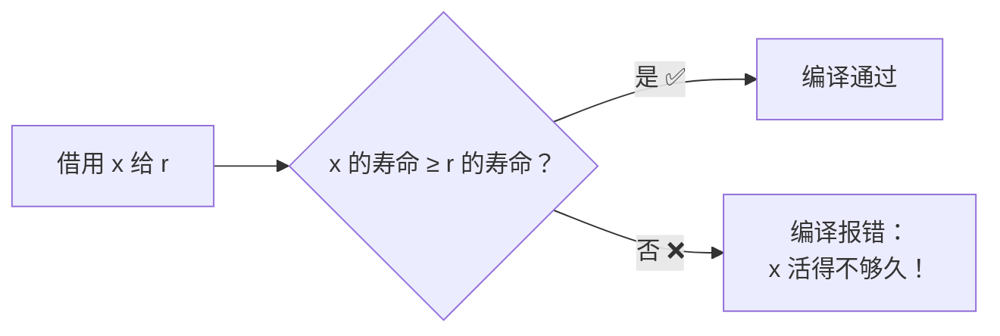
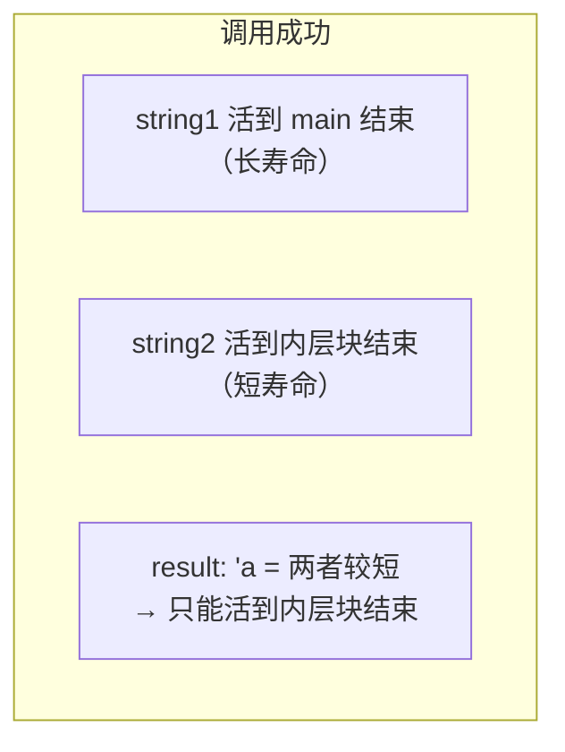
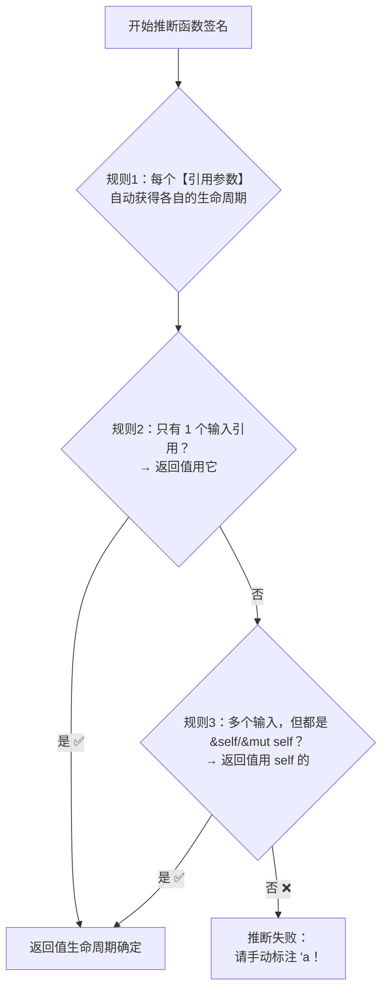
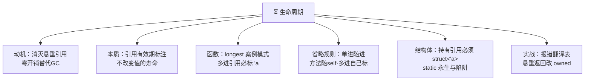

# ⏳ Rust 生命周期学习笔记

> 一句话介绍：**生命周期 = 引用保持有效的范围**——它是 Rust 编译器的"防悬垂指针侦探"，用 `'a` 标注告诉编译器"谁必须活得比谁久"。记住：它只是**描述关系的元数据**，不改变任何值的寿命！✨
>
> 📌 前置知识：[Rust基础语法.md](./Rust基础语法.md)（所有权/借用）+ [Rust切片.md](./Rust切片.md)（第六章已初见）——生命周期是 Rust 最后一座大山，翻过去就是坦途！⛰️

---

## 📖 开篇：学习路线总览


| 章节 | 内容 | 难度 |
|------|------|------|
| 一 | 悬垂引用问题、三种语言方案对比 | ⭐⭐ |
| 二 | 生命周期的本质与 `'a` 语法 | ⭐⭐⭐ |
| 三 | 函数标注：longest 经典案例 | ⭐⭐⭐ |
| 四 | **省略规则：90% 不用手写的原因** | ⭐⭐⭐⭐ |
| 五 | 结构体中的生命周期 + `'static` | ⭐⭐⭐⭐ |
| 六 | 常见报错翻译与实战 | ⭐⭐⭐ |

---

## 一、为什么需要生命周期？🔍

### 1.1 悬垂引用：万恶之源 💀

```rust
fn main() {
    let r;                        // 声明引用（还没初始化）

    {
        let x = 5;
        r = &x;                   // r 指向 x
    }                             // ❌ x 死了！r 还想用它 → 悬垂引用

    println!("{}", r);            // C 语言里：读到垃圾数据（未定义行为）
}                                 // Rust：直接编译报错 ✅
```

> 🎀 编译器的疑问：**"r 活得比 x 久，x 死了 r 怎么办？"**——为了回答这个问题，编译器必须知道**每个引用能活多久**，这就是生命周期！

### 1.2 三种语言的答卷 🪞

| 方案 | 代表 | 思路 | 代价 |
|------|------|------|------|
| 手动管理 | C | 程序员自己 free | 悬垂指针/UAF/泄漏 💀 |
| GC 垃圾回收 | Java/Go | 运行时追踪"还有人用吗" | 停顿、内存占用、性能损耗 |
| **编译期检查** | Rust ⭐ | 引用关系静态分析，**不匹配就拒绝编译** | 学习曲线陡（就是本篇！）|

> 💡 Rust 的答案：**零运行时开销**地消灭悬垂引用——代价是你要学会"向编译器解释清楚"引用之间的关系～

---

## 二、生命周期的本质 🧠

### 2.1 它不是什么 / 它是什么

| 误解 ❌ | 真相 ✅ |
|---------|---------|
| "生命周期改变值的存活时间" | **只是标注**，不延长/缩短任何东西 |
| "每运行一次就有一个生命周期" | 编译期**静态分析的概念**，运行时不存在 |
| "像 GC 一样管理内存" | 只是帮编译器**验证引用合法性**的元数据 |

```rust
&i32        // 普通引用
&'a i32     // 带生命周期标注的引用："这个引用在 'a 范围内有效"
&'a mut i32 // 可变引用 + 生命周期
```

> 🎀 类比：`'a` 就像给引用贴了个**"保质期标签**"🏷️——编译器检查所有标签，确保"没有人在保质期外使用"。标签本身不产生任何运行时开销！

### 2.2 作用域 vs 生命周期

```rust
fn main() {
    let x = 5;         // x 的生命周期从这里开始
    let r = &x;        // r 借用 x：r 的有效期被 x 的生命周期"兜底"
    println!("{} {}", x, r);
}                      // x 和 r 一起结束 ✅ 完美
```

**借用检查器的核心逻辑**：



---

## 三、函数中的生命周期：经典案例 🎓

### 3.1 longest：教科书第一案例 📖

```rust
// 返回两个字符串中更长的那个（参数是引用！）
fn longest<'a>(x: &'a str, y: &'a str) -> &'a str {   // 'a 标注三处
    if x.len() > y.len() { x } else { y }
}
```

**这段标注在说什么？**

> "`'a` 是 x 和 y 生命周期中**较短**的那个；返回值的寿命不超过 `'a`"——即**返回值不会比两个参数中任何一个活得久**！



```rust
fn main() {
    let string1 = String::from("long string is long");   // 长命

    {
        let string2 = String::from("xyz");               // 短命
        let result = longest(string1.as_str(), string2.as_str());
        println!("更长的是 {}", result);                   // ✅ 在两者都活着时使用
    }   // string2 死 → result 的 'a 也到此为止

    // let leaked;
    // {
    //     let string2 = String::from("xyz");
    //     leaked = longest(string1.as_str(), string2.as_str());
    // }
    // println!("{}", leaked);
    // ❌ 编译错误：string2 已死，而 leaked 还活着
    //    编译器防的就是这个！✅
}
```

### 3.2 标注语法规则

```rust
fn name<'a>(x: &'a str) -> &'a str { ... }
//  ↑     ↑      ↑          ↑
//  函数名 泛型参数（和<T>一个位置！）
//              参数引用带 'a   返回值也带 'a
```

| 规则 | 说明 |
|------|------|
| `'a` 写在 `<>` 里 | 生命周期是**泛型参数的一种**（和 `<T>` 同居）|
| 只描述、不改变 | 标注只是**契约声明**，不产生运行时影响 |
| 可以有多个 | `<'a, 'b>`：不同引用不同关系，各管各的 |

### 3.3 思考题：为什么这个不能编译？🤔

```rust
fn longest_x<'a, 'b>(x: &'a str, y: &'b str) -> &'a str {
    if x.len() > y.len() { x } else { y    // ❌ 返回 y，但 y 是 'b，和 'a 没约定
    }
}
// 错误：编译器无法证明 'b ≥ 'a → 返回值的寿命没保障
// 解法：fn f<'a:'b, ...> 约束 或 统一用同一个 'a
```

---

## 四、省略规则：为什么 90% 不用写 `'a`？✨

### 4.1 事实：多数函数不用标

```rust
fn first_word(s: &str) -> &str {        // 没写 'a，编译通过！
    s.split_whitespace().next().unwrap()
}

fn sum(v: &[i32]) -> i32 { v.iter().sum() }   // 同样不用
```

**因为编译器内置了 3 条省略规则（Elision Rules）**，能自动推断就不让你手写～

### 4.2 三条省略规则 📜



| 规则 | 内容 | 效果 |
|------|------|------|
| ① 输入 | 每个引用参数各得一个生命周期 | `&str` → `&'x str` |
| ② 输出 | 只有**一个**输入引用 → 返回值用它 | `first_word` 免标 ✅ |
| ③ 方法 | 输入含 `&self` → 返回值用 self 的 | 方法大多免标 ✅ |

### 4.3 对照练习

```rust
// ✅ 规则②命中：单个输入引用，返回值自动同寿命
fn slice_word(s: &str) -> &str { ... }

// ❌ 两个输入引用，规则失效 → 必须手写！
// fn longest(x: &str, y: &str) -> &str { ... }        // 编译错误
fn longest<'a>(x: &'a str, y: &'a str) -> &'a str { ... }   // ✅

// ✅ 规则③命中：方法返回值默认跟随 &self
impl Sentence {
    fn first(&self) -> &str { ... }          // 返回值 = self 的寿命，免标
    fn pick(&self, other: &str) -> &str { ... }  // ❌ 两个输入（self+other），要标！
}
```

> 🎀 记忆口诀：**"单进随进，方法随 self，多进自己标"**～编译器推不出来的那一刻，报错信息会明确说 `help: consider introducing a named lifetime parameter`，跟着提示加就好！

---

## 五、结构体中的生命周期与 'static 🏗️

### 5.1 结构体持有引用：必须标注 ⚠️

```rust
// ❌ 编译错误：结构体里的引用不知道能活多久
// struct Novel { title: &str }

// ✅ 正确：声明"结构体实例的寿命 ≤ 'a"
struct Novel<'a> {
    title: &'a str,      // 契约：Novel 活着的时候，title 指向的数据必须也活着
}

fn main() {
    let title = String::from("Rust 修炼之道");     // 长命的数据

    let novel = Novel { title: &title };           // novel 借用 title ✅

    println!("{}", novel.title);

    drop(title);       // ❌ 若先杀死 title，novel 就悬垂——编译器拦下！
}
```

> 🎀 对比：**结构体拥有数据（String）→ 想活多久活多久；结构体借用数据（&str）→ 必须陪数据一起死**。所以日常更推荐存 String（除非追求零拷贝性能）！

### 5.2 为结构体实现方法

```rust
struct Editor<'a> {
    name: &'a str,
    novel: Novel<'a>,           // 两个引用同享 'a
}

impl<'a> Editor<'a> {           // impl 也要声明
    fn sign(&self) -> String {
        format!("编辑 {} 签发《{}》", self.name, self.novel.title)
    }
}
```

### 5.3 'static：永生者 ♾️

```rust
let s: &'static str = "我编译期就存在，活到程序结束";   // 字面量都是 'static！

fn main() {
    let r: &'static str = "hello";     // ✅ 字面量放在只读数据区
}
```

| 要点 | 说明 |
|------|------|
| 含义 | 引用在**整个程序运行期间**都有效 |
| 谁是 'static | 字符串字面量、`static` 常量、全局数据 |
| ⚠️ 陷阱 | 看到 `-> &'static str` 报错就瞎加 'static = **埋雷**（可能掩盖真实问题）|
| 正确姿势 | 优先理清引用关系；确实需要"活久点"就考虑让函数**拥有数据**（返回 String）|

```rust
// 常见误区：为了消掉报错硬加 'static
fn get_name() -> &'static str {        // 契约：返回值活到程序结束
    // ... 如果实际上做不到，这就是自欺欺人 💣
}
// 更好的设计：返回 String，自己拥有数据，寿命自主！
fn get_name_owned() -> String { "name".to_string() }
```

### 5.4 泛型 + Trait + 生命周期三合一 🍱

```rust
use std::fmt::Display;

// 三种泛型参数同居一个 <>：类型 T、Trait约束、生命周期 'a
fn announce_and_return<'a, T: Display>(text: &'a str, ann: T) -> &'a str {
    println!("公告！{}", ann);
    text
}
```

---

## 六、常见报错翻译与实战 🚑

### 6.1 报错黑话翻译表 💊

| 编译器报错 | 人话 | 解法 |
|-----------|------|------|
| `expected lifetime parameter` / `consider introducing...` | 推断不出返回值寿命 | 按提示加 `'a` 标注 |
| `returns a value referencing data owned by the current function` | **返回了局部变量的引用**（悬垂）| 返回 owned 数据（String/T）或传入引用 |
| `x does not live long enough` | 某个值死得太早，借用还活着 | 调整作用域：让数据活得久一点 |
| `cannot borrow as mutable because it is also borrowed as shared` | 读写引用共存 | 缩短不可变借用的作用域（NLL）|
| `borrowed value does not live long enough`（结构体场景）| 结构体比它借的数据活得久 | 给 struct 加 `<'a>` 或改存 String |

### 6.2 经典悬垂返修案例

```rust
// ❌ 场景：函数内造数据、想返回引用
fn make_greeting(name: &str) -> &str {
    let greeting = format!("你好，{}", name);   // greeting 是局部变量
    &greeting                                  // ❌ 返回局部引用
}

// ✅ 修法1：返回拥有所有权的 String（最常用！）
fn make_greeting_v2(name: &str) -> String {
    format!("你好，{}", name)
}

// ✅ 修法2：调用方提供"存放处"（返回引用指向参数）
fn greet_into<'a>(buf: &'a mut String, name: &str) -> &'a str {
    buf.push_str(name);
    buf
}
```

> 🎀 **黄金直觉**：函数想返回引用，那引用指向的数据**必须来自外部**（参数）——函数自己造的局部数据，出了门就没了，借出去的引用必然悬垂！

### 6.3 什么时候真的需要手写标注？(频率表)

| 场景 | 需要标注？ |
|------|:---:|
| 普通函数：单引用进、引用出 | ❌ 省略规则搞定 |
| 方法：&self 进、引用出 | ❌ 跟随 self |
| **函数：多引用进、引用出** | ✅ `longest` 场景 |
| **结构体持有引用** | ✅ 必须 `struct X<'a>` |
| 想用 'static 全局数据 | 显式写更清晰 |
| 复杂库 API（迭代器适配器等）| ✅ 常见 |

---

## 七、高频问题速查 🎯

| 问题 | 要点 |
|------|------|
| 生命周期是什么？ | 引用保持有效的范围；编译期元数据，不改变运行时行为 |
| 为什么需要生命周期？ | 帮借用检查器验证"没有悬垂引用"，零开销替代 GC |
| `'a` 会改变值的寿命吗？ | ❌ 只描述关系，不延长不缩短任何东西 |
| 省略规则三条？ | ①每个引用参数各得生命周期 ②单输入→输出随它 ③有 self→输出随 self |
| 什么时候必须手写？ | 多个引用输入返回引用；结构体持有引用 |
| `'static` 是什么？ | 活到程序结束；字符串字面量都是 'static |
| 能返回局部变量的引用吗？ | ❌ 编译错误（悬垂）；改返回 String 等 owned 数据 |
| 结构体存 &str 还是 String？ | 常规存 String（自主寿命）；追求零拷贝才 &str + 'a |
| 生命周期和泛型 `<T>` 什么关系？ | 同居 `<>` 的"泛型参数"，一个是类型占位、一个是寿命占位 |
| 看到报错就加 'static 行吗？ | ⚠️ 治标不治本，可能掩盖设计问题；优先理清引用来源 |
| NLL 是什么？ | 非词法作用域：借用范围算到"最后一次使用"，不是作用域结尾 |
| 生命周期有运行时开销吗？ | **完全没有**！编译完就消失，产物和 C 一样快 |

---

## 八、结语 🌸

Rust 生命周期的知识树收好啦：



> 🎀 学习建议：
> 1. **别一开始就死抠语法**——先建立直觉："借用检查器只是要确认**数据不会死在引用前面**"，所有 `'a` 标注都是围绕这句话展开的！
> 2. 把 `longest` 案例和"返回局部变量引用"的反例**各手写三遍**，编译器报错信息当英语阅读题精读——Rust 的错误提示是全宇宙最贴心的 🥰
> 3. 实战策略：**优先返回 owned 数据（String/Vec）**，只有性能敏感路径才玩引用 + 标注——等写出结构体/迭代器库时再回来精读，水到渠成！
>
> 恭喜！Rust 最后一座大山翻过啦 🏔️🎉 技能树已点亮四盏：[基础语法](./Rust基础语法.md) + [匹配模式](./Rust匹配模式.md) + [切片](./Rust切片.md) + 生命周期～接下来闭包迭代器 / 智能指针 / 异步 / Axum 想去哪就去哪！(๑•̀ㅂ•́)و✧
