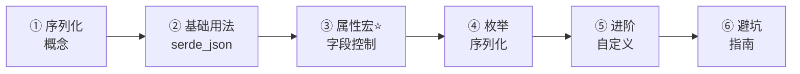
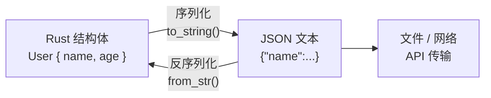
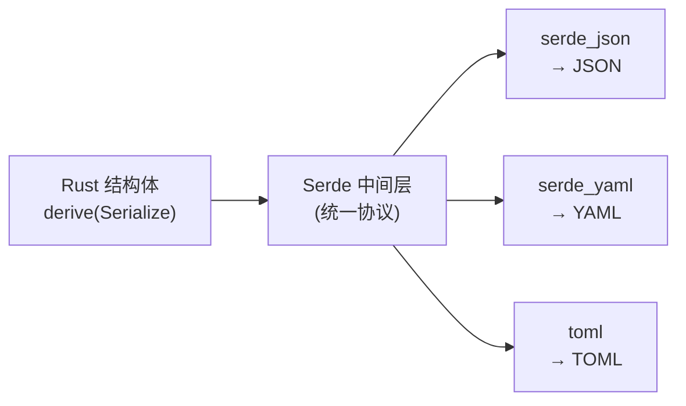
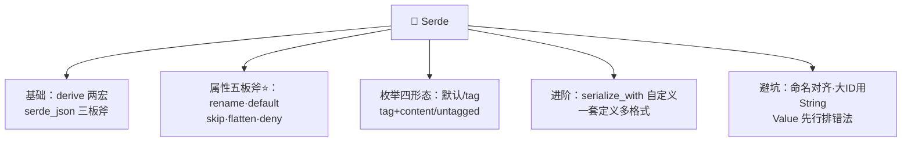

# 🔄 Serde 学习笔记

> 一句话介绍：**Serde = Rust 序列化界的事实标准**——一个 `#[derive(Serialize, Deserialize)]` 宏，结构体和 JSON/YAML/TOML 之间的转换全部自动完成！Axum 的 `Json<T>`、配置文件解析、API 通信……底层全是它 ✨
>
> 📌 前置知识：[Rust基础语法.md](./Rust基础语法.md)（结构体/枚举）+ [Axum.md](./Axum.md)（Json 提取器内部就是 Serde 在干活！）

---

## 📖 开篇：学习路线总览



| 章节 | 内容 | 难度 |
|------|------|------|
| 一 | 序列化 vs 反序列化、Serde 地位 | ⭐ |
| 二 | derive 宏 + serde_json 三板斧 | ⭐⭐ |
| 三 | **常用属性：字段级精准控制（核心！）** | ⭐⭐⭐ |
| 四 | 枚举序列化：tag 形式全解 | ⭐⭐⭐⭐ |
| 五 | 自定义序列化 + 多格式支持 | ⭐⭐⭐ |
| 六 | 常见坑与排查 | ⭐⭐ |

---

## 一、序列化是什么？🔄

### 1.1 两个方向

| 术语 | 方向 | 例子 |
|------|------|------|
| **序列化** Serialize | Rust 结构体 → 字符串/字节 | `User` → `{"name":"小花"}` |
| **反序列化** Deserialize | 字符串/字节 → Rust 结构体 | `{"name":"小花"}` → `User` |



### 1.2 Serde 的江湖地位 👑

| 场景 | 谁在用 Serde |
|------|--------------|
| Web 框架 | Axum `Json<T>`、Actix |
| 配置文件 | config、Figment（TOML/YAML）|
| 数据库 | sqlx、diesel（行↔结构体）|
| 消息队列 | Kafka、MQTT 客户端 |
| 其他语言对照 | Java Jackson、Python dataclasses+json |

> 🎀 Serde 的杀手锏是 **derive 宏**：不用手写一行转换代码，编译期自动生成——而且**零反射、纯编译期展开，性能直接拉满** 🚀

---

## 二、基础用法：serde_json 三板斧 🥊

### 2.1 依赖配置

```toml
[dependencies]
serde = { version = "1", features = ["derive"] }  # derive 宏必开！
serde_json = "1"                                   # JSON 格式实现
```

### 2.2 结构体 ↔ JSON

```rust
use serde::{Serialize, Deserialize};

#[derive(Serialize, Deserialize, Debug)]       // 两个宏一加，齐活！
struct User {
    name: String,
    age: u8,
    email: Option<String>,       // Option → 可有可无的字段
}

fn main() {
    let user = User {
        name: "小花".to_string(),
        age: 18,
        email: Some("hua@x.com".into()),
    };

    // ① 序列化：结构体 → JSON 字符串
    let json = serde_json::to_string(&user).unwrap();
    println!("{}", json);
    // {"name":"小花","age":18,"email":"hua@x.com"}

    // 美化输出（带缩进）
    let pretty = serde_json::to_string_pretty(&user).unwrap();

    // ② 反序列化：JSON 字符串 → 结构体
    let text = r#"{"name":"小明","age":20}"#;
    let u: User = serde_json::from_str(text).unwrap();
    println!("{:?}", u);
    // User { name: "小明", age: 20, email: None }  ✅ 缺 email 也能解析！

    // ③ 万能中间值：serde_json::Value（类似 JS 的对象）
    let v: serde_json::Value = serde_json::from_str(r#"{"a":1}"#).unwrap();
    println!("{}", v["a"]);            // 1
}
```

### 2.3 API 速查表

| 函数 | 作用 |
|------|------|
| `to_string(&v)` | 序列化为紧凑字符串 |
| `to_string_pretty(&v)` | 序列化 + 缩进美化 |
| `to_value(&v)` | 序列化为 `Value`（动态树）|
| `from_str::<T>(s)` | 字符串 → T |
| `from_slice(&[u8])` | 字节 → T |
| `from_reader(reader)` | IO 流 → T（边读边解析，省内存）|
| `json!({...})` 宏 | 手写 JSON 字面量（测试神器）|

```rust
use serde_json::json;

// json! 宏：像写 JS 一样构造
let payload = json!({
    "code": 0,
    "data": { "list": [1, 2, 3] },
    "msg": "ok",
});
println!("{}", payload["data"]["list"][1]);   // 2
```

---

## 三、常用属性：字段级精准控制 ⭐（核心！）

> 真实项目的 JSON 千奇百怪：驼峰命名、可省字段、默认值、字段合并……全靠 `#[serde(...)]` 属性搞定！

### 3.1 命名控制：rename 家族

```rust
#[derive(Serialize, Deserialize)]
#[serde(rename_all = "camelCase")]    // 整个结构体：snake_case → camelCase
struct ApiResponse {
    user_name: String,                // JSON 中变成 "userName"
    avatar_url: String,               // "avatarUrl"
}

#[derive(Serialize, Deserialize)]
struct Person {
    #[serde(rename = "id_card")]      // 单个字段改名
    id: String,                       // JSON 中叫 "id_card"

    #[serde(rename = "type_")]        // 避开关键字也能这么玩
    r#type: String,
}
```

| 属性 | 效果 |
|------|------|
| `rename_all = "camelCase"` | 全字段 蛇形→驼峰（对接前端 JS 风格 ⭐）|
| `rename_all = "UPPERCASE"` | 全大写 |
| `rename = "xxx"` | 单字段改名 |

### 3.2 缺省与默认值

```rust
#[derive(Deserialize)]
#[serde(default)]                     // 整个结构体：缺字段用 Default::default()
struct Config {
    host: String,
    #[serde(default = "default_port")] // 缺字段时调用这个函数
    port: u16,
    debug: bool,                      // 配合 #[serde(default)] → false
}

fn default_port() -> u16 { 8080 }

// {"host":"localhost"} 也能解析！port 自动 8080 ✅
```

### 3.3 跳过字段：skip 家族 ✂️

```rust
#[derive(Serialize, Deserialize)]
struct User {
    name: String,

    #[serde(skip)]                    // 完全跳过：序列化不输出、反序列化用 Default
    password: String,

    #[serde(skip_serializing)]        // 只序列化时跳过（反序列化还要读）
    cache: Option<String>,

    #[serde(skip_serializing_if = "Option::is_none")]   // None 就不输出 ⭐超常用
    email: Option<String>,
}
// email = None → {"name":"小花"}（不会出现 "email":null）
```

| 属性 | 序列化时 | 反序列化时 |
|------|----------|------------|
| `skip` | 不输出 | 用 Default 填充 |
| `skip_serializing` | 不输出 | 正常读取 |
| `skip_deserializing` | 正常输出 | 用 Default 填充 |
| `skip_serializing_if = "Option::is_none"` | None 不输出 | 正常读取 ⭐ |

### 3.4 flatten：字段拍平合并 🥞

```rust
#[derive(Serialize, Deserialize)]
struct Pagination {
    page: u32,
    size: u32,
}

#[derive(Serialize, Deserialize)]
struct Response {
    code: i32,
    #[serde(flatten)]                 // 把 Pagination 的字段"拍平"进上一层！
    paging: Pagination,
    items: Vec<String>,
}
// 输出：{"code":0,"page":1,"size":20,"items":[...]}
// （不是嵌套的 "paging":{...}，而是平铺 ✨）
```

### 3.5 严格模式

```rust
#[derive(Deserialize)]
#[serde(deny_unknown_fields)]        // JSON 里出现结构体没有的字段 → 报错！
struct Strict {
    a: i32,
}
// 解析 {"a":1,"b":2} → Err：unknown field `b`
// （默认行为是静默忽略多余字段）
```

> 🎀 属性速记：**改名用 rename、缺省用 default、藏字段用 skip、拍平用 flatten、严格用 deny**——五板斧覆盖 90% 场景！

---

## 四、枚举序列化：四种形态全解 🎰

枚举是 Serde 的重头戏，先看**默认行为**：

```rust
#[derive(Serialize, Deserialize)]
enum Status {
    Active,                       // unit 变体 → "Active"
    Level(u8),                    // tuple 变体 → {"Level":3}
    Error { code: u32, msg: String },  // struct 变体 → {"Error":{"code":500,"msg":"oops"}}
}
```

### 4.1 tag：给枚举打"类型标签" ⭐

```rust
#[derive(Serialize, Deserialize)]
#[serde(tag = "type")]             // 内部标签：变体名写进 type 字段
enum Message {
    Text { content: String },      // {"type":"Text","content":"hi"}
    Image { url: String },         // {"type":"Image","url":"http://..."}
}
```

### 4.2 adjacently tagged：类型与数据分离

```rust
#[derive(Serialize, Deserialize)]
#[serde(tag = "type", content = "data")]
enum Event {
    Click { x: i32, y: i32 },      // {"type":"Click","data":{"x":1,"y":2}}
    Key(char),                     // {"type":"Key","data":"a"}
}
```

### 4.3 untagged：无标签直接猜 🔮

```rust
#[derive(Serialize, Deserialize)]
#[serde(untagged")]
enum Value {
    Num(i64),                      // 42 → Num(42)（按字段形状猜变体！）
    Text(String),                  // "hi" → Text("hi")
}
```

### 4.4 四种形态对比表

| 写法 | 输出示例 | 适用 |
|------|----------|------|
| 默认（externally tagged）| `{"Level":3}` | 通用、可逆性最好 |
| `tag = "type"` | `{"type":"Text","content":"hi"}` | **API 常用** ⭐（扁平清晰）|
| `tag + content` | `{"type":"Click","data":{...}}` | 类型与数据分离 |
| `untagged` | `42` | 按形状匹配（解析灵活的多态 JSON）|

> ⚠️ untagged 的坑：**按顺序尝试匹配**，`Num(i64)` 排在 `Text` 前面时 `"42"` 不会被误吃，但形状相近的变体可能匹配错——**变体形状差异要足够大**再用！

### 4.5 实战：多态消息解析（untagged 神器）

```rust
#[derive(Serialize, Deserialize)]
#[serde(untagged)]
enum JsonValue {
    Bool(bool),
    Int(i64),
    Float(f64),
    Str(String),
    Array(Vec<JsonValue>),              // 递归！任意嵌套数组
    Object(std::collections::HashMap<String, JsonValue>),
}

// 任何 JSON 都能装进去——自己写个 mini serde_json::Value ✨
let v: JsonValue = serde_json::from_str(r#"{"a":[1,"two",true]}"#).unwrap();
```

---

## 五、进阶玩法 🚀

### 5.1 字段级自定义：serialize_with

```rust
use serde::ser::Serializer;

fn to_hex<S>(value: &u32, s: S) -> Result<S::Ok, S::Error>
where S: Serializer {
    s.serialize_str(&format!("0x{:X}", value))     // 输出 "0xFF" 而不是 255
}

fn from_hex<'de, D>(d: D) -> Result<u32, D::Error>
where D: serde::Deserializer<'de> {
    let s: &str = serde::Deserialize::deserialize(d)?;
    u32::from_str_radix(s.trim_start_matches("0x"), 16)
        .map_err(serde::de::Error::custom)
}

#[derive(Serialize, Deserialize)]
struct Color {
    #[serde(serialize_with = "to_hex", deserialize_with = "from_hex")]
    value: u32,        // Rust 里是数字 255，JSON 里是 "0xFF"
}
```

| 场景 | 方案 |
|------|------|
| 时间字段格式化 | `chrono` 的 `serde` feature（RFC3339 自动转）|
| 自定义格式 | `serialize_with` / `deserialize_with` |
| 第三方类型加序列化 | newtype 包一层 `struct UserId(u32)` |

### 5.2 一个 derive，多种格式 🎭

Serde 只是"翻译框架"，格式由前端 crate 实现：

```toml
serde_yaml = "0.9"    # YAML
toml = "0.8"          # TOML（Rust 配置文件标配）
serde_csv...          # 用 csv crate
```

```rust
// 同一个结构体，无缝切换格式！
let yaml = serde_yaml::to_string(&config).unwrap();
let toml = toml::to_string(&config).unwrap();
let json = serde_json::to_string(&config).unwrap();
// 反序列化同理——这就是"中间表示"设计的威力
```



### 5.3 与 Axum 的联动（呼应实战篇）

```rust
// Axum 里这两行，底层全是 Serde：
async fn create(Json(payload): Json<CreateUser>) -> Json<User> { ... }
// 请求体 --(serde_json::from_str)--> CreateUser
// User --(serde_json::to_string)--> 响应体
// 所以：字段解析报 422？检查 Deserialize derive 和字段名！
```

---

## 六、常见坑与排查 🚑

| 坑 | 现象 | 解法 |
|----|------|------|
| 忘开 derive feature | `cannot find derive macro Serialize` | `serde = { features = ["derive"] }` |
| 字段名不匹配 | `missing field \`user_name\`` | 加 `rename` / `rename_all` 对齐命名 |
| 缺字段报错 | `missing field \`email\`` | 字段用 `Option<T>` 或加 `#[serde(default)]` |
| 类型不匹配 | `invalid type: string, expected u32` | JSON 是 `"18"`（字符串）但 Rust 要数字——改类型或自定义反序列化 |
| 大整数丢失 | 64 位 ID 从 JS 来精度不够 | ID 字段用 **String** 接收（前端惯例）⭐ |
| 多余字段想报错 | 默默忽略了 | `#[serde(deny_unknown_fields)]` |
| 枚举对不上 | `unknown variant` | 检查 tag 属性和变体名拼写 |
| 想看详细错误 | unwrap 只有 `Error("...")` | 打印完整 error：`from_str::<T>(&s).map_err(|e| e.to_string())` |

> 🎀 排错万能套路：把目标 JSON 用 `serde_json::from_str::<serde_json::Value>()` 先解析成 Value 打印看看——**先确认 JSON 本身合法，再上结构体**，一步定位问题在哪层！

---

## 七、高频问题速查 🎯

| 问题 | 要点 |
|------|------|
| Serde 是什么？ | Rust 序列化框架事实标准；derive 宏编译期生成代码，零反射 |
| 序列化 vs 反序列化？ | 结构体→JSON 是序列化；JSON→结构体是反序列化 |
| Option 字段什么行为？ | JSON 缺字段 → None；配 skip_serializing_if 可不输出 null |
| 字段重命名怎么做？ | `#[serde(rename = "...")]` 单个 / `rename_all` 全体 |
| 默认值怎么给？ | `#[serde(default)]` / `#[serde(default = "fn")]` |
| flatten 干嘛的？ | 嵌套结构体的字段"拍平"到父级 JSON |
| 枚举默认输出啥样？ | 外部标签：`{"Level":3}` |
| tag 是什么？ | `#[serde(tag="type")]` 变体名内嵌为字段，API 常用 ⭐ |
| untagged 是什么？ | 无标签按"形状"猜变体——多态 JSON 解析神器（形状需差异明显）|
| 想忽略未知字段还是报错？ | 默认忽略；`deny_unknown_fields` 改为报错 |
| 支持 YAML/TOML 吗？ | ✅ 换个前端 crate（serde_yaml/toml），结构体定义不变 |
| 自定义字段格式？ | `serialize_with` / `deserialize_with` 指定转换函数 |
| 大整数 ID 为什么用 String？ | JS Number 只有 53 位精度，64 位会丢——API 惯例 ID 用字符串 |
| Axum 422 是谁报的？ | Serde 反序列化失败 → Axum 的 Json 提取器转成 422 响应 |

---

## 八、结语 🌸

Serde 的知识树收好啦：



> 🎀 学习建议：
> 1. **属性五板斧手敲一遍**——找一份真实 API 的 JSON（如 GitHub API），写结构体接住它，属性控制会瞬间融会贯通！
> 2. 枚举 tag 形式对着**输出对比表**逐个试——看输出长什么样比背概念快 10 倍 😆
> 3. 排错记住两板斧：**Value 先行**（先确认 JSON 合法）+ **error 完整打印**（别只 unwrap）！
>
> Rust 全家桶再下一城 🦀：[基础语法](./Rust基础语法.md) → [匹配模式](./Rust匹配模式.md) → [切片](./Rust切片.md) → [生命周期](./Rust生命周期.md) → [并发编程](./Rust并发编程.md) → [Axum](./Axum.md) → **Serde**——前后端数据通道也打通啦！还想学什么尽管吩咐～(๑•̀ㅂ•́)و✧
