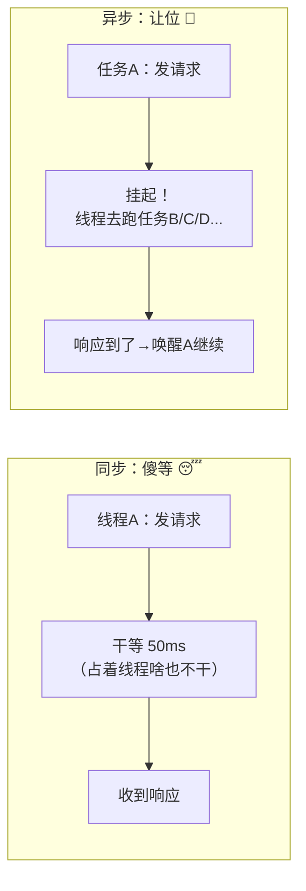
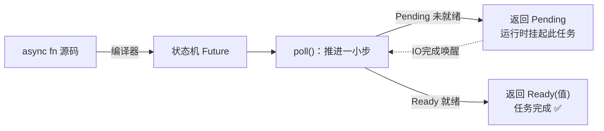
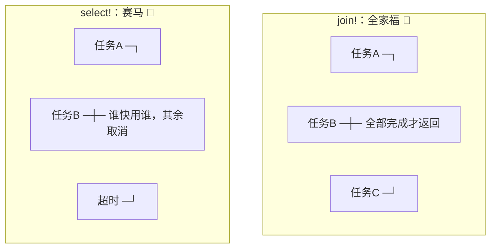
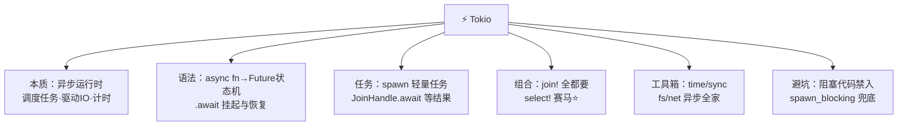

# ⚡ Tokio 学习笔记

> 一句话介绍：**Tokio = Rust 异步世界的"操作系统"**——async/await 只是语言语法，真正调度任务、驱动 IO、管理计时器的都是 Tokio！Axum、SQLx、reqwest 全建立在它之上，堪称异步生态的"地基中的地基" 🏗️
>
> 📌 前置知识：[Rust并发编程.md](./Rust并发编程.md)（线程篇 6.3 已埋伏笔："算得猛用线程，等得多用异步"）——本篇揭开另一半！

---

## 📖 开篇：学习路线总览


| 章节 | 内容 | 难度 |
|------|------|------|
| 一 | IO 密集痛点、运行时概念 | ⭐⭐ |
| 二 | async fn、.await、Future 状态机 | ⭐⭐⭐ |
| 三 | #[tokio::main] + spawn 任务 | ⭐⭐⭐ |
| 四 | join! / select! 并发组合 | ⭐⭐⭐ |
| 五 | time / sync / fs / net 工具箱 | ⭐⭐⭐ |
| 六 | 阻塞任务与常见坑 | ⭐⭐⭐ |

---

## 一、为什么需要异步？⚡

### 1.1 线程的困境

```
场景：1 万个连接同时等对方说话（聊天服务器）

方案A：一个连接一个线程
├── 每线程 ~1MB 栈内存 → 10GB 💥 内存爆炸
└── 1 万线程让操作系统调度 → 上下文切换开销巨大 😵

方案B：异步任务（Tokio）
├── 每任务 ~几KB → 几十 MB ✅
└── 少量线程跑上万任务 → 等待时让出 CPU ✨
```

| 维度 | 线程 | 异步任务 |
|------|------|----------|
| 内存开销 | ~MB 级 | ~KB 级 |
| 谁调度 | 操作系统（抢占）| 运行时（协作）|
| 数量级 | 千级吃力 | **十万级轻松** ✅ |
| 适用 | CPU 密集（计算）| **IO 密集**（网络/磁盘）|

### 1.2 核心思想：等待时让出来 🤝



> 🎀 一句话：**异步 = 等待时不占线程**。就像外卖等餐时刷手机而不是站在门口发呆——一个人（线程）能"同时"处理多件事 📱

---

## 二、async/await 的本质 🧠

### 2.1 基本语法

```rust
// async fn：返回一个 Future（"未来才会有值的承诺函"）
async fn fetch_data(id: u32) -> String {
    tokio::time::sleep(std::time::Duration::from_millis(100)).await;  // 模拟网络IO
    format!("数据{}", id)
}

// 使用：.await 等承诺兑现（只能在 async 里用！）
async fn main_like() {
    let data = fetch_data(42).await;    // ⏳ 等待期间线程可以去干别的
    println!("{}", data);
}
```

| 关键字 | 作用 | 类比 |
|--------|------|------|
| `async fn` | 定义异步函数，返回 `Future` | 拿到"外卖取餐号" 🎫 |
| `.await` | 等待 Future 完成，拿到结果 | 凭号取餐（期间可干别的）|
| ⚠️ 规则 | `.await` 只能在 async 上下文 | 异步会"传染"——一路 async 到 main |

### 2.2 Future：状态机本质 🔬

```rust
// 你写的代码：
async fn work() -> u32 {
    let a = step_one().await;      // 挂起点1
    let b = step_two(a).await;     // 挂起点2
    a + b
}

// 编译器实际生成：一个状态机！
enum WorkFuture {
    Start,                    // 还没开始
    WaitingStepOne,           // 在等 step_one
    WaitingStepTwo(u32),      // 在等 step_two（记住了 a！）
    Done,
}
// 每次 .await 就是"存档"当前状态；IO 就绪后从存档处"读档"继续
```



> 🎀 关键认知：**Future 是惰性的**！创建它什么都不会发生，必须 `.await`（或交给运行时）才会执行——和迭代器一个脾气～

### 2.3 谁在驱动？运行时！

```rust
// 标准库只定义了 Future 接口，没有提供"执行器"
// Tokio 的职责就是不断 poll 所有任务 + 处理 IO 事件唤醒它们
```

| 角色 | 负责 | 类比 |
|------|------|------|
| 语言（async/await）| 生成状态机 | 造出汽车 🚗 |
| **Tokio 运行时** | 调度、驱动、唤醒 | 修好公路 + 当调度员 👷 |

---

## 三、Tokio 核心：main 与 spawn 🚀

### 3.1 #[tokio::main] 的真相

```rust
#[tokio::main]        // 这个宏其实是语法糖！
async fn main() {
    println!("Hello");
}

// 展开后等价于：
fn main() {
    tokio::runtime::Builder::new_multi_thread()   // 多线程运行时
        .enable_all()                             // 开启 IO + 时间驱动
        .build()
        .unwrap()
        .block_on(async {                         // 阻塞主线程，跑完异步块
            println!("Hello");
        });
}
```

```toml
[dependencies]
tokio = { version = "1", features = ["full"] }   # full = 全功能
```

### 3.2 spawn：并发新任务 🎯

```rust
use tokio::task;

#[tokio::main]
async fn main() {
    // spawn：把任务丢给运行时调度（立即返回，不等待！）
    let handle = task::spawn(async {
        tokio::time::sleep(std::time::Duration::from_secs(1)).await;
        "任务完成！"
    });

    println!("主流程继续跑，不等它～");

    let result = handle.await.unwrap();    // 需要结果时再等（JoinHandle）
    println!("{}", result);
}
```

| 对比 | 线程篇 `thread::spawn` | Tokio `task::spawn` |
|------|------------------------|----------------------|
| 创建成本 | 系统调用，~MB | 轻量，~KB ⚡ |
| 参数 | 闭包 | **async 块** |
| 等待 | `.join()` | `.await`（JoinHandle）|
| 数量 | 千级 | 十万级 ✅ |

> 🎀 记忆锚点：**会 .await 的闭包就是 async 块 `async { ... }`**，spawn 它就得到并发任务～

---

## 四、join! 与 select!：并发组合器 🧩

### 4.1 join!：全都要（等全部完成）

```rust
use tokio::time::{sleep, Duration};

// 串行：总耗时 = 1 + 2 = 3 秒 😴
async fn serial() {
    let a = task_a().await;    // 等1秒
    let b = task_b().await;    // 再等2秒
}

// 并发：总耗时 = max(1, 2) = 2 秒 ⚡
async fn concurrent() {
    let (a, b) = tokio::join!(task_a(), task_b());   // 同时开始，全等完
}
```

### 4.2 select!：赛马（谁先好用谁）🐎

```rust
use tokio::select;

async fn with_timeout() {
    let result = tokio::select! {
        data = fetch_data() => {
            println!("请求先完成: {}", data);
            data
        }
        _ = sleep(Duration::from_millis(500)) => {
            println!("超时先到！500ms 内没等到 😢");
            "超时降级数据".to_string()
        }
    };
    // 同时发起两个 Future，谁先完成走谁的分支（另一个被丢弃）
}
```



| 组合器 | 语义 | 典型场景 |
|--------|------|----------|
| `join!(a, b)` | 等全部完成 | 并行请求多个接口再汇总 |
| `select!(a, b)` | 谁先完成用谁 | **超时控制**、多路监听 ⭐ |
| `try_join!(a, b)` | 全成功才 Ok | 一荣俱荣，一个失败就放弃 |
| `spawn` + `await` | 独立任务 | 需要后台长期跑的任务 |

> 🎀 select! 是**超时/取消**的标准姿势：`fetch` vs `sleep` 赛马——500ms 内没响应就降级，用户体验瞬间拉满！

---

## 五、Tokio 工具箱 🧰

### 5.1 time：时间三件套 ⏰

```rust
use tokio::time::{sleep, timeout, interval, Duration};

// ① sleep：异步睡眠（不占线程！）
sleep(Duration::from_secs(1)).await;

// ② timeout：给任何操作加时限 ⭐
match timeout(Duration::from_secs(3), long_task()).await {
    Ok(result) => println!("按时完成: {}", result.unwrap()),
    Err(_) => println!("超时啦！"),
}

// ③ interval：定时循环
let mut tick = interval(Duration::from_secs(5));
loop {
    tick.tick().await;              // 每5秒醒来一次
    println!("心跳～ 💓");
}
```

> ⚠️ 千万别在 async 里用 `std::thread::sleep`——它是阻塞的，会把整个 worker 线程卡死！必须用 `tokio::time::sleep`～

### 5.2 sync：异步版本的同步原语 🔐

```rust
use tokio::sync::{Mutex, RwLock, mpsc, oneshot, watch, Notify};

// ① 异步 Mutex：和 std 的区别是——等待锁时不阻塞线程（挂起任务）
let data = std::sync::Arc::new(Mutex::new(vec![1, 2]));
{
    let mut guard = data.lock().await;    // ⚠️ 注意 .await！
    guard.push(3);
}

// ② mpsc channel：任务间消息传递（异步版）
let (tx, mut rx) = mpsc::channel(32);     // 32 = 缓冲容量（满了 send 会等待）
tokio::spawn(async move {
    tx.send("你好").await.unwrap();
});
while let Some(msg) = rx.recv().await {
    println!("收到: {}", msg);
}
```

| 选谁 | 场景 |
|------|------|
| `tokio::sync::Mutex` | 锁内要 `.await`（持有期间跨挂起点）⭐ |
| `std::sync::Mutex` | 锁内纯计算、快速释放（性能更好）|
| `mpsc` | 多发一收消息流 |
| `oneshot` | 一次性传值（发一次就关）|
| `watch` | 广播最新值（配置热更新）|
| `broadcast` | 一发多收 |

### 5.3 fs 与 net：异步 IO 全家 🌐

```rust
// 异步文件（内部用线程池模拟）
let content = tokio::fs::read_to_string("config.toml").await?;

// 异步 TCP 服务（Axum 底层就是它！）
let listener = tokio::net::TcpListener::bind("0.0.0.0:8080").await?;
loop {
    let (socket, addr) = listener.accept().await?;   // 等连接（不占线程）
    tokio::spawn(async move {
        // 每个连接一个轻量任务——十万连接也不怕 ⚡
        handle_connection(socket).await;
    });
}
```

---

## 六、常见坑与避坑指南 🚑

### 6.1 头号大坑：在 async 里写阻塞代码 💀

```rust
#[tokio::main]
async fn main() {
    // ❌ 阻塞操作会卡死 worker 线程！运行时线程就那几个，全卡住=服务瘫痪
    std::thread::sleep(std::time::Duration::from_secs(1));  // 阻塞睡眠
    let s = std::fs::read_to_string("big.txt").unwrap();    // 阻塞IO
    let h = heavy_cpu_compute();                            // CPU 密集

    // ✅ 正确姿势分三种：
    // 1. 睡眠换异步版
    tokio::time::sleep(std::time::Duration::from_secs(1)).await;
    // 2. 文件换异步版
    let s = tokio::fs::read_to_string("big.txt").await?;
    // 3. CPU 密集/第三方阻塞库 → 丢进专用线程池！
    let r = tokio::task::spawn_blocking(|| heavy_cpu_compute())
        .await.unwrap();
}
```

| 阻塞代码 | 替换方案 |
|----------|----------|
| `thread::sleep` | `tokio::time::sleep().await` |
| `std::fs` | `tokio::fs` |
| CPU 密集计算 | `spawn_blocking` ⭐ |
| 同步库的阻塞调用 | `spawn_blocking` 包起来 |

### 6.2 其他常见坑

| 坑 | 现象 | 解法 |
|----|------|------|
| 忘了 .await | Future never executed 警告 | Future 是惰性的，必须 await/spawn |
| async 传染 | 想在 main 里调用异步函数 | 一路 async fn 到 main（#[tokio::main]）|
| select! 后继续用被取消的 Future | 值丢失/逻辑怪异 | 用循环 + 重置，或用 timeout() 包装 |
| channel 容量太小 | send 卡住 | 加大容量 / 用 unbounded（慎用）|
| 锁跨 .await 死锁 | 任务互相等锁 | 缩小锁作用域，别持锁 await |
| spawn 的任务丢了 | 主程序退出任务没跑完 | 保存 JoinHandle 并 await / 用 graceful shutdown |

### 6.3 spawn vs join! 决策表 🧭

| 需求 | 选择 |
|------|------|
| 并行几个请求，全都要结果，当前函数等 | `tokio::join!` |
| 多个来源，谁先到处理谁 | `tokio::select!` |
| 后台长期任务（日志上报、心跳）| `tokio::spawn` |
| 给请求加超时 | `timeout()` 或 select! |
| CPU 密集任务 | `spawn_blocking` |

---

## 七、高频问题速查 🎯

| 问题 | 要点 |
|------|------|
| Tokio 是什么？ | Rust 异步运行时：调度任务、驱动 IO、计时器——Axum/SQLx 的地基 |
| async fn 返回什么？ | Future（编译器生成的状态机），惰性，不 await 不执行 |
| .await 做了什么？ | 挂起当前任务（存档），线程去跑别的；就绪后从存档继续 |
| 为什么异步省资源？ | 等待时任务挂起（KB级），线程不被占用——单线程可跑上万任务 |
| spawn 和 join! 区别？ | spawn 独立后台任务；join! 在当前上下文并发等全部 |
| select! 是干嘛的？ | 多个 Future 赛马，谁先完成用谁——超时/取消标准姿势 ⭐ |
| #[tokio::main] 干了啥？ | 建多线程运行时 + block_on 跑 async main（语法糖）|
| std::sync::Mutex 还是 tokio 的？ | 锁内要 .await 用 tokio 版；纯计算快进快出用 std 版 |
| 阻塞代码能放 async 里吗？ | ❌ 卡死 worker 线程！换异步版或 spawn_blocking |
| spawn_blocking 何时用？ | CPU 密集或必须调同步阻塞库时，丢专用线程池 |
| channel 满了会怎样？ | 有界 channel 的 send 挂起等待（背压 ✅）|
| 线程还是异步怎么选？ | CPU 密集→线程；海量连接 IO 密集→异步（口诀见并发篇）|

---

## 八、结语 🌸

Tokio 的知识树收好啦：



> 🎀 学习建议：
> 1. 把 **4.2 的 select! 超时示例**亲手跑一遍，再把 sleep 改成 100ms/1000ms 观察两个分支——**异步"赛马"的体感一次建立** 🏇
> 2. 故意在 async 里写 `thread::sleep` 跑双任务对比 `tokio sleep`——亲眼看到"卡死"就再也不会犯 💀
> 3. 心智模型三句话：**async fn 是状态机、.await 是存档读档、Tokio 是调度员**——面试和实战都够用了！
>
> Rust 全家桶大圆满 🦀✨：[基础语法](./Rust基础语法.md) → [匹配模式](./Rust匹配模式.md) → [切片](./Rust切片.md) → [生命周期](./Rust生命周期.md) → [并发编程](./Rust并发编程.md) → **Tokio**（异步）→ [Axum](./Axum.md) → [Serde](./Serde.md) → [SQLx](./SQLx.md)——语言核心 + 异步运行时 + Web 全栈，一套打通！还想学什么尽管吩咐～(๑•̀ㅂ•́)و✧
