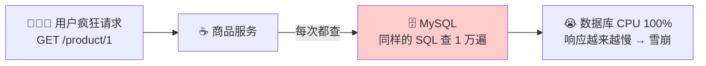
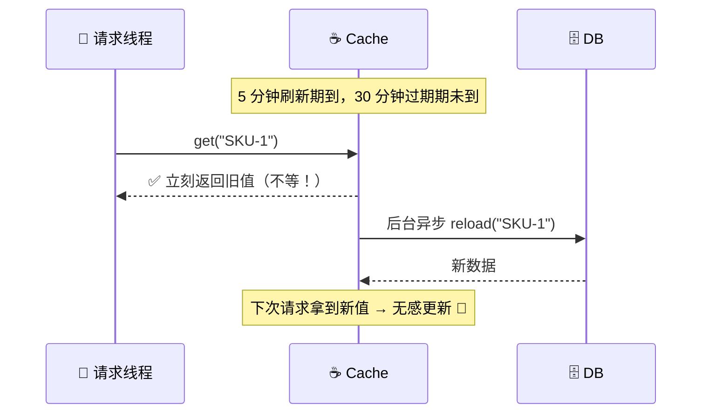
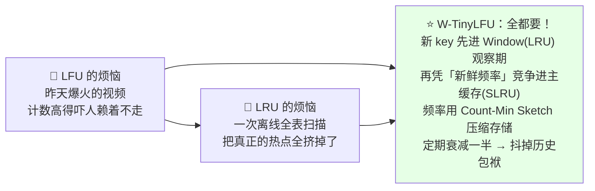
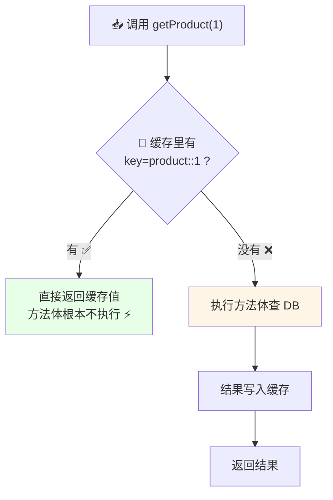
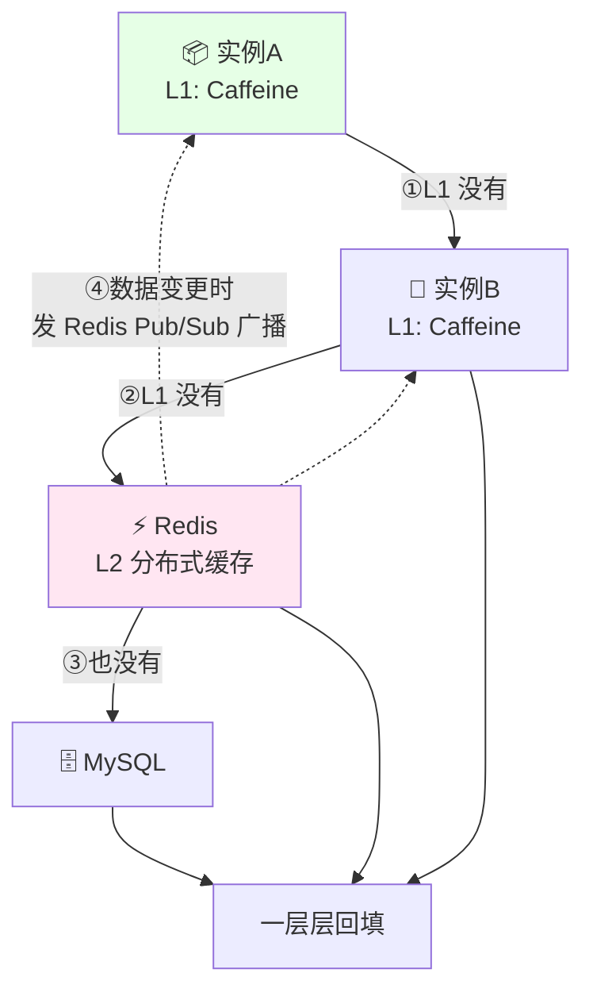
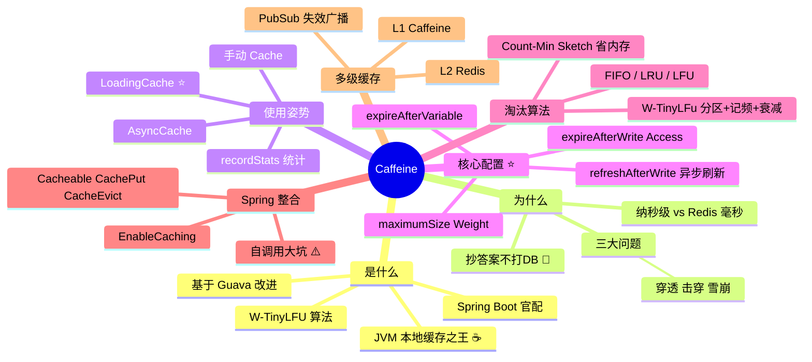

# Caffeine 本地缓存 从入门到实战 ☕

> 欢迎来到 Caffeine 小课堂！💖 一个商品详情页每秒被查 1 万次，每次都打数据库？数据库当场去世 💀！今天的主角 **Caffeine**——JVM 上**性能最强的本地缓存库**（名字梗：咖啡因，让你快到失眠 😆），Spring Boot 的官方心头好！学完这篇，缓存配置、淘汰策略、@Cacheable 一网打尽～
>
> **学习目标**：
> - 🎯 搞懂本地缓存的价值和 Caffeine 的江湖地位
> - 🎯 掌握核心配置：容量上限、过期策略、刷新机制
> - 🎯 理解 W-TinyLFU 淘汰算法为什么牛
> - 🎯 会用 Spring Boot + Caffeine 的 @Cacheable 姿势 + 多级缓存架构
>
> **前置知识**：Java 基础、了解 HashMap、Spring Boot 更佳～

---

## 一、初识 Caffeine：为什么需要缓存？🌱

### 1.1 没有缓存的悲惨世界



**灵魂拷问**：商品 1 的数据一分钟内根本不会变，为什么要查一万遍数据库？**把结果"抄"一份放内存里**不就完了！

### 1.2 缓存 = 把答案抄在便利贴上 📝

> **缓存（Cache）**：把频繁访问、不易变化的数据，存在**读取更快的地方**（内存），下次直接拿，不打数据库！

| 方案 | 速度 | 范围 | 代表 |
|---|---|---|---|
| 本地缓存 | ⚡⚡⚡ 纳秒级（进程内存） | **单 JVM 进程** | **Caffeine**、Guava Cache、Ehcache |
| 分布式缓存 | ⚡ 毫秒级（网络） | 全集群共享 | **Redis**（联动前作～） |
| 数据库 | 🐢 几十毫秒 | 持久化 | MySQL |

> 🎀 本地缓存比 Redis 还快几十倍（不用过网络）！但它是"每个 JVM 各抄一份"——**多实例数据可能不一致**，所以大项目常用"Caffeine + Redis"组合拳（第七章讲～）

### 1.3 Caffeine 是什么

> **Caffeine** = 基于 **Guava Cache** 改进而来的新一代 JVM 本地缓存库，采用 **W-TinyLFU** 淘汰算法，在各类基准测试里**命中率吊打 Guava**，官方钦点为 Spring 抽象缓存的首选实现！🏆

| | Guava Cache（老将） | **Caffeine**（新王 ⭐） |
|---|---|---|
| 算法 | LRU 近似 | **W-TinyLFU**（命中率更高） |
| 吞吐 | 高 | **更高（官方基准碾压）** |
| 异步支持 | 弱 | **AsyncCache 原生响应式** |
| 过期策略 | 写后/访问后 | + **变量过期**、刷新 |
| 维护 | 缓慢 | 活跃 |
| API | — | **几乎照抄 Guava**（迁移零成本！） |

---

## 二、缓存三大经典问题 ⭐（面试必会！）

| 问题 | 是什么 | Caffeine 视角的缓解 |
|---|---|---|
| **缓存穿透** | 查"根本不存在"的数据，缓存永远不命中，全打到 DB | 缓存空值（`Optional.empty()`）短 TTL |
| **缓存击穿** | 某**热点 key** 过期瞬间，万军齐查 DB | `refreshAfterWrite` 异步刷新（旧值顶住，旧 key 不下岗）⭐ |
| **缓存雪崩** | **大批 key 同时过期**，DB 瞬间被冲垮 | 给 TTL 加随机抖动（`expireAfterVariable`） |

> 💡 这三兄弟在 Redis 那篇也会遇到，概念通用，面试超高频！区别是：**本地缓存还可以靠"容量上限 + 好算法"兜底**——淘汰策略才是 Caffeine 的看家本领（第五章）～

---

## 三、快速上手：五种姿势用缓存 🚀

### 3.1 引依赖

```xml
<dependency>
    <groupId>com.github.ben-manes.caffeine</groupId>
    <artifactId>caffeine</artifactId>
    <version>3.1.8</version>
</dependency>
```

### 3.2 姿势一：手动 Cache（最灵活）

```java
// ☕ 手动版：自己决定什么时候放/取
Cache<String, Product> cache = Caffeine.newBuilder()
        .maximumSize(10_000)                 // 最多 1 万条
        .expireAfterWrite(10, TimeUnit.MINUTES)   // 写入 10 分钟后过期
        .build();

// ① get(key, mappingFunction)：没有就现算并放入（原子！同一 key 并发只算一次 ⭐）
Product p1 = cache.get("SKU-1", key -> productDao.findById(key));

// ② 普通 getIfPresent：只查不计算
Product p2 = cache.getIfPresent("SKU-1");

// ③ 直接放
cache.put("SKU-2", new Product("SKU-2", "可爱抱枕"));

// ④ 失效（删除）
cache.invalidate("SKU-1");          // 删一条
cache.invalidateAll();              // 全清
```

> ⚠️ **大坑预警**：**别用"先 getIfPresent、null 再查库再 put"** 的两步写法——并发下同 key 会被算 N 次（缓存击穿现场 😱）。**永远用 `get(key, function)` 原子姿势**！

### 3.3 姿势二：自动加载 LoadingCache（最常用 ⭐）

```java
// ☕ 定义"怎么加载"，之后只管 get，全自动！
LoadingCache<String, Product> cache = Caffeine.newBuilder()
        .maximumSize(10_000)
        .expireAfterWrite(10, TimeUnit.MINUTES)
        .build(key -> productDao.findById(key));   // 加载逻辑写死在 build 里

Product p = cache.get("SKU-1");       // 没有就自动调 productDao 加载 ✨
Map<String, Product> all = cache.getAll(List.of("SKU-1", "SKU-2"));  // 批量
```

### 3.4 姿势三：异步 AsyncCache（高并发神器）

```java
// ☕ 返回 CompletableFuture：加载在异步线程池跑，不阻塞调用线程！
AsyncCache<String, Product> cache = Caffeine.newBuilder()
        .maximumSize(10_000)
        .expireAfterWrite(10, TimeUnit.MINUTES)
        .buildAsync(key -> productDao.findById(key));

CompletableFuture<Product> future = cache.get("SKU-1");
future.thenAccept(p -> System.out.println("拿到啦：" + p.getName()));
```

### 3.5 姿势四：统计命中率（recordStats）

```java
LoadingCache<String, Product> cache = Caffeine.newBuilder()
        .recordStats()                // ⭐ 开启统计（有极小开销）
        .maximumSize(1000)
        .build(key -> load(key));

// 干点查询后……
CacheStats stats = cache.stats();
System.out.println("命中率：" + stats.hitRate());            // 0.95 = 95% 命中
System.out.println("命中次数：" + stats.hitCount());
System.out.println("加载平均耗时：" + stats.averageLoadPenalty());
```

---

## 四、核心配置详解 ⭐⭐（重头戏！）

Caffeine 的精髓全在 `Caffeine.newBuilder()` 的链式配置：

### 4.1 容量上限：什么时候开始"裁员"

```java
Caffeine.newBuilder()
    // 方式一：按条数（简单粗暴）
    .maximumSize(10_000)

    // 方式二：按"权重"（更精细，如按字节/对象大小）
    .maximumWeight(100_000)                       // 总权重 10 万
    .weigher((String key, byte[] value) -> value.length)  // 每条权重 = 字节数
```

> 💡 达到上限后不是"立即裁到上限"，而是接近上限时**异步批量淘汰**（性能考量）～

### 4.2 过期策略：数据能活多久

| 策略 | 含义 | 适用 |
|---|---|---|
| `expireAfterWrite(10, MINUTES)` | **写入后 10 分钟过期**（无论有没有人访问） | 数据有明确时效（Token、行情快照）⭐ |
| `expireAfterAccess(10, MINUTES)` | **最后访问后** 10 分钟过期 | 热点数据"越用越活" |
| `expireAfterVariable(Expiry)` | **每条数据自定义存活时间** ⭐ | 不同数据不同 TTL（如 VIP 数据活 1h、普通活 5min） |

```java
// ☕ 每条数据自己的 TTL（还能玩"续命"：每次访问刷新）
Caffeine.newBuilder()
    .expireAfterVariable(new Expiry<String, Session>() {
        @Override
        public long expireAfterCreate(String key, Session s, long now) {
            return TimeUnit.SECONDS.toNanos(s.getTtl());        // 创建时按自身 TTL
        }
        @Override
        public long expireAfterUpdate(String key, Session s, long now) {
            return TimeUnit.SECONDS.toNanos(s.getTtl());        // 更新时重置
        }
        @Override
        public long expireAfterRead(String key, Session s, long now, long old) {
            return old;                                          // 读不续命
        }
    }).build();
```

### 4.3 刷新策略：旧值顶住，后台悄悄换新 ⭐（防击穿神技！）

```java
Caffeine.newBuilder()
    .refreshAfterWrite(5, TimeUnit.MINUTES)   // 写后 5 分钟"该刷新了"
    .expireAfterWrite(30, TimeUnit.MINUTES)   // 30 分钟才真正过期
    .build(key -> productDao.findById(key));  // ⚠️ 刷新要求 Cache 是 LoadingCache！
```

**expire 和 refresh 的天壤之别**：

| | `expireAfterWrite` 过期 | `refreshAfterWrite` 刷新 |
|---|---|---|
| 到期后第一次访问 | **阻塞**等重新加载（击穿窗口 😱） | **立即返回旧值**，后台异步加载 |
| 线程感受 | 慢一下 | 无感 ✅ |
| 适用 | 强时效数据 | 热点数据平滑更新 ⭐ |



### 4.4 其他实用配置

```java
Caffeine.newBuilder()
    .initialCapacity(100)                    // 初始容量（预分配，防扩容抖动）
    .recordStats()                           // 开统计
    .removalListener((key, value, cause) ->  // 移除监听：谁被裁了？为什么？
            log.info("💨 移除 {}，原因：{}", key, cause))    // EXPIRED/SIZE/EVICTED...
```

---

## 五、淘汰算法：Caffeine 的看家本领 🧠⭐

缓存满了，**该裁谁**？这是个千古难题：

### 5.1 三大经典算法对比

| 算法 | 思路 | 优点 | 致命伤 |
|---|---|---|---|
| **FIFO** 先进先出 | 最老的滚蛋 | 简单 | 老但常用的 key 被误杀 😢 |
| **LRU** 最近最少使用 | 最久没被用的滚蛋 | 贴近直觉，实现不难 | **偶发批量扫描会"冲刷"掉真热点**（一次遍历全表，热点全被挤走） |
| **LFU** 最不常用 | 访问次数最少的滚蛋 | 抗扫描冲刷 ✅ | 历史包袱重（昨天的热点赖着不走）、计数器占内存 |



### 5.2 W-TinyLFU 一句话版

> **W-TinyLFU = LRU 的"识人" + LFU 的"记频"**：新来的先在小房间（Window-LRU）观察，想进主厅（SLRU）得靠**近期访问频率**说话，而且频率定期**减半衰减**——既不被一次性扫描忽悠，也不被过气网红占座！**用极省内存的 Count-Min Sketch 记频率**，这就是 Caffeine 命中率碾压 Guava 的秘密 🏆

> 🎀 面试答到"W-TinyLFU = 新老分区 + 频率统计 + 衰减机制，兼顾 LRU 和 LFU 优点、克服各自缺点"这一层，就超过 90% 的候选人啦！

---

## 六、Spring Boot + Caffeine 实战 ⭐⭐（企业标准姿势！）

> 平时业务代码里**很少直接 new Caffeine**——都用 Spring Cache 注解，底层自动换成 Caffeine！

### 6.1 三步接入

```xml
<!-- ☕ pom.xml -->
<dependency>
    <groupId>org.springframework.boot</groupId>
    <artifactId>spring-boot-starter-cache</artifactId>
</dependency>
<dependency>
    <groupId>com.github.ben-manes.caffeine</groupId>
    <artifactId>caffeine</artifactId>
</dependency>
```

```java
// ☕ ① 启动类开缓存
@SpringBootApplication
@EnableCaching                       // ⭐ 别忘了！
public class App { ... }
```

```yaml
# ☕ ② application.yml —— 指定 Caffeine + 全局配置
spring:
  cache:
    type: caffeine
    caffeine:
      spec: maximumSize=1000,expireAfterWrite=5m
```

### 6.2 三个注解打天下

```java
// ☕ ③ 业务方法上贴注解
@Service
public class ProductService {

    @Cacheable(value = "product", key = "#id")          // ⭐ 先查缓存，没有才执行方法并回填
    public Product getProduct(Long id) {
        System.out.println("💥 查数据库了（这句不该频繁出现）");
        return productDao.findById(id);
    }

    @CachePut(value = "product", key = "#p.id")          // 方法照常执行，结果更新进缓存
    public Product update(Product p) {
        return productDao.update(p);
    }

    @CacheEvict(value = "product", key = "#id")          // 删除缓存
    public void delete(Long id) {
        productDao.delete(id);
    }

    @CacheEvict(value = "product", allEntries = true)    // 清空整个 product 缓存
    public void reloadAll() { ... }
}
```

**@Cacheable 执行流程**：



### 6.3 每个 cacheName 不同配置（进阶）

```java
// ☕ 多缓存个性化配置（product 活 10 分钟、user 活 1 小时）
@Configuration
public class CacheConfig {
    @Bean
    public CacheManager cacheManager() {
        CaffeineCacheManager manager = new CaffeineCacheManager("product", "user");
        manager.setCaffeine(Caffeine.newBuilder()
                .maximumSize(1000)
                .expireAfterWrite(10, TimeUnit.MINUTES));
        // 需要更细粒度就用 SimpleCacheManager + 多个 CaffeineCache 组装～
        return manager;
    }
}
```

> ⚠️ **自调用大坑**：同类里 `this.getProduct()` 调用**不走缓存**！（AOP 代理失效，同 @Transactional 坑）——拆到别的 Bean 或注入自身代理～

---

## 七、多级缓存：Caffeine + Redis 组合拳 🥊⭐

单机本地缓存的软肋：**多实例各存一份，更新不同步**。企业标准解法——**L1 本地 + L2 分布式**：



```java
// ☕ 多级缓存读取骨架（伪代码）
public Product get(Long id) {
    // ① L1：本地（纳秒级）
    Product p = l1.getIfPresent(id);
    if (p != null) return p;

    // ② L2：Redis（毫秒级）
    p = redis.get("product:" + id);
    if (p != null) {
        l1.put(id, p);                     // 回填 L1
        return p;
    }

    // ③ DB（最慢，兜底）
    p = productDao.findById(id);
    redis.setex("product:" + id, 600, p);  // 回填 L2
    l1.put(id, p);                         // 回填 L1
    return p;
}

// ☕ 数据更新时：删 Redis + 发广播让所有实例清各自的 L1
public void update(Product p) {
    productDao.update(p);
    redis.del("product:" + p.getId());
    redis.convertAndSend("cache:invalidate", p.getId());   // 各实例订阅后 invalidate L1
}
```

| 层 | 技术 | 速度 | 作用 |
|---|---|---|---|
| L1 | Caffeine | ⚡⚡⚡ 纳秒 | 扛住最热流量 |
| L2 | Redis | ⚡ 毫秒 | 跨实例共享、容量大 |
| DB | MySQL | 🐢 | 真相之源 |

---

## 八、常见坑速查表 🕳️

| 现象/坑 | 原因 | 解法 |
|---|---|---|
| @Cacheable 完全不生效 | 忘了 @EnableCaching / **同类自调用** | 开注解；跨 Bean 调用 |
| 并发下同 key 查了 N 次库 | getIfPresent + put 两步非原子 | 用 `get(key, loader)` 原子姿势 ⭐ |
| 缓存对象更新了但读到的还是旧的 | 存的是**同一可变对象引用**（改了原对象，缓存里也被改/或反过来） | 缓存**不可变对象**或存副本 |
| OOM 内存爆了 | 没maximumSize / 权重配置 | 一定设上限！本地缓存吃的是 JVM 堆 ⚠️ |
| 集群下实例间数据不一致 | 本地缓存天然各存一份 | TTL 调短 + 多级缓存 + 失效广播 |
| expireAfterAccess 越用越久导致数据陈旧 | 访问会续命 | 时效敏感场景用 expireAfterWrite |
| 缓存大量 key 同一秒过期 → 雪崩 | TTL 全一样 | expireAfterVariable 加随机抖动 |
| refreshAfterWrite 报错/不刷新 | 用在普通 Cache 上 | 刷新只支持 **LoadingCache**（build 传 loader） |
| removalListener 里做重活 | 监听器是异步/可能阻塞内部线程 | 只做轻量日志，重活扔线程池 |
| hitRate 一直很低 | key 太散/缓存粒度不对/容量太小 | 检查 key 设计、加容量、看 stats 调优 |

---

## 九、高频面试题速答 🎯

| 问题 | 精简答案 |
|---|---|
| Caffeine 是什么？和 Guava Cache 区别？ | JVM 高性能本地缓存库；API 沿袭 Guava 但用 W-TinyLFU 替代 LRU 近似，命中率/吞吐更高，原生支持异步 |
| Caffeine 为什么快/命中率为什么高？ | W-TinyLFU（Window-LRU + SLRU 分区 + Count-Min Sketch 记频 + 定期衰减）兼顾 LRU/LFU 优点；淘汰异步批量执行减少开销；基于乐观并发（ConcurrentHashMap 变体） |
| LRU 和 LFU 的优缺点？ | LRU 贴近局部性但怕批量扫描冲刷热点；LFU 抗冲刷但历史热点赖着不走且占内存——W-TinyLFU 融合两者并衰减解决 |
| expireAfterWrite 和 expireAfterAccess 区别？ | 前者写入后固定时长过期（时效保证），后者最后访问后过期（越用越活） |
| refreshAfterWrite 的作用？ | 到期后首次访问**立即返回旧值**并**异步回源刷新**，避免热点 key 过期瞬间的击穿阻塞 |
| 本地缓存和 Redis 怎么选？ | Caffeine：纳秒级、单进程、不怕网络抖动，适合热点小数据；Redis：集群共享、容量大、可持久化；大厂常用 L1 Caffeine + L2 Redis 多级缓存 |
| @Cacheable 原理？ | Spring AOP 环绕代理：先按 key 查缓存，命中直接返回（方法不执行）；未命中执行方法后回填——所以同类 this 调用不走代理不生效 |
| 怎么解决本地缓存集群不一致？ | 短 TTL 容忍 + 更新时发 Redis Pub/Sub / MQ 广播失效消息，各实例删除本地 key |
| 缓存穿透/击穿/雪崩？ | 穿透：查不存在的 key（缓存空值）；击穿：热点 key 过期瞬间并发打 DB（refreshAfterWrite/加锁）；雪崩：大批 key 同时过期（TTL 加随机） |
| Caffeine 怎么统计命中率？ | `recordStats()` 开启，`cache.stats()` 拿 hitRate/averageLoadPenalty 等指标（可接 Micrometer） |

---

## 十、知识总结地图 🗺️



> 🎀 **毕业寄语**：Caffeine 的灵魂就一句——**"把答案抄在离你最近的便利贴上"**！先把第六章 @Cacheable 跑起来感受"💥查库日志消失术"，再回头品味 refreshAfterWrite 防击穿和 W-TinyLFU 的精妙～ 面试聊到"为什么 Caffeine 比 Guava 强"，甩出 W-TinyLFU 三个关键词（分区、记频、衰减），面试官眼睛会亮！💪✨
