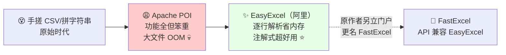
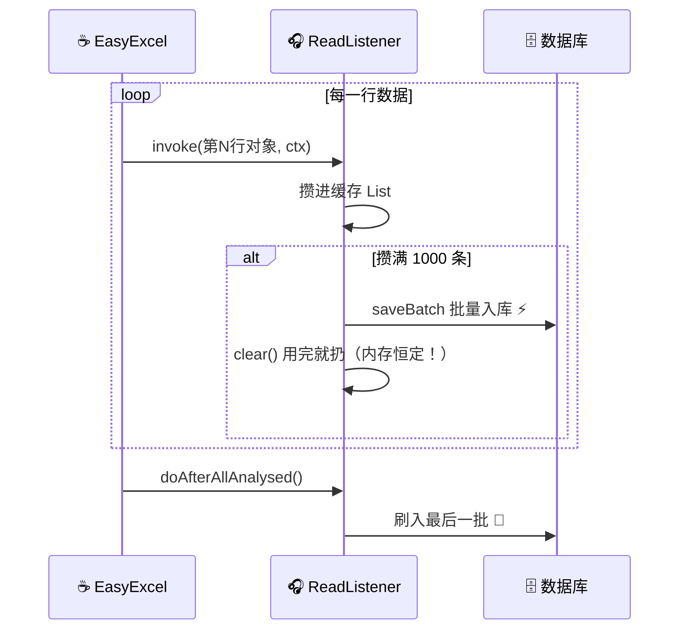
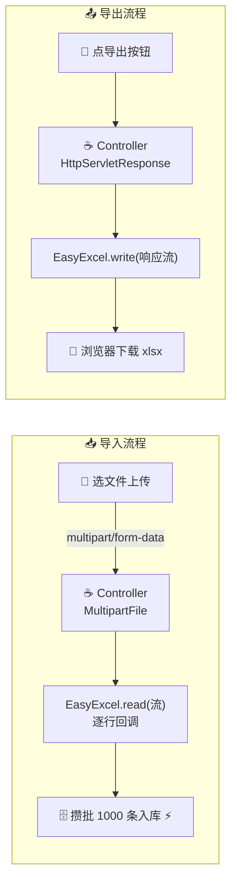
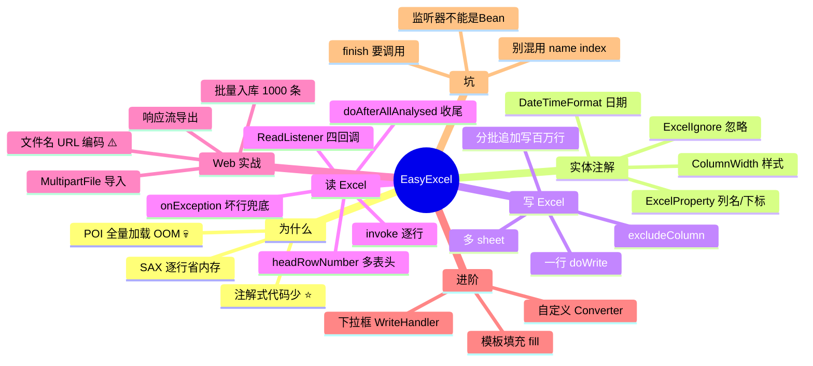

# EasyExcel 表格处理 从入门到实战 📊

> 欢迎来到 EasyExcel 小课堂！💖 后台系统三大俗："增删改查、权限、**Excel 导入导出**" 😆！用原生 POI 读一个 10 万行的表？内存直接 `OutOfMemoryError` 当场去世 💀！今天的主角 **EasyExcel**——阿里开源的 Excel 处理框架，**逐行读取省内存 + 注解一行搞定读写**！学完这篇，导入导出需求信手拈来～
>
> **学习目标**：
> - 🎯 搞懂 POI 为什么 OOM、EasyExcel 为什么省
> - 🎯 掌握注解式读写：@ExcelProperty + 监听器
> - 🎯 会 Web 上传/下载的完整实战（批量入库、文件流）
> - 🎯 会模板填充、自定义转换器等进阶姿势
>
> **前置知识**：Java 基础、Spring Boot、Lambda～

---

## 一、为什么需要 EasyExcel？🌱

### 1.1 Excel 处理的前世今生



### 1.2 POI 的两大痛

| 痛点 | 说明 |
|---|---|
| 💀 **OOM 内存溢出** | POI 的 `userModel` 模式把**整个 Excel 全量加载进内存**（一个 5MB 的 xlsx 能膨胀成几百 MB 对象）——10 万行直接教做人 |
| 😩 API 冗长 | 写个带样式表格几十行代码：`Workbook/Sheet/Row/Cell` 一层层套娃 |

### 1.3 EasyExcel 的两大药方 ⭐

> **药方一：SAX 逐行解析**——不一次全读，**读一行、回调一行、扔一行**，内存占用恒定！
> **药方二：注解映射**——实体类贴个 `@ExcelProperty`，读写各**一行代码**搞定！

| | POI userModel | **EasyExcel** ⭐ |
|---|---|---|
| 读取方式 | 全量加载进内存 | **SAX 逐行 + 监听器回调** |
| 内存占用 | 大文件几百 MB 💀 | **几十 MB 恒定** ✅ |
| 代码量 | 套娃冗长 | 注解 + 几行 |
| 64M 内存读 75M 文件 | 直接 OOM | 官方跑过，稳 ✅ |
| 使用记忆 | "开货车搬砖" 🚚 | "流水线传送带" 🏭 |

> 💡 注：EasyExcel 3.3.x 后原作者重组为 **FastExcel**（包名 `cn.idev.excel`），API 基本兼容——本文以最普及的 **EasyExcel 3.x** 讲解，原理完全通用～

---

## 二、快速上手：五分钟读写 🚀

### 2.1 引依赖

```xml
<dependency>
    <groupId>com.alibaba</groupId>
    <artifactId>easyexcel</artifactId>
    <version>4.0.3</version>
</dependency>
<!-- ⚠️ 它自带 poi 相关依赖，别再手动引旧版 poi 冲突！ -->
```

### 2.2 定义实体（读写的"合同" 📜）

```java
// ☕ 一个实体类 = 表格结构
@Data
@HeadRowHeight(25)                                    // 表头行高
@ColumnWidth(20)                                      // 列宽
public class UserExcelDTO {

    @ExcelProperty(value = "用户ID", index = 0)        // 列名 + 位置
    private Long id;

    @ExcelProperty("姓名")
    @ColumnWidth(15)
    private String name;

    @ExcelProperty(value = "年龄", index = 2)
    private Integer age;

    @ExcelProperty("邮箱")
    private String email;

    @ExcelProperty("入职日期")
    @DateTimeFormat("yyyy-MM-dd")                     // 日期格式
    private Date hireDate;

    @ExcelIgnore                                      // ⭐ 不参与 Excel 的字段
    private String password;
}
```

### 2.3 写 Excel：一行代码

```java
// ☕ 把 List<UserExcelDTO> 写成 excel
List<UserExcelDTO> data = queryUsers();

EasyExcel.write("/tmp/users.xlsx", UserExcelDTO.class)  // 文件 + 实体
        .sheet("用户列表")                               // sheet 名
        .doWrite(data);                                  // 开写！就这么多 ✨
```

### 2.4 读 Excel：配一个监听器

```java
// ☕ 监听器：每读到一行，回调一次 invoke
public class UserReadListener implements ReadListener<UserExcelDTO> {

    private static final int BATCH = 1000;             // 攒批入库
    private List<UserExcelDTO> cache = new ArrayList<>(BATCH);

    @Override
    public void invoke(UserExcelDTO row, AnalysisContext context) {
        cache.add(row);                                // ① 每行数据到这
        if (cache.size() >= BATCH) {
            saveBatch();                               // ② 攒够一批入库
        }
    }

    @Override
    public void doAfterAllAnalysed(AnalysisContext context) {
        saveBatch();                                   // ③ 读完收尾：刷最后一批
        System.out.println("全部读完啦～ 🎉");
    }

    private void saveBatch() {
        // userDao.saveBatch(cache)……
        cache.clear();                                 // 用完就扔 → 内存恒定 ⭐
    }
}

// ☕ 读取入口
EasyExcel.read(new File("/tmp/users.xlsx"), UserExcelDTO.class,
        new UserReadListener())
        .sheet()                                        // 默认读第一个 sheet
        .doRead();
```

**读取流程一图看懂**：



---

## 三、写 Excel 详解 📝⭐

### 3.1 常用注解速查

| 注解 | 作用 | 示例 |
|---|---|---|
| `@ExcelProperty("姓名")` | 列名（或 index 指定列号） | `@ExcelProperty(value="姓名", index=1)` |
| `@ExcelIgnore` | 该字段不进表格 | 密码等敏感字段 ⭐ |
| `@ColumnWidth(20)` | 列宽 | 类上加=全局 |
| `@HeadRowHeight(25)` | 表头行高 | |
| `@ContentRowHeight(20)` | 内容行高 | |
| `@DateTimeFormat("yyyy-MM-dd")` | 日期格式 | 写出/读入都生效 |
| `@NumberFormat("#,##0.00")` | 数字格式 | 金额千分位 |
| `@ContentStyle(...)` / `@HeadStyle(...)` | 单元格样式 | 字体/居中/背景色 |

### 3.2 按名字 vs 按下标匹配（读表易错点！）

```java
@ExcelProperty(value = "姓名")     // 按"表头名"匹配（表头顺序变了也不怕 ⭐）
private String name;

@ExcelProperty(index = 2)          // 按列下标匹配（0开始，不怕重名/改表头）
private Integer age;
```

> ⚠️ **规则**：同一个实体里**别混用** name 和 index 匹配！推荐按名字（业务表头常改），模板固定场景用 index。

### 3.3 常用写法合集

```java
// ☕ ① 只导部分字段：排除法
EasyExcel.write(file, UserExcelDTO.class)
        .excludeColumnFieldNames(Set.of("email"))      // 排除 email 列
        .sheet("用户").doWrite(data);

// ☕ ② 多 sheet 导出
try (ExcelWriter writer = EasyExcel.write(file, UserExcelDTO.class).build()) {
    WriteSheet s1 = EasyExcel.writerSheet(0, "正式员工").build();
    WriteSheet s2 = EasyExcel.writerSheet(1, "实习生").build();
    writer.write(data1, s1);
    writer.write(data2, s2);
}

// ☕ ③ 大数据量分批写（100 万行也不慌）
try (ExcelWriter writer = EasyExcel.write(file, UserExcelDTO.class).build()) {
    WriteSheet sheet = EasyExcel.writerSheet("大数据").build();
    int page = 1;
    while (true) {
        List<UserExcelDTO> list = dao.pageQuery(page++, 5000);  // 分页查
        if (list.isEmpty()) break;
        writer.write(list, sheet);                              // 追加写 ⭐
    }
}

// ☕ ④ 表头美化：默认样式策略（隔行换色+表头字体）
EasyExcel.write(file, UserExcelDTO.class)
        .registerWriteHandler(new HorizontalCellStyleStrategy(headStyle(), contentStyle()))
        .sheet("用户").doWrite(data);
```

---

## 四、读 Excel 详解：监听器进阶 🎧⭐⭐

### 4.1 监听器还能重写这些方法

```java
public class UserReadListener implements ReadListener<UserExcelDTO> {

    // ① 读到表头时回调（可校验模板对不对！）
    @Override
    public void invokeHead(Map<Integer, String> headMap, AnalysisContext context) {
        System.out.println("表头：" + headMap);          // {0=用户ID, 1=姓名, ...}
        // if (!"姓名".equals(headMap.get(1))) throw new RuntimeException("模板不对！");
    }

    // ② 某行转换失败（日期格式错/数字写成了字）→ 在这兜住，不用整单失败 ⭐
    @Override
    public void onException(Exception e, AnalysisContext ctx) {
        if (e instanceof ExcelDataConvertException ex) {
            int row = ex.getRowIndex() + 1;              // 出错行号
            int col = ex.getColumnIndex() + 1;           // 出错列号
            System.out.println("第" + row + "行 第" + col + "列数据不对，跳过这行 🙈");
        }
    }

    // ③ 每行数据
    @Override
    public void invoke(UserExcelDTO row, AnalysisContext context) { ... }

    // ④ 读完
    @Override
    public void doAfterAllAnalysed(AnalysisContext context) { ... }
}
```

### 4.2 表头不止一行？

```java
EasyExcel.read(file, UserExcelDTO.class, listener)
        .sheet()
        .headRowNumber(2)       // ⭐ 前两行都是表头，数据从第 3 行开始读
        .doRead();
```

### 4.3 无实体的灵活读取

```java
// ☕ 不定义实体，Map 接：列号 → 值（适合表结构不确定的场景）
EasyExcel.read(file, new AnalysisEventListener<Map<Integer, String>>() {
    @Override
    public void invoke(Map<Integer, String> row, AnalysisContext ctx) {
        System.out.println(row.get(0) + " / " + row.get(1));   // 第1列、第2列
    }
    @Override
    public void doAfterAllAnalysed(AnalysisContext ctx) { }
}).sheet().doRead();
```

> 💡 **注意**：监听器**不能被 Spring 管理**（每次 read 都要 new），需要用到 Service 时**通过构造器传进来**～

---

## 五、Web 实战：上传导入 + 下载导出 🌐⭐⭐（企业必会！）

### 5.1 完整 Controller

```java
@RestController
@RequestMapping("/api/user")
@RequiredArgsConstructor
public class UserExcelController {

    private final UserService userService;

    // ========== ① 导入：前端上传文件 ==========
    @PostMapping("/import")
    public Result<String> importUsers(@RequestParam("file") MultipartFile file)
            throws IOException {
        if (file.isEmpty()) return Result.fail("文件不能为空哦～");

        userService.importUsers(file.getInputStream());   // 直接喂流！
        return Result.ok("导入成功 🎉");
    }

    // ========== ② 导出：浏览器下载文件 ==========
    @GetMapping("/export")
    public void exportUsers(HttpServletResponse response) throws IOException {
        // 设置下载头（文件名中文要编码，否则乱码！）
        response.setContentType("application/vnd.openxmlformats-officedocument.spreadsheetml.sheet");
        response.setCharacterEncoding("utf-8");
        String fileName = URLEncoder.encode("用户列表", StandardCharsets.UTF_8)
                .replaceAll("\\+", "%20");
        response.setHeader("Content-Disposition",
                "attachment;filename*=utf-8''" + fileName + ".xlsx");

        List<UserExcelDTO> data = userService.queryForExport();
        EasyExcel.write(response.getOutputStream(), UserExcelDTO.class)  // 写到响应流！
                .sheet("用户列表")
                .doWrite(data);
    }
}
```

### 5.2 Service 里的导入逻辑

```java
@Service
@RequiredArgsConstructor
public class UserService {

    private final UserDao userDao;

    public void importUsers(InputStream in) {
        EasyExcel.read(in, UserExcelDTO.class,
                        new UserImportListener(userDao))    // 监听器 new 出来，dao 通过构造器传入
                .sheet()
                .headRowNumber(1)
                .doRead();
    }
}

// ☕ 导入专用监听器：带库操作
public class UserImportListener implements ReadListener<UserExcelDTO> {

    private final UserDao userDao;
    private final List<UserExcelDTO> cache = new ArrayList<>(1000);
    private final List<String> errors = new ArrayList<>();     // 收集错误行

    public UserImportListener(UserDao userDao) { this.userDao = userDao; }

    @Override
    public void invoke(UserExcelDTO row, AnalysisContext ctx) {
        if (row.getName() == null || row.getName().isBlank()) {
            errors.add("第 " + ctx.readRowHolder().getRowIndex() + " 行姓名为空 🙈");
            return;                                            // 脏数据跳过
        }
        cache.add(row);
        if (cache.size() >= 1000) { userDao.saveBatch(cache); cache.clear(); }
    }

    @Override
    public void doAfterAllAnalysed(AnalysisContext ctx) {
        if (!cache.isEmpty()) userDao.saveBatch(cache);
        if (!errors.isEmpty()) log.warn("导入异常行：{}", errors);
    }

    @Override
    public void onException(Exception e, AnalysisContext ctx) {
        if (e instanceof ExcelDataConvertException ex) {
            errors.add("第 " + (ex.getRowIndex() + 1) + " 行格式错误，已跳过");
        }
    }
}
```

### 5.3 前后端交互全景图



---

## 六、进阶技能 🎓⭐

### 6.1 模板填充：报表神器

> 先做一个带 `{占位符}` 的模板 xlsx，再灌数据——**做复杂报表不用拼样式**！

```java
// 模板内容：第1行 "2024年Q1报表  生成时间：{time}"
// 表格区：{data.name}  {data.age} …（横向填充）或 {.name}（列表填充）

EasyExcel.write(response.getOutputStream(), FillUserDTO.class)
        .withTemplate("/templates/report.xlsx")        // ⭐ 指定模板
        .sheet()
        .doFill(Map.of("time", LocalDate.now()));      // 单值填充

// 列表填充
FillConfig cfg = FillConfig.builder().forceNewRow(true).build();
ExcelWriter writer = EasyExcel.write(out).withTemplate(tpl).build();
WriteSheet sheet = EasyExcel.writerSheet().build();
writer.fill(dataList, cfg, sheet);                     // 灌列表
writer.fill(Map.of("total", 666), sheet);              // 灌汇总
writer.finish();
```

### 6.2 自定义转换器（字典翻译）

> 数据库存的是 `1/0`，Excel 里想显示"男/女"？写个 Converter：

```java
public class GenderConverter implements Converter<Integer> {

    @Override
    public Class<Integer> supportJavaTypeKey() { return Integer.class; }

    @Override
    public WriteCellData<?> convertToExcelData(Integer value,
            ExcelContentProperty ctx, GlobalConfiguration gc) {
        String text = value == 1 ? "男 👦" : "女 👧";
        return new WriteCellData<>(text);              // 写出时翻译
    }

    @Override
    public Integer convertToJavaData(ReadCellData<?> cell,
            ExcelContentProperty ctx, GlobalConfiguration gc) {
        return "男".equals(cell.getStringValue()) ? 1 : 0;   // 读入时还原
    }
}

// ☕ 实体上挂载
@ExcelProperty(value = "性别", converter = GenderConverter.class)
private Integer gender;
```

### 6.3 拦截器校验下拉框等（WriteHandler）

```java
// ☕ 单元格加下拉框（防手滑填错）
public class GenderDropdownHandler implements SheetWriteHandler {
    @Override
    public void afterSheetCreate(WriteWorkbookHolder wb, WriteSheetHolder sheet) {
        DataValidationHelper helper = sheet.getSheet().getDataValidationHelper();
        DataValidationConstraint constraint = helper.createExplicitListConstraint(
                new String[]{"男", "女"});
        CellRangeAddressList range = new CellRangeAddressList(1, 5000, 3, 3);  // D列 2~5001行
        sheet.getSheet().addDataValidation(helper.createValidation(constraint, range));
    }
}

EasyExcel.write(file, UserExcelDTO.class)
        .registerWriteHandler(new GenderDropdownHandler())
        .sheet().doWrite(data);
```

---

## 七、EasyExcel vs POI 终极对比 🆚

| 维度 | Apache POI | **EasyExcel** ⭐ |
|---|---|---|
| 内存 | userModel 全量加载，大文件 OOM | SAX 逐行，内存恒定 |
| 读写代码量 | 套娃式几十行 | 注解 + 几行 |
| 上手成本 | 高（Workbook/Sheet/Row/Cell） | 低（实体即合同） |
| 灵活性 | **全能**（公式/图表/宏都能搞） | 覆盖常用场景，复杂需求兜底靠它返回的 POI 对象 |
| 维护 | 稳定 | EasyExcel 3.x → FastExcel 延续 |
| 选择 | 超复杂 Excel（带图表公式） | **99% 业务导入导出 ⭐** |

---

## 八、常见坑速查表 🕳️

| 现象/坑 | 原因 | 解法 |
|---|---|---|
| 导出文件打开提示"格式损坏" | 忘了 `finish()` / Controller 抛异常后流写了一半 | try-with-resources 或 finally 里 finish；导出别再写 JSON 返回 |
| 下载文件名乱码 | 中文文件名没编码 | `URLEncoder.encode` + `filename*=utf-8''`（见 5.1）⭐ |
| 读出来字段全是 null | 表头名和 `@ExcelProperty` 对不上 / 混用 index 和 name | 核对表头拼写；统一匹配方式 |
| `ExcelDataConvertException` | 单元格类型不匹配（数字列写了文字） | 监听器重写 `onException` 跳过坏行 ⭐ |
| 日期读出来变数字 | Excel 本质存数字 | 用 `@DateTimeFormat` 或转换器 |
| 大导入内存还是爆 | 在监听器里把所有行攒进一个 List 不清 | **边攒边清**，批量入库后 `clear()` |
| 监听器里 @Autowired 为 null | 监听器是 new 的，不受 Spring 管理 | 构造器传入依赖 ⭐ |
| 依赖冲突 `NoSuchMethodError` | 项目里残留旧 POI（如 3.x 混 5.x） | 统一用 easyexcel 自带版本，`mvn dependency:tree` 排查 |
| 重复读取同一文件报错 | 流只能读一次 | 保存后重新获取流 / 复制成 ByteArrayInputStream |
| 读不到数据/行数少了 | 表头多行没声明 | `.headRowNumber(n)` |
| xlsx vs xls | 03 版 xls 最大 65536 行 | 大数据用 `.xlsx`（easyexcel 会按文件名自动识别格式） |

---

## 九、高频面试题速答 🎯

| 问题 | 精简答案 |
|---|---|
| EasyExcel 为什么不会 OOM？ | 底层用 POI 的 SAX 事件模式**逐行解析**，每行解析完回调监听器即释放，不把整个文件 DOM 装进内存；配合监听器"边读边批处理"内存恒定 |
| EasyExcel 和 POI 的关系？ | EasyExcel 基于 POI（复用其底层），重写了解析层（SAX）和封装层（注解映射）；复杂场景可通过其暴露的 POI 对象兜底 |
| 读取时的核心组件是什么？ | `ReadListener`：`invoke`（每行回调）、`invokeHead`（表头）、`doAfterAllAnalysed`（收尾）、`onException`（坏行兜底） |
| 百万数据怎么导出？ | 分页查询 + `ExcelWriter` 追加写（同一 sheet `writer.write` 多次）；必要时多 sheet/多文件+zip |
| 百万数据怎么导入？ | 监听器攒批（如 1000 条）批量入库、用完 clear；坏行 onException 收集不中断 |
| @ExcelProperty 按 name 和 index 匹配区别？ | name 按表头文字匹配（表头列序变了不影响）；index 按列下标（表头改名不影响）；**不可混用** |
| 怎么实现导入校验 + 错误反馈？ | invoke 里校验、onException 捕获转换异常，收集行号和原因，最后统一返回错误清单（或生成错误标记的回执表） |
| 日期/字典字段怎么处理？ | `@DateTimeFormat/@NumberFormat` 格式化；复杂字典用自定义 `Converter`（convertToExcelData 写出翻译 / convertToJavaData 读入还原） |
| 模板填充用过吗？ | `withTemplate + fill`：模板里 `{key}` 单值、`{.field}` 列表占位，报表样式全在模板里维护 |
| 为什么监听器不能是 Spring Bean？ | 每次读取需独立实例（有状态：缓存行/错误收集），Spring 单例会被并发污染；依赖通过构造器传入 |

---

## 十、知识总结地图 🗺️



> 🎀 **毕业寄语**：EasyExcel 的灵魂就一句——**"流水线逐行干，内存永远不爆仓"**！把第五章 Web 实战抄进项目跑通（导入 + 导出 + 中文文件名），Excel 需求从此半小时交付～ 面试聊"大文件 Excel 怎么处理"，把 **SAX 逐行 + 攒批入库** 两个关键词说清，就是满分答案！💪✨
