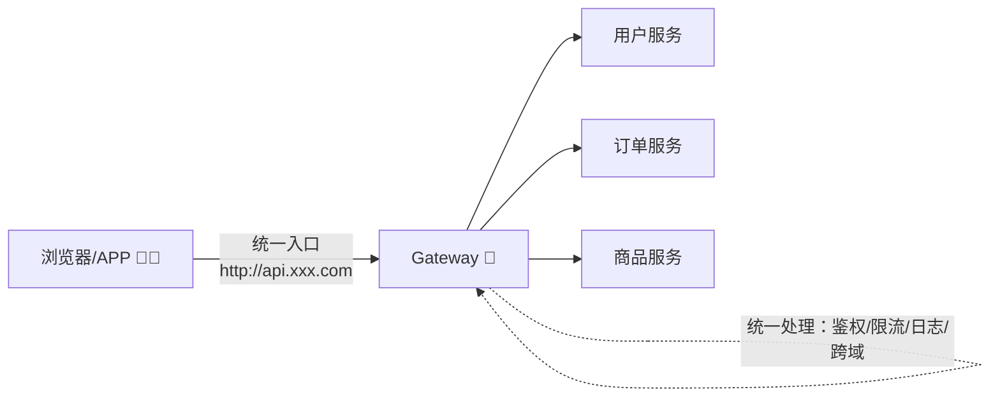
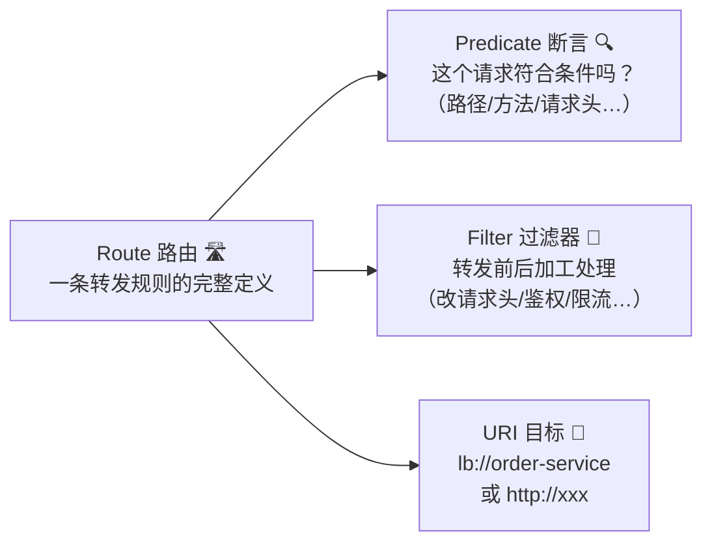
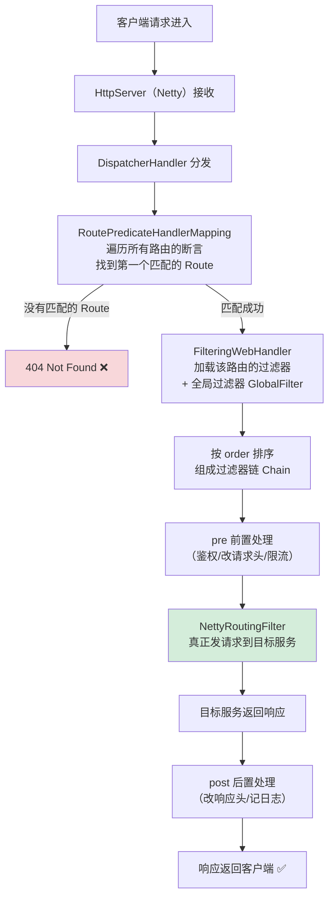
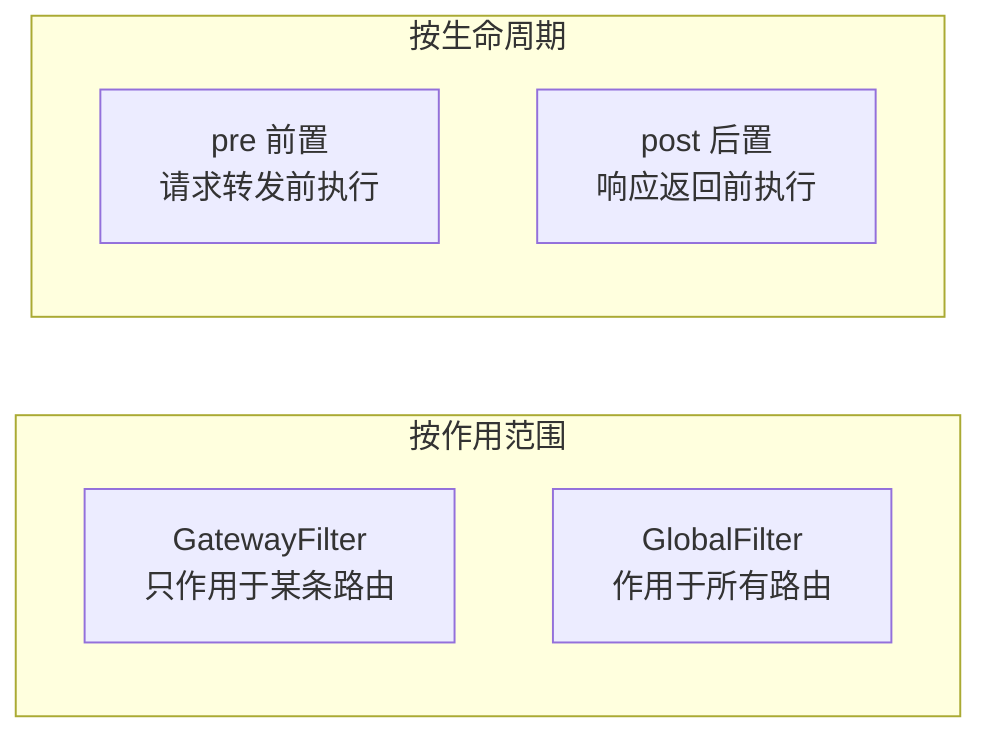
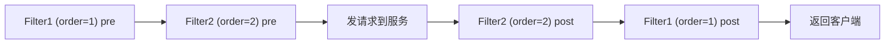
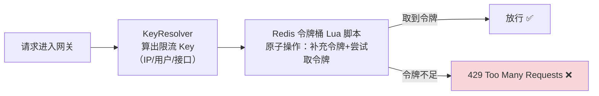
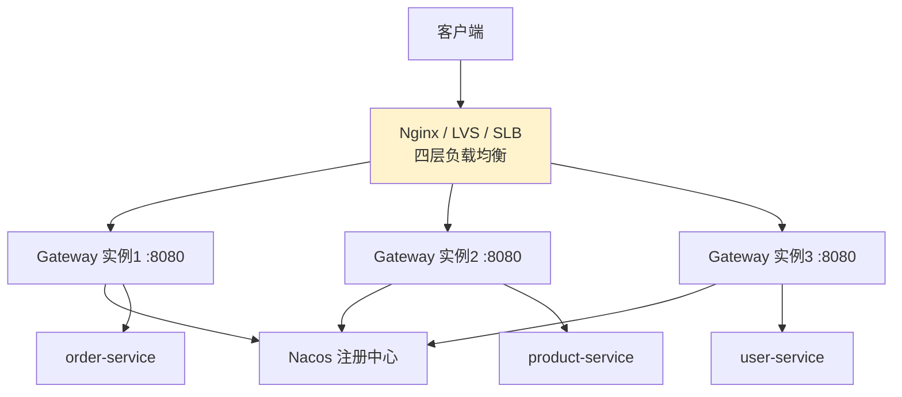
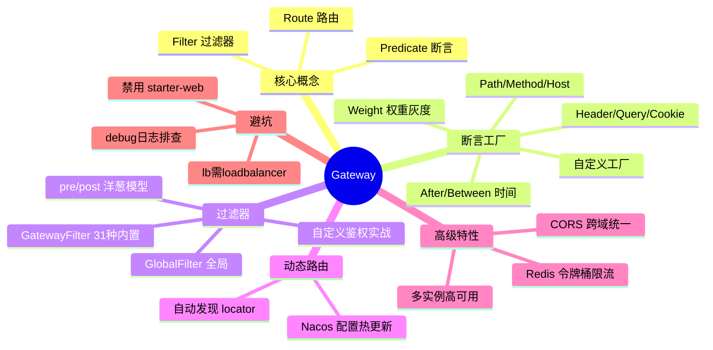

# 🌸 SpringCloud Gateway 超详细教程

> 前两篇我们把 Nacos 玩明白了，今天来攻占微服务的"大门"——**Gateway 网关**！
> 所有进出的流量都要过它这一关，妥妥的门面担当 💂～

---

## 📖 目录

1. [网关是什么？为什么需要它](#一网关是什么为什么需要它)
2. [Gateway 简介与技术底牌](#二gateway-简介与技术底牌)
3. [三大核心概念：Route、Predicate、Filter](#三三大核心概念routepredicatefilter)
4. [请求执行流程（源码级）](#四请求执行流程源码级)
5. [快速上手：搭建网关](#五快速上手搭建网关)
6. [断言 Predicate 详解](#六断言-predicate-详解)
7. [自定义断言工厂](#七自定义断言工厂)
8. [过滤器 Filter 详解](#八过滤器-filter-详解)
9. [自定义过滤器（鉴权实战）](#九自定义过滤器鉴权实战)
10. [动态路由：从 Nacos 自动发现](#十动态路由从-nacos-自动发现)
11. [网关限流：RequestRateLimiter](#十一网关限流requestratelimiter)
12. [跨域 CORS 配置](#十二跨域-cors-配置)
13. [高可用架构](#十三高可用架构)
14. [常见坑与排错](#十四常见坑与排错)
15. [面试高频问题](#十五面试高频问题)
16. [总结](#十六总结)

---

## 一、网关是什么？为什么需要它？

### 1.1 没有网关的日子 😢

```text
前端同学要记住：
  用户服务 → http://192.168.1.10:8081/user/**
  订单服务 → http://192.168.1.11:8082/order/**
  商品服务 → http://192.168.1.12:8083/product/**
```

| 痛点 | 具体表现 |
| --- | --- |
| 地址裸奔 🩳 | 内网 IP 直接暴露给外部，黑客狂喜 |
| 鉴权代码复制 N 遍 | 每个服务都要写一遍登录校验 |
| 跨域配置重复 | 每个服务配一遍 CORS |
| 无法统一限流/监控 | 流量进来像脱缰野马 🐎 |

### 1.2 有了网关之后 ✨



> 💡 **一句话**：网关 = 微服务世界的**大门保安 + 前台小姐姐**，所有请求先过它：查证件（鉴权）、指路（路由）、控制人流（限流）、记登记（日志）～

---

## 二、Gateway 简介与技术底牌

### 2.1 Gateway 是谁 🏷️

> **Spring Cloud Gateway** 是 Spring 官方推出的 API 网关，基于 **Spring WebFlux + Project Reactor + Netty** 构建，目标是替换掉已经停更的 Zuul 1.x。

### 2.2 技术底牌：响应式非阻塞 🌊

| 对比项 | Zuul 1.x（旧） | **Gateway**（新） |
| --- | --- | --- |
| 底层 | Servlet（阻塞式） | **WebFlux + Netty（响应式非阻塞）** ✅ |
| 线程模型 | 每请求占一个线程 | 少量 EventLoop 线程处理海量请求 |
| 性能 | 一般 | 优秀 ✅ |
| 功能 | 路由+过滤 | 路由+断言+过滤器+限流+熔断集成 |
| 长连接/WebSocket | 支持弱 | 原生支持 ✅ |
| 维护状态 | 停更 💤 | 官方持续更新 ✅ |

> ⚠️ **重要提醒**：因为 Gateway 基于 WebFlux，**网关工程里绝对不能引入 `spring-boot-starter-web`**（SpringMVC）！两者默认服务器一个 Tomcat 一个 Netty，混在一起启动直接报错 🙅

### 2.3 Gateway vs Nginx 🤔

| 对比 | Nginx | Gateway |
| --- | --- | --- |
| 定位 | 通用流量入口（静态资源、四层/七层负载） | **微服务业务网关** |
| 服务发现 | 需配合 upstream 手动配置 | 与注册中心无缝集成（lb://）✅ |
| 业务逻辑 | Lua 脚本（门槛高） | Java 写 Filter（丝滑 ✅） |
| 实际架构 | Nginx 在最外层，Gateway 在里面 | 两者配合使用 💑 |

---

## 三、三大核心概念：Route、Predicate、Filter



| 概念 | 说明 | 通俗比喻 |
| --- | --- | --- |
| **Route** | 网关的基本单元：**断言+过滤器+目标URI** 的打包 | 一条"快递线路" 📦 |
| **Predicate** | Java 8 的函数式接口，输入请求返回 true/false | "揽件条件"——符合才接单 🔍 |
| **Filter** | 请求转发前（pre）/响应返回前（post）的处理 | "安检+贴标流水线" 🛂 |

一条 Route 的完整定义示例：

```yaml
spring:
  cloud:
    gateway:
      routes:
        - id: order-route                    # ① 编号：唯一标识
          uri: lb://order-service            # ② 目的地
          predicates:                        # ③ 断言：满足全部条件才匹配
            - Path=/order/**
            - Method=GET,POST
          filters:                           # ④ 过滤器：匹配后按序加工
            - StripPrefix=1
          order: 1                           # ⑤ 路由优先级（越小越优先）
```

---

## 四、请求执行流程（源码级）🔍

一个请求打到 Gateway 后，内部到底发生了什么？



**源码关键类速览**（面试加分）：

| 类 | 干什么 |
| --- | --- |
| `RoutePredicateHandlerMapping` | 用断言匹配 Route |
| `FilteringWebHandler` | 组装过滤器链（GatewayFilter + GlobalFilter） |
| `NettyRoutingFilter` | 链上最后的"执行者"，真正转发 HTTP 请求 |
| `GatewayFilterChain` | 过滤器链，`chain.filter(exchange)` 放行到下一个 |

> 💡 **Exchange 是什么？** `ServerWebExchange` = 当前请求的"上下文背包" 🎒，请求、响应、属性都挂它身上，过滤器之间传数据就靠 `exchange.getAttributes()`～

---

## 五、快速上手：搭建网关 🛠️

### 5.1 建模块 + 引依赖

新建 `gateway-service` 模块，pom 里**只放这三个**：

```xml
<!-- 网关核心（自带 WebFlux + Netty，千万别再加 starter-web！） -->
<dependency>
    <groupId>org.springframework.cloud</groupId>
    <artifactId>spring-cloud-starter-gateway</artifactId>
</dependency>
<!-- 注册中心：从 Nacos 发现服务 -->
<dependency>
    <groupId>com.alibaba.cloud</groupId>
    <artifactId>spring-cloud-starter-alibaba-nacos-discovery</artifactId>
</dependency>
<!-- 负载均衡：lb:// 语法必需，没有它会 503！ -->
<dependency>
    <groupId>org.springframework.cloud</groupId>
    <artifactId>spring-cloud-starter-loadbalancer</artifactId>
</dependency>
```

### 5.2 写配置

```yaml
server:
  port: 8080
spring:
  application:
    name: gateway-service
  cloud:
    nacos:
      server-addr: localhost:8848
    gateway:
      routes:
        - id: order-route
          uri: lb://order-service          # lb:// = 去 Nacos 找 + 负载均衡
          predicates:
            - Path=/order/**
        - id: product-route
          uri: lb://product-service
          predicates:
            - Path=/product/**
```

### 5.3 测试 ✅

```text
不经过网关：http://localhost:8083/product/1
经过网关 ：http://localhost:8080/product/1   ← 走 Gateway 转发，成功！🎉
```

### 5.4 路由配置的两种姿势

**姿势一：yml 配置（上面这种，简单直观）✅**

**姿势二：Java API 编码式**

```java
@Configuration
public class RouteConfig {

    @Bean
    public RouteLocator customRoutes(RouteLocatorBuilder builder) {
        return builder.routes()
                // 订单服务路由
                .route("order-route", r -> r
                        .path("/order/**")                     // 断言
                        .filters(f -> f.stripPrefix(1))        // 过滤器
                        .uri("lb://order-service"))            // 目标
                // 查询参数带 red=true 才转发的彩蛋路由
                .route("red-route", r -> r
                        .path("/red/**")
                        .and()
                        .query("red", "true")
                        .uri("lb://product-service"))
                .build();
    }
}
```

> 💡 两种姿势的选择：**固定规则用 yml**（改配置中心可热更新），**复杂逻辑用 Java API**（能用任何 Java 表达式）～

---

## 六、断言 Predicate 详解

### 6.1 内置断言工厂全表 📋

Gateway 内置了一堆开箱即用的断言工厂（类名都是 `XxxRoutePredicateFactory`）：

| 断言 | 示例 | 含义 |
| --- | --- | --- |
| **Path** | `Path=/order/**` | 路径匹配（最常用 ⭐） |
| **Method** | `Method=GET,POST` | 请求方法匹配 |
| **Host** | `Host=**.xxx.com` | 域名匹配 |
| **Header** | `Header=X-Token, \d+` | 请求头存在 + 可选正则匹配 |
| **Query** | `Query=name, zhang.` | 查询参数匹配（可选正则） |
| **Cookie** | `Cookie=session, abc.*` | Cookie 匹配 |
| **After** | `After=2026-10-01T00:00+08:00` | 此时间**之后**才生效（活动开始 🎉） |
| **Before** | `Before=2026-10-08T00:00+08:00` | 此时间**之前**生效（活动结束） |
| **Between** | `Between=2026-10-01T00:00+08:00, 2026-10-08T00:00+08:00` | 时间段内生效 |
| **RemoteAddr** | `RemoteAddr=192.168.1.1/24` | 客户端 IP 网段匹配 |
| **Weight** | `Weight=group1, 8` | 按权重分流（同组内 80% 流量走这条路由，灰度神器 🐤） |

### 6.2 组合玩法示例 🎮

```yaml
spring:
  cloud:
    gateway:
      routes:
        # 双十一大促路由：时间窗口 + 路径双条件
        - id: promotion-route
          uri: lb://promotion-service
          predicates:
            - Path=/api/promotion/**
            - Between=2026-11-01T00:00:00+08:00, 2026-11-12T00:00:00+08:00

        # 权重灰度：group-a 组里 90% 流量走 v1，10% 走 v2
        - id: weight-v1
          uri: lb://order-service
          predicates:
            - Weight=group-a, 9
        - id: weight-v2
          uri: lb://order-service-v2
          predicates:
            - Weight=group-a, 1
```

> ⚠️ **同一服务多条路由的匹配规则**：断言全部满足才算匹配；多条都匹配时按 **order 值**小的优先（默认按声明顺序）。

---

## 七、自定义断言工厂 🧑‍🔧

内置的不够用？自己写一个！比如：只允许携带 `X-Source=app` 的请求走这条路由。

**第一步：写断言工厂类**（命名规则必须是 `名字 + RoutePredicateFactory`）

```java
/**
 * 自定义断言：校验请求头 X-Source 的值
 * yml 里使用：- Source=app
 */
@Component
public class SourceRoutePredicateFactory
        extends AbstractRoutePredicateFactory<SourceRoutePredicateFactory.Config> {

    public SourceRoutePredicateFactory() {
        // 把 Config 类交给父类，用于绑定 yml 里的参数
        super(Config.class);
    }

    /** yml 里参数名是 source（- Source=app 中的值绑到 source 字段） */
    @Override
    public List<String> shortcutFieldOrder() {
        return List.of("source");
    }

    /** 核心逻辑：返回 true = 断言匹配 */
    @Override
    public Predicate<ServerWebExchange> apply(Config config) {
        return exchange -> {
            String header = exchange.getRequest().getHeaders().getFirst("X-Source");
            return config.getSource().equalsIgnoreCase(header);
        };
    }

    /** 参数配置类 */
    @Data
    public static class Config {
        private String source;
    }
}
```

**第二步：yml 使用**

```yaml
routes:
  - id: app-only-route
    uri: lb://order-service
    predicates:
      - Path=/app/**
      - Source=app        # ← 用上自定义断言！
```

> 💡 **命名玄机**：类名去掉 `RoutePredicateFactory` 后缀 = yml 里的断言名（`Source`），这就是 Gateway 的约定大于配置～

---

## 八、过滤器 Filter 详解

### 8.1 过滤器的两个维度 📐



### 8.2 内置 GatewayFilter 速查表 📋

| 过滤器 | 作用 | 示例 |
| --- | --- | --- |
| **StripPrefix** | 去掉路径前 N 段 | `StripPrefix=1`：`/product/x` → `/x` |
| **PrefixPath** | 加路径前缀 | `PrefixPath=/api`：`/x` → `/api/x` |
| **RewritePath** | 正则重写路径 | `RewritePath=/red/(?<seg>.*), /$\{seg}` |
| **SetPath** | 直接设置路径 | `SetPath=/api/{segment}` |
| **AddRequestHeader** | 加请求头 | `AddRequestHeader=X-Color, red` |
| **AddRequestParameter** | 加查询参数 | `AddRequestParameter=foo, bar` |
| **AddResponseHeader** | 加响应头 | `AddResponseHeader=X-Resp, hi` |
| **SetStatus** | 强制响应码 | `SetStatus=401` |
| **RemoveRequestHeader** | 删请求头 | 隐藏内部信息用 |
| **RedirectTo** | 重定向 | `RedirectTo=302, https://xxx` |
| **Retry** | 重试 | `Retry=3, INTERNAL_SERVER_ERROR` |
| **RequestRateLimiter** | 限流（配 Redis） | 详见第十一章 ⭐ |
| **CircuitBreaker** | 熔断（配 Resilience4j/Sentinel） | 服务故障时快速失败 |
| **PreserveHostHeader** | 保留原始 Host | 下游依赖 Host 时开 |
| **DefaultFilters** | 对所有路由生效的默认过滤器 | 写在 routes 同级 |

```yaml
spring:
  cloud:
    gateway:
      default-filters:              # 所有路由都过这两个过滤器
        - AddRequestHeader=X-Gateway, my-gateway
        - AddResponseHeader=X-Gateway-Version, v1
      routes:
        - id: rewrite-demo
          uri: lb://product-service
          predicates:
            - Path=/red/**
          filters:
            # /red/123 → /123（正则捕获组重写，注意 $ 要写成 $ 转义）
            - RewritePath=/red/(?<segment>.*), /$\{segment}
```

### 8.3 过滤器的执行顺序规则 🔢

过滤器链按 **order 值**升序执行，规则：

| 来源 | order 值 |
| --- | --- |
| yml/Java 声明的过滤器 | 按**声明顺序**自动分配：1, 2, 3... |
| `Ordered` 接口 / `@Order` 注解 | 显式指定，数字小先执行 |
| GlobalFilter + GatewayFilter | 混在一起统一排序 |

```text
pre 阶段：order 小 → 大 依次执行
post 阶段：反过来，order 大 → 小（洋葱模型 🧅）
```



---

## 九、自定义过滤器（鉴权实战）🔐

### 9.1 GlobalFilter：全局登录校权（最常用！⭐）

```java
@Component
public class AuthGlobalFilter implements GlobalFilter, Ordered {

    /** 免登录白名单 */
    private static final List<String> WHITE_LIST = List.of(
            "/user/login", "/user/register", "/actuator/**");

    @Override
    public Mono<Void> filter(ServerWebExchange exchange, GatewayFilterChain chain) {
        // ① 获取请求
        ServerHttpRequest request = exchange.getRequest();
        String path = request.getURI().getPath();

        // ② 白名单放行
        if (WHITE_LIST.stream().anyMatch(p ->
                new AntPathMatcher().match(p, path))) {
            return chain.filter(exchange);
        }

        // ③ 取 token 校验（真实项目：验签 + 查 Redis）
        String token = request.getHeaders().getFirst("Authorization");
        if (!StringUtils.hasText(token) || !checkToken(token)) {
            exchange.getResponse().setStatusCode(HttpStatus.UNAUTHORIZED);

            // 拒绝时也可以返回 JSON 提示，而不是冷冰冰的 401
            exchange.getResponse().getHeaders()
                    .add("Content-Type", "application/json;charset=UTF-8");
            byte[] body = "{\"code\":401,\"msg\":\"请先登录哦～\"}".getBytes(StandardCharsets.UTF_8);
            DataBuffer buffer = exchange.getResponse().bufferFactory().wrap(body);
            return exchange.getResponse().writeWith(Mono.just(buffer));
        }

        // ④ 校验通过：把解析出的用户 ID 塞进请求头，传给下游服务
        ServerHttpRequest newRequest = request.mutate()
                .header("X-User-Id", parseUserId(token))
                .build();

        // ⑤ 放行（注意要用 newRequest 替换过的 exchange！）
        return chain.filter(exchange.mutate().request(newRequest).build());
    }

    private boolean checkToken(String token) {
        return token.startsWith("Bearer ");   // 演示用，真实项目换成 JWT 验签
    }

    private String parseUserId(String token) {
        return "1001";
    }

    /** order 越小越先执行：鉴权要尽早，设为 -100 */
    @Override
    public int getOrder() {
        return -100;
    }
}
```

> 💡 **网关统一鉴权的好处**：下游服务从请求头直接拿 `X-User-Id`，再也不用每个服务都写一遍登录校验，瘦身成功 ✂️～

### 9.2 自定义 GatewayFilterFactory：作用于单条路由

```java
/**
 * 统计接口耗时日志的过滤器，yml 用法：- CostTime=100
 * 参数 100 表示：超过 100ms 才打印慢日志
 */
@Component
public class CostTimeGatewayFilterFactory
        extends AbstractGatewayFilterFactory<CostTimeGatewayFilterFactory.Config> {

    public CostTimeGatewayFilterFactory() {
        super(Config.class);
    }

    @Override
    public List<String> shortcutFieldOrder() {
        return List.of("maxMillis");
    }

    @Override
    public GatewayFilter apply(Config config) {
        return (exchange, chain) -> {
            long start = System.currentTimeMillis();
            return chain.filter(exchange).then(Mono.fromRunnable(() -> {
                long cost = System.currentTimeMillis() - start;
                String path = exchange.getRequest().getURI().getPath();
                if (cost > config.getMaxMillis()) {
                    System.out.printf("🐢 慢接口告警：%s 耗时 %d ms%n", path, cost);
                } else {
                    System.out.printf("✅ %s 耗时 %d ms%n", path, cost);
                }
            }));
        };
    }

    @Data
    public static class Config {
        private long maxMillis = 1000;
    }
}
```

```yaml
routes:
  - id: order-route
    uri: lb://order-service
    predicates:
      - Path=/order/**
    filters:
      - CostTime=200     # 超过 200ms 打慢日志
```

---

## 十、动态路由：从 Nacos 自动发现 🔄

### 10.1 痛点

服务多了之后，每加一个服务就改一次网关 yml？太累啦 😩

### 10.2 方案一：自动发现路由（按服务名转发）

```yaml
spring:
  cloud:
    gateway:
      discovery:
        locator:
          enabled: true           # 开启自动路由
          lower-case-service-id: true   # 服务名转小写（Nacos 大写会翻车）
```

效果：

```text
请求：http://localhost:8080/order-service/order/1
             自动转发到 → order-service 服务的 /order/1
             优点：零配置！新服务注册即自动可达 🎉
             缺点：URL 里暴露服务名、无法精细控制路由规则
```

### 10.3 方案二：路由配置进 Nacos，热更新 ⭐（生产推荐）

```yaml
# gateway-service 的 application.yml
spring:
  config:
    import:
      - nacos:gateway-routes.yaml      # 路由规则放配置中心
  cloud:
    nacos:
      server-addr: localhost:8848
```

```yaml
# Nacos 控制台的 gateway-routes.yaml（改这里，网关自动刷新路由！）
spring:
  cloud:
    gateway:
      routes:
        - id: order-route
          uri: lb://order-service
          predicates:
            - Path=/order/**
        - id: user-route
          uri: lb://user-service
          predicates:
            - Path=/user/**
```

> 💡 原理：Gateway 的路由定义绑定在 `RouteDefinitionLocator` 上，配合 SpringCloud 的配置刷新事件，配置中心一改，`RefreshRoutesEvent` 触发，路由表重建 ✨

---

## 十一、网关限流：RequestRateLimiter 🚦

### 11.1 原理：Redis + 令牌桶



### 11.2 实战步骤

**第一步：引依赖**

```xml
<dependency>
    <groupId>org.springframework.boot</groupId>
    <artifactId>spring-boot-starter-data-redis-reactive</artifactId>
</dependency>
```

**第二步：定义 KeyResolver（按什么维度限流）**

```java
@Configuration
public class KeyResolverConfig {

    /** 按 IP 限流（最常用） */
    @Bean
    public KeyResolver ipKeyResolver() {
        return exchange -> Mono.just(
                exchange.getRequest().getRemoteAddress()
                        .getAddress().getHostAddress());
    }

    /** 按接口路径限流 */
    @Bean
    KeyResolver pathKeyResolver() {
        return exchange -> Mono.just(
                exchange.getRequest().getPath().value());
    }

    /** 按用户限流（配合网关鉴权塞的 X-User-Id） */
    @Bean
    KeyResolver userKeyResolver() {
        return exchange -> Mono.justOrEmpty(
                exchange.getRequest().getHeaders().getFirst("X-User-Id"));
    }
}
```

**第三步：配置路由 + 限流参数**

```yaml
spring:
  data:
    redis:
      host: localhost
  cloud:
    gateway:
      routes:
        - id: order-route
          uri: lb://order-service
          predicates:
            - Path=/order/**
          filters:
            - name: RequestRateLimiter
              args:
                redis-rate-limiter.replenishRate: 10   # 令牌生成速率：10 个/秒（平均 QPS）
                redis-rate-limiter.burstCapacity: 20   # 桶容量：20（允许的突发量）
                redis-rate-limiter.requestedTokens: 1  # 每个请求消耗几个令牌
                key-resolver: "#{@ipKeyResolver}"      # 用哪个 KeyResolver
```

> 💡 参数怎么理解：
> `replenishRate=10, burstCapacity=20` = 每秒发 10 个令牌，桶里最多存 20 个 → 平时 10 QPS，突发瞬间最多 20 个请求能一次涌进来～

---

## 十二、跨域 CORS 配置 🌍

前后端分离项目，前端 `localhost:5173` 调网关会有跨域问题。**在网关统一配置，下游服务不再配置**（两边都配反而会因为重复头报错 ⚠️）：

```yaml
spring:
  cloud:
    gateway:
      globalcors:                      # 全局跨域
        add-to-simple-url-handler-mapping: true   # 解决 OPTIONS 预检被拦截问题
        cors-configurations:
          '[/**]':
            allowed-origin-patterns:      # 允许的源（SpringBoot 2.4+ 用 patterns 支持通配）
              - "http://localhost:5173"
              - "https://*.xxx.com"
            allowed-methods: "*"          # 允许所有方法
            allowed-headers: "*"          # 允许所有请求头
            allow-credentials: true       # 允许携带 Cookie
            max-age: 3600                 # 预检结果缓存1小时，减少 OPTIONS 请求
```

---

## 十三、高可用架构 🏰

网关自己挂了整站就挂，所以网关必须多实例：



| 要点 | 说明 |
| --- | --- |
| 多实例 | Gateway 无状态，直接横向扩容 👯 |
| 前置负载 | Nginx/云 SLB 做 VIP，客户端只认一个地址 |
| 路由集中管理 | 路由配置放 Nacos，实例间自动一致 ✨ |

---

## 十四、常见坑与排错 🩺

### 坑1：启动报错 `Spring MVC found on classpath` 💥

```text
原因：网关工程里混入了 spring-boot-starter-web
解决：删掉它！（检查依赖树：mvn dependency:tree | grep web）
      Gateway 用的是 WebFlux，两者不能共存
```

### 坑2：路由转发 503 Service Unavailable

```text
原因：用了 lb:// 但没引 loadbalancer 依赖（或目标服务没注册到 Nacos）
解决：① 加 spring-cloud-starter-loadbalancer
      ② 检查 Nacos 控制台服务列表有没有目标服务
```

### 坑3：请求 404 Not Found

```text
排查：① 断言写错没匹配上（Path 大小写、** 的位置）
      ② StripPrefix 把路径切多了/少了
      ③ 多条路由 order 抢先匹配错了
调试：开启日志观察匹配情况
```

```yaml
logging:
  level:
    org.springframework.cloud.gateway: debug   # 打开网关调试日志，路由匹配一目了然
```

### 坑4：自定义过滤器不生效

```text
① 自定义断言/过滤器工厂忘了加 @Component！
② 类名不符合约定（必须 XxxRoutePredicateFactory / XxxGatewayFilterFactory）
③ GlobalFilter 的 order 太大，被鉴权过滤器先拦截了
```

### 坑5：网关后面拿不到真实客户端 IP

```text
经过 Nginx → Gateway → 服务，服务里 request.getRemoteAddr() 拿到的是网关 IP
解决：逐层透传 X-Forwarded-For / X-Real-IP，各层配置信任并解析
```

---

## 十五、面试高频问题 🎯

### Q1：Gateway 的三大核心概念？

> **Route（路由）**：断言+过滤器+目标 URI 的转发规则单元；
> **Predicate（断言）**：判断请求是否匹配路由（Path/Method/Header 等 11 种内置工厂）；
> **Filter（过滤器）**：转发前后的加工处理（pre/post 两个阶段，分 GatewayFilter 和 GlobalFilter）。

### Q2：Gateway 的工作流程？

> 请求 → `DispatcherHandler` → `RoutePredicateHandlerMapping`（断言匹配 Route）→ `FilteringWebHandler`（组装 GatewayFilter + GlobalFilter 并按 order 排序）→ 过滤器链 pre 执行 → `NettyRoutingFilter` 转发到目标服务（lb 负载均衡）→ 响应按链 post 返回。

### Q3：GatewayFilter 和 GlobalFilter 的区别？

> **作用范围**不同：GatewayFilter 只作用于配置了它的路由；GlobalFilter 全局所有路由生效（常用于鉴权、日志）。
> 底层 GlobalFilter 会和路由的 GatewayFilter 合并成一条链，统一按 order 排序执行。

### Q4：为什么 Gateway 不能集成 spring-boot-starter-web？

> Gateway 基于 **WebFlux（Netty 响应式）**，而 starter-web 是 **SpringMVC（Servlet 阻塞式）**，两者默认的服务器和编程模型冲突，同时引入启动报错。想在网关写普通 Controller？不建议，网关应保持纯粹转发。

### Q5：Gateway 和 Zuul 的区别？（高频）

| 对比 | Zuul 1.x | Gateway |
| --- | --- | --- |
| 模型 | Servlet 阻塞，每请求一线程 | Reactor 响应式，少量线程处理大量请求 |
| 性能 | 一般 | 更高（非阻塞 IO） |
| 功能 | 路由+过滤器 | 路由+断言+丰富过滤器+限流+WebSocket 原生支持 |
| 维护 | 停更 | 官方主推 ✅ |

### Q6：Gateway 怎么做动态路由？

> ① `discovery.locator.enabled=true` 按服务名自动发现路由；
> ② 路由配置放 Nacos 配置中心，配合配置刷新事件触发 `RefreshRoutesEvent`，路由表热更新不用重启。

### Q7：Gateway 限流怎么实现？

> 内置 `RequestRateLimiter` 过滤器 + **Redis 令牌桶**（Lua 脚本原子执行）：
> `replenishRate` 控制平均速率，`burstCapacity` 控制突发容量；
> `KeyResolver` 决定限流维度（IP/用户/接口）。

### Q8：网关层的鉴权怎么做？

> 自定义 `GlobalFilter`（实现 Ordered 设高优先级）：
> 白名单放行 → 校验 token（JWT 验签/查 Redis）→ 失败返回 401 → 成功把用户信息塞请求头透传给下游。
> 下游服务从 `X-User-Id` 之类的请求头拿身份，无需重复鉴权。

---

## 十六、总结 🎓

### 16.1 知识点一张图 🗺️



### 16.2 学习建议 💝

1. **先跑通基础路由**：Path + lb:// 转发成功，信心 +100 😎
2. **重点吃透过滤器**：洋葱模型执行顺序（pre 正序、post 逆序）是理解一切网关行为的钥匙 🔑
3. **动手写一个鉴权 GlobalFilter**：这是实际工作中网关用得最多的场景
4. **三个坑背下来**：不能引 starter-web、lb 要 loadbalancer、debug 日志查路由

---

> 🌸 **恭喜你把 Gateway 学透啦！**
> 网关 = 断言指路 + 过滤器安检 + 负载均衡发车 🚗～
> 接下来想学 OpenFeign、Sentinel 还是 Seata 深入篇？随时点单哦 💪✨
