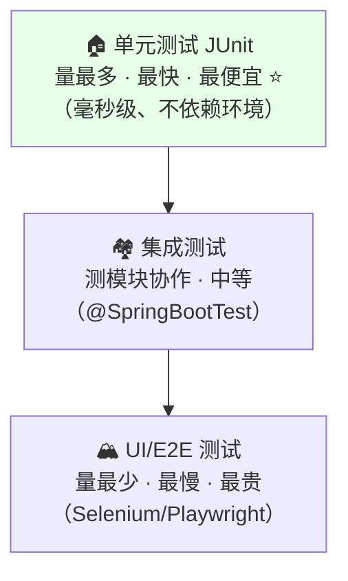
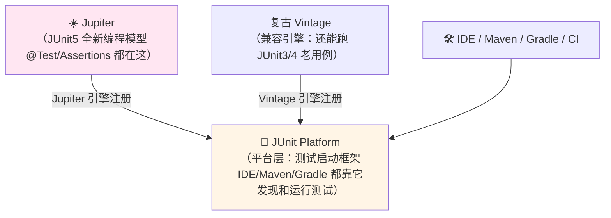
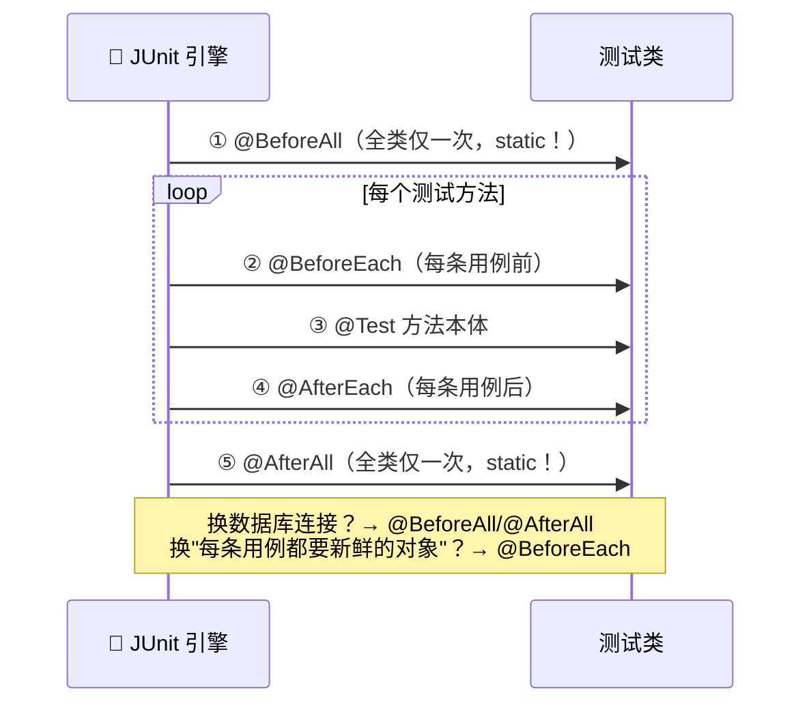
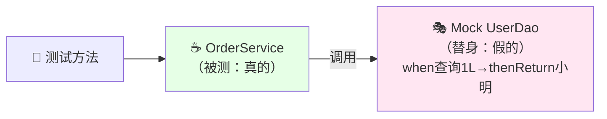
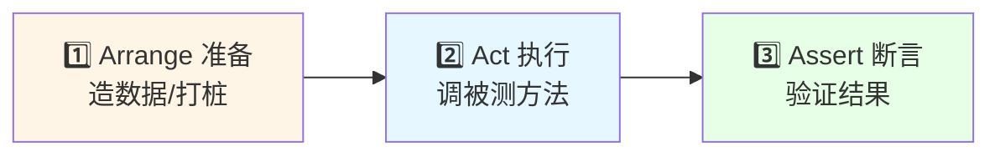
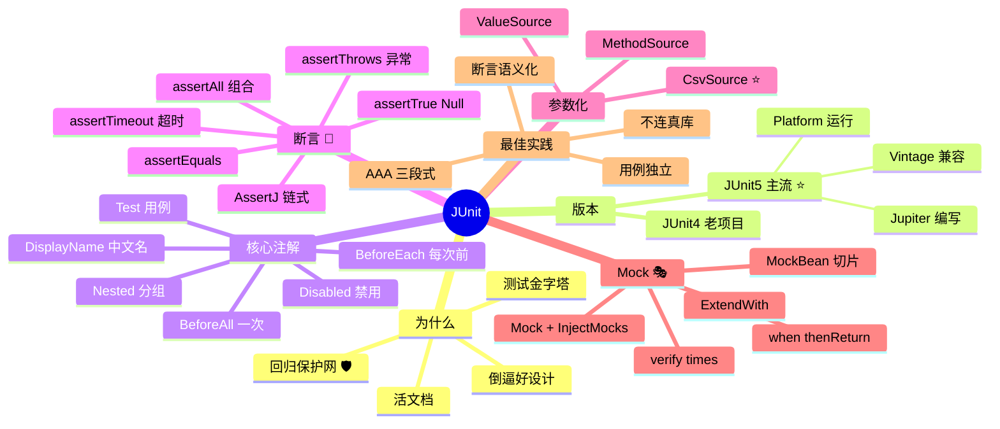

# JUnit 单元测试 从入门到实战 🧪

> 欢迎来到 JUnit 小课堂！💖 改了一行代码，怎么知道没把别的功能改坏？"手动点一遍"？太累啦！今天的主角 **JUnit**——Java 世界的事实标准**单元测试框架**，写一次测试，一辈子自动回归！学完这篇，`@Test`、断言、Mock、参数化测试全拿下，从此带着"测试保护网"写代码～
>
> **学习目标**：
> - 🎯 搞懂单元测试的价值和 JUnit4/5 的区别
> - 🎯 熟练使用 @Test、生命周期注解、断言
> - 🎯 会参数化测试、@Nested 嵌套
> - 🎯 会用 Mockito Mock 依赖 + Spring Boot 切片测试
>
> **前置知识**：Java 基础（Lambda、注解）～

---

## 一、初识单元测试：为什么需要它？🌱

### 1.1 没有 JUnit 的原始时代

想验证一个方法，很多新手这么干：

```java
// ☕ 用 main 方法测试——原始人的做法 🦴
public static void main(String[] args) {
    Calculator calc = new Calculator();
    int result = calc.add(1, 2);
    if (result == 3) {
        System.out.println("通过 ✅");
    } else {
        System.out.println("失败 ❌");
    }
    // 😭 问题：一次只能跑一个，结果靠肉眼看，<br/>没法批量跑、没法统计覆盖率、没法集成 CI！
}
```

**痛点一览**：

| main 方法测试 | JUnit 自动化测试 |
|---|---|
| 一个 main 只能测一个场景 | 一个类里 N 个 `@Test` 方法 ✅ |
| 结果靠肉眼看输出 | 断言自动判定红/绿 🚦 |
| 要测 100 个方法就写 100 个 main | `mvn test` 一键全跑 |
| 改代码后要手动重测 | CI 每次 push 自动回归 |
| 没法统计覆盖率 | JaCoCo 出报告 📊 |

### 1.2 单元测试的三大价值

> **单元测试（Unit Test）**：对**最小可测单元**（通常一个方法）做隔离验证，几秒钟跑完几千个！

1. 🛡️ **回归保护网**：改代码后一键确认没改坏（重构的底气！）
2. 📖 **活文档**：看测试用例就知道方法该怎么用、边界在哪
3. 🏗️ **倒逼好设计**：难测试的代码往往是耦合太重——测试性好的代码架构更清晰

### 1.3 测试金字塔（全局视野）



> 💡 **原则**：**越多测试越好地沉在金字塔底部**——单元测试跑得快、定位准，是性价比之王！

---

## 二、JUnit 是什么 & 版本恩怨 🎭

> **JUnit** = Java 单元测试框架的事实标准（名字来自 Kent Beck 的 SUnit + Java），陪伴 Javaer 二十多年～

### 2.1 JUnit4 vs JUnit5（面试常问！）

| 对比 | JUnit 4 | **JUnit 5** ⭐（主流） |
|---|---|---|
| 发布 | 2006 | 2017 至今 |
| 包名 | `org.junit.Test` | `org.junit.jupiter.api.Test` |
| 架构 | 单体 | **平台 + API 分层**（可跑别的引擎） |
| 注解风格 | `@Before/@After` | `@BeforeEach/@AfterEach` |
| 参数化 | `@RunWith(Parameterized.class)` 笨重 | `@ParameterizedTest` 原生优雅 |
| 断言 | `Assert.assertEquals` | `Assertions.assertEquals`（+分组断言） |
| 嵌套测试 | 无 | `@Nested` |
| Boot 2.x 默认 | 4/5 都行 | 5 |
| **Boot 3.x 默认** | ❌ | ✅ **JUnit 5** |

### 2.2 JUnit5 三件套架构



> 💡 一句话：**Platform 负责"跑"，Jupiter 负责"写"**——所以 IDE 能同时跑你项目里 JUnit4 和 5 的用例！

---

## 三、快速上手：第一个测试 🚀

### 3.1 引依赖

```xml
<!-- ☕ Spring Boot 项目（自带 JUnit5 + Mockito + AssertJ 全家桶） -->
<dependency>
    <groupId>org.springframework.boot</groupId>
    <artifactId>spring-boot-starter-test</artifactId>
    <scope>test</scope>
</dependency>

<!-- ☕ 纯 Java 项目只引 JUnit -->
<dependency>
    <groupId>org.junit.jupiter</groupId>
    <artifactId>junit-jupiter</artifactId>
    <version>5.10.2</version>
    <scope>test</scope>
</dependency>
```

### 3.2 被测类 + 测试类

```java
// ☕ 被测的朴素类
public class Calculator {
    public int add(int a, int b) { return a + b; }
    public int divide(int a, int b) {
        if (b == 0) throw new IllegalArgumentException("除数不能为0");
        return a / b;
    }
}
```

```java
// ☕ src/test/java 下的测试类（目录不同才对哦！）
import org.junit.jupiter.api.*;
import static org.junit.jupiter.api.Assertions.*;

@DisplayName("计算器测试 🧮")
class CalculatorTest {

    private Calculator calculator;

    @BeforeEach                          // 每个测试方法前都新建 → 测试互相独立！
    void setUp() {
        calculator = new Calculator();
    }

    @Test                                // ⭐ 灵魂注解：这是一个测试用例
    @DisplayName("1 加 2 应该等于 3")
    void testAdd() {
        assertEquals(3, calculator.add(1, 2));   // 断言：期望 3，实际 add(1,2)
    }

    @Test
    @DisplayName("除以 0 应该抛异常")
    void testDivideByZero() {
        assertThrows(IllegalArgumentException.class,
                () -> calculator.divide(10, 0)); // 断言：这行代码应该抛这个异常
    }
}
```

**运行方式**：IDE 里点方法旁边的 ▶️ 按钮 / 终端 `mvn test`——绿条通过，红条失败 🚦！

### 3.3 测试类命名约定

| 流派 | 示例 |
|---|---|
| 传统 | `CalculatorTest`（测试类）+ `testAdd`（方法） |
| **Given-When-Then** ⭐ | `addTwoNumbers_returnsSum()` |
| 中文场景化（@DisplayName） | `@DisplayName("用户名重复时_注册应失败")` |

---

## 四、生命周期注解：什么时候执行？⏰⭐



| 注解 | 时机 | 典型用途 |
|---|---|---|
| `@BeforeAll` | 全类**一次**（static） | 连数据库、建容器 |
| `@BeforeEach` | **每条**用例前 | 造新对象、初始化数据 |
| `@Test` | 用例本体 | 测！ |
| `@AfterEach` | 每条用例后 | 清理临时数据 |
| `@AfterAll` | 全类一次（static） | 关连接、关容器 |

**其他常用装饰注解**：

```java
@DisplayName("用户服务测试 👤")     // 给类/方法起中文名（报告里超好看）
@Tag("slow")                       // 打标签，可选择只跑/跳过某类用例
@Disabled("等第三方接口修复后启用")  // 临时禁用（写明原因哦）
class UserServiceTest {

    @Test
    @DisplayName("正常登录")
    void login_success() { ... }

    @Test
    @Disabled("Bug #1024 修复中")
    void login_withWrongPassword() { ... }
}
```

---

## 五、断言：测试的灵魂 🚦⭐

> 断言（Assertion）= 你的"审判官"：**期望 vs 实际**，不符就报失败并打印两边差异～

### 5.1 常用断言速查

```java
import static org.junit.jupiter.api.Assertions.*;

@Test
void assertions_demo() {
    User user = new User("小明", 18);

    assertEquals("小明", user.getName());        // 相等（最常用 ⭐）
    assertNotEquals("小红", user.getName());     // 不等
    assertTrue(user.isAdult());                  // 为真
    assertFalse(user.isVip());                   // 为假
    assertNull(user.getEmail());                 // 为 null
    assertNotNull(user);                         // 非 null

    // 数组/集合逐项比对
    assertArrayEquals(new int[]{1, 2, 3}, result);

    // 浮点比较要给误差范围！
    assertEquals(0.3, 0.1 + 0.2, 1e-9);
}
```

### 5.2 三种高级断言（面试加分！）

```java
// ① 组合断言 assertAll：一次跑完所有断言，报告全部失败点
@Test
void user_info_should_be_complete() {
    User user = userService.find(1L);
    assertAll("用户信息完整性",
        () -> assertEquals("小明", user.getName()),
        () -> assertEquals(18, user.getAge()),
        () -> assertNotNull(user.getEmail())      // 前面挂了后面的照样跑！
    );
}

// ② 异常断言 assertThrows：能拿到异常对象进一步检查
@Test
void divide_byZero_throws() {
    IllegalArgumentException e = assertThrows(
            IllegalArgumentException.class,
            () -> calculator.divide(1, 0));
    assertEquals("除数不能为0", e.getMessage());  // 连异常信息一起验！
}

// ③ 超时断言 assertTimeout：防死循环/慢逻辑
@Test
void query_should_finish_in_1s() {
    assertTimeout(Duration.ofSeconds(1),
            () -> userService.query());
}
```

> 💡 **配套推荐**：`spring-boot-starter-test` 还自带 **AssertJ**，链式写法更香：`assertThat(user.getName()).isEqualTo("小明").startsWith("小")`～

---

## 六、参数化测试：一套逻辑测 N 组数据 📊⭐

> 同一个方法想测 10 组入参？别复制 10 个方法！`@ParameterizedTest` + 数据源搞定：

```java
import org.junit.jupiter.params.ParameterizedTest;
import org.junit.jupiter.params.provider.*;

@ParameterizedTest(name = "[{index}] {0} + {1} = {2}")   // 报告里显示第几组数据
@CsvSource({
        "1, 1, 2",       // a=1, b=1, 期望=2
        "2, 3, 5",
        "-1, 1, 0",
        "100, 200, 300"
})
void add_should_work(int a, int b, int expected) {
    assertEquals(expected, calculator.add(a, b));
}

// 各种数据源任选：
@ParameterizedTest
@ValueSource(strings = {"", " ", "abc@incomplete"})       // 单参数批量喂
void invalid_email_should_fail(String email) { ... }

@ParameterizedTest
@EnumSource(PayType.class)                                 // 枚举全量遍历
void pay_by_type(PayType type) { ... }

@ParameterizedTest
@MethodSource("provideUsers")                              // 复杂对象用方法造数据
void user_age_check(User user) { ... }
static Stream<Arguments> provideUsers() {
    return Stream.of(
            Arguments.of(new User("小明", 18), true),
            Arguments.of(new User("小宝宝", 3), false)
    );
}
```

| 数据源 | 适用 |
|---|---|
| `@ValueSource` | 单参数的原始类型批量 |
| `@CsvSource` | **多参数组合（最常用 ⭐）** |
| `@EnumSource` | 遍历枚举 |
| `@MethodSource` | 复杂对象/动态构造 |
| `@CsvFileSource` | 大量数据放 CSV 文件 |

---

## 七、@Nested 嵌套测试：给用例分组收纳 🗂

> 一个大测试类按"场景"分内嵌类，报告呈树状，结构超清晰：

```java
@DisplayName("订单服务")
class OrderServiceTest {

    @Nested                              // 🎀 内嵌测试类（也可 @DisplayName）
    @DisplayName("创建订单")
    class Create {
        @Test void withValidProduct() { ... }
        @Test void withEmptyCart_shouldFail() { ... }
    }

    @Nested
    @DisplayName("取消订单")
    class Cancel {
        @Test void beforePay() { ... }
        @Test void afterShip_shouldFail() { ... }
    }
}
```

> 💡 内嵌类能访问外部类字段；执行顺序还可用 `@TestMethodOrder(OrderAnnotation.class)` + `@Order(1)` 精确控制（**但别依赖顺序写依赖逻辑**，测试要彼此独立！）

---

## 八、Mock 测试：隔离一切外部依赖 🎭⭐（重头戏！）

### 8.1 为什么需要 Mock？

被测的 `OrderService` 依赖 `UserDao`（查数据库）——单测**不该真的连库**（慢 + 环境依赖 + 数据污染）！

> **Mock = 造一个"假替身"**，你说了算：让它返回什么就返回什么 🎭



### 8.2 Mockito 实战（spring-boot-starter-test 自带）

```java
import org.mockito.*;
import static org.mockito.Mockito.*;

@ExtendWith(MockitoExtension.class)        // 启用 Mockito 支持
class OrderServiceTest {

    @Mock                                  // 🎭 造替身（假的 UserDao）
    private UserDao userDao;

    @InjectMocks                           // 🎯 替身们注入到这个"真身"里
    private OrderService orderService;

    @Test
    void createOrder_withVipUser_getsDiscount() {
        // ① 打桩（Arrange）：规定替身的行为
        when(userDao.findById(1L)).thenReturn(new User("小明", true));

        // ② 执行（Act）：调真方法
        Order order = orderService.create(1L, "SKU-42");

        // ③ 断言（Assert）
        assertEquals(OrderStatus.DISCOUNT, order.getStatus());

        // ④ 验证交互：findById 确实被调了 1 次
        verify(userDao, times(1)).findById(1L);
    }

    @Test
    void createOrder_whenDbError_throws() {
        when(userDao.findById(anyLong()))
                .thenThrow(new RuntimeException("DB 挂了"));   // 模拟异常场景！

        assertThrows(RuntimeException.class,
                () -> orderService.create(1L, "SKU-42"));
    }
}
```

**Mockito 常用套路速查**：

| 需求 | 写法 |
|---|---|
| 打桩返回值 | `when( mock.foo() ).thenReturn(x)` |
| 打桩抛异常 | `.thenThrow(new Xxx())` |
| 任意参数 | `when(mock.find(anyLong()))` |
| 连续不同返回 | `.thenReturn(a, b, c)`（第一次 a 第二次 b…） |
| void 方法打桩 | `doThrow(ex).when(mock).save(any())` |
| 验证调用次数 | `verify(mock, times(1)/never()/atLeast(2)).foo()` |
| 验证无任何交互 | `verifyNoInteractions(mock)` |

---

## 九、Spring Boot 集成测试 🌱⭐

| 注解 | 装配范围 | 场景 |
|---|---|---|
| `@SpringBootTest` | **整个容器**全起 | 慢！测整体流程 |
| `@WebMvcTest(UserController.class)` | 只起 Web 层 | 测 Controller（Service 用 MockBean） |
| `@DataJpaTest` | 只起 JPA + 内存库 | 测 Repository |
| `@ExtendWith(MockitoExtension.class)` | **不起容器** ⚡ | 纯单测（首选，快！） |

```java
// ☕ 切片测试：Controller 层（不起数据库、不起 Service 真身）
@WebMvcTest(OrderController.class)
class OrderControllerTest {

    @Autowired
    private MockMvc mockMvc;                 // 模拟发 HTTP 请求（不占端口！）

    @MockBean                               // 往容器里塞一个假的 Service
    private OrderService orderService;

    @Test
    void getOrder_should_return_200() throws Exception {
        when(orderService.find(1L)).thenReturn(new OrderVO("ORD-1", 1));

        mockMvc.perform(get("/api/order/1"))
               .andExpect(status().isOk())                    // 断言 HTTP 200
               .andExpect(jsonPath("$.orderNo").value("ORD-1")); // 断言 JSON 字段
    }
}
```

> 💡 **性能口诀**：**能用 Mockito 纯单测就别起容器，能用切片就别 @SpringBootTest**——测试跑得快，才有动力常跑！

---

## 十、最佳实践 + 常见坑 🕳️

### 10.1 AAA 三段式（写出优雅用例）



### 10.2 常见坑速查表

| 坑 | 说明 | 正确姿势 |
|---|---|---|
| 测试方法互相依赖 | B 用例依赖 A 先跑 | 每条用例 `@BeforeEach` 重建状态，**独立！** |
| 断言消息乱写 | 失败了不知道哪挂了 | `assertEquals(3, actual, "加法结果不对")` 带说明 |
| 一个方法塞 10 个场景 | 挂了不知道哪断的 | 一个 @Test 一个场景；多组数据用参数化 |
| 测试里写 `System.out.println` 然后肉眼判断 | 那不是测试，是打印 😅 | 必须用断言让框架判定 |
| 单测连真实数据库/Redis | 慢且不稳定 | Mock 掉 / 切片测试 + 内嵌库 |
| 测 getter/setter | 无意义凑数 | 测有逻辑的方法和边界条件 |
| 忘记给浮点误差 | `0.1+0.2 != 0.3` 经典翻车 | `assertEquals(0.3, x, 1e-9)` |
| `@BeforeAll` 没 static | 编译报错 | JUnit5 里默认必须 static（除非 @TestInstance 改模式） |
| 随机 `new Random()` 造数据 | 偶发失败难排查 | 固定种子或用确定性数据 |
| 为了覆盖率写断言弱的用例 | 覆盖率好看但测不出 bug | 断言要验证**业务语义** |

---

## 十一、高频面试题速答 🎯

| 问题 | 精简答案 |
|---|---|
| JUnit4 和 JUnit5 的主要区别？ | 5 采用 Platform+Jupiter 分层架构（可插拔引擎）；注解改名（@Before→@BeforeEach）；新增参数化测试、@Nested、lambda 断言；Boot3 默认 5 |
| JUnit5 由哪几部分组成？ | **Platform**（启动运行平台）+ **Jupiter**（新编程模型/注解）+ **Vintage**（兼容老版本引擎） |
| 单元测试和集成测试的区别？ | 单元测试隔离测最小单元（Mock 依赖、毫秒级）；集成测试验证模块协作（连库/起容器、较慢） |
| @BeforeEach 和 @BeforeAll 区别？ | BeforeEach 每条用例前执行（实例方法）；BeforeAll 整个测试类只执行一次（必须 static） |
| 什么是 Mock？为什么用 Mockito？ | Mock 用"替身"替换真实依赖，隔离被测单元；不连库不联网、速度快、能模拟异常等难以复现场景 |
| @Mock 和 @MockBean 区别？ | @Mock 是 Mockito 的（不起 Spring 容器）；@MockBean 是 Spring Test 的（替换**容器中**的 Bean，需切片/@SpringBootTest） |
| verify 和 when 的区别？ | `when...thenReturn` 是**打桩**（规定返回）；`verify` 是**验证交互**（确认被调了没有/几次） |
| 参数化测试用过吗？ | `@ParameterizedTest` + `@ValueSource/@CsvSource/@MethodSource`，一套逻辑跑多组数据 |
| assertThrows 的作用？ | 断言 lambda 代码抛出指定异常并返回异常对象，可继续断言 message |
| 怎么测 Controller？ | `@WebMvcTest` + MockMvc 发模拟请求 + `@MockBean` 假 Service，断言状态码和 JSON（jsonPath） |

---

## 十二、知识总结地图 🗺️



> 🎀 **毕业寄语**：测试的灵魂就一条——**"红条让我警觉，绿条让我安心"**！从今天起给自己的核心方法都配上测试，改代码前先跑一遍绿、改完再跑见绿，就是最朴素的"安全带"～ 把第八章 Mock 和第九章切片测试练熟，你就是团队里最稳的崽！💪✨
