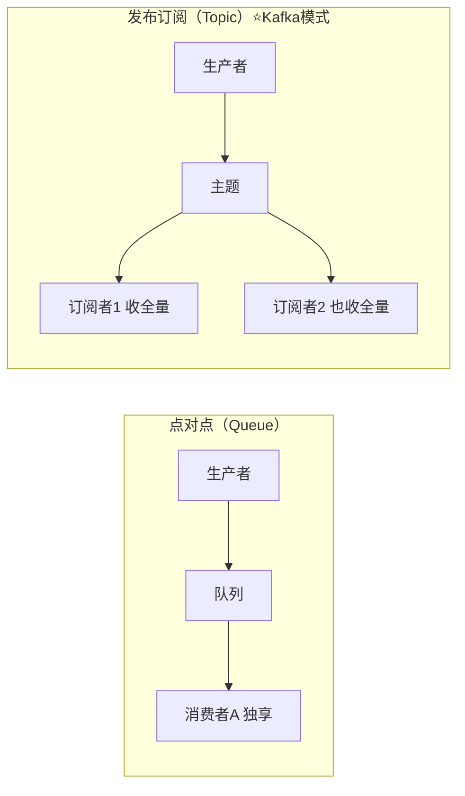
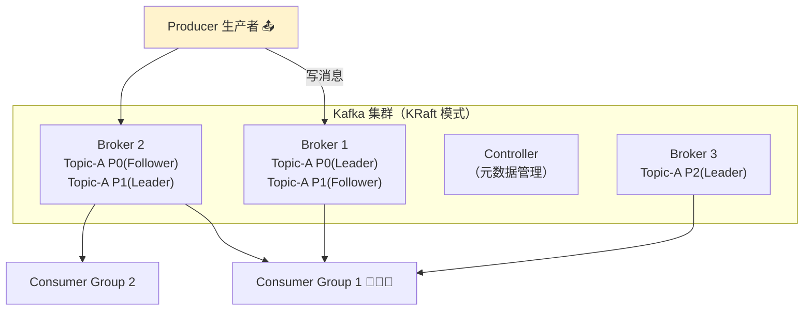
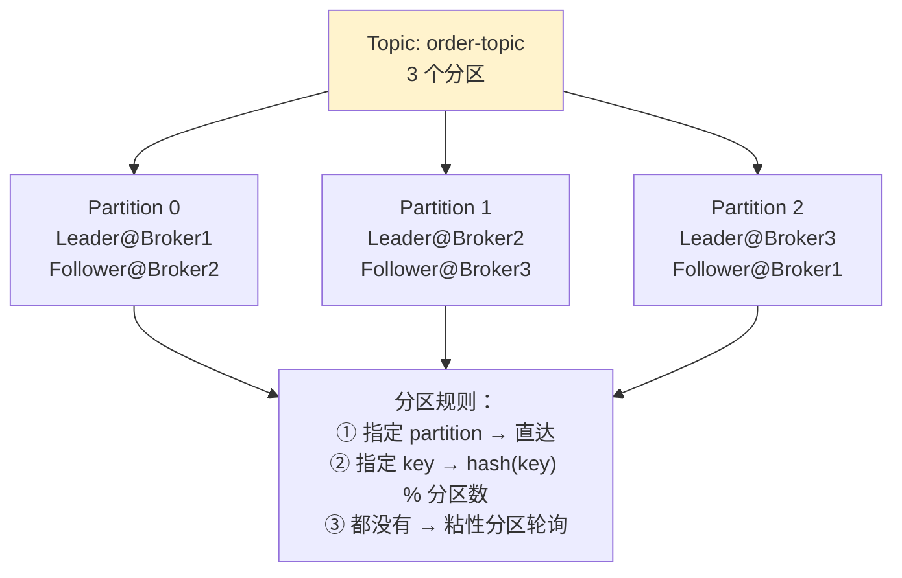
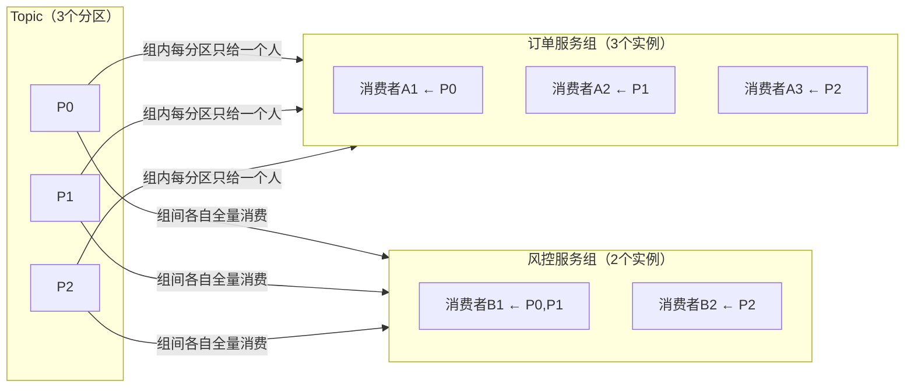
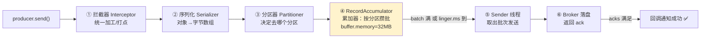
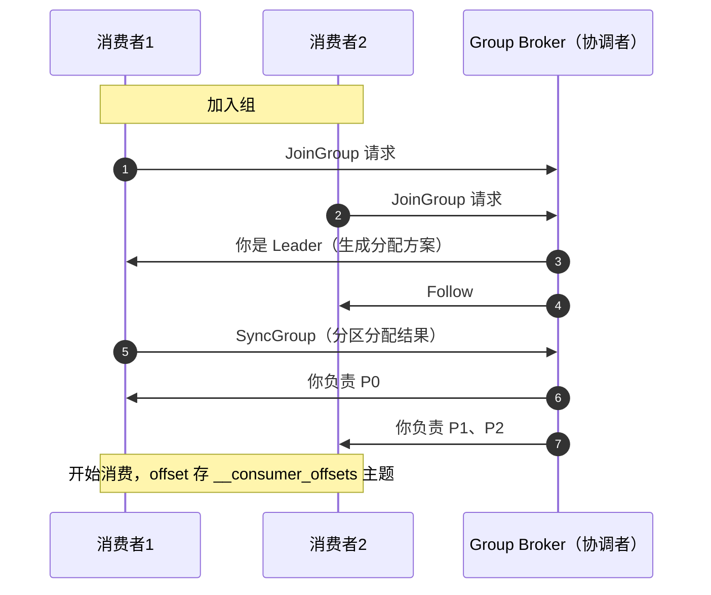
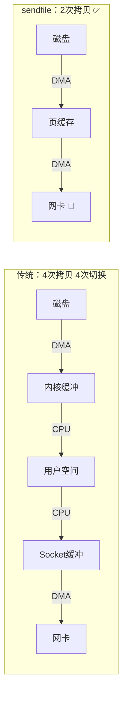
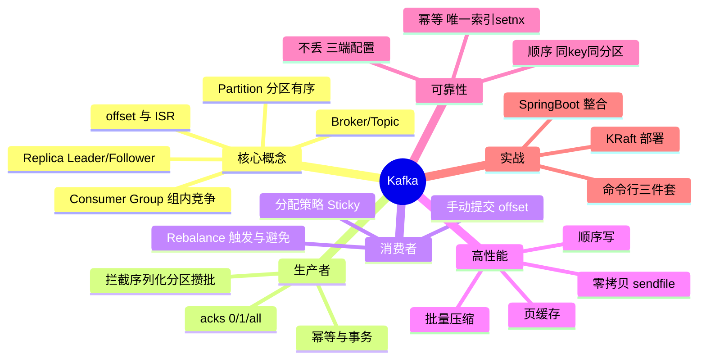

# 🌸 Kafka 超详细教程

> 消息队列界的"性能天花板"——**Kafka**！
> 日志采集、削峰填谷、流式计算全靠它，学会 = 解锁大数据和微服务两扇门 🚪～

---

## 📖 目录

1. [消息队列与 Kafka 是什么](#一消息队列与-kafka-是什么)
2. [核心概念：Broker、Topic、Partition…](#二核心概念brokertopicpartition)
3. [安装与命令行操作](#三安装与命令行操作)
4. [Java 客户端实战](#四java-客户端实战)
5. [Spring Boot 整合](#五spring-boot-整合)
6. [生产者原理](#六生产者原理)
7. [消费者原理与 Rebalance](#七消费者原理与-rebalance)
8. [Kafka 高性能的秘密](#八kafka-高性能的秘密)
9. [可靠性保证：不丢、不重、有序](#九可靠性保证不丢不重有序)
10. [常见问题排查](#十常见问题排查)
11. [面试高频问题](#十一面试高频问题)
12. [总结](#十二总结)

---

## 一、消息队列与 Kafka 是什么？

### 1.1 为什么需要消息队列？🤔

| 价值 | 说明 | 比喻 |
| --- | --- | --- |
| **异步** | 非核心流程（发短信、积分）扔队列慢慢做 | 主菜先上，饮料后上 🥤 |
| **解耦** | 生产者消费者互不认识，随便扩容 | 快递柜：寄件人收件人不用见面 📦 |
| **削峰** | 秒杀 10 万 QPS 涌入，队列缓冲慢慢消费 | 景区闸机限流入园 🎫 |

### 1.2 两种消息模式 📮



### 1.3 主流 MQ 对比 🥊

| 对比 | **Kafka** ⭐ | RocketMQ | RabbitMQ |
| --- | --- | --- | --- |
| 吞吐量 | **百万级/秒** 🚀 | 十万级 | 万级 |
| 延迟 | ms 级 | ms 级 | **μs 级**（最低） |
| 功能 | 精简（无延迟消息） | 丰富（事务/延迟/重试） | 丰富（路由灵活） |
| 生态 | **大数据全家桶**（Stream/Connect/Flink） | 阿里系 | 传统企业 |
| 适合 | 日志采集、流处理、大吞吐 | 电商业务消息 | 复杂路由、低延迟 |

> 💡 **一句话**：追求**吞吐**选 Kafka；业务消息功能多选 RocketMQ；路由灵活小规模选 RabbitMQ～

### 1.4 Kafka 定位 🏷️

> Kafka 是**分布式流处理平台**（不只是消息队列）：
> ① 消息系统（发布订阅）② 存储系统（日志可持久化、可回放）③ 流处理（Kafka Streams）

---

## 二、核心概念：Broker、Topic、Partition 🧠

### 2.1 全家福架构图



### 2.2 核心概念速查表 📋

| 概念 | 说明 | 比喻 |
| --- | --- | --- |
| **Broker** | 一个 Kafka 服务器节点 | 一家快递网点 🏪 |
| **Topic** | 消息类别（逻辑分类） | 一类包裹（如"订单类"） |
| **Partition** | Topic 的分片，**有序队列** | 该类包裹分成几条流水线 |
| **Replica** | 分区副本（Leader 写、Follower 同步） | 每条流水线有备胎 |
| **Producer** | 消息生产者 | 寄件人 📤 |
| **Consumer** | 消息消费者 | 取件人 📥 |
| **Consumer Group** | 消费者组：**组内竞争，组间广播** | 几个人分拣一条流水线 |
| **Offset** | 消息在分区内的唯一序号 | 流水线上的编号 |
| **ISR** | 与 Leader 保持同步的副本集合 | 跟得上的备胎们 ✅ |

### 2.3 Topic / Partition / Replica 关系（必懂 ⭐）



| 关键规则 | 说明 |
| --- | --- |
| 分区内有序 | **只有分区内消息有序**，跨分区不保证顺序 |
| 消费并行度 | 一个分区**最多**被组内一个消费者消费；消费者数 > 分区数会有人闲着 😴 |
| 副本角色 | 只有 **Leader 分区**对外读写；Follower 只同步 |
| 副本分布 | 同一分区的多个副本**必须在不同 Broker**（容灾） |

### 2.4 消费者组：组内竞争、组间广播 🎯



> 💡 这是 Kafka 实现负载均衡 + 广播的钥匙：**同一个服务多实例 → 同一个组（分摊）；不同服务都要消息 → 不同组（广播）**！

---

## 三、安装与命令行操作 🛠️

### 3.1 启动（KRaft 模式，无需 ZooKeeper ✨）

```bash
# ① 生成集群 UUID
bin/kafka-storage.sh random-uuid

# ② 格式化存储目录（把生成的 UUID 填进去）
bin/kafka-storage.sh format -t <uuid> -c config/kraft/server.properties

# ③ 启动
bin/kafka-server-start.sh config/kraft/server.properties     # Linux
.\bin\windows\kafka-server-start.bat .\config\kraft\server.properties   # Windows
```

> 💡 老版本需要先起 ZooKeeper 管理元数据，**2.8+ 引入 KRaft**（内置 Raft 协议），3.x 起官方主推，告别"双进程"时代～

### 3.2 常用命令行速查 📋

```bash
# 创建主题：3分区 2副本
bin/kafka-topics.sh --create --bootstrap-server localhost:9092 \
  --topic order-topic --partitions 3 --replication-factor 2

# 查看主题列表 / 详情
bin/kafka-topics.sh --list --bootstrap-server localhost:9092
bin/kafka-topics.sh --describe --bootstrap-server localhost:9092 --topic order-topic

# 命令行生产者（回车发送）
bin/kafka-console-producer.sh --bootstrap-server localhost:9092 --topic order-topic

# 命令行消费者（--from-beginning 从头消费）
bin/kafka-console-consumer.sh --bootstrap-server localhost:9092 \
  --topic order-topic --from-beginning --group my-group
```

---

## 四、Java 客户端实战 ☕

### 4.1 生产者

```xml
<dependency>
    <groupId>org.apache.kafka</groupId>
    <artifactId>kafka-clients</artifactId>
    <version>3.6.1</version>
</dependency>
```

```java
public class MyProducer {
    public static void main(String[] args) {
        Properties props = new Properties();
        props.put(ProducerConfig.BOOTSTRAP_SERVERS_CONFIG, "localhost:9092");
        props.put(ProducerConfig.KEY_SERIALIZER_CLASS_CONFIG, StringSerializer.class.getName());
        props.put(ProducerConfig.VALUE_SERIALIZER_CLASS_CONFIG, StringSerializer.class.getName());
        // 可靠性三件套（第九章详解）
        props.put(ProducerConfig.ACKS_CONFIG, "all");
        props.put(ProducerConfig.ENABLE_IDEMPOTENCE_CONFIG, "true");   // 幂等，防重复
        props.put(ProducerConfig.RETRIES_CONFIG, Integer.MAX_VALUE);

        try (KafkaProducer<String, String> producer = new KafkaProducer<>(props)) {

            // ① 异步发送（最常用）
            ProducerRecord<String, String> record =
                    new ProducerRecord<>("order-topic", "order-1001", "创建订单");
            producer.send(record, (metadata, e) -> {          // 回调：成功/失败都知道
                if (e == null) {
                    System.out.println("发送成功：" + metadata.partition() + "-" + metadata.offset());
                } else {
                    System.err.println("发送失败：" + e.getMessage());
                }
            });

            // ② 同步发送（阻塞等结果，可靠但要等）
            try {
                RecordMetadata md = producer.send(record).get();
                System.out.println("同步确认：" + md.offset());
            } catch (Exception e) {
                e.printStackTrace();
            }

            producer.flush();
        }
    }
}
```

### 4.2 消费者

```java
public class MyConsumer {
    public static void main(String[] args) {
        Properties props = new Properties();
        props.put(ConsumerConfig.BOOTSTRAP_SERVERS_CONFIG, "localhost:9092");
        props.put(ConsumerConfig.GROUP_ID_CONFIG, "order-service-group");  // 消费者组
        props.put(ConsumerConfig.KEY_DESERIALIZER_CLASS_CONFIG, StringDeserializer.class.getName());
        props.put(ConsumerConfig.VALUE_DESERIALIZER_CLASS_CONFIG, StringDeserializer.class.getName());
        // 手动提交 offset（可靠性推荐）
        props.put(ConsumerConfig.ENABLE_AUTO_COMMIT_CONFIG, "false");

        KafkaConsumer<String, String> consumer = new KafkaConsumer<>(props);
        consumer.subscribe(List.of("order-topic"));

        while (true) {
            // 拉取一批消息（500ms 没拉到就返回空）
            ConsumerRecords<String, String> records = consumer.poll(Duration.ofMillis(500));

            for (ConsumerRecord<String, String> record : records) {
                System.out.printf("partition=%d offset=%d value=%s%n",
                        record.partition(), record.offset(), record.value());
            }
            // 处理完再提交（先处理后提交 → 至少一次语义）
            consumer.commitSync();
        }
    }
}
```

---

## 五、Spring Boot 整合 🌸

### 5.1 配置

```yaml
spring:
  kafka:
    bootstrap-servers: localhost:9092
    producer:
      key-serializer: org.apache.kafka.common.serialization.StringSerializer
      value-serializer: org.apache.kafka.common.serialization.StringSerializer
      acks: all
      properties:
        enable.idempotence: true
    consumer:
      group-id: order-service-group
      auto-offset-reset: earliest      # 无offset时从头消费
      enable-auto-commit: false        # 关自动提交
      key-deserializer: org.apache.kafka.common.serialization.StringDeserializer
      value-deserializer: org.apache.kafka.common.serialization.StringDeserializer
    listener:
      ack-mode: manual_immediate       # 手动确认模式
```

### 5.2 发送与监听

```java
@Service
public class OrderMessageService {

    @Autowired
    private KafkaTemplate<String, String> kafkaTemplate;

    /** 发送订单消息（key=订单ID → 同一订单进同一分区，保证顺序） */
    public void sendOrderCreated(OrderEvent event) {
        kafkaTemplate.send("order-topic", event.getOrderId(), toJson(event))
                .whenComplete((result, ex) -> {
                    if (ex != null) {
                        log.error("发送失败，走补偿逻辑", ex);
                    } else {
                        log.info("发送成功：{}", result.getRecordMetadata().offset());
                    }
                });
    }
}
```

```java
@Component
@Slf4j
public class OrderListener {

    @KafkaListener(topics = "order-topic", groupId = "order-service-group")
    public void onMessage(ConsumerRecord<String, String> record, Acknowledgment ack) {
        try {
            log.info("收到消息：partition={}, offset={}, value={}",
                    record.partition(), record.offset(), record.value());
            // 业务处理（记得做幂等！）
            handleOrder(record.value());
            ack.acknowledge();        // 手动确认 offset
        } catch (Exception e) {
            log.error("处理失败，不确认（下次重新投递）", e);
        }
    }
}
```

---

## 六、生产者原理 📤

### 6.1 发送全流程（源码级）



### 6.2 分区策略 🎯

| 条件 | 策略 |
| --- | --- |
| 指定了 `partition` | 直奔目标分区 |
| 有 `key` 无 partition | `hash(key) % 分区数`（**同 key 永远同分区 → 有序！**） |
| 都没有 | 粘性分区：先填满一个批次再换分区（吞吐更好） |

### 6.3 acks 参数（可靠性核心 ⭐）

| 值 | 含义 | 可靠性 / 性能 |
| --- | --- | --- |
| `acks=0` | 发出去就算成功，不等确认 | 最低 ⚡最快（日志采集可用） |
| `acks=1` | **Leader** 写入成功即确认 | 中等（默认） |
| `acks=all/-1` | Leader + **ISR 里所有副本**都写入才确认 | **最高** ✅ 最慢 |

### 6.4 ISR 与 HW、LEO 🧬

| 概念 | 全称 | 含义 |
| --- | --- | --- |
| **LEO** | Log End Offset | 每个副本日志的下一条写入位置（终点） |
| **HW** | High Watermark | **消费者可见的最大 offset** = ISR 中最小 LEO |
| **ISR** | In-Sync Replicas | 与 Leader 保持同步的副本集（含 Leader），落后太多会被踢出 |

```text
Leader:   [0][1][2][3][4][5]        LEO=6, HW=5（受最慢Follower限制）
Follower1:[0][1][2][3][4][5]        LEO=6
Follower2:[0][1][2][3][4]           LEO=5 ← 拖后腿
消费者最多能读到 offset=4（HW=5 之前）
```

> 💡 Follower 落后超过 `replica.lag.time.max.ms`（默认30秒）→ 被踢出 ISR；全部副本唯一（`min.insync.replicas`）不够时 acks=all 会报错——**可用性与一致性的平衡艺术** ⚖️

### 6.5 幂等与事务 🔒

| 机制 | 解决什么 | 原理 |
| --- | --- | --- |
| **幂等**（`enable.idempotence=true`） | **单分区单会话**的重复 | Broker 记 (PID, 分区, 序号)，重复序号丢弃 |
| **事务**（`transactional.id=xx`） | **跨分区跨会话**原子写 | 两阶段提交，read-process-write 场景 |

```java
producer.initTransactions();
producer.beginTransaction();
try {
    producer.send(new ProducerRecord<>("topic-a", "msg1"));
    producer.send(new ProducerRecord<>("topic-b", "msg2"));   // 两个主题要么都成
    producer.sendOffsetsToTransaction(offsets, groupMetadata); // 消费偏移量也纳入事务
    producer.commitTransaction();
} catch (Exception e) {
    producer.abortTransaction();
}
```

---

## 七、消费者原理与 Rebalance 📥

### 7.1 消费者组协调流程



### 7.2 Rebalance（再均衡）：必须搞懂 ⭐

**触发条件**（任何一种）：

| 触发 | 场景 |
| --- | --- |
| 组内成员变化 | 消费者**挂了 / 新增 / 优雅退出** |
| 订阅主题变化 | 新增订阅主题、分区数扩容 |
| 消费者心跳超时 | `session.timeout.ms`（默认45s）没心跳 → 判死 |

**危害** 😱：

```text
Rebalance 期间【全组停止消费】（Stop The World）
→ 消费者越多，重分配越慢 → 消息积压
→ 频繁误判（GC 停顿被当成死亡）→ 反复 Rebalance → 雪上加霜
```

**避免方案** ✅：

| 手段 | 说明 |
| --- | --- |
| 合理心跳 | `heartbeat.interval.ms` = session.timeout 的 1/3 |
| 调大超时判死 | `session.timeout.ms` / `max.poll.interval.ms`（处理太慢也会被判死！） |
| 使用 CooperativeSticky | 增量再均衡，只动需要动的分区（不用全组停摆）|
| 静态成员 | `group.instance.id` 重启不触发再均衡 |

### 7.3 offset 提交策略 🎛️

| 方式 | 说明 | 风险 |
| --- | --- | --- |
| 自动提交 | `auto-commit` 每 5s 提交一次 | **处理没完成就提交 → 丢消息** 💀 |
| 手动同步 `commitSync()` | 处理完一批再提交，阻塞 | 可靠但慢 |
| 手动异步 `commitAsync()` | 不阻塞性能好 | 失败可能漏提交（配合关机前 sync 兜底）|

```java
// 生产推荐姿势：异步为主 + 关闭前同步兜底
try {
    while (running) {
        records = consumer.poll(Duration.ofMillis(500));
        handle(records);
        consumer.commitAsync();               // 日常异步
    }
} finally {
    try { consumer.commitSync(); }           // 退出前最后确认一次
    finally { consumer.close(); }
}
```

### 7.4 分区分配策略 📊

| 策略 | 规则 | 问题 |
| --- | --- | --- |
| Range | 按主题逐个分：分区排序后连续切分 | 多主题时可能不均（前边的消费者总多拿）|
| RoundRobin | 所有分区混在一起轮询分 | 比较均匀 |
| Sticky | 尽量保持上次分配 | 减少变动 |
| **CooperativeSticky** ⭐ | Sticky + **增量再均衡** | 其他消费者不用停（3.x 默认）|

---

## 八、Kafka 高性能的秘密 🚀

| 设计 | 说明 |
| --- | --- |
| **顺序写磁盘** | 日志只追加（append），顺序写 ~600MB/s vs 随机写 ~100KB/s 💨 |
| **页缓存 PageCache** | 读写先走 OS 页缓存，热数据基本不碰磁盘 |
| **零拷贝 sendfile** | 数据：磁盘 → 页缓存 → 网卡，**不经过用户态**（和 Netty FileRegion 同款）🍰 |
| **批量 + 压缩** | 攒批发送（batch.size / linger.ms）+ gzip/lz4/zstd 压缩 |
| **分区并行** | 分区分布在多 Broker，读写天然水平扩展 |
| **稀疏索引** | 每个 segment 配 .index 稀疏索引，查找快 |



---

## 九、可靠性保证：不丢、不重、有序 🔒

### 9.1 消息丢失三大环节及对策


| 环节 | 丢失原因 | 对策 |
| --- | --- | --- |
| **生产端** | acks=0/1 就返回，Leader 挂了 | `acks=all` + `retries=MAX` + **回调处理失败** |
| **存储端** | 副本数不足、ISR 全没了 | `replication.factor≥3` + `min.insync.replicas≥2` + `unclean.leader.election=false` |
| **消费端** | **自动提交：先提交后处理**，处理崩了 | **手动提交：先处理再提交** |

> ⚠️ 高可靠模板（背下来 ⭐）：
> ```text
> producer:  acks=all + retries=MAX + enable.idempotence=true
> broker:    replication.factor=3 + min.insync.replicas=2
>            unclean.leader.election.enable=false
> consumer:  enable.auto.commit=false + 处理成功后手动提交
> ```

### 9.2 重复消费与幂等 🔄

重试机制的必然代价：**至少一次（At Least Once）** = 不丢但可能重。

**幂等方案**：

```java
/** 数据库唯一键兜底：重复消费直接插入失败，天然幂等 */
@KafkaListener(topics = "order-topic")
public void onMessage(ConsumerRecord<String, String> record) {
    OrderEvent event = parse(record.value());

    // 方式1：唯一索引（order_id 唯一键）
    // INSERT IGNORE / ON DUPLICATE KEY UPDATE

    // 方式2：Redis setnx 去重标记
    String key = "kafka:consumed:" + event.getMsgId();
    Boolean first = redisTemplate.opsForValue().setIfAbsent(key, "1", 24, TimeUnit.HOURS);
    if (Boolean.FALSE.equals(first)) {
        return;   // 消费过了，跳过 ✅
    }
    orderService.handle(event);
}
```

| 幂等手段 | 适用 |
| --- | --- |
| 数据库唯一索引 | 插入类操作（最稳 ⭐） |
| Redis setnx | 通用（注意 TTL 与业务一致） |
| 状态机校验 | 更新类（订单状态只能往前走） |

### 9.3 消息顺序性 🔢

**结论**：Kafka 只保证**分区内有序**！

| 需求 | 做法 |
| --- | --- |
| 单订单的创建→支付→发货有序 | **同 orderId 发到同一分区**：指定 `key=orderId`（hash 同 key 同分区）✅ |
| 全局有序 | 分区数设 1（牺牲并发，一般不干） |

> ⚠️ 即使同分区，生产端重试乱序 → 开**幂等**（max.in.flight ≤5 时保证有序）；
> 消费端单分区可能被多线程乱序处理 → 按消息 key 再哈希到线程池。

---

## 十、常见问题排查 🩺

### Q1：消息积压怎么办？📉

```text
① 先查消费端：是不是消费者挂了 / Rebalance 风暴 / 处理太慢（DB慢查询）
② 提升并行度：加消费者实例（≤分区数！）或临时扩分区 + 扩消费者
③ 快速导流：写个临时程序只读不处理，转发到新 topic（更多分区），再扩消费者消费
④ 事后预防：监控 Consumer Lag（kafka-exporter + Prometheus）提前告警 📢
```

### Q2：消费者消费不到消息？

```text
① group.id 配错（订阅了别的组？offset 已到最新）
② auto.offset.reset 设置：earliest（从头）/latest（只收新的，默认）
③ 手动提交模式忘了 ack.acknowledge() → 重启反复重复消费
④ 分区数 < 消费者数 → 有人分不到分区干瞪眼
```

### Q3：频繁 Rebalance？

```text
① 日志搜 "Attempt to heartbeat failed" / rebalancing
② max.poll.interval.ms 太小：一批处理超时被踢（加大它 or 减 max.poll.records）
③ GC 停顿误判：优化 JVM 或调大 session.timeout.ms
④ 升级 cooperative-sticky 策略，增量再均衡
```

### Q4：Topic 删除不掉 / 元数据异常？

```text
KRaft 模式：确认 controller 配置，删除用 --delete 且注意
server.properties 里 delete.topic.enable=true（老版本）
```

---

## 十一、面试高频问题 🎯

### Q1：Kafka 为什么快？（必考 ⭐）

> ① **顺序写**磁盘（append-only 日志）；② **页缓存**读写，绕开 JVM 堆；③ **零拷贝**（sendfile）直接从页缓存发网卡；④ **批量 + 压缩**减少网络开销；⑤ **分区并行**水平扩展；⑥ 稀疏索引快速定位。

### Q2：Kafka 的架构 / 核心组件？

> Broker（服务器）+ Topic（主题）+ Partition（分区，有序、并行单位）+ Replica（副本，Leader/Follower）+ Producer + Consumer Group（组内竞争组间广播）+ Controller/KRaft（元数据管理）。消费者 offset 存在 `__consumer_offsets` 内部主题。

### Q3：生产者发送消息的流程？

> 主线程：拦截器 → 序列化 → 分区器 → 进 RecordAccumulator（按分区攒批）；Sender 线程：批次满/linger.ms 到 → 发给 Broker → 按 acks 等待确认 → 回调返回结果。

### Q4：acks 参数含义？怎么保证不丢消息？

> acks=0 不等确认最快；acks=1 Leader 确认；acks=all ISR 全部确认最可靠。
> 不丢三件套：**生产端** acks=all+重试+幂等；**存储端** 副本≥3 + min.insync.replicas≥2 + 禁脏选举；**消费端** 手动提交（先处理后提交）。

### Q5：什么是 ISR、LEO、HW？

> **ISR**：与 Leader 同步的副本集合（落后超时被踢）；**LEO**：每个副本下一条待写入的位置；**HW（高水位）**：ISR 中最小 LEO，消费者只能读到 HW 之前的消息（保证只消费已被充分复制的消息）。

### Q6：Rebalance 是什么？什么时候发生？怎么避免？

> 消费者组内分区重新分配。触发：成员增减、订阅变化、心跳超时。
> 危害：全组暂停消费（STW）。
> 避免：合理心跳参数、调大 max.poll.interval.ms（处理慢别被判死）、用 CooperativeSticky 增量再均衡、静态成员 ID。

### Q7：怎么保证消息顺序？

> Kafka 只保证分区内有序 → **同一业务 key（如订单ID）发同一分区**（hash 路由）；
> 生产端开启幂等防重试乱序；消费端按 key 再做线程级隔离。

### Q8：怎么处理重复消费？

> 重试机制决定是"至少一次"，重复不可避免 → **消费端幂等**：数据库唯一索引、Redis setnx 去重、状态机校验。
> Kafka 端还有幂等生产者（单分区会话）与事务（跨分区原子）。

### Q9：Kafka 和 RocketMQ/RabbitMQ 怎么选？

> Kafka：超高吞吐、日志/埋点/流处理生态（Flink 无缝）；
> RocketMQ：业务消息功能全（事务、延迟、重试、死信），Java 技术栈友好；
> RabbitMQ：低延迟微秒级、路由灵活，吞吐要求不高的传统系统。

### Q10：消费者数量和分区数的关系？

> 一个分区最多被**组内一个**消费者消费：消费者数=分区数利用率最大；消费者数>分区数时多余者空闲；想扩消费者先扩分区。

---

## 十二、总结 🎓

### 12.1 知识点一张图 🗺️



### 12.2 学习建议 💝

1. **本地起一套 KRaft**：建 topic → 命令行收发 → 观察分区分布 🖱️
2. **跑通 Java 客户端**：自定义 key 观察消息固定进同一分区，体会有序性
3. **手写不丢不重**：按 9.1 模板配置 + Redis 去重，这就是生产标配
4. **面试抓四大件**：**为什么快、怎么不丢、Rebalance、顺序性**——90% 的 Kafka 面题都在这 🎯

---

> 🌸 **恭喜你把 Kafka 学透啦！**
> 记住灵魂口诀：**分区有序、组内竞争、批量顺序写、零拷贝起飞** 🚀～
> 系列：SpringCloud → Nacos → Gateway → Sentinel → Seata → Netty → Kafka ✅
> 下一篇想学 Redis、RocketMQ、Zookeeper 还是 JVM？随时点单哦 💪✨
