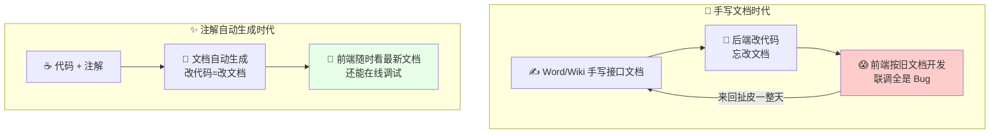
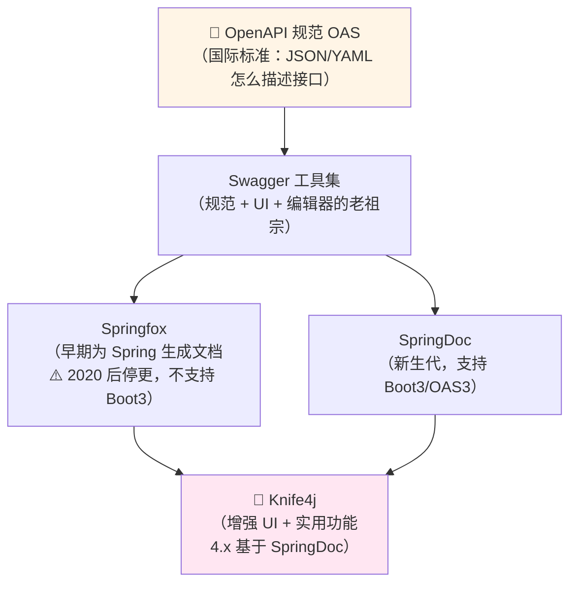
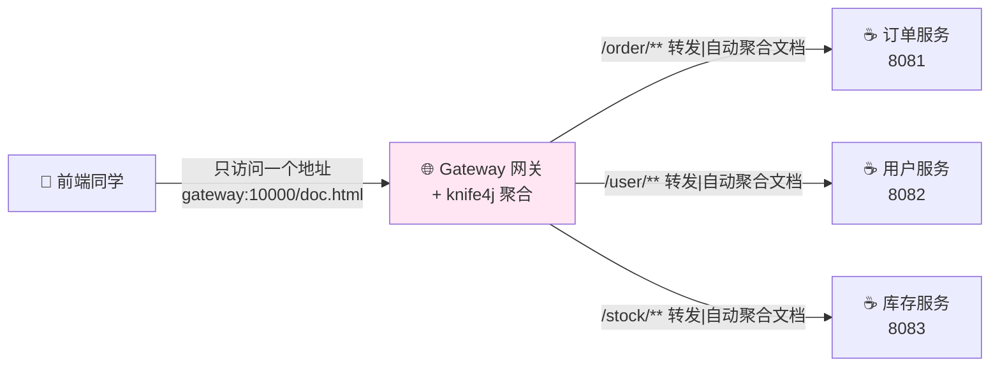
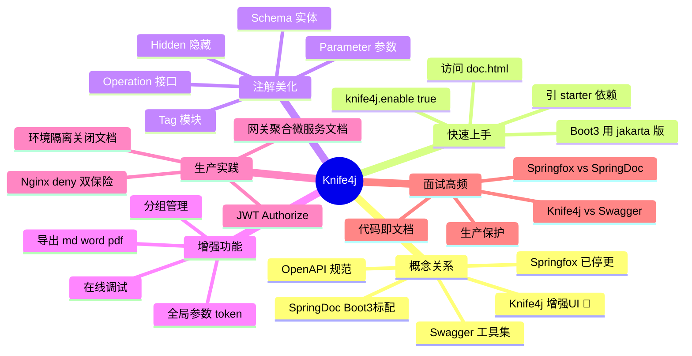

# Knife4j 接口文档 从入门到实战 📄

> 欢迎来到 Knife4j 小课堂！💖 前后端联调最怕什么？"接口文档过期了！"——后端改了参数忘了说，前端对着旧文档调到怀疑人生 😭。今天的主角 **Knife4j** 让接口文档**跟着代码自动生成、永远最新**，还自带漂亮的界面和在线调试！学完这篇，前后端协作体验直接起飞～
>
> **学习目标**：
> - 🎯 搞懂 OpenAPI / Swagger / Knife4j 的关系（面试常问！）
> - 🎯 会在 Spring Boot 项目里集成 Knife4j（2.x 和 3.x 两套方案）
> - 🎯 熟练使用常用注解美化文档
> - 🎯 会 JWT 授权、离线导出、微服务网关聚合、生产环境保护
>
> **前置知识**：Spring Boot 基础、会用 Maven～

---

## 一、为什么需要 Knife4j？🌱

### 1.1 前后端协作的血泪史



**理想的接口文档应该**：

| 要求 | 手写文档 | 自动生成文档 |
|---|---|---|
| 永远和代码同步 | ❌ 靠自觉 | ✅ **代码即文档** |
| 能在线调试 | ❌ | ✅ 页面上直接发请求 |
| 参数/返回值结构清晰 | 慢慢写 | ✅ 从 DTO 自动推导 |
| 给前端/测试/第三方看 | 发文件 | ✅ 甩一个 URL |

### 1.2 Knife4j 是什么（一句话版）

> **Knife4j** = 给 Java 接口文档做的一套**"漂亮皮肤 + 超级增强"**——底层遵循 OpenAPI 规范生成文档，Knife4j 提供好看好用的 UI（`/doc.html`）和一堆实用功能（导出、聚合、调试增强）！
>
> 前身叫 `swagger-bootstrap-ui`，后来改名 Knife4j（"Knife for Java"，一把瑞士军刀 🔪）～

---

## 二、概念扫盲：OpenAPI、Swagger、SpringDoc、Knife4j ⭐（面试必会！）

这四个名词像绕口令？一张关系图看懂：



| 名词 | 是什么 | 一句话记忆 |
|---|---|---|
| **OpenAPI** | 描述 REST 接口的**规范/格式标准** | "普通话标准" 📜 |
| **Swagger** | 实现该规范的老牌工具集 | "第一批说普通话的" |
| **Springfox** | Spring 集成 Swagger 的库（**已停更**） | "过气的翻译官" 🪦 |
| **SpringDoc** | 新一代 Spring 文档库（支持 Boot3） | "现役翻译官" ⭐ |
| **Knife4j** | UI 皮肤 + 增强功能（可配 Springfox/SpringDoc） | "给文档化妆 + 加特技" 💄✨ |

> ⚠️ **版本对照（大坑！）**：
>
> | Spring Boot 版本 | 方案 | Knife4j 版本 |
> |---|---|---|
> | 2.x | Springfox | Knife4j 2.x / 3.0 |
> | **3.x** | **SpringDoc** | **Knife4j 4.x** ⭐ |
>
> Boot 3 必须用 Knife4j 4.x（`knife4j-openapi3-jakarta-spring-boot-starter`），用老版本启动直接报错！

---

## 三、快速上手：三步集成 🚀

### 3.1 引依赖

```xml
<!-- ☕ Spring Boot 3.x（主流，基于 SpringDoc + OpenAPI3） -->
<dependency>
    <groupId>com.github.xiaoymin</groupId>
    <artifactId>knife4j-openapi3-jakarta-spring-boot-starter</artifactId>
    <version>4.5.0</version>
</dependency>

<!-- ☕ Spring Boot 2.x 老项目（基于 Springfox） -->
<dependency>
    <groupId>com.github.xiaoymin</groupId>
    <artifactId>knife4j-openapi2-spring-boot-starter</artifactId>
    <version>4.5.0</version>
</dependency>
```

### 3.2 写个配置类（可省略，但建议写）

```java
// ☕ Knife4jConfig.java —— Spring Boot 3 版
@Configuration
public class Knife4jConfig {

    @Bean
    public OpenAPI openAPI() {
        return new OpenAPI()
                .info(new Info()
                        .title("订单中心 API")                       // 文档标题
                        .description("订单模块接口文档～🛒")
                        .version("v1.0")
                        .contact(new Contact().name("小仙女的团队")))
                // JWT 授权配置（右上角 Authorize 按钮 🔒）
                .components(new Components()
                        .addSecuritySchemes("token",
                                new SecurityScheme()
                                        .type(SecurityScheme.Type.APIKEY)
                                        .in(SecurityScheme.In.HEADER)
                                        .name("token")))
                .addSecurityItem(new SecurityRequirement().addList("token"));
    }
}
```

### 3.3 启动访问

浏览器打开：

```text
http://localhost:8080/doc.html     ← Knife4j 增强版界面 ⭐
http://localhost:8080/v3/api-docs  ← 原始 OpenAPI JSON（给其他工具消费）
http://localhost:8080/swagger-ui/index.html  ← 原版 Swagger UI（对比用）
```

> 看到 Knife4j 那个清爽的文档界面（左侧文档管理/接口列表，右侧说明）= 成功！🎉 **代码里一个 Controller 都没动，文档已经自动生成了**——这就是"自动扫描"的魔法～

---

## 四、注解详解：让文档漂亮起来 🎨⭐

不写注解也能生成文档，但加上注解才是"精装修"！以下基于 **OpenAPI3 注解**（Boot3 + Knife4j 4.x）：

### 4.1 Controller 层注解

```java
// ☕ OrderController.java
@Tag(name = "订单管理", description = "订单的增删改查")      // ① 模块名（旧版叫 @Api）
@RestController
@RequestMapping("/api/order")
public class OrderController {

    @Operation(summary = "创建订单",                             // ② 接口名（旧版 @ApiOperation）
            description = "传入商品ID和数量，返回订单号")
    @Parameters({
            @Parameter(name = "userId", description = "用户ID", required = true, example = "10086")
    })
    @PostMapping("/create")
    public Result<String> createOrder(
            @RequestParam Long userId,                          // ③ @RequestParam 自动识别为 query 参数
            @RequestBody OrderCreateDTO dto) {                  // ④ @RequestBody 自动识别为 body 参数
        return Result.ok("ORD-" + System.currentTimeMillis());
    }

    @Operation(summary = "查询订单详情")
    @GetMapping("/{id}")
    public Result<OrderVO> getOrder(
            @Parameter(description = "订单ID", example = "1")
            @PathVariable Long id) {
        return Result.ok(new OrderVO());
    }

    @Operation(summary = "内部接口", hidden = true)              // ⑤ 不想暴露的接口藏起来
    @GetMapping("/internal/health")
    public String health() { return "ok"; }
}
```

### 4.2 DTO 层注解（实体美化）

```java
// ☕ OrderCreateDTO.java
@Schema(description = "创建订单请求体")                          // 旧版 @ApiModel
@Data
public class OrderCreateDTO {

    @Schema(description = "商品ID", example = "9527", requiredMode = REQUIRED)  // 旧版 @ApiModelProperty
    private Long productId;

    @Schema(description = "购买数量（1~99）", example = "2", maximum = "99")
    private Integer count;

    @Schema(description = "备注", example = "麻烦尽快发货～")
    private String remark;
}

// ☕ OrderVO.java —— 返回值也会被自动推导成表格！
@Schema(description = "订单详情响应")
@Data
public class OrderVO {
    @Schema(description = "订单号", example = "ORD-1697000001")
    private String orderNo;
    @Schema(description = "订单状态：0待支付 1已支付 2已发货")
    private Integer status;
}
```

### 4.3 新旧注解对照表（老项目迁移必备！）

| 作用 | OpenAPI3（新 ⭐） | Swagger2（旧） |
|---|---|---|
| 模块/Controller | `@Tag(name=...)` | `@Api(tags=...)` |
| 接口/方法 | `@Operation(summary=...)` | `@ApiOperation(value=...)` |
| 参数 | `@Parameter` | `@ApiParam` |
| 请求体/实体 | `@Schema` | `@ApiModel` |
| 实体字段 | `@Schema` | `@ApiModelProperty` |
| 隐藏 | `@Hidden` | `@ApiIgnore` |

> 💡 **效果**：加完注解刷新 `/doc.html`——接口有中文名、参数有说明和示例值、返回值有结构表、枚举有描述……前端小姐姐看了都说好 🥰

---

## 五、增强功能：Knife4j 的特技 ✨

比原版 Swagger UI 强的地方，全在 `/doc.html` 左侧"文档管理"里：

| 功能 | 用法 | 场景 |
|---|---|---|
| 🌍 **调试增强** | 接口"调试"标签页，参数自动填充示例值 | 比 Postman 还顺手 |
| 📤 **导出离线文档** | 文档管理 → 下载：Markdown / Word / PDF | 交付给客户/存档 |
| 🔖 **全局参数** | 文档管理 → 全局参数设置 → 加 `token` 头 | 每个接口自动带上，不用重复填 |
| 🧹 **清除缓存** | 清掉调试缓存的参数 | 调试数据串了时用 |
| 🌐 **多语言/搜索** | 支持中英文切换、接口搜索 | 大项目找接口快 |
| 🗂 **分组** | 大项目按模块拆文档 | 见 6.1 |

```yaml
# ☕ application.yml —— 开启增强功能
knife4j:
  enable: true                    # 开启 Knife4j 增强模式 ⭐（必须！）
  setting:
    language: zh_cn               # 中文界面
    enable-document-manage: true  # 文档管理（导出/全局参数）
    enable-download: true         # 允许导出 md/word/pdf
    enable-cache: true            # 缓存调试参数
    enable-open-api: false        # 是否显示 /v3/api-docs 原始 JSON 入口
```

---

## 六、进阶玩法 🎓⭐

### 6.1 多人协作：接口分组

后端有多人各管一摊？每人一个分组，互不干扰：

```java
// ☕ 方式一：配置多个 GroupOpenAPI Bean（SpringDoc）
@Configuration
public class GroupConfig {

    @Bean
    public GroupedOpenApi orderGroup() {
        return GroupedOpenApi.builder()
                .group("订单模块")                    // 下拉框里显示的名字
                .pathsToMatch("/api/order/**")        // 只扫描这个路径
                .build();
    }

    @Bean
    public GroupedOpenApi userGroup() {
        return GroupedOpenApi.builder()
                .group("用户模块")
                .pathsToMatch("/api/user/**")
                .build();
    }
}
```

### 6.2 生产环境关闭文档（安全必做！⚠️）

> 接口文档暴露在生产 = 把家底地图送给黑客 🙀！三种关法：

```yaml
# ☕ 方式一：配置文件（推荐，最简单）
springdoc:
  api-docs:
    enabled: false        # 生产环境关掉
knife4j:
  production: true        # Knife4j 屏蔽所有资源（更彻底）
```

```java
// ☕ 方式二：代码判断环境
@Profile({"dev", "test"})     // 只有 dev/test 环境才装配
@Configuration
public class Knife4jConfig { ... }
```

```nginx
# ☕ 方式三：Nginx 网关层拦截（双保险）
location ~ ^/doc.html|^/swagger|^/v3/api-docs {
    deny all;             # 生产直接 403
    return 403;
}
```

### 6.3 微服务网关聚合 ⭐（联动 Gateway）

微服务一堆，前端不想记 N 个 `doc.html`？**在网关把所有服务的文档聚合成一份**：



```yaml
# ☕ 网关服务（Gateway）application.yml —— 聚合配置
knife4j:
  gateway:
    enabled: true                      # 开启网关聚合
    strategy: discover                 # 自动发现模式（从注册中心拉服务）
    discover:
      enabled: true
      version: swagger2                # 或 openapi3
```

> 💡 效果：打开**网关的** `/doc.html`，左上角下拉框能切换每个服务的文档——前端只收藏一个链接，幸福感爆棚 🥳（每个微服务自己也要引 Knife4j 依赖 + `knife4j.enable=true`）

### 6.4 认证接口调试（JWT）

1. 先调登录接口拿到 token
2. 文档右上角 🔒 **Authorize**（或全局参数设置）填入 `token`
3. 之后**所有**调试请求自动带 `token` 头——不用每个接口手动贴！

---

## 七、常见坑速查表 🕳️

| 现象 | 原因 | 解法 |
|---|---|---|
| 访问 `/doc.html` 404 | 依赖引错版本（Boot3 引了 openapi2 包） | Boot3 用 `knife4j-openapi3-jakarta-...` |
| 启动报 `Unable to load...` | Springfox 老依赖残留 / 和 SpringDoc 冲突 | 二选一，统一用 SpringDoc + Knife4j 4.x |
| 页面能开但**接口列表为空** | 包没被扫到 / 拦截器拦截了文档路径 | 检查 `@ComponentScan`；放行 `/doc.html`、`/v3/api-docs/**`、`/webjars/**` |
| Boot3 + Spring Security 全被拦 | Security 没放行文档资源 | `permitAll` 放行上述路径 |
| 导出 Word/PDF 没反应 | `knife4j.setting.enable-download` 没开 / 未开增强模式 | `knife4j.enable: true` + download 开启 |
| 注解写了不生效（还是英文默认值） | 新旧注解混用 | Boot3 用 `@Tag/@Operation/@Schema`，别再 import `io.swagger.annotations.*` |
| 生产环境文档裸奔 | 忘了关 | `knife4j.production: true` + Nginx deny 双保险 ⚠️ |
| 网关聚合看不到服务 | 网关路由 paths 和聚合规则不匹配 | 调整 `strategy: manual` 手动逐个配置 |

---

## 八、高频面试题速答 🎯

| 问题 | 精简答案 |
|---|---|
| Knife4j 和 Swagger 的关系？ | Swagger/SpringDoc 按 OpenAPI 规范**生成**文档数据；Knife4j 是**增强 UI + 实用功能**（调试增强/导出/聚合/全局参数），不替代只增强 |
| OpenAPI 和 Swagger 的区别？ | OpenAPI 是**规范**（描述接口的标准格式）；Swagger 是实现该规范的工具集，Swagger 2.0 之后规范改名 OpenAPI |
| Springfox 和 SpringDoc 区别？ | 都是 Spring 集成库；Springfox 已停更不支持 Boot3，SpringDoc 支持 Boot3 + OpenAPI3，是新标准 |
| 项目里怎么保证文档不过期？ | 代码 + 注解驱动，**改代码即改文档**，编译期自动同步（代码即文档理念） |
| 生产环境怎么保护接口文档？ | `knife4j.production=true` 屏蔽资源 / `springdoc.api-docs.enabled=false` / `@Profile` 限定环境 / Nginx deny 四连 |
| 微服务下文档怎么管理？ | 各服务自建文档 + 网关（Gateway）开启 Knife4j 聚合（`knife4j.gateway.enabled`），前端一个入口统一切换 |
| 常用注解有哪些？ | `@Tag` 模块、`@Operation` 接口、`@Parameter` 参数、`@Schema` 实体/字段、`@Hidden` 隐藏 |
| 怎么给文档加 JWT 调试？ | OpenAPI 配置 `SecurityScheme(APIKEY/HEADER)`，页面上 Authorize 填 token 后全局自动携带 |

---

## 九、知识总结地图 🗺️



> 🎀 **毕业寄语**：Knife4j 的理念就一条——**"代码即文档，文档即调试台"**！花 10 分钟给自己项目装上它，再把注解补齐，从此告别"文档过期扯皮"，成为前后端都爱的协作者～ 顺便把"Knife4j/Swagger/OpenAPI 关系"那道面试题背熟，很多人只会用说不清，你能说清就赢麻了！💪✨
