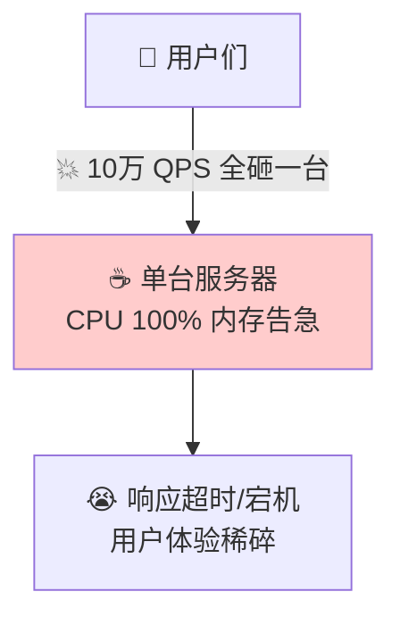
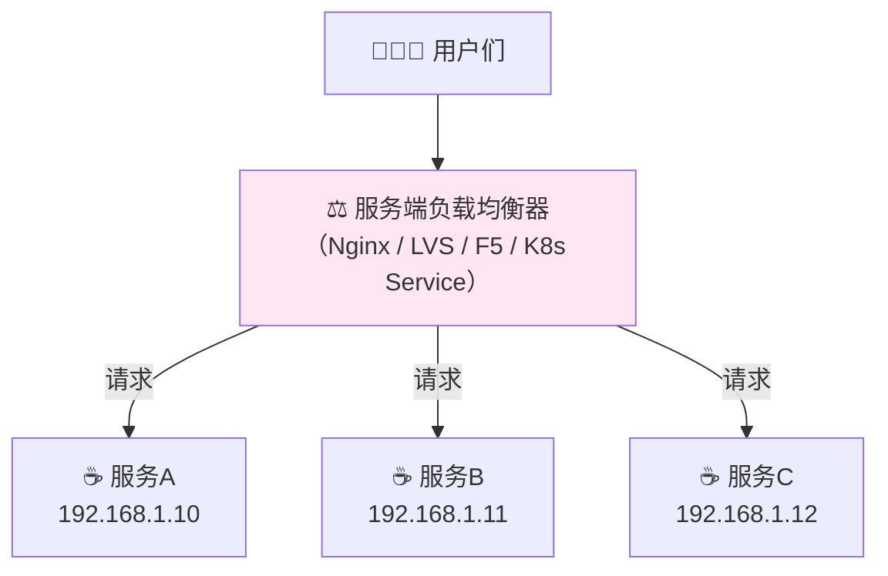
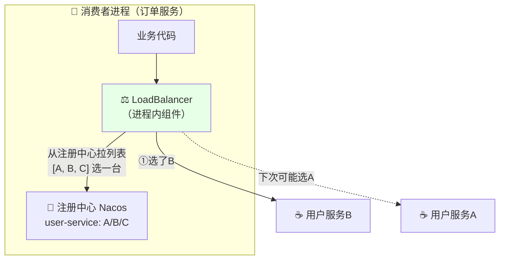
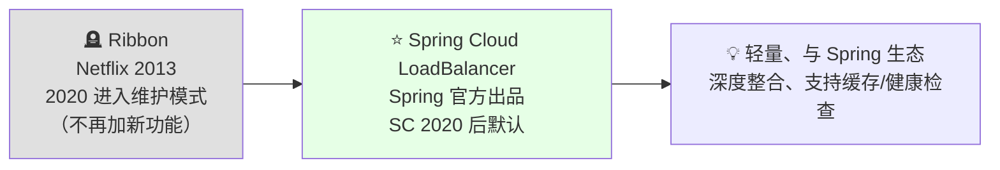
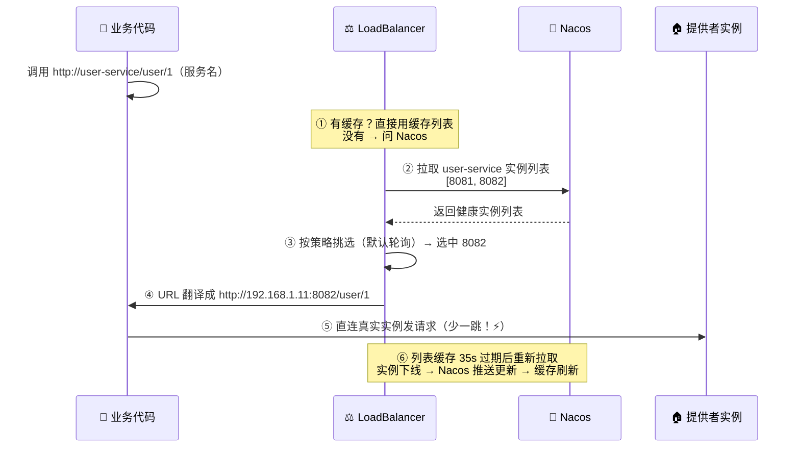
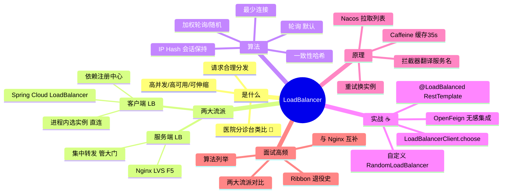

# LoadBalancer 负载均衡 从入门到实战 ⚖️

> 欢迎来到 LoadBalancer 小课堂！💖 一台服务器扛不住十万用户怎么办？多开几台！可新问题来了——**请求到底发给哪台**？今天的主角**负载均衡器（Load Balancer）**就是那个"雨露均沾"的分发员～学完这篇，Ribbon 为什么退役、Spring Cloud LoadBalancer 怎么玩、七种算法怎么选，全都拿下！
>
> **学习目标**：
> - 🎯 搞懂负载均衡是什么、解决什么问题
> - 🎯 分清**服务端 LB**（Nginx）和**客户端 LB**（LoadBalancer）两大流派
> - 🎯 掌握常见负载均衡算法
> - 🎯 会在 Spring Cloud 项目里用 LoadBalancer + OpenFeign，还会自定义策略
>
> **前置知识**：Spring Boot 基础、了解注册中心（Nacos）更佳～

---

## 一、初识负载均衡：为什么需要它？🌱

### 1.1 一台服务器的崩溃现场



**解法**：加机器！开 3 台一样的服务组成"集群" 👯

但马上诞生新问题：**请求来了发给谁？**

- 全发给 1 号？→ 另外两台吃灰，1 号还是崩 ❌
- 随便乱发？→ 可能有的撑死有的饿死 ❌

### 1.2 负载均衡一句话定义

> **负载均衡（Load Balancing）**：把请求**合理地分发**到多台服务器上，让每台都"吃得饱但撑不着"，从而提升整体**吞吐量、可用性、扩展性**！

打个比方 🏥：

> 医院来了 100 个病人，**分诊台护士**就是负载均衡器——看看哪个医生空闲（最少连接）、按顺序轮流分诊（轮询）、专家号多分几个病人（加权）……总之让每个医生都均匀干活，没有一个人累垮！

| 收益 | 说明 |
|---|---|
| ⬆️ 高并发 | 横向扩展，加机器就能抗流量 |
| 🛡️ 高可用 | 一台挂了自动跳过，请求发别的机器 |
| 📈 可伸缩 | 大促前加机器、大促后缩容，弹性十足 |

---

## 二、两大流派：服务端 LB vs 客户端 LB ⭐（核心！）

负载均衡器**放的位置**不同，分成了两大门派：

### 2.1 服务端负载均衡（集中式）

> 在服务器**前面**架一台独立的负载均衡设备/软件，所有请求先到它，它再转发——客户端**完全不知道**后面有几台真实服务器！



**代表**：Nginx（七层）、LVS（四层）、F5（硬件土豪款 💰）、云厂商 SLB/CLB、K8s Service（kube-proxy）

### 2.2 客户端负载均衡（进程内）

> 没有中间设备！**调用方自己**从注册中心拉取服务列表，自己挑一台发请求——负载均衡逻辑跑在**消费者进程里**！



**代表**：**Spring Cloud LoadBalancer**（本篇主角 ⭐）、Ribbon（已退役 🪦）、Dubbo 内置 LB

### 2.3 门派对比表（面试高频！）

| 对比项 | 服务端 LB（Nginx） | 客户端 LB（LoadBalancer） |
|---|---|---|
| 位置 | 独立部署在服务器前面 | 嵌在**消费者进程内** |
| 谁知道服务列表 | 只有 LB 知道 | 每个消费者自己知道（从注册中心拉） |
| 性能开销 | 多一跳网络转发 | **直连服务提供者**，少一跳 ⚡ |
| 单点问题 | LB 挂了全完（要集群化） | 无集中单点 ✅ |
| 策略调整 | 运维改 Nginx 配置 | 代码/配置改，随应用发布 |
| 依赖注册中心 | 不需要 | **必须有**（不然去哪拿列表） |
| 适用层次 | 对外流量入口、跨语言 | 微服务**内部**调用 |
| 典型搭档 | 用户 → 网关 | 订单服务 → 用户服务 |

> 💡 **一句话记住**：**外面用 Nginx 分流（用户→网关），里面用 LoadBalancer 挑机器（服务→服务）**——俩不冲突，是黄金搭档！💍

---

## 三、负载均衡算法大全 🧮⭐

> "雨露均沾"也分很多种沾法！以下是面试 + 生产最常见的算法：

| 算法 | 原理 | 优点 | 缺点 | 场景 |
|---|---|---|---|---|
| **轮询 Round Robin** | 1→2→3→1→2→3 依次来 | 简单公平 | 不看机器强弱 | 机器配置相同 |
| **加权轮询 Weighted RR** | 权重高的多分（8核分8份，4核分4份） | 强机器多干活 | 权重要手动维护 | 机器配置不均 |
| **随机 Random** | 掷骰子选一台 | 简单，大量请求下趋近均匀 | 少量请求可能不均 | 简单场景 |
| **加权随机** | 按权重比例随机 | 同上且照顾强弱 | 同上 | 机器配置不均 |
| **最少连接 Least Connections** | 谁当前连接少发给谁 | 慢机器不被压垮 | 要实时统计连接数 | 请求耗时差异大 |
| **源地址哈希 IP Hash** | 同一 IP 永远发同一台 | **会话保持** | 机器挂了缓存失效、分布可能倾斜 | 需要粘性会话 |
| **一致性哈希** | 哈希环，机器下线只影响相邻段 | 增减机器抖动小 | 实现复杂 | 分布式缓存 |
| **最小响应时间** | 谁响应快多发谁 | 智能自适应 | 统计开销大 | 追求极致性能 |

**轮询 vs 加权轮询示意**：

```text
【轮询】三台同配置
请求1 → A   请求2 → B   请求3 → C   请求4 → A ...

【加权轮询】A(权重3) B(权重1)
请求1→A 请求2→A 请求3→A 请求4→B 请求5→A ...   ← A 扛 75% 流量 💪
```

> 🎀 **Spring Cloud LoadBalancer 默认策略是轮询（RoundRobinLoadBalancer）**，想换随机看第五章代码实战～

---

## 四、Ribbon 退役 & Spring Cloud LoadBalancer 登场 🎭

### 4.1 一段微服务简史



| | Ribbon | Spring Cloud LoadBalancer |
|---|---|---|
| 出品 | Netflix | Spring 官方 |
| 状态 | 维护模式（躺平）🪦 | 活跃开发 ⭐ |
| 默认集成 | Spring Cloud 2020 之前 | **2020.0 之后** |
| 依赖 | `spring-cloud-starter-netflix-ribbon` | `spring-cloud-starter-loadbalancer` |
| 算法 | 7 种，配置切换 | 轮询/随机，代码扩展 |
| 心智负担 | 重、复杂 | 轻、简单（克制也是一种美 🎀） |

> ⚠️ **版本提醒**：Spring Cloud 2020.0（Ilford）之后，OpenFeign **不再自带 Ribbon**，必须显式引入 LoadBalancer，否则启动报 `No LoadBalancer for xxx`！

---

## 五、Spring Cloud LoadBalancer 实战 ☕⭐（灵魂章节！）

### 5.1 环境搭建：一个提供者 + 一个消费者

```xml
<!-- ☕ 消费者 pom.xml —— Feign 场景下 LoadBalancer 必备！ -->
<dependencyManagement>
    <dependencies>
        <dependency>
            <groupId>org.springframework.cloud</groupId>
            <artifactId>spring-cloud-dependencies</artifactId>
            <version>2022.0.0</version>
            <type>pom</type>
            <scope>import</scope>
        </dependency>
    </dependencies>
</dependencyManagement>

<dependencies>
    <!-- 注册中心 -->
    <dependency>
        <groupId>com.alibaba.cloud</groupId>
        <artifactId>spring-cloud-starter-alibaba-nacos-discovery</artifactId>
    </dependency>
    <!-- ☄️ Spring Cloud LoadBalancer（注意：要先排除 nacos 自带的 ribbon！） -->
    <dependency>
        <groupId>org.springframework.cloud</groupId>
        <artifactId>spring-cloud-starter-loadbalancer</artifactId>
    </dependency>
    <!-- OpenFeign（内部靠 LoadBalancer 选实例） -->
    <dependency>
        <groupId>org.springframework.cloud</groupId>
        <artifactId>spring-cloud-starter-openfeign</artifactId>
    </dependency>
</dependencies>
```

> 🕳️ **大坑预警**：老版本 `nacos-discovery` 会自动带 Ribbon 依赖，和 LoadBalancer 打架（报 `No instances available`）。解法：启动类/配置排除 Ribbon 自动装配，或用 2021.x 之后的版本～

### 5.2 用法一：@LoadBalanced + RestTemplate（最直观）

```java
// ☕ 消费者配置类
@Configuration
public class RestTemplateConfig {

    @Bean
    @LoadBalanced   // ⭐ 灵魂注解！RestTemplate 从此会"自动负载均衡"
    public RestTemplate restTemplate() {
        return new RestTemplate();
    }
}
```

```java
// ☕ 消费者调用：URL 里写"服务名"而不是 IP！
@RestController
public class OrderController {

    @Autowired
    private RestTemplate restTemplate;

    @GetMapping("/order/{id}")
    public String getOrder(@PathVariable Long id) {
        // ⬇️ user-service 是 Nacos 里注册的服务名
        // LoadBalancer 会把它替换成类似 http://192.168.1.11:8081/user/1
        String result = restTemplate.getForObject(
                "http://user-service/user/" + id, String.class);
        return "订单详情：" + result;
    }
}
```

> 🔍 **魔法揭秘**：`@LoadBalanced` 给 RestTemplate 塞了一个拦截器（`LoadBalancerInterceptor`）——发现 URL 是服务名，就找 LoadBalancer 要一个具体实例，替换后再发请求！**"服务名 → IP:端口"的翻译官**～

### 5.3 用法二：OpenFeign（推荐，无感）

```java
// ☕ Feign 接口——负载均衡全自动，一行配置都不用加！
@FeignClient("user-service")
public interface UserClient {

    @GetMapping("/user/{id}")
    String getUser(@PathVariable("id") Long id);
}

// ☕ 直接注入使用
@RestController
public class OrderController {

    @Autowired
    private UserClient userClient;      // 底层自动 LoadBalancer 选实例

    @GetMapping("/order/{id}")
    public String getOrder(@PathVariable Long id) {
        return "订单依赖用户：" + userClient.getUser(id);
    }
}
```

### 5.4 用法三：LoadBalancerClient 手动控制（看得更清楚）

```java
// ☕ 手动选择实例——帮你彻底看穿"内部都干了啥"
@RestController
public class DebugController {

    @Autowired
    private LoadBalancerClient loadBalancerClient;

    @GetMapping("/pick")
    public String pick() {
        // ① 按当前策略挑一个 user-service 的实例
        ServiceInstance instance = loadBalancerClient.choose("user-service");
        if (instance == null) {
            return "没有可用实例 😢";
        }
        // ② 拿到真实地址
        return "选中：" + instance.getHost() + ":" + instance.getPort();
    }
}
```

### 5.5 验证负载均衡：开两个端口起两个实例

```bash
# ☕ 同一个服务起两个实例（IDEA 里 copy 配置改端口，或命令行）
java -jar user-service.jar --server.port=8081
java -jar user-service.jar --server.port=8082
```

```java
// ☕ 提供者：报上自己的端口，方便观察轮询效果
@RestController
public class UserController {

    @Value("${server.port}")
    private String port;

    @GetMapping("/user/{id}")
    public String getUser(@PathVariable Long id) {
        return "用户" + id + "（来自端口 " + port + "）";
    }
}
```

连续调消费者接口，返回结果会交替出现 `8081`、`8082`——**轮询生效，眼见为实**！🎉

### 5.6 自定义策略：换成随机 ⭐

```java
// ☕ 方式一：代码配置（全局或按服务名生效）
public class CustomLoadBalancerConfiguration {

    @Bean
    ReactorLoadBalancer<ServiceInstance> randomLoadBalancer(
            Environment environment, LoadBalancerClientFactory factory) {

        String name = environment.getProperty(LoadBalancerClientFactory.PROPERTY_NAME);
        // 换成 RandomLoadBalancer 就是随机策略！
        return new RandomLoadBalancer<>(factory.getLazyProvider(name,
                ServiceInstance.class), name);
    }
}

// ☕ 挂到 Feign 客户端上（只对 user-service 生效，@Configuration 千万别被扫进主容器！）
@FeignClient(value = "user-service",
             configuration = CustomLoadBalancerConfiguration.class)
public interface UserClient { ... }
```

```yaml
# ☕ 方式二：配置文件方式（指定服务关闭 LoadBalancer 缓存，方便调试）
spring:
  cloud:
    loadbalancer:
      cache:
        enabled: false      # 生产保持默认开启（Caffeine 缓存，性能更好）
      health-check:
        interval: 5s        # 主动健康检查间隔
```

> 🎀 **小提示**：LoadBalancer 默认**缓存服务列表 35 秒**（Caffeine）——既不用每次都问注册中心，又能较快感知变化，调试时看到"不生效"先想到它！

---

## 六、LoadBalancer 工作全流程 🧭



**三个关键角色**：

| 组件 | 职责 |
|---|---|
| `DiscoveryClient` / `ServiceInstanceListSupplier` | 从注册中心拿服务列表（数据源头） |
| `ReactorLoadBalancer` | 挑选算法（轮询/随机/自定义） |
| `LoadBalancerClient` / 拦截器 | 把"服务名"翻译成"真实 IP:端口" |

---

## 七、健康检查与容错 🛡️

| 机制 | 说明 |
|---|---|
| 注册中心心跳 | Nacos：实例 5s 心跳、15s 未收到标不健康、30s 剔除 |
| LoadBalancer 健康检查 | 可开启主动探测（`spring.cloud.loadbalancer.health-check.*`） |
| 失败重试 | 搭配 `spring-retry`：当前实例失败 → **换下一个实例重试** |
| 缓存刷新 | 服务列表缓存 TTL 到期自动重拉，实例上下线快速感知 |

```xml
<!-- ☕ 开启重试能力（LoadBalancer 换实例重试） -->
<dependency>
    <groupId>org.springframework.retry</groupId>
    <artifactId>spring-retry</artifactId>
</dependency>
```

```yaml
spring:
  cloud:
    loadbalancer:
      retry:
        enabled: true      # 对 RestTemplate 生效；Feign 自带 retryer 配置
```

---

## 八、LoadBalancer vs Nginx：到底用谁？🥊

| 维度 | Spring Cloud LoadBalancer | Nginx |
|---|---|---|
| 层次 | 客户端（进程内） | 服务端（独立部署） |
| 流量位置 | 微服务**内部互调** | **外部流量入口** → 网关/静态资源 |
| 依赖 | 必须有注册中心 | 不需要 |
| 转发路径 | 消费者 → 提供者（**直连**） | 用户 → Nginx → 服务（多一跳） |
| 典型部署 | 打在每一个消费者 jar 里 | 单独集群部署 |

> 💡 **真实生产架构**（串起来用！）：
>
> ```mermaid
> flowchart LR
>     U["🧑 用户"] --> NG["⚖️ Nginx<br/>（外层分流/静态资源/TLS）"] --> GW["🌐 Gateway 网关集群"] --> A["☕ 订单服务"]
>     A -->|"LoadBalancer<br/>进程内选实例"| B["☕ 用户服务<br/>8081/8082"]
>     A -->|"LoadBalancer"| C["☕ 库存服务"]
>     style NG fill:#fff5e6
>     style A fill:#e6ffe6
> ```
>
> **Nginx 管大门，LoadBalancer 管室内**——各司其职，缺一不可！🎀

---

## 九、常见坑速查表 🕳️

| 现象 | 原因 | 解法 |
|---|---|---|
| 启动报 `No LoadBalancer for user-service` | SC 2020 后没引 loadbalancer 依赖 | 加 `spring-cloud-starter-loadbalancer` |
| 调用报 `No instances available` | Nacos 里没实例 / Ribbon 残留冲突 | 检查注册；排除 Ribbon 相关自动装配 |
| RestTemplate 调服务名报 `UnknownHostException` | 忘加 `@LoadBalanced` | 加注解（注意别加到纯外网调用的 RestTemplate 上） |
| 负载不均/轮询"看起来没生效" | 缓存 35s、或两实例会话粘住 | 调试时关缓存；确认没有 IP Hash 类策略 |
| 自定义策略不生效 | `@Configuration` 被组件扫描进主上下文（变全局） | 自定义配置类放扫描包外 + 按服务名引用 |
| 改了实例数没及时感知 | 缓存 TTL 未到 | 等 35s 或调 `cache.ttl`；配合 Nacos 推送 |
| 想会话保持做不到 | LoadBalancer 无 IP Hash 开箱策略 | 换一致性哈希自定义 / 上服务端 LB |

---

## 十、高频面试题速答 🎯

| 问题 | 精简答案 |
|---|---|
| 什么是负载均衡？ | 将请求按策略分发到多台服务器，提升吞吐/可用/扩展性 |
| 服务端和客户端负载均衡区别？ | 服务端（Nginx/LVS）独立部署统一转发，客户端（LoadBalancer/Ribbon）在消费者进程内自行从注册中心选实例直连 |
| Ribbon 和 Spring Cloud LoadBalancer 区别？ | Ribbon 是 Netflix 老组件已维护模式；LoadBalancer 是 Spring 官方替代品，轻量、默认轮询、集成 Caffeine 缓存，SC 2020 后默认 |
| 常见负载均衡算法？ | 轮询、加权轮询、随机、加权随机、最少连接、源 IP 哈希、一致性哈希 |
| LoadBalancer 怎么拿到服务列表？ | 通过 `ServiceInstanceListSupplier` → `DiscoveryClient` 查注册中心，结果缓存约 35 秒（Caffeine） |
| `@LoadBalanced` 原理？ | 给 RestTemplate 加 `LoadBalancerInterceptor`，把 URL 中的服务名替换为 LoadBalancer 选出的真实 IP:端口 |
| 怎么自定义负载均衡策略？ | 自定义配置类返回 `RandomLoadBalancer`（或实现 `ReactorServiceInstanceLoadBalancer`），挂到 `@FeignClient(configuration=...)` |
| 负载均衡 + 某实例宕机怎么办？ | 注册中心心跳剔除 + LoadBalancer 缓存刷新 + spring-retry 换实例重试 + 主动健康检查 |
| 为什么有了 Nginx 还要 LoadBalancer？ | Nginx 管外部入口（集中转发多一跳）；内部服务互调要直连提性能、去中心化，用客户端 LB，两者互补 |

---

## 十一、知识总结地图 🗺️



> 🎀 **毕业寄语**：负载均衡的灵魂就一句——**"雨露均沾，谁也不许累垮"**！建议把第五章跑起来：两个端口的提供者 + 一个消费者，亲眼看返回结果在 8081/8082 之间交替，那一刻"客户端负载均衡"就彻底刻进 DNA 啦～ 结合前面学的 Nginx（服务端 LB）一起食用，效果更佳！💪✨
