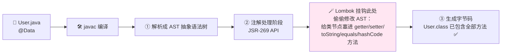
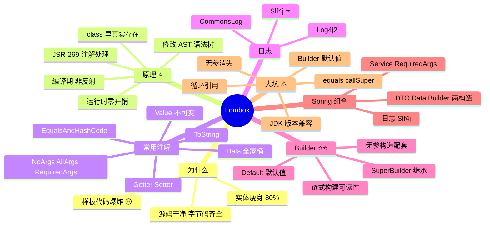

# Lombok 代码生成神器 从入门到实战 🪄

> 欢迎来到 Lombok 小课堂！💖 写个实体类：3 个字段要配 getter、setter、toString、equals、hashCode……分分钟 80 行，真正有价值的就 5 行 😩！今天的主角 **Lombok**——一个注解，编译时自动帮你把样板代码全生成！学完这篇，实体类"瘦身"80%，还会搞懂它的原理和那些经典大坑～
>
> **学习目标**：
> - 🎯 搞懂 Lombok 的编译期原理（面试高频！）
> - 🎯 熟练使用 @Data、@Builder、@Slf4j 等常用注解
> - 🎯 会避开 @Builder 默认值失效、无参构造消失等经典坑
> - 🎯 了解团队里的 Lombok 争议，学会权衡
>
> **前置知识**：Java 基础（类、构造器、注解）～

---

## 一、为什么需要 Lombok？🌱

### 1.1 JavaBean 样板代码之痛

```java
// ☕ 没 Lombok 的世界：5 个字段 = 一大坨"体力活"
public class User {
    private Long id;
    private String name;
    private Integer age;

    public Long getId() { return id; }
    public void setId(Long id) { this.id = id; }
    public String getName() { return name; }
    public void setName(String name) { this.name = name; }
    public Integer getAge() { return age; }
    public void setAge(Integer age) { this.age = age; }

    @Override
    public String toString() {
        return "User{id=" + id + ", name='" + name + "', age=" + age + '}';
    }

    @Override
    public boolean equals(Object o) { /* 20 行…… */ return true; }

    @Override
    public int hashCode() { /* 5 行…… */ return 0; }
    // 😭 加一个字段 = 再补 6+ 处代码，漏一处就是 Bug！
}
```

```java
// ☕ 有 Lombok 的世界：一个注解搞定上面全部 ✨
@Data
public class User {
    private Long id;
    private String name;
    private Integer age;
}
```

> **Lombok**（印尼巴厘岛旁边的"龙目岛"）：通过**注解 + 编译期代码生成**，把 getter/setter/构造器/builder/日志对象等样板代码统统自动补齐——**源码干净，字节码齐全**！🧹

---

## 二、核心原理：它是怎么"变出"代码的？🧠⭐（面试高频！）

### 2.1 先排除一个错误答案

> ❌ 不是反射！反射是**运行时**动态操作，性能有开销；Lombok 是**编译期**就把方法真实写进 `.class` 文件——**运行时零开销**！

### 2.2 编译期流程图



**三步走人话版**：

1. javac 编译时有个"注解处理"阶段（官方预留的扩展口，**JSR-269 Pluggable Annotation Processing API**）
2. Lombok 注册在这里，扫到 `@Data` 就**修改语法树（AST）**，把方法节点插进去
3. 最终生成的 `.class` 文件里**真实存在**这些方法（反编译可见！）

> 💡 严格说 Lombok "超出"了 JSR-269 的本意（规范本不建议改 AST），它是用了"非官方"的 hack 手法——这也是它魔法感十足又有点小争议的原因 😆

### 2.3 IDE 怎么认识它？

| IDE | 支持方式 |
|---|---|
| IntelliJ IDEA 2020.3+ | **内置 Lombok 插件** ✅（只需开启注解处理） |
| 老版 IDEA | 手动装 Lombok 插件 |
| Eclipse | 运行 lombok.jar 把自己注入进去 |

> IDEA 能代码提示 `user.getName()`，靠的是插件"预演"了编译期的生成结果～

---

## 三、快速上手 🚀

### 3.1 引依赖

```xml
<dependency>
    <groupId>org.projectlombok</groupId>
    <artifactId>lombok</artifactId>
    <version>1.18.34</version>
    <scope>provided</scope>   <!-- ⭐ 只在编译期用，不打进包 -->
</dependency>
```

> 💡 Spring Boot 项目在 `spring-boot-starter-parent` 里已管理版本，无需写 version～

### 3.2 IDEA 开启注解处理

`Settings → Build, Execution, Deployment → Compiler → Annotation Processors → Enable annotation processing` ✅（新版本装了 Lombok 插件会自动提示开启）

---

## 四、注解大全 🧰⭐⭐

### 4.1 基础三件套

```java
// ☕ getter / setter / toString
public class User {
    @Getter @Setter                // 类上 = 全字段；字段上 = 单独控制
    private String name;

    @Getter(AccessLevel.NONE)      // 排除某个字段
    private String password;

    @Setter(AccessLevel.PROTECTED) // 还能改访问级别
    private Integer age;

    @ToString.Exclude              // toString 里不展示（敏感字段 ⭐）
    private String idCard;

    @ToString.Include              // 或者：仅含指定字段模式
    private Long id;
}
```

### 4.2 构造器三兄弟

```java
@NoArgsConstructor                  // 无参构造器：User()
@AllArgsConstructor                 // 全参构造器：User(id, name, age)
@RequiredArgsConstructor            // ⭐ final / @NonNull 字段的构造器（配合依赖注入神器！）
public class User {
    private Long id;
    private final String name;      // 这个会进 @RequiredArgsConstructor
    @NonNull private Integer age;   // 这个也会（且构造时校验非空）
}
```

### 4.3 @Data：全家桶一键打包 ⭐

```java
// ☕ @Data = @Getter + @Setter + @ToString + @EqualsAndHashCode + @RequiredArgsConstructor
@Data
public class User {
    private Long id;
    private String name;
}
```

| 注解 | 等价于 |
|---|---|
| `@Data` | Getter + Setter + ToString + EqualsAndHashCode + RequiredArgsConstructor |
| `@Value` | **不可变版 @Data**：字段全 private final、只给 getter（配 @AllArgsConstructor）⭐ |
| `@Data @Builder` | 再加一个 Builder（见第五章） |

### 4.4 日志注解：和 logger 声明说拜拜 📝⭐

```java
// ☕ @Slf4j：自动生成 private static final Logger log = ...（slf4j 门面，最常用 ⭐）
@Slf4j
@Service
public class OrderService {
    public void create(Order order) {
        log.info("创建订单：{}", order.getOrderNo());   // 直接用 log！
        log.warn("库存紧张，仅剩 {} 件", 3);
        log.error("下单失败", exception);
    }
}
```

| 日志注解 | 对应门面/实现 |
|---|---|
| **@Slf4j** ⭐ | org.slf4j.Logger（Spring Boot 默认，无脑选它） |
| @Log4j2 | log4j2 |
| @CommonsLog | Apache Commons Logging |
| @Log | java.util.logging（没人用 😆） |

### 4.5 实用小注解

```java
// ☕ 链式 setter：return this
@Data
@Accessors(chain = true)
public class User { ... }
User u = new User().setName("小明").setAge(18);   // 一行串到底 ✨

// ☕ 流式风格（get 变 name()，set 变 name(x)）
@Accessors(fluent = true)

// ☕ @SneakyThrows：偷偷抛受检异常，不用 throws 声明
@SneakyThrows
public void readFile() {
    Files.readString(Path.of("/tmp/a.txt"));   // 原本必须 try-catch IOException
}

// ☕ @NonNull：参数非空校验（空则抛 NPE）
public void create(@NonNull User user) { ... }

// ☕ @Cleanup：自动 close（try-with-resources 的注解版）
public void copyFile(String in, String out) throws IOException {
    @Cleanup InputStream is = new FileInputStream(in);
    @Cleanup OutputStream os = new FileOutputStream(out);
    // 作用域结束自动 is.close() / os.close()
}

// ☕ @Synchronized：给私有锁对象加同步（比直接锁 this 安全）
@Synchronized
public void safeMethod() { ... }

// ☕ var / val（实验性，需 import lombok.experimental）
var list = new ArrayList<String>();   // 类型推断（val = final var）
```

---

## 五、@Builder 详解：优雅构建对象 🏗⭐⭐

### 5.1 为什么香？

```java
// ☕ 构造器地狱：new User(1L, null, null, "备注", null, null) ← 谁知道第4个参数是啥？
// ☕ setter 流水账：对象可变、分号满天飞

// ☕ @Builder：可读性拉满 ✨
@Builder
@Data
public class Order {
    private Long userId;
    private String product;
    private Integer amount;
    private String remark;
}

Order order = Order.builder()
        .userId(10086L)
        .product("可爱抱枕")
        .amount(2)
        .remark("粉色加急")
        .build();                     // 参数一目了然，还能只设需要的字段！
```

**实现原理**：Lombok 生成一个内部 `OrderBuilder` 类，每个字段一个同名方法（返回自身实现链式），`build()` 调用全参构造器兜底～

### 5.2 ⚠️ 经典大坑一：默认值失效！

```java
@Builder
@Data
public class Config {
    private Boolean enabled = true;      // 想给默认值
    private Integer retries = 3;
}

Config c = Config.builder().build();
c.getEnabled();   // 😱 null！不是 true！
```

> **原因**：`build()` 走的是 Lombok 生成的**全参构造器**，没传的参数全是 null，**字段初始化语句被绕过**！

```java
// ✅ 解法：@Builder.Default
@Builder
@Data
public class Config {
    @Builder.Default
    private Boolean enabled = true;     // 现在生效！
    @Builder.Default
    private Integer retries = 3;
}
```

### 5.3 ⚠️ 经典大坑二：无参构造器消失！

```java
@Builder
public class User { ... }
// → Lombok 只生成全参构造器（@AllArgsConstructor 级别）
// → User 没有 new User() → Jackson/MyBatis 反序列化直接报错！💀
```

```java
// ✅ 解法：补回无参构造（配套食用 ⭐）
@Builder
@Data
@NoArgsConstructor
@AllArgsConstructor      // @Builder 也需要全参构造（有@Data+@Builder时可显式补上）
public class User { ... }
```

### 5.4 继承场景：@SuperBuilder

```java
// ☕ 普通 @Builder 不认爹的字段 → 用 @SuperBuilder 父子联动 ⭐
@SuperBuilder
public class Animal {
    private String name;
}

@SuperBuilder
public class Dog extends Animal {
    private String barkSound;
}

Dog d = Dog.builder().name("旺财").barkSound("汪汪").build();  // 父字段也能链！
```

---

## 六、Lombok 在 Spring Boot 里的黄金组合 🌱⭐

```java
// ☕ ① 官方盖章的依赖注入姿势：@RequiredArgsConstructor
@Service
@RequiredArgsConstructor              // 生成 OrderService(UserDao, MailClient) 构造器
public class OrderService {
    private final UserDao userDao;       // final 字段自动进构造器 → Spring 构造器注入 ✅
    private final MailClient mailClient; // 告别 @Autowired 字段注入（不利于测试&不可变）

    // ② 日志直接用
    @Transactional
    public void create(Long userId) {
        log.info("创建订单, userId={}", userId);
    }
}

// ☕ ③ DTO 三连：@Data + @Builder + 无参全参
@Data
@Builder
@NoArgsConstructor
@AllArgsConstructor
public class OrderCreateDTO {
    private Long productId;
    @Builder.Default
    private Integer count = 1;
}
```

> 💡 **口诀**：**Service 用 `@RequiredArgsConstructor`，DTO 用 `@Data @Builder @NoArgsConstructor @AllArgsConstructor`，日志用 `@Slf4j`**——这三套组合覆盖 90% 日常场景！

---

## 七、常见坑速查表 🕳️

| 坑 | 现象 | 解法 |
|---|---|---|
| @Builder 默认值失效 | build() 出来字段是 null 不是默认值 | `@Builder.Default` 标注字段 ⭐ |
| 无参构造消失 | Jackson/MyBatis 反序列化报错 | 补 `@NoArgsConstructor`（+ `@AllArgsConstructor`） |
| @Data + 继承 的 equals 不含父类字段 | 父类字段相等性被忽略 | `@EqualsAndHashCode(callSuper = true)` |
| @EqualsAndHashCode 循环引用死循环 | A 持有 B、B 持有 A 且都在 equals 里 | `@ToString.Exclude` + `@EqualsAndHashCode.Exclude` 断环 |
| IDEA 代码爆红但编译通过 | 插件没装/注解处理没开 | 内置插件 + Enable annotation processing |
| 升级 JDK 后编译报错 | Lombok 版本太老跟不上 javac | JDK 21 用 1.18.30+ |
| MapStruct 找不到属性 | 注解处理器顺序问题 | lombok 依赖放前面 / 加 `lombok-mapstruct-binding` |
| 团队成员 IDE 没插件 | 互相打开全是红线 | 统一 IDEA 2020.3+（内置支持） |
| 调试看不到生成代码 | 想看"到底生成了啥" | delombok（打包/反编译 .class 也能看） |
| @Accessors(chain=true) 坑 Jackson | setter 返回 this 非 void，反序列化可能失效 | 老 Jackson 版本注意；或不用 chain |
| @Value 误用 | 想改字段时发现没有 setter | 需要可变就别用 @Value |

---

## 八、高频面试题速答 🎯

| 问题 | 精简答案 |
|---|---|
| Lombok 的原理？ | 编译期通过 JSR-269 注解处理器挂入 javac 流程，在注解处理阶段**修改 AST** 插入方法节点，最终 class 文件真实包含生成代码；运行时零开销、无反射 |
| Lombok 是运行时还是编译期？ | **编译期**（provided 依赖不打进 jar），与反射/AOP（运行时）本质不同 |
| @Data 包含哪些？ | @Getter + @Setter + @ToString + @EqualsAndHashCode + @RequiredArgsConstructor |
| @Builder 的坑？ | ① 字段默认值失效（需 @Builder.Default）② 顶掉无参构造（需补 @NoArgsConstructor/@AllArgsConstructor）③ 继承不认父字段（用 @SuperBuilder） |
| @RequiredArgsConstructor 和 @Autowired 区别？ | 前者生成构造器实现**构造器注入**（官方推荐、可 final、利于单测）；后者常见字段注入（不利于测试、隐藏依赖） |
| @NoArgsConstructor 和 @AllArgsConstructor 和 @RequiredArgsConstructor？ | 无参 / 全参 /（final + @NonNull 字段）构造器 |
| 为什么需要 lombok-mapstruct-binding？ | 协调两者注解处理器执行顺序，防止 MapStruct 在 Lombok 生成前读取类导致属性丢失 |
| @Value 和 @Data 区别？ | @Value 生成**不可变类**：字段 private final、无 setter、类 final；@Data 是可变 JavaBean |
| @SneakyThrows 原理？ | 利用泛型/字节码技巧绕过受检异常检查，把异常"偷偷"抛给上层，无需 throws 声明 |
| Lombok 有什么缺点/争议？ | 黑魔法改 AST 超出规范边界；强 IDE 依赖；生成代码不可见增加调试门槛；历史版本与 JDK 升级兼容风险 |

---

## 九、知识总结地图 🗺️



> 🎀 **毕业寄语**：Lombok 的灵魂就一句——**"你只写有价值的代码，体力活编译器包了"**！把第六章三个黄金组合（Service 注入 / DTO 四件套 / @Slf4j）固化成肌肉记忆，代码瞬间清爽～ 面试聊原理，**"JSR-269 + 编译期修改 AST + 运行时零开销"** 三个词甩出去，你就是懂魔法背后原理的仔！💪✨
