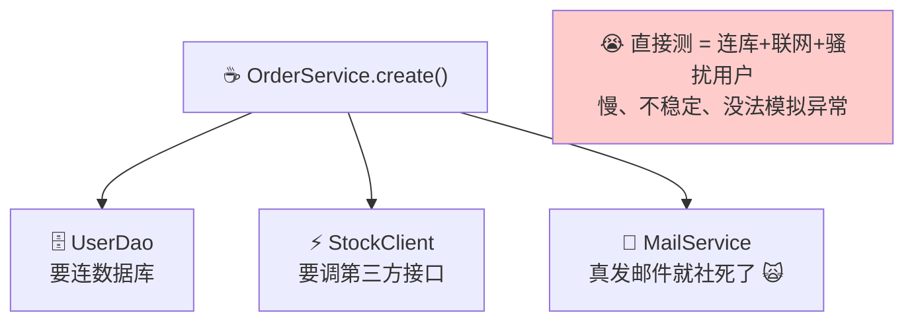
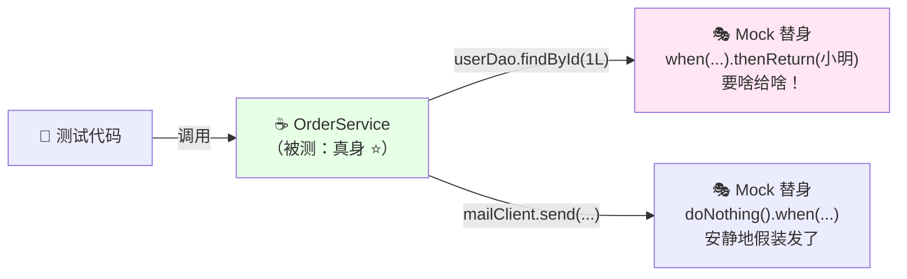
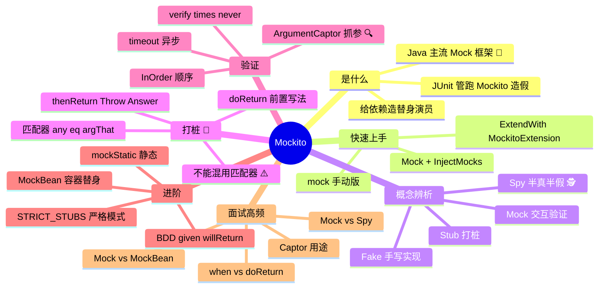

# Mockito Mock 测试 从入门到实战 🎭

> 欢迎来到 Mockito 小课堂！💖 上一课 JUnit 学了"怎么跑测试"，但被测类依赖数据库、Redis、第三方接口怎么办？总不能每次测试都连真库吧！今天的主角 **Mockito**——Java 最流行的 **Mock 框架**，专门给依赖造"替身演员"，让你想测啥场景就测啥场景！学完这篇，打桩、验证、ArgumentCaptor、静态 Mock 全拿下～
>
> **学习目标**：
> - 🎯 搞懂 Mock/Stub/Spy 概念区别和 Mockito 的定位
> - 🎯 熟练打桩（when/thenReturn）和验证（verify）
> - 🎯 会用参数匹配器、ArgumentCaptor、mockStatic
> - 🎯 分清 @Mock / @Spy / @MockBean，避开经典大坑
>
> **前置知识**：JUnit 5 基础（上篇～）、Lambda 表达式～

---

## 一、初识 Mockito：为什么需要它？🌱

### 1.1 被依赖卡住的单元测试

想测 `OrderService.create()`，但它的依赖一个比一个重：



**三大难题**：

| 难题 | 不用 Mock 的下场 |
|---|---|
| 环境依赖 | 测试机必须有库/Redis/网络，CI 一断全红 |
| 场景难造 | "第三方接口超时""余额不足"这些场景怎么复现？ |
| 副作用 | 测试跑一次给用户真发一封邮件 💀 |

### 1.2 Mock 思想：替身演员 🎭

> **Mock = 给依赖造一个"假替身"**：真方法不执行，**你让它返回啥它就返回啥**——数据库不用连、邮件不会发、异常随便造！



### 1.3 Mockito 是什么 & 和 JUnit 的关系

> **Mockito** = Java 界最流行的 Mock 框架（名字梗：Mock + Mojito 莫吉托鸡尾酒🍹），spring-boot-starter-test **自带**，开箱即用！

| | JUnit 5 | Mockito |
|---|---|---|
| 职责 | **跑测试 + 断言**（裁判 🚦） | **造替身 + 验证交互**（道具组 🎭） |
| 关心什么 | 结果对不对 | 依赖被怎么调用了 |
| 例子 | `assertEquals(3, add(1,2))` | `when(dao.find(id)).thenReturn(user)` |
| 关系 | 黄金搭档，`@ExtendWith(MockitoExtension.class)` 一起用 | |

---

## 二、快速上手：第一个 Mock 测试 🚀

### 2.1 引依赖（Spring Boot 项目其实已经有了）

```xml
<dependency>
    <groupId>org.springframework.boot</groupId>
    <artifactId>spring-boot-starter-test</artifactId>   <!-- 自带 Mockito + JUnit5 -->
    <scope>test</scope>
</dependency>
```

### 2.2 注解版（最常用 ⭐）

```java
// ☕ 被测类长这样
@Service
public class OrderService {
    private final UserDao userDao;
    private final MailClient mailClient;

    public OrderService(UserDao userDao, MailClient mailClient) {
        this.userDao = userDao;
        this.mailClient = mailClient;
    }

    public Order create(Long userId) {
        User user = userDao.findById(userId);
        if (user == null) throw new IllegalArgumentException("用户不存在");
        Order order = new Order(userId, calculateLevel(user));
        mailClient.send(user.getEmail(), "下单成功～");
        return order;
    }

    private int calculateLevel(User user) {
        return user.isVip() ? 2 : 1;
    }
}
```

```java
// ☕ 测试类：三件套 @ExtendWith + @Mock + @InjectMocks
@ExtendWith(MockitoExtension.class)
class OrderServiceTest {

    @Mock                                        // ① 造替身
    private UserDao userDao;

    @Mock
    private MailClient mailClient;

    @InjectMocks                                 // ② 把替身注入真身的构造器
    private OrderService orderService;

    @Test
    void create_withVipUser_returnsLevel2Order() {
        // ③ 打桩：规定替身行为
        when(userDao.findById(1L)).thenReturn(new User("小明", true, "xm@demo.com"));

        Order order = orderService.create(1L);   // ④ 调真方法

        assertEquals(2, order.getLevel());       // ⑤ 断言（JUnit 的活儿）
        verify(mailClient).send(anyString(), anyString());   // ⑥ 验证：邮件"被发了"
    }
}
```

### 2.3 手动版（不用注解也行）

```java
@Test
void manual_mock_demo() {
    UserDao userDao = mock(UserDao.class);          // 手动造替身
    MailClient mailClient = mock(MailClient.class);
    OrderService service = new OrderService(userDao, mailClient);   // 手动注入

    when(userDao.findById(1L)).thenReturn(new User("小明", false, "x@d.com"));

    assertEquals(1, service.create(1L).getLevel());
}
```

> 💡 注解版和手动版等价，**注解版更清爽**，推荐日常用～

---

## 三、概念辨析：Mock / Stub / Spy / Fake 📖⭐（面试常问！）

| 概念 | 一句话 | Mockito 里的对应 |
|---|---|---|
| **Stub（桩）** | 只关心"给什么返回什么"，不验证调用 | `when().thenReturn()` |
| **Mock（替身）** | 关注"交互行为"（谁被调了、调了几次） | `verify()` |
| **Spy（间谍）** | **半真半假**：默认走真实逻辑，指定方法才打桩 | `@Spy` |
| **Fake（假实现）** | 手写一个简化版真实现（如内存版 Dao） | Mockito 不做这个，自己 new |

> 💡 现代语境里 Mock 泛指一切替身，Mockito 里 Mock 和 Stub 能力合体——**既能打桩也能验证**！

---

## 四、打桩（Stubbing）详解 💉⭐⭐（核心技能！）

### 4.1 返回值打桩全家桶

```java
// ☕ 基础：thenReturn
when(userDao.findById(1L)).thenReturn(user);

// ☕ 抛异常：thenThrow（测异常分支神器！）
when(userDao.findById(-1L)).thenThrow(new RuntimeException("参数非法"));

// ☕ 连续不同返回：第一次 null，第二次有值（测重试逻辑！）
when(httpClient.call()).thenReturn(null, null, "成功啦");  // 前两次 null 第三次成功

// ☕ 动态返回：thenAnswer（根据入参计算返回）
when(calculator.discount(anyInt())).thenAnswer(invocation -> {
    int price = invocation.getArgument(0);        // 拿到入参
    return price > 100 ? price * 8 / 10 : price;  // 满100打8折
});

// ☕ void 方法：必须用 doXxx 前置写法！（when 语法 void 会编译报错）
doNothing().when(mailClient).send(any(), any());            // 什么都不干
doThrow(new MailException()).when(mailClient).send(any(), any());  // void 抛异常
```

### 4.2 参数匹配器（Argument Matchers）

> 想让"任意参数"都命中同一个桩？用**匹配器**！

```java
import static org.mockito.ArgumentMatchers.*;

when(userDao.findById(anyLong())).thenReturn(user);       // 任意 long
when(userDao.findByName(eq("小明"))).thenReturn(user);    // 精确匹配（eq）
when(userDao.search(anyString(), anyInt())).thenReturn(list);
when(userDao.findByEmail(contains("@vip.com"))).thenReturn(vip);  // contains 正则味
when(orderDao.save(argThat(o -> o.getAmount() > 1000)))   // ⭐ 自定义 Lambda 匹配
        .thenReturn(1L);
```

| 匹配器 | 匹配什么 |
|---|---|
| `any()` / `anyLong()` / `anyString()` | 任意值（含 null） |
| `eq(value)` | 等于指定值 |
| `same(obj)` | 同一引用（==） |
| `contains / startsWith / endsWith` | 字符串模糊匹配 |
| `argThat(lambda)` | **自定义断言式匹配 ⭐** |
| `nullable(String.class)` | 任意 String 或 null |
| `anyList() / anyMap()` | 任意集合 |

> ⚠️ **天坑预警（每年坑哭无数人）**：**匹配器和字面量不能混用**！
>
> ```java
> when(dao.search(eq("小明"), 18)).thenReturn(x);   // ❌ 编译能过，运行报 InvalidUseOfMatchersException
> when(dao.search(eq("小明"), eq(18))).thenReturn(x); // ✅ 要么全字面量，要么全匹配器
> ```

### 4.3 验证交互（Verify）

> 测的不是返回值，而是"**它有没有被调用、被怎么调用**"：

```java
// 验证调用次数
verify(mailClient, times(1)).send(any(), any());    // 恰好 1 次
verify(mailClient, never()).send(any(), any());     // 从没调过
verify(mailClient, atLeast(2)).send(any(), any());  // 至少 2 次
verify(mailClient, atMost(3)).send(any(), any());   // 最多 3 次

// 验证异步（最多等 2 秒内被调到）
verify(asyncClient, timeout(2000)).notify(any());

// 验证调用顺序
InOrder inOrder = inOrder(userDao, orderDao);
inOrder.verify(userDao).findById(1L);       // 必须先查用户
inOrder.verify(orderDao).save(any());       // 再存订单

// 验证"再无任何其他交互"
verifyNoMoreInteractions(userDao);
verifyNoInteractions(mailClient);           // 压根没碰过
```

### 4.4 ArgumentCaptor：截获真实入参 🔍⭐

> 想检查"传给依赖的**真实参数内容**"对不对？用**参数捕获器**——验证 + 检查一步到位！

```java
@Test
void sendMail_should_useUserEmail_andNiceTitle() {
    when(userDao.findById(1L))
            .thenReturn(new User("小明", true, "xm@demo.com"));

    orderService.create(1L);

    // 🎯 捕获 send() 收到的真实参数
    ArgumentCaptor<String> emailCaptor = ArgumentCaptor.forClass(String.class);
    ArgumentCaptor<String> titleCaptor = ArgumentCaptor.forClass(String.class);
    verify(mailClient).send(emailCaptor.capture(), titleCaptor.capture());

    assertEquals("xm@demo.com", emailCaptor.getValue());      // 邮箱对不对
    assertThat(titleCaptor.getValue()).contains("下单成功");   // 标题对不对
}
```

> 💡 典型场景：被测方法内部 `new` 了一个对象传给依赖，外面根本拿不到——**Captor 就是"抓拍"这种内部对象的神器**！

---

## 五、@Spy：半真半假的间谍 🕵️⭐

> **Spy 间谍 = 真实对象 + 局部打桩**：没打桩的方法走**真逻辑**，打桩的才走假的！

```java
@Test
void spy_demo() {
    List<String> spyList = spy(new ArrayList<>());   // 包一层真 ArrayList

    spyList.add("a");                                // ✅ 真加进去了
    spyList.add("b");
    assertEquals(2, spyList.size());                 // 真实 size = 2

    doReturn(100).when(spyList).size();              // 只对 size() 打桩
    spyList.add("c");                                // 还是真加
    assertEquals(100, spyList.size());               // size 被截胡 = 100 🎭
}
```

> ⚠️ **Spy 大坑**：打桩**必须用 `doReturn` 前置写法**！
>
> ```java
> when(spyList.size()).thenReturn(100);   // ❌ 会先真调用 size()（可能抛异常/产生副作用）
> doReturn(100).when(spyList).size();     // ✅ 先声明"截胡"再触发，安全！
> ```
>
> 原理：`when(x.size())` 括号里会**真实执行一遍** `spyList.size()`（真身被执行了！），`doReturn().when()` 语法跳过真执行～

**注解版**：

```java
@ExtendWith(MockitoExtension.class)
class ReportServiceTest {

    @Spy                                        // 间谍：默认真逻辑
    private PriceCalculator calculator = new PriceCalculator();

    @InjectMocks
    private ReportService reportService;

    @Test
    void complexCalc_is_stubbed_only() {
        doReturn(666.0).when(calculator).complexCalc(any());  // 只有这个方法用假的
        // 其余方法照常走真实实现～
    }
}
```

**@Mock vs @Spy 选择**：

| | @Mock | @Spy |
|---|---|---|
| 默认行为 | 全部"哑巴"（返回 null/0/false） | **全部走真实逻辑** |
| 打桩范围 | 想桩哪个桩哪个 | 只桩少数、保留大部分真逻辑 |
| 适用 | 依赖（Dao/Client） | 真对象 + 只想改个别方法 |
| 打桩写法 | `when()` 或 `doReturn()` | **必须 `doReturn()`** ⚠️ |

---

## 六、BDD 风格：given/willReturn 🎀

> Behavior-Driven Development（行为驱动）爱好者觉得 `when...thenReturn` 读起来像"当…然后"，**given…will** 更贴近自然语言 Given-When-Then：

```java
import static org.mockito.BDDMockito.*;

@Test
void bdd_style() {
    // Given（准备）
    given(userDao.findById(1L)).willReturn(user);

    // When（执行）
    Order order = orderService.create(1L);

    // Then（断言）
    assertEquals(2, order.getLevel());
    then(mailClient).should().send(any(), any());   // 等价 verify！
}
```

> 💡 和 `when/thenReturn` **功能完全等价**，纯风格喜好～团队统一就行！

---

## 七、进阶技能 🎓⭐

### 7.1 @MockBean：Spring 容器里的替身（联动上篇！）

| | `@Mock`（Mockito） | `@MockBean`（Spring Test） |
|---|---|---|
| 需要 | `@ExtendWith(MockitoExtension.class)` | `@SpringBootTest` / `@WebMvcTest` 等切片 |
| 起容器？ | ❌ 不起（快 ⚡） | ✅ 起（慢） |
| 替换目标 | 普通字段 | **容器里的 Bean** |
| 场景 | Service 纯单测 | Controller 切片测试 |

```java
@WebMvcTest(OrderController.class)
class OrderControllerTest {
    @Autowired
    private MockMvc mockMvc;

    @MockBean                                     // 替换容器里的 OrderService Bean
    private OrderService orderService;

    @Test
    void getOrder_api() throws Exception {
        given(orderService.find(1L)).willReturn(new OrderVO("ORD-1"));
        mockMvc.perform(get("/api/order/1"))
               .andExpect(status().isOk())
               .andExpect(jsonPath("$.orderNo").value("ORD-1"));
    }
}
```

### 7.2 mockStatic：静态方法也能 Mock（v3.4+ ⭐）

```java
// ☕ Mock 静态方法（UUID.randomUUID、工具类等）——要用 try-with-resources！
@Test
void static_mock_demo() {
    try (MockedStatic<UUID> mocked = mockStatic(UUID.class)) {
        mocked.when(UUID::randomUUID).thenReturn(UUID.fromString("00000000-0000-0000-0000-000000000001"));

        String id = IdGenerator.next();
        assertEquals("00000000-0000-0000-0000-000000000001", id);
    }   // try 结束自动解除，不影响其他测试！
}
```

> ⚠️ 需要依赖 `mockito-inline`（Mockito 5 已默认内置 inline mock maker）。**静态 Mock 是"补丁"不是"常规操作"**——满屏 mockStatic 说明代码设计有问题（静态滥用）！

### 7.3 严格模式：UnnecessaryStubbingException

MockitoExtension 默认 **STRICT_STUBS**：打了桩却没用到会报错——帮你清理"谎言桩"：

```java
@Test
void strict_demo() {
    when(userDao.findById(1L)).thenReturn(user);   // 如果本用例没调用它……
    orderService.createSimple();                   // createSimple 不查用户
    // ❌ 结束时报 UnnecessaryStubbingException：这桩白打了！删掉或用 lenient()
}
```

```java
@ExtendWith(MockitoExtension.class)
@MockitoSettings(strictness = Strictness.LENIENT)   // 确实需要"松模式"时
class LegacyTest { ... }
```

### 7.4 @Captor：Captor 也能用注解

```java
@ExtendWith(MockitoExtension.class)
class CaptorTest {
    @Captor                                        // 免去 forClass 样板代码
    private ArgumentCaptor<Order> orderCaptor;
    // 使用：verify(orderDao).save(orderCaptor.capture());
}
```

---

## 八、综合实战：一次像样的 Service 测试 🏆

```java
@ExtendWith(MockitoExtension.class)
@DisplayName("订单服务测试 📦")
class OrderServiceFullTest {

    @Mock  private UserDao userDao;
    @Mock  private StockClient stockClient;
    @Mock  private MailClient mailClient;

    @InjectMocks
    private OrderService orderService;

    @Nested
    @DisplayName("创建订单")
    class Create {

        @Test
        @DisplayName("VIP 用户下单 → 二级订单 + 发邮件")
        void vipUser() {
            // given
            User vip = new User("小明", true, "xm@demo.com");
            given(userDao.findById(1L)).willReturn(vip);
            given(stockClient.deduct(anyString())).willReturn(true);

            // when
            Order order = orderService.create(1L);

            // then
            assertThat(order.getLevel()).isEqualTo(2);

            // 验证交互细节（Captor 抓邮箱）
            ArgumentCaptor<String> email = ArgumentCaptor.forClass(String.class);
            then(mailClient).should().send(email.capture(), anyString());
            assertThat(email.getValue()).isEqualTo("xm@demo.com");
        }

        @Test
        @DisplayName("用户不存在 → 抛异常且不发邮件")
        void userNotFound() {
            given(userDao.findById(99L)).willReturn(null);

            assertThatThrownBy(() -> orderService.create(99L))
                    .isInstanceOf(IllegalArgumentException.class);

            then(mailClient).shouldHaveNoInteractions();   // 根本不该发！
        }

        @Test
        @DisplayName("库存不足 → 回滚且返回失败")
        void outOfStock() {
            given(userDao.findById(1L)).willReturn(new User("小明", false, "x@d.com"));
            given(stockClient.deduct(anyString())).willReturn(false);

            Order order = orderService.create(1L);

            assertThat(order.getStatus()).isEqualTo(OrderStatus.FAILED);
            then(mailClient).should(never()).send(any(), any());
        }

        @Test
        @DisplayName("库存接口抛异常 → 上抛给调用方")
        void stockError() {
            given(userDao.findById(1L)).willReturn(new User("小明", false, "x@d.com"));
            given(stockClient.deduct(anyString()))
                    .willThrow(new RuntimeException("库存服务超时"));

            assertThatThrownBy(() -> orderService.create(1L))
                    .hasMessageContaining("库存服务超时");
        }
    }
}
```

> 🎀 看！正常流、空值、第三方失败、异常——**四个以前"很难造"的场景，现在四个桩搞定**，而且全程不碰数据库！

---

## 九、常见坑速查表 🕳️

| 现象/坑 | 原因 | 解法 |
|---|---|---|
| `InvalidUseOfMatchersException` | 匹配器和字面量混用 | `eq()` 把字面量也变匹配器 |
| Mock 了的对象返回全 null | **没打桩**（Mock 默认哑巴） | `when()` 打桩或看下一条 |
| 想让 Mock 默认"聪明点" | 默认 RETURNS_DEFAULTS | `mock(X.class, RETURNS_SMART_NULLS)` 或 `RETURNS_DEEP_STUBS`（链式 a().b().c()） |
| Spy 上 `when()` 报错/真执行了 | when 语法会真调用方法 | **换 `doReturn().when()`** ⚠️ |
| `UnnecessaryStubbingException` | 严格模式发现桩没被用 | 删掉无用桩 / `lenient()` / 类级松模式 |
| `@InjectMocks` 注入不进去 | 构造器参数对不上/字段是 private 且无构造器 | 依赖尽量用**构造器注入**（最稳） |
| mock 不了 final 类/方法 | 版本老没 inline | 用 Mockito 5+ 或引 `mockito-inline` |
| mockStatic 影响其他用例 | 忘了释放 | **try-with-resources** 包住 ✅ |
| `@Mock` 在 `@SpringBootTest` 里不生效 | 容器 Bean 是真身，@Mock 只是个普通字段 | 容器场景换 **`@MockBean`** |
| verify 报 `Wanted but not invoked` | 参数不匹配（对象没重写 equals） | DTO 记得 `@Data`/重写 equals；或用 `argThat` 比字段 |
| 测试跑通了但实际是"假绿" | 桩打太狠把被测逻辑也 mock 了 | 被测类**绝不 mock 自己**！只 mock 依赖 |

---

## 十、高频面试题速答 🎯

| 问题 | 精简答案 |
|---|---|
| Mockito 是什么？为什么用？ | Java 主流 Mock 框架；为被测单元的依赖造替身，脱离数据库/网络，可模拟异常等难复现场景，测试快且稳定 |
| Mock 和 Stub 的区别？ | Stub 关注"输入→输出"（打桩），Mock 关注"交互行为"（verify 被调/次数）；Mockito 两者合一 |
| Mock 和 Spy 的区别？ | Mock 全方法默认假（返回默认值）；Spy 默认走真实逻辑、仅指定方法被替换；Spy 打桩必须 `doReturn().when()` |
| when-thenReturn 和 doReturn-when 区别？ | 语法位置不同；`when(x.foo())` 会真实执行一遍 foo()（Spy 上有副作用），`doReturn().when()` 不执行——**Spy/void 方法必须用后者** |
| @Mock 和 @MockBean 区别？ | @Mock 是 Mockito 注解（不起 Spring 容器、快）；@MockBean 是 Spring Test 的（替换容器中 Bean，配合 @SpringBootTest/@WebMvcTest） |
| verify 的作用？ | 验证替身的**交互**：是否被调、调几次（times/never/atLeast）、调用顺序（InOrder）、超时内调用（timeout） |
| ArgumentCaptor 干嘛的？ | 捕获传给替身的**真实参数对象**，用于断言内部构造的参数内容（常配合 verify 使用） |
| 怎么 mock 静态方法？ | Mockito 3.4+ 的 `mockStatic()` + try-with-resources 自动释放；需要 inline mock maker；应少用（设计坏味道） |
| 参数匹配器怎么用？ | `any()/eq()/argThat()` 等；**全字面量或全匹配器**，混用抛 InvalidUseOfMatchersException |
| UnnecessaryStubbingException 是啥？ | MockitoExtension 默认 STRICT_STUBS，打了桩没被调用即报错，提示清理无效桩 |

---

## 十一、知识总结地图 🗺️



> 🎀 **毕业寄语**：Mockito 的灵魂就一句——**"依赖皆可替身，场景随意捏造"**！把第八章综合实战敲一遍，感受"正常流/异常流/第三方挂了"四种场景信手拈来的快乐～ 记住两个保命知识点：**匹配器别混用**、**Spy 用 doReturn**，能躲开 90% 的深夜报错！配合上篇 JUnit 食用，单测之王就是你！💪✨
