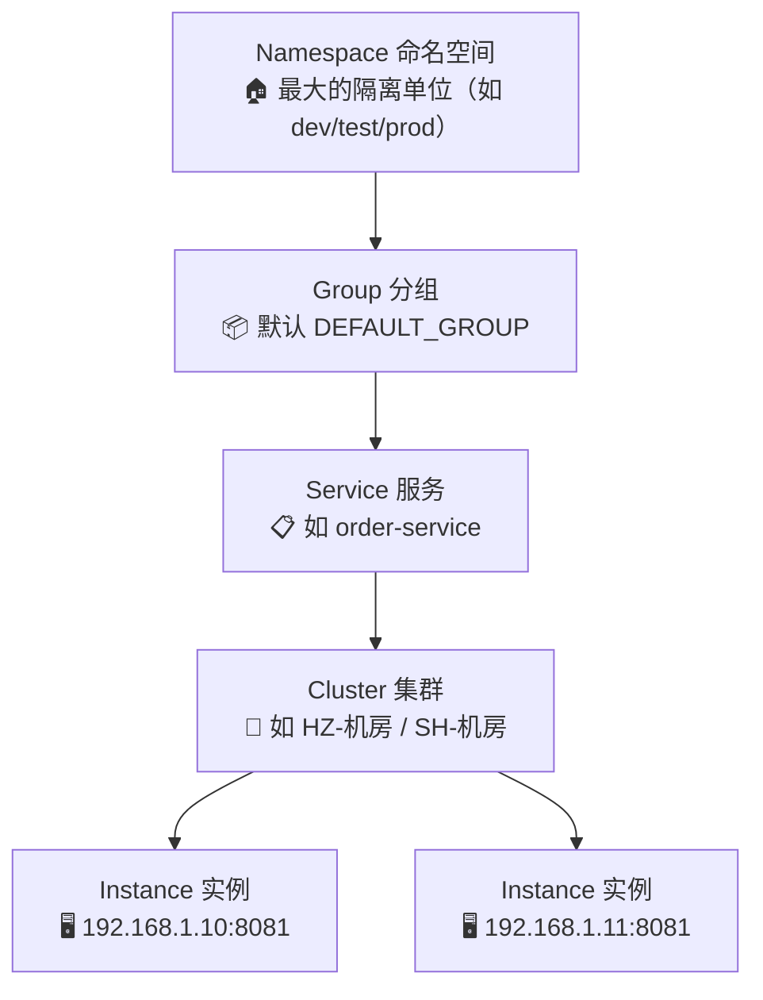
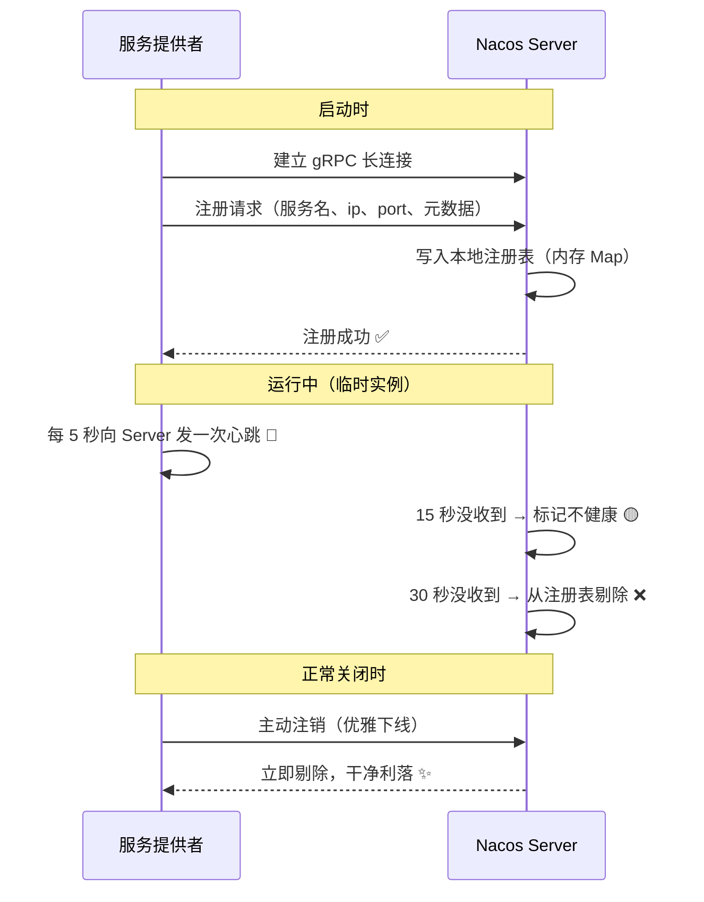
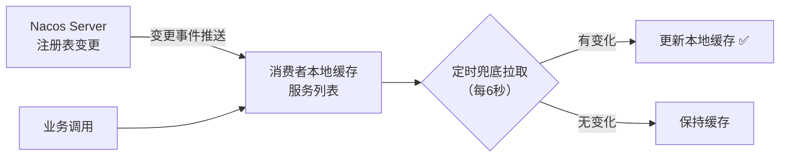
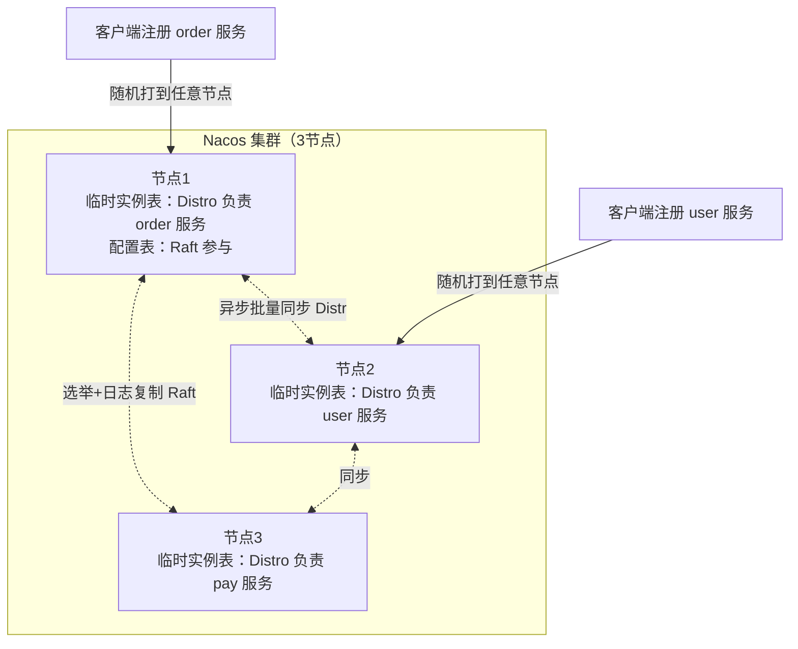
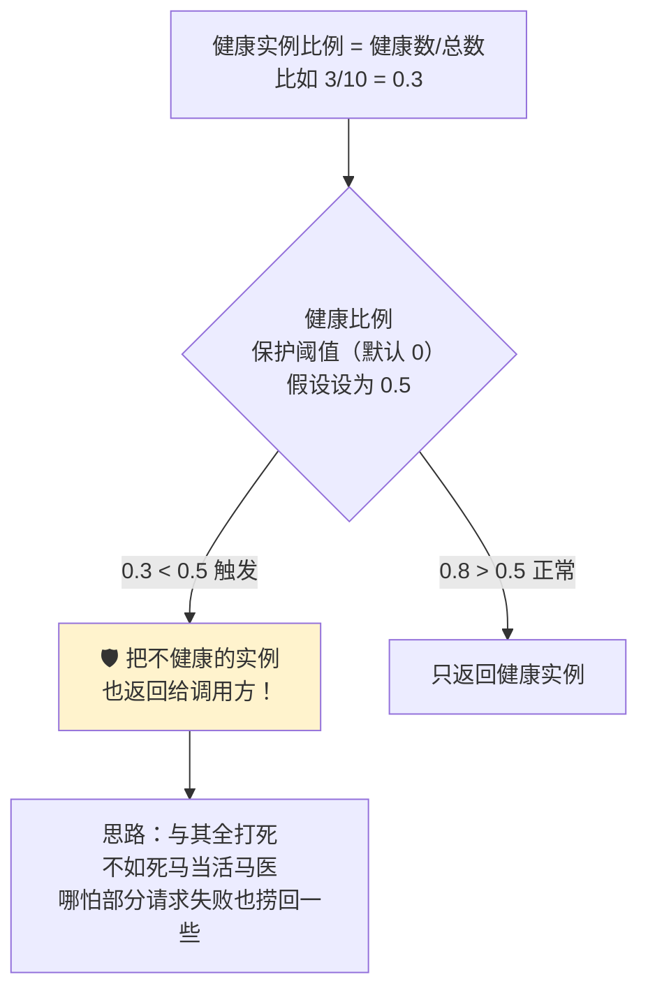
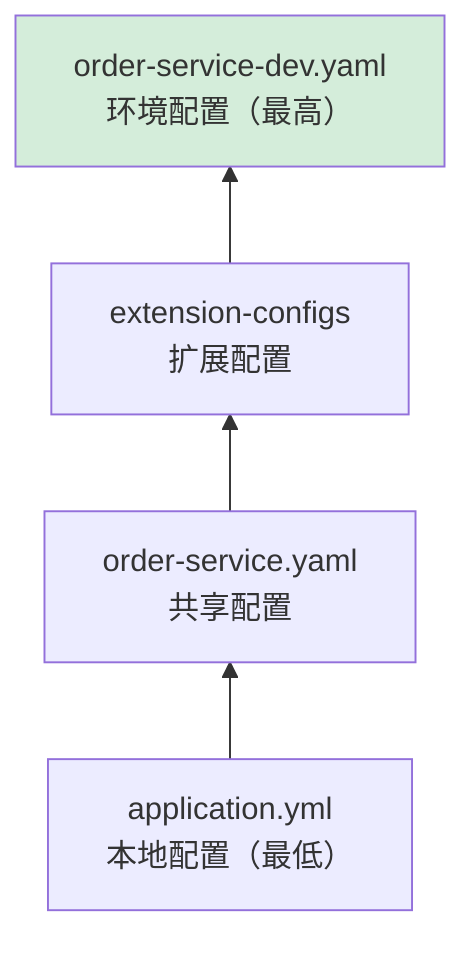
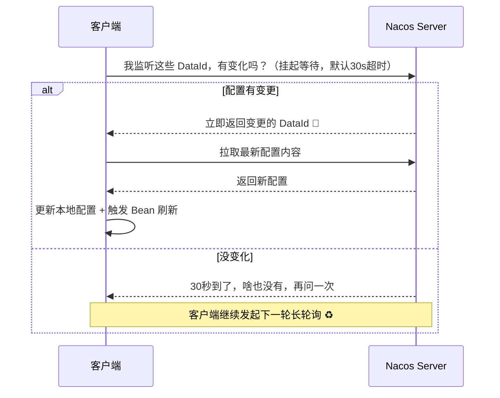
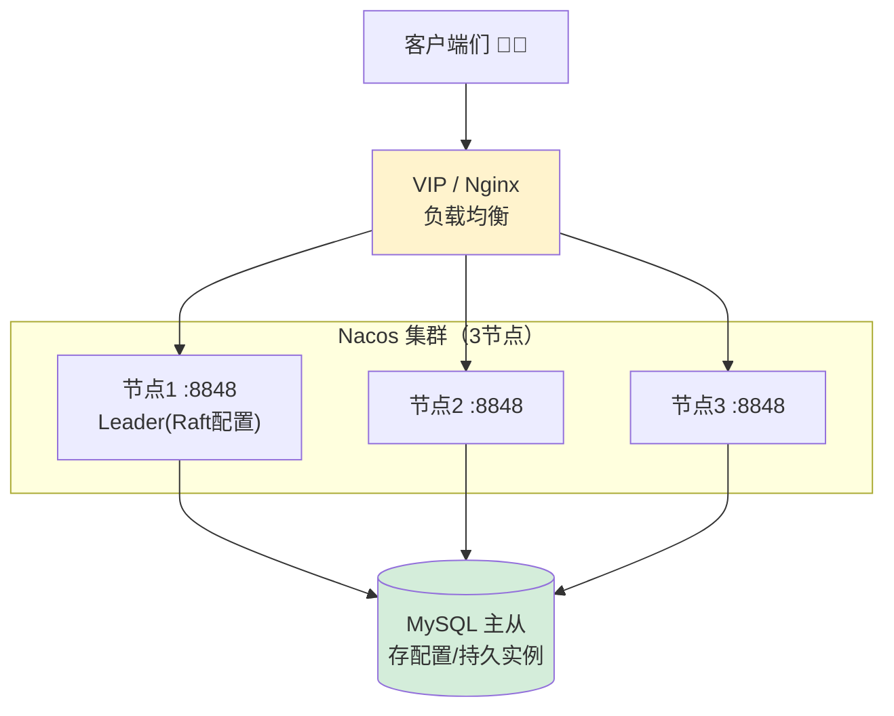
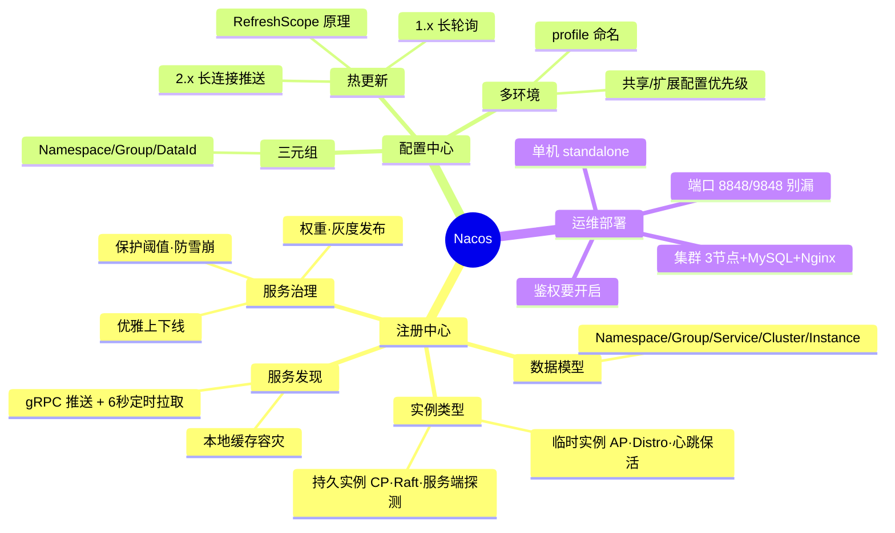

# 🌸 Nacos 超详细教程

> 上回书说到 SpringCloud 全家桶，其中最闪亮的明星组件就是 **Nacos** 啦！
> 一个顶俩：**注册中心 + 配置中心** 二合一 💎，本篇我们把它扒个底朝天～

---

## 📖 目录

1. [Nacos 是什么](#一nacos-是什么)
2. [安装与启动](#二安装与启动三种姿势)
3. [核心概念与数据模型](#三核心概念与数据模型)
4. [注册中心实战：服务注册与发现](#四注册中心实战服务注册与发现)
5. [注册中心原理深入](#五注册中心原理深入心跳发现apcp)
6. [服务治理：权重、保护阈值、优雅上下线](#六服务治理权重保护阈值优雅上下线)
7. [配置中心实战：统一配置管理](#七配置中心实战统一配置管理)
8. [配置热更新原理](#八配置热更新原理长轮询与长连接)
9. [集群部署与数据持久化](#九集群部署与数据持久化)
10. [常见问题排查](#十常见问题排查-qa)
11. [面试高频问题](#十一面试高频问题)
12. [总结](#十二总结)

---

## 一、Nacos 是什么？

### 1.1 名字的含义 🏷️

> **Na**ming and **Co**nfiguration **S**ervice → **Nacos**
> 官方口号："**动态服务发现、配置管理和服务管理平台**"

说人话就是：Nacos = **服务的电话簿 📖 + 配置的中央仓库 🗄️**


### 1.2 为什么 Nacos 这么受欢迎？🥰

| 优点 | 说明 |
| --- | --- |
| 一站式 | 注册中心 + 配置中心，不用 Eureka + Config 两个组件拼装 |
| 可视化控制台 | 界面友好，点点鼠标就能改配置、下线服务 🖱️ |
| AP/CP 可切换 | 临时实例走 AP，持久实例走 CP，两副面孔自由切换 |
| 性能好 | 2.x 基于 gRPC 长连接，十万级服务也能扛 |
| 阿里出品 | 双十一同款，经过海量流量验证 💪 |

### 1.3 和同类产品的对比 🥊

| 特性 | **Nacos** ⭐ | Eureka | Consul | Zookeeper |
| --- | --- | --- | --- | --- |
| CAP | **AP / CP 可切换** | AP | CP | CP |
| 配置中心 | ✅ 自带 | ❌ | ✅ | 需自研 |
| 健康检查 | 客户端心跳 + 服务端探测 | 客户端心跳 | Agent 探测 | Session 会话 |
| 访问协议 | HTTP/gRPC/DNS | HTTP | HTTP/DNS | TCP 私有协议 |
| 控制台 | ✅ 丰富 | 简陋 | 一般 | ❌ |
| 社区活跃度 | 🌟🌟🌟🌟🌟 | 💤 停更 | 🌟🌟🌟 | 🌟🌟 |

---

## 二、安装与启动：三种姿势 🚀

### 2.1 方式一：Windows 直接跑 🪟

```text
1. 官网/GitHub 下载 nacos-server-2.2.3.zip
2. 解压到本地目录
3. 进入 bin 目录
4. 单机模式必须加 -m standalone！（默认是集群模式会启动失败 😭）
```

```bash
# Windows 启动（单机模式）
startup.cmd -m standalone

# 关闭
shutdown.cmd
```

### 2.2 方式二：Docker 一键跑 🐳（推荐）

```bash
docker run -d --name nacos \
  -e MODE=standalone \
  -p 8848:8848 \
  -p 9848:9848 \
  nacos/nacos-server:v2.2.3
```

> ⚠️ **注意端口**：Nacos 2.x 除了 `8848`（主端口）还需要 `9848`（gRPC 客户端口 = 8848+1000）！
> 只开放 8848 会导致客户端连不上，报 `Client not connected, current status: STARTING` 😱

### 2.3 方式三：源码编译 🧑‍💻（想读源码的同学）

```bash
git clone https://github.com/alibaba/nacos.git
cd nacos
mvn -Prelease-nacos -Dmaven.test.skip=true clean install -U
```

### 2.4 验证启动成功 ✅

浏览器打开控制台：

```text
http://localhost:8848/nacos
账号/密码：nacos / nacos（默认）
```

看到控制台界面就成功啦 🎉！

> 💡 端口小抄：
>
> | 端口 | 用途 |
> | --- | --- |
> | 8848 | 主端口（HTTP API + 控制台） |
> | 9848 | 客户端 gRPC（2.x 必须） |
> | 9849 | 服务端之间 gRPC |
> | 7848 | 集群节点间 Raft 选举通信 |

---

## 三、核心概念与数据模型 🧠

### 3.1 分层模型：Namespace → Group → Service → Cluster → Instance

Nacos 组织服务的层级结构，像一棵大树 🌳：



| 概念 | 作用 | 通俗比喻 |
| --- | --- | --- |
| **Namespace** | 环境/租户级隔离 | 不同的小区（dev 小区和 prod 小区互相看不见）🏠 |
| **Group** | 服务分组 | 小区里的楼栋（默认 DEFAULT_GROUP） |
| **Service** | 服务名 | 一栋楼里的某一户人家 |
| **Cluster** | 机房/区域分组 | 家里的不同房间（同机房优先调用） |
| **Instance** | 具体某个服务进程 | 房间里的某个人 👤 |

> 💡 **实际开发最佳实践**：用 Namespace 隔离**环境**（dev/test/prod），用 Group 区分**项目/业务线**，同机房实例设置相同的 Cluster 名（配合 `spring.cloud.nacos.discovery.cluster-name`）。

### 3.2 临时实例 vs 持久实例（重要！）⭐

这是 Nacos 很有特色的设计——**实例分两种身份**：

| 对比 | 临时实例（默认）| 持久实例 |
| --- | --- | --- |
| 存活方式 | 客户端**心跳上报**保活 💓 | 服务端**主动探测**健康 |
| 不见了怎么办 | 心跳超时自动**剔除** | **不剔除**，只标记为不健康（可能只是网络问题，服务进程还在） |
| 数据存储 | 内存（AP，Distro 协议） | 磁盘（CP，Raft 协议） |
| 适用场景 | 微服务实例（挂了就删，干脆利落） | DB、Redis 等基础组件（挂了也要留着记录排查） |
| CAP | **AP** | **CP** |

```yaml
spring:
  cloud:
    nacos:
      discovery:
        ephemeral: true    # true=临时实例（默认），false=持久实例
```

---

## 四、注册中心实战：服务注册与发现 🛠️

### 4.1 版本配套提醒 ⚠️

| SpringBoot | SpringCloud | SpringCloud Alibaba | Nacos Server |
| --- | --- | --- | --- |
| 3.2.x | 2023.0.x | 2023.0.1.x | 2.2.x / 2.3.x ✅ |
| 2.7.x | 2021.0.x | 2021.0.5.0 | 2.0/2.1 |

### 4.2 服务提供者注册

**第一步：引依赖**（父工程已在 SpringCloud 篇管理好版本，子模块直接用）

```xml
<dependency>
    <groupId>com.alibaba.cloud</groupId>
    <artifactId>spring-cloud-starter-alibaba-nacos-discovery</artifactId>
</dependency>
```

**第二步：写配置**

```yaml
server:
  port: 8083
spring:
  application:
    name: product-service          # 服务名，注册的"姓名"
  cloud:
    nacos:
      server-addr: localhost:8848  # Nacos 地址
      discovery:
        namespace: dev             # 命名空间 ID（注意填 ID 不是名字！）
        group: DEFAULT_GROUP
        cluster-name: HZ           # 集群名：同机房同集群
        ephemeral: true            # 临时实例
```

**第三步：启动！**

启动后控制台 → 服务管理 → 服务列表，就能看到它啦 🎊

### 4.3 消费者发现服务

消费者引入同样依赖 + 配置，然后可以：

**方式一：搭配 OpenFeign（推荐 ✨）**

```java
@FeignClient(name = "product-service")
public interface ProductClient {
    @GetMapping("/product/{id}")
    Product getProduct(@PathVariable("id") Long id);
}
```

**方式二：手动从注册中心拉取（了解原理用）**

```java
@Autowired
private DiscoveryClient discoveryClient;   // Spring Cloud 标准接口

public List<ServiceInstance> getInstances() {
    // 按服务名拿到所有健康实例的 ip + port
    return discoveryClient.getInstances("product-service");
}
```

### 4.4 验证负载均衡

把 `product-service` 用不同端口启动两份（IDEA 里 Copy Configuration 改端口）：

```text
Nacos 控制台 → 服务列表 → product-service → 详情：
  实例1：192.168.1.10:8081 ✅ 健康在线
  实例2：192.168.1.10:8082 ✅ 健康在线
```

消费者连续调用，请求会轮流打到两台机器上（默认轮询）⚖️～

---

## 五、注册中心原理深入：心跳、发现、AP/CP 🧠

### 5.1 服务注册流程（2.x 版本）



> 📌 1.x 版本用的是 HTTP 短连接 + UDP 推送；2.x 改成 **gRPC 长连接**，性能大幅提升～

### 5.2 服务发现：推拉结合 📬

消费者怎么知道有哪些实例可用？



| 机制 | 说明 |
| --- | --- |
| **Push 推** | 2.x：gRPC 长连接实时推送变更；1.x：UDP 推送（可能丢包） |
| **Pull 拉** | 定时（默认 6 秒）全量拉取兜底，防止推送丢失 |
| **订阅** | 消费者 Subscribe 感兴趣的服务，变更时收到通知 🔔 |

> 💡 **为什么本地要缓存？** 注册中心挂了，消费者手里还有旧的服务列表，调用照样能跑——这就是**客户端缓存容错**，也是 Nacos AP 设计思想的体现！

### 5.3 AP 与 CP：Distro 和 Raft 双协议 🎭

Nacos 同时支持两种数据一致性协议，各管一摊：

| 协议 | 管什么 | 特点 |
| --- | --- | --- |
| **Distro**（阿里自研） | 临时实例的注册信息 | **AP**：各节点平等接收写请求，异步同步；追求可用性，数据最终一致 |
| **Raft** | 配置数据 + 持久实例 | **CP**：选举 Leader，过半节点确认才写入；追求强一致性 |



> 🌟 **Distro 协议核心思想**（面试加分点）：
> 1. 每个节点都能接收写请求（**全员可写**，保证可用性）
> 2. 每个服务的数据有一个**责任节点**，由它负责同步给别人
> 3. 新节点加入时，先从其他节点**全量拉快照**，再接受增量
> 4. 临时实例数据存内存，节点重启丢了也没事——实例心跳会很快重新注册回来 🔄

---

## 六、服务治理：权重、保护阈值、优雅上下线 🎛️

### 6.1 权重：金丝雀发布神器 🐤

给不同实例设置不同权重，流量按比例分配：

```text
实例1 权重 0.9 → 承接 90% 流量（老版本）
实例2 权重 0.1 → 承接 10% 流量（新版本，金丝雀 🐤）
```

设置方式：控制台 → 服务列表 → 详情 → 编辑权重；或代码注册时带上：

```yaml
spring:
  cloud:
    nacos:
      discovery:
        weight: 0.1    # 10% 流量
```

> ⚠️ 权重是 Nacos 元数据，但默认的 RoundRobin 负载策略**不读它**！
> 想让权重生效，可以自定义 LoadBalancer 策略（从 `NacosServiceInstance#getWeight` 读取）或用 Nacos 自带的负载均衡能力～

### 6.2 保护阈值：防雪崩保险丝 ⚡

**场景**：某服务 10 个实例挂了 7 个，剩下 3 个健康实例本来要干 10 份活 → 被打死 → 全挂 💀

**保护阈值（protectThreshold）机制**：



设置：控制台 → 服务详情 → 编辑保护阈值（如 0.5）

> 💡 和 Eureka 自我保护对比：
> **Eureka** 是"注册中心视角"（心跳大面积丢失时拒绝剔除）；
> **Nacos 保护阈值**是"消费者视角"（健康实例太少时连不健康的也给你）——目的都是防雪崩！

### 6.3 优雅上下线 🚦

发布新版本时的标准动作：

| 方式 | 操作 | 效果 |
| --- | --- | --- |
| 主动注销 | `NamingService#deregisterInstance()` | 客户端通知 Server 立即下线 |
| 控制台下线 | 服务详情 → 下线按钮 🖱️ | 实例还在运行，但不给流量 |
| 权重调 0 | 编辑权重为 0 | 流量慢慢切走，最平滑 ✅ |

```java
// 代码优雅下线示例（比如运维接口触发）
@RestController
public class OfflineController {

    @Autowired
    private NacosAutoServiceRegistration registration;

    @GetMapping("/offline")
    public String offline() {
        registration.stop();   // 主动向 Nacos 注销自己
        return "我下线啦，拜拜 👋";
    }
}
```

---

## 七、配置中心实战：统一配置管理 📄

### 7.1 配置模型：DataId、Group、Namespace

一个配置文件在 Nacos 里的定位三元组：

```text
Namespace（哪个环境） + Group（哪个分组） + DataId（哪个文件）
= 唯一确定一份配置 ✅
```

**DataId 命名规则**：

```text
${spring.application.name}-${profile}.${后缀}
order-service-dev.yaml      → dev 环境的订单服务配置
order-service-prod.yaml     → prod 环境的订单服务配置
order-service.yaml          → 不带 profile = 通用配置（所有环境共享）
```

### 7.2 第一步：引依赖

```xml
<dependency>
    <groupId>com.alibaba.cloud</groupId>
    <artifactId>spring-cloud-starter-alibaba-nacos-config</artifactId>
</dependency>
```

### 7.3 第二步：本地最小配置

> SpringBoot 2.4+ 已经不用 bootstrap.yml 啦，改用 `spring.config.import` ✨

```yaml
# application.yml
spring:
  application:
    name: order-service
  profiles:
    active: dev
  config:
    import:
      - nacos:order-service.yaml          # 通用配置
      - nacos:order-service-${spring.profiles.active}.yaml   # 环境配置
  cloud:
    nacos:
      server-addr: localhost:8848
      config:
        namespace: dev                    # 命名空间 ID
        group: DEFAULT_GROUP
        file-extension: yaml
```

### 7.4 第三步：控制台创建配置

控制台 → 配置管理 → 配置列表 → ➕ 创建：

```yaml
# DataId: order-service-dev.yaml 的内容
order:
  promotion: true           # 满减开关
  discount-limit: 100       # 最高减100元
  pay-timeout: 1800         # 支付超时秒数
```

### 7.5 第四步：读取配置（两种姿势）

**姿势一：@Value + @RefreshScope**

```java
@RestController
@RefreshScope                      // 必须加！Bean 会在配置变更时重建
public class PromotionController {

    @Value("${order.promotion}")
    private Boolean promotion;

    @GetMapping("/check")
    public String check() {
        return promotion ? "满减进行中 🎉" : "活动休息中 😴";
    }
}
```

**姿势二：@ConfigurationProperties（推荐 ✅）**

```java
@Data
@Component
@ConfigurationProperties(prefix = "order")
public class OrderProperties {
    private Boolean promotion;
    private Integer discountLimit;
    private Integer payTimeout;
}
// 好处：类型安全、集中管理、自动热更新（不用加 @RefreshScope！）
```

**优先级测试**：在控制台把 `promotion` 改成 `false` 发布 → 接口**不重启**秒变"活动休息中" 🎊

### 7.6 多配置文件与优先级 🪜

一个服务可以拉取多份配置，优先级从高到低：



```yaml
spring:
  config:
    import:
      - nacos:common-redis.yaml       # 公共配置（DB、Redis 地址等）
      - nacos:order-service.yaml
      - nacos:order-service-dev.yaml  # 越靠后优先级越高（import 列表内后者覆盖前者）
```

> 💡 多团队共享公共配置（如 Redis 地址）单独建一个 DataId，谁要谁 import，改一处全生效～

---

## 八、配置热更新原理：长轮询与长连接 🔥

### 8.1 1.x 时代：长轮询（Long Polling）



> 🌟 **长轮询精髓**：客户端发请求，服务端**hold 住不马上回**，有变化（或超时）才响应。
> 既比普通轮询省流量（不用频繁问"有了吗"），又比纯长连接实现简单～

### 8.2 2.x 时代：gRPC 长连接推送


| 对比 | 1.x 长轮询 | 2.x gRPC 长连接 |
| --- | --- | --- |
| 实时性 | 毫秒~秒级 | 毫秒级 ✅ |
| 连接开销 | 每次都挂 HTTP 请求 | 一条长连接复用 ✅ |
| 性能 | 一般 | 高并发优秀 ✅ |

### 8.3 @RefreshScope 刷新的秘密 🤫


> ⚠️ 所以 `@RefreshScope` 的 Bean 刷新**不是改字段值**，而是**整个 Bean 销毁重建**！缓存状态放在这种 Bean 里会被清空，要小心哦～

---

## 九、集群部署与数据持久化 🏰

### 9.1 数据存哪：内嵌 Derby vs 外置 MySQL

| 方式 | 说明 | 适用 |
| --- | --- | --- |
| 内嵌 Derby | 单机自带，数据存本地 `data/derby-data` | 学习测试（单机）|
| **外置 MySQL** | 集群**必须**！所有节点连同一个库 | 生产环境 ✅ |

**配置外置 MySQL**（`application.properties`）：

```properties
spring.sql.init.platform=mysql
db.num=1
db.url.0=jdbc:mysql://127.0.0.1:3306/nacos?characterEncoding=utf8&serverTimezone=Asia/Shanghai&useSSL=false
db.user.0=root
db.password.0=123456
```

> 💡 初始化 SQL 在发行包 `conf/mysql-schema.sql`，先建库建表再启动～

### 9.2 生产级集群架构 🏗️



**搭建三步走**：

```bash
# ① conf/cluster.conf 配置集群成员（每台都写全）
# IP:port 三行，例：
192.168.1.101:8848
192.168.1.102:8848
192.168.1.103:8848

# ② 所有节点配同一个 MySQL（见上一步）

# ③ 前面挂 Nginx 做负载均衡
upstream nacos {
    server 192.168.1.101:8848;
    server 192.168.1.102:8848;
    server 192.168.1.103:8848;
}
```

> ⚠️ 生产注意：
> - 集群节点数建议 **3 个以上奇数**（Raft 选举需要过半）
> - 客户端 `server-addr` 填 Nginx 地址而不是写死某节点
> - 建议开启鉴权：`nacos.core.auth.enabled=true` 并修改默认密钥（默认密钥被曝过漏洞 🙈）

### 9.3 各数据存储位置总结 📌

| 数据 | 存储 | 协议 | 集群同步方式 |
| --- | --- | --- | --- |
| 临时实例注册信息 | 内存 | Distro（AP） | 责任节点异步批量同步 |
| 持久实例注册信息 | MySQL + 内存 | Raft（CP） | Leader 日志复制 |
| 配置文件 | MySQL + 本地快照 | Raft（CP） | Leader 日志复制 |
| 客户端本地 | **snapshot 快照**（容灾用） | —— | Server 挂了也能用本地快照兜底 ✅ |

---

## 十、常见问题排查 Q&A 🩺

### Q1：服务注册不上，控制台看不到？

```text
排查顺序：
① Nacos 起没起？ → 访问 localhost:8848/nacos
② 2.x 是不是只开了 8848 没开 9848？（gRPC 连不上必挂！）
③ namespace 填的是 ID 还是名称？（必须填 ID！控制台创建时生成的那串）
④ 版本配套对不对？（Boot/Cloud/Alibaba/Server 四件套要对齐）
⑤ 看日志：nacos registry, register finished... 注册成功的标志
```

### Q2：控制台能看配置，客户端读不到？

```text
① DataId 拼写对不对？后缀 file-extension 是 yaml 还是 properties？
② namespace / group 和客户端配置一致吗？
③ spring.config.import 写了吗？（2.4+ 别再用 bootstrap.yml 的老教程啦）
```

### Q3：启动报 `Connection refused` 或 `Client not connected`？

```text
多为网络/端口问题：
① server-addr 别带 http:// 前缀（写 localhost:8848 就行）
② Docker 部署记得 -p 9848:9848
③ 云服务器开安全组：8848 + 9848 都要开
```

### Q4：配置改了没生效？

```text
① @Value 的类加了 @RefreshScope 吗？
② 检查日志有没有 Nacos config ... dataId ... changed 相关输出
③ 是不是优先级被本地 application.yml 覆盖了？（本地配置 vs 远程配置优先级问题）
```

---

## 十一、面试高频问题 🎯

### Q1：Nacos 和 Eureka 的区别？（超高频！）

| 对比 | Nacos | Eureka |
| --- | --- | --- |
| CAP | AP/CP 按实例类型切换 | 仅 AP |
| 配置中心 | ✅ 集成 | ❌ |
| 健康检查 | 心跳 + 服务端主动探测 | 客户端心跳 |
| 不健康实例 | 临时实例剔除 / 持久实例保留标记 | 自我保护模式下不剔除 |
| 集群协议 | Distro + Raft | P2P 对等复制 |
| 控制台 & 现状 | 功能强，活跃维护 ✅ | 简陋，停更 💤 |

### Q2：Nacos 怎么实现 AP 和 CP 的切换？

> 看**实例类型**：
> - `ephemeral=true`（默认，临时实例）→ 数据存内存，Distro 协议同步 → **AP**
> - `ephemeral=false`（持久实例）→ 数据存磁盘/MySQL，Raft 协议 → **CP**
> 一句话：**注册中心选型一般用 AP**，因为注册中心挂一小会儿没关系，但不能整个不可用～

### Q3：临时实例的心跳和剔除时间？

> 客户端每 **5 秒**发一次心跳；**15 秒**没收到标记为不健康；**30 秒**没收到剔除该实例。
> 服务正常关闭时会**主动注销**，立即剔除，不用等超时。

### Q4：Nacos 服务发现的推拉机制？

> **推拉结合**：
> - 推：2.x gRPC 长连接实时推送变更（1.x 用 UDP）
> - 拉：客户端每 **6 秒**定时查询兜底
> - 消费者本地**缓存服务列表**，注册中心全挂也能靠缓存继续调用（容灾）

### Q5：Nacos 配置热更新原理？

> - 1.x：客户端对监听的 DataId 发起**长轮询**（30s 超时挂起），变更立即返回 → 再拉取新配置
> - 2.x：**gRPC 长连接**，服务端变更主动推送
> - 拿到新值后发布 RefreshEvent → `@RefreshScope` 的 Bean 销毁重建 → 新值生效

### Q6：什么是保护阈值？和 Eureka 自我保护的区别？

> 保护阈值：健康实例比例 < 阈值时，**把不健康实例也返回**，防止剩余健康实例被打垮（消费者视角防雪崩）。
> Eureka 自我保护：心跳大量丢失时**拒绝剔除实例**（注册中心视角防误杀）。
> 都是为了防雪崩，但视角和手段不同～

### Q7：Nacos 集群如何保证数据一致性？

> 双协议各管一摊：
> - **Distro**（临时实例，AP）：全员可写 + 责任节点异步同步，最终一致
> - **Raft**（配置 & 持久实例，CP）：选举 Leader，过半提交，强一致
> 新节点加入先全量同步快照，再接增量。

### Q8：Nacos 1.x 和 2.x 的主要区别？

| 维度 | 1.x | 2.x |
| --- | --- | --- |
| 连接模型 | HTTP 短连接 + UDP 推送 | **gRPC 长连接** ✅ |
| 性能 | 万级 | 十万级实例 ✅ |
| 配置监听 | 长轮询 | 长连接推送 ✅ |
| 心跳 | 连接级别天然保活（不再依赖定时心跳） | 同左 |

---

## 十二、总结 🎓

### 12.1 一张图带走 Nacos 知识点 🗺️



### 12.2 学习建议 💝

1. **先单机玩透**：注册、发现、配置热更新各跑一个 demo，控制台多点一点 🖱️
2. **抓两条主线**：注册中心线（心跳→剔除→推送→缓存）+ 配置线（DataId→长轮询→刷新）
3. **坑点背牢**：9848 端口、namespace 填 ID、版本配套——这三个坑 90% 的人都踩过 😂
4. **进阶**：读一读 Distro 协议官方文档，面试聊到一致性直接起飞 🛫

---

> 🌸 **恭喜你把 Nacos 学透啦！**
> 记住它的两大身份：**服务的电话簿 + 配置的中央仓库**～
> 下一篇想学 OpenFeign 深入、Sentinel 还是 Seata？随时点单哦 💪✨
