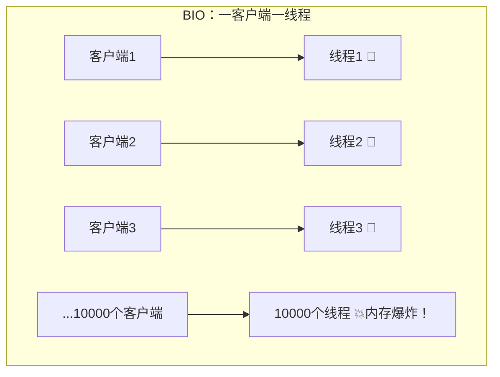
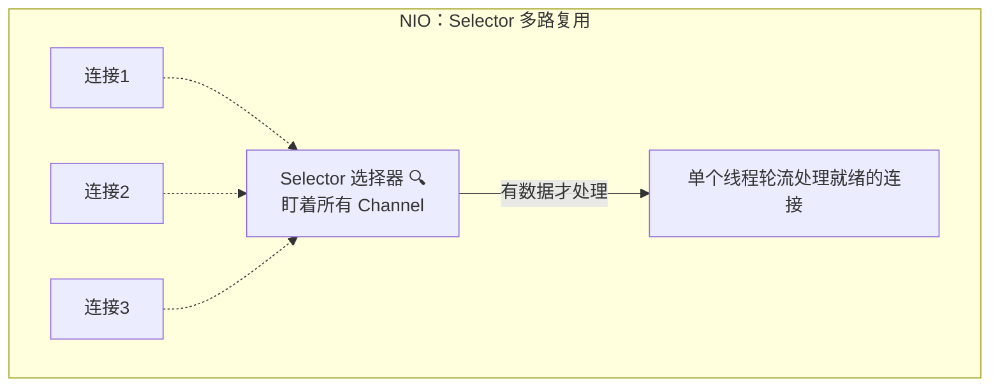
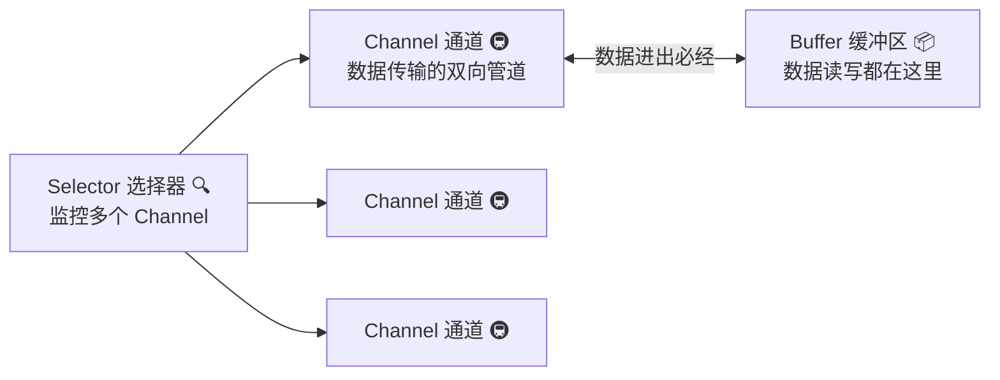
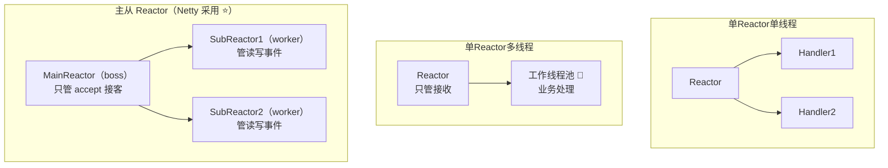
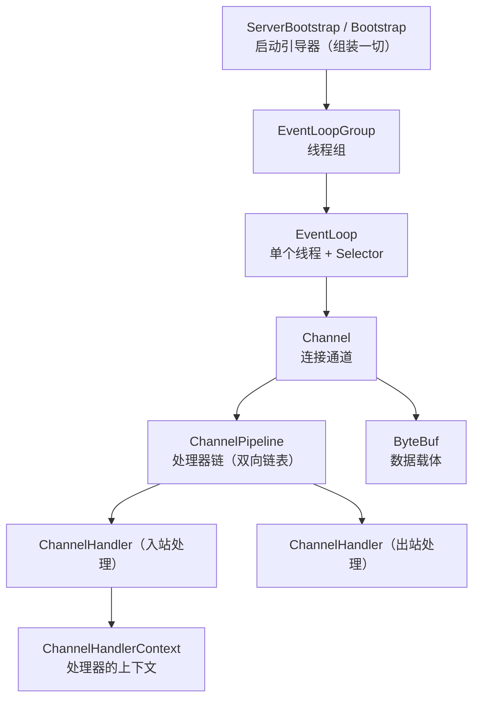
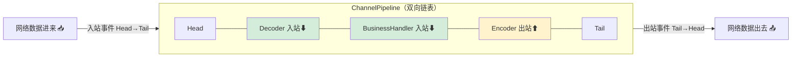
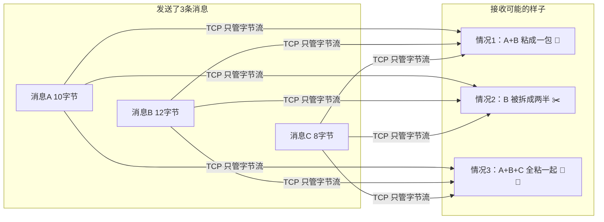
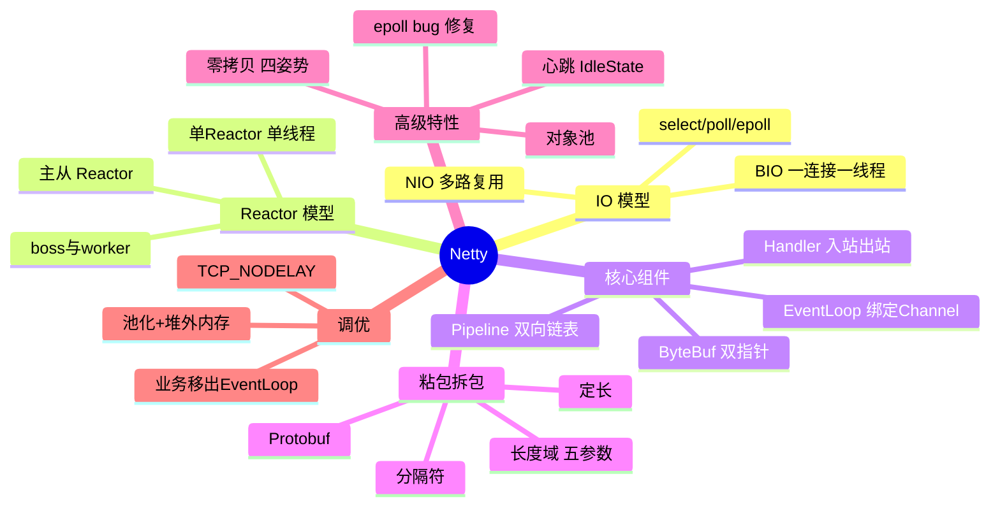

# 🌸 Netty 超详细教程

> 微服务学完，来点硬核的——**Netty 网络编程**！
> Dubbo、RocketMQ、ElasticSearch、Redis 客户端…底层全是它，学会 = 半个中间件专家 💎～

---

## 📖 目录

1. [Netty 是什么](#一netty-是什么)
2. [IO 模型演进：BIO → NIO](#二io-模型演进bio--nio)
3. [NIO 三大件：Channel、Buffer、Selector](#三nio-三大件channelbufferselector)
4. [Reactor 线程模型](#四reactor-线程模型)
5. [快速上手：第一个 Netty 程序](#五快速上手第一个-netty-程序)
6. [Netty 核心组件详解](#六netty-核心组件详解)
7. [ByteBuf 详解](#七bytebuf-详解)
8. [TCP 粘包拆包与编解码器](#八tcp-粘包拆包与编解码器)
9. [心跳机制：IdleStateHandler](#九心跳机制idlestatehandler)
10. [Netty 高性能的秘密](#十netty-高性能的秘密)
11. [常见问题与调优](#十一常见问题与调优)
12. [面试高频问题](#十二面试高频问题)
13. [总结](#十三总结)

---

## 一、Netty 是什么？

### 1.1 一句话定位 🏷️

> **Netty** 是一个**异步事件驱动**的高性能网络应用框架，用于快速开发可维护的高性能协议服务器和客户端。
> 说人话：**帮你把 Java 网络编程中最难啃的部分（NIO）封装成人话 API** 🎁。

### 1.2 谁在用 Netty？🤩

| 中间件 | 用 Netty 干嘛 |
| --- | --- |
| Dubbo / gRPC | RPC 通信底层 |
| RocketMQ | 消息收发网络层 |
| Elasticsearch | 节点间通信 |
| Spring WebFlux / Gateway | 默认服务器就是 Netty |
| Redis 客户端（Lettuce） | 命令传输 |

### 1.3 为什么不直接用原生 NIO？🤔

| 痛点 | 说明 |
| --- | --- |
| API 复杂 | Selector、Channel、Buffer 手动配合，容易写错 😵 |
| 臭名昭著的 Bug | JDK NIO 的 **epoll 空轮询 bug**（Selector 空转 CPU 100%） |
| 安全隐患 | 曾经的 UDP 漏洞 |
| 功能缺失 | 粘包拆包、心跳、重连都要自己造轮子 |
| **Netty 全解决** | 高级封装 + 修复 bug + 开箱即用组件 ✅ |

---

## 二、IO 模型演进：BIO → NIO 📈

### 2.1 BIO（Blocking IO）：一连接一线程 😅

```java
// BIO 服务端：每个客户端开一个线程伺候
ServerSocket server = new ServerSocket(8080);
while (true) {
    Socket socket = server.accept();      // ① 阻塞！等客户端来
    new Thread(() -> {
        byte[] buf = new byte[1024];
        int len = socket.getInputStream().read(buf);  // ② 又阻塞！等数据来
        System.out.println(new String(buf, 0, len));
    }).start();                            // ③ 客户端一多，线程爆炸 💥
}
```



**BIO 三宗罪**：accept 阻塞、read 阻塞、线程开销大。

### 2.2 NIO（Non-blocking IO）：一个线程管所有连接 😎



| 对比 | BIO | NIO |
| --- | --- | --- |
| 阻塞 | 阻塞（accept/read 都等） | 非阻塞 |
| 线程 | 一连接一线程 | **一（少）线程管万级连接** ✅ |
| 模型 | 一对一伺候 | 多路复用，谁就绪处理谁 |
| 数据操作 | 流（Stream，单向） | Buffer（缓冲区，双向读写） |

### 2.3 同步/异步、阻塞/非阻塞一次说清 🧠

| 概念 | 说人话 |
| --- | --- |
| 同步阻塞 | 排队打饭，站着干等 🧍 |
| 同步非阻塞 | 取号后自己刷手机，时不时看叫号屏 📱 |
| 异步 | 扫码点单，做好了小程序通知你来取，期间随便干啥 ✨ |

> 💡 **NIO 属于同步非阻塞**（还是要自己问"好了吗"）；真·异步是 AIO（Windows IOCP 较成熟，Linux 支持一般，Netty 曾支持后移除）。

---

## 三、NIO 三大件：Channel、Buffer、Selector 🧰

### 3.1 三大件关系



### 3.2 Buffer：数据的"中转站" 📦

```java
ByteBuffer buf = ByteBuffer.allocate(1024);  // 分配容量1024
buf.put("hello".getBytes());                 // 写数据（position 前进）
buf.flip();                                  // ★ 翻转：写模式→读模式
while (buf.hasRemaining()) {
    System.out.print((char) buf.get());      // 读数据
}
buf.clear();                                 // 清空回到写模式（内容其实还在，只是指针归零）
```

**四个关键指针**（重理解 ⭐）：

| 指针 | 含义 |
| --- | --- |
| capacity | 总容量（不变） |
| position | 当前读写位置 |
| limit | 读写上限 |
| mark | 标记位，可 reset 回来 |

```text
写模式：  0 <= position <= limit <= capacity
flip后：  position=0（回到开头读），limit=原position（最多读到刚写的位置）
```

### 3.3 Channel：双向管道 🚇

| Channel | 用途 |
| --- | --- |
| ServerSocketChannel | 服务端监听连接 |
| SocketChannel | 客户端/服务端 数据读写 |
| FileChannel | 文件传输（配合 transferTo 实现零拷贝） |

### 3.4 Selector：多路复用核心 🔍

```java
Selector selector = Selector.open();
channel.configureBlocking(false);                    // 必须非阻塞！
channel.register(selector, SelectionKey.OP_READ);    // 注册关注"读就绪"事件

while (true) {
    selector.select();                               // 阻塞到有事件就绪（Netty 帮你优化了这里）
    Set<SelectionKey> keys = selector.selectedKeys();
    for (SelectionKey key : keys) {
        if (key.isReadable()) { /* 处理读事件 */ }
    }
}
```

**四种事件**：`OP_ACCEPT`（连接就绪）、`OP_CONNECT`（连接完成）、`OP_READ`（读就绪）、`OP_WRITE`（写就绪）。

### 3.5 底层多路复用器：select / poll / epoll 🐧

| 对比 | select | poll | **epoll** ⭐ |
| --- | --- | --- | --- |
| fd 上限 | 1024 | 无硬限制 | 无硬限制 |
| 找就绪 fd | 每次全量线性扫描 O(n) | 全量扫描 O(n) | **事件回调，只返回就绪的 O(1)** ✅ |
| 内核拷贝 | 每次调用都传全量 fd 集合 | 同左 | fd 只注册一次（红黑树+就绪链表） |
| 适用 | 少量连接 | 少量连接 | **海量连接（Linux 主流）** |

> 💡 Netty 会根据操作系统自动选择：Linux 用 epoll（还有专用的 `EpollEventLoopGroup`），Mac 用 kqueue，其他用 select 兜底～

---

## 四、Reactor 线程模型 🧵

Netty 的架构基于 **Reactor（反应器）模式**：有人把事件"反应"给对应处理器。

### 4.1 三种形态



| 形态 | 优点 | 缺点 | 谁在用 |
| --- | --- | --- | --- |
| 单 Reactor 单线程 | 简单无锁 | 一个慢操作卡全部 💀 | Redis（6.0 前） |
| 单 Reactor 多线程 | 计算交给线程池 | Reactor 单点 | 部分小框架 |
| **主从 Reactor** | 接客与干活分离，性能好 ⭐ | 稍复杂 | **Netty**、Nginx、Memcached |

### 4.2 Netty 的主从映射

| Netty 组件 | Reactor 角色 |
| --- | --- |
| `bossGroup`（1 个线程即可） | MainReactor：accept 连接后把连接转给 worker |
| `workerGroup`（默认 CPU核数×2） | SubReactor：负责注册连接的读写事件并处理 IO |

---

## 五、快速上手：第一个 Netty 程序 🚀

### 5.1 服务端完整代码

```java
public class NettyServer {
    public static void main(String[] args) throws Exception {
        // ① 两个线程组：boss 接客，worker 干活（主从 Reactor）
        EventLoopGroup bossGroup = new NioEventLoopGroup(1);
        EventLoopGroup workerGroup = new NioEventLoopGroup();

        try {
            // ② 服务端启动引导器
            ServerBootstrap bootstrap = new ServerBootstrap();
            bootstrap.group(bossGroup, workerGroup)
                    .channel(NioServerSocketChannel.class)      // 服务端通道实现
                    .option(ChannelOption.SO_BACKLOG, 128)      // 全连接队列长度
                    .childOption(ChannelOption.SO_KEEPALIVE, true)
                    // ⑤ boss 的 handler（这里不用，直接链式返回 this）
                    .handler(new LoggingHandler(LogLevel.INFO))
                    // ③ worker 的 handler：每个连接进来都会走这个初始化器
                    .childHandler(new ChannelInitializer<SocketChannel>() {
                        @Override
                        protected void initChannel(SocketChannel ch) {
                            ChannelPipeline pipeline = ch.pipeline();
                            // 加解码器：解决粘包拆包（后面细讲）
                            pipeline.addLast(new LineBasedFrameDecoder(1024));
                            pipeline.addLast(new StringDecoder());
                            pipeline.addLast(new StringEncoder());
                            // 自己的业务处理器
                            pipeline.addLast(new ServerBusinessHandler());
                        }
                    });

            // ④ 绑定端口，同步等待启动成功
            ChannelFuture future = bootstrap.bind(8080).sync();
            System.out.println("服务端启动好啦，监听 8080 ✨");
            // 等待服务端监听端口关闭
            future.channel().closeFuture().sync();
        } finally {
            // ⑥ 优雅关闭线程组
            bossGroup.shutdownGracefully();
            workerGroup.shutdownGracefully();
        }
    }
}

/** 业务处理器：读数据、回消息 */
class ServerBusinessHandler extends SimpleChannelInboundHandler<String> {

    @Override
    public void channelRead0(ChannelHandlerContext ctx, String msg) {
        System.out.println("收到客户端消息：" + msg);
        ctx.writeAndFlush("服务端收到啦：" + msg + "\n");   // 回写（自动经过 Encoder）
    }

    @Override
    public void exceptionCaught(ChannelHandlerContext ctx, Throwable cause) {
        cause.printStackTrace();
        ctx.close();    // 出异常关闭连接
    }
}
```

### 5.2 客户端完整代码

```java
public class NettyClient {
    public static void main(String[] args) throws Exception {
        EventLoopGroup group = new NioEventLoopGroup();
        try {
            Bootstrap bootstrap = new Bootstrap();
            bootstrap.group(group)
                    .channel(NioSocketChannel.class)
                    .handler(new ChannelInitializer<SocketChannel>() {
                        @Override
                        protected void initChannel(SocketChannel ch) {
                            ch.pipeline()
                              .addLast(new LineBasedFrameDecoder(1024))
                              .addLast(new StringDecoder())
                              .addLast(new StringEncoder())
                              .addLast(new SimpleChannelInboundHandler<String>() {
                                  @Override
                                  public void channelActive(ChannelHandlerContext ctx) {
                                      // 连接建立成功就发消息
                                      ctx.writeAndFlush("你好呀，我是客户端 🙋\n");
                                  }
                                  @Override
                                  public void channelRead0(ChannelHandlerContext ctx, String msg) {
                                      System.out.println("收到服务端回复：" + msg);
                                  }
                              });
                        }
                    });
            ChannelFuture future = bootstrap.connect("localhost", 8080).sync();
            future.channel().closeFuture().sync();
        } finally {
            group.shutdownGracefully();
        }
    }
}
```

### 5.3 运行效果

```text
服务端控制台：收到客户端消息：你好呀，我是客户端 🙋
客户端控制台：收到服务端回复：服务端收到啦：你好呀，我是客户端 🙋
```

---

## 六、Netty 核心组件详解 🧩

### 6.1 组件全家福



### 6.2 EventLoop：Netty 的"发动机" 🏎️

| 要点 | 说明 |
| --- | --- |
| 本质 | **一个线程 + 一个 Selector**，死循环处理 IO 事件和任务队列 |
| 绑定关系 | 一个 Channel **终身只绑定一个** EventLoop（线程安全的关键！）|
| 职责 | IO 读写 + 执行该 Channel 的所有 Handler + 定时任务 |

> 💡 **无锁串行化**：同一个连接的所有事件都在同一个线程里顺序处理，不需要加锁，性能起飞 🛫

### 6.3 Pipeline 与 Handler 的入站/出站 🔀

Pipeline 是一条**双向链表**，事件从两端流进流出：



| 方向 | 触发时机 | 典型 Handler |
| --- | --- | --- |
| **入站 Inbound** | 数据**进来**（读）、连接建立/断开 | `ChannelInboundHandler`：Decoder、业务逻辑 |
| **出站 Outbound** | 数据**出去**（写）、绑定/连接 | `ChannelOutboundHandler`：Encoder |

> ⚠️ 入站事件从 Head 到 Tail；出站事件从 Tail 到 Head——**顺序很重要**：
> 习惯上 pipeline 顺序 = Decoder → Encoder → BusinessHandler（虽然 Encoder 是出站，放前面也只对出站事件生效）

### 6.4 Handler 常用生命周期方法 🔄

```java
public class MyHandler extends ChannelInboundHandlerAdapter {
    @Override public void channelRegistered(ChannelHandlerContext ctx) { }  // 注册到 EventLoop
    @Override public void channelActive(ChannelHandlerContext ctx) { }      // 连接激活（可以收发了）
    @Override public void channelRead(ChannelHandlerContext ctx, Object msg) { }  // 读到数据 ⭐
    @Override public void channelReadComplete(ChannelHandlerContext ctx) { } // 一次读批结束
    @Override public void channelInactive(ChannelHandlerContext ctx) { }    // 连接断开
    @Override public void exceptionCaught(ChannelHandlerContext ctx, Throwable cause) { } // 异常 ⭐
}
```

### 6.5 常用 ChannelOption 参数 🎛️

| 参数 | 说明 |
| --- | --- |
| `SO_BACKLOG` | 服务端全连接队列大小（三次握手完成、等待 accept 的队列） |
| `SO_KEEPALIVE` | TCP 层保活探测 |
| `TCP_NODELAY` | 关闭 Nagle 算法，小包立即发送（低延迟场景必开 ⭐） |
| `SO_SNDBUF / SO_RCVBUF` | 发送/接收缓冲区大小 |

---

## 七、ByteBuf 详解 📦

### 7.1 ByteBuf vs NIO ByteBuffer

| 对比 | NIO ByteBuffer | **Netty ByteBuf** ⭐ |
| --- | --- | --- |
| 读写指针 | 一个 position，读写切换要 flip() | **两个指针**：readerIndex / writerIndex，读写互不干扰 ✅ |
| 容量 | 固定 | 自动扩容 ✅ |
| 池化 | 无 | **池化**（PooledByteBufAllocator）减少 GC ✅ |
| 内存 | 仅堆内 | 堆内 / **堆外（Direct）** 均可 ✅ |
| 引用计数 | 无 | ReferenceCounted，用完要 release ⚠️ |
| 零拷贝操作 | 无 | slice / duplicate / CompositeByteBuf ✅ |

### 7.2 读写指针示意 🎯

```text
+-------------------+------------------+------------------+
|  丢弃区           |   可读区         |   可写区          |
+-------------------+------------------+------------------+
0 <= readerIndex <= writerIndex <= capacity

读 n 个字节：readerIndex += n（不移动数据！）
写 n 个字节：writerIndex += n
```

### 7.3 常用 API

```java
ByteBuf buf = Unpooled.buffer(64);      // 或 PooledByteBufAllocator 分配
buf.writeBytes("hello".getBytes());     // 写
System.out.println(buf.readableBytes());// 可读字节数
byte[] dst = new byte[buf.readableBytes()];
buf.readBytes(dst);                     // 读
buf.discardReadBytes();                 // 丢弃已读，可写区变大（涉及移动数据）

// ★ 堆外内存注意引用计数！
ByteBuf direct = ctx.alloc().directBuffer();
direct.release();                       // 堆外内存不受 GC 管理，必须手动释放
```

> ⚠️ **内存泄漏经典坑**：入站 handler 读到的 msg 是 ByteBuf，**如果自己消费了不传下去，必须 release**；
> 而 `SimpleChannelInboundHandler` 会自动 release，不需要手动（新手推荐用它！）。
> 加 `-Dio.netty.leakDetection.level=PARANOID` 可开启泄漏检测 🔍

---

## 八、TCP 粘包拆包与编解码器 🍜

### 8.1 什么是粘包/拆包？

TCP 是**字节流**协议，没有"消息边界"概念，发三包可能被拼成一包或拆成五段：



**原因**：发送缓冲区合并小包（Nagle）、MSS 分段、接收缓冲区读取时机…都是 TCP 的正常行为，**不是 Bug**！
**本质**：应用层的"消息边界"在字节流里丢失了，**要自己在应用层定义边界**。

### 8.2 四种解决方案

| 方案 | Decoder | 特点 |
| --- | --- | --- |
| **定长** | `FixedLengthFrameDecoder` | 每条消息固定字节数，浪费空间 💸 |
| **特殊分隔符** | `DelimiterBasedFrameDecoder` / `LineBasedFrameDecoder` | 用 `\n` 或自定义符号分隔，简单但消息里不能含分隔符 |
| **长度域** ⭐ | `LengthFieldBasedFrameDecoder` | 消息头带长度字段，**最通用！工业标准** |
| 自定义协议 | 自己继承 `ByteToMessageDecoder` | 灵活定制 |

### 8.3 长度域解码器详解（必考！⭐）

消息格式设计：

```text
+----------+----------+---------+
| 协议头    | 长度域    | 消息体   |
| 2字节     | 4字节     | N字节    |
+----------+----------+---------+
  长度域记录的是：消息体的长度 N
```

```java
pipeline.addLast(new LengthFieldBasedFrameDecoder(
        1024 * 1024,   // maxFrameLength：最大帧长度（防恶意大包）
        2,             // lengthFieldOffset：长度域的偏移（前面有2字节协议头）
        4,             // lengthFieldLength：长度域本身占几字节
        0,             // lengthAdjustment：长度域的值 = 后面还剩多少字节（N 正好是消息体，无需调整）
        0              // initialBytesToStrip：解析后丢弃前面几个字节
));
```

**五个参数图解**（假设长度域值 = 消息体长度）：

```text
原始帧： [2字节头][4字节长度=N][N字节消息体]
lengthFieldOffset = 2     （跳过头，找长度域）
lengthFieldLength = 4     （长度域4字节）
lengthAdjustment = 0      （长度=N，正好是后面全部）
initialBytesToStrip = 0   （不丢弃，全给业务）
```

### 8.4 自定义编码器示例

```java
/** 出站编码：把 String 编成 [4字节长度][内容] */
public class MyEncoder extends MessageToByteEncoder<String> {
    @Override
    protected void encode(ChannelHandlerContext ctx, String msg, ByteBuf out) {
        byte[] bytes = msg.getBytes(StandardCharsets.UTF_8);
        out.writeInt(bytes.length);      // 先写长度
        out.writeBytes(bytes);           // 再写内容
    }
}
```

### 8.5 更进一步：Protobuf 📮

生产中常用 Protobuf 做序列化（体积小、跨语言）：

```java
pipeline.addLast(new ProtobufVarint32FrameDecoder());          // 长度域解码（varint）
pipeline.addLast(new ProtobufDecoder(MsgProto.Request.getDefaultInstance()));
pipeline.addLast(new ProtobufVarint32LengthFieldPrepender());  // 自动加长度
pipeline.addLast(new ProtobufEncoder());
```

---

## 九、心跳机制：IdleStateHandler 💓

### 9.1 为什么需要心跳？

TCP 长连接中，客户端断网/被防火墙悄悄掐断，服务端可能**毫无感知**，连接成了"僵尸连接" 🧟。
→ 定期心跳探测 + 空闲检测，及时发现死连接。

### 9.2 实战代码

```java
// 服务端：10 秒没读到数据就触发 IdleStateEvent
pipeline.addLast(new IdleStateHandler(10, 0, 0, TimeUnit.SECONDS));
pipeline.addLast(new HeartBeatHandler());

/** 心跳处理 */
class HeartBeatHandler extends ChannelInboundHandlerAdapter {

    private static final int LOSS_LIMIT = 3;    // 连续3次空闲就踢掉
    private int lossCount = 0;

    @Override
    public void userEventTriggered(ChannelHandlerContext ctx, Object evt) throws Exception {
        if (evt instanceof IdleStateEvent) {
            IdleStateEvent event = (IdleStateEvent) evt;
            if (event.state() == IdleState.READER_IDLE) {
                lossCount++;
                System.out.println(ctx.channel().remoteAddress() + " 心跳超时 " + lossCount + " 次 💔");
                if (lossCount >= LOSS_LIMIT) {
                    System.out.println("连接判死，关闭！🧟");
                    ctx.close();
                }
            }
        } else {
            super.userEventTriggered(ctx, evt);
        }
    }
}
```

```java
// 客户端：每 5 秒发一次心跳（写空闲触发）
pipeline.addLast(new IdleStateHandler(0, 5, 0, TimeUnit.SECONDS));
pipeline.addLast(new SimpleChannelInboundHandler<String>() {
    @Override
    public void userEventTriggered(ChannelHandlerContext ctx, Object evt) {
        if (evt instanceof IdleStateEvent
                && ((IdleStateEvent) evt).state() == IdleState.WRITER_IDLE) {
            ctx.writeAndFlush("PING\n");    // 写空闲就发心跳 🏓
        }
    }
    // ...省略 channelRead0
});
```

| IdleState 参数 | 含义 |
| --- | --- |
| readerIdleTime | 读空闲超时（多久没收到数据） |
| writerIdleTime | 写空闲超时（多久没发数据） |
| allIdleTime | 读写都空闲超时 |

---

## 十、Netty 高性能的秘密 🚀

| 设计 | 说明 |
| --- | --- |
| **主从 Reactor** | boss 专接客、worker 专干活，事件驱动不阻塞 |
| **无锁串行化** | 一个 Channel 终身绑定一个 EventLoop 线程，处理免加锁 |
| **零拷贝** | 见下文 4 种姿势 👇 |
| **对象池** | ByteBuf 池化复用，减少 GC 压力 |
| **堆外内存** | DirectByteBuf 直接在堆外读写，省去堆内外复制 |
| **Reactor 数量可调** | worker 默认 = CPU核数 × 2，充分利用多核 |
| **修复 epoll bug** | 检测到 Selector 空轮询，重建 Selector 迁移 Channel ✅ |

### Netty 的四种"零拷贝" 🍰

| 层面 | 手段 | 说明 |
| --- | --- | --- |
| 应用层 | `CompositeByteBuf` | 多个 ByteBuf 逻辑合并，**不复制数据**（拼协议头+包体） |
| 应用层 | `slice() / duplicate()` | 共享底层数据的视图，不复制 |
| 应用层 | `Unpooled.wrappedBuffer()` | 包装 byte[] 成 ByteBuf，不复制 |
| **操作系统层** | `FileRegion` + `transferTo()` | sendfile：文件直接从页缓存→网卡，不经过用户态 ⭐ |

> 💡 这也是 Kafka、RocketMQ 大文件传输飞快的同款技术～
> 注意区分：Netty 的零拷贝（避免**业务代码里的数据复制**）≠ 操作系统零拷贝（mmap/sendfile，避免**内核态与用户态间的复制**）。

---

## 十一、常见问题与调优 🩺

### Q1：epoll 空轮询 bug 是什么？

```text
JDK NIO 在 Linux 上，Selector.select() 本应阻塞等事件，
但可能没事件也立即返回 → 死循环空转 → CPU 100% 💥
Netty 的处理：统计 select 空转次数，超阈值（默认512次）就新建一个 Selector，
把旧 Channel 迁移过去 —— 神不知鬼不觉地"换个监听员" ✅
```

### Q2：Handler 里的业务太重怎么办？

```text
问题：Handler 默认跑在 EventLoop 线程里，耗时操作会卡住该线程上【所有连接】！
解决：把耗时业务丢给业务线程池：
  ① ctx.channel().eventLoop().parent().execute(...) 太绕
  ② 自定义业务线程池 + handler 中提交任务 ⭐
  ③ pipeline.addLast(businessGroup, myHandler)  ← 直接给这个 handler 指定线程组 ✅
```

### Q3：内存泄漏排查

```text
症状：堆外内存持续上涨 → OOM: direct memory
① ByteBuf 用完没 release（尤其堆外）
② 开启泄漏检测：-Dio.netty.leakDetection.level=PARANOID
③ 优先用 SimpleChannelInboundHandler（自动释放）
④ 遵循"谁最后引用谁释放"原则
```

### Q4：性能调优清单 ✅

```text
□ Linux 用 EpollEventLoopGroup（省一层封装，性能更好）
□ 开 TCP_NODELAY（低延迟场景）
□ 合理设置 worker 线程数（默认 CPU核数×2 一般够用）
□ 大文件传输用 FileRegion（sendfile）
□ 用 PooledByteBufAllocator + 堆外内存
□ maxFrameLength 设小防恶意大包
□ 耗时业务移出 EventLoop 线程
```

---

## 十二、面试高频问题 🎯

### Q1：Netty 的线程模型？（必考 ⭐）

> **主从 Reactor 多线程模型**：
> `bossGroup`（MainReactor，1 线程）负责 accept 新连接，注册到 worker；
> `workerGroup`（SubReactor，默认 CPU核数×2）负责已连接 Channel 的读写事件处理。
> 每个 Channel 终身绑定一个 EventLoop 线程（无锁串行化），耗时业务再丢给业务线程池。

### Q2：BIO、NIO、AIO 区别？

> **BIO**：同步阻塞，一连接一线程，线程开销大；
> **NIO**：同步非阻塞 + 多路复用（Selector/epoll），一个线程管大量连接，谁就绪处理谁；
> **AIO**：真异步，内核完成后回调通知（Linux 支持不成熟，实际用的少）。
> Netty 基于 NIO（同步非阻塞）封装。

### Q3：select、poll、epoll 区别？

> 三者都是 IO 多路复用：
> **select**：fd 上限 1024，每次全量拷贝+线性扫描；
> **poll**：链表存 fd 无上限，仍全量扫描；
> **epoll**：红黑树注册 fd + 就绪链表回调，只返回就绪 fd，**海量连接下性能最优**（Linux 主流，Netty 自动适配）。

### Q4：Netty 核心组件有哪些？

> **Bootstrap/ServerBootstrap**（启动引导）、**EventLoopGroup/EventLoop**（线程与事件循环）、**Channel**（连接通道）、**ChannelPipeline**（处理器链）、**ChannelHandler**（编解码与业务逻辑）、**ChannelHandlerContext**（上下文传递）、**ByteBuf**（数据容器）、**ChannelFuture**（异步结果）。

### Q5：什么是粘包拆包？怎么解决？

> TCP 是字节流无消息边界，多条消息可能被合并（粘包）或截断（拆包）。
> 解决：**应用层定义消息边界**——定长（FixedLengthFrameDecoder）、分隔符（DelimiterBasedFrameDecoder）、**长度域（LengthFieldBasedFrameDecoder ⭐ 最通用）**。

### Q6：LengthFieldBasedFrameDecoder 五个参数？

> `maxFrameLength` 最大帧长；`lengthFieldOffset` 长度域偏移；`lengthFieldLength` 长度域字节数；`lengthAdjustment` 长度调整值（长度域的值与实际剩余字节的关系修正）；`initialBytesToStrip` 解码后剥离的头部字节数。

### Q7：Netty 的零拷贝体现在哪里？

> 应用层：① CompositeByteBuf 逻辑合并不复制；② slice/duplicate 共享视图；③ wrappedBuffer 包装数组；
> 操作系统层：④ FileRegion 底层 sendfile，文件不经用户态直达网卡。
> （区别于 OS 级的 mmap/sendfile 概念，Netty 零拷贝更多指避免程序内数据复制）

### Q8：ByteBuf 相比 ByteBuffer 的优势？

> ① 双指针（readIndex/writeIndex）读写分离，不用 flip；② 自动扩容；③ 池化复用减 GC；④ 支持堆外内存；⑤ 引用计数管理堆外内存释放；⑥ 提供 slice/composite 等零拷贝操作。

### Q9：Netty 心跳怎么实现？

> 利用 `IdleStateHandler`（读/写/全空闲检测）+ 重写 `userEventTriggered`：
> 客户端写空闲自动发 PING；服务端读空闲计数，超过阈值判定死连接 close。
> 保证长连接可用、及时清理僵尸连接。

### Q10：Netty 和 Tomcat 的区别？

> **定位**不同：Tomcat 是 **HTTP(S) Web 容器**（Servlet 规范，面向 HTTP 应用）；
> Netty 是**通用网络框架**（自定义 TCP/UDP 协议、RPC、游戏服务器、中间件底层）。
> 性能上 Netty 更轻量灵活；Spring WebFlux 底层正是 Netty。

---

## 十三、总结 🎓

### 13.1 知识点一张图 🗺️



### 13.2 学习建议 💝

1. **先跑通 Echo 程序**：服务端+客户端互发消息，理解 bind → connect → pipeline 流转 🚀
2. **背熟两条主线**：**主从 Reactor 线程模型** + **Pipeline 入站出站流向**——面试 80% 从这出题
3. **手撕一次长度域编解码**：自定义 [长度][内容] 协议并跑通，粘包拆包才算真懂
4. **进阶方向**：用 Netty 手写一个简易 RPC / 聊天室，和 SpringCloud 篇呼应，融会贯通 ✨

---

> 🌸 **恭喜你把 Netty 学透啦！**
> 记住灵魂口诀：**事件驱动、主从 Reactor、无锁串行、零拷贝、池化** 🚀～
> 下一篇想学什么？Redis、RocketMQ、Zookeeper 还是 JVM？随时点单哦 💪✨
