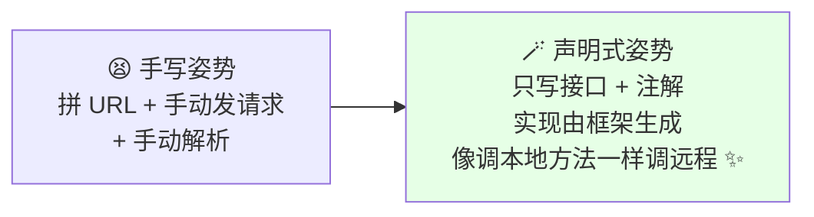
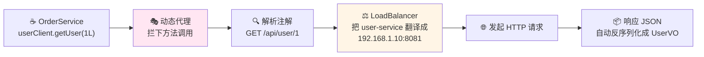
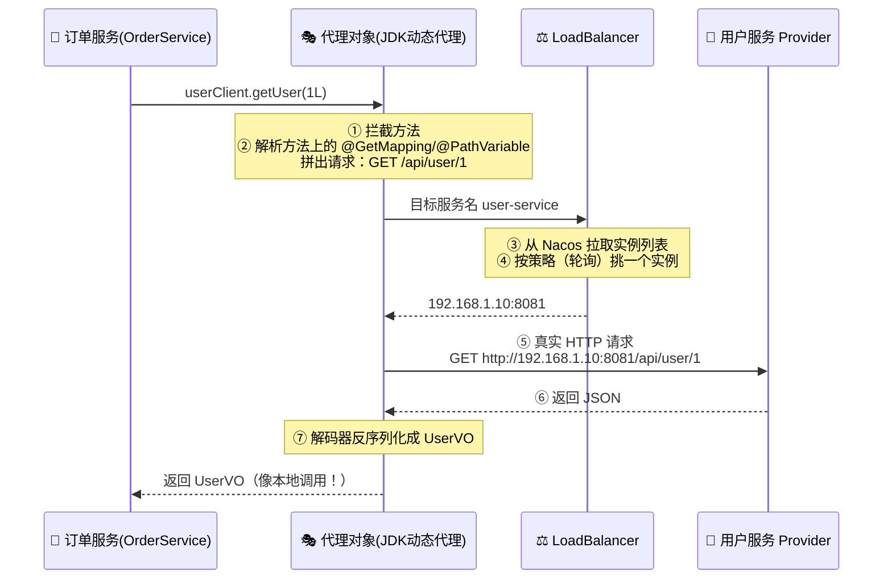
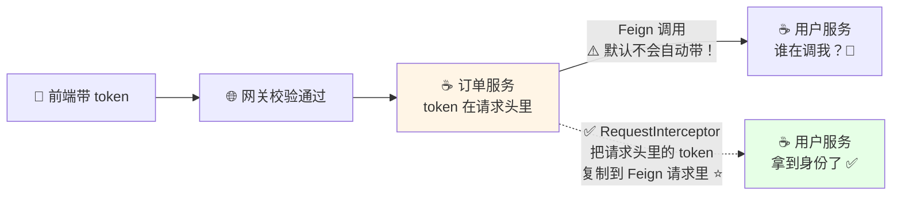
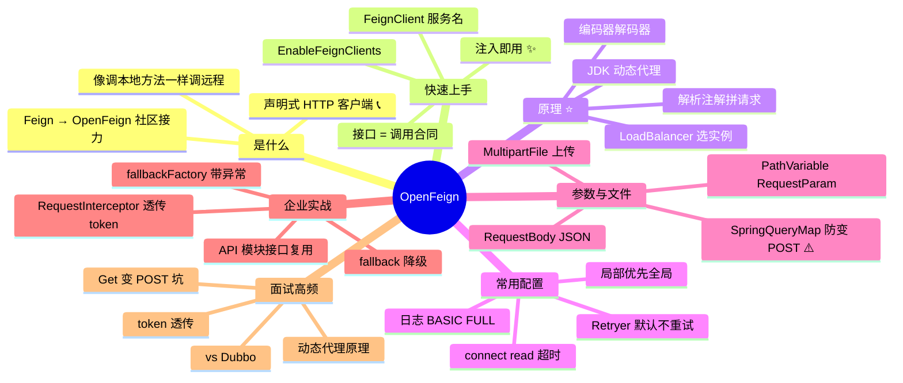

# OpenFeign 声明式调用 从入门到实战 📞

> 欢迎来到 OpenFeign 小课堂！💖 微服务之间要互相调用，用 RestTemplate 手写 URL？`http://user-service/api/user/` + id 拼字符串、解析响应……写一次烦一次 😩！今天的主角 **OpenFeign**——**声明式 HTTP 客户端**：定义一个接口，**像调本地方法一样调远程服务**！学完这篇，接口声明、超时重试、token 透传、降级熔断全拿下～
>
> **学习目标**：
> - 🎯 会用 @FeignClient 三步接通服务间调用
> - 🎯 搞懂动态代理工作原理（面试高频！）
> - 🎯 会配置日志、超时、拦截器透传 token、fallback 降级
> - 🎯 避开 Get 传参变 POST 等经典大坑
>
> **前置知识**：Spring Boot、了解 Nacos 注册中心（SpringCloud 篇～）、LoadBalancer 篇更佳～

---

## 一、为什么需要 OpenFeign？🌱

### 1.1 RestTemplate 的烦恼

```java
// ☕ 传统姿势：手写一切
@Autowired
private RestTemplate restTemplate;

public UserVO getUser(Long id) {
    // URL 硬编码（服务名/路径/参数全靠拼）👇
    return restTemplate.getForObject(
        "http://user-service/api/user/" + id, UserVO.class);
}
// 😩 痛点：URL 散落各处、参数拼接易错、
//    没有接口约定（返回类型靠强制转换）、超时重试自己写……
```

### 1.2 声明式思想：只声明，不实现 🪄



> **OpenFeign** = Spring Cloud 生态的**声明式 HTTP 客户端**：你只负责"声明接口长啥样"（方法名、参数、返回值、URL），**框架在运行时动态生成实现**——底层自动完成：**服务发现 → 负载均衡 → 发 HTTP → 解析响应** 全流程！

### 1.3 演进小史（面试可能问）

| 阶段 | 说明 |
|---|---|
| Feign | Netflix 出品（2016），后来停更 ⚰️ |
| **OpenFeign** ⭐ | Netflix 捐给社区（Spring Cloud OpenFeign），现役主流 |
| Spring 6 @HttpExchange | Spring 自家新声明式 HTTP 客户端（配合 WebClient），新项目可关注 |

---

## 二、快速上手：三步接通 🚀

### 2.1 引依赖 + 开开关

```xml
<!-- ☕ pom.xml（消费方） -->
<dependency>
    <groupId>org.springframework.cloud</groupId>
    <artifactId>spring-cloud-starter-openfeign</artifactId>
</dependency>
```

```java
// ☕ 启动类开启 Feign 客户端扫描
@SpringBootApplication
@EnableFeignClients                 // ⭐ 扫描 @FeignClient 接口并生成代理
public class OrderApplication { ... }
```

### 2.2 定义接口（核心！）

```java
// ☕ 声明：我要调 user-service 的接口（和 Provider 的 Controller 写法神似！）
@FeignClient(value = "user-service")       // value = 注册中心里的服务名
public interface UserClient {

    @GetMapping("/api/user/{id}")          // 路径和 Provider 的 Controller 一致
    UserVO getUser(@PathVariable("id") Long id);

    @PostMapping("/api/user")
    UserVO create(@RequestBody UserCreateDTO dto);

    @GetMapping("/api/user/search")
    List<UserVO> search(@RequestParam("keyword") String keyword);

    @GetMapping("/api/user/me")
    UserVO me(@RequestHeader("Authorization") String token);
}
```

### 2.3 像调本地方法一样使用 ✨

```java
// ☕ OrderService 里直接注入接口用！
@Service
@RequiredArgsConstructor
public class OrderService {

    private final UserClient userClient;      // 注入的是框架生成的"代理对象"

    public OrderVO createOrder(Long userId) {
        UserVO user = userClient.getUser(userId);   // 这一行其实是发了一次 HTTP！🌐
        // 拿到 user 继续下单逻辑……
        return new OrderVO(user.getName());
    }
}
```

> 🎀 就这么简单：**接口一声明、注解一扫、直接调用**——URL 拼接、负载均衡、响应解析全部隐形！

### 2.4 全景流程



---

## 三、工作原理：动态代理揭秘 🧠⭐（面试高频！）

> 疑问：`UserClient` 只是个接口，没写任何实现，`userClient.getUser()` 怎么跑起来的？——**动态代理**（和 RPC 篇手写迷你 RPC 同款套路！）



**一句话原理**：

> `@EnableFeignClients` 扫描接口 → 为每个 `@FeignClient` 接口生成 **JDK 动态代理 Bean** → 调用方法时代理拦截 → **解析注解构建 HTTP 请求** → **LoadBalancer**（默认配合，还记得"LoadBalancer 管室内"那篇吗 😆）选实例 → 发请求 → **解码响应**回填返回值～

**与相关组件分工**：

| 组件 | 职责 |
|---|---|
| OpenFeign | 声明式接口 + 请求构建/发送/解码 |
| Nacos | 提供实例列表（服务发现） |
| LoadBalancer | 从列表里挑一个（负载均衡）⭐ |
| Sentinel/Hystrix（可选） | 熔断降级兜底 |

---

## 四、常用配置：日志与超时 ⏰⭐

### 4.1 日志级别（调试神器！）

```yaml
# ☕ application.yml
feign:
  client:
    config:
      default:                  # default = 全部客户端
        loggerLevel: BASIC      # 日志级别

logging:
  level:
    com.example.client: debug   # ⚠️ 必须配合：接口所在包开 debug 才有效！
```

| 级别 | 打印内容 |
|---|---|
| NONE（默认） | 啥也不打 |
| **BASIC** ⭐ | 请求方法、URL、状态码、耗时 |
| HEADERS | BASIC + 请求/响应头 |
| FULL | 全家桶：+ 请求体/响应体（排错神级，生产慎用） |

### 4.2 超时与重试

```yaml
# ☕ 全局配置
feign:
  client:
    config:
      default:
        connectTimeout: 2000        # 连接超时 2s
        readTimeout: 5000           # 读取超时 5s

# ☕ 只给 user-service 单独配置（局部优先于全局 ⭐）
feign:
  client:
    config:
      user-service:
        readTimeout: 10000          # 这家伙接口慢，给它 10s
```

```java
// ☕ 重试：OpenFeign 默认 NEVER_RETRY（不重试）！
@Bean
public Retryer retryer() {
    return new Retryer.Default(100, TimeUnit.SECONDS.toMillis(1), 3);
    // 参数：首次间隔100ms、最大间隔1s、最多重试3次
}
// ⚠️ 注意：GET 幂等请求才适合重试；POST 重试可能重复下单！
```

---

## 五、参数传递与文件上传 📦⭐

### 5.1 各种参数姿势

```java
@FeignClient("user-service")
public interface UserClient {

    @GetMapping("/api/user/{id}")                     // ① 路径变量
    UserVO getUser(@PathVariable("id") Long id);

    @GetMapping("/api/user/search")                   // ② URL 参数 ?keyword=xx
    List<UserVO> search(@RequestParam("keyword") String kw);

    @PostMapping("/api/user")                         // ③ JSON 请求体 ⭐
    UserVO create(@RequestBody UserCreateDTO dto);

    @GetMapping("/api/user/me")                       // ④ 请求头（token 等）
    UserVO me(@RequestHeader("Authorization") String token);
}
```

### 5.2 Get 传对象：@SpringQueryMap（经典坑！）

```java
// ☕ ⚠️ 直接给 @GetMapping 传对象，Feign 会偷偷变成 POST → Provider 405！
@GetMapping("/api/user/list")
List<UserVO> list(UserQuery query);          // ❌ 大坑！

// ☕ ✅ 正确姿势：@SpringQueryMap 把对象拆成 ?name=x&age=18
@GetMapping("/api/user/list")
List<UserVO> list(@SpringQueryMap UserQuery query);   // 保持 GET ✅
```

### 5.3 文件上传

```java
// ☕ 消费方接口（需要引 feign-form 依赖 或 spring-cloud-starter-openfeign 新版自带支持）
@FeignClient("file-service", configuration = FeignMultipartConfig.class)
public interface FileClient {

    @PostMapping(value = "/upload", consumes = MediaType.MULTIPART_FORM_DATA_VALUE)
    String upload(@RequestPart("file") MultipartFile file);
}

// ☕ 编码器配置
public class FeignMultipartConfig {
    @Bean
    public Encoder feignEncoder(ObjectFactory<HttpMessageConverters> converters) {
        return new SpringFormEncoder(new SpringEncoder(converters));
    }
}
```

---

## 六、拦截器：token 透传 🔑⭐（企业必会！）

> 场景：网关校验完登录，服务 A 调服务 B 时，**B 也需要用户身份**——总不能每个方法都手传 token 吧！



**解法：RequestInterceptor 一处配置，全局生效** ✨

```java
// ☕ Feign 拦截器：自动透传 token（登录态续命神器）
@Component
public class FeignTokenInterceptor implements RequestInterceptor {

    @Override
    public void apply(RequestTemplate template) {
        // 从当前请求的上下文里拿 token（网关放行时带来的）
        ServletRequestAttributes attrs = (ServletRequestAttributes)
                RequestContextHolder.getRequestAttributes();
        if (attrs != null) {
            String token = attrs.getRequest().getHeader("Authorization");
            if (token != null && !token.isBlank()) {
                template.header("Authorization", token);   // 塞进 Feign 请求头 ⭐
            }
        }
    }
}
```

> 💡 现在整个微服务链路的登录态就通了：网关 → 订单服务 → 用户服务 → 下游服务……token 一路自动透传，**业务代码一行都不用改**！异步线程里上下文会丢（可用装饰线程池/手动传参解决）～

---

## 七、降级与熔断：挂了也别炸全链路 🛡️⭐

> 服务 B 挂了/响应超慢，A 的调用线程干等着 → A 也被拖死 → 雪崩！**降级（fallback）**：调不动就返回兜底值，保住主流程～

### 7.1 fallback 基本用法

```java
// ☕ ① 兜底实现类（实现 Feign 接口）
@Component
public class UserClientFallback implements UserClient {

    @Override
    public UserVO getUser(Long id) {
        UserVO vo = new UserVO();
        vo.setName("神秘用户");           // 兜底数据 🛟
        return vo;
    }

    @Override
    public UserVO create(UserCreateDTO dto) {
        throw new BizException("用户服务开小差，请稍后再试～");
    }
}

// ☕ ② 接口上指定 fallback
@FeignClient(value = "user-service",
             fallback = UserClientFallback.class)
public interface UserClient { ... }
```

```yaml
# ☕ ③ 开启熔断（OpenFeign 12+ 基于 Sentinel 等时的开关，spring.cloud.openfeign.circuitbreaker.enabled: true）
spring:
  cloud:
    openfeign:
      circuitbreaker:
        enabled: true
```

### 7.2 fallbackFactory：能看到失败原因（更推荐 ⭐）

```java
@Component
public class UserClientFallbackFactory implements FallbackFactory<UserClient> {

    @Override
    public UserClient create(Throwable cause) {      // 拿到真实异常！
        return new UserClient() {
            @Override
            public UserVO getUser(Long id) {
                log.warn("调用用户服务失败，走降级。原因：{}", cause.getMessage());
                return UserVO.defaultOne();
            }
            // ...其他方法
        };
    }
}

@FeignClient(value = "user-service",
             fallbackFactory = UserClientFallbackFactory.class)   // ⭐
public interface UserClient { ... }
```

| 方式 | 区别 |
|---|---|
| fallback | 简单，但**拿不到异常信息** |
| **fallbackFactory** ⭐ | 能拿到失败原因，方便打日志/告警 |

---

## 八、最佳实践：接口复用（API 模块抽取）🎓

> 痛点：Provider 的 Controller 路径和 Consumer 的 Feign 接口**要手动保持一致**，改一处忘另一处 = 404！**解法：把接口抽到公共模块**～

```text
mall-user-api（公共模块 📦）
 ├── UserClient.java        ← @FeignClient 接口（带 Spring MVC 注解）
 └── dto/UserVO.java        ← 共享 DTO

mall-user（Provider 服务）
 └── UserController implements UserClient   ← 直接实现接口，路径天然一致！✅

mall-order（Consumer 服务）
 └── 直接注入 UserClient 调用               ← 直接依赖 api 模块！✅
```

```java
// ☕ api 模块：接口只写一份
@FeignClient(value = "user-service")
public interface UserClient {
    @GetMapping("/api/user/{id}")
    UserVO getUser(@PathVariable("id") Long id);
}

// ☕ Provider 实现它（Controller 路径自动对齐）
@RestController
@RequiredArgsConstructor
public class UserController implements UserClient {
    private final UserService userService;

    @Override
    public UserVO getUser(Long id) {
        return userService.find(id);
    }
}
```

> ⚠️ **注意**：Provider 依赖了 api 模块，但它**不需要开启** `@EnableFeignClients`（不扫就不生成代理）；Consumer 才开扫描。这样接口只维护一份，路径永远不会对不上啦～

---

## 九、常见坑速查表 🕳️

| 现象/坑 | 原因 | 解法 |
|---|---|---|
| Get + 对象参数变成 POST，Provider 报 405 | Feign 对 POJO 参数默认当请求体 | `@SpringQueryMap` 标注对象参数 ⭐ |
| 启动报 "No Feign Client for lazy" / 找不到 Bean | 忘了 `@EnableFeignClients` 或接口不在扫描包内 | 启动类加注解 / `basePackages` 指定 |
| 404：路径对不上 | Consumer 接口路径和 Provider Controller 不一致 | 用第八章 API 模块统一维护 |
| 传参对方收不到 | `@PathVariable/@RequestParam` 没写 value 且编译没保留参数名 | 显式写 `@PathVariable("id")` ⭐ |
| 超时走的是 Ribbon 老配置/默认太短 | 未显式配置 connectTimeout/readTimeout | yml 显式配（新版在 `spring.cloud.openfeign.*`） |
| 为什么没重试 | OpenFeign 默认 `NEVER_RETRY` | 自定义 `Retryer` Bean（幂等请求才重试） |
| 日志死活不输出 | loggerLevel 配了但包没开 debug | `logging.level.<接口包>: debug` 双保险 ⭐ |
| token 下游拿不到 | Feign 默认不带原请求头 | `RequestInterceptor` 透传 |
| 异步线程里调用丢上下文 | RequestContextHolder 是 ThreadLocal | 装饰线程池/调用前手动透传 |
| 两个接口的 @FeignClient value 一样启动报错 | contextId 冲突 | 加 `contextId = "xxx"` 区分 |
| 内部接口被 Feign 误暴露 | Controller 里的内部方法被复用进 Feign 接口 | 内部接口别塞进共享接口；或 @Hidden（Knife4j 篇讲过 😆） |
| fallback 不生效 | 没开 circuitbreaker / fallback 类没注册成 Bean | 开开关 + @Component ⭐ |

---

## 十、高频面试题速答 🎯

| 问题 | 精简答案 |
|---|---|
| OpenFeign 是什么？和 Feign 什么关系？ | 声明式 HTTP 客户端：接口+注解声明调用，框架生成实现；Feign 是 Netflix 停更的原版，OpenFeign 是社区接力的 Spring Cloud 集成版 |
| OpenFeign 的工作原理？ | @EnableFeignClients 扫描 → 为接口创建 JDK 动态代理 → 调用时解析注解生成 Request → LoadBalancer 从 Nacos 选实例 → HTTP 发送 → 解码器反序列化返回 |
| OpenFeign 底层怎么发 HTTP？负载均衡谁做的？ | 旧版可配 HttpClient/OkHttp，新版默认 java.net HttpClient/JDK；负载均衡由 Spring Cloud LoadBalancer 完成（Ribbon 已退役） |
| 怎么传 token 给下游？ | RequestInterceptor：从 RequestContextHolder 取当前请求头，塞进 RequestTemplate，全局自动透传 |
| fallback 和 fallbackFactory 区别？ | fallback 简单兜底拿不到异常；fallbackFactory 能接收 Throwable，便于日志告警（推荐） |
| Get 请求怎么传对象？ | @SpringQueryMap（拆成 query 参数）；否则 Feign 会转 POST 导致 405 |
| 超时怎么配？优先级？ | 全局 `feign.client.config.default` / 局部 `feign.client.config.<服务名>`，**局部优先**；新版配置前缀 `spring.cloud.openfeign.*` |
| 默认重试几次？ | 默认 `Retryer.NEVER_RETRY` 不重试；自定义 Retryer 时注意只对幂等接口开 |
| 日志级别有哪些？为什么配了不生效？ | NONE/BASIC/HEADERS/FULL；需同时把接口包日志级别调到 debug（Feign 日志走 debug 级别） |
| OpenFeign 和 Dubbo（RPC 篇）怎么选？ | OpenFeign 走 HTTP+JSON，跨语言、穿透网关、简单通用（Spring Cloud 标配）；Dubbo 走私有协议+二进制序列化，性能更高、治理能力强——云原生 HTTP 生态选 Feign，高性能内网调优选 Dubbo |

---

## 十一、知识总结地图 🗺️



> 🎀 **毕业寄语**：OpenFeign 的灵魂就一句——**"接口即合同，声明即调用"**！把第六章 token 拦截器和第七章降级抄进项目，微服务调用的"企业级姿势"就齐活了～ 面试聊原理，**"动态代理 + 解析注解 + LoadBalancer 选实例 + 解码响应"** 四步说出来，配合 RPC 篇的知识融会贯通，服务调用题直接通杀！💪✨
