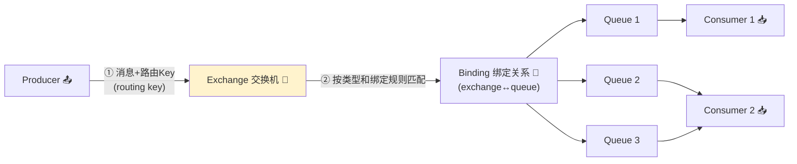
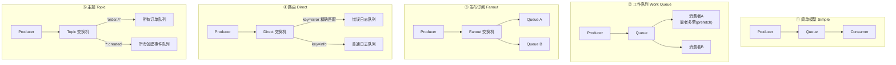
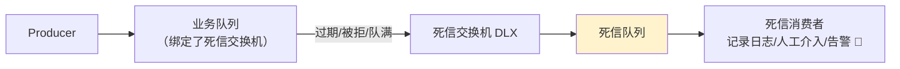
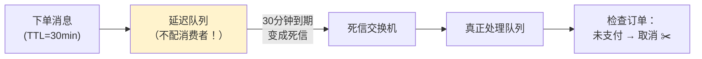
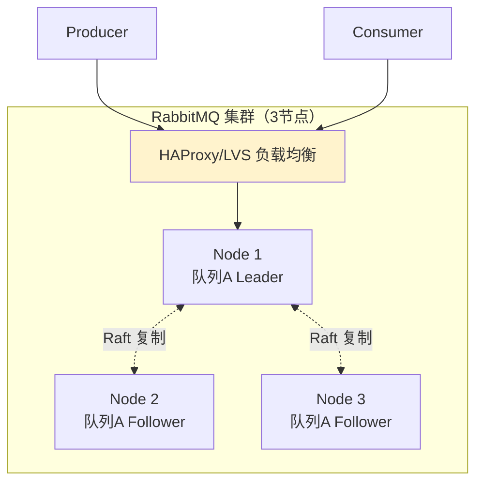
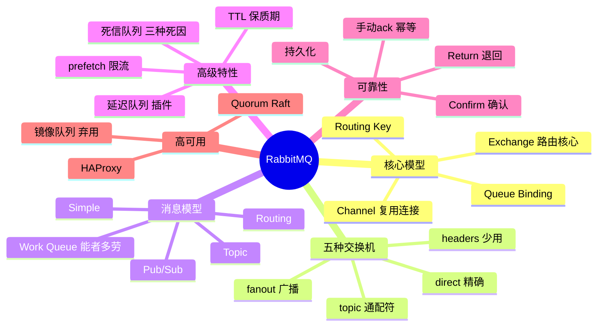

# 🌸 RabbitMQ 超详细教程

> 消息队列界的"灵活胖兔"——**RabbitMQ**！
> 路由玩法最丰富、延迟最低，传统企业级应用的宠儿 🐰～
> 上篇学了 Kafka（吞吐王者），这篇对比着学，双 MQ 技能拉满！

---

## 📖 目录

1. [RabbitMQ 是什么](#一rabbitmq-是什么)
2. [核心概念：AMQP 模型](#二核心概念amqp-模型)
3. [安装与控制台](#三安装与控制台)
4. [Java 客户端实战](#四java-客户端实战)
5. [Spring Boot 整合](#五spring-boot-整合)
6. [五大消息模型与交换机](#六五大消息模型与交换机)
7. [高级特性：TTL 与死信队列](#七高级特性ttl-与死信队列)
8. [延迟队列](#八延迟队列)
9. [消息可靠性保证](#九消息可靠性保证不丢不重)
10. [集群与高可用](#十集群与高可用)
11. [常见问题排查](#十一常见问题排查)
12. [面试高频问题](#十二面试高频问题)
13. [总结](#十三总结)

---

## 一、RabbitMQ 是什么？

### 1.1 一句话定位 🏷️

> **RabbitMQ** 是基于 **AMQP 协议**的开源消息代理（Broker），用 Erlang 编写（天生适合高并发分布式），特点是**路由灵活、延迟低（微秒级）、管理界面友好**。

### 1.2 和 Kafka 再对比一次 🥊

| 对比 | **RabbitMQ** ⭐ | Kafka |
| --- | --- | --- |
| 模型 | **推/拉 路由模型**（Exchange 灵活分发） | 分区日志模型（顺序流） |
| 路由能力 | **超级灵活**（direct/topic/fanout/headers） | 只有 topic 的 key hash 分区 |
| 延迟 | **μs~ms 级** ✅ | ms 级 |
| 吞吐 | 万~十万级 | **百万级** 🚀 |
| 消息留存 | **消费即删除**（默认） | 按保留期存磁盘，可回放 |
| 顺序性 | 单队列 FIFO | 单分区有序 |
| 延迟消息 | 支持（TTL+DLX / 插件） | 不原生支持 |
| 适合 | 业务解耦、复杂路由、低延迟 | 日志、埋点、流处理 |

> 💡 **选择困难症解药**：业务消息路由复杂、要求低延迟 → RabbitMQ；海量数据高吞吐、要回放 → Kafka～
> 很多公司是**两个都要**：业务消息走 Rabbit，日志数据走 Kafka 😎

### 1.3 AMQP 协议核心层 📜

> **AMQP**（Advanced Message Queuing Protocol）：一个开放的**应用层网络协议**，规定了消息的格式与流转规则。RabbitMQ 是它最著名的实现。

---

## 二、核心概念：AMQP 模型 🧠

### 2.1 消息流转全景图（必背 ⭐）



| 概念 | 说明 | 比喻 |
| --- | --- | --- |
| **Broker** | RabbitMQ 服务器 | 整个快递转运中心 🏤 |
| **Virtual Host** | 虚拟主机（权限隔离单元） | 独立的分公司 |
| **Exchange** | 交换机：接收消息，**按规则分发**（不存消息！） | 分拣中心 📮 |
| **Queue** | 队列：真正存消息的地方 | 货架（消息排队等被取）📦 |
| **Binding** | 交换机与队列的绑定关系（可带 binding key） | 分拣规则单 🔗 |
| **Routing Key** | 生产者发送时指定的路由键 | 快递单上的地址 🏷️ |
| **Channel** | 连接里的轻量通道（复用 TCP） | 一个窗口办多件事 🪟 |

> 💡 **核心设计思想**：生产者**从不直接发消息给队列**，永远发给交换机；由交换机按绑定规则路由到队列。这就是 RabbitMQ 路由灵活的根源！

### 2.2 Channel：为什么不用连接直发？🪟

```text
TCP 连接（Connection）：建立/销毁开销大（三次握手 + 认证）
Channel：一条 TCP 连接上的多条轻量"逻辑通道"
  → 一个应用一条 Connection + 多 Channel 并发，省资源 ✅
  → 注意：Channel 不能跨线程共享！
```

---

## 三、安装与控制台 🛠️

### 3.1 Docker 一键起 🐳

```bash
docker run -d --name rabbitmq \
  -p 5672:5672 \          # AMQP 协议端口（客户端用）
  -p 15672:15672 \        # 管理界面端口（浏览器用）
  --hostname my-rabbit \
  rabbitmq:3.13-management   # 带 -management 才有控制台！
```

### 3.2 控制台

```text
http://localhost:15672
账号/密码：guest / guest（仅本机可用）
```

| 控制台标签页 | 干什么 |
| --- | --- |
| Overview | 整体状态：连接数、队列数、消息速率 📊 |
| Connections / Channels | 谁连上来了 |
| **Exchanges** | 管理交换机（新建/绑定/发消息测试） |
| **Queues** | 管理队列（新建/发消息/查堆积/获取消息） |
| Admin | 用户和 Virtual Host 权限管理 👮 |

---

## 四、Java 客户端实战 ☕

原生 `amqp-client` 走一遍（理解原理，实际开发用 Spring Boot 整合）：

```xml
<dependency>
    <groupId>com.rabbitmq</groupId>
    <artifactId>amqp-client</artifactId>
    <version>5.20.0</version>
</dependency>
```

```java
public class NativeDemo {
    public static void main(String[] args) throws Exception {
        // ① 建立连接
        ConnectionFactory factory = new ConnectionFactory();
        factory.setHost("localhost");
        factory.setPort(5672);
        factory.setUsername("guest");
        factory.setPassword("guest");

        try (Connection conn = factory.newConnection();
             Channel channel = conn.createChannel()) {   // ② 开 Channel

            // ③ 声明队列（幂等：已存在不报错）
            channel.queueDeclare("hello.queue", true, false, false, null);

            // ④ 发消息（发到默认交换机，routing key = 队列名直达队列）
            channel.basicPublish("", "hello.queue",
                    MessageProperties.PERSISTENT_TEXT_PLAIN,  // 持久化消息
                    "hello rabbitmq".getBytes());

            // ⑤ 消费消息（开启手动 ack）
            channel.basicConsume("hello.queue", false,
                    (consumerTag, message) -> {
                        System.out.println("收到：" + new String(message.getBody()));
                        // 处理成功才确认
                        channel.basicAck(message.getEnvelope().getDeliveryTag(), false);
                    },
                    consumerTag -> System.out.println("消费者取消"));
        }
    }
}
```

---

## 五、Spring Boot 整合 🌸

### 5.1 依赖与配置

```xml
<dependency>
    <groupId>org.springframework.boot</groupId>
    <artifactId>spring-boot-starter-amqp</artifactId>
</dependency>
```

```yaml
spring:
  rabbitmq:
    host: localhost
    port: 5672
    username: guest
    password: guest
    virtual-host: /
    publisher-confirm-type: correlated      # 生产者确认（异步回调）
    publisher-returns: true                 # 消息路由失败退回
    listener:
      simple:
        acknowledge-mode: manual            # 消费者手动 ack
        prefetch: 1                         # 每次预取几条（限流）
        retry:
          enabled: true
          max-attempts: 3
```

### 5.2 声明交换机与队列（配置类）

```java
@Configuration
public class RabbitConfig {

    public static final String ORDER_EXCHANGE = "order.topic.exchange";
    public static final String ORDER_QUEUE = "order.queue";
    public static final String PAY_QUEUE = "pay.queue";

    @Bean
    public TopicExchange orderExchange() {                    // 主题交换机
        return ExchangeBuilder.topicExchange(ORDER_EXCHANGE)
                .durable(true).build();
    }

    @Bean
    public Queue orderQueue() {
        return QueueBuilder.durable(ORDER_QUEUE).build();
    }

    @Bean
    public Binding orderBinding(Queue orderQueue, TopicExchange ex) {
        return BindingBuilder.bind(orderQueue).to(ex).with("order.#");  // 绑定 key
    }
}
```

### 5.3 发送与监听

```java
@Service
public class OrderMqService {

    @Autowired
    private RabbitTemplate rabbitTemplate;

    /** 发消息：交换机 + 路由键 + 消息 */
    public void sendOrderCreated(String orderId) {
        rabbitTemplate.convertAndSend(RabbitConfig.ORDER_EXCHANGE,
                "order.created",                     // routing key
                orderId,
                msg -> { msg.getMessageProperties()
                          .setMessageId(UUID.randomUUID().toString()); // 幂等用
                          return msg; });
    }
}
```

```java
@Component
@Slf4j
public class OrderListener {

    @RabbitListener(queues = RabbitConfig.ORDER_QUEUE)
    public void onMessage(String body, Message message, Channel channel) throws IOException {
        long tag = message.getMessageProperties().getDeliveryTag();
        try {
            log.info("处理订单消息：{}", body);
            // 业务处理 + 幂等校验 ...
            channel.basicAck(tag, false);              // ✅ 确认
        } catch (Exception e) {
            // ❌ 拒绝：requeue=false → 进死信队列，防止无限重投
            channel.basicNack(tag, false, false);
        }
    }
}
```

---

## 六、五大消息模型与交换机 🎨

### 6.1 五种交换机类型（核心 ⭐）

| 交换机 | 路由规则 | 一句话 |
| --- | --- | --- |
| **direct** | routing key **完全匹配** binding key | 指名道姓派单 🎯 |
| **fanout** | **广播**到所有绑定队列（忽略 key） | 群发通知 📢 |
| **topic** | key **通配符匹配**：`*` 一个词、`#` 零或多词 | 模糊匹配大师 🔍 |
| headers | 按消息头匹配（性能差，少用） | 冷门 |
| default | 无名交换机，key=队列名直达 | 兜底 |

### 6.2 五大消息模型



### 6.3 Topic 通配符示例 🔍

```text
routing key 格式：用 . 分隔的单词，如 order.paid.vip

绑定 key = order.#     → 匹配 order.created / order.paid.vip ✅
绑定 key = *.paid      → 匹配 order.paid / user.paid ✅（* 恰好一个词）
绑定 key = order.*     → 匹配 order.created ✅ / order.paid.vip ❌（两个词）
绑定 key = #           → 匹配一切（相当于 fanout）
```

### 6.4 Work Queue：能者多劳 ⚖️

```yaml
spring:
  rabbitmq:
    listener:
      simple:
        prefetch: 1    # 关键！每次只预取1条，处理完 ack 再拿下一条
                       # 不设置的话轮询分发，快的被慢的拖累
```

---

## 七、高级特性：TTL 与死信队列 ⏰

### 7.1 TTL：消息/队列的保质期 🥛

| 设置方式 | 效果 |
| --- | --- |
| **队列 TTL** | 该队列所有消息统一到期时间（先进先删的坑：队头堵住后面 ⚠️） |
| 消息 TTL | 单条消息独立过期时间 |

```java
// 队列设置 TTL（30 分钟）
@Bean
public Queue ttlQueue() {
    return QueueBuilder.durable("ttl.queue")
            .ttl(30 * 60 * 1000)                          // 消息过期时间
            .deadLetterExchange("dlx.exchange")           // 过期后去哪：死信交换机
            .deadLetterRoutingKey("dead")
            .build();
}

// 单条消息 TTL
rabbitTemplate.convertAndSend("ex", "rk", msg, m -> {
    m.getMessageProperties().setExpiration("10000");      // 10秒
    return m;
});
```

### 7.2 死信队列 DLX：消息的三种死法 💀

消息变成"死信"（Dead Letter）的三种情况：

| 死因 | 场景 |
| --- | --- |
| ① 消息被 reject/nack 且 requeue=false | 消费者处理失败主动拒绝 |
| ② 消息 TTL 过期 | 保质期到了 |
| ③ 队列满（达到 max-length） | 货架塞爆，最老的被挤死 |



```java
// 声明带死信的队列
@Bean
public Queue businessQueue() {
    return QueueBuilder.durable("order.queue")
            .deadLetterExchange("dlx.exchange")     // 指定死信交换机
            .deadLetterRoutingKey("order.dead")     // 死信的路由 key
            .build();
}

// 死信队列照常监听，做兜底处理
@RabbitListener(queues = "dlx.queue")
public void onDeadLetter(String msg) {
    log.error("进入死信队列，人工排查：{}", msg);
}
```

---

## 八、延迟队列 ⏳

RabbitMQ 原生**没有**延迟队列，两种经典实现：

### 方案一：TTL + 死信队列（经典款）



> ⚠️ **致命缺陷**：队列 TTL 只检查**队头**！
> 消息 A（TTL 10分钟）排在消息 B（TTL 30分钟）后面 → B 到期堵着队头，A 到期了也出不去（等 B 走了才被检查）→ 延迟严重不准 ❌
> 解决：**按不同 TTL 建不同队列**（10min 队、30min 队分开）

### 方案二：延迟插件（推荐 ⭐）

```bash
# 安装 rabbitmq_delayed_message_exchange 插件
docker exec my-rabbit rabbitmq-plugins enable rabbitmq_delayed_message_exchange
```

```java
// 声明自定义交换机（x-delayed-type）
@Bean
public CustomExchange delayExchange() {
    Map<String, Object> args = new HashMap<>();
    args.put("x-delayed-type", "direct");          // 底层路由类型
    return new CustomExchange("delay.exchange",
            "x-delayed-message", true, false, args);
}

// 发送时指定延迟毫秒数
rabbitTemplate.convertAndSend("delay.exchange", "delay.key", msg, m -> {
    m.getMessageProperties().setDelay(30 * 60 * 1000);   // 延迟30分钟
    return m;
});
```

| 对比 | TTL+DLX | 延迟插件 |
| --- | --- | --- |
| 依赖 | 原生功能 | 装插件 |
| 精度 | 队头阻塞问题 ⚠️ | 定时器检查，较准 ✅ |
| 灵活度 | 每 TTL 一条队列 | 任意 delay 随便设 ✅ |

---

## 九、消息可靠性保证：不丢、不重 🔒

### 9.1 消息丢失三大环节（和 Kafka 思路一致！）


| 环节 | 丢失原因 | 对策 |
| --- | --- | --- |
| **生产者→交换机** | 网络抖动，发送失败没人知道 | **Publisher Confirm** 确认机制 ✅ |
| **交换机→队列** | routing key 没匹配到队列，消息被丢 | **Publisher Return** 回退 + 备份交换机 |
| **Broker 存储** | 重启内存消息丢失 | **持久化**：交换机 durable + 队列 durable + 消息 deliveryMode=2 |
| **消费者** | 自动 ack：还没处理完就 ack 了，进程崩了 | **手动 ack**：处理成功再 basicAck |

### 9.2 生产者确认代码

```yaml
spring:
  rabbitmq:
    publisher-confirm-type: correlated    # 异步确认（推荐）
    publisher-returns: true               # 路由失败退回
```

```java
@Configuration
public class RabbitConfirmConfig {

    @Bean
    public ApplicationRunner runner(RabbitTemplate rabbitTemplate) {
        return args -> {
            // ① Confirm：消息到底到没到【交换机】
            rabbitTemplate.setConfirmCallback((correlationData, ack, cause) -> {
                if (ack) {
                    System.out.println("消息到达交换机 ✅");
                } else {
                    System.out.println("发送失败，重发/记日志：" + cause);
                }
            });
            // ② Return：到了交换机但【路由不到队列】时回调
            rabbitTemplate.setReturnsCallback(returned ->
                    System.out.println("路由失败：" + returned.getMessage()
                            + " replyText=" + returned.getReplyText()));
        };
    }
}
```

### 9.3 高可靠配置模板（背下来 ⭐）

```text
生产端：publisher-confirm-type=correlated + publisher-returns=true
        + 消息设 messageId（幂等用）
Broker：交换机/队列 durable=true + 消息持久化（默认 deliveryMode=2）
        + 备份交换机（alternate-exchange 兜底路由失败）
消费端：acknowledge-mode=manual + 处理成功再 basicAck
        + 失败 basicNack(requeue=false) 进死信队列
        + 幂等消费（唯一索引/Redis setnx，同 Kafka 篇方案）
```

### 9.4 消费端限流与预取 🎛️

```yaml
spring:
  rabbitmq:
    listener:
      simple:
        prefetch: 10        # 未 ack 消息最多堆积10条/消费者，防被打爆
```

---

## 十、集群与高可用 🏰

### 10.1 三种集群形态

| 形态 | 说明 | 问题 |
| --- | --- | --- |
| **普通集群** | 元数据（队列位置）共享，消息仍在单节点 | 节点挂了队列数据不可用 💤 |
| **镜像队列**（经典方案） | 队列**主从复制**到多节点，主宕从顶 | 性能损耗大，同步阻塞，官方已弃用趋势 ⚠️ |
| **仲裁队列 Quorum** ⭐ | 基于 **Raft** 的队列，多节点强一致 | 3.x 推荐，生产首选 ✅ |



### 10.2 部署要点

```text
① 至少 3 节点（Raft 过半存活）
② 网络分区处理策略：pause_minority（少数派暂停，防脑裂）⭐
③ 前面挂 HAProxy + Keepalived 做负载与 VIP
④ 仲裁队列声明：x-queue-type=quorum
```

```java
@Bean
public Queue quorumQueue() {
    return QueueBuilder.durable("my.quorum.queue")
            .quorum()          // 声明为仲裁队列
            .build();
}
```

---

## 十一、常见问题排查 🩺

### Q1：消息堆积怎么办？📉

```text
① 看消费端：消费者挂了？处理慢（慢SQL/下游慢）？
② 临时扩容消费者实例 + 服务器
③ prefetch 调大提高吞吐（处理快的前提下）
④ 实在扛不住：写临时程序批量取出 → 转存 → 削峰处理
⑤ 控制台 Queues → Get Messages 只用于查看（会消费消息，慎点！）
```

### Q2：消息丢了怎么查？🔍

```text
① 生产端：确认日志（ConfirmCallback 是否 ack=true）
② 交换机路由：ReturnsCallback 有没有触发（routing key 写错很常见！）
③ 持久化：队列是不是 durable、消息 deliveryMode=2
④ 消费端：是不是自动 ack？处理异常有没有被 catch 吞掉
```

### Q3：消息重复消费？

```text
网络抖动导致 ack 丢失 → Broker 重发（至少一次语义，必然存在）
解法 = 消费端幂等（同 Kafka 篇）：
  唯一索引 / messageId + Redis setnx / 业务状态机
```

### Q4：Connection reset / 收不到消息？

```text
① 端口：5672 是 AMQP，15672 是控制台，别搞混 😅
② virtual-host 权限没分配（Admin → 用户 → Virtual Host）
③ @RabbitListener 的队列不存在且未声明（默认不自动创建，先在 Config 声明）
④ 磁盘告警：磁盘剩余 < 阈值时 Broker 会阻塞生产者
```

---

## 十二、面试高频问题 🎯

### Q1：RabbitMQ 的核心概念 / 消息流转？（必背）

> 生产者把消息和 **routing key** 发给 **Exchange（交换机）**；交换机根据 **Binding（与队列的绑定关系）** 和自身类型把消息路由到一个或多个 **Queue**；消费者从队列取消息，处理完发 **ack**。
> 关键：**生产者永远不直接发消息给队列**——这是路由灵活性的根源。

### Q2：五种交换机类型？

> **direct**（key 完全匹配）、**fanout**（广播所有绑定队列，最快）、**topic**（通配符 `*` 一个词 `#` 多词，最常用 ⭐）、headers（按消息头匹配，性能差少用）、default（无名，key=队列名直达）。

### Q3：怎么保证消息不丢失？

> 四道防线：
> ① **生产者确认**：publisher-confirm（到交换机）+ publisher-return（路由到队列）；
> ② **持久化**：交换机/队列 durable + 消息 deliveryMode=2；
> ③ **备份交换机**：路由失败兜底；
> ④ **消费者手动 ack**：处理成功再确认，失败 nack 进死信队列。

### Q4：死信队列是什么？什么时候产生？

> 消息变成死信的三种情况：**① 被消费者 reject/nack 且不重回队列；② TTL 过期；③ 队列达到最大长度被挤掉**。
> 队列声明时指定 `dead-letter-exchange`，死信会重新投递到这个交换机 → 死信队列，用于兜底/重试/人工处理/实现延迟队列。

### Q5：延迟队列怎么实现？

> 两种：
> ① **TTL + 死信队列**：消息到期变死信 → 转投处理队列（注意队列 TTL 的**队头阻塞**缺陷，不同 TTL 分队列）；
> ② **延迟插件 delayed-message-exchange**：发送时设置 `x-delay`，交换机定时投递，精度与灵活度更好 ⭐。

### Q6：RabbitMQ 和 Kafka 区别？（超高频）

> **模型**：Rabbit 是路由模型（Exchange 分发，消费即删）；Kafka 是分区日志（顺序追加，可回放）。
> **吞吐**：Kafka 百万级远超 Rabbit（十万级）；**延迟**：Rabbit 微秒级更低。
> **功能**：Rabbit 有延迟/优先级/灵活路由；Kafka 有流处理生态。
> **选型**：业务消息低延迟复杂路由 → Rabbit；海量日志流处理 → Kafka。

### Q7：消息重复消费怎么解决？

> ack 丢失/重试导致重复不可避免（至少一次语义）→ **消费端幂等**：messageId + Redis setnx、数据库唯一索引、状态机校验。与具体 MQ 无关，思想通用。

### Q8：什么是 prefetch？为什么需要？

> 消费者**预取**的未确认消息数。默认无限预取会一次灌爆消费者；设置 prefetch=N 实现限流 + **能者多劳**（快的多处理），Spring 中 `listener.simple.prefetch`。

### Q9：镜像队列和仲裁队列区别？

> **镜像队列**：经典 HA 方案，主从复制，性能损耗大、脑裂风险，官方逐步弃用；
> **仲裁队列（Quorum）**：基于 **Raft** 共识，多数派写入强一致，3.x 推荐的生产高可用方案。

### Q10：Connection 和 Channel 的关系？

> Channel 是 Connection（TCP）上的**轻量逻辑通道**：TCP 建立销毁昂贵，多线程复用一条 Connection + 各自 Channel 大幅省资源；Channel 非线程安全，一Channel一线程。

---

## 十三、总结 🎓

### 13.1 知识点一张图 🗺️



### 13.2 学习建议 💝

1. **控制台多点一点**：建交换机 → 绑定队列 → 手动发消息观察路由效果，五种交换机玩一遍 🖱️
2. **抓一条主线**：**生产者 → 交换机 → 绑定 → 队列 → 消费者 ack**，所有高级特性都是围着它转
3. **必练两个实战**：手动 ack + 死信兜底、延迟队列（先 TTL+DLX 后插件版）
4. **面试四大件**：消息流转、不丢消息、死信/延迟、vs Kafka——和 Kafka 篇对照着背，双倍战力 ⚔️

---

> 🌸 **恭喜你把 RabbitMQ 学透啦！**
> 记住灵魂口诀：**生产者只管发交换机，路由全看绑定关系，可靠性四道防线** 🐰～
> 系列：SpringCloud → Nacos → Gateway → Sentinel → Seata → Netty → Kafka → RabbitMQ ✅
> 下一篇想学 Redis、RocketMQ、Zookeeper 还是 JVM？随时点单哦 💪✨
