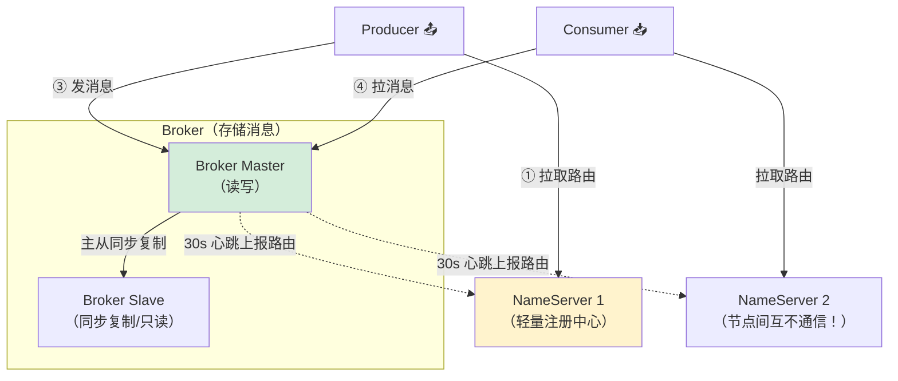
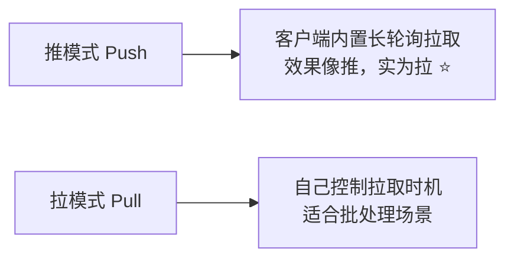
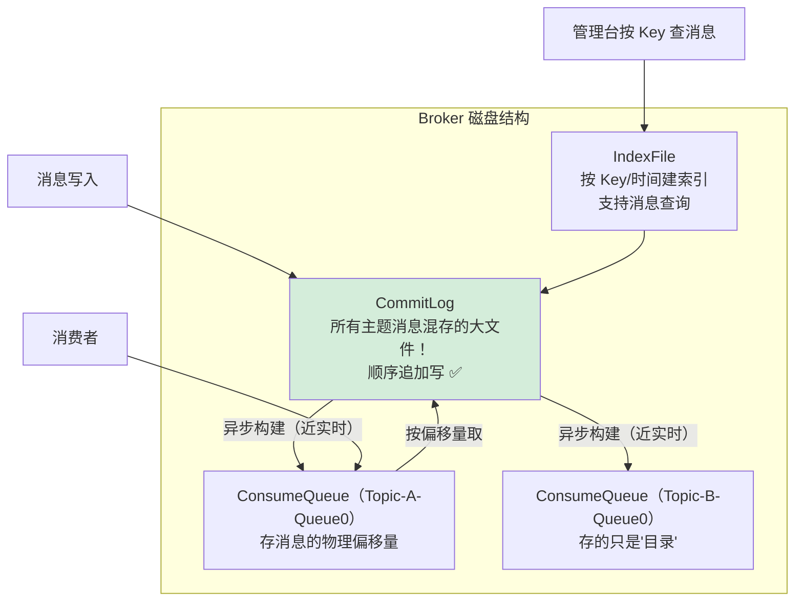
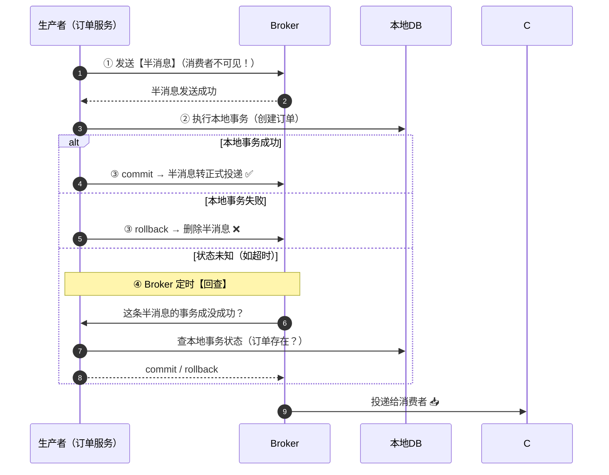
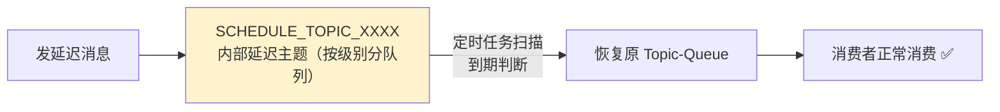
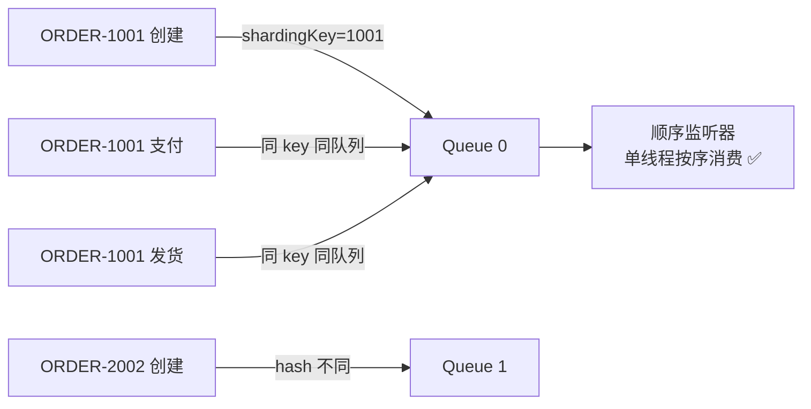
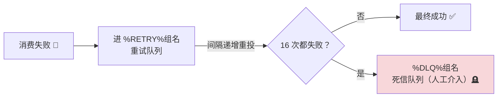
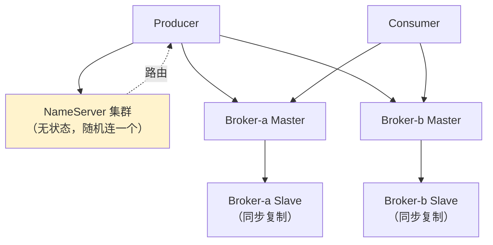
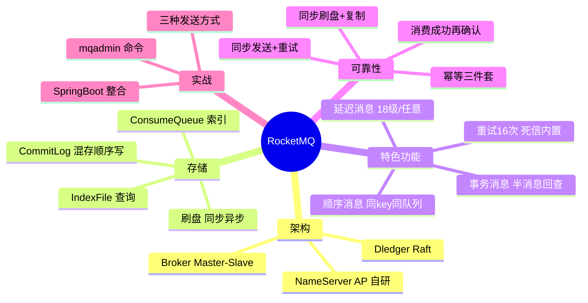

# 🌸 RocketMQ 超详细教程

> MQ 三兄弟的最后一位——**RocketMQ**！
> 阿里出品、Java 编写，**事务消息、延迟消息、重试机制**全是它的高招 💎～
> 前面学了 Kafka（吞吐）和 Rabbit（路由），这集凑齐三件套！

---

## 📖 目录

1. [RocketMQ 是什么](#一rocketmq-是什么)
2. [架构与核心概念](#二架构与核心概念)
3. [安装与命令](#三安装与命令)
4. [Java 客户端实战](#四java-客户端实战)
5. [Spring Boot 整合](#五spring-boot-整合)
6. [消息发送三种方式](#六消息发送三种方式)
7. [存储机制：CommitLog](#七存储机制commitlog)
8. [事务消息](#八事务消息)
9. [延迟消息](#九延迟消息)
10. [顺序消息](#十顺序消息)
11. [消息重试与死信队列](#十一消息重试与死信队列)
12. [可靠性保证与集群](#十二可靠性保证与集群)
13. [常见问题排查](#十三常见问题排查)
14. [面试高频问题](#十四面试高频问题)
15. [总结](#十五总结)

---

## 一、RocketMQ 是什么？

### 1.1 一句话定位 🏷️

> **RocketMQ** 是阿里开源的分布式消息中间件（Java 编写，源自淘宝"去 IOE"运动，经受双十一万亿级消息考验），后捐赠给 Apache 顶级项目。
> 特点：**功能丰富（事务/延迟/重试）+ 吞吐高 + Java 技术栈友好**。

### 1.2 三大 MQ 终极对比 🥊

| 对比 | RocketMQ ⭐ | Kafka | RabbitMQ |
| --- | --- | --- | --- |
| 出身/语言 | 阿里 / Java ✅ | LinkedIn / Scala+Java | Erlang |
| 吞吐量 | 十万级 | **百万级** 🚀 | 万级 |
| 延迟 | ms 级 | ms 级 | **μs 级** |
| **事务消息** | **支持**（半消息+回查）✅ 独门绝技 | 弱（幂等生产者） | 不支持 |
| **延迟消息** | **原生支持** ✅ | 不支持 | TTL+DLX / 插件 |
| **消息重试** | **自动重试 16 次** ✅ | 不自动 | 不自动 |
| 死信队列 | **内置** ✅ | 手动实现 | TTL/拒绝触发 |
| 消息回溯 | 支持（按时间） | 支持（offset） | 不支持（消费即删） |
| 架构依赖 | **无外部依赖**（NameServer 自研） | KRaft / ZK | 自身集群 |
| 适合 | **电商业务消息** 💰 | 日志/流处理 | 复杂路由低延迟 |

> 💡 **选型口诀**：业务消息（下单、支付、超时取消）→ RocketMQ；数据管道（日志、埋点）→ Kafka；小系统灵活路由 → RabbitMQ～

---

## 二、架构与核心概念 🏗️

### 2.1 整体架构图（必背 ⭐）



### 2.2 核心概念对照表 📋

| 概念 | 说明 | 对比 Kafka |
| --- | --- | --- |
| **NameServer** | 路由注册中心（无状态、节点独立、**AP**） | 类似 KRaft/ZK，但更轻 |
| **Broker** | 消息存储与转发服务器 | Broker |
| **Topic** | 消息类别 | Topic |
| **MessageQueue** | Topic 的分区（队列） | Partition |
| **Producer Group** | 生产者组（事务回查用） | 无 |
| **Consumer Group** | 消费者组（集群/广播模式） | Consumer Group |
| **Tag** | 消息二级标签（过滤用） | 无（key 过滤） |
| **ConsumeOffset** | 消费进度 | offset |

### 2.3 两种消费模式 🎛️

| 模式 | 行为 | 对应 |
| --- | --- | --- |
| **CLUSTERING**（默认） | 组内分摊，每条消息组内只消费一次 | Kafka 组内竞争 |
| **BROADCASTING** | 组内每个消费者都消费全量 | Kafka 不同组 / Rabbit 广播 |

### 2.4 两种消费方式



> 💡 RocketMQ 的"推"其实是**长轮询拉**（和 Nacos 配置热更新同款思想）：服务端没有新消息就 hold 住，有了立刻返回——兼顾实时性和吞吐！

---

## 三、安装与命令 🛠️

### 3.1 本地启动（Windows）

```bash
# ① 启动 NameServer（监听 9876）
mqnamesrv.cmd

# ② 启动 Broker（连接 NameServer）
mqbroker.cmd -n localhost:9876

# ③ 验证：查看集群状态
mqadmin.cmd clusterList -n localhost:9876
```

> 💡 注意配置 `ROCKETMQ_HOME` 环境变量；内存不够的话改 `runserver.cmd/runbroker.cmd` 里的 JVM 参数（默认给的特别大 😅）

### 3.2 常用 mqadmin 命令

```bash
# 创建主题（8 个队列）
mqadmin updateTopic -n localhost:9876 -c DefaultCluster -t order-topic -r 8 -w 8

# 查看主题列表 / 状态 / 路由
mqadmin topicList -n localhost:9876
mqadmin topicStatus -n localhost:9876 -t order-topic
mqadmin topicRoute -n localhost:9876 -t order-topic

# 查询消息堆积 / 消费进度
mqadmin consumerProgress -n localhost:9876 -g my-consumer-group
```

---

## 四、Java 客户端实战 ☕

```xml
<dependency>
    <groupId>org.apache.rocketmq</groupId>
    <artifactId>rocketmq-client</artifactId>
    <version>5.1.4</version>
</dependency>
```

```java
public class RocketDemo {
    public static void main(String[] args) throws Exception {
        // ========== 生产者 ==========
        DefaultMQProducer producer = new DefaultMQProducer("my-producer-group");
        producer.setNamesrvAddr("localhost:9876");
        producer.start();

        Message msg = new Message(
                "order-topic",                     // 主题
                "TagA",                            // 标签（过滤用）
                "ORDER-1001".getBytes(StandardCharsets.UTF_8));
        msg.setKeys("order-1001");                 // 业务 key（查询去重用）

        SendResult result = producer.send(msg);    // 同步发送
        System.out.println("发送结果：" + result.getSendStatus());
        producer.shutdown();

        // ========== 消费者 ==========
        DefaultMQPushConsumer consumer = new DefaultMQPushConsumer("my-consumer-group");
        consumer.setNamesrvAddr("localhost:9876");
        consumer.subscribe("order-topic", "TagA || TagB");   // 按 Tag 过滤
        consumer.registerMessageListener((MessageListenerConcurrently) (msgs, context) -> {
            for (MessageExt m : msgs) {
                System.out.println("收到：" + new String(m.getBody()));
            }
            return ConsumeConcurrentlyStatus.CONSUME_SUCCESS;   // 消费成功
            // 失败返回 RECONSUME_LATER → 自动重试（第十一章）
        });
        consumer.start();
    }
}
```

---

## 五、Spring Boot 整合 🌸

### 5.1 依赖与配置

```xml
<dependency>
    <groupId>org.apache.rocketmq</groupId>
    <artifactId>rocketmq-spring-boot-starter</artifactId>
    <version>2.3.0</version>
</dependency>
```

```yaml
rocketmq:
  name-server: localhost:9876
  producer:
    group: order-producer-group
    send-message-timeout: 3000
    retry-times-when-send-failed: 3      # 同步发送失败重试次数
```

### 5.2 发送与监听

```java
@Service
public class OrderMqService {

    @Autowired
    private RocketMQTemplate rocketMQTemplate;

    /** 普通消息：topic:tag 格式 */
    public void sendOrderCreated(String orderId) {
        OrderMsg msg = new OrderMsg(orderId, "CREATED");
        SendResult result = rocketMQTemplate.syncSend(
                "order-topic:TagA",                    // destination = topic:tag
                MessageBuilder.withPayload(msg)
                        .setHeader(RocketMQHeaders.KEYS, orderId)  // 消息 key
                        .build());
        log.info("发送状态：{}", result.getSendStatus());
    }

    /** 延迟消息：下单 30 分钟后检查支付（第十一章展开） */
    public void sendOrderDelayCheck(String orderId) {
        Message<String> msg = MessageBuilder.withPayload(orderId).build();
        rocketMQTemplate.syncSend("order-check-topic", msg, 3000, 5);  // level 5 = 1分钟
    }
}
```

```java
@Component
@Slf4j
@RocketMQMessageListener(
        topic = "order-topic",
        consumerGroup = "order-consumer-group",
        selectorExpression = "TagA || TagB",     // tag 过滤
        maxReconsumeTimes = 5)                    // 最大重试次数
public class OrderListener implements RocketMQListener<OrderMsg> {

    @Override
    public void onMessage(OrderMsg msg) {
        // 方法正常返回 = 消费成功；抛异常 = 自动重试！
        log.info("处理订单消息：{}", msg.getOrderId());
        // 幂等校验（同前两篇）...
    }
}
```

---

## 六、消息发送三种方式 📤

| 方式 | 说明 | 场景 |
| --- | --- | --- |
| **同步 syncSend** | 阻塞等 Broker 确认 | 重要通知（下单成功）⭐ |
| **异步 asyncSend** | 回调通知结果 | 链路耗时敏感、流量大 |
| **单向 sendOneway** | 发完不管，无确认 | 日志埋点（丢了无所谓） |

```java
// 异步发送
rocketMQTemplate.asyncSend("order-topic", msg, new SendCallback() {
    @Override public void onSuccess(SendResult result) { log.info("成功 ✅"); }
    @Override public void onException(Throwable e) { log.error("失败重发", e); }
});

// 单向发送
rocketMQTemplate.sendOneWay("log-topic", logMsg);
```

---

## 七、存储机制：CommitLog 💾

### 7.1 三层文件结构（核心 ⭐）



| 文件 | 作用 | 类比 |
| --- | --- | --- |
| **CommitLog** | **所有消息统一顺序写**这一个文件（1G/个滚动） | 图书馆的"总入库流水账" 📖 |
| **ConsumeQueue** | 每个 Topic-Queue 一个逻辑队列，只存 commitlog offset（索引） | 每类书的"书架目录卡" 🗂️ |
| **IndexFile** | Key/时间哈希索引 | 检索用的"索引柜" 🔍 |

> 🌟 **设计精髓（面试加分）**：
> Kafka 是**每个分区独立文件**（多文件顺序写）；RocketMQ 是**单 CommitLog 混存**（**单文件顺序写**，写入更快、崩溃恢复更简单），再靠 ConsumeQueue 做逻辑分区索引——**牺牲一点读性能换写性能**！

### 7.2 刷盘策略 ⚡

| 策略 | 流程 | 可靠/性能 |
| --- | --- | --- |
| **同步刷盘 SYNC_FLUSH** | 消息落盘成功才返回 ack | 最高（金融） |
| **异步刷盘 ASYNC_FLUSH**（默认） | 写入 PageCache 就返回，后台定时刷盘 | 高性能，宕机可能丢少量 |

### 7.3 主从复制

| 模式 | 说明 |
| --- | --- |
| **同步复制 SYNC_MASTER** | Master 等 Slave 也写成功才 ack（不丢） |
| **异步复制 ASYNC_MASTER** | Master 自己成功就 ack（默认，性能好） |

> 💡 传统 Master/Slave **从不能自动升主**（主挂需人工/Dledger 解决），5.x 推荐 **Controller + 自动主从切换**～

---

## 八、事务消息 🎭（独门绝技！⭐）

### 8.1 解决什么问题？

**本地事务 + 发消息 的原子性**：扣款成功消息没发出去？消息发了扣款失败？——两难！

### 8.2 半消息 + 回查机制（原理必背）



### 8.3 代码实现

```java
/** 事务消息生产者 */
@Service
public class OrderTxProducer {

    @Autowired
    private RocketMQTemplate rocketMQTemplate;

    public void createOrder(OrderDTO dto) {
        Message<OrderMsg> msg = MessageBuilder
                .withPayload(new OrderMsg(dto.getOrderId()))
                .build();
        // 发送事务消息
        rocketMQTemplate.sendMessageInTransaction(
                "order-tx-topic:TagA", msg, dto);
    }
}

/** 本地事务 + 回查逻辑 */
@RocketMQTransactionListener
public class OrderTxListener implements RocketMQLocalTransactionListener {

    @Autowired private OrderMapper orderMapper;

    /** 执行本地事务 */
    @Override
    public RocketMQLocalTransactionState executeLocalTransaction(
            Message msg, Object arg) {
        OrderDTO dto = (OrderDTO) arg;
        try {
            orderMapper.insert(buildOrder(dto));     // 本地事务：建订单
            return RocketMQLocalTransactionState.COMMIT;
        } catch (Exception e) {
            return RocketMQLocalTransactionState.ROLLBACK;
        }
    }

    /** Broker 回查：本地事务到底成没成功？ */
    @Override
    public RocketMQLocalTransactionState checkLocalTransaction(Message msg) {
        String orderId = getOrderKey(msg);
        // 查库：订单存在 → commit；不存在 → rollback
        return orderMapper.exists(orderId)
                ? RocketMQLocalTransactionState.COMMIT
                : RocketMQLocalTransactionState.ROLLBACK;
    }
}
```

> 💡 本质：**最终一致**（不是强一致）——本地事务先落地，消息保证最终一定投递（靠回查兜底）。
> 对比 Seata 的强一致方案，事务消息适合**允许异步**的业务链路～

---

## 九、延迟消息 ⏳

### 9.1 固定级别（4.x 经典）

```java
// 18 个固定级别：1s 5s 10s 30s 1m 2m 3m 4m 5m 6m 7m 8m 9m 10m 20m 30m 1h 2h
// level: 1    2   3   4   5  ...
Message msg = new Message("order-check-topic", "ORDER-1001".getBytes());
msg.setDelayTimeLevel(16);        // 级别16 = 30分钟（下单超时检查经典用法）

// Spring 写法：syncSend(topic, msg, timeout, delayLevel)
rocketMQTemplate.syncSend("order-check-topic", msg, 3000, 16);
```

### 9.2 工作原理



### 9.3 5.x 任意时间延迟

```java
// 5.x 支持任意时间戳（默认最长 3 天）
msg.setDeliverTimeTs(System.currentTimeMillis() + 5 * 60 * 1000);  // 5分钟后
```

| 对比 | RocketMQ 延迟 | RabbitMQ 延迟 |
| --- | --- | --- |
| 实现 | 内部 SCHEDULE_TOPIC + 定时轮（原生） | TTL+DLX 或插件 |
| 精度 | 4.x 固定18档 / 5.x 任意 ✅ | 插件较准 |
| 易用性 | **开箱即用** ✅ | 要拼装 |

---

## 十、顺序消息 🔢

### 10.1 原理：和 Kafka 同款思想

**局部有序**：同一业务 key（同一订单）的消息发到**同一个 MessageQueue**，单线程消费。

```java
// 生产端：按订单ID选队列（MessageQueueSelector）
rocketMQTemplate.syncSendOrderly(
        "order-topic",
        msg,
        orderId);          // 分片键：同 orderId → 同队列 ✅

// 消费端：必须用顺序监听（MessageListenerOrderly，单线程逐条）
@RocketMQMessageListener(topic = "order-topic", consumerGroup = "order-seq-group")
public class OrderSeqListener implements RocketMQListener<OrderMsg> { ... }
```



### 10.2 注意事项 ⚠️

```text
① 生产端重试可能乱序（maxAttempt 次失败换队列）→ 顺序场景关闭生产重试
② Broker 宕机队列减少 → 精简后顺序可能短暂错乱
③ 消费失败不能跳过（会阻塞当前队列重试到成功）
```

---

## 十一、消息重试与死信队列 🔁

### 11.1 自动重试（RocketMQ 招牌功能 ⭐）

消费者抛异常/返回 `RECONSUME_LATER` → **自动重投**，间隔递增：

```text
重试间隔：10s 30s 1m 2m 3m 4m 5m 6m 7m 8m 9m 10m 20m 30m 1h 2h
第1次...第16次（共16次）
```



### 11.2 死信队列特点

| 特性 | 说明 |
| --- | --- |
| 命名 | `%DLQ%消费者组名` 自动创建 |
| 有效期 | 同正常消息 72 小时（过期删除，**及时处理！**） |
| 处理 | 控制台查死信 → 排查原因 → 重发（mqadmin resend）或人工补偿 |

### 11.3 与 RabbitMQ/Kafka 重试对比

| | RocketMQ | RabbitMQ | Kafka |
| --- | --- | --- | --- |
| 自动重试 | ✅ 16次内置 | ❌ 需自己实现（重试队列） | ❌ 自己写 |
| 死信队列 | ✅ 内置 | ✅（需手动绑定DLX） | ❌ 自己建 topic |

---

## 十二、可靠性保证与集群 🏰

### 12.1 不丢消息配置（对照前两篇背 ⭐）

```text
生产端：同步发送（syncSend）+ retry-times-when-send-failed=3
        + 检查 SendStatus == SEND_OK
Broker：同步刷盘（SYNC_FLUSH）+ 同步复制（SYNC_MASTER / Dledger）
消费端：处理成功才返回 CONSUME_SUCCESS（消费重试自动兜底）
幂等：  唯一索引 / Redis setnx / 状态机（三件套通用）
```

### 12.2 集群模式

| 模式 | 说明 | 评价 |
| --- | --- | --- |
| 多 Master | 全主无备 | 性能好，单点挂了那部分消息暂不可用 |
| 多主多从-异步复制 | 主写从异步抄 | 性能好，主宕极小概率丢 |
| 多主多从-同步复制 | 主写从同步确认 | 不丢，但同步延迟拖慢写入 |
| **Dledger / Controller** ⭐ | 基于 **Raft** 自动选主复制 | 5.x 主推：主宕秒级自动切 ✅ |



> 💡 Topic 的多个 Queue 分布在不同 Broker：**Broker 挂了只影响部分队列**，写成功的部分继续服务～

---

## 十三、常见问题排查 🩺

### Q1：发消息报 `No route info of this topic`

```text
① Topic 没创建且 autoCreateTopicEnable=false → 手动建或开启自动创建
② NameServer 地址配错（端口 9876）
③ Broker 没注册上（Broker 心跳 30s 一次，刚启动稍等）
```

### Q2：消费消息延迟/堆积？

```text
① consumerProgress 看各 Queue 堆积量
② 加消费者实例（≤Queue 数！同 Kafka）
③ 扩队列：mqadmin updateTopic -r 16 -w 16
④ 监听器里有没有慢操作（DB/远程调用）拖慢单线程
```

### Q3：消息重复？

```text
重试机制的必然结果（至少一次）→ 消费端幂等三件套
（RocketMQ 可用 msgId + 业务 key 双保险去重）
```

### Q4：事务消息一直没投递？

```text
① 半消息 commit 了吗？（executeLocalTransaction 返回值）
② 回查抛异常了？checkLocalTransaction 里别抛，返回 UNKNOWN 会持续回查
③ 回查默认15次仍 UNKNOWN → 丢弃（log 报错），注意保证回查逻辑轻量可靠
```

---

## 十四、面试高频问题 🎯

### Q1：RocketMQ 架构？（必背）

> **NameServer**（无状态注册中心，节点独立不通信，AP）+ **Broker**（存消息，Master/Slave，30s 心跳上报路由）+ **Producer/Consumer**（客户端从 NameServer 拉路由直连 Broker 收发）。
> 客户端本地缓存路由定时更新——NameServer 短暂全挂不影响已缓存的收发。

### Q2：为什么 RocketMQ 不用 ZooKeeper？

> ① ZK 强一致（CP），MQ 场景**可用性优先**；② ZK 在大规模注册时性能抖动；③ NameServer 极轻量、彼此独立、无状态，部署运维简单——为 AP 放弃强一致的架构选择 ⭐

### Q3：RocketMQ 存储结构？（超高频）

> **CommitLog**：所有主题消息混存的单文件顺序写（1G 滚动）；
> **ConsumeQueue**：每个 Topic-Queue 的逻辑索引（存 commitlog offset）；
> **IndexFile**：Key/时间哈希索引，支持消息查询。
> 精髓：**写靠单 CommitLog 顺序写，读靠 ConsumeQueue 索引**——对比 Kafka 每分区独立文件。

### Q4：事务消息原理？

> 两阶段 + 回查：
> ① 生产者发**半消息**（对消费者不可见）；
> ② 执行本地事务，返回 commit/rollback；
> ③ 状态未知时 **Broker 定时回查**生产者（查本地事务状态），最多15次；
> commit 后消息才真正投递。本质是**最终一致**，适合异步业务链路。

### Q5：延迟消息原理？

> 消息先投到内部主题 `SCHEDULE_TOPIC_XXXX`（按级别分队列），**定时任务扫描**到期消息恢复原 Topic 投递。
> 4.x 固定 18 个级别；5.x 支持任意时间戳。

### Q6：顺序消息怎么保证？

> **局部有序**：生产端 `MessageQueueSelector` 按业务 key（订单ID）哈希选队列（同 key 同队列）；消费端用 `MessageListenerOrderly` 单线程逐条消费；注意失败重试会阻塞当前队列（顺序 vs 可用性的取舍）。

### Q7：重试和死信机制？

> 消费失败自动重投，间隔 10s→2h 递增，**最多16次**；期间消息在 `%RETRY%组名` 队列；16 次失败进死信队列 `%DLQ%组名`（保留72h），需人工/监控介入。对比：Rabbit 要自己搭重试队列，Kafka 完全 DIY。

### Q8：RocketMQ vs Kafka？

> **存储**：Rocket 单 CommitLog 顺序写+索引 vs Kafka 分区文件顺序写；
> **功能**：Rocket 有事务/延迟/重试/死信/回溯 vs Kafka 精简；
> **吞吐**：Kafka 百万级更高（零拷贝+批量更极致）；
> **依赖**：Rocket 自研 NameServer 无外部依赖；
> **选型**：电商业务消息 → Rocket，数据管道 → Kafka。

### Q9：刷盘和复制策略？

> **刷盘**：同步（落盘才 ack，不丢、慢）vs 异步（PageCache 就 ack，快、可能丢少量）；
> **复制**：同步复制（主从都写成功才 ack）vs 异步（主好就行）。
> 金融级 = 同步刷盘 + 同步复制（Dledger）。

### Q10：Push 消费为什么其实是拉？

> RocketMQ Push 模式内部是**长轮询 Pull**：Consumer 发拉请求，Broker 无消息则 hold 挂起，有消息立刻返回——既实时又不空轮询，兼顾性能与低延迟（和 Nacos 配置长轮询、Netty 心跳设计异曲同工 ⭐）。

---

## 十五、总结 🎓

### 15.1 知识点一张图 🗺️



### 15.2 学习建议 💝

1. **本地跑通收发**：NameServer + Broker + 控制台（rocketmq-dashboard），消息流转眼见为实 🖱️
2. **三大独门绝技各练一次**：事务消息（下单场景）、延迟消息（超时关单）、顺序消息（订单状态机）
3. **存储结构画三遍**：CommitLog / ConsumeQueue / IndexFile 关系图，面试画出来直接加分 ✍️
4. **三 MQ 对照背**：不丢消息三板斧 + 幂等三件套完全通用，差异在功能特性（事务/延迟/重试）——一表记三家 💪

---

> 🌸 **恭喜你把 RocketMQ 学透啦！MQ 三兄弟集齐 🎉**
> 记住灵魂口诀：**NameServer 轻注册、CommitLog 顺序写、事务半消息、重试十六次** 🚀～
> 系列：SpringCloud → Nacos → Gateway → Sentinel → Seata → Netty → Kafka → RabbitMQ → RocketMQ ✅
> 下一篇想学 Redis、Zookeeper 还是 JVM？随时点单哦 💪✨
