# 🌸 Seata 超详细教程

> 微服务系列最后一座大山——**Seata 分布式事务**！
> 跨服务的转账、下单再也不怕"钱扣了货没发"啦，一起来搞定它 💪～

---

## 📖 目录

1. [为什么需要分布式事务](#一为什么需要分布式事务)
2. [分布式事务理论储备](#二分布式事务理论储备)
3. [Seata 架构：三大角色](#三seata-架构三大角色)
4. [四种事务模式总览](#四四种事务模式总览)
5. [AT 模式：一阶段提交的魔法](#五at-模式一阶段提交的魔法)
6. [AT 模式实战](#六at-模式实战)
7. [AT 模式原理深入](#七at-模式原理深入undo_log-与全局锁)
8. [TCC 模式实战](#八tcc-模式实战三段式手写)
9. [Saga 与 XA 模式](#九saga-与-xa-模式)
10. [TC Server 高可用部署](#十tc-server-高可用部署)
11. [常见问题排查](#十一常见问题排查)
12. [面试高频问题](#十二面试高频问题)
13. [总结](#十三总结)

---

## 一、为什么需要分布式事务？

### 1.1 单体时代的好日子 😌

单体应用里，一个 `@Transactional` 搞定一切：

```java
@Transactional   // 万一失败，全部回滚，稳！
public void createOrder() {
    orderMapper.insert(order);      // 建订单
    stockMapper.deduct(stockId);    // 扣库存
    accountMapper.deduct(userId);   // 扣钱
}
```

### 1.2 微服务时代的噩梦 😱

拆成微服务后，每个服务**各自连自己的数据库**，本地事务鞭长莫及：

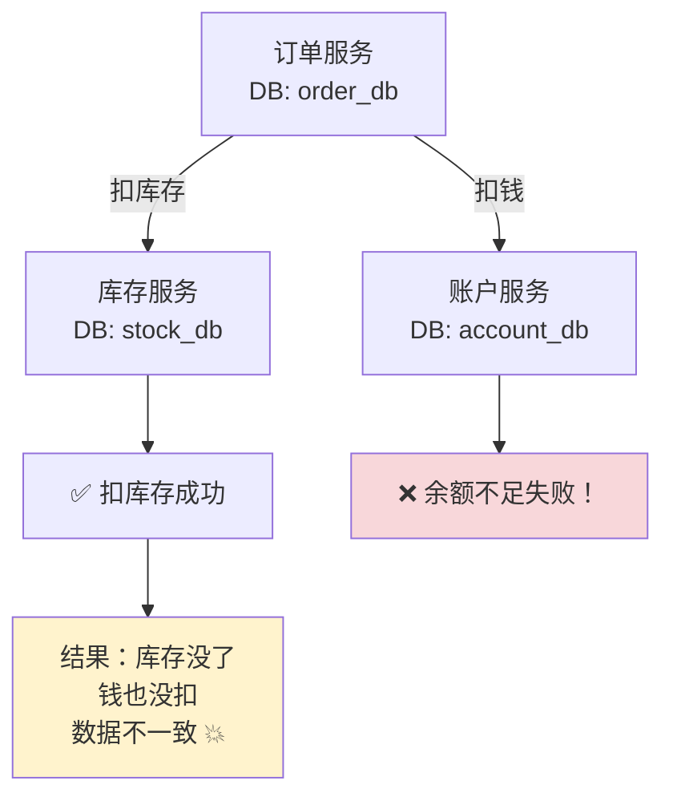

> 💡 本地事务只能管**自己库里**的事，跨库、跨服务的"要么全成，要么全败"就需要**分布式事务**！

### 1.3 常见解决方案家族 👨‍👩‍👧‍👦

| 方案 | 一致性 | 侵入性 | 一句话 |
| --- | --- | --- | --- |
| **2PC/XA** | 强一致 | 低 | 协调者统一问"能提交吗"，阻塞、性能差 |
| **TCC** | 最终一致 | 高 | 手写 Try/Confirm/Cancel 三步 |
| **Saga** | 最终一致 | 中 | 长事务拆小步 + 逆向补偿 |
| **本地消息表** | 最终一致 | 中 | 业务和消息同库写入，异步投递保证最终到达 |
| **MQ 事务消息** | 最终一致 | 中 | RocketMQ 半消息 + 回查 |
| **Seata** | 最终/强一致 | **AT 模式几乎零侵入** ✅ | 本篇主角！ |

---

## 二、分布式事务理论储备 📚

### 2.1 CAP 定理

```text
C（Consistency 一致性）  ：所有节点数据时刻一致
A（Availability 可用性） ：每个请求都能得到响应
P（Partition 分区容错）  ：网络分区时系统仍能运行
```

> 💡 网络分区在分布式里**无法避免**（P 必选），所以只能在 **C 和 A 之间二选一**：
> 银行转账偏 CP（宁可暂停服务也不能错账）；电商下单偏 AP（先接单，最终对账一致）～

### 2.2 BASE 理论

> **B**asically **A**vailable（基本可用）+ **S**oft state（软状态）+ **E**ventually consistent（最终一致）
> 说人话：**放弃强一致，换取可用性，数据短暂不一致没关系，但最终一定要对上账！** 📊

### 2.3 分布式事务的演进路线

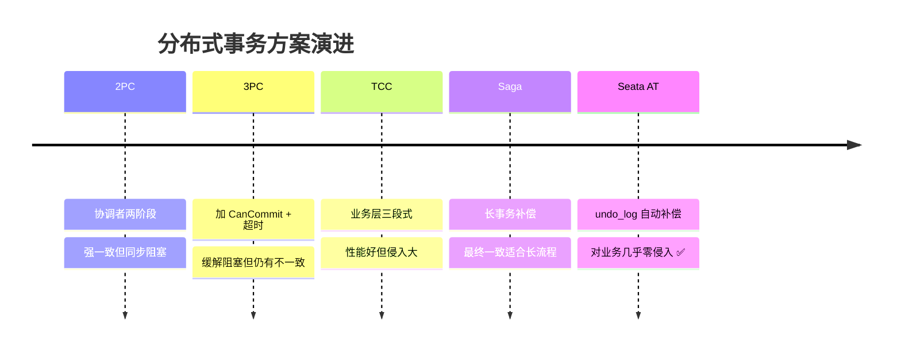

---

## 三、Seata 架构：三大角色 🎭

### 3.1 Seata 是谁 🏷️

> **Seata**（Simple Extensible Autonomous Transaction Architecture）是阿里开源的分布式事务解决方案，提供 **AT、TCC、Saga、XA** 四种模式，宗旨：**对业务低侵入，像用本地事务一样用分布式事务**。

### 3.2 三大核心角色（必背！⭐）

| 角色 | 全称 | 干什么 | 谁来当 |
| --- | --- | --- | --- |
| **TC** | Transaction Coordinator | **事务协调者**：维护全局事务状态，指挥提交/回滚 | 独立部署的 **Seata Server** 🏛️ |
| **TM** | Transaction Manager | **事务管理器**：开启/提交/回滚全局事务 | **事务发起方**（如订单服务）|
| **RM** | Resource Manager | **资源管理器**：管理分支事务，向 TC 注册并汇报 | **每个参与方**（订单/库存/账户服务）|

### 3.3 一次全局事务的完整流程

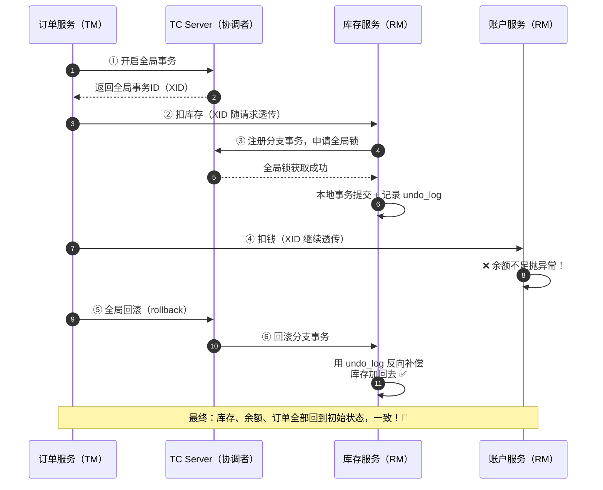

> 💡 **XID 是全局事务的"身份证"**：跨服务透传（HTTP 头/MQ 消息），每个 RM 靠它知道自己属于哪个全局事务，Seata 已自动实现主流框架的 XID 透传～

---

## 四、四种事务模式总览 🗂️

| 对比 | **AT**（默认 ⭐） | TCC | Saga | XA |
| --- | --- | --- | --- | --- |
| 一致性 | 最终一致 | 最终一致 | 最终一致 | **强一致** |
| 侵入性 | **几乎零**（注解即可）✅ | 高（手写三方法） | 中（写补偿逻辑） | 低 |
| 性能 | 高（一阶段即提交） | 高 | 高 | 低（同步阻塞） |
| 依赖 | undo_log 表 | 业务表设计 | 状态机编排 | DB 支持 XA 协议 |
| 适合场景 | 大多数短事务 🌟 | 对性能/控制要求高 | 长流程、跨系统 | 强一致刚需（金融） |

---

## 五、AT 模式：一阶段提交的魔法 🪄

### 5.1 AT 是什么

> **AT（Auto Transaction）= 自动化事务**：框架自动解析你的 SQL，自动记录回滚数据，自动补偿——**业务代码完全不用关心回滚逻辑**，这就是"零侵入"！

### 5.2 一阶段做了什么（核心！⭐）

业务 SQL 执行时，Seata 会**代理数据源**偷偷做四件事：

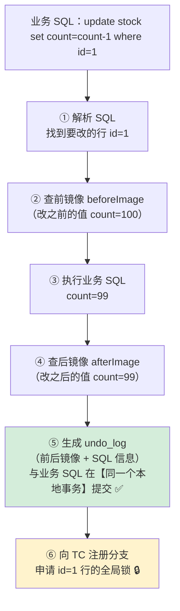

> 🌟 **划重点**：一阶段**本地事务直接提交**（不像 2PC 一直锁着等协调者）！
> 万一后面要回滚？undo_log 里存着"案发前的照片"，随时可以还原 📸～

### 5.3 二阶段：提交 or 回滚

| 全局结果 | 二阶段动作 | 性能 |
| --- | --- | --- |
| **全局提交** ✅ | **异步**删除各 RM 的 undo_log | 极快（删日志而已） |
| **全局回滚** ❌ | RM 用 **undo_log 反向补偿**：生成反向 SQL 恢复数据 | 先校验后镜像未被别人改过，再恢复 |

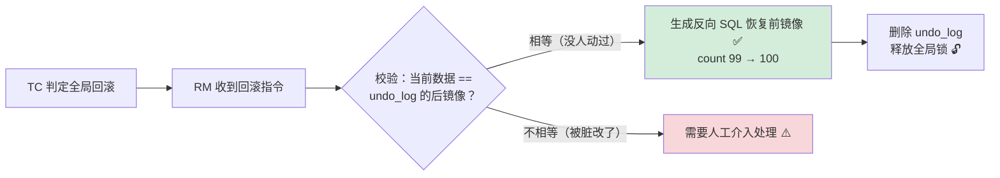

---

## 六、AT 模式实战 🛠️

### 6.1 第一步：部署 TC Server（DB 模式 + Nacos 注册）

```bash
# ① 下载 seata-server-2.0.0.zip 解压
# ② 建库 seata，执行 conf/sql/mysql.sql（建 global_table、branch_table、lock_table）
# ③ 修改 conf/application.conf（新版是 application.yml 形式）
```

```yaml
# seata-server 的关键配置
seata:
  config:
    type: nacos                      # 配置中心用 Nacos
    nacos:
      server-addr: localhost:8848
  registry:
    type: nacos                      # 注册中心用 Nacos，客户端从 Nacos 发现 TC
    nacos:
      server-addr: localhost:8848
      application: seata-server
  store:
    mode: db                         # 事务状态存数据库（file 只适合单机测试）
    db:
      url: jdbc:mysql://localhost:3306/seata
      user: root
      password: 123456
```

```bash
# ④ 启动
bin/seata-server.bat   # Windows
```

### 6.2 第二步：每个业务库建 undo_log 表（AT 模式必须！）

```sql
-- 在 order_db / stock_db / account_db 【每个业务库】都执行
CREATE TABLE undo_log (
    branch_id     BIGINT       NOT NULL COMMENT '分支事务ID',
    xid           VARCHAR(128) NOT NULL COMMENT '全局事务ID',
    context       VARCHAR(128) NOT NULL COMMENT '上下文',
    rollback_info LONGBLOB     NOT NULL COMMENT '回滚信息（前后镜像）',
    log_status    INT          NOT NULL COMMENT '状态，0正常 1防御',
    log_created   DATETIME(6)  NOT NULL,
    log_modified  DATETIME(6)  NOT NULL,
    UNIQUE KEY ux_undo_log (xid, branch_id)
) ENGINE = InnoDB COMMENT = 'AT 模式回滚日志表';
```

### 6.3 第三步：客户端接入

**引依赖**（三个服务都要）：

```xml
<dependency>
    <groupId>com.alibaba.cloud</groupId>
    <artifactId>spring-cloud-starter-alibaba-seata</artifactId>
</dependency>
```

**写配置**：

```yaml
seata:
  registry:
    type: nacos
    nacos:
      server-addr: localhost:8848
      application: seata-server     # TC 注册到 Nacos 的服务名
  tx-service-group: my_tx_group    # 事务组名（客户端与 TC 要对应）
  service:
    vgroup-mapping:
      my_tx_group: default         # 事务组 → TC 集群名 的映射
```

### 6.4 第四步：一个注解开搞 🎉

```java
@Service
public class OrderService {

    @Autowired private OrderMapper orderMapper;
    @Autowired private StockClient stockClient;    // Feign 调库存服务
    @Autowired private AccountClient accountClient; // Feign 调账户服务

    /**
     * @GlobalTransactional：开启全局分布式事务
     * 任何一环抛异常 → 全链路回滚！
     */
    @GlobalTransactional(name = "create-order", rollbackFor = Exception.class)
    public void createOrder(OrderDTO dto) {
        // ① 本地：创建订单
        orderMapper.insert(buildOrder(dto));

        // ② 远程：扣库存（XID 自动透传）
        stockClient.deduct(dto.getProductId(), dto.getCount());

        // ③ 远程：扣钱（余额不足会抛异常 → 触发全局回滚！）
        accountClient.deduct(dto.getUserId(), dto.getAmount());

        // ④ 修改订单状态为已支付
        orderMapper.updateStatus(dto.getOrderId(), "PAID");
    }
}
```

**测试**：账户余额故意设为不够 → 抛异常 → 观察库存被自动补回去、订单消失——**全局回滚成功！** 🎊

---

## 七、AT 模式原理深入：undo_log 与全局锁 🔬

### 7.1 undo_log 里到底存了什么

```json
{
  "branchId": 641789253,
  "xid": "192.168.1.10:8091:85765566572952197",
  "tableName": "stock",
  "beforeImage": {
    "rows": [{ "id": 1, "product_id": 666, "count": 100 }]
  },
  "afterImage": {
    "rows": [{ "id": 1, "product_id": 666, "count": 97 }]
  }
}
```

> 回滚时：`update stock set count=100 where id=1`——**用前镜像反向覆盖**，就这么朴实无华 😎

### 7.2 全局锁：AT 模式的隔离法宝 🔒

问题：全局事务 A 改了 `stock.id=1`（本地已提交！），另一个**非 Seata 全局事务 B** 也来改这行怎么办？回滚时数据就错乱了！

**全局锁**登场：RM 一阶段提交前，必须先向 TC 申请**目标行的全局锁**，拿不到就重试等待。

| 隔离需求 | AT 的实现 |
| --- | --- |
| **写隔离** | 全局事务写某行前先拿全局锁；其他全局事务想写同一行必须等 → 两个全局事务不会交叉写同一行 |
| **读隔离** | 默认**读未提交**（性能优先）；需要读已提交就用 `select ... for update`（会先注册全局锁） |

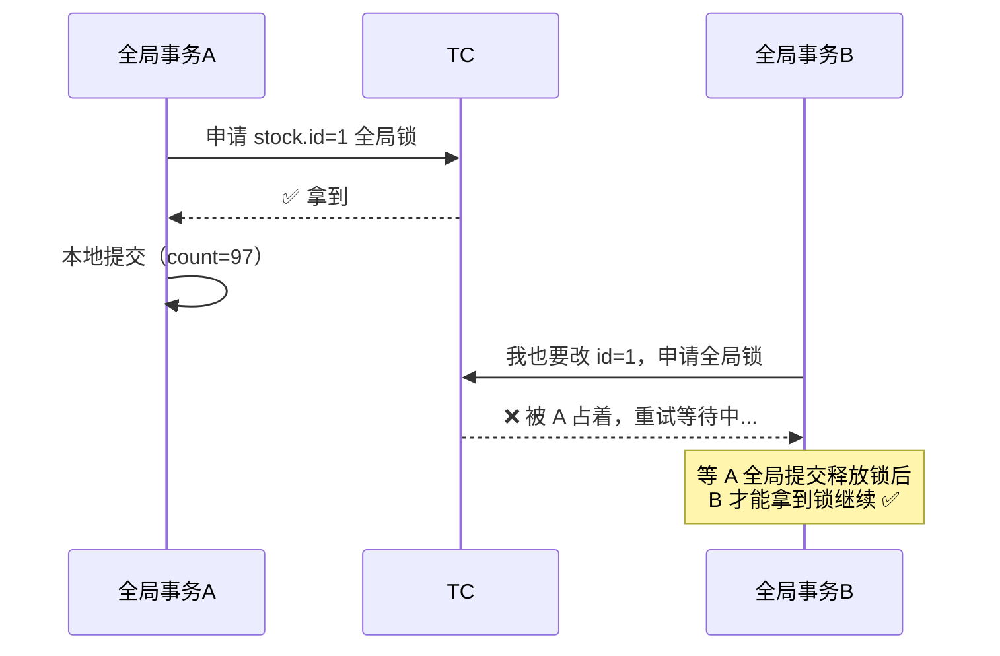

> 💡 **AT 隔离级别**：写隔离达到"全局读已提交"，读默认"读未提交"——大多数业务够用，且性能好～

### 7.3 AT 全流程总结图

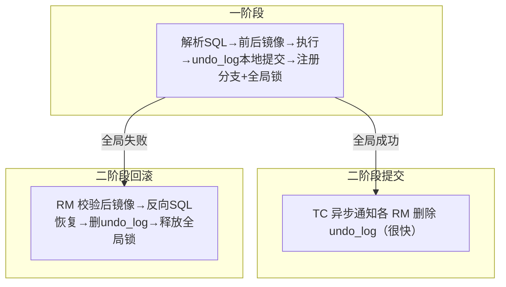

---

## 八、TCC 模式实战：三段式手写 🖋️

### 8.1 TCC 是什么

> **T（Try）** 预留资源 → **C（Confirm）** 确认提交 → **C（Cancel）** 取消释放
> 不靠 undo_log，靠**你自己写**这三个方法——控制力最强，性能最好，侵入也最大！

```text
以扣库存为例：
Try    ：冻结库存   count=100, frozen=10（预留10个，别人不能用）
Confirm：扣减冻结   count=90,  frozen=0  （真正扣掉）
Cancel ：解冻       count=100, frozen=0  （不扣了，还回去）
```

### 8.2 代码实现

```java
/**
 * TCC 接口：一个方法 + 两个阶段动作
 */
@LocalTCC
public interface StockTccAction {

    /**
     * Try：冻结库存
     * @TwoPhaseBusinessAction 绑定 Confirm 和 Cancel 方法
     */
    @TwoPhaseBusinessAction(name = "deductTcc", commitMethod = "confirm", rollbackMethod = "cancel")
    boolean prepareDeduct(@BusinessActionContextParameter("productId") Long productId,
                          @BusinessActionContextParameter("count") Integer count);

    /** Confirm：真正扣减 */
    boolean confirm(BusinessActionContext ctx);

    /** Cancel：解冻返还 */
    boolean cancel(BusinessActionContext ctx);
}
```

```java
@Service
public class StockTccActionImpl implements StockTccAction {

    @Override
    public boolean prepareDeduct(Long productId, Integer count) {
        // Try：冻结 count 个库存（frozen += count）
        return stockMapper.freeze(productId, count) == 1;
    }

    @Override
    public boolean confirm(BusinessActionContext ctx) {
        Long productId = ctx.getActionContext("productId", Long.class);
        Integer count = ctx.getActionContext("count", Integer.class);
        stockMapper.deductFrozen(productId, count);   // count -= count, frozen -= count
        return true;
    }

    @Override
    public boolean cancel(BusinessActionContext ctx) {
        Long productId = ctx.getActionContext("productId", Long.class);
        Integer count = ctx.getActionContext("count", Integer.class);
        stockMapper.unfreeze(productId, count);       // frozen -= count（还回去）
        return true;
    }
}
```

### 8.3 TCC 三大经典问题（必考！⭐）

| 问题 | 场景 | 解决方案 |
| --- | --- | --- |
| **空回滚** | Try 没执行（超时），Cancel 却先到了 → Cancel 白跑 | Cancel 先查事务控制表：**没有 Try 记录 → 直接返回成功并记一条"空回滚"标记** |
| **幂等** | Confirm/Cancel 因重试被执行多次 | 事务控制表记状态，**已处理过直接返回** |
| **悬挂** | Cancel 先执行完，阻塞的 Try 这时才到 → 资源被冻结却永远没人管 | Try 执行前查控制表：**发现空回滚标记 → 拒绝执行** |

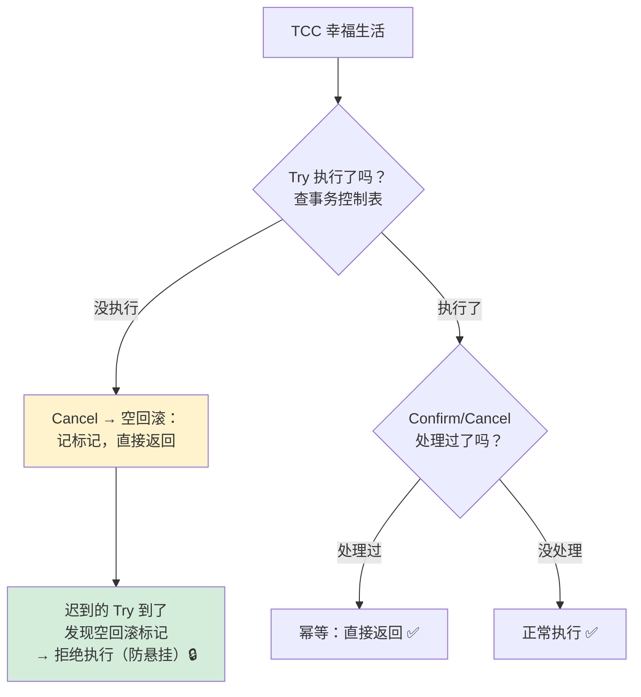

> 💡 **事务控制表**（tcc_transaction_log）：记录 xid + 分支状态，是三大问题的统一解药 💊

---

## 九、Saga 与 XA 模式 📦

### 9.1 Saga 模式

适合**长流程、参与者多、含第三方系统**（别人家的服务你没法改它的 SQL 加 undo_log）：

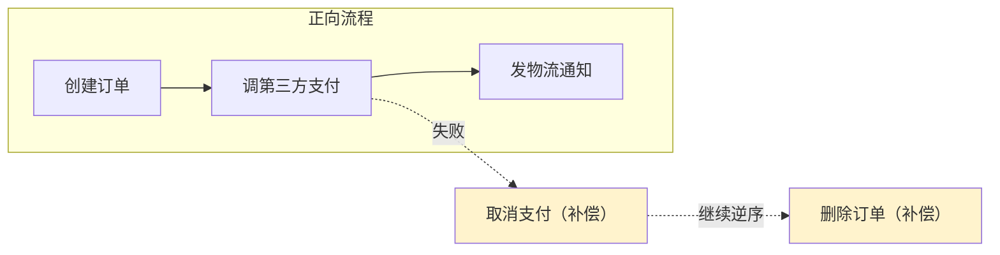

- 一阶段直接提交本地事务，失败就**逆序执行补偿**（没有"回滚"，只有"反向操作"）
- 通过**状态机 JSON** 编排流程（Seata 提供可视化设计器）
- 缺点：**不保证隔离性**（中间状态别人可见）

### 9.2 XA 模式

| 特点 | 说明 |
| --- | --- |
| 原理 | 利用数据库**原生 XA 协议**：一阶段 prepare 不提交，二阶段 TC 续命提交/回滚 |
| 一致性 | **强一致**（全程数据库锁保护） |
| 性能 | 差（同步阻塞，锁持有到二阶段） |
| 侵入 | 与 AT 一样几乎零侵入（只改一行配置） |

```yaml
# 从 AT 切换到 XA 只需：
seata:
  data-source-proxy-mode: XA    # 默认是 AT
```

---

## 十、TC Server 高可用部署 🏰

TC 挂了所有全局事务都完蛋，生产必须集群：

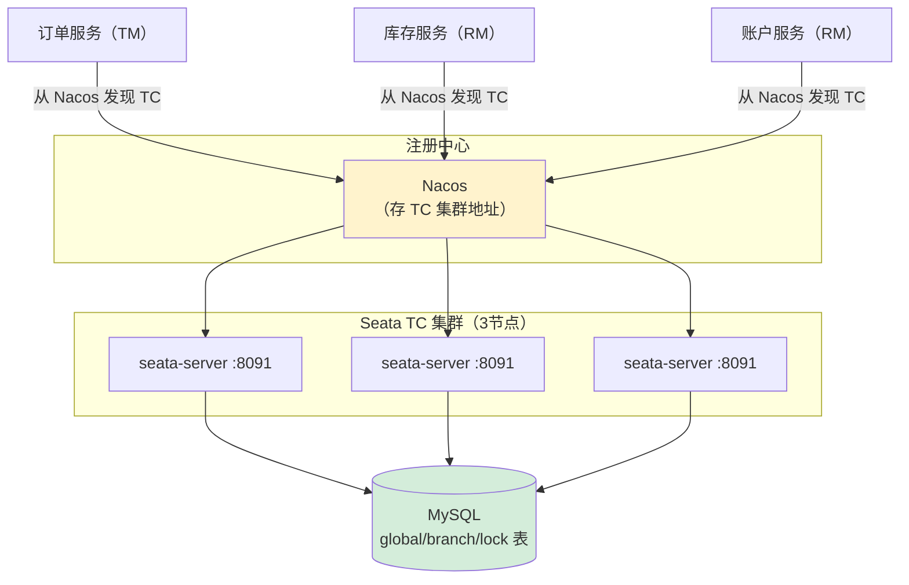

| 要点 | 说明 |
| --- | --- |
| 存储模式 | `store.mode=db`（file 模式重启丢事务状态 ⚠️） |
| 多集群 | 按机房分集群（如 shenzhen/shanghai），客户端按事务组路由 |
| 事务组映射 | `vgroup-mapping.my_tx_group: 集群名`——**同一事务组的服务连同一集群** |

---

## 十一、常见问题排查 🩺

### Q1：全局事务不回滚？

```text
① @GlobalTransactional 在哪个服务，XID 就从哪里开始——注解要加在【发起方】！
② Feign 调用方要把异常抛出来，别在代码里 try-catch 吞了 😅
③ rollbackFor = Exception.class 了吗？（默认只回滚 RuntimeException）
④ 远程服务内部自己 try-catch 了异常，TM 根本不知道失败了
```

### Q2：`can not get global lock` 报错？

```text
全局锁竞争：
① 两个全局事务抢同一行 → 后者会重试，默认重试10次×30ms
② 非 Seata 事务改了被全局锁保护的行
解决：优化事务粒度（别一个全局事务改太多表）、调整 lock-retry-times
```

### Q3：undo_log 表没数据？

```text
① 检查数据源代理是否生效（AT 模式靠代理 DataSource 拦截 SQL）
② undo_log 表建对库了吗？（要在【业务库】建，不是 seata 库！）
③ 表名必须是 undo_log，不能改
```

### Q4：客户端连不上 TC？

```text
① Nacos 里 seata-server 注册了吗？
② tx-service-group 和 vgroup-mapping 配置对应吗？
③ 检查日志：register TM success / register RM success 才算成功
```

---

## 十二、面试高频问题 🎯

### Q1：Seata 的三大角色？（必背）

> **TC 事务协调者**（独立部署的 Seata Server）：维护全局/分支事务状态，指挥提交回滚；
> **TM 事务管理器**（发起方）：定义全局事务边界，开启/提交/回滚；
> **RM 资源管理器**（各参与方）：管理分支事务，向 TC 注册并按指令执行。
> 三者通过 **XID**（全局事务ID）串联。

### Q2：AT 模式的两阶段原理？（超高频）

> **一阶段**：代理数据源拦截 SQL → 解析得到前镜像 → 执行 SQL → 取后镜像 → 生成 undo_log **与业务数据同一本地事务提交** → 向 TC 注册分支并申请**全局锁**。
> **二阶段提交**：异步删除 undo_log（快）；
> **二阶段回滚**：校验当前数据 == 后镜像（没被脏改）→ 用前镜像**反向补偿** → 删日志释放锁。
> 关键：**一阶段就提交本地事务**，不长时间占连接，性能远高于传统 2PC。

### Q3：AT 模式怎么实现隔离？

> **全局锁**：全局事务改某行前必须从 TC 拿到该行全局锁，拿不到重试等待 → 保证两个全局事务不交叉写同一行（写隔离，达到全局读已提交级别）；
> 读默认**读未提交**（性能优先），需要强一致读用 `select for update`（自动注册全局锁）。

### Q4：AT、TCC、Saga、XA 怎么选？

> **AT**：短事务、无外部系统、想低侵入（绝大多数场景 ⭐）；
> **TCC**：性能敏感、不依赖 undo_log、能改造业务表（要处理空回滚/幂等/悬挂）；
> **Saga**：长流程、参与方多、含第三方系统（无法控制别人的 DB）；
> **XA**：强一致刚需（金融核心），能接受性能损耗。

### Q5：TCC 的三大问题及解决方案？

> **空回滚**（Try 没执行 Cancel 却来了）：Cancel 查控制表，无 Try 记录则记标记直接返回；
> **幂等**（Confirm/Cancel 重试多次）：控制表记状态，处理过直接返回；
> **悬挂**（Cancel 先于 Try 完成，迟到的 Try 冻结资源没人释放）：Try 前查控制表发现空回滚标记则拒绝执行。
> 统一解法：**事务控制表（xid + 状态）**。

### Q6：Seata 和本地事务注解能混用吗？

> 可以且推荐组合：`@GlobalTransactional`（全局）+ `@Transactional`（本地）。
> 但注意顺序：全局注解在**外层**（发起方），本地注解在**各分支内部**；
> RM 内部的本地事务保证该服务自己的原子性，TC 保证跨服务全局一致。

### Q7：全局锁和数据库行锁的区别？

> **数据库行锁**：本地事务结束就释放；
> **Seata 全局锁**：绑定在"全局事务 + 行"上，从一阶段提交到全局事务结束一直持有（TC 维护在 lock_table）。
> 因为 AT 一阶段就提交了本地事务，数据库锁已释放，靠全局锁防其他全局事务交叉写。

---

## 十三、总结 🎓

### 13.1 知识点一张图 🗺️

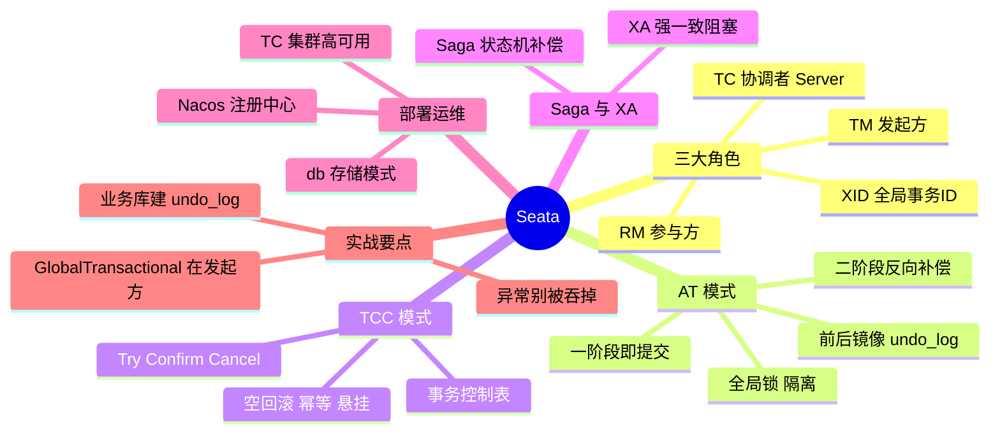

### 13.2 学习建议 💝

1. **先把 AT 跑通**：三个服务 + 一个 `@GlobalTransactional`，看到"全局回滚成功"的日志就是毕业证 🎓
2. **盯住两条主线**：**undo_log**（怎么恢复数据）+ **全局锁**（怎么防脏写）——AT 的全部秘密
3. **TCC 三大问题**当顺口溜背：**空回滚、幂等、悬挂**，一表解千愁
4. **动手实验**：故意在账户服务抛异常，观察 undo_log 表的写入与删除、TC 控制台的事务状态流转 🔭

---

> 🌸 **恭喜你把 Seata 学透啦！** 微服务全家桶集齐 ✅
> 记住核心口诀：**TC 指挥、TM 发起、RM 干活、XID 串门、undo_log 兜底** ⚖️～
> 系列：SpringCloud → Nacos → Gateway → Sentinel → Seata 全部完结撒花 🎉
> 想复习哪篇、或继续新主题（如 OpenFeign/LoadBalancer/RocketMQ）随时喊我哦 💪✨
