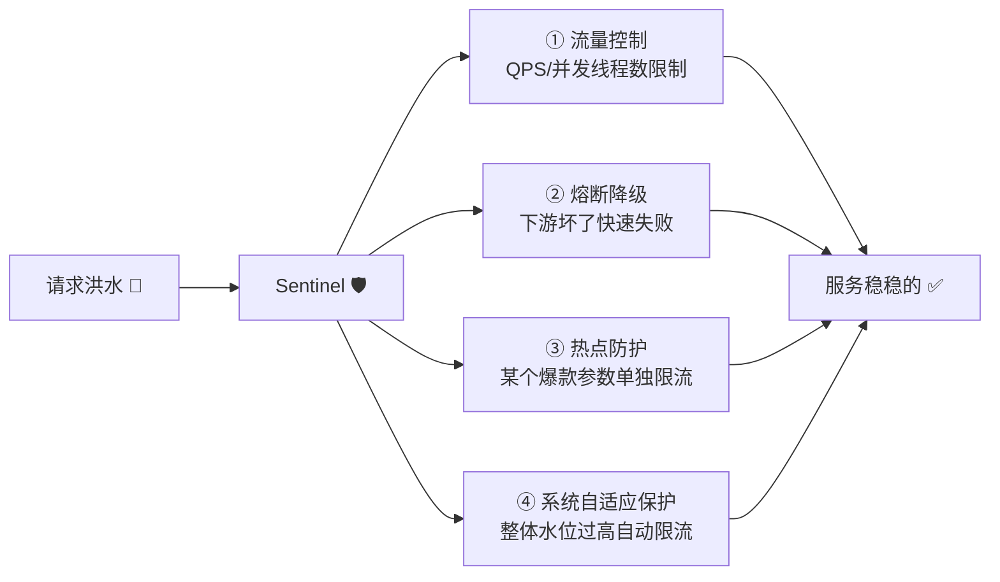
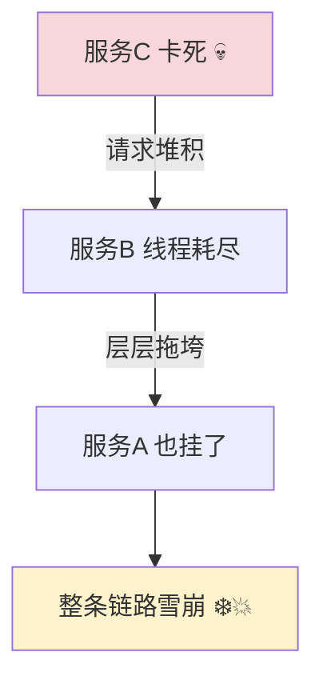
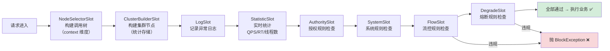
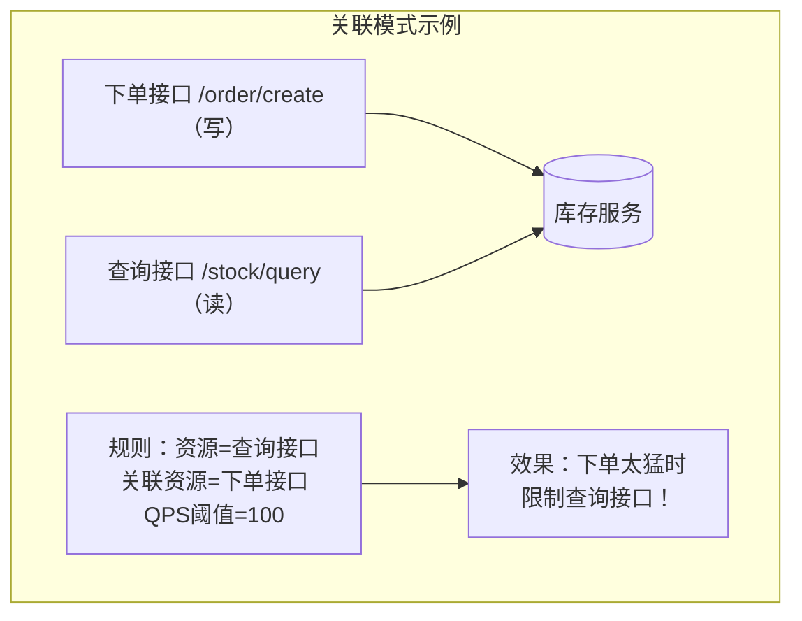
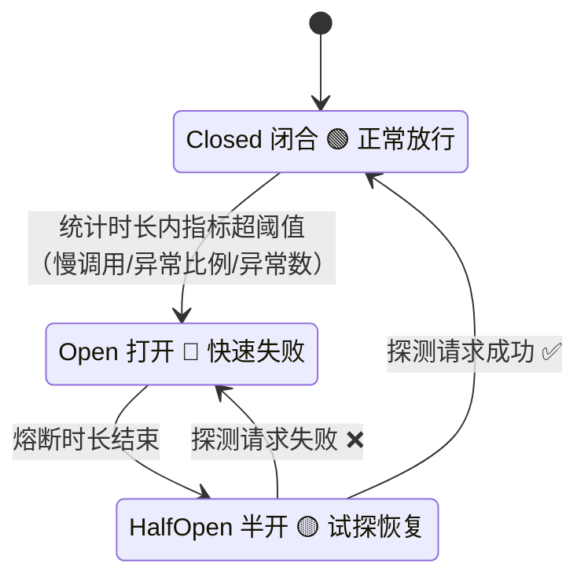
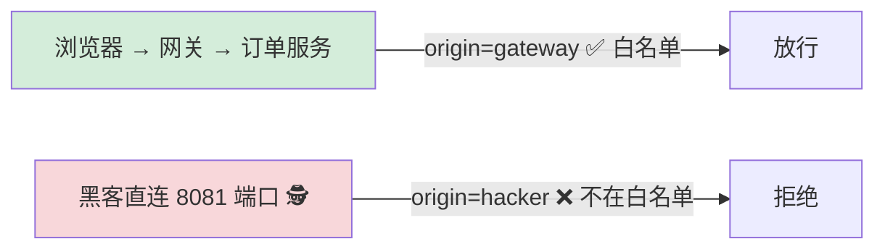
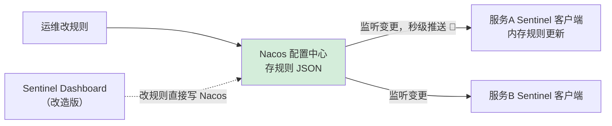
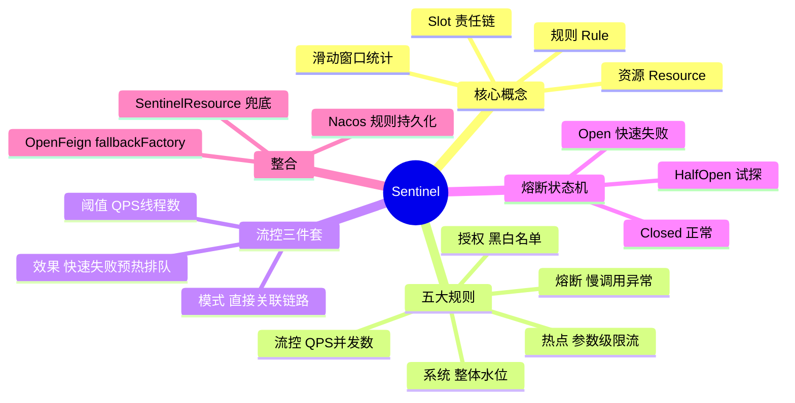

# 🌸 Sentinel 超详细教程

> 网关学会了，那服务崩了怎么办？今天请出微服务的"保险丝+保安队长"——**Sentinel 流量防卫兵**！
> 限流、熔断、降级三板斧，让你的系统稳如老狗 🐶～

---

## 📖 目录

1. [Sentinel 是什么](#一sentinel-是什么)
2. [Sentinel vs Hystrix](#二sentinel-vs-hystrix)
3. [核心概念：资源与规则](#三核心概念资源与规则)
4. [快速接入：三步上手](#四快速接入三步上手)
5. [流控规则详解](#五流控规则详解流量控制)
6. [熔断降级规则详解](#六熔断降级规则详解)
7. [热点参数限流](#七热点参数限流针对参数精准打击)
8. [系统自适应保护与授权规则](#八系统自适应保护与授权规则)
9. [@SentinelResource 详解](#九sentinelresource-详解)
10. [整合 OpenFeign：熔断兜底](#十整合-openfeign熔断兜底)
11. [规则持久化：Nacos 数据源](#十一规则持久化nacos-数据源)
12. [常见问题排查](#十二常见问题排查)
13. [面试高频问题](#十三面试高频问题)
14. [总结](#十四总结)

---

## 一、Sentinel 是什么？

### 1.1 一句话定位 🏷️

> **Sentinel** 是阿里开源的**面向分布式服务架构的流量防护组件**，主要以**流量**为切入点，提供：
> **流量控制、熔断降级、系统自适应保护、热点防护**等功能，保障微服务的稳定性。



### 1.2 诞生的背景 💔

还记得雪崩效应吗？



| 防护手段 | 防什么 | 比喻 |
| --- | --- | --- |
| **限流** | 流量太大 | 景区限流，每天只卖1万张票 🎫 |
| **熔断** | 下游故障 | 家里跳闸，保护电器 ⚡ |
| **降级** | 异常后体验 | 外卖没了吃泡面 🍜 |
| **系统保护** | 整体过载 | 水位过高自动泄洪 🌊 |

---

## 二、Sentinel vs Hystrix

Hystrix 停更后，Sentinel 成为主流选择，两者对比（面试超高频 ⭐）：

| 对比项 | Sentinel | Hystrix |
| --- | --- | --- |
| 隔离策略 | **信号量隔离**（并发线程数限流） | 线程池隔离（默认）/ 信号量 |
| 熔断策略 | **慢调用比例 / 异常比例 / 异常数** 三种 | 仅异常比例 |
| 实时规则修改 | **控制台动态推送，即时生效** ✅ | 改代码重启 💤 |
| 流量整形 | 支持预热、排队等待（削峰） ✅ | 不支持 |
| 系统自适应保护 | 支持 ✅ | 不支持 |
| 控制台 | 开箱即用，功能齐全 ✅ | 简单 Demo 级 |
| 注解支持 | `@SentinelResource` | `@HystrixCommand` |
| 限流维度 | QPS、并发数、热点参数、链路、系统 | 线程池/信号量 |
| 维护状态 | 持续活跃 ✅ | 停更 💤 |

> 💡 **隔离策略区别**：
> Hystrix 线程池隔离 = 给每个依赖开个小线程池（隔得干净，但线程开销大）；
> Sentinel 信号量隔离 = 直接限制**并发线程数**（轻量高效，但靠调用方自己计时 ⏱️）

---

## 三、核心概念：资源与规则

### 3.1 两大核心 🎯

| 概念 | 说明 | 比喻 |
| --- | --- | --- |
| **资源（Resource）** | 被保护的东西：一个方法、一段代码、一个接口 | 景区里的景点 🏞️ |
| **规则（Rule）** | 怎么保护：限流规则、熔断规则、热点规则… | 景区的管理规章 📋 |

> 💡 Sentinel 的设计哲学：**资源是中心，规则围绕资源转**。同一份代码，换套规则就是另一种防护策略～

### 3.2 五大规则类型 📋

| 规则 | 管什么 | 核心参数 |
| --- | --- | --- |
| **流控规则** | 流量大小 | 阈值类型（QPS/并发数）、流控模式、流控效果 |
| **熔断规则** | 故障隔离 | 熔断策略、阈值、熔断时长、最小请求数 |
| **热点规则** | 特定参数值 | 参数索引、单机阈值、参数例外项 |
| **系统规则** | 整体水位 | Load、CPU使用率、入口QPS、平均RT、并发线程数 |
| **授权规则** | 来源黑白名单 | 白名单/黑名单、调用方标识 |

### 3.3 底层原理：Slot 责任链 ⛓️（源码加分点）

每个请求进入 Sentinel 都要走一条**插槽链**，逐个检查，像机场安检的每一道关卡 ✈️：



| Slot | 职责 |
| --- | --- |
| NodeSelectorSlot | 构建调用链路树（context 维度） |
| ClusterBuilderSlot | 构建资源的统计节点 |
| StatisticSlot | **滑动窗口**实时统计 QPS、RT、线程数（数据来源） |
| AuthoritySlot / SystemSlot / FlowSlot / DegradeSlot | 分别检查授权、系统、流控、熔断规则 |

> 🌟 **记住这条链**，面试官问"Sentinel 原理"时直接说：**基于滑动窗口统计 + Slot 责任链逐级检查，违规抛 BlockException**！

---

## 四、快速接入：三步上手 🛠️

### 第一步：引依赖 + 写配置

```xml
<dependency>
    <groupId>com.alibaba.cloud</groupId>
    <artifactId>spring-cloud-starter-alibaba-sentinel</artifactId>
</dependency>
```

```yaml
spring:
  application:
    name: order-service
  cloud:
    sentinel:
      transport:
        dashboard: localhost:8085    # 控制台地址
        port: 8719                   # 本地启动一个 HTTP Server 与控制台通信（默认8719，冲突自动+1）
      eager: true                    # 立即注册到控制台（默认懒注册，得先访问一次接口才出现）
```

### 第二步：启动 Dashboard 控制台

```bash
# 下载 sentinel-dashboard-1.8.6.jar 后
java -jar sentinel-dashboard-1.8.6.jar --server.port=8085
```

浏览器访问 `http://localhost:8085`（默认 sentinel/sentinel），启动服务后就能在控制台看到它 🎊

### 第三步：定义资源（两种方式）

**方式一：自动埋点**——Web 接口天然是资源（资源名 = URL 路径）：

```java
@RestController
public class OrderController {

    // 资源名自动是 /order/create，控制台直接配置规则即可
    @PostMapping("/order/create")
    public Result create(@RequestBody OrderDTO dto) {
        return Result.ok(orderService.create(dto));
    }
}
```

**方式二：@SentinelResource 手动埋点**（可以自定义资源名 + 兜底）：

```java
@GetMapping("/product/{id}")
@SentinelResource(value = "getProduct",
                  blockHandler = "getProductBlock")   // 限流/熔断时的兜底方法
public Product getProduct(@PathVariable Long id) {
    return productService.findById(id);
}

/** 兜底方法：参数同原方法 + BlockException，返回值同类型 */
public Product getProductBlock(Long id, BlockException e) {
    return Product.error("人太多啦，稍后再试～ 🐢");
}
```

---

## 五、流控规则详解：流量控制 🚦

### 5.1 阈值类型：QPS vs 并发线程数

| 阈值类型 | 含义 | 适合场景 |
| --- | --- | --- |
| **QPS** | 每秒**请求数**超过阈值就拒绝 | 保护接口吞吐（常用 ⭐） |
| **并发线程数** | 同时执行的**线程数**超过阈值就拒绝 | 保护慢 SQL、下游抖动（业务执行慢时更精准） |

> 💡 区别举例：接口 RT 很长（如 2 秒），QPS=10 意味着同时可能有 20 个线程在跑；
> 用"并发线程数=10"限流，比 QPS 更贴合"别占我这么多线程"的诉求～

### 5.2 三种流控模式 🎛️

| 模式 | 规则 | 典型场景 |
| --- | --- | --- |
| **直接（默认）** | 资源自身达到阈值 → 限流自己 | 接口自我保护 |
| **关联** | **关联资源**达到阈值 → 限流**自己** | 写接口忙时保护读：`读` 关联 `写`，写压力大时限流读（保写不保读 🤯） |
| **链路** | 只统计从某条**入口链路**进来的流量 | 同一资源被多个入口调用，只限其中一个入口 |



> ⚠️ **链路模式注意**：需要关闭公共路径的"链路收敛"，否则所有请求都会被认为来自同一个入口：
> ```yaml
> spring:
>   cloud:
>     sentinel:
>       web-context-unify: false   # 关闭调用链路收敛，链路模式才生效！
> ```

### 5.3 三种流控效果 🎨

| 效果 | 行为 | 比喻 |
| --- | --- | --- |
| **快速失败（默认）** | 超阈值直接抛 `FlowException` | 排队人太多？不让进，直接回家 ❌ |
| **Warm Up 预热** | 从 `阈值/冷加载因子(默认3)` 慢慢升到阈值 | 景区刚开门慢慢放人进，防止系统"冷启动"被秒杀 🌡️ |
| **排队等待** | 请求匀速通过（漏桶算法），超时等待的拒绝 | 排队叫号，等太久自动走人 🎫 |

**Warm Up 适用场景**：秒杀开始瞬间缓存刚失效/连接池未热，直接放满 QPS 会压垮系统——先放 1/3，10 秒内逐步升满～

**排队等待适用场景**：突发流量削峰填谷（如消息处理、异步任务），希望匀速处理不丢请求：

```yaml
# 例：QPS 阈值 5，排队等待超时 2000ms
# 瞬间来 10 个请求 → 5 个立刻过，其余排队，超过 2 秒还没轮到才拒绝
```

### 5.4 流控规则速查配置表 📋

| 配置项 | 取值 | 说明 |
| --- | --- | --- |
| 阈值类型 | QPS / 并发线程数 | 限什么 |
| 单机阈值 | 数字 | 限多少 |
| 流控模式 | 直接 / 关联 / 链路 | 对谁限 |
| 流控效果 | 快速失败 / Warm Up / 排队等待 | 怎么限 |

---

## 六、熔断降级规则详解 ⚡

### 6.1 熔断器状态机（三种状态）



### 6.2 三种熔断策略（重点 ⭐）

| 策略 | 触发条件（统计时长内） | 适合场景 |
| --- | --- | --- |
| **慢调用比例** | RT 超过 `最大RT` 的请求占比 > `比例阈值` | 下游变慢（数据库慢查询）|
| **异常比例** | 异常请求占比 > 比例阈值 | 下游偶发出错 |
| **异常数** | 异常请求**次数** > 阈值（分钟级统计） | 低流量接口（异常比例不准时用绝对数） |

**慢调用比例示例配置**：

```text
最大 RT = 500        → 超过 500ms 算"慢调用"
比例阈值 = 0.5       → 慢调用占比超过 50%
熔断时长 = 10        → 熔断 10 秒
最小请求数 = 5       → 统计时长内至少 5 个请求才生效（防止 1 个请求慢就熔断）
统计时长 = 1000ms    → 统计窗口
```

> 💡 **熔断期间**：请求直接快速失败（走降级逻辑），**不再真实调用**下游——给下游喘息时间 🛌；
> 10 秒后进入**半开态**，放一个请求试探：成功恢复，失败继续熔断。

### 6.3 熔断 vs 限流的触发区别 🤔

| | 限流（FlowRule） | 熔断（DegradeRule） |
| --- | --- | --- |
| 看什么 | **流量大小**（QPS/线程数） | **质量指标**（RT/异常） |
| 触发后 | 持续按阈值拦截 | **先断一段时间再试探**（有状态机） |
| 保护对象 | 自己不被压垮 | 自己不被下游拖垮 |

---

## 七、热点参数限流：针对参数精准打击 🎯

### 7.1 场景

普通限流管所有请求一刀切，但有时"罪魁祸首"是**某个参数值**：

```text
查询商品接口 QPS 正常 100
→ 某顶流商品（id=666）被疯狂刷 → 单独把它限到 QPS=5
→ 其他商品照常 QPS=100 ✨
```

### 7.2 实战

**第一步：用 @SentinelResource 定义资源（热点规则对 URL 资源不生效，必须注解埋点！）**

```java
@GetMapping("/product")
@SentinelResource(value = "queryProduct", blockHandler = "queryBlock")
public Product queryProduct(@RequestParam(required = false) Long id,
                            @RequestParam(required = false) String type) {
    return productService.query(id, type);
}

public Product queryBlock(Long id, String type, BlockException e) {
    return Product.error("该商品太火爆啦，稍后再试 🐑");
}
```

**第二步：控制台配置热点规则**

```text
参数索引 = 0        → 限第一个参数（id）
单机阈值 = 5        → 参数值相同的请求，QPS 超过 5 就拒绝
统计窗口 = 1 秒
```

**进阶：参数例外项**——某几个特殊参数值单独给额度：

```text
id=666（顶流商品）→ 例外阈值 50（给它多点额度）
id=1（首页推荐）  → 例外阈值 200
其余所有 id       → 统一阈值 5
```

> ⚠️ 热点规则的注意点：
> ① 参数必须是**基本类型或 String**（对象没法统计）
> ② 资源必须用 `@SentinelResource` 定义（URL 资源的热点规则不生效哦）

---

## 八、系统自适应保护与授权规则 🏰

### 8.1 系统规则（整体水位兜底）

前面规则都是"单资源"粒度，系统规则保护的是**整个应用**：

| 指标 | 说明 |
| --- | --- |
| **Load** | 系统 1 分钟平均负载（Linux 上有效），超过阈值且当前并发线程数超容量时触发 |
| **平均 RT** | 所有入口流量的平均响应时间 |
| **并发线程数** | 所有入口流量的并发线程数 |
| **入口 QPS** | 所有入口流量的总 QPS |
| **CPU 使用率** | 超过阈值（如 0.8）直接限流 |

> 💡 设计思想来自 TCP BBR：**在系统快要扛不住之前主动降低入口流量，别等崩了才救** 🌊

### 8.2 授权规则（来源黑白名单）

针对**调用方**做准入控制：只允许网关来的请求，绕过网关直连的请求统统拒绝！



**实现步骤**：

```java
/**
 * 告诉 Sentinel：这个请求的调用方（origin）是谁
 */
@Component
public class HeaderOriginParser implements RequestOriginParser {

    @Override
    public String parseOrigin(HttpServletRequest request) {
        // 从网关透传的请求头里取来源标识
        String origin = request.getHeader("X-Origin");
        return origin != null ? origin : "unknown";
    }
}
```

网关加过滤器透传标识：

```yaml
# gateway 的路由过滤器
filters:
  - AddRequestHeader=X-Origin, gateway
```

控制台配置授权规则：

```text
资源：/order/**
流控应用（调用方）：gateway
授权类型：白名单    → 只有 gateway 能访问！
```

---

## 九、@SentinelResource 详解 📝

### 9.1 全部属性一览

```java
@SentinelResource(
    value = "getProduct",              // 资源名（必填）
    blockHandler = "blockMethod",      // Sentinel 规则违规时调用（BlockException）
    blockHandlerClass = MyBlock.class, // 兜底方法不在本类时指定（必须是 static）
    fallback = "fallbackMethod",       // 业务代码抛异常时调用（Throwable）
    fallbackClass = MyFallback.class,  // 同上
    exceptionsToIgnore = {IllegalArgumentException.class}  // 这些异常不算，直接抛出
)
```

### 9.2 blockHandler vs fallback（必考！⭐）

| 对比 | blockHandler | fallback |
| --- | --- | --- |
| 触发时机 | **Sentinel 规则**违规（限流/熔断/热点…） | **业务代码**抛异常 |
| 兜底方法参数 | 原参数 + **BlockException** | 原参数 + **Throwable** |
| 优先级 | 两个都配时，规则违规走 blockHandler | 异常走 fallback |

```java
@GetMapping("/product/{id}")
@SentinelResource(value = "getProduct",
                  blockHandler = "getProductBlock",     // 规则违规走这
                  fallback = "getProductFallback")      // 代码异常走这
public Product getProduct(@PathVariable Long id) {
    if (id < 0) {
        throw new IllegalArgumentException("id 不合法");  // → fallback 处理
    }
    return productService.findById(id);
}

public Product getProductBlock(Long id, BlockException e) {
    return Product.error("被限流啦 🐢");
}

public Product getProductFallback(Long id, Throwable e) {
    return Product.error("服务开小差 🛠️");
}
```

> 💡 全局兜底方案：用 `WebMvcConfigurer` 提供 `BlockExceptionHandler` 统一处理 URL 资源的 BlockException，返回统一的 JSON 格式，不用每个接口都写 blockHandler～

---

## 十、整合 OpenFeign：熔断兜底 🤝

Feign 调用远程服务时接入 Sentinel，服务挂了自动走兜底：

### 第一步：开配置

```yaml
feign:
  sentinel:
    enabled: true    # 老版本是 spring.cloud.openfeign.feign.sentinel.enabled
```

### 第二步：写 Fallback（或 FallbackFactory 推荐版本）

```java
@FeignClient(name = "product-service",
             fallbackFactory = ProductClientFallbackFactory.class)
public interface ProductClient {

    @GetMapping("/product/{id}")
    Product getProduct(@PathVariable("id") Long id);
}
```

```java
/**
 * 推荐 FallbackFactory：能拿到异常原因，方便排查日志！
 */
@Component
public class ProductClientFallbackFactory implements FallbackFactory<ProductClient> {

    private static final Logger log = LoggerFactory.getLogger(ProductClientFallbackFactory.class);

    @Override
    public ProductClient create(Throwable cause) {
        // 打印远程调用失败原因，排查全靠它 🔍
        log.warn("product-service 调用失败：{}", cause.getMessage());

        return id -> {
            Product p = new Product();
            p.setName("商品信息暂时不可用（兜底）");
            return p;
        };
    }
}
```

| 对比 | fallback | fallbackFactory |
| --- | --- | --- |
| 拿到异常 | ❌ | ✅（能打日志排查） |
| 写法 | 实现接口 | 实现 Factory 的 create 方法 |
| 推荐 | 简单场景 | **生产推荐** ✅ |

---

## 十一、规则持久化：Nacos 数据源 💾

### 11.1 最大的坑：规则为什么会丢？😭

```text
默认情况下：规则存在 Sentinel 控制台的【内存】里
→ 控制台一重启 / 服务一重启 → 规则全没了！❌
→ 生产环境绝对不能这么玩
```

### 11.2 三种持久化模式

| 模式 | 原理 | 推荐 |
| --- | --- | --- |
| **原始模式** | 存内存，重启丢 | 仅测试 💤 |
| **Pull 拉模式** | 本地文件/DB 定时轮询 | 一般（有延迟） |
| **Push 推模式** | 规则存 Nacos，控制台改完**推到 Nacos**，客户端监听 Nacos 变更 | **生产标准 ✅** |



### 11.3 客户端接入 Nacos 数据源（不用改控制台也能用！）

**引依赖**：

```xml
<dependency>
    <groupId>com.alibaba.csp</groupId>
    <artifactId>sentinel-datasource-nacos</artifactId>
</dependency>
```

**配置数据源**：

```yaml
spring:
  cloud:
    sentinel:
      datasource:
        flow-rule:                          # 数据源名字（随便起）
          nacos:
            server-addr: localhost:8848
            namespace: dev
            groupId: SENTINEL_GROUP
            dataId: order-service-flow-rules
          rule-type: flow                   # 规则类型：flow/degrade/param-flow/system/authority
        degrade-rule:
          nacos:
            server-addr: localhost:8848
            groupId: SENTINEL_GROUP
            dataId: order-service-degrade-rules
          rule-type: degrade                # 注意：rule-type 与 nacos 同级！
```

**在 Nacos 中创建规则配置**（JSON 数组格式）：

```json
[
  {
    "resource": "/order/create",
    "grade": 1,
    "count": 100,
    "strategy": 0,
    "controlBehavior": 0,
    "clusterMode": false
  }
]
```

**字段对照表**：

| JSON 字段 | 含义 |
| --- | --- |
| resource | 资源名 |
| grade | 阈值类型：0=并发线程数，**1=QPS** |
| count | 阈值 |
| strategy | 流控模式：0=直接，1=关联，2=链路 |
| controlBehavior | 流控效果：0=快速失败，1=Warm Up，2=排队等待 |
| warmUpPeriodSec | 预热时长（Warm Up 用） |
| maxQueueingTimeMs | 排队超时（排队等待用） |

> ⚠️ 说明：官方 Dashboard 默认把规则推给客户端内存（不落 Nacos）。
> 想要"控制台改动 → 落 Nacos → 全实例生效"的完整闭环，需要**改造 Dashboard 源码**（把推送逻辑改成写 Nacos），
> 或者直接用 Nacos 控制台改 JSON 规则 + 客户端监听的方式（最简单实用 ✅）

---

## 十二、常见问题排查 🩺

### Q1：控制台看不到我的服务？

```text
① spring.cloud.sentinel.transport.dashboard 地址配对了吗？
② eager: true 了吗？（默认懒注册，得先访问一次接口）
③ transport.port（8719）被占用没关系，会自动递增，但防火墙要放行
④ 依赖引对了吗？spring-cloud-starter-alibaba-sentinel
```

### Q2：配置了规则不生效？

```text
① 资源名对得上吗？（URL 资源名是完整路径 /order/create，注意 context-path）
② 热点规则只对 @SentinelResource 资源生效！
③ 链路模式：web-context-unify: false 了吗？
④ 多实例部署时控制台规则只推给了其中一台？（未持久化时的经典坑 → 上 Nacos 数据源）
```

### Q3：限流后前端收到什么？

```text
默认返回：Blocked by Sentinel (flow limiting) 纯文本，很不友好 😅
解决：自定义 BlockExceptionHandler 返回统一 JSON
```

```java
@Component
public class MyBlockExceptionHandler implements BlockExceptionHandler {

    @Override
    public void handle(HttpServletRequest request, HttpServletResponse resp,
                       BlockException e) throws Exception {
        resp.setStatus(429);
        resp.setContentType("application/json;charset=utf-8");
        resp.getWriter().write("{\"code\":429,\"msg\":\"请求太频繁啦，喝口水休息下～ 🍵\"}");
    }
}
```

### Q4：熔断恢复后立刻又熔断，来回抖动？

```text
熔断时长太短 / 半开探测又失败：
① 检查最小请求数（minRequestAmount）是否太小导致误判
② 调大熔断时长（timeWindow），给下游足够恢复时间
③ 检查慢调用的最大RT阈值是不是定太苛刻
```

---

## 十三、面试高频问题 🎯

### Q1：Sentinel 和 Hystrix 的区别？（必考）

> **隔离**：Hystrix 线程池隔离为主，Sentinel 信号量（并发线程数）隔离；
> **熔断**：Hystrix 只有异常比例，Sentinel 有慢调用比例/异常比例/异常数三种；
> **规则**：Sentinel 控制台动态推规则，Hystrix 要改代码；
> **流量整形**：Sentinel 支持预热、排队等待，Hystrix 不支持；
> **功能**：Sentinel 还有热点限流、系统自适应保护；Hystrix 已停更。

### Q2：Sentinel 的工作原理？

> 核心是 **Slot 责任链**：
> 请求进入 → NodeSelectorSlot（建调用树）→ ClusterBuilderSlot（建统计节点）→ StatisticSlot（**滑动窗口**实时统计 QPS/RT/线程数）→ Authority/System/Flow/Degrade 各 Slot 依次检查规则 → 全过执行业务，违规抛 **BlockException**。
> 一句话：**滑动窗口做统计，责任链做检查，异常做信号**。

### Q3：什么是滑动窗口？为什么用它？

> 把 1 秒切成多个小格子（如 2 个 500ms），窗口随时间滑动，统计最近 1 秒内的数据。
> 相比"固定窗口计数器"，滑动窗口**平滑了临界突刺问题**（避免窗口边缘瞬间双倍流量穿透）；Sentinel 默认 1 秒 2 格，可调更细。

### Q4：流控的三种模式？

> **直接**：超阈值限自己；**关联**：关联资源繁忙时限自己（写忙保写限读）；**链路**：只统计指定入口进来的流量（需关闭 web-context-unify）。

### Q5：流控的三种效果？

> **快速失败**：直接拒绝；**Warm Up 预热**：从阈值/3 逐步爬升（冷系统保护）；**排队等待**：漏桶匀速通过 + 超时拒绝（削峰填谷）。

### Q6：熔断三种策略和状态机？

> 策略：**慢调用比例**（RT 超标的占比）、**异常比例**、**异常数**；
> 状态机：Closed（正常）→ 指标超阈值 → Open（熔断，快速失败）→ 熔断时长到 → HalfOpen（放一个请求试探）→ 成功回 Closed / 失败回 Open。

### Q7：blockHandler 和 fallback 区别？

> **blockHandler**：Sentinel **规则违规**（BlockException）时触发；**fallback**：**业务异常**（Throwable）时触发；都配置时规则违规优先走 blockHandler；兜底方法参数 = 原参数 + 对应异常对象。

### Q8：热点参数限流怎么用？

> `@SentinelResource` 定义资源 → 热点规则指定**参数索引**和单机阈值 → 对**指定参数的值**分别统计限流；支持**参数例外项**给特殊值单独额度。限制：参数需是基本类型/String。

### Q9：Sentinel 规则持久化方案？

> 默认内存模式重启丢失。生产用 **Push 模式**：规则存 **Nacos**（sentinel-datasource-nacos），客户端监听 Nacos 变更自动更新规则；Dashboard 官方默认推内存，需改造源码把"推客户端"改为"写 Nacos"实现闭环。

---

## 十四、总结 🎓

### 14.1 知识点一张图 🗺️



### 14.2 学习建议 💝

1. **先玩控制台**：本地起 Dashboard，把流控/熔断/热点每种规则都配一遍，肉眼观察效果 🖱️
2. **抓住两条主线**：**统计**（滑动窗口 StatisticSlot）+ **决策**（各规则 Slot 检查）——这就是 Sentinel 的全部秘密 🔍
3. **必练三个实战**：限流兜底 JSON、Feign 熔断 fallbackFactory、Nacos 规则持久化
4. **面试三板斧**：vs Hystrix 对比、Slot 链原理、三种熔断策略——背熟直接起飞 🛫

---

> 🌸 **恭喜你把 Sentinel 学透啦！**
> 记住：**限流保自己，熔断保链路，降级保体验，系统规则保全局** 🛡️～
> 系列已完成：SpringCloud → Nacos → Gateway → Sentinel ✅
> 下一个学 OpenFeign 深入篇还是 Seata？随时点单哦 💪✨
