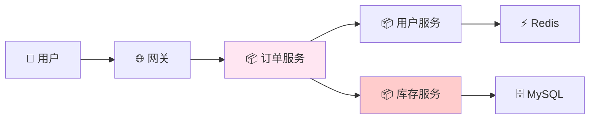
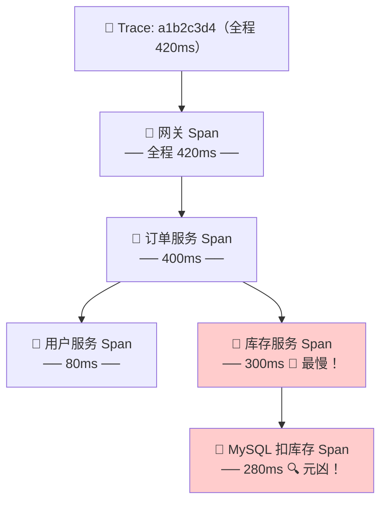
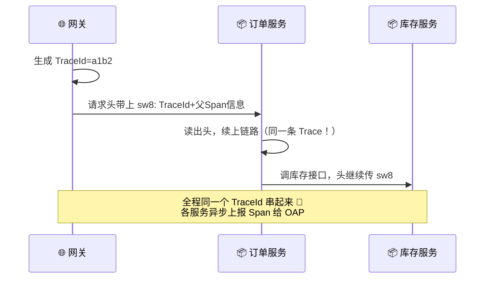
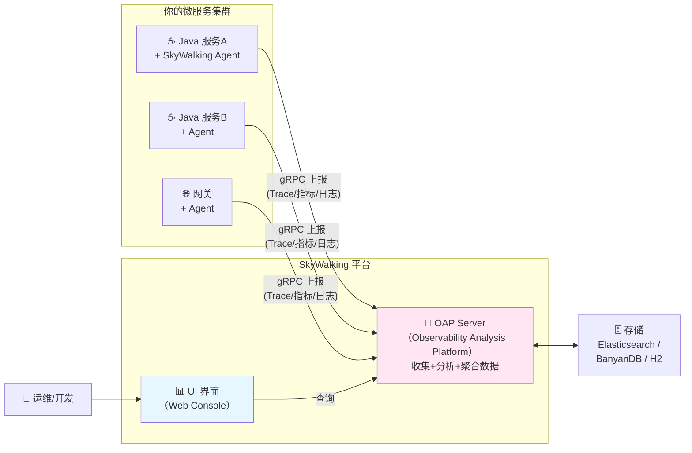
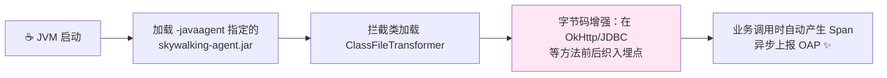
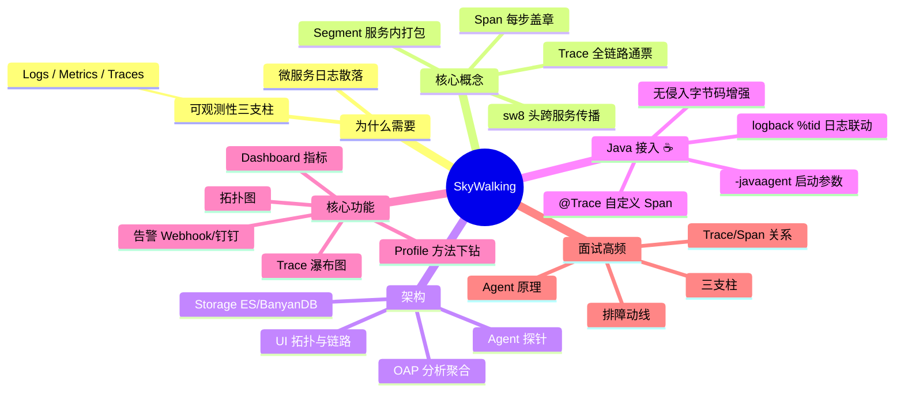

# Apache SkyWalking 分布式链路追踪 从入门到实战 ☁️

> 欢迎来到 SkyWalking 小课堂！💖 微服务一多，"一个请求到底卡在哪"就成了灵魂拷问——而 **SkyWalking（天际漫步）** 就是给微服务装上 **GPS + 行车记录仪** 的神器！学完这篇，你就能优雅地回答"线上接口慢怎么排查"这种面试题啦～
>
> **学习目标**：
> - 🎯 理解可观测性三大支柱和链路追踪核心概念（Trace/Span）
> - 🎯 看懂 SkyWalking 架构：Agent → OAP → 存储/UI
> - 🎯 会用 Java Agent 无侵入接入 Spring Boot 项目
> - 🎯 会查调用链、配告警、整合日志（traceId 关联）
>
> **前置知识**：了解微服务架构（看过前面 RPC 那篇更好哦～）

---

## 一、为什么需要链路追踪？🤔

### 1.1 微服务的"薛定谔故障"

先看一个扎心场景 😱：

> 用户："下单好慢啊！" 🙋
> 你：订单服务日志没报错啊……调了用户服务？查用户服务日志……又调了库存服务？又查库存日志……还过了网关和 Nginx？！**翻完 5 个服务的日志，半天过去了** 😭

**单体时代**：一个请求一个进程，加个断点全知道 ✅
**微服务时代**：一个请求穿越 网关 → 订单 → 用户 → 库存 → 支付，日志散落 5 台机器 ❌



> ❓ 到底是哪一环慢了？哪一环挂了？——**链路追踪（Distributed Tracing）** 就是答案！

### 1.2 可观测性三大支柱（面试必会！⭐）

| 支柱 | 英文 | 回答的问题 | 代表工具 |
|---|---|---|---|
| **日志 Logs** | Logging | 发生了什么？（离散事件） | ELK / Loki |
| **指标 Metrics** | Metrics | 数值怎么样？（QPS、RT、错误率） | Prometheus |
| **链路 Traces** | Tracing | 请求**走过的路径**和每步耗时？ | **SkyWalking** ⭐ / Zipkin / Jaeger |

> 💡 **一句话记住**：日志看"点"，指标看"面"，**链路看"线"**——三者合体就是"可观测性"（Observability）！

### 1.3 链路追踪的核心思想

> 给每个请求发一张 **"全程通票"（TraceId）**，每经过一个服务，就在票上**盖个章（Span）**记下：我是谁、耗时多少、成功失败。最后把所有章按时间排开，整条链路一目了然 🎫✨

---

## 二、核心概念：Trace、Span 与朋友们的户口本 📇

### 2.1 三个关键角色

| 概念 | 含义 | 类比 |
|---|---|---|
| **Trace** | 一次完整请求的全链路（全局唯一 TraceId） | 一张全程车票 🎫 |
| **Span** | 链路中的一步操作（一次 RPC/DB/HTTP 调用） | 车票上盖的一个章 📌 |
| **Segment** | 单个服务内的 Span 打包（SkyWalking 特有） | 每个景点自己的游览记录 🏞️ |

**Span 之间靠什么串起来？** 靠上下文传播：

- **进程内**：方法调用传参（ThreadLocal）
- **跨服务**：塞进请求头随 HTTP/RPC **飞过去**（SkyWalking 用 `sw8` 头）

### 2.2 一张图看懂 Trace 长啥样

一次下单请求的调用链（**甘特图**就是 SkyWalking 界面里那条经典的时间轴！）：



> 🎯 一眼锁定：库存服务里那条 SQL 花了 280ms——**这就是链路追踪的价值：从"翻 5 个服务日志"变成"看一张图秒定位"**！

### 2.3 TraceId 怎么跨服务飞？



> 💡 这就解释了为什么接入时要给**网关也装 Agent**——头丢了链路就断啦！跨服务追踪依赖"每个环节都自觉传递上下文"～

---

## 三、SkyWalking 是什么 & 架构 🏗️

### 3.1 一句话介绍

> **Apache SkyWalking**：开源 **APM**（应用性能监控）平台，提供**链路追踪 + 指标监控 + 拓扑图 + 告警**一站式能力，**Java Agent 无侵入接入**，国内微服务监控的事实标准之一 👑

### 3.2 整体架构（面试常问！⭐）



| 组件 | 全称/作用 | 类比 |
|---|---|---|
| **Agent**（探针） | 嵌在业务进程里，自动采集数据 | 行车记录仪 📹 |
| **OAP Server** | 收数据、分析聚合、流式处理 | 交管指挥中心 🚦 |
| **Storage** | 存历史数据（ES/BanyanDB 等） | 档案库 🗄️ |
| **UI** | 可视化：拓扑/链路/指标/告警 | 指挥大屏 📺 |

> 📌 **数据流一句话**：Agent 采 → OAP 算 → 存储放 → UI 看！

### 3.3 同类产品对比

| 工具 | 出品方 | 特点 | 推荐场景 |
|---|---|---|---|
| **SkyWalking** 🇨🇳 | Apache | 无侵入 Agent、拓扑图强、告警全、中文友好 | 国内 Java 微服务 ⭐ |
| Zipkin | Twitter | 轻量、只管 Tracing | 小项目 |
| Jaeger | Uber/CNCF | 云原生、Go 生态 | K8s + 多语言 |
| Pinpoint | Naver | UI 炫酷、无侵入 | 韩系/大流量 |

---

## 四、快速部署：三步跑起来 🚀

学习环境用 Docker 一把梭（生产建议 OAP 集群 + ES 集群）：

```bash
# 1️⃣ 起 Elasticsearch（存数据）
docker run -d --name es -p 9200:9200 -e "discovery.type=single-node" \
  -e "xpack.security.enabled=false" elasticsearch:8.11.4

# 2️⃣ 起 OAP Server（采集分析，等 ES 就绪后再跑）
docker run -d --name oap -p 11800:11800 -p 12800:12800 \
  -e SW_STORAGE=elasticsearch \
  -e SW_STORAGE_ES_CLUSTER_NODES=es:9200 \
  --link es:es apache/skywalking-oap-server:9.7.0

# 3️⃣ 起 UI（8080 端口访问）
docker run -d --name ui -p 8080:8080 \
  -e SW_OAP_ADDRESS=http://oap:12800 \
  --link oap:oap apache/skywalking-ui:9.7.0
```

> 打开 `http://服务器IP:8080` 看到 SkyWalking 界面 = 部署成功！🎉（11800 是 Agent 上报端口、12800 是 UI 查询端口，别搞混哦～）

---

## 五、Java 接入实战 ☕⭐（灵魂章节！）

### 5.1 Java Agent：无侵入的魔法原理

> 问：不改一行业务代码，SkyWalking 怎么知道我调了 HTTP、执行了 SQL？
>
> 答：**Java Agent + 字节码增强**！Agent 在类加载时用 ByteBuddy 把埋点代码"织入"目标类（比如 `OkHttp`、`JDBC`、`RedisTemplate` 的底层类）——方法一进一出，Span 就自动生成了 🪄



### 5.2 两步接入 Spring Boot

**Step 1：下载并解压 Agent**

```bash
# 下载 apache-skywalking-java-agent-x.x.x.tgz 解压得到目录：
# skywalking-agent/
# ├── skywalking-agent.jar      ← 主入口
# └── activations/ + plugins/   ← 各种插件（按需增删）
```

**Step 2：启动命令挂上 Agent（完事！）**

```bash
java -javaagent:/opt/skywalking-agent/skywalking-agent.jar \
     -Dskywalking.agent.service_name=order-service \
     -Dskywalking.collector.backend_service=127.0.0.1:11800 \
     -jar app.jar
```

| 参数 | 含义 |
|---|---|
| `-javaagent:...` | JVM 启动时加载探针（在 `-jar` **之前**！） |
| `service_name` | 服务在拓扑图上的名字 |
| `backend_service` | OAP 的 gRPC 地址（11800 端口） |

> 🎀 **注意三个大坑** ⚠️：
> 1. `-javaagent` 必须写在 `-jar` 前面，放后面直接失效！
> 2. 用了网关（Gateway/Nginx 不用管 HTTP 头转发即可）要在网关也挂 Agent，链路才完整；
> 3. K8s 部署时把这些参数写进 `Deployment.yaml` 的 `JAVA_TOOL_OPTIONS` 环境变量即可～（联动 K8s 那篇！）

### 5.3 验证效果

写个最普通的 Controller（**完全没加 SkyWalking 任何代码**）：

```java
// ☕ OrderController.java —— 一个"平平无奇"的接口
@RestController
public class OrderController {

    @Autowired
    private StockFeignClient stockFeignClient;   // Feign 调库存服务

    @GetMapping("/order/create")
    public String createOrder() {
        stockFeignClient.deduct();              // 远程调用
        return "下单成功 🎉";
    }
}
```

请求几次后打开 UI → **Trace 界面**：一条完整链路（Order → Stock）已经躺在那了，连耗时瀑布图都有！这就是无侵入的魅力 ✨

### 5.4 @Trace：手动给业务方法"盖章"

自动埋点管中间件，**业务方法**想被追踪？加个注解：

```xml
<!-- ☕ pom.xml 引入工具包 -->
<dependency>
    <groupId>org.apache.skywalking</groupId>
    <artifactId>apm-toolkit-trace</artifactId>
    <version>9.0.0</version>
</dependency>
```

```java
// ☕ 给业务方法加 @Trace，它就成了链路上的一个 Span
@Trace
public boolean checkRisk(Long userId) {
    return true;   // UI 上就能看到这一步的耗时啦～
}

// ☕ 在 Span 上记录业务标签（查询时可按 tag 过滤！）
@Trace
@Tags(@Tag(key = "userId", value = "arg[0]"))
public boolean checkRisk(Long userId) { ... }

// ☕ 主动记录业务日志到当前 Span（UI 链路里直接看）
@Trace(operationName = "风控校验")
public boolean check(Long userId) {
    TraceContext.putCorrelation("userId", String.valueOf(userId));
    ActiveSpan.tag("渠道", "App");
    ActiveSpan.error(new RuntimeException("风控超时"));  // 标记异常
    return false;
}
```

---

## 六、UI 功能导览：看什么、怎么看 📊

| 界面 | 能看到什么 | 排障用法 |
|---|---|---|
| **拓扑图 Topology** 🕸️ | 服务依赖关系全景 | 一眼看懂"谁调谁"，圈出异常节点 |
| **Trace 查询** 🔍 | 调用链瀑布图 | 按 URL/TraceId 搜，看每步耗时，红=慢/错 |
| **服务指标 Dashboard** | QPS、RT（P50/P75/P99）、错误率、SLA | 判断"整体慢"还是"个别请求慢" |
| **实例/JVM 监控** | CPU、堆内存、GC 次数 | 判断是不是 JVM 在拖后腿（联动 jstat～） |
| **数据库/慢查询面板** | SQL 耗时、影响行数 | 揪出慢 SQL 🔴 |
| **性能剖析 Profile** | 方法级火焰采样 | Span 太粗时，下钻到**具体方法行号**！🔬 |

> 🎀 **排障标准动线**：告警/用户反馈 → Dashboard 确认指标异常 → Trace 找到慢/错的链路 → 定位到 Span → 需要更细就 Profile 下钻 → 修复上线 🎉

---

## 七、告警：让 SkyWalking 主动打电话给你 📞

### 7.1 内置规则（OAP 端配置 `alarm-settings.yml`）

```yaml
rules:
  # 规则名：订单服务 3 分钟内平均 RT 超过 500ms 就告警
  order_service_sla_rule:
    expression: service_resp_time > 500
    period: 3            # 统计窗口：最近3分钟
    silence-period: 2    # 告警后静默2分钟（防轰炸）
    message: '订单服务响应时间超过500ms啦！🚨'
  service_error_rate_rule:
    expression: service_sla < 950    # 成功率低于95%
    period: 10
    message: '服务成功率跌破95%！🆘'
```

### 7.2 Webhook 推给钉钉/企微/自建服务

```yaml
webhooks:
  - http://告警接收服务:9401/alarm/receive   # OAP 会 POST JSON 过来
dingtalk-hooks:
  - text-template: 'SkyWalking 告警: ${name} —— ${message}'
    webhooks:
      - url: https://oapi.dingtalk.com/robot/send?access_token=xxx
        secret: yyy
```

```java
// ☕ 自建告警接收服务（webhook 目标）
@RestController
public class AlarmController {

    private static final Logger log = LoggerFactory.getLogger(AlarmController.class);

    @PostMapping("/alarm/receive")
    public void receive(@RequestBody List<AlarmMessage> alarms) {
        // 转发钉钉/短信/值班电话...
        alarms.forEach(a -> log.warn("🚨 告警: {} 范围:{} 消息:{}",
                a.getName(), a.getScope(), a.getMessage()));
    }
}

// ☕ 告警消息结构（对应 OAP 推送的 JSON）
@Data
public class AlarmMessage {
    private String name;       // 规则名
    private int scopeId;
    private String scope;      // 服务名等
    private String message;    // 告警内容
    private long startTime;
}
```

---

## 八、日志整合：让日志也带上"通票号" 🎫⭐

痛点：日志有了 TraceId，但要去 SkyWalking 复制 TraceId 回 ELK 搜？**不如直接把 tid 打进日志里双向直达！**

**Step 1：引入日志工具包**

```xml
<dependency>
    <groupId>org.apache.skywalking</groupId>
    <artifactId>apm-toolkit-logback-1.x</artifactId>
    <version>9.0.0</version>
</dependency>
```

**Step 2：logback-spring.xml 加 `%tid` 和 Appender**

```xml
<configuration>
    <!-- 提供 %tid 变量 -->
    <conversionRule conversionWord="tid"
        converterClass="org.apache.skywalking.apm.toolkit.log.logback.v1.x.LogbackPatternLayoutEncoder"/>

    <appender name="STDOUT" class="ch.qos.logback.core.ConsoleAppender">
        <encoder class="ch.qos.logback.classic.encoder.PatternLayoutEncoder">
            <pattern>%d{yyyy-MM-dd HH:mm:ss} [%tid] %-5level %logger{36} - %msg%n</pattern>
        </encoder>
    </appender>

    <!-- 可选：TraceIdAppender 直接把日志上报到 SkyWalking，
         UI 看链路时能直接看每一步的日志！ -->
    <appender name="SW_GRPC" class="org.apache.skywalking.apm.toolkit.log.logback.v1.x.log.GRPCLogClientAppender">
        <encoder class="org.apache.skywalking.apm.toolkit.log.logback.v1.x.LogbackPatternLayoutEncoder">
            <pattern>%tid %level %msg%n</pattern>
        </encoder>
    </appender>

    <root level="INFO">
        <appender-ref ref="STDOUT"/>
        <appender-ref ref="SW_GRPC"/>
    </root>
</configuration>
```

**Step 3：日志效果**

```
2026-09-13 15:30:22 [TID:a1b2c3d4e5f6.78.1234] ERROR o.d.c.OrderController - 下单失败！
```

> 🎀 **双向打通的快乐**：ELK 里搜业务关键字 → 拿到 TID → SkyWalking 看完整链路；反过来从链路点开 → 直接看该步骤日志。**排障效率直接起飞** ✈️
>
> ☕ **Java 里主动拿 TraceId**：`TraceContext.traceId()`——把它塞进错误提示返回给前端，用户报障时直接甩 TraceId 给你，精确制导！🎯

---

## 九、性能剖析 Profile：下钻到方法级 🔬

Span 只能告诉你"库存服务花了 300ms"，**具体哪个方法**干的？用 Profile：

1. UI → 服务 → **Profile** → 新建任务（指定端点 + 监控时长）
2. 触发请求采样（对线程做 **CPU 时间切片快照**）
3. 查看剖析结果：**方法级调用栈 + 每层耗时**，直达行号！

> 对比记忆：Trace 是"体检报告"，Profile 是"CT 扫描"🩻；且 Profile 只在采样窗口内工作，**对性能影响极小**～

---

## 十、高频面试题速答 🎯

| 问题 | 精简答案 |
|---|---|
| 可观测性三大支柱？ | **日志（Logs）、指标（Metrics）、链路（Traces）** |
| Trace 和 Span 的关系？ | Trace 是一次请求的全链路（唯一 TraceId）；Span 是链路中每步操作，通过父子关系/上下文传播串成树 |
| SkyWalking 架构组成？ | Agent（探针采集）→ OAP（分析聚合）→ Storage（ES/BanyanDB）→ UI（展示） |
| Java Agent 无侵入原理？ | JVM `-javaagent` 启动钩子 + ByteBuddy 字节码增强，在类加载时把埋点织入中间件类 |
| TraceId 怎么跨服务传播？ | 进程内 ThreadLocal；跨服务塞进协议头（HTTP 头 `sw8` / Dubbo Attachment），下游 Agent 解析续链 |
| SkyWalking vs Zipkin？ | SkyWalking = APM 全家桶（链路+指标+拓扑+告警+日志）且中文生态好；Zipkin 只做轻量 Tracing |
| Span 数据量那么大怎么存？ | 异步上报 + 采样率可调 + ES/BanyanDB 分区存储 + TTL 过期清理 |
| 线上接口偶发慢怎么用 SkyWalking 排查？ | Dashboard 确认指标 → Trace 按 URL 过滤看慢链路瀑布 → 定位慢 Span → Profile 方法级下钻 → 日志(tid)佐证 |
| 告警怎么发的？ | OAP 按 `alarm-settings.yml` 规则计算指标 → 触发后经 Webhook/DingTalk 推送，支持静默期防轰炸 |

---

## 十一、知识总结地图 🗺️



> 🎀 **毕业寄语**：链路追踪的世界观就一句话——**"一票（TraceId）到底，每站盖章（Span）"**！建议按第四、五章用 Docker 跑一遍 OAP，再把自己的 Spring Boot 小项目挂上 Agent，亲眼看一次拓扑图从无到有长出来，那种"微服务尽收眼底"的成就感超棒～ 排障功力 +100！加油！💪✨
