# 🌸 SpringCloud 微服务全家桶教程

> 姐妹们！今天我们来搞一个超重要的大主题——**SpringCloud**！
> 它可是微服务世界的"胶水层"👑，学会了它，你就从"单体应用打工人"进化成"微服务架构师"啦～ 💪

***

## 📖 目录

1. [为什么需要 SpringCloud？](#一为什么需要-springcloud)
2. [SpringCloud 是什么](#二springcloud-是什么)
3. [技术栈全景图](#三springcloud-技术栈全景图)
4. [版本选型与环境准备](#四版本选型与环境准备)
5. [注册中心：服务的"电话簿"](#五注册中心服务的电话簿-📞)
6. [服务调用：OpenFeign 像调本地方法一样调远程](#六服务调用openfeign-像调本地方法一样调远程)
7. [负载均衡：雨露均沾的艺术](#七负载均衡雨露均沾的艺术)
8. [API 网关：微服务的"大门保安"](#八api-网关微服务的大门保安-gateway)
9. [配置中心：Nacos Config 统一管家](#九配置中心nacos-config-统一管家)
10. [服务保护：Sentinel 熔断降级限流](#十服务保护sentinel-熔断降级限流三件套)
11. [分布式事务：Seata](#十一分布式事务seata-跨服务也要讲信用)
12. [链路追踪：Micrometer Tracing + Zipkin](#十二链路追踪请求去哪儿了)
13. [完整小案例：电商下单](#十三完整小案例电商下单流程)
14. [面试高频问题](#十四面试高频问题-考点冲刺)
15. [总结与学习路线](#十五总结与学习路线)

***

## 一、为什么需要 SpringCloud？

### 1.1 从"一个大胖子"说起 🍔

以前我们写项目，所有功能都塞在一个工程里，叫做 **单体架构（Monolithic）**：

```text
┌─────────────────────────────────────┐
│           超级大单体应用              │
│  ┌─────────┐ ┌─────────┐ ┌────────┐ │
│  │ 用户模块 │ │ 订单模块 │ │ 商品模块│ │
│  └─────────┘ └─────────┘ └────────┘ │
│           共用一个数据库              │
└─────────────────────────────────────┘
```

项目小的时候很香，但是一旦业务变大，问题就来了 😭：

| 痛点          | 具体表现                |
| ----------- | ------------------- |
| 🐢 改一处，全量重启 | 改个 logo 也要重新部署整个系统  |
| 🔒 技术锁死     | 全是 Java 写的，想换个语言？没门 |
| 💥 一崩全崩     | 订单模块内存溢出 → 整站挂掉     |
| 🚗 发布慢      | 几百人协作一个工程，互相踩脚      |

### 1.2 微服务：把大胖子拆成小仙女 💃

**微服务（Microservices）** 就是把大应用按业务拆成一个个独立的小服务，每个服务：

- 独立的进程、独立部署 🏠
- 独立的数据库 📦
- 通过 HTTP/RPC 互相调用 📞

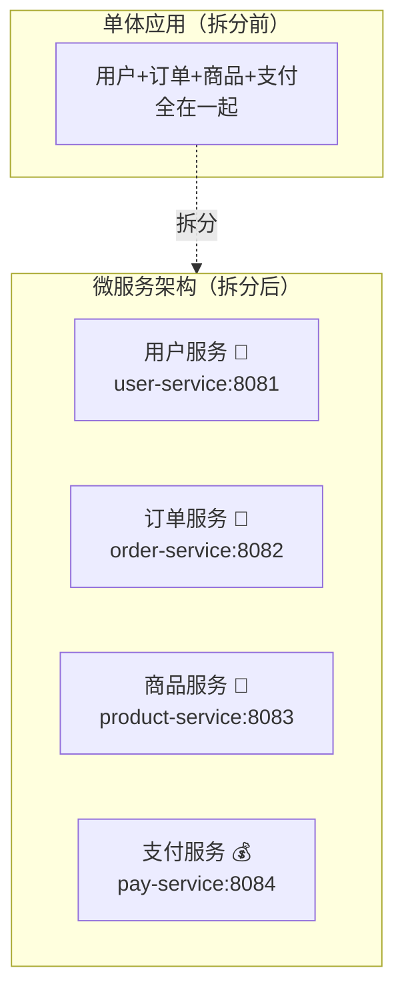

> 💡 **一句话记住**：微服务 = 拆！独立部署、独立数据库、独立崩溃互不拖累～

### 1.3 拆完之后的新烦恼 🤔

拆是拆爽了，但新问题像雨后蘑菇一样冒出来：

| 新烦恼                | 通俗解释           | SpringCloud 的答案        |
| ------------------ | -------------- | ---------------------- |
| 服务那么多，互相怎么找到对方？    | 电话簿在哪？         | **注册中心**（Nacos/Eureka） |
| 一个服务有 3 台机器，请求发给谁？ | 雨露均沾怎么分？       | **负载均衡**（LoadBalancer） |
| 想远程调用，代码写起来好麻烦     | 有没有像调本地方法一样爽的？ | **OpenFeign**          |
| 外面那么请求，直接打到各服务安全吗？ | 得有个大门保安吧？      | **网关**（Gateway）        |
| 100 台机器的配置文件改到吐    | 配置能统一管理吗？      | **配置中心**（Nacos Config） |
| 某个服务卡死，把整条链路拖崩     | 雪崩怎么防？         | **熔断降级**（Sentinel）     |
| 出 bug 了不知道请求走到哪一步  | 谁来跟踪请求轨迹？      | **链路追踪**（Zipkin）       |

✨ **SpringCloud 就是解决上面所有烦恼的"微服务全家桶工具箱"！**

***

## 二、SpringCloud 是什么？

### 2.1 官方定义（说人话版） 🎀

> SpringCloud 是基于 SpringBoot 的**微服务架构一站式解决方案**，它把成熟的第三方组件"包装"成统一的、Spring 风格的开发体验。

它本身**不生产组件**，它只是**优秀开源组件的搬运工 + 包装工** 📦：

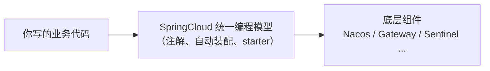

### 2.2 SpringBoot 和 SpringCloud 的关系 💑

| 对比项  | SpringBoot       | SpringCloud         |
| ---- | ---------------- | ------------------- |
| 定位   | 快速开发**单个**应用的脚手架 | 微服务**整体生态**的协调工具    |
| 比喻   | 做一块乐高积木 🧱       | 把所有积木拼成城堡 🏰        |
| 依赖关系 | 可以独立存在           | **必须基于 SpringBoot** |
| 关注点  | 简化配置、内嵌容器        | 服务治理（注册、调用、熔断、网关…）  |

> 🌟 **经典记忆口诀**：SpringBoot 专注于快速、方便地开发单个微服务个体；SpringCloud 关注**全局**的服务治理框架。

### 2.3 SpringCloud 的"两大家族"

由于 Netflix 全家桶（Eureka、Hystrix、Ribbon、Zuul）陆续停止维护（进入维护模式，只修 bug 不加新功能 😢），现在主流分两派：

| 家族                       | 包含组件                                  | 现状             |
| ------------------------ | ------------------------------------- | -------------- |
| 🇺🇸 SpringCloud Netflix | Eureka、Ribbon、Hystrix、Zuul、Feign      | 老项目常见，**停止更新** |
| 🇨🇳 SpringCloud Alibaba | Nacos、Sentinel、Seata、RocketMQ         | **目前主流推荐** ✅   |
| 🌍 SpringCloud 官方        | Gateway、LoadBalancer、OpenFeign、Config | 官方亲儿子，持续更新 ✅   |

**当下最流行的黄金组合** 🏆：

```text
Nacos（注册+配置中心）+ OpenFeign（服务调用）+ Gateway（网关）
+ LoadBalancer（负载均衡）+ Sentinel（熔断限流）+ Seata（分布式事务）
```

***

## 三、SpringCloud 技术栈全景图

### 3.1 一图看懂微服务架构 🗺️

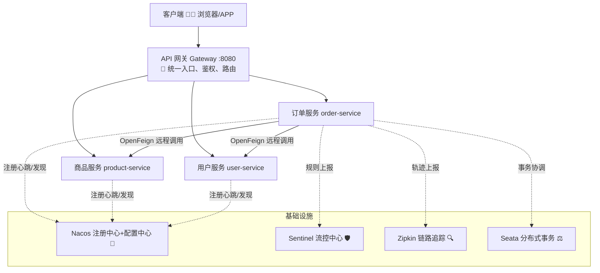

### 3.2 组件职责速查表 📋

| 组件    | 职责（说人话）        | 旧时代（Netflix）  | 新时代（主流）                     |
| ----- | -------------- | ------------- | --------------------------- |
| 注册中心  | 服务的电话簿 📖      | Eureka        | **Nacos** / Consul          |
| 配置中心  | 配置的中央仓库 🗄️    | Config        | **Nacos** / Apollo          |
| 服务调用  | 声明式远程调用 📞     | Feign         | **OpenFeign**               |
| 负载均衡  | 请求雨露均沾 ⚖️      | Ribbon        | **LoadBalancer**            |
| 服务网关  | 大门保安 🚪        | Zuul          | **Gateway**                 |
| 熔断降级  | 保险丝 🔌         | Hystrix       | **Sentinel** / Resilience4j |
| 分布式事务 | 跨服务要么全成要么全败 ⚖️ | 无             | **Seata**                   |
| 链路追踪  | 请求轨迹记录仪 🔍     | Sleuth+Zipkin | Micrometer Tracing + Zipkin |

***

## 四、版本选型与环境准备

### 4.1 版本对应关系（超重要，别踩坑！⚠️）

SpringCloud 版本号很有意思，是按 **伦敦地铁站名** 命名的（Angel、Brixton、Finchley...），首字母按 ABC 顺序迭代～

| SpringCloud 版本                 | SpringBoot 版本 | 备注             |
| ------------------------------ | ------------- | -------------- |
| 2021.0.x (Jubilee)             | 2.6.x / 2.7.x | 2.x 时代的稳定版     |
| 2022.0.x (Kilburn)             | 3.0.x / 3.1.x | JDK17 起步       |
| 2023.0.x (Leyton)              | 3.2.x         | **当前主流推荐** ✅   |
| SpringCloud Alibaba 2022.0.0.0 | 3.0.x         | 配套 Nacos 2.2.x |

> ⚠️ **血泪教训**：SpringCloud、SpringBoot、SpringCloud Alibaba 三者版本必须配套，版本错乱会出现各种玄学问题（比如 `NoSuchMethodError`）！

### 4.2 父工程 pom 示例 🧱

本教程采用主流组合：**SpringBoot 3.2.x + SpringCloud 2023.0.x + SpringCloud Alibaba 2022.0.0.0**

```xml
<!-- 父工程 pom.xml -->
<properties>
    <java.version>17</java.version>
    <spring-boot.version>3.2.4</spring-boot.version>
    <spring-cloud.version>2023.0.1</spring-cloud.version>
    <spring-cloud-alibaba.version>2023.0.1.0</spring-cloud-alibaba.version>
</properties>

<dependencyManagement>
    <dependencies>
        <!-- SpringBoot 官方依赖 -->
        <dependency>
            <groupId>org.springframework.boot</groupId>
            <artifactId>spring-boot-dependencies</artifactId>
            <version>${spring-boot.version}</version>
            <type>pom</type>
            <scope>import</scope>
        </dependency>
        <!-- SpringCloud 官方依赖 -->
        <dependency>
            <groupId>org.springframework.cloud</groupId>
            <artifactId>spring-cloud-dependencies</artifactId>
            <version>${spring-cloud.version}</version>
            <type>pom</type>
            <scope>import</scope>
        </dependency>
        <!-- SpringCloud Alibaba 依赖 -->
        <dependency>
            <groupId>com.alibaba.cloud</groupId>
            <artifactId>spring-cloud-alibaba-dependencies</artifactId>
            <version>${spring-cloud-alibaba.version}</version>
            <type>pom</type>
            <scope>import</scope>
        </dependency>
    </dependencies>
</dependencyManagement>
```

### 4.3 跑起 Nacos Server 🐳

Nacos 是 Alibaba 出品的注册中心 + 配置中心，先把它跑起来（Windows 版直接下载解压，双击 `startup.cmd`，或用 Docker）：

```bash
# Docker 一键启动 Nacos（单机模式）
docker run -d --name nacos \
  -e MODE=standalone \
  -p 8848:8848 -p 9848:9848 \
  nacos/nacos-server:v2.2.3
```

启动成功后访问：`http://localhost:8848/nacos`（默认账号密码 nacos/nacos）🎉

***

## 五、注册中心：服务的"电话簿" 📞

### 5.1 为什么需要注册中心？

想象一下：订单服务想调用户服务，可是用户服务部署了 3 台机器，IP 分别是 `192.168.1.10`、`192.168.1.11`、`192.168.1.12`……

- 把 IP 写死在代码里？→ 机器一换 IP 就全废 😱
- 新增一台机器？→ 所有调用方都要改配置 😫

**注册中心（Registry Center）** 就是解决方案：

- **服务提供者**启动时，把自己的地址"登记"上去（**服务注册**）
- **服务消费者**调用前，去"电话簿"查一下对方的地址（**服务发现**）
- 服务挂了，注册中心自动把它的号码"注销"（**健康检测**）

### 5.2 工作原理图 🧠

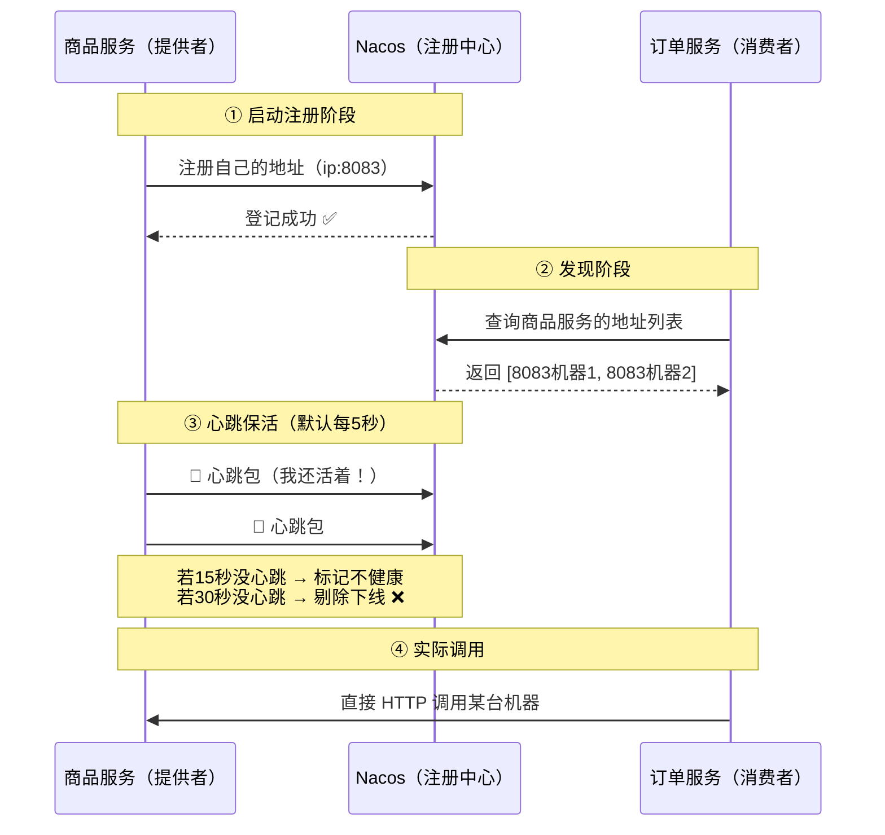

### 5.3 三大注册中心对比 🥊

| 特性     | **Nacos** ⭐   | Eureka   | Consul   | Zookeeper |
| ------ | ------------- | -------- | -------- | --------- |
| CAP 模型 | **AP/CP 可切换** | AP       | CP       | CP        |
| 一致性协议  | Raft + Distro | 无（最终一致）  | Raft     | ZAB       |
| 配置中心   | ✅ 自带          | ❌        | ✅        | 需自研       |
| 控制台    | ✅ 好看好用        | 简陋       | ✅        | ❌         |
| 健康检查   | 心跳 + 服务端探测    | 客户端心跳    | Agent 探测 | 会话保持      |
| 推荐度    | 🌟🌟🌟🌟🌟    | 🌟🌟（停更） | 🌟🌟🌟   | 🌟🌟      |

> 💡 **CAP 小课堂**：
>
> - **C（一致性）**：所有节点看到的数据一模一样
> - **A（可用性）**：每次请求都有响应（哪怕是旧数据）
> - **P（分区容错性）**：网络断开时系统还能运转（分布式必选项！）
> - 网络分区无法避免，所以只能 **CP 或 AP 二选一**。注册中心一般选 **AP**（宁可返回旧地址，也不能整个瘫痪）～

### 5.4 实战：把服务注册进 Nacos 🛠️

**第一步：引入依赖**（在 `product-service` 的 pom 里）

```xml
<dependency>
    <groupId>com.alibaba.cloud</groupId>
    <artifactId>spring-cloud-starter-alibaba-nacos-discovery</artifactId>
</dependency>
```

**第二步：写配置**

```yaml
# product-service 的 application.yml
server:
  port: 8083
spring:
  application:
    name: product-service   # 服务名 = 电话簿里的"姓名"，别人就靠它找你！
  cloud:
    nacos:
      server-addr: localhost:8848   # Nacos 的地址
```

**第三步：启动类加注解**（SpringBoot 3.x 新版本可省略，但加上更清晰）

```java
@SpringBootApplication
public class ProductApplication {
    public static void main(String[] args) {
        SpringApplication.run(ProductApplication.class, args);
    }
}
```

启动后打开 Nacos 控制台 → 服务列表，就能看到 `product-service` 躺在里面啦 🎊

### 5.5 Eureka 回顾（面试还会问！）📖

虽然 Eureka 停更了，但面试超爱考它的**自我保护机制**：

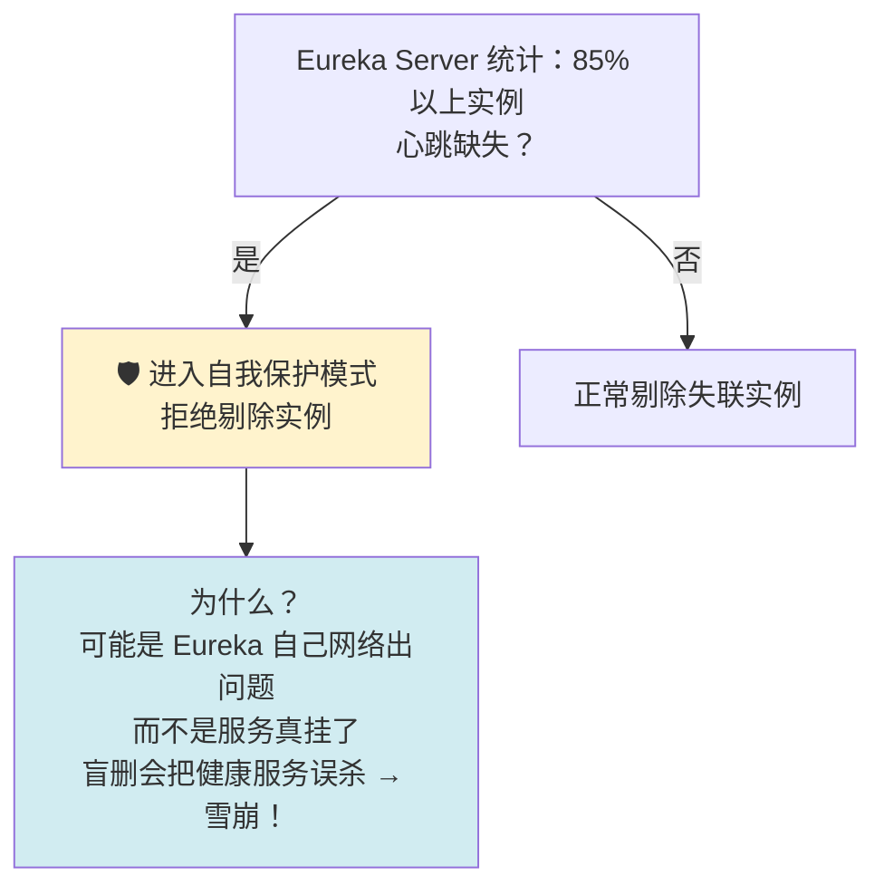

> 🌟 **一句话**：自我保护 = "宁可错杀不了，不可误杀"——心跳大量丢失时，宁可信服务还活着，也不删除注册信息！

***

## 六、服务调用：OpenFeign 像调本地方法一样调远程 🪄

### 6.1 先看原始方式有多痛苦 😩

不用 Feign 时，得手动用 `RestTemplate` 发 HTTP 请求：

```java
// 传统方式：拼接 URL，手动解析结果，又臭又长 💔
String url = "http://product-service/product/" + productId;
Product product = restTemplate.getForObject(url, Product.class);
```

问题：

- URL 写死、参数拼接容易错 ✍️
- 返回值还得手动转对象
- 负载均衡要自己管
- 风格丑！（这段代码像不像前端同学写的 AJAX？）

### 6.2 OpenFeign：声明式的优雅 ✨

**OpenFeign** 的思路：你只需要**声明一个接口**，剩下的（发请求、解析 JSON、负载均衡）框架全包了！


### 6.3 实战代码 🛠️

**第一步：引依赖**（在消费者 `order-service` 里）

```xml
<dependency>
    <groupId>org.springframework.cloud</groupId>
    <artifactId>spring-cloud-starter-openfeign</artifactId>
</dependency>
<dependency>
    <groupId>org.springframework.cloud</groupId>
    <artifactId>spring-cloud-starter-loadbalancer</artifactId>
</dependency>
```

**第二步：启动类开启 Feign**

```java
@SpringBootApplication
@EnableFeignClients   // 开启 Feign 客户端扫描 ✨
public class OrderApplication {
    public static void main(String[] args) {
        SpringApplication.run(OrderApplication.class, args);
    }
}
```

**第三步：声明接口（核心！）**

```java
/**
 * 商品服务的远程调用客户端
 * name 属性 = 目标服务在 Nacos 里注册的服务名
 */
@FeignClient(name = "product-service")
public interface ProductClient {

    /**
     * 声明这个方法 = 发 GET 请求
     * http://product-service/product/{id}
     */
    @GetMapping("/product/{id}")
    Product getProduct(@PathVariable("id") Long id);

    /** POST 新增商品 */
    @PostMapping("/product")
    Product createProduct(@RequestBody Product product);
}
```

**第四步：像调本地方法一样使用！**

```java
@Service
public class OrderService {

    @Autowired
    private ProductClient productClient;  // 注入远程接口，就问你这个不这个！😎

    public Order createOrder(Long productId) {
        // 远程调用！但写起来和本地方法一模一样～
        Product product = productClient.getProduct(productId);

        Order order = new Order();
        order.setProductId(product.getId());
        order.setProductName(product.getName());
        order.setAmount(product.getPrice());
        return order;
    }
}
```

### 6.4 Feign 性能优化：换连接器 🚀

默认用 JDK 的 `URLConnection`（性能一般），可以换成 `okhttp` 或 `apache httpclient`：

```yaml
spring:
  cloud:
    openfeign:
      okhttp:
        enabled: true   # 开启 OkHttp 连接池，性能起飞 🛫
```

| 优化项  | 做法                                  |
| ---- | ----------------------------------- |
| 连接池  | 换 OkHttp / HttpClient，避免频繁建立连接      |
| 日志级别 | 生产环境用 `NONE` 或 `BASIC`，别用 `FULL`（慢） |
| 超时设置 | 合理配置 connectTimeout / readTimeout   |

```yaml
spring:
  cloud:
    openfeign:
      client:
        config:
          default:            # 全局配置（也可写服务名单独配置）
            connect-timeout: 2000
            read-timeout: 5000
            logger-level: basic
```

***

## 七、负载均衡：雨露均沾的艺术 ⚖️

### 7.1 什么是负载均衡？

商品服务部署了 3 台机器，1000 个请求来了，总不能让一台累死、两台闲死吧？

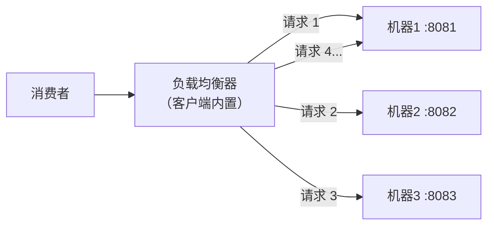

**两种模式对比**：

| 模式         | 说明                   | 代表                          |
| ---------- | -------------------- | --------------------------- |
| **集中式** LB | 独立设备统一分发             | Nginx、F5                    |
| **客户端** LB | 消费者自己从注册中心拉服务列表，本地决策 | **LoadBalancer / Ribbon** ✅ |

> 💡 SpringCloud 里的 LoadBalancer/Ribbon 属于**客户端负载均衡**：消费者自己拿到服务列表自己分，不需要中间商赚差价～

### 7.2 常见负载策略 🎯

| 策略            | 规则              | 适合场景          |
| ------------- | --------------- | ------------- |
| 轮询 RoundRobin | 1→2→3→1→2→3 排队来 | 机器配置相同时 ✅（默认） |
| 随机 Random     | 随缘抽取 🎲         | 大量请求时效果≈轮询    |
| 加权轮询          | 性能好的多干活         | 机器配置不均        |
| 最少活跃调用        | 谁最闲找谁           | 任务耗时差异大       |
| 一致性哈希         | 同一参数总是打同一台      | 有缓存/会话需求      |

### 7.3 自定义负载策略（LoadBalancer）🛠️

```java
@Configuration
public class LbConfig {

    /**
     * 把默认的轮询换成随机策略
     */
    @Bean
    public ReactorLoadBalancer<ServiceInstance> randomLoadBalancer(
            Environment environment,
            LoadBalancerClientFactory factory) {

        String name = environment.getProperty(LoadBalancerClientFactory.PROPERTY_NAME);
        return new RandomLoadBalancer(
                factory.getLazyProvider(name, ServiceInstanceListSupplier.class),
                name);
    }
}
```

> ⚠️ **坑点提示**：这个配置类**不要加** **`@Configuration`** **被全局扫描**哦（除非你想全局替换），常见做法是放在 `@FeignClient` 同包之外，再用注解局部指定，避免"污染"其他服务的策略～

***

## 八、API 网关：微服务的"大门保安" 🚪

### 8.1 为什么需要网关？

没有网关时，前端要记住 N 个服务的地址：

```text
前端 → http://api.xxx.com/user/**   （用户服务）
前端 → http://api.xxx.com/order/**  （订单服务）
前端 → http://api.xxx.com/product/**（商品服务）
```

问题：跨域处理重复、鉴权代码每个服务写一遍、内网地址暴露危险 😰

**网关（Gateway）** = 所有请求的唯一入口，统一做：

| 能力   | 说明                   |
| ---- | -------------------- |
| 路由转发 | `/order/**` → 订单服务   |
| 鉴权   | 先验 token，没登录的拦在门外 🙅 |
| 限流   | 请求太猛先掐掉一部分           |
| 跨域   | 统一处理 CORS            |
| 日志监控 | 记录所有进出流量             |

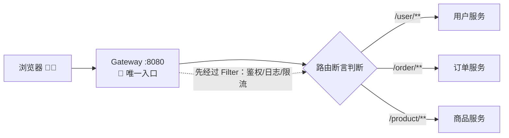

### 8.2 Gateway 三大核心概念 ⭐

| 概念               | 说明                      | 比喻          |
| ---------------- | ----------------------- | ----------- |
| **Route 路由**     | 转发规则的基本单位（目的地+条件+过滤器）   | 一条"快递线路" 📦 |
| **Predicate 断言** | 判断请求是否匹配该路由（路径、方法、请求头…） | "取件条件" 🔍   |
| **Filter 过滤器**   | 请求/响应的前置后置加工            | "安检流水线" 🛂  |

**一次请求的完整流程**：


### 8.3 实战：搭建网关 🛠️

**第一步：引依赖**（新建 `gateway-service` 模块）

```xml
<dependency>
    <groupId>org.springframework.cloud</groupId>
    <artifactId>spring-cloud-starter-gateway</artifactId>
</dependency>
<dependency>
    <groupId>com.alibaba.cloud</groupId>
    <artifactId>spring-cloud-starter-alibaba-nacos-discovery</artifactId>
</dependency>
<!-- Gateway 基于 WebFlux，别忘了负载均衡器 -->
<dependency>
    <groupId>org.springframework.cloud</groupId>
    <artifactId>spring-cloud-starter-loadbalancer</artifactId>
</dependency>
```

**第二步：配置路由规则**

```yaml
server:
  port: 8080
spring:
  application:
    name: gateway-service
  cloud:
    nacos:
      server-addr: localhost:8848
    gateway:
      routes:
        - id: order-route                # 路由唯一 id
          uri: lb://order-service        # lb:// = 从注册中心负载均衡地找服务
          predicates:
            - Path=/order/**             # 路径匹配断言
        - id: product-route
          uri: lb://product-service
          predicates:
            - Path=/product/**
          filters:
            - StripPrefix=1              # 去掉路径第1段：/product/x → /x
      globalcors:                        # 全局跨域配置
        cors-configurations:
          '[/**]':
            allowed-origin-patterns: "*"
            allowed-methods: "*"
            allowed-headers: "*"
```

> 💡 `uri` 写法区别：
>
> - `http://localhost:8083` → 写死地址（不推荐）
> - `lb://product-service` → 从 Nacos 找 + 负载均衡（**推荐** ✅）

### 8.4 常用断言 & 过滤器速查 📋

**断言（Predicate）**：

| 断言     | 例子                             | 含义              |
| ------ | ------------------------------ | --------------- |
| Path   | `Path=/order/**`               | 路径匹配            |
| Method | `Method=GET,POST`              | 请求方法匹配          |
| Header | `Header=X-Token, \d+`          | 请求头存在且匹配正则      |
| Query  | `Query=name, zhang.`           | 查询参数匹配          |
| Time   | `After=2026-01-01T00:00+08:00` | 时间之后才生效（营销活动场景） |

**过滤器（Filter）**：

| 过滤器                          | 作用           |
| ---------------------------- | ------------ |
| `StripPrefix=1`              | 去掉路径前 N 段    |
| `AddRequestHeader=X-Red, aa` | 加请求头         |
| `SetStatus=401`              | 强制改响应状态码     |
| `PrefixPath=/api`            | 加路径前缀        |
| 自定义 GlobalFilter             | 鉴权、日志等任意逻辑 ✨ |

### 8.5 自定义全局过滤器（鉴权实战）🔐

```java
@Component
public class AuthGlobalFilter implements GlobalFilter, Ordered {

    /** 白名单：这些路径不用登录 */
    private static final List<String> WHITE_LIST = List.of("/user/login", "/user/register");

    @Override
    public Mono<Void> filter(ServerWebExchange exchange, GatewayFilterChain chain) {
        String path = exchange.getRequest().getPath().toString();

        // 1. 白名单直接放行
        if (WHITE_LIST.stream().anyMatch(path::startsWith)) {
            return chain.filter(exchange);
        }

        // 2. 获取 token 并校验
        String token = exchange.getRequest().getHeaders().getFirst("Authorization");
        if (token == null || token.isBlank()) {
            exchange.getResponse().setStatusCode(HttpStatus.UNAUTHORIZED);   // 401
            return exchange.getResponse().setComplete();
        }

        // 3. 校验通过，放行～（真实项目里这里验签、查 Redis 等）
        return chain.filter(exchange);
    }

    /** 过滤器优先级，数字越小越先执行 */
    @Override
    public int getOrder() {
        return -1;
    }
}
```

***

## 九、配置中心：Nacos Config 统一管家 🗄️

### 9.1 痛点场景 😫

你有 50 台机器的订单服务，突然要改一个"满减活动开关"：

- 传统做法：改 50 份配置文件 → 重启 50 台 😭
- 配置中心做法：控制台改一处 → **全部实例秒级热更新** ✨

### 9.2 配置中心原理 🧠

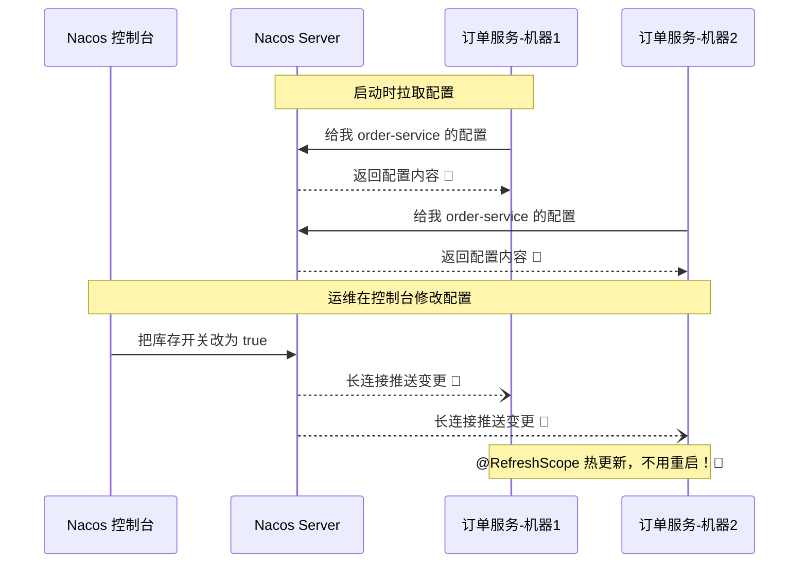

### 9.3 实战步骤 🛠️

**第一步：引依赖 + bootstrap 配置**

```xml
<dependency>
    <groupId>com.alibaba.cloud</groupId>
    <artifactId>spring-cloud-starter-alibaba-nacos-config</artifactId>
</dependency>
```

```yaml
# application.yml
spring:
  application:
    name: order-service
  config:
    import:
      - nacos:order-service-common.yaml   # 从 Nacos 导入配置（SpringBoot 2.4+ 新写法）
  cloud:
    nacos:
      server-addr: localhost:8848
```

> 💡 Nacos 中配置文件的 DataId 命名规则：`${spring.application.name}-${profile}.${file-extension}`，如 `order-service-dev.yaml`

**第二步：在 Nacos 控制台创建配置**

```yaml
# Nacos 控制台里的 order-service-common.yaml
order:
  promotion: true        # 满减活动开关
  discount-limit: 100
```

**第三步：热更新读取**

方式一：`@Value` + `@RefreshScope`

```java
@RestController
@RefreshScope    // 配置变了，这个 Bean 会自动重建，值自动刷新 ✨
public class OrderController {

    @Value("${order.promotion}")
    private Boolean promotion;

    @GetMapping("/promotion")
    public String check() {
        return promotion ? "满减活动进行中 🎉" : "活动结束啦";
    }
}
```

方式二：`@ConfigurationProperties`（**推荐**，自动刷新不用加 `@RefreshScope`）

```java
@Data
@Component
@ConfigurationProperties(prefix = "order")
public class OrderProperties {
    private Boolean promotion;
    private Integer discountLimit;
}
```

***

## 十、服务保护：Sentinel 熔断降级限流三件套 🛡️

### 10.1 先认识"雪崩效应" ⛄💥

微服务链路：`A → B → C`。如果 C 挂了/卡了：

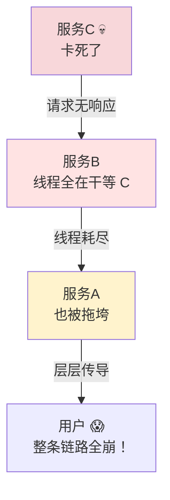

> 💡 **雪崩**：一个服务故障，像多米诺骨牌一样层层拖垮整条链路！
> 根因：**同步调用 + 线程阻塞等待**。

### 10.2 三兄弟的区别（必考！）🥊

| 概念     | 英文            | 干什么                   | 比喻               |
| ------ | ------------- | --------------------- | ---------------- |
| **限流** | Rate Limiting | 请求太多，只放一部分进来，多的直接拒绝   | 景区限流，超过1万人不让进 🎫 |
| **熔断** | Circuit Break | 发现下游故障，直接"跳闸"短路，不再调用它 | 家里短路跳闸，保护电器 ⚡    |
| **降级** | Fallback      | 熔断/异常后，返回个"兜底方案"而不是报错 | 外卖没了 → 吃泡面 🍜    |

三者关系：**限流是入口防御，熔断是故障隔离，降级是优雅善后**，配合食用效果最佳～

### 10.3 Sentinel 使用实战 🛠️

Sentinel 有两个身份：**客户端依赖**（引入后自动埋点）+ **控制台**（可视化配置规则）。

**第一步：引依赖 + 配置**

```xml
<dependency>
    <groupId>com.alibaba.cloud</groupId>
    <artifactId>spring-cloud-starter-alibaba-sentinel</artifactId>
</dependency>
```

```yaml
spring:
  cloud:
    sentinel:
      transport:
        dashboard: localhost:8085   # Sentinel 控制台地址
      eager: true                   # 项目一启动就连接控制台（懒加载关闭）
```

**第二步：下载并启动 Sentinel Dashboard**（一个 jar 包）

```bash
java -jar sentinel-dashboard-1.8.6.jar --server.port=8085
```

> ⚠️ 注意：控制台需要**手动点一次请求**（或者 eager:true）之后才能在页面上看到服务，因为它是懒注册的哦～

**第三步：代码定义资源 + 降级兜底**

```java
@RestController
public class ProductController {

    /**
     * @SentinelResource 定义资源名，并指定降级方法
     */
    @GetMapping("/product/{id}")
    @SentinelResource(value = "getProduct",
                      blockHandler = "getProductBlockHandler",     // 限流/熔断时的兜底
                      fallback = "getProductFallback")             // 业务异常时的兜底
    public Product getProduct(@PathVariable Long id) {
        return productService.findById(id);
    }

    /** 限流兜底：注意参数要多一个 BlockException */
    public Product getProductBlockHandler(Long id, BlockException e) {
        Product p = new Product();
        p.setName("人太多啦，稍后再试～ 🐢");
        return p;
    }

    /** 异常兜底 */
    public Product getProductFallback(Long id, Throwable e) {
        Product p = new Product();
        p.setName("服务开小差了 🛠️");
        return p;
    }
}
```

> 🌟 `blockHandler` vs `fallback` 的区别：
>
> - `blockHandler`：**Sentinel 规则触发**（被限流/熔断）时走
> - `fallback`：**代码本身抛异常**时走
> - 参数都要和原方法一致，前者多 `BlockException`，后者多 `Throwable`

### 10.4 熔断器的三种状态 🔄

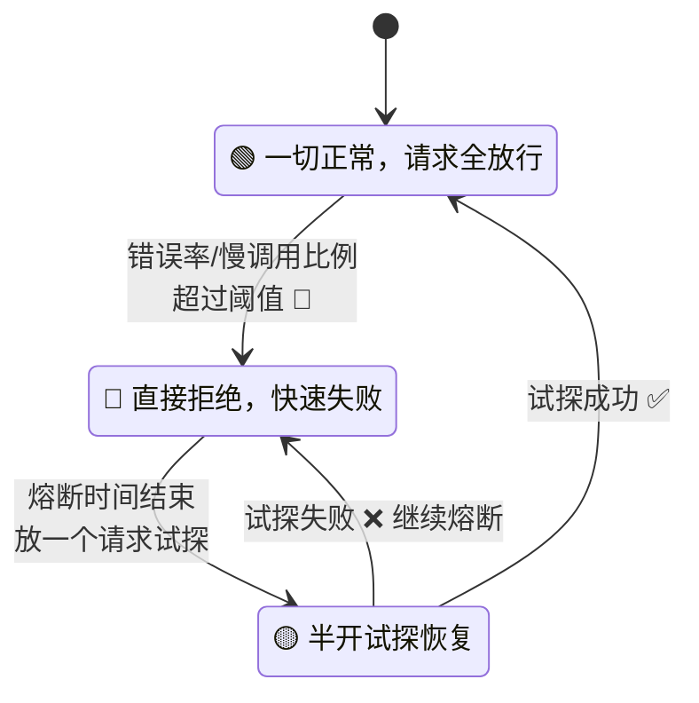

### 10.5 常见限流算法（面试高频！）📊

| 算法      | 思路              | 优点       | 缺点             |
| ------- | --------------- | -------- | -------------- |
| 计数器     | 1秒一个窗口，超了就拒     | 简单       | 临界突刺（窗口边缘2倍流量） |
| 滑动窗口    | 大窗口切小格，滑动统计     | 平滑临界问题   | 实现稍复杂          |
| 漏桶      | 请求进桶，匀速流出 🫗    | 流量绝对平滑   | 无法应对突发         |
| **令牌桶** | 匀速发令牌，有令牌才放行 🎫 | 允许一定突发流量 | ——（主流选择 ✅）     |

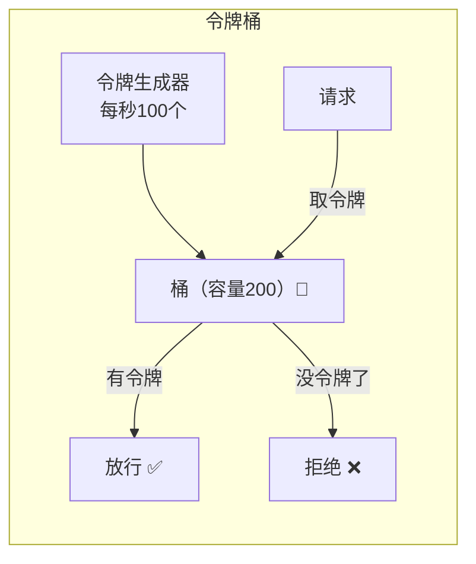

***

## 十一、分布式事务：Seata 跨服务也要讲信用 ⚖️

### 11.1 问题场景 💸

下单业务 = `订单服务扣库存`（成功 ✅）+ `账户服务扣钱`（失败 ❌）→ 钱没扣，库存少了！**数据不一致了！**

> 单体里靠 `@Transactional` 就能回滚，但跨服务跨数据库，本地事务管不着别人家的事务呀 😭

### 11.2 CAP & BASE 理论（前置知识）📚

| 理论       | 核心内容                   | 一句话                          |
| -------- | ---------------------- | ---------------------------- |
| **CAP**  | C 一致性、A 可用性、P 分区容错，三选二 | 网络必出问题（P 必选），所以是 CP 或 AP 二选一 |
| **BASE** | 基本可用 + 软状态 + 最终一致      | 放弃强一致，换取可用性，最终能对上账就行         |

### 11.3 分布式事务方案对比 🥊

| 模式                 | 原理                           | 一致性  | 侵入性         |
| ------------------ | ---------------------------- | ---- | ----------- |
| **2PC/XA**         | 协调者问大家"能提交吗"→全部 yes 才提交      | 强一致  | 低，但性能差、同步阻塞 |
| **Seata AT**（推荐 ⭐） | 一阶段本地提交+记录 undo\_log，二阶段自动补偿 | 最终一致 | **几乎零侵入**   |
| **TCC**            | 手写 Try/Confirm/Cancel 三个方法   | 最终一致 | 高（业务侵入大）    |
| **Saga**           | 长事务拆成小事务+补偿                  | 最终一致 | 需写补偿逻辑      |
| **消息最终一致**         | MQ 事务消息 + 对账                 | 最终一致 | 中           |

### 11.4 Seata AT 模式流程 🧠

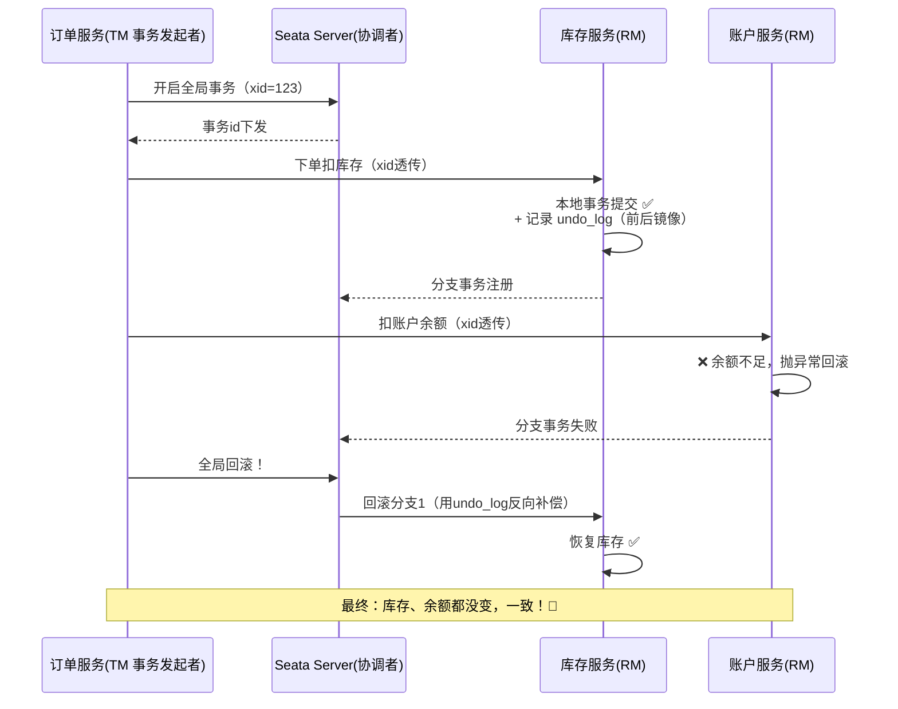

### 11.5 实战：一行注解搞定 💫

```java
@Service
public class OrderService {

    @GlobalTransactional   // 就这一行！开启全局分布式事务 ✨
    public void createOrder(OrderDTO dto) {
        orderMapper.insert(order);                    // 本地：建订单
        storageClient.deduct(dto.getProductId());     // 远程：扣库存
        accountClient.deduct(dto.getUserId());        // 远程：扣钱（若失败，全部回滚！）
    }
}
```

***

## 十二、链路追踪：请求去哪儿了？ 🔍

### 12.1 问题：微服务"查案"太难了 🕵️

一个请求穿过 8 个服务，报错了，日志分散在 8 台机器里，怎么还原"案发现场"？

**链路追踪** 给每个请求发一个"身份证"：**TraceId**，所有经过的服务都带着它打日志！

### 12.2 核心概念 📖

| 概念          | 说明                         |
| ----------- | -------------------------- |
| **Trace**   | 一次完整请求的轨迹（一个 TraceId 串起来）  |
| **Span**    | 轨迹中的一段（比如"调用商品服务"是一个 Span） |
| **父子 Span** | 订单服务(父) → 商品服务(子)，形成调用树    |

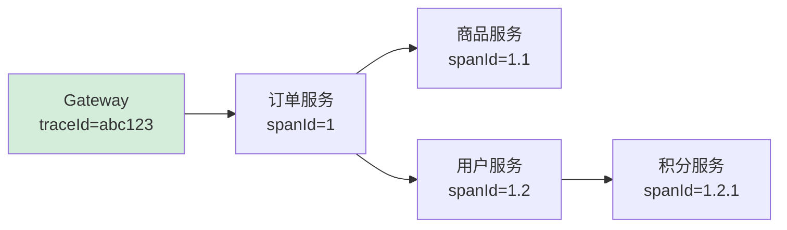

### 12.3 实战（SpringBoot 3.x 新方案）🛠️

> 旧版是 Sleuth + Zipkin；SpringBoot 3.x 后 Sleuth 停更，换成 **Micrometer Tracing + Zipkin**

```xml
<dependency>
    <groupId>io.micrometer</groupId>
    <artifactId>micrometer-tracing-bridge-brave</artifactId>
</dependency>
<dependency>
    <groupId>io.zipkin.reporter2</groupId>
    <artifactId>zipkin-reporter-brave</artifactId>
</dependency>
```

```yaml
management:
  tracing:
    sampling:
      probability: 1.0    # 采样率，1.0=全采样（生产建议0.1）
  zipkin:
    tracing:
      endpoint: http://localhost:9411/api/v2/spans
```

启动 Zipkin：`docker run -d -p 9411:9411 openzipkin/zipkin`
打开 `http://localhost:9411` 就能看到瀑布图啦，哪个服务耗时最长一目了然 📊

***

## 十三、完整小案例：电商下单流程 🛍️

把前面学的组件串起来！项目结构：

```text
springcloud-demo
├── gateway-service        # 网关 :8080
├── order-service          # 订单 :8081
├── product-service        # 商品 :8083
└── pom.xml                # 父工程统一管版本
```

### 13.1 下单时序图 🎬

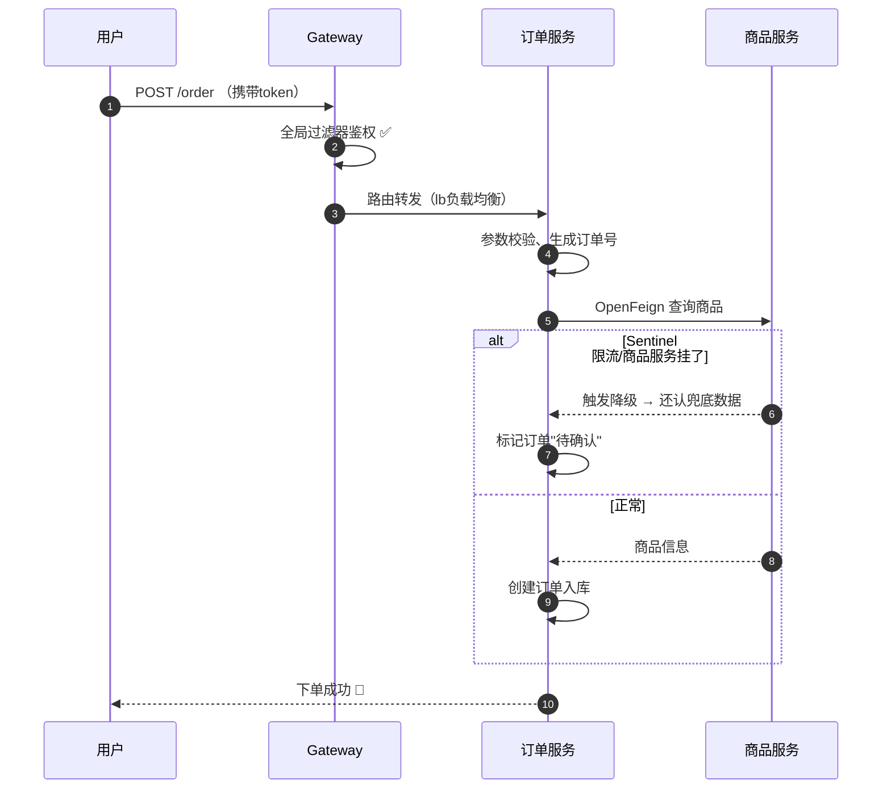

### 13.2 关键代码回顾 👀

```java
// order-service 的 OrderController
@RestController
@RequestMapping("/order")
@RefreshScope
public class OrderController {

    @Autowired
    private OrderService orderService;

    @Value("${order.promotion}")
    private Boolean promotion;

    @PostMapping
    @SentinelResource(value = "createOrder", blockHandler = "busyHandler")
    public Result<OrderVO> create(@RequestBody OrderDTO dto) {
        return Result.ok(orderService.createOrder(dto));
    }

    public Result<OrderVO> busyHandler(OrderDTO dto, BlockException e) {
        return Result.fail("下单人数过多，喝口水再试呀～ 🍵");
    }
}
```

```java
// 远程调用 + 熔断降级工厂
@FeignClient(name = "product-service",
             fallback = ProductClientFallback.class)
public interface ProductClient {
    @GetMapping("/product/{id}")
    Product getProduct(@PathVariable("id") Long id);
}

/** 降级类：实现 Feign 接口，服务挂了就返回兜底数据 */
@Component
public class ProductClientFallback implements ProductClient {
    @Override
    public Product getProduct(Long id) {
        Product p = new Product();
        p.setName("商品信息加载中～（兜底数据）");
        return p;
    }
}
```

> ⚠️ Feign 的 fallback 要生效，记得开启：
>
> ```yaml
> spring:
>   cloud:
>     openfeign:
>       circuitbreaker:
>         enabled: true
> ```

***

## 十四、面试高频问题 考点冲刺 🎯

### Q1：SpringCloud 和 SpringBoot 的区别？

> SpringBoot 负责快速开发**单个服务**（自动装配、内嵌容器）；SpringCloud 是**服务治理框架**（注册发现、负载均衡、熔断、网关…），必须基于 SpringBoot。**Boot 专注个体，Cloud 治理全局**。

### Q2：Eureka 和 Nacos 的区别？

| 对比   | Eureka    | Nacos                    |
| ---- | --------- | ------------------------ |
| CAP  | AP        | AP/CP 可切换（临时实例AP，持久实例CP） |
| 配置中心 | 无         | 有 ✅                      |
| 健康检查 | 客户端心跳     | 心跳 + 服务端主动探测             |
| 控制台  | 简陋        | 功能丰富 ✅                   |
| 现状   | 停更 2.x 闭源 | 持续活跃 ✅                   |

### Q3：负载均衡策略有哪些？Ribbon 和 LoadBalancer 区别？

> 策略：轮询、随机、加权、最少活跃、一致性哈希。
> Ribbon 是 Netflix 的（停更），LoadBalancer 是 Spring 官方替代品，策略上目前主要轮询（可自定义），支持懒加载配置。

### Q4：Feign 的工作原理？

> ① 启动扫描 `@FeignClient` 接口 → ② 为接口生成 JDK 动态代理 → ③ 调用方法时代理解析注解构建 HTTP 请求 → ④ LoadBalancer 选服务实例 → ⑤ 发请求并反序列化结果。

### Q5：Gateway 的三大核心 + 工作流程？

> Route（路由）、Predicate（断言）、Filter（过滤器）。流程：请求 → 断言匹配路由 → 前置 Filter → 转发目标服务（lb）→ 后置 Filter → 响应。
> 底层基于 **WebFlux + Netty**（响应式非阻塞），所以 Gateway 工程里**不能有 SpringMVC 的依赖**！

### Q6：熔断、降级、限流的区别？

> **限流**防流量洪峰（入口控制数量）；**熔断**防故障扩散（下游坏了就短路不再调用）；**降级**是熔断/异常后的兜底方案（返回默认值、友好提示）。限流保自己，熔断保链路，降级保体验。

### Q7：Sentinel 和 Hystrix 区别？

| 对比   | Sentinel       | Hystrix        |
| ---- | -------------- | -------------- |
| 隔离策略 | 信号量隔离（并发线程数）   | 线程池隔离（默认）/ 信号量 |
| 熔断策略 | 慢调用比例/异常比例/异常数 | 异常比例           |
| 实时规则 | 控制台动态推送 ✅      | 需改代码重启         |
| 流量整形 | 支持排队、预热 ✅      | 不支持            |
| 控制台  | 开箱即用 ✅         | 简陋             |
| 现状   | 活跃 ✅           | 停更 💤          |

### Q8：Seata AT 模式的两阶段？

> **一阶段**：业务 SQL 执行 + 记录 undo\_log（前后镜像）+ 本地事务**直接提交**，并注册分支事务。
> **二阶段**：全局成功 → 删除 undo\_log（异步，快）；全局失败 → 用 undo\_log **反向补偿**回滚。
> 关键：一阶段就提交本地事务释放连接，所以性能好～

***

## 十五、总结与学习路线 🎓

### 15.1 核心组件一张表带走 🎁

| 需求       | 组件                    | 一句话                                 |
| -------- | --------------------- | ----------------------------------- |
| 服务怎么找到彼此 | **Nacos** 注册中心        | 电话簿：注册+发现+心跳                        |
| 远程调用写太烦  | **OpenFeign**         | 声明式接口，像本地方法一样调                      |
| 请求分给哪台机器 | **LoadBalancer**      | 客户端负载均衡，默认轮询                        |
| 统一入口和鉴权  | **Gateway**           | 断言匹配路由 + 过滤器链                       |
| 配置统一热更新  | **Nacos Config**      | 控制台改一处，全服务生效                        |
| 防雪崩      | **Sentinel**          | 限流+熔断+降级三件套                         |
| 跨服务事务    | **Seata**             | @GlobalTransactional + undo\_log 补偿 |
| 查请求轨迹    | **Micrometer+Zipkin** | TraceId 串起全链路                       |

### 15.2 学习路线图 🗺️

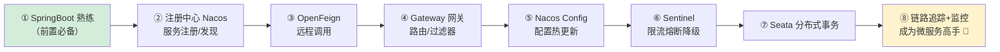

### 15.3 给姐妹们的学习建议 💝

1. **先跑通再深究**：先把 Nacos + Feign 的小 demo 跑起来，成就感拉满再回来抠原理 🏃‍♀️
2. **版本配套是第一坑**：SpringBoot/Cloud/Alibaba 版本必须匹配，先查官方对照表！
3. **多画图**：注册发现、熔断状态机这些，画一遍 mermaid 图胜过看十遍文章 📝
4. **面试导向**：CAP/BASE、组件对比、熔断降级限流区别，是高频考点，重点背～

***

> 🌸 **恭喜你读完啦！** SpringCloud 的核心组件都过了一遍～
> 下一步建议动手把第十三章的小案例完整搭一遍，代码敲过才是自己的哦！加油加油 💪✨

