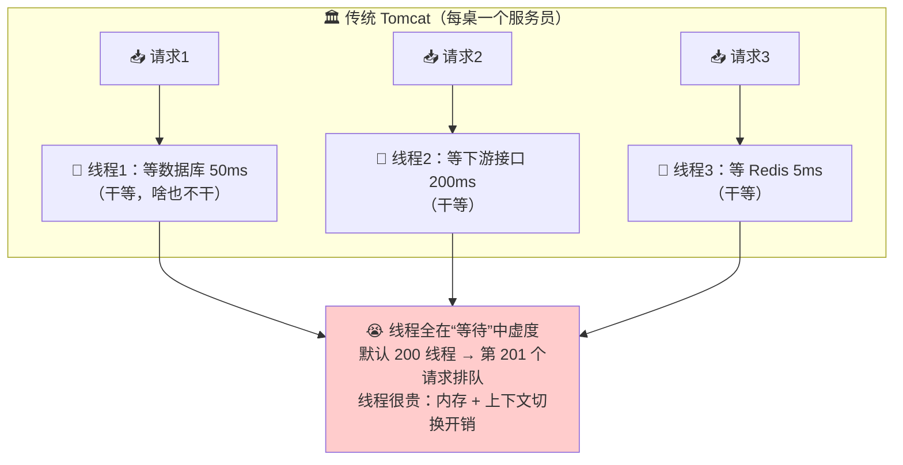
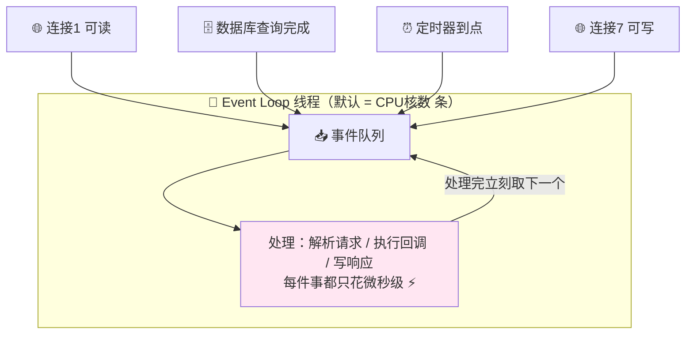
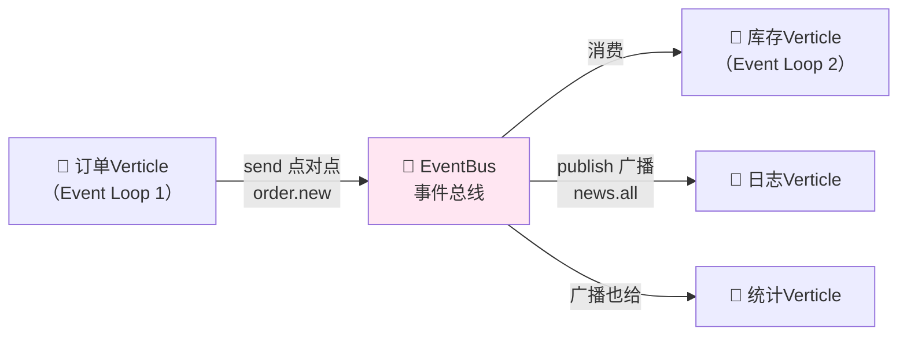
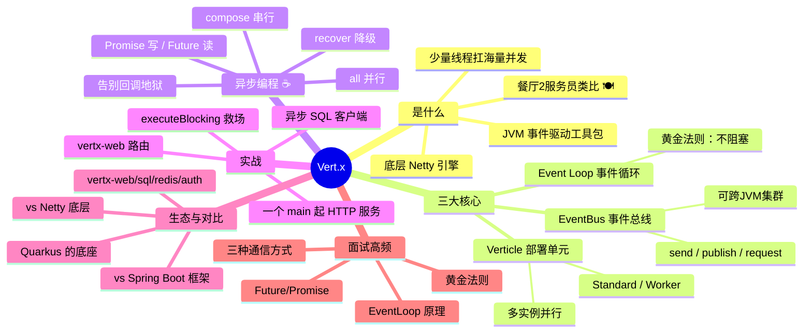

# Vert.x 异步编程 从入门到实战 🚀

> 欢迎来到 Vert.x 小课堂！💖 传统 Spring Boot 一台服务器几十个线程就"满员"了，想用**少量线程扛海量并发**？今天的主角 **Vert.x**——JVM 上的**事件驱动、非阻塞异步工具包**，一台小机器扛几万连接不在话下！学完这篇，Event Loop、Verticle、EventBus 这些酷炫概念全都拿下～
>
> **学习目标**：
> - 🎯 搞懂 Vert.x 是什么、和 Spring Boot/Netty 的关系
> - 🎯 掌握三大核心：Event Loop、Verticle、EventBus
> - 🎯 会写异步 HTTP 服务、Future 组合、事件总线通信
> - 🎯 记住黄金法则：**永远不要阻塞 Event Loop**！
>
> **前置知识**：Java 基础（Lambda、泛型）、了解线程/线程池概念～

---

## 一、初识 Vert.x：为什么需要它？🌱

### 1.1 传统 Web 服务器的线程烦恼

Tomcat 的经典玩法（**一请求一线程**）：



**痛点**：大部分时间线程根本不在算东西，在**傻等 IO**（数据库、HTTP、Redis）！长连接（WebSocket）场景更是"一线程焊死一个连接"，万人在线 = 一万线程 = 直接爆炸 💥

### 1.2 Vert.x 的解法：少量线程 + 谁好了叫谁

> **Vert.x** 是 Eclipse 基金会出品的 **JVM 事件驱动工具包**（Toolkit，不是框架！）——用**极少量 Event Loop 线程**处理海量连接，IO 全部异步回调：**"登记个电话，好了叫我"** 📞

**餐厅类比** 🍽️：

| | 传统模型 | Vert.x 模型 |
|---|---|---|
| 服务员 | **每桌专属 1 名**（一请求一线程） | **2 个服务员看全场**（Event Loop） |
| 点菜 | 站在桌边干等客人想好 😐 | 记下菜单就去别桌，**菜好了广播叫号** 🔔 |
| 100 桌客人 | 需要 100 个服务员 | 还是 2 个服务员，忙而不乱 ✅ |

> 💡 事件驱动思想的代表：前端 Node.js、Nginx、Netty——**Vert.x = Netty 引擎 + 更友好的编程模型**（还带全家桶生态）！

### 1.3 Vert.x 是"工具包"不是"框架"

| | 框架（Spring Boot） | 工具包（Vert.x） |
|---|---|---|
| 风格 | "听我的"：约定优于配置，接管一切 | "听你的"：提供积木，自由拼装 |
| 定位 | 应用容器 + 全家桶 | **嵌入到你程序里的一组库** |
| 甚至可以 | — | **和 Spring Boot 混用**（在 Spring 里嵌 Vert.x 完全 OK！） |

---

## 二、三大核心概念 🧩⭐（必须搞懂！）

### 2.1 Event Loop：永不停歇的柜台小姐 🎡

**Event Loop（事件循环）**：一条（或几条）**永不阻塞**的线程，循环干一件事——**从事件队列取事件 → 快速处理 → 取下一个**。



> ⚠️ **黄金法则（背下来！）**：**Never block the Event Loop！** Event Loop 上严禁：`Thread.sleep()`、同步 JDBC、耗时 `for` 循环、锁等待……**一个慢操作会卡住队列里所有事件**——整条服务瘫痪！Vert.x 有"哨兵"（BlockedThreadChecker）会在日志里大声警告 `Thread blocked` 😤

### 2.2 Verticle：你的业务积木 🧱

**Verticle** = Vert.x 的**部署单元**（一段部署到 Vert.x 运行时的代码），类似微型的"Actor"：

```java
// ☕ 一个最简单的 Verticle
public class MyFirstVerticle extends AbstractVerticle {

    @Override
    public void start(Promise<Void> startPromise) {
        vertx.createHttpServer()                       // 拿到 HTTP 服务器
             .requestHandler(req -> req.response()
                     .end("Hello Vert.x! 🚀"))          // 注册回调（不阻塞！）
             .listen(8080)
             .onSuccess(v -> startPromise.complete())   // 监听成功 → 启动完成
             .onFailure(e -> startPromise.fail(e));     // 失败 → 启动失败
    }
}
```

| 类型 | 跑在哪 | 用途 |
|---|---|---|
| **Standard Verticle** | Event Loop ⚡ | 绝大多数业务（IO 异步） |
| **Worker Verticle** | 专用线程池 🧵 | 不得不阻塞的任务（同步 JDBC、重计算） |
| 多实例 | 部署 N 份 | 轻松并行（如 `deploymentOptions.setInstances(4)`） |

### 2.3 EventBus：Verticle 间的微信群里 📢

**Event Bus（事件总线）**：Verticle 之间**不直接调用**，通过总线**异步收发消息**——Vert.x 的"神经系统"！



| 通信方式 | API | 语义 |
|---|---|---|
| **点对点** | `send(address, msg)` | 多个消费者，**只有一个**收到（轮询挑一个） |
| **发布/订阅** | `publish(address, msg)` | **所有**订阅者都收到 |
| **请求/响应** | `request(address, msg, replyHandler)` | 发消息并等回复（异步回调） |

---

## 三、快速上手：第一个 Vert.x 应用 ☕🚀

### 3.1 引依赖

```xml
<dependency>
    <groupId>io.vertx</groupId>
    <artifactId>vertx-core</artifactId>
    <version>4.5.7</version>
</dependency>
<!-- Web 路由支持（类似 Spring MVC 的 @GetMapping） -->
<dependency>
    <groupId>io.vertx</groupId>
    <artifactId>vertx-web</artifactId>
    <version>4.5.7</version>
</dependency>
```

### 3.2 Hello World HTTP 服务（对比 Spring Boot）

```java
// ☕ Main.java —— 无需注解、无需脚手架，一个 main 就能跑！
public class Main {
    public static void main(String[] args) {
        Vertx vertx = Vertx.vertx();                    // ① 创建 Vert.x 实例

        vertx.deployVerticle(new MyFirstVerticle())     // ② 部署 Verticle
             .onSuccess(id -> System.out.println("🚀 部署成功 id=" + id))
             .onFailure(e -> e.printStackTrace());
    }
}
```

浏览器打开 `http://localhost:8080` → `Hello Vert.x! 🚀`——就这么多！

### 3.3 用 vertx-web 写 REST 接口

```java
// ☕ ProductVerticle.java —— 路由 + JSON 返回
public class ProductVerticle extends AbstractVerticle {

    @Override
    public void start(Promise<Void> startPromise) {
        Router router = Router.router(vertx);            // 路由器（对标 Spring MVC）

        // GET /api/product/1
        router.get("/api/product/:id").handler(ctx -> {
            String id = ctx.pathParam("id");             // 取路径参数
            JsonObject product = new JsonObject()
                    .put("id", id)
                    .put("name", "可爱抱枕")
                    .put("price", 99.9);
            ctx.response()
               .putHeader("Content-Type", "application/json")
               .end(product.encode());                   // 返回 JSON
        });

        // POST /api/order（读请求体）
        router.post("/api/order").handler(ctx -> {
            ctx.request().bodyHandler(body -> {          // 异步拿 body
                JsonObject order = body.toJsonObject();
                ctx.response().end("下单成功：" + order.getString("productId"));
            });
        });

        vertx.createHttpServer()
             .requestHandler(router)
             .listen(8080)
             .onSuccess(v -> startPromise.complete());
    }
}
```

---

## 四、异步灵魂：Future 与 Promise 🔮⭐

同步代码 `User u = dao.findById(1)` 到了异步世界怎么办？答案是 **Future**（未来结果凭证）：

### 4.1 三个角色一张表

| 角色 | 含义 | 类比 |
|---|---|---|
| **Future** | **读取方**持有的"未来结果"凭证 | 取餐小票 🎫 |
| **Promise** | **写入方**用来兑现/撕票的凭证 | 后厨叫号器 🔔 |
| Handler/回调 | 结果好了执行的函数 | 广播"XX号取餐" |

```java
// ☕ Promise 用法：自己写一个异步方法
public Future<String> fetchName(long userId) {
    Promise<String> promise = Promise.promise();          // 创建凭证
    vertx.setTimer(100, id -> {                           // 模拟异步查询
        if (userId > 0) {
            promise.complete("小明" + userId);             // ✅ 兑现
        } else {
            promise.fail("用户不存在");                     // ❌ 失败
        }
    });
    return promise.future();                              // 把"小票"给调用方
}
```

### 4.2 Future 组合：告别回调地狱！（核心技能 ⭐）

回调套回调套回调 = "回调地狱"😈。Vert.x Future 提供链式组合：

```java
// ☕ 串行组合：查用户 → 查订单 → 组装结果
fetchUser(1L)                                   // Future<User>
    .compose(user -> fetchOrders(user.getId())) // .compose：上一步结果喂给下一步
    .compose(orders -> buildResult(orders))
    .onSuccess(result -> System.out.println("✅ " + result))
    .onFailure(err  -> System.err.println("❌ " + err));

// ☕ 并行组合：同时查用户和库存，全好了再继续
Future.all(fetchUser(1L), fetchStock("SKU-42"))
      .onSuccess(cf -> {
          User user    = cf.resultAt(0);        // 第 1 个结果
          Integer stock = cf.resultAt(1);       // 第 2 个结果
          System.out.println(user + " 库存：" + stock);
      });

// ☕ 兜底：失败时给默认值（服务降级思想！）
fetchRecommend()
      .recover(err -> Future.succeededFuture("猜你喜欢（兜底）"))
      .onSuccess(System.out::println);
```

| 组合方法 | 作用 |
|---|---|
| `compose(fn)` | **串行**：上一步结果 → 下一步 |
| `Future.all(f1, f2)` | **并行**：全成功才成功 |
| `Future.any(f1, f2)` | 任一成功即成功（竞速） |
| `recover(fn)` | 失败兜底（降级） |
| `map(fn)` | 转换结果类型 |

---

## 五、EventBus 实战：Verticle 间通话 ☎️⭐

```java
// ☕ 消费者：库存 Verticle 监听地址
public class StockVerticle extends AbstractVerticle {

    @Override
    public void start() {
        // 点对点：处理订单扣减请求（request-reply 模式）
        vertx.eventBus().<JsonObject>consumer("stock.deduct", msg -> {
            String sku = msg.body().getString("sku");
            System.out.println("📦 收到扣减请求：" + sku);
            msg.reply(new JsonObject().put("success", true));   // 异步回复！
        });

        // 发布订阅：监听全局广播
        vertx.eventBus().consumer("news.all", msg -> {
            System.out.println("📢 收到广播：" + msg.body());
        });
    }
}
```

```java
// ☕ 生产者：订单 Verticle 发消息（request-reply 版）
public Future<Boolean> deductStock(String sku) {
    return vertx.eventBus()
            .<JsonObject>request("stock.deduct",                       // 目标地址
                    new JsonObject().put("sku", sku))
            .map(resp -> resp.body().getBoolean("success"));            // Future 包装回复
}
```

> 💡 EventBus 还能配 **Clustered EventBus**（ Hazelcast/Infinispan）：**跨 JVM、跨机器**的 Verticle 也能互相发消息——多台机器组一个大 Vert.x 集群，是不是有点微服务消息总线的味道了！🌉

---

## 六、必须阻塞时怎么办？Worker 来救场 🧵

Event Loop 不能阻塞，但同步 JDBC、调老 SDK、重计算躲不掉——三种出路：

```java
// ☕ 方式一：executeBlocking —— 临时借 Worker 线程池跑阻塞代码
vertx.executeBlocking(promise -> {
    String result = heavySyncJdbcQuery();       // 😅 同步阻塞操作放这里
    promise.complete(result);
}).onSuccess(result -> {
    System.out.println("✅ 结果回到 Event Loop：" + result);   // 回调自动切回 Event Loop！
});

// ☕ 方式二：部署成 Worker Verticle —— 整个 Verticle 都跑在 Worker 池
vertx.deployVerticle("com.demo.SyncDbVerticle",
        new DeploymentOptions().setWorker(true));

// ☕ 方式三（推荐）：用 Vert.x 原生异步客户端 —— vertx-jdbc / redis / mongo / sql-client
```

| 方案 | 场景 |
|---|---|
| `executeBlocking` | 偶尔的阻塞调用 |
| Worker Verticle | 整块逻辑都阻塞（老系统桥接） |
| **异步客户端** ⭐ | 正解！vertx-sql-client 等原生异步 |

---

## 七、生态全家桶 & 知名用户 🌍

| 模块 | 作用（对标 Spring 生态） |
|---|---|
| vertx-web | 路由/中间件/静态资源（≈ Spring MVC） |
| vertx-web-client / circuit-breaker | 异步 HTTP 客户端 / 熔断器（≈ RestTemplate + Resilience4j） |
| vertx-jdbc-client / mysql/postgreSQL-client | **异步数据库**（≈ JDBC/JPA，但非阻塞） |
| vertx-redis-client | 异步 Redis |
| vertx-config | 配置加载（≈ @Value + 配置中心） |
| vertx-service-discovery | 服务发现（≈ Nacos Discovery） |
| vertx-auth / vertx-micrometer-metrics | 认证 / 监控指标 |
| **Quarkus** 🎀 | 基于 Vert.x 的云原生框架（K8s 时代当红炸子鸡，GRPC/响应式全家桶） |

**谁在用**：Red Hat（Quarkus 底层）、Eclipse、很多游戏/IM/物联网网关项目……**一句话：高并发长连接、低延迟网关、消息驱动场景的天菜！**

---

## 八、Vert.x vs Spring Boot vs Netty 🥊（面试必会！）

| 维度 | Spring Boot | **Vert.x** | Netty |
|---|---|---|---|
| 定位 | 全家桶**框架** | 事件驱动**工具包** | 网络编程**底层框架** |
| 线程模型 | 一请求一线程（可异步） | **Event Loop 少量线程** ⚡ | Event Loop（Reactor） |
| 编程体验 | 同步为主、注解简单 | **异步回调**（有学习曲线） | 极底层、自己写协议 |
| 生态 | 🏆 无敌全（注册/配置/网关…） | 中等（核心齐全） | 基础网络层 |
| 万人长连接 | 吃力（线程爆炸） | 😎 轻松 | 😎 轻松 |
| 典型场景 | 业务管理系统 | 高并发网关/IM/IoT | 所有中间件的底层（Dubbo/ES/Redis客户端） |
| 关系 | 可**内嵌** Vert.x | 底层就是 **Netty** | 是 Vert.x 的发动机 🛞 |

> 🎀 **选型口诀**：**业务快糙猛选 Spring Boot，海量连接选 Vert.x，自研中间件才碰 Netty**！而且 Vert.x 能嵌进 Spring Boot——网关部分用 Vert.x，业务部分用 Spring，混搭也香～

---

## 九、常见坑速查表 🕳️

| 现象 | 原因 | 解法 |
|---|---|---|
| 日志疯狂刷 `Thread ... has been blocked for 2000 ms` | 在 Event Loop 里写了阻塞代码 | 移到 `executeBlocking` / Worker Verticle / 换异步客户端 |
| 接口偶发"卡死"整组请求 | 某个 handler 里一次同步慢查询**堵住队列** | 同上（黄金法则！） |
| `ConcurrentModificationException` | 多个 Verticle 共享可变集合 | 用 Vert.x 提供的并发容器（`SharedData`：`ConcurrentHashMap`/异步 Map） |
| 回调嵌套太深没法读 | 回调地狱 | **Future.compose 链式**（第四章） |
| 调试时不知道代码跑哪个线程 | Event Loop 线程名类似 `vert.x-eventloop-0` | 打 `Thread.currentThread().getName()` 观察；`vertx.isOnEventLoopThread()` 判断 |
| Context 数据串了/取不到 | Vert.x 有自己的 Context（非 ThreadLocal） | 用 `Vertx.currentContext().put()/get()` |
| 数据库连接很快耗尽 | 异步太快、并发查询爆炸 | 客户端连接池设上限 + 限流 |

---

## 十、高频面试题速答 🎯

| 问题 | 精简答案 |
|---|---|
| Vert.x 是什么？ | 基于 JVM 的**事件驱动、非阻塞异步工具包**，底层用 Netty，用少量 Event Loop 线程支撑海量并发 |
| Vert.x 和 Netty 的关系？ | Netty 是网络通信引擎；Vert.x 在其上提供更高层抽象（Verticle/EventBus/Future/全家桶），开发效率高一个量级 |
| 什么是 Event Loop？ | 一条永不阻塞的线程，循环从事件队列取事件处理（IO 就绪、定时器、回调），少量线程服务海量连接 |
| Vert.x 的黄金法则？ | **不阻塞 Event Loop**——阻塞代码会卡住整条事件队列；用 executeBlocking/Worker/异步客户端解决 |
| Verticle 是什么？有哪几类？ | Vert.x 的部署单元（类 Actor 模型）；Standard（Event Loop 跑）、Worker（线程池跑阻塞任务），可部署多实例并行 |
| EventBus 是什么？三种通信方式？ | Verticle 间异步消息总线：send 点对点（一个消费者）、publish 广播（全部）、request-reply 请求应答 |
| Future 和 Promise 的区别？ | Promise 是**写入方**兑现结果的凭证，Future 是**读取方**等待结果的句柄；`promise.future()` 返回关联 Future |
| 异步编程怎么避免回调地狱？ | Future 链式组合：`compose` 串行、`Future.all` 并行、`recover` 兜底降级 |
| 什么时候不用 Vert.x？ | 重 CPU 计算（本就吃满线程）、团队不熟异步、需要 Spring 全家桶生态的常规业务系统 |
| Vert.x 如何做到高并发？ | Netty NIO 多路复用 + 事件驱动回调（线程不等待 IO）+ 少量 Event Loop（省上下文切换）+ 异步客户端全家桶 |

---

## 十一、知识总结地图 🗺️



> 🎀 **毕业寄语**：Vert.x 的世界观一句话——**"线程不傻等，事件来驱动"**！先把第三章的 HTTP 服务跑起来，再用 Future 把两三个异步调用串成链（第四章），你会突然开窍：原来高并发不一定靠堆机器堆线程，**换一种"等"的姿势**就够了！之后看 Netty、Reactor（WebFlux）也是一通百通～ 加油！💪✨
