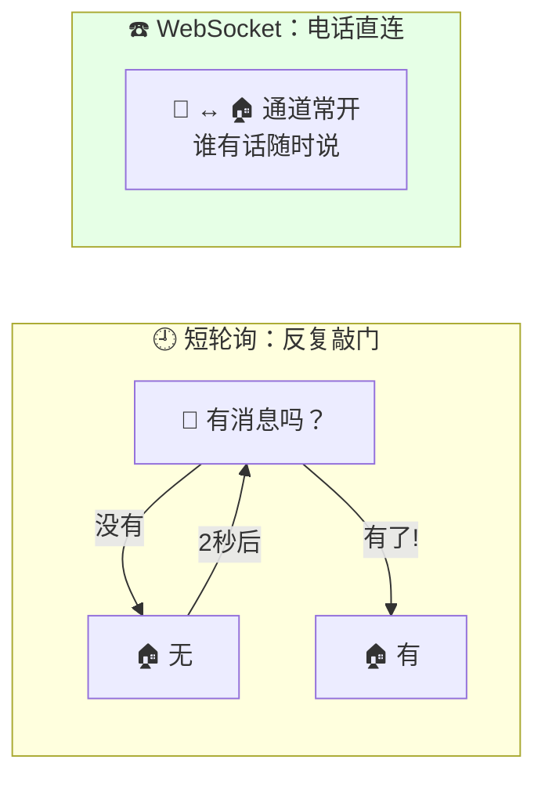
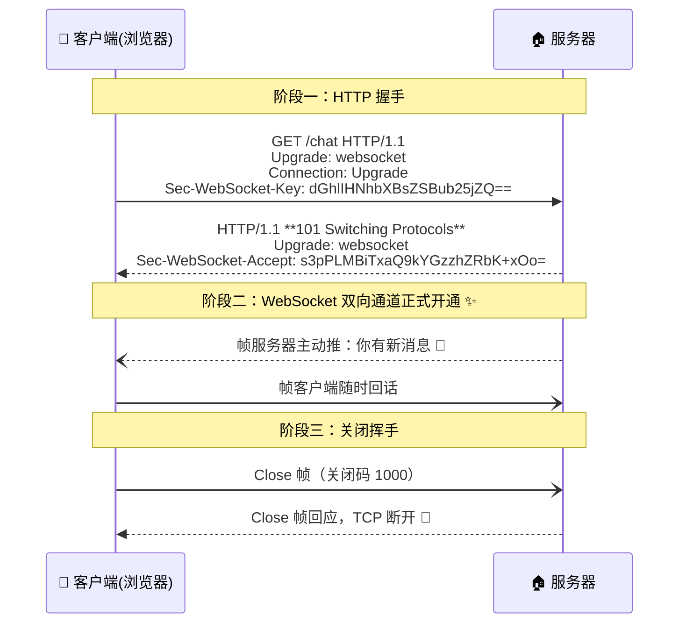
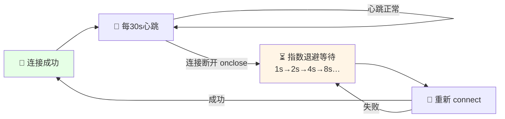
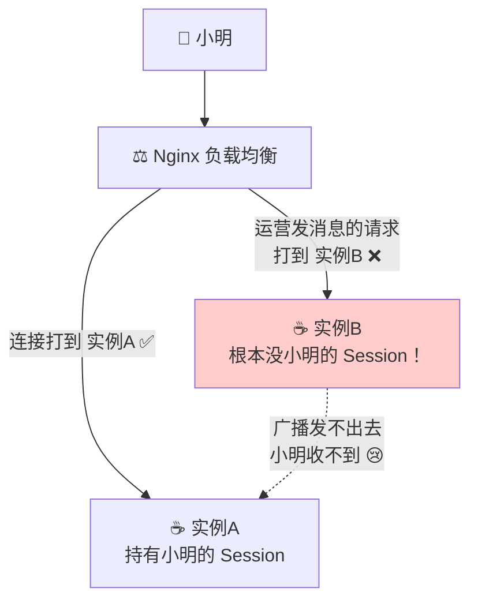
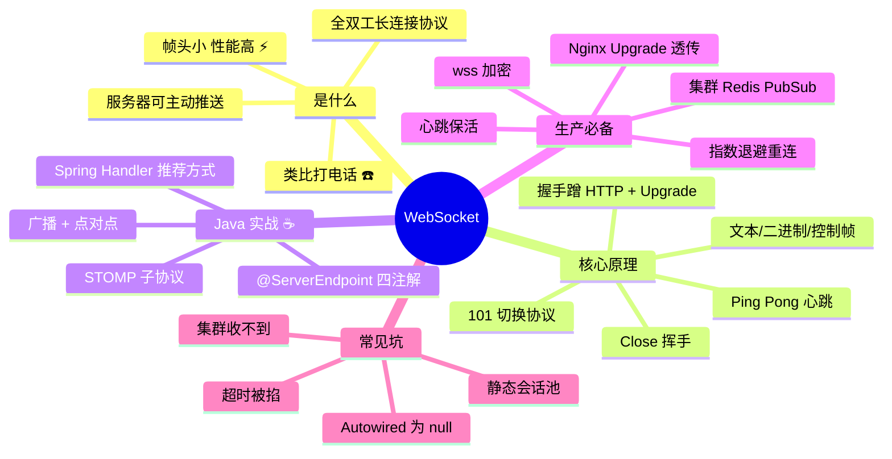

# WebSocket 从入门到实战 ☎️

> 欢迎来到 WebSocket 小课堂！💖 HTTP 只能"你问我答"，想让**服务器主动推消息**给浏览器？聊天、通知、行情推送全靠今天的主角——**WebSocket，浏览器和服务器之间的全双工电话线**！学完这篇，你就能亲手写一个在线聊天室啦～
>
> **学习目标**：
> - 🎯 搞懂 WebSocket 是什么、和 HTTP 的本质区别
> - 🎯 掌握握手原理（蹭 HTTP 敲门 → 101 切换协议）
> - 🎯 会用 Java 写服务端 + JS 写客户端，实现广播/点对点
> - 🎯 会解决集群部署、断线重连、Nginx/K8s 配置这些实战大坑
>
> **前置知识**：HTTP 基础、Spring Boot 基础～

---

## 一、为什么需要 WebSocket？🌱

### 1.1 HTTP 的先天限制

HTTP 是**请求-响应**模型：**客户端不问，服务器打死不能说** 🤐。可是很多场景偏偏需要服务器主动推：

- 💬 聊天：别人发消息给你，服务器得"喊"你一声
- 🔔 订单状态变了、站内信来了
- 📈 股票行情：每秒都在变
- 🎮 多人游戏：对手动了要同步

### 1.2 没有 WebSocket 的"土办法"

| 方案 | 原理 | 缺点 |
|---|---|---|
| **短轮询** ⏰ | 前端每隔 2 秒问一次"有新消息吗？" | 大部分白问，浪费请求；消息延迟最多 2 秒 |
| **长轮询** ⏳ | 服务器 hold 住请求 30 秒，有消息才返回 | 稍好，但每次返回后要重连，仍是一问一答 |
| **SSE** 📡 | 服务器单向持续推（基于 HTTP 流） | 只能服务器→客户端**单向**，且是文本 |



### 1.3 WebSocket 一句话定义

> **WebSocket** 是一种在**单个 TCP 连接**上进行**全双工通信**的协议（RFC 6455）——握手成功后，客户端和服务器**随时互发消息**，连接一直保持！

| 对比 | HTTP 🗣️ | WebSocket ☎️ |
|---|---|---|
| 通信方式 | 请求-响应（一问一答） | **全双工**（双向随时说） |
| 服务器主动推 | ❌ | ✅ 天生支持 |
| 连接生命周期 | 短连接，完事就挂 | 握手后**持久保持** |
| 报文开销 | 每次都带完整 HTTP 头（几百字节起） | 帧头仅 **2~14 字节** ⚡ |
| 数据格式 | 文本为主 | 文本 + 二进制都行 |
| 比喻 | 去柜台问路 🚶 | 打电话畅聊 📞 |

> 💡 **一句话记住**：HTTP 是"传纸条"，WebSocket 是"打电话"！

---

## 二、核心原理：握手、帧、挥手 🧭（重点！）

### 2.1 握手：蹭 HTTP 敲门 🔪

WebSocket 复用 HTTP 完成握手，之后"过河拆桥"切换协议：



**握手要点**：

| 字段 | 作用 |
|---|---|
| `Upgrade: websocket` | "我要升级协议！" |
| `Connection: Upgrade` | "这次连接要升级" |
| `Sec-WebSocket-Key` | 客户端随机串（防老式缓存代理乱入） |
| **`101 Switching Protocols`** | 服务器同意换协议的标志性状态码 ⭐ |
| `Sec-WebSocket-Accept` | 服务器用 Key + 固定魔法串做 SHA-1 运算回传，客户端校验合法性 |

### 2.2 数据帧：极简快递包裹 📦

握手后传输的是 WebSocket **帧（Frame）**：

- 帧头超小：**2~14 字节**（HTTP 头动辄几百字节，这就是它快的原因 ⚡）
- 支持三种类型：**文本帧**（字符串/JSON）、**二进制帧**（文件/图片/Protobuf）、**控制帧**（Ping/Pong 心跳、Close）
- 大消息会自动**分片**（fragment）传输

> 🩺 **心跳保活**：TCP 连接长时间没数据，可能被路由器/防火墙/负载均衡悄悄掐掉。所以一般每 30~60 秒发一个 **Ping 帧**，对方回 **Pong 帧**——证明"我还活着"！（后面代码实战会写～）

### 2.3 协议格式速览

```text
ws://host:port/path      ← 明文 WebSocket（类比 http://）
wss://host:port/path     ← 加密 WebSocket（类比 https://，生产必备 🔒）
```

---

## 三、Java 实战一：原生注解版聊天室 ☕⭐

> 用 JDK 自带的 `jakarta.websocket`（旧版是 `javax.websocket`）注解，三分钟写个广播聊天室！

### 3.1 引依赖（Spring Boot 项目）

```xml
<dependency>
    <groupId>org.springframework.boot</groupId>
    <artifactId>spring-boot-starter-websocket</artifactId>
</dependency>
```

### 3.2 服务端核心代码

```java
// ☕ ChatServerEndpoint.java —— 原生注解版 WebSocket 服务端
@ServerEndpoint("/chat/{username}")   // 每个连接的 URI，{username} 是路径参数
@Component
public class ChatServerEndpoint {

    /** 在线会话池：key = sessionId，所有连接都存这里（静态共享！） */
    private static final Map<String, Session> SESSIONS = new ConcurrentHashMap<>();

    /** 连接建立 */
    @OnOpen
    public void onOpen(Session session, @PathParam("username") String username) {
        SESSIONS.put(session.getId(), session);
        System.out.println("👋 [" + username + "] 上线，当前在线：" + SESSIONS.size());
        broadcast("📢 " + username + " 进入聊天室");
    }

    /** 收到消息：遍历会话池广播给所有人 */
    @OnMessage
    public void onMessage(String message, @PathParam("username") String username) {
        broadcast("💬 " + username + "：" + message);
    }

    /** 连接关闭：从池子里移除 */
    @OnClose
    public void onClose(Session session, @PathParam("username") String username) {
        SESSIONS.remove(session.getId());
        broadcast("👋 " + username + " 离开了");
    }

    /** 出错 */
    @OnError
    public void onError(Session session, Throwable e) {
        System.err.println("连接异常：" + e.getMessage());
        SESSIONS.remove(session.getId());
    }

    /** 广播工具方法：给所有在线的人发消息 */
    private void broadcast(String message) {
        SESSIONS.values().forEach(s -> {
            if (s.isOpen()) {
                s.getAsyncRemote().sendText(message);   // 异步发送，不阻塞
            }
        });
    }
}
```

### 3.3 客户端（浏览器 JS）

```html
<!-- ☕ chat.html —— 前端直连测试 -->
<script>
    // 1️⃣ 建立连接（注意：@ServerEndpoint 每个连接是新实例，username 走路径）
    const socket = new WebSocket("ws://localhost:8080/chat/小明");

    // 2️⃣ 连接成功
    socket.onopen = () => console.log("☎️ 已连接服务器！");

    // 3️⃣ 收到服务器消息
    socket.onmessage = (event) => console.log("📩", event.data);

    // 4️⃣ 随时发消息（双向！）
    socket.send("大家好呀～");

    // 5️⃣ 连接关闭
    socket.onclose = (event) => console.log("👋 已断开，code =", event.code);
</script>
```

**四大生命周期注解速记**：

| 注解 | 触发时机 | 类比 |
|---|---|---|
| `@OnOpen` | 连接建立 | 接通电话 📞 |
| `@OnMessage` | 收到消息 | 对方说话 🗣️ |
| `@OnClose` | 连接关闭 | 挂断 👋 |
| `@OnError` | 出错 | 串线/掉线 😵 |

> ⚠️ **大坑预警**：`@ServerEndpoint` 类**每个连接会 new 一个新实例**！所以会话池必须用 `static` + 并发安全容器（ConcurrentHashMap），不然广播就失效啦～

---

## 四、Java 实战二：Spring 配置化版（推荐 ⭐⭐）

> 原生注解和 Spring 生态（拦截器、注入 Service）整合不太好，**生产推荐 Spring 的 Handler 方式**：

```java
// ☕ 1. 定义 Handler：处理连接生命周期
public class ChatWebSocketHandler extends TextWebSocketHandler {

    private static final Set<WebSocketSession> SESSIONS = new CopyOnWriteArraySet<>();

    @Override
    public void afterConnectionEstablished(WebSocketSession session) {
        SESSIONS.add(session);                          // 上线
        System.out.println("👋 上线：" + session.getId());
    }

    @Override
    protected void handleTextMessage(WebSocketSession session, TextMessage message) throws Exception {
        // 收到消息 → 广播给所有人
        for (WebSocketSession s : SESSIONS) {
            if (s.isOpen()) {
                s.sendMessage(new TextMessage(message.getPayload()));
            }
        }
    }

    @Override
    public void afterConnectionClosed(WebSocketSession session, CloseStatus status) {
        SESSIONS.remove(session);                       // 下线
    }
}
```

```java
// ☕ 2. 注册端点 + 允许跨域
@Configuration
@EnableWebSocket
public class WebSocketConfig implements WebSocketConfigurer {

    @Override
    public void registerWebSocketHandlers(WebSocketHandlerRegistry registry) {
        registry.addHandler(new ChatWebSocketHandler(), "/ws/chat")
                .setAllowedOrigins("*");          // 跨域放行（生产改成白名单！）
    }
}
```

```java
// ☕ 3. 点对点私聊：给"指定用户"发（Session 里塞 userId）
@Override
public void afterConnectionEstablished(WebSocketSession session) {
    String userId = (String) session.getAttributes().get("userId");
    userSessionMap.put(userId, session);      // key=用户ID 的会话池
}

/** 给指定用户推消息（通知场景超常用！） */
public void sendToUser(String userId, String message) throws IOException {
    WebSocketSession session = userSessionMap.get(userId);
    if (session != null && session.isOpen()) {
        session.sendMessage(new TextMessage(message));
    }
}
```

> 💡 **鉴权技巧**：握手前用 `HandshakeInterceptor` 校验 token（从 URL 参数或子协议头里拿），把用户信息塞进 `attributes`，后续 Handler 随取随用～

---

## 五、进阶：心跳保活 + 断线重连 💪

真实网络环境（手机切 WiFi、NAT 超时、Nginx 超时）连接随时可能悄悄断掉，**心跳 + 重连是生产必备**！

### 5.1 服务端心跳（Java）

```java
// ☕ 简易心跳：每 30 秒 Ping 一次，60 秒没响应就踢掉
@Override
public void afterConnectionEstablished(WebSocketSession session) {
    SESSIONS.add(session);
    session.getAttributes().put("lastPong", System.currentTimeMillis());
}

@Scheduled(fixedRate = 30000)                        // 别忘了 @EnableScheduling
public void heartbeat() throws IOException {
    long now = System.currentTimeMillis();
    for (WebSocketSession s : SESSIONS) {
        Long lastPong = (Long) s.getAttributes().get("lastPong");
        if (now - lastPong > 60000) {
            s.close(CloseStatus.GOING_AWAY);         // 超时没心跳 → 踢！
        } else {
            s.sendMessage(new PingMessage());        // 发 Ping 帧
        }
    }
}

@Override
protected void handlePongMessage(WebSocketSession session, PongMessage message) {
    session.getAttributes().put("lastPong", System.currentTimeMillis()); // 记录存活时间
}
```

### 5.2 前端断线重连（JS，指数退避）

```javascript
// ☕ reconnect.js —— 断线自动重连 + 心跳
class ReconnectingSocket {
    constructor(url) {
        this.url = url;
        this.retryCount = 0;
        this.connect();
    }

    connect() {
        this.socket = new WebSocket(this.url);

        this.socket.onopen = () => {
            console.log("✅ 连接成功");
            this.retryCount = 0;                              // 重置重试次数
            this.startHeartbeat();                            // 开心跳
        };

        this.socket.onclose = () => {
            this.stopHeartbeat();
            this.reconnect();                                 // 掉线 → 自动重连
        };

        this.socket.onmessage = (e) => console.log("📩", e.data);
    }

    reconnect() {
        // 指数退避：1s 2s 4s 8s... 最大 30s，防止服务器崩溃时被重连打爆
        const delay = Math.min(1000 * 2 ** this.retryCount, 30000);
        this.retryCount++;
        console.log(`⏳ ${delay / 1000}s 后重连...`);
        setTimeout(() => this.connect(), delay);
    }

    startHeartbeat() {
        this.timer = setInterval(() => {
            if (this.socket.readyState === WebSocket.OPEN) {
                this.socket.send(JSON.stringify({ type: "ping" }));
            }
        }, 30000);
    }

    stopHeartbeat() { clearInterval(this.timer); }
}

new ReconnectingSocket("ws://localhost:8080/ws/chat");
```



---

## 六、进阶：STOMP 子协议（Spring 秒变消息队列风）📬

> 裸 WebSocket 就是一根"水管"，消息格式全靠自己约定。**STOMP** 在水管上定义了 `SEND/SUBSCRIBE/MESSAGE` 指令——像订阅频道一样用，Spring 支持超好！

```java
// ☕ 服务端：启用 STOMP + 消息代理
@Configuration
@EnableWebSocketMessageBroker
public class StompConfig implements WebSocketMessageBrokerConfigurer {

    @Override
    public void registerStompEndpoints(StompEndpointRegistry registry) {
        registry.addEndpoint("/ws")                  // 握手端点
                .setAllowedOriginPatterns("*")
                .withSockJS();                       // 不支持 WS 的浏览器自动降级
    }

    @Override
    public void configureMessageBroker(MessageBrokerRegistry registry) {
        registry.enableSimpleBroker("/topic", "/queue");  // 广播 & 队列前缀
        registry.setApplicationDestinationPrefixes("/app"); // 请求前缀
    }
}

// ☕ Controller：像写 MVC 一样处理消息
@Controller
public class ChatStompController {

    @MessageMapping("/chat")                 // 客户端发到 /app/chat
    @SendTo("/topic/messages")               // 处理结果广播到 /topic/messages
    public ChatMessage send(ChatMessage message) {
        return message;                      // 所有订阅者都能收到！
    }
}
```

```javascript
// ☕ 前端用 STOMP 客户端（stompjs）
const client = new StompJs.Client({
    brokerURL: "ws://localhost:8080/ws",
    onConnect: () => {
        client.subscribe("/topic/messages", (msg) => {   // 📬 订阅频道
            console.log("收到广播：", JSON.parse(msg.body));
        });
        client.publish({ destination: "/app/chat",       // 📤 发消息
                         body: JSON.stringify({ content: "大家好～" }) });
    }
});
client.activate();
```

> 🎀 **什么时候用 STOMP**：聊天室分频道、点对点投递、要和 RabbitMQ 等真消息代理打通时超香；简单推送用裸 WebSocket 就够～

---

## 七、集群部署：最大的生产大坑！⚠️⭐

### 7.1 问题：Session 不跨 JVM！

单机时 Session 池在内存里没问题；但服务一旦部署 **2 个实例**：



> 实例 B 收到"给小明推消息"的请求，但它内存里没有小明的 Session——**消息石沉大海**！

### 7.2 三种解法

| 方案 | 原理 | 优缺点 |
|---|---|---|
| **粘性会话** 🩹 | Nginx 按 IP hash 把同一用户固定到同一实例 | 简单；但实例挂了 Session 全丢，不均衡 |
| **Redis Pub/Sub 广播** 📢 | 推消息时发到 Redis 频道，**所有实例**都收到，各自检查"这个用户在不在我这" | 主流方案 ⭐，无状态化 |
| **MQ 广播**（RabbitMQ/Kafka） | 同上，用消息队列代替 Redis | 适合大规模、可持久化 |

```java
// ☕ Redis Pub/Sub 方案核心代码
@Service
public class PushService {

    @Autowired
    private StringRedisTemplate redisTemplate;

    /** 业务方调用：把消息扔进 Redis 频道（不直接碰本地 Session！） */
    public void pushToUser(String userId, String message) {
        redisTemplate.convertAndSend("ws:push",
                JSON.toJSONString(new PushMsg(userId, message)));
    }
}

/** 每个实例都订阅该频道：收到后看用户在不在自己这 */
@Component
public class PushSubscriber implements MessageListener {

    @Override
    public void onMessage(Message message, byte[] pattern) {
        PushMsg msg = JSON.parseObject(new String(message.getBody()), PushMsg.class);
        WebSocketSession session = userSessionMap.get(msg.getUserId());
        if (session != null && session.isOpen()) {      // 在我这 → 我来发！
            session.sendMessage(new TextMessage(msg.getContent()));
        }                                                  // 不在 → 无视（别的实例发）
    }
}
```

---

## 八、Nginx / K8s 配置（联动前作 🎁）

### 8.1 Nginx 反向代理 WebSocket（必背！）

```nginx
# ☕ Nginx 配置：让 Upgrade 头透传过去
http {
    # map：把 $http_upgrade 映射成 Connection 头的值
    map $http_upgrade $connection_upgrade {
        default upgrade;
        ''      close;      # 普通 HTTP 请求 → 正常关闭
    }

    server {
        listen 80;

        location /ws/ {
            proxy_pass http://127.0.0.1:8080;
            proxy_http_version 1.1;
            proxy_set_header Upgrade    $http_upgrade;          # ⭐ 关键！
            proxy_set_header Connection $connection_upgrade;    # ⭐ 关键！
            proxy_set_header Host      $host;
            proxy_read_timeout 3600s;    # ⭐ 空闲超时调大，长连接不被掐
        }
    }
}
```

> 🎀 **记不住就背口诀**：**"一 map 二 set 头，timeout 拉长久"**——`Upgrade`、`Connection` 两个头不透传，握手必失败（浏览器报 `WebSocket connection to ... failed`）！

### 8.2 K8s 部署注意

| 项 | 说明 |
|---|---|
| Ingress-Nginx | 默认支持 WS 透传，超时可用注解 `proxy-read-timeout` 调大 |
| Service | 单用户会话固定在一个 Pod，可配 `sessionAffinity: ClientIP`；更推荐**第七章 Redis 广播方案** |
| 优雅停机 | 收到 SIGTERM 后先发 Close 帧、等连接排空再退出（联动 K8s terminationGracePeriodSeconds） |

---

## 九、常见坑速查表 🕳️

| 现象 | 原因 | 解法 |
|---|---|---|
| 连接握手直接 404 | 端点路径没注册 / 依赖没引 | 检查 `@ServerEndpoint` / `registry.addHandler` 路径 |
| 浏览器报 `failed: Error during WebSocket handshake` | Nginx 没透传 Upgrade 头 | 配 map + `proxy_set_header Upgrade` |
| 连上一会儿就自动断 | Nginx `proxy_read_timeout`（默认 60s）掐线 / 没心跳 | 调大超时 + 客户端定时心跳 |
| `@ServerEndpoint` 里 `@Autowired` 为 null | 该类每连接新实例，脱离 Spring 管理 | 用 SpringUtils 手动取 Bean，或改用 Spring Handler 方式 |
| 跨域连接被拒 | `setAllowedOrigins` 没配 | 配白名单（生产别用 `*`） |
| 集群下用户收不到消息 | Session 不跨实例 | Redis Pub/Sub 广播（第七章） |
| 手机锁屏/切后台就断 | 系统省电杀连接 | 前端断线重连（指数退避） |
| 生产环境连不上 | 用了 `ws://` 但页面是 `https://` | 混合内容被浏览器拦截，改用 `wss://` 🔒 |

---

## 十、高频面试题速答 🎯

| 问题 | 精简答案 |
|---|---|
| WebSocket 和 HTTP 的区别？ | HTTP 请求-响应单向、短连接；WebSocket **全双工、长连接**，服务器可主动推，帧头开销极小 |
| WebSocket 握手过程？ | 客户端发带 `Upgrade/Connection/Sec-WebSocket-Key` 的 HTTP 请求 → 服务器回 **101 Switching Protocols** + Accept → 升级为 WS 协议 |
| 服务器怎么主动推送？还有别的方案吗？ | WebSocket/SSE；轮询和长轮询是模拟推送，浪费连接 |
| WebSocket 和 SSE 的区别？ | SSE 基于 HTTP、只能服务器→客户端单向、仅文本、自动重连；WS 双向、支持二进制 |
| 怎么保活？ | Ping/Pong 控制帧心跳（30~60s），配合 Nginx `proxy_read_timeout` 调大 |
| 断线怎么办？ | 前端 `onclose` 触发**指数退避重连**，重连成功重新订阅/补拉离线消息 |
| 集群部署消息推不到？ | Session 在各实例内存不共享 → Redis Pub/Sub 或 MQ 广播，所有实例收到后各自判断用户是否在本机 |
| Nginx 代理 WS 为什么要两个头？ | WS 握手借 HTTP `Upgrade` 机制，反代默认丢弃这些头，必须显式 `proxy_set_header Upgrade/Connection` 透传 |
| `@ServerEndpoint` 有什么坑？ | 每连接一个新实例（非单例），共享数据要 static 并发容器，注入 Bean 需手动获取 |

---

## 十一、知识总结地图 🗺️



> 🎀 **毕业寄语**：WebSocket 的灵魂就一句——**"一次握手，双向常聊"**！建议把第三章的聊天室亲手跑起来，再一步步加心跳、重连、Redis 广播，把坑全踩一遍，你就是团队里最懂实时通信的崽！💪✨
