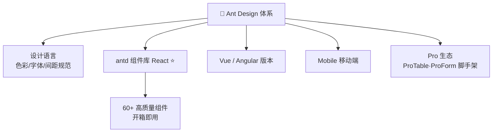
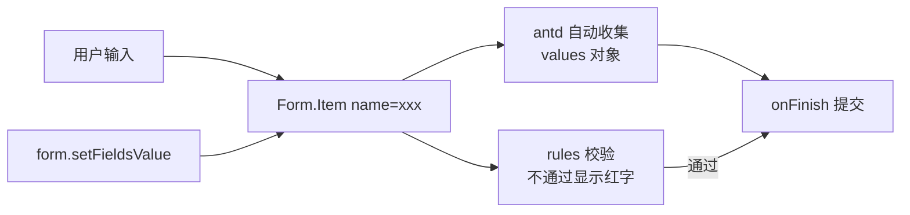
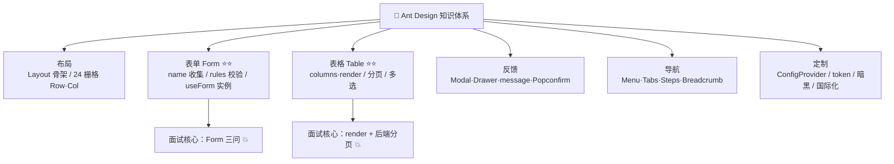

# 🐜 Ant Design 学习笔记 —— 中后台组件库之王 👑

> 嘿嘿～欢迎来到 Ant Design 的小课堂！🎀
> 表格、表单、弹窗...中后台页面的零件全部现成供应！
> 蚂蚁集团出品，打工人摸鱼（划掉）搬砖必备神器！(๑•̀ㅂ•́)و✧

---

## 📚 目录

| 章节 | 内容 | 难度 |
| --- | --- | --- |
| 一 | Ant Design 是什么？ | ⭐ |
| 二 | 快速上手 | ⭐ |
| 三 | 布局：Layout 与 Grid 栅格 | ⭐⭐ |
| 四 | 基础组件（按钮/图标/排版） | ⭐⭐ |
| 五 | 表单 Form（重中之重！） | ⭐⭐⭐⭐ |
| 六 | 数据展示：Table 表格（重中之重！） | ⭐⭐⭐⭐ |
| 七 | 反馈组件：弹窗/消息/抽屉 | ⭐⭐⭐ |
| 八 | 导航组件：菜单/标签页/步骤条 | ⭐⭐ |
| 九 | 主题定制与国际化 | ⭐⭐⭐ |
| 十 | 实战技巧合集 🌟 | ⭐⭐⭐ |
| 十一 | 组件库选型对比 | ⭐⭐ |
| 十二 | 面试高频考点速览 | 🔥 |

---

## 一、Ant Design 是什么？🤔

**Ant Design = 蚂蚁集团开源的企业级 UI 组件库 + 设计体系**

> 🎀 它不只是"组件库"，还是一套**设计语言**（色彩、字体、间距、交互规范全套），
> 就像宜家的全屋方案——买的不是单个柜子，是整个家的和谐风格 🏠

### 1.1 为什么需要组件库？

| 手搓组件 😫 | 用组件库 ✨ |
| --- | --- |
| 弹窗自己写、遮罩自己算 | `<Modal />` 一行搞定 |
| 兼容性、无障碍全要操心 | 团队帮你踩好坑 |
| 每人一套风格，项目像打补丁 | 统一设计规范 |
| 老板：下周上线 | 拖拖组件就完事 🚀 |

### 1.2 Ant Design 家族生态

| 版本 | 框架 | 说明 |
| --- | --- | --- |
| **antd**（本笔记主角）| React | 官方亲儿子，最活跃 ⭐ |
| ant-design-vue | Vue 3 | 社区维护，Vue 党用 |
| ng-zorro-antd | Angular | 社区维护 |
| Ant Design Mobile | React | 移动端 H5 |
| Ant Design Pro | React | 中后台脚手架（模板级） |
| ProComponents | React | 高级业务组件（ProTable 等） |



> 💡 本笔记以 **React + antd 5.x** 为准（Vue 党看 ant-design-vue，API 大同小异）

---

## 二、快速上手 🛠️

### 2.1 安装三步走

```bash
# ① 创建 React 项目（推荐 Vite）
npm create vite@latest my-app -- --template react

# ② 安装 antd
npm install antd

# ③ 启动
npm run dev
```

### 2.2 第一个组件

```jsx
import { Button } from 'antd';

function App() {
  return <Button type="primary">你好，蚂蚁！</Button>;
}

export default App;
```

> ✨ antd 5 的好处：**无需引入样式文件**（CSS-in-JS 自动注入），
> 也不用配 babel 按需加载——装完直接用！

### 2.3 图标单独装

```bash
npm install @ant-design/icons
```

```jsx
import { SmileOutlined, SearchOutlined } from '@ant-design/icons';

<Button icon={<SearchOutlined />}>搜索</Button>
```

---

## 三、布局：Layout 与 Grid 栅格 🏗️

### 3.1 Layout：中后台页面骨架

经典中后台布局：顶栏 + 侧边栏 + 内容区 + 底栏～

```jsx
import { Layout, Menu } from 'antd';
const { Header, Sider, Content, Footer } = Layout;

export default function BasicLayout() {
  return (
    <Layout style={{ minHeight: '100vh' }}>
      <Sider>
        <Menu
          theme="dark"
          mode="inline"
          items={[
            { key: '1', label: '首页', icon: <HomeOutlined /> },
            { key: '2', label: '订单管理', icon: <OrderedListOutlined /> },
          ]}
        />
      </Sider>
      <Layout>
        <Header style={{ background: '#fff' }}>顶栏</Header>
        <Content style={{ margin: 16 }}>我是内容区~</Content>
        <Footer>© 2026 小甜甜公司</Footer>
      </Layout>
    </Layout>
  );
}
```

### 3.2 Grid 栅格系统 📐

> 🎀 和 Bootstrap 一样把宽度分成 **24 份**，按份数瓜分屏幕～

```jsx
import { Row, Col } from 'antd';

// 三个盒子：8 + 8 + 8 = 24 正好一行
<Row gutter={16}>           {/* gutter：列间距，推荐 [16, 16] */}
  <Col span={8}><div>1/3</div></Col>
  <Col span={8}><div>1/3</div></Col>
  <Col span={8}><div>1/3</div></Col>
</Row>

// 响应式：不同屏幕不同占宽
<Row>
  <Col xs={24} sm={12} md={8} lg={6}>
    手机占满 / 平板一半 / 桌面1/3 / 大屏1/4
  </Col>
</Row>

// 偏移与排序
<Col span={8} offset={8}>右移 8 格</Col>
<Col flex="auto">自动填充剩余</Col>
```

| 属性 | 作用 | 记忆 |
| --- | --- | --- |
| `span` | 占几格（共 24） | 份量 🍰 |
| `gutter` | 列间距 | 缝隙 |
| `offset` | 左侧空几格 | 缩进 |
| `xs/sm/md/lg/xl/xxl` | 响应式断点 | 五档屏幕 |

---

## 四、基础组件 🔘

### 4.1 Button 按钮

```jsx
import { Button, Space } from 'antd';

<Space>
  <Button type="primary">主按钮（提交/强调）</Button>
  <Button>默认按钮</Button>
  <Button type="dashed">虚线</Button>
  <Button type="text">文字</Button>
  <Button type="link">链接</Button>
  <Button danger>危险操作</Button>
  <Button loading>加载中</Button>
  <Button disabled>禁用</Button>
  <Button shape="circle" icon={<SearchOutlined />} />
  <Button block>占满整行</Button>
</Space>
```

| type | 场景 |
| --- | --- |
| primary | 一页最多 1 个（主操作） |
| default | 普通操作 |
| text/link | 弱化操作 |
| danger + primary | 删除等危险动作 ⚠️ |

### 4.2 Typography 排版

```jsx
import { Typography } from 'antd';
const { Title, Text, Paragraph } = Typography;

<Title level={1}>h1 标题（level 1~5）</Title>
<Text type="secondary">次要文字</Text>
<Text type="danger">危险文字</Text>
<Text mark>标记</Text>
<Text code>代码</Text>
<Text delete>删除线</Text>
<Paragraph ellipsis={{ rows: 2, expandable: true }}>
  超过两行自动省略，还能展开～
</Paragraph>
```

### 4.3 Space / Divider：留白艺术

```jsx
<Space direction="vertical" size="large">  {/* 垂直排列 + 大间距 */}
  <div>A</div>
  <div>B</div>
</Space>
<Divider>中间分割线（还能写字）</Divider>
```

---

## 五、表单 Form 📝（重中之重！）

### 5.1 基本结构：Form + Form.Item + name

> 🎀 核心：给每个 `Form.Item` 起个 **name**，antd 自动收集/回填数据，
> 就像给每个格子贴了标签，存取全自动～🏷️

```jsx
import { Form, Input, Button, Select } from 'antd';

function Login() {
  const onFinish = (values) => {
    console.log('提交的数据：', values);
    // { username: 'xxx', password: 'yyy' } 自动打包好！
  };

  return (
    <Form onFinish={onFinish} initialValues={{ remember: true }}>
      <Form.Item
        name="username"
        label="用户名"
        rules={[{ required: true, message: '请输入用户名！' }]}
      >
        <Input placeholder="请输入" />
      </Form.Item>

      <Form.Item name="password" label="密码"
        rules={[{ min: 6, message: '至少 6 位' }]}>
        <Input.Password />
      </Form.Item>

      <Button type="primary" htmlType="submit">登录</Button>
    </Form>
  );
}
```

### 5.2 常用校验规则 rules

```jsx
rules={[
  { required: true, message: '必填哦' },
  { min: 6, max: 20, message: '6~20 位' },
  { pattern: /^1[3-9]\d{9}$/, message: '手机号格式不对' },
  { type: 'email', message: '邮箱格式不对' },
  { len: 18, message: '必须 18 位' },
  // 自定义校验器
  { validator: (_, value) =>
      value === 'admin'
        ? Promise.reject('不能用 admin')
        : Promise.resolve() },
]}
```

### 5.3 三大提交方式

```jsx
// ① onFinish：校验通过才触发（推荐 ✨）
<Form onFinish={onFinish}>

// ② 手动提交：useForm 拿到表单实例
const [form] = Form.useForm();

const handleSubmit = async () => {
  const values = await form.validateFields();  // 校验+取值，失败会抛错
  console.log(values);
};

// ③ 监听字段变化
<Form onValuesChange={(changed, all) => console.log(changed, all)}>
```

### 5.4 常用表单控件速查

| 场景 | 组件 |
| --- | --- |
| 文本 | `Input` / `Input.Password` / `Input.TextArea` |
| 数字 | `InputNumber` |
| 选择 | `Select`（options 属性）/ `TreeSelect` |
| 日期 | `DatePicker` / `RangePicker`（范围） |
| 单选/多选 | `Radio.Group` / `Checkbox.Group` |
| 开关 | `Switch` |
| 上传 | `Upload` |
| 评分/滑块 | `Rate` / `Slider` |
| 联动 | `Cascader` 级联（省市区） |

```jsx
// Select 用 options 而不是子组件（5.x 推荐）
<Form.Item name="city" label="城市">
  <Select
    placeholder="请选择"
    allowClear                    {/* 可清空 */}
    showSearch                    {/* 可搜索 */}
    options={[
      { value: 'bj', label: '北京' },
      { value: 'sh', label: '上海' },
    ]}
  />
</Form.Item>
```

### 5.5 表单实例常用方法（useForm）

```jsx
const [form] = Form.useForm();

form.setFieldsValue({ username: '小甜' });  // 回填数据（编辑页）
form.resetFields();                         // 重置
form.getFieldsValue();                      // 取值（不校验）
form.validateFields();                      // 校验 + 取值（Promise）
form.setFields([{ name: 'age', errors: ['错了哦'] }]); // 手动设置错误

// 编辑页回填经典场景
useEffect(() => {
  form.setFieldsValue(detail);   // 接口数据塞进表单
}, [detail]);
```

### 5.6 Form 数据流图



---

## 六、数据展示：Table 表格 📊（重中之重！）

### 6.1 最小可用表格：dataSource + columns

```jsx
import { Table, Tag, Button, Space } from 'antd';

const columns = [
  {
    title: '姓名',           // 表头文字
    dataIndex: 'name',       // 对应数据的字段名
    key: 'name',
  },
  {
    title: '年龄',
    dataIndex: 'age',
    sorter: (a, b) => a.age - b.age,   // 点击表头排序！
  },
  {
    title: '状态',
    dataIndex: 'status',
    render: (status) => (              // 自定义渲染 🌟
      <Tag color={status === 1 ? 'green' : 'red'}>
        {status === 1 ? '在职' : '离职'}
      </Tag>
    ),
  },
  {
    title: '操作',
    key: 'action',
    render: (_, record) => (           // record = 整行数据
      <Space>
        <Button size="small" onClick={() => onEdit(record)}>编辑</Button>
        <Button size="small" danger onClick={() => onDelete(record.id)}>删除</Button>
      </Space>
    ),
  },
];

const data = [
  { id: 1, name: '小甜', age: 18, status: 1 },
  { id: 2, name: '小美', age: 20, status: 0 },
];

<Table
  columns={columns}
  dataSource={data}
  rowKey="id"                     {/* 必设！相当于 Vue 的 key */}
  bordered
/>;
```

### 6.2 常用属性速查

| 属性 | 作用 | 常用值 |
| --- | --- | --- |
| `columns` | 列配置数组 | title/dataIndex/render |
| `dataSource` | 数据数组 | - |
| `rowKey` | 行唯一标识 | `'id'`（必设 ⚠️） |
| `pagination` | 分页配置 | 见下 |
| `loading` | 加载状态 | true/false |
| `rowSelection` | 多选框 | `{ selectedRowKeys, onChange }` |
| `scroll` | 横向/纵向滚动 | `{ x: 1200, y: 400 }` |
| `onChange` | 分页/排序/筛选变化 | 三合一回调 |
| `expandable` | 展开行 | `{ expandedRowRender }` |

### 6.3 分页配置（前端分页 vs 后端分页）

```jsx
// ① 数据全拿到，前端自己分页（数据少时）
<Table
  pagination={{
    current: 1,
    pageSize: 10,
    total: 100,
    showSizeChanger: true,      // 可切每页条数
    showTotal: (t) => `共 ${t} 条`,
  }}
/>

// ② 后端分页（实战主流 ✨）
const [list, setList] = useState([]);
const [page, setPage] = useState(1);
const [total, setTotal] = useState(0);

const fetchList = async (p = 1) => {
  const res = await api.get(`/users?page=${p}&size=10`);
  setList(res.data.list);
  setTotal(res.data.total);
};

<Table
  columns={columns}
  dataSource={list}
  rowKey="id"
  pagination={{
    current: page,
    pageSize: 10,
    total,
    onChange: (p) => { setPage(p); fetchList(p); },  // 翻页重新请求
  }}
/>
```

### 6.4 render 渲染函数（灵活的 soul ✨）

```jsx
// render(当前值, 整行记录, 行下标)
{
  title: '头像',
  dataIndex: 'avatar',
  render: (url) => <Avatar src={url} />,
},
{
  title: '时间',
  dataIndex: 'createTime',
  render: (t) => dayjs(t).format('YYYY-MM-DD HH:mm'),
},
{
  title: '金额',
  dataIndex: 'price',
  render: (v) => `￥${v.toFixed(2)}`,
},
```

---

## 七、反馈组件 💬

### 7.1 Modal 对话框

```jsx
import { Modal, Button } from 'antd';
import { useState } from 'react';

function EditModal() {
  const [open, setOpen] = useState(false);

  return (
    <>
      <Button type="primary" onClick={() => setOpen(true)}>
        打开弹窗
      </Button>
      <Modal
        title="编辑用户"
        open={open}                     {/* 5.x 用 open（4.x 是 visible）⚠️ */}
        onOk={() => setOpen(false)}
        onCancel={() => setOpen(false)}
        okText="保存"
        cancelText="取消"
        width={600}
        destroyOnClose                   {/* 关闭时重置内部状态 */}
      >
        <p>弹窗内容放这里~</p>
      </Modal>
    </>
  );
}
```

### 7.2 Drawer 抽屉

```jsx
<Drawer title="详情" open={open} onClose={onClose} width="40%">
  从侧面滑出来的面板，编辑详情页超好用～
</Drawer>
```

### 7.3 三种消息提示对比（面试爱问！）

| 组件 | 形态 | 场景 | 用法 |
| --- | --- | --- | --- |
| `message` | 顶部小黑条 | 轻量结果反馈 | `message.success('保存成功')` |
| `notification` | 右上角卡片 | 内容较多的通知 | `notification.open({...})` |
| `Modal.confirm` | 中央对话框 | 需要用户确认 | 见下 ⬇️ |

```jsx
import { message, Modal } from 'antd';

// 操作成功提示
const onSave = async () => {
  await saveData();
  message.success('保存成功！');
};

// 删除前确认
const onDelete = (id) => {
  Modal.confirm({
    title: '确定删除这条数据吗？',
    content: '删除后无法恢复哦~',
    okText: '删除',
    okType: 'danger',
    cancelText: '再想想',
    onOk: () => deleteById(id),
  });
};

// loading 提示（配合手动关闭）
const hide = message.loading('提交中...', 0);
await submit();
hide();   // 关掉 loading
```

### 7.4 其他常用反馈

```jsx
<Spin spinning={loading}>  {/* 区域加载中 */}
  <Table ... />
</Spin>

<Popconfirm title="确定删除吗？" onConfirm={onDel}>
  <Button danger>删除</Button>
</Popconfirm>

<Tooltip title="鼠标悬停提示">  {/* 气泡提示 */}
  <QuestionCircleOutlined />
</Tooltip>

<Skeleton loading={loading}>  {/* 骨架屏 */}
  <Content />
</Skeleton>
```

---

## 八、导航组件 🧭

### 8.1 Menu 侧边菜单（配合 Layout）

```jsx
const items = [
  { key: 'home', icon: <HomeOutlined />, label: '首页' },
  {
    key: 'system',
    icon: <SettingOutlined />,
    label: '系统管理',
    children: [                        {/* 二级菜单 */}
      { key: 'user', label: '用户管理' },
      { key: 'role', label: '角色管理' },
    ],
  },
];

<Menu
  mode="inline"
  theme="dark"
  items={items}
  selectedKeys={[currentKey]}          {/* 高亮当前项 */}
  onClick={({ key }) => navigate(key)} {/* 点击跳路由 */}
/>
```

> ⚠️ antd 5 推荐用 `items` 属性代替 4.x 的 `<Menu.Item>` 子组件写法！

### 8.2 Tabs / Breadcrumb / Steps / Pagination

```jsx
// 标签页
<Tabs
  items={[
    { key: '1', label: '详情', children: <Detail /> },
    { key: '2', label: '日志', children: <Logs /> },
  ]}
/>

// 面包屑（配合路由）
<Breadcrumb
  items={[{ title: '首页' }, { title: '订单' }, { title: '详情' }]}
/>

// 步骤条（下单流程）
<Steps
  current={1}
  items={[{ title: '选商品' }, { title: '填地址' }, { title: '付款' }]}
/>
```

---

## 九、主题定制与国际化 🎨

### 9.1 ConfigProvider：全局配置（定制主题的钥匙 🗝️）

```jsx
import { ConfigProvider, theme } from 'antd';

// ① 改主题色（token 定制）
<ConfigProvider
  theme={{
    token: {
      colorPrimary: '#ff6b9d',   // 主色：粉粉的 🌸
      borderRadius: 8,           // 圆角
      fontSize: 14,
    },
  }}
>
  <App />
</ConfigProvider>

// ② 暗黑主题（一行搞定 🌙）
<ConfigProvider
  theme={{
    algorithm: theme.darkAlgorithm,       // 暗色算法
    token: { colorPrimary: '#ff6b9d' },
  }}
>
  <App />
</ConfigProvider>
```

| 常用 token | 作用 |
| --- | --- |
| `colorPrimary` | 主色（按钮/链接/选中态） |
| `borderRadius` | 全局圆角 |
| `fontSize` | 字号 |
| `colorBgContainer` | 容器背景色 |
| `colorSuccess / colorError` | 成功/失败色 |

### 9.2 国际化 locale

```jsx
import zhCN from 'antd/locale/zh_CN';
import dayjs from 'dayjs';
import 'dayjs/locale/zh-cn';

<ConfigProvider locale={zhCN}>
  <App />
</ConfigProvider>
// DatePicker / Pagination 等自带文字全部变中文～
```

> 💡 dayjs 是 antd 5 的日期库（3.x 用 moment，4/5 用 dayjs，更小更快）

---

## 十、实战技巧合集 🌟

### 10.1 弹窗里放表单（编辑用户完整流程）

```jsx
function UserPage() {
  const [form] = Form.useForm();
  const [open, setOpen] = useState(false);
  const [editing, setEditing] = useState(null);   // null=新增，对象=编辑

  // 打开编辑：回填
  const openEdit = (record) => {
    setEditing(record);
    setOpen(true);
    form.setFieldsValue(record);
  };

  // 打开新增：清空
  const openAdd = () => {
    setEditing(null);
    setOpen(true);
    form.resetFields();
  };

  const onOk = async () => {
    const values = await form.validateFields();
    if (editing) {
      await api.put(`/users/${editing.id}`, values);
    } else {
      await api.post('/users', values);
    }
    message.success('保存成功');
    setOpen(false);
    fetchList();   // 刷新列表
  };

  return (
    <>
      <Button type="primary" onClick={openAdd}>新增</Button>
      <Table columns={[/* ...操作列调 openEdit */]} ... />
      <Modal
        title={editing ? '编辑用户' : '新增用户'}
        open={open}
        onOk={onOk}
        onCancel={() => setOpen(false)}
        destroyOnClose
      >
        <Form form={form} layout="vertical">
          <Form.Item name="name" label="姓名"
            rules={[{ required: true, message: '必填' }]}>
            <Input />
          </Form.Item>
        </Form>
      </Modal>
    </>
  );
}
```

### 10.2 Table 搜索 + 分页组合（列表页标配）

```jsx
function ListPage() {
  const [keyword, setKeyword] = useState('');
  const [data, setData] = useState([]);
  const [pagination, setPagination] = useState({ current: 1, pageSize: 10, total: 0 });
  const [loading, setLoading] = useState(false);

  const fetchData = async (p = { current: 1, pageSize: 10 }) => {
    setLoading(true);
    const res = await api.get('/users', {
      params: { page: p.current, size: p.pageSize, keyword },
    });
    setData(res.list);
    setPagination({ ...p, total: res.total });
    setLoading(false);
  };

  useEffect(() => { fetchData(); }, []);

  return (
    <>
      <Input.Search
        placeholder="搜索姓名"
        onSearch={(v) => { setKeyword(v); fetchData(); }}
        style={{ width: 240, marginBottom: 16 }}
      />
      <Table
        loading={loading}
        rowKey="id"
        columns={columns}
        dataSource={data}
        pagination={{
          ...pagination,
          onChange: (current, pageSize) => fetchData({ current, pageSize }),
        }}
      />
    </>
  );
}
```

### 10.3 常见坑速查 ⚠️

| 坑 | 原因/解决 |
| --- | --- |
| Modal 关了再开，数据还在 | 加 `destroyOnClose` 或打开时 `resetFields` |
| 表单数据没被收集 | `Form.Item` 忘写 `name` 属性！ |
| Modal 里表单取不到值 | `form` 实例必须挂在 `<Form form={form}>` 上 |
| Table 警告 rowKey | 必须设置 `rowKey`（唯一字段） |
| 4.x 升 5.x 报错 | `visible` 改成 `open`；`destroyOnClose` 改 `destroyOnHidden`（5.25+） |
| Select 中文搜索不生效 | 设 `optionFilterProp="label"` |
| DatePicker 值是对象 | 用 dayjs 处理，提交时 `.format()` 或转字符串 |

---

## 十一、组件库选型对比 ⚔️

| 维度 | Ant Design | Element Plus | Arco / Naive UI |
| --- | --- | --- | --- |
| 框架 | React（Vue 有社区版） | Vue 3 ⭐ | React / Vue3 |
| 风格 | 商务蓝、企业感 | 清新、国内 Vue 主流 | 年轻现代 |
| 适合 | 中后台/管理系统 | Vue 中后台 | 追求颜值/轻量 |
| 生态 | ProComponents、Pro 脚手架 | 生态齐全 | 相对小 |
| 社区 | 国际范、文档全 | 国内最大 Vue 生态 | 新锐 |

> 🎀 口诀：**React 中后台 → antd；Vue 中后台 → Element Plus**，两个 API 设计思路相通，学一个另一个秒上手～

---

## 十二、面试高频考点速览 🔥

| 考点 | 一句话答案 |
| --- | --- |
| antd 如何做主题定制 | ConfigProvider 的 theme.token（5.x CSS-in-JS），无需 less 变量覆盖 |
| Form 数据收集原理 | Form.Item 的 name 注册字段，Form 实例统一管理 values，onFinish 自动校验+打包 |
| Form.Item 没有 name 会怎样 | 变成纯布局，数据不收集、不校验 |
| validateFields vs getFieldsValue | 前者先校验再返回 Promise（失败抛错）；后者直接取值不校验 |
| Table 自定义单元格 | columns 的 render(value, record, index) |
| Table 分页两种模式 | 前端分页（全量数据自动切）/ 后端分页（pagination.onChange 重新请求） |
| rowKey 作用 | 行唯一标识，优化渲染 diff（类似 Vue :key） |
| message vs notification vs Modal.confirm | 轻提示 / 富通知 / 强确认 |
| Modal 表单数据残留 | destroyOnClose 或 onOpen 时 resetFields |
| 暗黑主题实现 | `theme.algorithm: theme.darkAlgorithm` |
| antd 5 vs 4 区别 | 5 用 CSS-in-JS 免引样式、主题 token 化、moment→dayjs、visible→open |
| 受控 vs 非受控组件 | value+onChange 受控；defaultValue 非受控（antd 大多有两种形态） |

---

## 🎁 结语：知识地图



> 🎀 恭喜通关 Ant Design！学习建议：
> ① 打开 [ant.design](https://ant.design) 官网，**每个组件的 demo 都复制下来跑一遍**！
> ② 重点吃透 **Form（校验+实例方法）** 和 **Table（render+分页）**，中后台开发 80% 就是跟这俩打交道 💪
> ③ 把"实战技巧"里的列表页 + 弹窗表单敲熟，直接就是项目模板级代码～
> 接下来想学 Element Plus、React 进阶还是 Vue3，随时喊我！(๑•̀ㅂ•́)و✧
