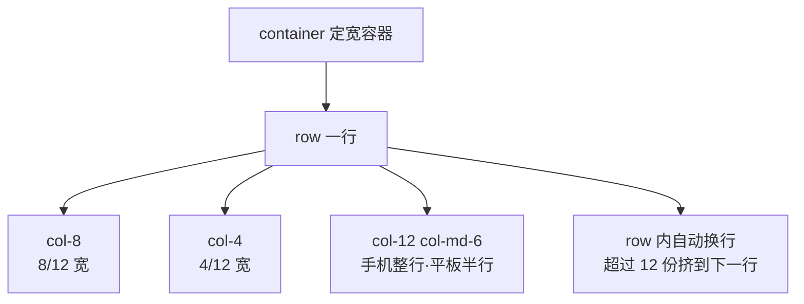
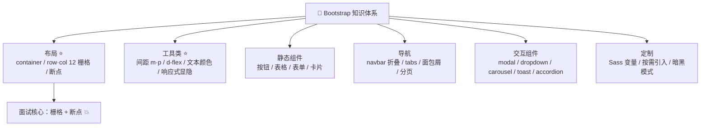

# 🥾 Bootstrap 学习笔记 —— 老牌 UI 框架的常青树 🌳

> 嘿嘿～欢迎来到 Bootstrap 的小课堂！🎀
> Twitter 出品、前端框架界的"祖师爷"：栅格、组件、工具类全都有！
> 不会设计的程序员的救星，快速出页面的神器！(๑•̀ㅂ•́)و✧

---

## 📚 目录

| 章节 | 内容 | 难度 |
| --- | --- | --- |
| 一 | Bootstrap 是什么？ | ⭐ |
| 二 | 快速开始 | ⭐ |
| 三 | 布局：容器与 12 栅格 ⭐ | ⭐⭐ |
| 四 | 响应式断点 | ⭐⭐ |
| 五 | 工具类 Utilities ⭐ | ⭐⭐ |
| 六 | 基础组件：按钮/表格/表单/卡片 | ⭐⭐ |
| 七 | 导航组件：Navbar/分页/面包屑 | ⭐⭐ |
| 八 | 交互组件：弹窗/轮播/折叠 | ⭐⭐⭐ |
| 九 | JS 插件两种用法 | ⭐⭐ |
| 十 | Sass 定制主题 🌟 | ⭐⭐⭐ |
| 十一 | 实战：响应式落地页 | ⭐⭐⭐ |
| 十二 | Bootstrap vs Tailwind | ⭐⭐ |
| 十三 | 面试高频考点速览 | 🔥 |

---

## 一、Bootstrap 是什么？🤔

**Bootstrap = Twitter 开源的 HTML/CSS/JS 前端框架**：自带栅格系统、大量组件和工具类，class 一挂，页面立现～

### 1.1 为什么用它？

| 手写 CSS 😫 | Bootstrap ✨ |
| --- | --- |
| 响应式要自己想方案 | 栅格系统开箱即用 |
| 按钮弹窗一个个搓 | 现成组件 + 交互 |
| 间距颜色全靠拍脑袋 | 统一的设计规范 |
| 设计感为 0 | 自带审美，丑救星 💄 |

### 1.2 版本进化史

| 版本 | 关键变化 |
| --- | --- |
| 3.x | 时代的眼泪，移动端优先初尝试 |
| 4.x | Flexbox 布局、Less → Sass |
| **5.x（本笔记主角）** | **去掉 jQuery**、改用原生 JS、CSS 变量、RTL 支持 ⭐ |
| 5.3+ | 暗黑模式 `data-bs-theme="dark"` 🌙 |

> 💡 现在 `npm i bootstrap` 装的就是 5.x；老项目里见到 jQuery 的基本是 3/4 时代～

---

## 二、快速开始 🛠️

### 2.1 方式一：CDN 引入（最快体验）

```html
<!DOCTYPE html>
<html lang="zh-CN">
<head>
  <meta charset="UTF-8" />
  <!-- 移动端优先 viewport（Bootstrap 的前提！） -->
  <meta name="viewport" content="width=device-width, initial-scale=1.0" />

  <!-- CSS -->
  <link href="https://cdn.jsdelivr.net/npm/bootstrap@5.3.3/dist/css/bootstrap.min.css" rel="stylesheet" />
</head>
<body>
  <h1 class="text-primary">你好，Bootstrap！</h1>

  <!-- JS（组件交互需要，放 body 底部） -->
  <script src="https://cdn.jsdelivr.net/npm/bootstrap@5.3.3/dist/js/bootstrap.bundle.min.js"></script>
</body>
</html>
```

### 2.2 方式二：npm 安装（配打包工具/定制主题用）

```bash
npm install bootstrap
# 图标库（可选）
npm install bootstrap-icons
```

```js
// 方式 A：直接引编译好的
import 'bootstrap/dist/css/bootstrap.min.css';
import 'bootstrap';   // 引 JS 插件

// 方式 B：引 Sass 源码（要定制主题时用 ✨）
import 'bootstrap/scss/bootstrap.scss';
```

> 🎀 记忆点：`bootstrap.bundle.min.js` = 核心 JS + **Popper**（定位库，弹窗/下拉对齐用），
> 不带 bundle 的版本没有 Popper，下拉菜单会歪哦～

---

## 三、布局：容器与 12 栅格 🏗️（核心！）

### 3.1 两种容器

```html
<!-- container：响应式定宽容器（每个断点有最大宽度，自动居中） -->
<div class="container">我是优雅的定宽容器</div>

<!-- container-fluid：占满 100% 宽（全屏轮播/后台框架用） -->
<div class="container-fluid">我铺满全屏~</div>
```

### 3.2 12 栅格系统 📐

> 🎀 把一行分成 **12 份**，`row` 装着 `col`，每个 col 声明自己占几份～
> 就像切披萨：一行披萨 12 块，你 4 块我 8 块 🍕

```html
<div class="container">
  <!-- row：一行（自带负 margin 消除首尾 padding） -->
  <div class="row">
    <div class="col">自动平分</div>
    <div class="col">自动平分</div>
  </div>

  <div class="row">
    <div class="col-8">占 8/12（2/3）</div>
    <div class="col-4">占 4/12（1/3）</div>
  </div>

  <!-- 响应式：不同屏幕不同占份 -->
  <div class="row">
    <!-- 手机全宽 / 平板及以上占一半 -->
    <div class="col-12 col-md-6">响应式列</div>
    <div class="col-12 col-md-6">响应式列</div>
  </div>

  <!-- 列间距：gutter（g-0 到 g-5） -->
  <div class="row g-3">
    <div class="col-6"><div class="p-3 bg-light">有间距的列</div></div>
    <div class="col-6"><div class="p-3 bg-light">有间距的列</div></div>
  </div>
</div>
```

### 3.3 栅格运行图



> 💡 换行规则：一行里 col 加起来 **>12** 就自动换行；
> 加起来 <12 剩下的位置就空着（或用 `justify-content-between` 拉开）～

---

## 四、响应式断点 📱

Bootstrap 一切响应式能力的地基（栅格、工具类、组件都用它）：

| 断点 | 缩写 | 生效条件 | 典型设备 |
| --- | --- | --- | --- |
| x-Small | （无） | < 576px | 手机 📱 |
| Small | `sm` | ≥ 576px | 大手机 |
| Medium | `md` | ≥ 768px | 平板 |
| Large | `lg` | ≥ 992px | 笔记本 💻 |
| X-Large | `xl` | ≥ 1200px | 台式机 |
| XX-Large | `xxl` | ≥ 1400px | 大屏 |

```html
<!-- 断点是"向上生效"的：md 的规则在 lg/xl 也成立 -->
<div class="col-md-6 col-xl-3">
  平板 2 列 → 超大屏 4 列
</div>

<!-- 显示/隐藏也是断点玩法 -->
   <!-- 手机隐藏，平板以上显示 -->
<nav class="d-md-none">手机菜单</nav> <!-- 平板以上隐藏 -->
```

> 🎀 口诀：**class 只写 `col-md-6`，手机端自动变全宽**（col 前缀只影响该断点及以上，往下退化成堆叠）～

---

## 五、工具类 Utilities ⭐（5.x 的灵魂！）

> 不写 CSS，class 直接解决问题——Bootstrap 用得越熟，工具类背得越多 😎

### 5.1 间距：{m|p}{side}-{size}

```html
<!-- m = margin，p = padding -->
<!-- side：t 顶 / b 底 / s 左(start) / e 右(end) / x 左右 / y 上下 / 空格=四边 -->
<div class="mt-3">margin-top: 1rem</div>
<div class="px-4">padding 左右 1.5rem</div>
<div class="mb-0">去掉下边距</div>
<div class="m-auto">水平垂直居中（配 flex/d-block）</div>

<!-- 也可以带断点：mt-md-5 → 平板以上才有大上边距 -->
<div class="mt-2 mt-md-5">手机小间距，平板大间距</div>
```

| size | 值 |
| --- | --- |
| 0 | 0 |
| 1 | 0.25rem |
| 2 | 0.5rem |
| 3 | 1rem |
| 4 | 1.5rem |
| 5 | 3rem |
| auto | auto |

### 5.2 Flex 工具类（配着用起飞 🚀）

```html
<div class="d-flex justify-content-between align-items-center gap-3">
  <span>左</span>
  <span>右</span>
</div>

<!-- 常用组合 -->
d-flex / d-inline-flex / d-none      <!-- display -->
flex-row / flex-column               <!-- 方向 -->
justify-content-start|center|end|between|around   <!-- 主轴 -->
align-items-start|center|end|stretch              <!-- 交叉轴 -->
flex-wrap / flex-grow-1 / flex-shrink-0
```

### 5.3 文本与颜色

```html
<p class="text-center text-primary fw-bold fs-4">居中·主题蓝·加粗·大字</p>
<p class="text-muted text-decoration-line-through">次要·删除线</p>
<p class="text-uppercase">uppercase</p>
<span class="badge text-bg-primary rounded-pill">新</span>

<!-- 背景 -->
<div class="bg-dark text-white p-3">黑底白字</div>
<div class="bg-primary-subtle text-primary-emphasis p-3">浅色底（5.3+）</div>
```

### 5.4 工具类速查表

| 类别 | 示例 | 作用 |
| --- | --- | --- |
| 间距 | `mt-3` `px-2` | 外/内边距 |
| 显示 | `d-none d-md-block` | 显示隐藏（响应式） |
| Flex | `d-flex justify-content-center` | 弹性布局 |
| 文本 | `text-center fw-bold fs-5` | 对齐/粗细/字号 |
| 颜色 | `text-primary bg-dark` | 主题色 |
| 边框 | `border border-2 rounded-3` | 边框/圆角 |
| 尺寸 | `w-100 h-50 mw-100` | 宽高 |
| 定位 | `position-relative top-0` | 定位 |
| 浮动 | `float-end clearfix` | 浮动（老项目） |
| 阴影 | `shadow-sm shadow-lg` | 盒阴影 |
| 溢出 | `overflow-hidden text-truncate` | 溢出处理/截断 |

---

## 六、基础组件 🔘

### 6.1 按钮

```html
<button class="btn btn-primary">主按钮</button>
<button class="btn btn-secondary">次要</button>
<button class="btn btn-success">成功</button>
<button class="btn btn-outline-danger">描边危险</button>
<button class="btn btn-link">链接款</button>

<!-- 尺寸与状态 -->
<button class="btn btn-lg btn-primary">大按钮</button>
<button class="btn btn-sm btn-primary">小按钮</button>
<button class="btn btn-primary" disabled>禁用</button>
<button class="btn btn-primary active">激活</button>

<!-- 按钮组 -->
<div class="btn-group">
  <button class="btn btn-outline-primary">左</button>
  <button class="btn btn-outline-primary">中</button>
  <button class="btn btn-outline-primary">右</button>
</div>
```

### 6.2 表格

```html
<table class="table table-striped table-hover table-bordered align-middle">
  <thead class="table-dark">
    <tr><th>姓名</th><th>年龄</th></tr>
  </thead>
  <tbody>
    <tr><td>小甜</td><td>18</td></tr>
    <tr class="table-warning"><td>小美</td><td>20</td></tr>
  </tbody>
</table>

<!-- 响应式表格：小屏横向滚动 -->
<div class="table-responsive"> ... </div>
```

| class | 效果 |
| --- | --- |
| `table-striped` | 隔行变色 |
| `table-hover` | 悬停高亮 |
| `table-bordered` | 全边框 |
| `table-sm` | 紧凑型 |
| `table-dark` | 暗色表/表头 |
| `table-primary...` | 行/单元格着色 |

### 6.3 表单

```html
<form class="was-validated">
  <!-- 浮动标签（超好看 ✨） -->
  <div class="form-floating mb-3">
    <input type="email" class="form-control" id="email" placeholder="xx" required />
    <label for="email">邮箱地址</label>
  </div>

  <div class="mb-3">
    <label class="form-label">密码</label>
    <input type="password" class="form-control is-invalid" />
    <div class="invalid-feedback">密码错了哦~</div>   <!-- 红字提示 -->
  </div>

  <div class="mb-3">
    <label class="form-label">城市</label>
    <select class="form-select">
      <option selected>请选择</option>
      <option value="1">北京</option>
    </select>
  </div>

  <div class="form-check">
    <input class="form-check-input" type="checkbox" id="c1" />
    <label class="form-check-label" for="c1">记住我</label>
  </div>

  <!-- 开关（checkbox 的皮肤） -->
  <div class="form-check form-switch">
    <input class="form-check-input" type="checkbox" role="switch" id="s1" />
    <label class="form-check-label" for="s1">夜间模式</label>
  </div>
</form>
```

> 🎀 Bootstrap 表单只管"长相"，**校验逻辑自己写**（或用 `was-validated` + 原生 required），
> 这点跟 antd/Element 的自动校验不一样！

### 6.4 卡片 Card

```html
<div class="card" style="max-width: 18rem;">
  
  <div class="card-body">
    <h5 class="card-title">草莓蛋糕 🍰</h5>
    <p class="card-text">甜甜的，好好吃~</p>
    <a href="#" class="btn btn-primary">去买</a>
  </div>
  <div class="card-footer text-muted">2 天前上架</div>
</div>

<!-- 卡片组：等高等宽排列 -->
<div class="row row-cols-1 row-cols-md-3 g-3">
  <div class="col"><div class="card h-100">...</div></div>
  <div class="col"><div class="card h-100">...</div></div>
</div>
```

---

## 七、导航组件 🧭

### 7.1 Navbar 响应式导航栏（最常用！）

```html
<nav class="navbar navbar-expand-lg bg-body-tertiary">
  <div class="container">
    <!-- Logo -->
    <a class="navbar-brand" href="#">🧁 甜品屋</a>

    <!-- 汉堡按钮：小屏出现（data-bs-target 指向菜单 id） -->
    <button class="navbar-toggler" type="button"
            data-bs-toggle="collapse" data-bs-target="#mainNav">
      <span class="navbar-toggler-icon"></span>
    </button>

    <!-- 折叠菜单：小屏折叠，lg 以上展开 -->
    <div class="collapse navbar-collapse" id="mainNav">
      <ul class="navbar-nav me-auto">
        <li class="nav-item">
          <a class="nav-link active" href="#">首页</a>
        </li>
        <li class="nav-item"><a class="nav-link" href="#">新品</a></li>
      </ul>
      <form class="d-flex" role="search">
        <input class="form-control me-2" type="search" placeholder="搜索" />
        <button class="btn btn-outline-success">搜</button>
      </form>
    </div>
  </div>
</nav>
```

### 7.2 其他导航组件

```html
<!-- 标签页（配合 JS 插件，点着切） -->
<ul class="nav nav-tabs">
  <li class="nav-item">
    <button class="nav-link active" data-bs-toggle="tab" data-bs-target="#home">首页</button>
  </li>
  <li class="nav-item">
    <button class="nav-link" data-bs-toggle="tab" data-bs-target="#profile">我的</button>
  </li>
</ul>
<div class="tab-content">
  <div class="tab-pane fade show active" id="home">首页内容</div>
  <div class="tab-pane fade" id="profile">我的内容</div>
</div>

<!-- 面包屑 -->
<nav><ol class="breadcrumb">
  <li class="breadcrumb-item"><a href="#">首页</a></li>
  <li class="breadcrumb-item"><a href="#">商品</a></li>
  <li class="breadcrumb-item active">草莓蛋糕</li>
</ol></nav>

<!-- 分页 -->
<nav><ul class="pagination">
  <li class="page-item disabled"><a class="page-link">上一页</a></li>
  <li class="page-item active"><a class="page-link">1</a></li>
  <li class="page-item"><a class="page-link">2</a></li>
  <li class="page-item"><a class="page-link">下一页</a></li>
</ul></nav>
```

---

## 八、交互组件 💬（要 JS 的都在这）

### 8.1 Modal 弹窗

```html
<!-- 触发按钮：不用写 JS！data 属性驱动 -->
<button class="btn btn-primary" data-bs-toggle="modal" data-bs-target="#loginModal">
  登录
</button>

<!-- 弹窗本体 -->
<div class="modal fade" id="loginModal" tabindex="-1">
  <div class="modal-dialog modal-dialog-centered">
    <div class="modal-content">
      <div class="modal-header">
        <h5 class="modal-title">用户登录</h5>
        <button class="btn-close" data-bs-dismiss="modal"></button>
      </div>
      <div class="modal-body">表单放这里~</div>
      <div class="modal-footer">
        <button class="btn btn-secondary" data-bs-dismiss="modal">取消</button>
        <button class="btn btn-primary">登录</button>
      </div>
    </div>
  </div>
</div>
```

### 8.2 下拉菜单 Dropdown

```html
<div class="dropdown">
  <button class="btn btn-secondary dropdown-toggle" data-bs-toggle="dropdown">
    更多操作
  </button>
  <ul class="dropdown-menu">
    <li><a class="dropdown-item" href="#">编辑</a></li>
    <li><a class="dropdown-item" href="#">复制</a></li>
    <li><hr class="dropdown-divider" /></li>
    <li><a class="dropdown-item text-danger" href="#">删除</a></li>
  </ul>
</div>
```

### 8.3 轮播图 Carousel

```html
<div id="banner" class="carousel slide" data-bs-ride="carousel">
  <!-- 指示器 -->
  <div class="carousel-indicators">
    <button data-bs-target="#banner" data-bs-slide-to="0" class="active"></button>
    <button data-bs-target="#banner" data-bs-slide-to="1"></button>
  </div>

  <!-- 幻灯片 -->
  <div class="carousel-inner">
    <div class="carousel-item active">
      
    </div>
    <div class="carousel-item">
      
    </div>
  </div>

  <!-- 左右箭头 -->
  <button class="carousel-control-prev" data-bs-target="#banner" data-bs-slide="prev">
    <span class="carousel-control-prev-icon"></span>
  </button>
  <button class="carousel-control-next" data-bs-target="#banner" data-bs-slide="next">
    <span class="carousel-control-next-icon"></span>
  </button>
</div>
```

### 8.4 其他常用交互组件

```html
<!-- 手风琴（FAQ 折叠面板） -->
<div class="accordion">
  <div class="accordion-item">
    <h2 class="accordion-header">
      <button class="accordion-button" data-bs-toggle="collapse" data-bs-target="#q1">
        怎么退款？
      </button>
    </h2>
    <div id="q1" class="accordion-collapse collapse show" data-bs-parent=".accordion">
      <div class="accordion-body">联系客服就好啦~</div>
    </div>
  </div>
</div>

<!-- Toast 轻提示（JS 控制显示） -->
<div class="toast" id="myToast">
  <div class="toast-header">通知<button class="btn-close" data-bs-dismiss="toast"></button></div>
  <div class="toast-body">保存成功！</div>
</div>

<!-- Tooltip 气泡 -->
<button class="btn btn-secondary" data-bs-toggle="tooltip" title="我是提示">
  悬停看看
</button>

<!-- Spinner 加载 -->
<div class="spinner-border text-primary"></div>
<div class="spinner-grow text-danger"></div>

<!-- 警告框（可关闭） -->
<div class="alert alert-warning alert-dismissible fade show">
  优惠券即将过期！
  <button class="btn-close" data-bs-dismiss="alert"></button>
</div>

<!-- 徽章/进度条 -->
<span class="badge text-bg-danger">99+</span>
<div class="progress"><div class="progress-bar" style="width: 70%">70%</div></div>
```

---

## 九、JS 插件两种用法 🎛️

> Bootstrap 的交互组件 = CSS（样式） + JS 插件（行为），JS 有两种打开方式～

```html
<!-- ① data 属性驱动（HTML 里声明，零 JS） -->
<button data-bs-toggle="modal" data-bs-target="#m1">开弹窗</button>
```

```js
// ② JS API（需要动态控制时）
import { Modal, Toast, Tooltip } from 'bootstrap';

// 打开/关闭弹窗
const modal = Modal.getOrCreateInstance(document.querySelector('#m1'));
modal.show();
modal.hide();

// Toast 显示
const toast = Toast.getOrCreateInstance(document.querySelector('#myToast'));
toast.show();

// 监听事件（open 瞬间干点啥）
document.querySelector('#m1').addEventListener('shown.bs.modal', () => {
  console.log('弹窗完全打开了');
});

// Tooltip 必须初始化才生效！
document.querySelectorAll('[data-bs-toggle="tooltip"]')
  .forEach(el => new Tooltip(el));
```

| 需求 | 用哪种 |
| --- | --- |
| 点击就打开/关闭 | data 属性（够用） |
| JS 里主动控制/传参/监听事件 | JS API |

---

## 十、Sass 定制主题 🌟（和 Sass 笔记联动！）

> Bootstrap 5 源码就是 Sass 写的！改几个变量 = 全新皮肤 🎨

### 10.1 改主题色

```scss
// ① 先自定义变量（必须放在 import 之前！）
$primary: #ff6b9d;          // 主色变粉粉 🌸
$enable-rounded: true;
$border-radius: 12px;       // 大圆角

// ② 再引入源码
@import "bootstrap/scss/bootstrap";

/* 编译出来的所有组件：按钮/链接/焦点框...全部自动变粉+大圆角 ✨ */
```

### 10.2 按需引入（减小体积）

```scss
// 只要变量和函数 + 挑着引组件
@import "bootstrap/scss/functions";
@import "bootstrap/scss/variables";
@import "bootstrap/scss/mixins";

@import "bootstrap/scss/buttons";
@import "bootstrap/scss/card";
@import "bootstrap/scss/modal";
// 没引的组件 CSS 一行都不会有，体积骤减 📉
```

### 10.3 5.3+ 暗黑模式（超简单）

```html
<!-- html 标签挂个属性就完事！ -->
<html data-bs-theme="dark">
  ...整个页面自动变暗色 🌙
</html>
```

```js
// JS 动态切换
document.documentElement.setAttribute('data-bs-theme', 'dark');
```

### 10.4 CSS 变量覆盖（不编译 Sass 的轻量法）

```css
:root {
  --bs-primary: #ff6b9d;
  --bs-border-radius: 12px;
}
/* BS5 组件内部大量使用 CSS 变量，覆盖它们也能改样式～ */
```

---

## 十一、实战：响应式落地页 🌟

> 需求：导航 + 轮播 + 三列商品卡 + 页脚，手机单列/平板两列/桌面三列～

```html
<!DOCTYPE html>
<html lang="zh-CN">
<head>
  <meta charset="UTF-8" />
  <meta name="viewport" content="width=device-width, initial-scale=1.0" />
  <title>甜品屋</title>
  <link href="https://cdn.jsdelivr.net/npm/bootstrap@5.3.3/dist/css/bootstrap.min.css" rel="stylesheet" />
</head>
<body>
  <!-- ① 导航栏 -->
  <nav class="navbar navbar-expand-md bg-body-tertiary sticky-top">
    <div class="container">
      <a class="navbar-brand fw-bold" href="#">🧁 甜品屋</a>
      <button class="navbar-toggler" data-bs-toggle="collapse" data-bs-target="#nav">
        <span class="navbar-toggler-icon"></span>
      </button>
      <div class="collapse navbar-collapse" id="nav">
        <ul class="navbar-nav ms-auto">
          <li class="nav-item"><a class="nav-link active" href="#">首页</a></li>
          <li class="nav-item"><a class="nav-link" href="#goods">商品</a></li>
        </ul>
      </div>
    </div>
  </nav>

  <!-- ② 轮播 -->
  <div id="banner" class="carousel slide" data-bs-ride="carousel">
    <div class="carousel-inner">
      <div class="carousel-item active">
        
      </div>
    </div>
  </div>

  <!-- ③ 商品卡：手机1列 / 平板2列 / 桌面3列 -->
  <div class="container py-5" id="goods">
    <h2 class="text-center mb-4">热销甜品</h2>
    <div class="row row-cols-1 row-cols-md-2 row-cols-lg-3 g-4">
      <div class="col">
        <div class="card h-100 shadow-sm">
          
          <div class="card-body">
            <h5 class="card-title">草莓蛋糕 🍓</h5>
            <p class="card-text text-muted">新鲜草莓，酸甜可口</p>
            <div class="d-flex justify-content-between align-items-center">
              <span class="fs-4 text-danger fw-bold">￥39.9</span>
              <button class="btn btn-sm btn-primary">加入购物车</button>
            </div>
          </div>
        </div>
      </div>
      <!-- 复制几个 col 就是商品列表~ -->
    </div>
  </div>

  <!-- ④ 页脚 -->
  <footer class="bg-dark text-white text-center py-4">
    <p class="mb-0">© 2026 甜品屋 · 用 Bootstrap 搓的</p>
  </footer>

  <script src="https://cdn.jsdelivr.net/npm/bootstrap@5.3.3/dist/js/bootstrap.bundle.min.js"></script>
</body>
</html>
```

> 🎀 全程 **0 行自定义 CSS**，纯 class 拼出来的响应式页面——这就是 Bootstrap 的魅力！

---

## 十二、Bootstrap vs Tailwind ⚔️（绕不开的对比）

| 维度 | Bootstrap | Tailwind |
| --- | --- | --- |
| 理念 | **组件化**：现成组件拿来用 | **原子化**：小 class 自由拼装 |
| 上手 | 快，背组件名就行 | 要先熟工具类 + 自搭一切 |
| 页面风格 | 有辨识度（Bootstrap 味儿 😅） | 完全自定义，无模板感 |
| 设计自由度 | 低（覆盖样式要打仗） | 高（本就一无所有） |
| JS 交互 | 自带 Modal/Dropdown 等 | 无（配 Headless UI/daisyUI） |
| 适合 | 后台、原型、快速交付、Demo | 追求设计感的产品页 |

> 🎀 一句话：**要快要省事 → Bootstrap；要独特要精致 → Tailwind**。
> 现在新技术栈多用 Tailwind，但 Bootstrap 在老项目/管理后台/课程作业里依然是常客，都值得会～

---

## 十三、面试高频考点速览 🔥

| 考点 | 一句话答案 |
| --- | --- |
| Bootstrap 栅格原理 | 容器 → row → col，一行 12 份，col-N 占 N 份，flexbox 实现 |
| 断点有哪些 | sm 576 / md 768 / lg 992 / xl 1200 / xxl 1400，向上生效 |
| col 与 col-md-6 区别 | col 自动等分；带断点前缀只在 ≥该断点生效，往下堆叠全宽 |
| container vs container-fluid | 定宽居中（各断点有 max-width） vs 100% 全宽 |
| mt-3 啥意思 | margin-top: 1rem（间距工具类 {m/p}{t/b/s/e/x/y}-{0-5/auto}） |
| d-none d-md-block | 默认隐藏、md 及以上显示（响应式显隐） |
| 组件交互怎么触发 | data-bs-* 属性 或 JS API（Modal.getOrCreateInstance().show()） |
| 5.x 最大变化 | 抛弃 jQuery 用原生 JS、CSS 变量、RTL、5.3 暗黑 data-bs-theme |
| 怎么定制主题 | Sass 变量（import 前定义） / 按需 import / CSS 变量覆盖 |
| Bootstrap vs Tailwind | 组件化开箱即用 vs 原子类自由拼装；效率 vs 自定义 |
| gutter 是什么 | row 的列间距（g-0~g-5），通过 col 的 padding 实现 |

---

## 🎁 结语：知识地图



> 🎀 恭喜通关 Bootstrap！学习建议：
> ① 直接把"实战落地页"复制到本地跑起来，改改 class 感受响应式变化～
> ② 重点记住 **栅格系统 + 间距/Flex 工具类**，日常开发 80% 就靠它们 💪
> ③ 想深入定制就翻出前面的 **Sass 笔记**复习，Bootstrap 源码就是 Sass 大型应用现场！
> 接下来想学 Tailwind、ECharts 还是 Vue3/React，随时喊我！(๑•̀ㅂ•́)و✧
