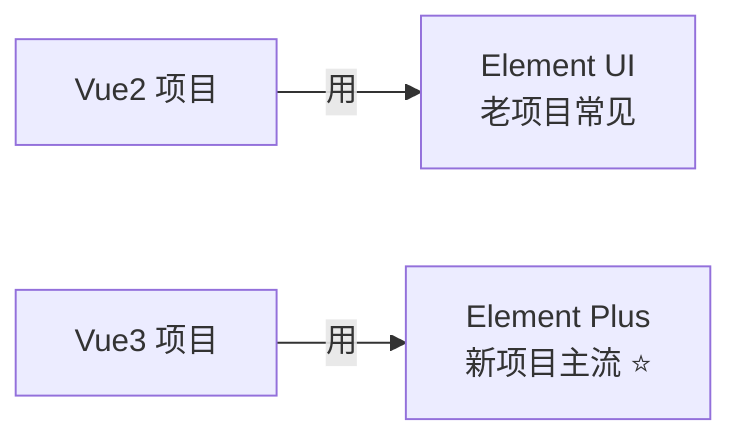
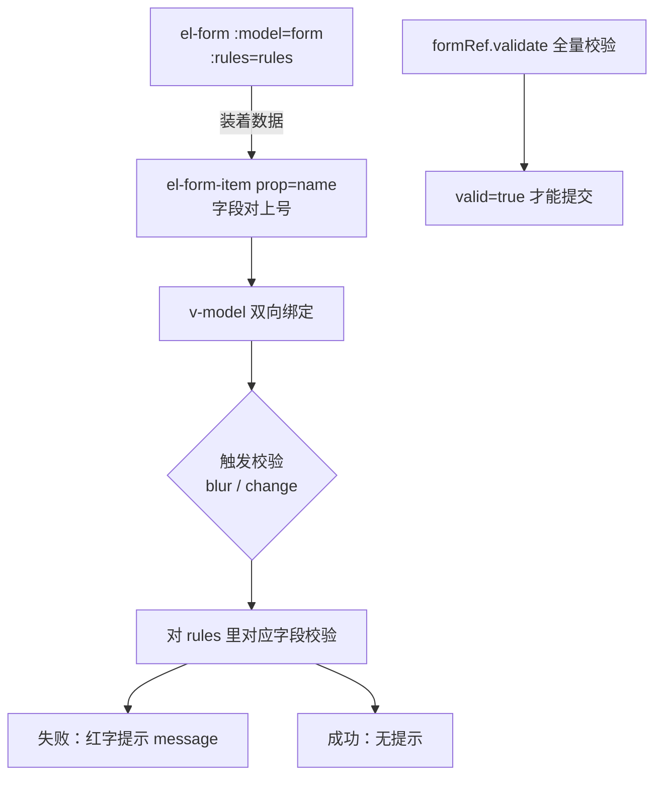
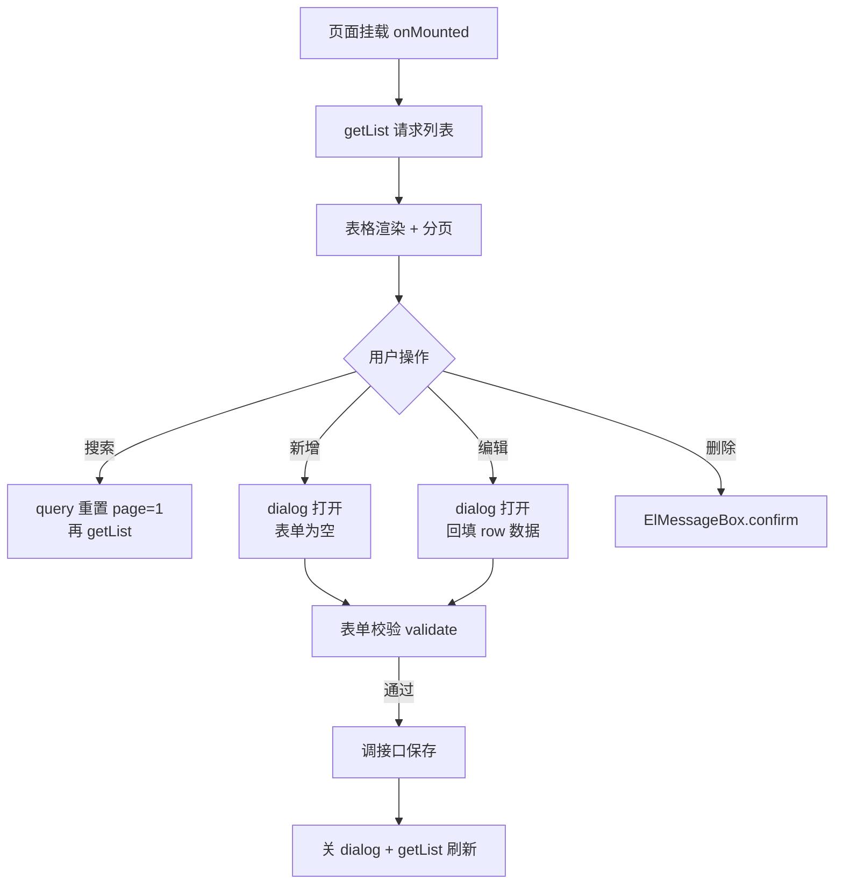
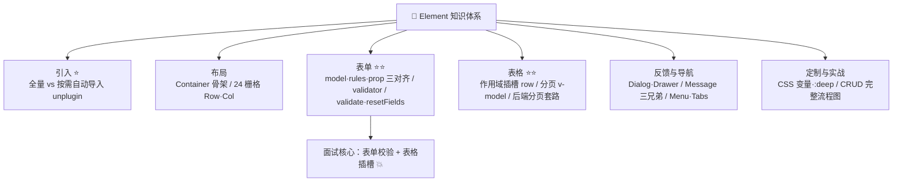

# 🍃 ElementUI 学习笔记 —— Vue 生态的组件全家桶 🛋️

> 嘿嘿～欢迎来到 Element 的小课堂！🎀
> 饿了么团队出品的 Vue 组件库：表单表格弹窗全都有！
> 中后台项目的老朋友，配着 Vue 笔记食用更佳～(๑•̀ㅂ•́)و✧

---

## 📚 目录

| 章节 | 内容 | 难度 |
| --- | --- | --- |
| 一 | Element UI vs Element Plus | ⭐ |
| 二 | 快速上手与按需引入 ⭐ | ⭐⭐ |
| 三 | 布局：Container 与栅格 | ⭐⭐ |
| 四 | 基础组件：按钮/图标/标签 | ⭐⭐ |
| 五 | 表单 Form ⭐⭐（重头戏） | ⭐⭐⭐ |
| 六 | 表格 Table 与分页 ⭐⭐ | ⭐⭐⭐ |
| 七 | 反馈组件：弹窗与消息 | ⭐⭐ |
| 八 | 导航组件 | ⭐⭐ |
| 九 | 数据展示组件 | ⭐⭐ |
| 十 | 实战：CRUD 页面完整流程 🌟 | ⭐⭐⭐ |
| 十一 | 主题定制 | ⭐⭐ |
| 十二 | 常见坑与面试考点 | 🔥 |

---

## 一、Element UI vs Element Plus 🤔

> 🎀 一家人两兄弟：**Element UI 配 Vue2，Element Plus 配 Vue3**！别装错了～

| 对比 | Element UI | Element Plus |
| --- | --- | --- |
| 对应框架 | Vue 2 | **Vue 3** ⭐ |
| 包名 | `element-ui` | `element-plus` |
| 图标 | 字体图标 class（`el-icon-xxx`） | **组件化图标** `<el-icon><Edit/></el-icon>` |
| TS 支持 | 弱 | 完整类型定义 ✅ |
| 按需引入 | babel-plugin-component | unplugin 自动导入 ✨ |
| 暗黑模式 | ❌ | ✅ `data-theme="dark"` |
| 维护状态 | 只修 bug 不加功能 | 持续更新 ⭐ |



> 💡 本笔记以 **Element Plus** 为主讲（面向新项目），
> 老 Element UI 的写法差异会在各章节标注～面试常问：`this.$message` → `ElMessage` 导入式调用！

---

## 二、快速上手与按需引入 ⭐

### 2.1 全量引入（学习/demo 图省事）

```bash
npm i element-plus
```

```js
// main.js
import { createApp } from 'vue';
import ElementPlus from 'element-plus';
import 'element-plus/dist/index.css';
import App from './App.vue';

createApp(App).use(ElementPlus).mount('#app');
```

### 2.2 按需自动导入（项目标配 ✨）

```bash
npm i -D unplugin-vue-components unplugin-auto-import
```

```js
// vite.config.js
import { defineConfig } from 'vite';
import AutoImport from 'unplugin-auto-import/vite';
import Components from 'unplugin-vue-components/vite';
import { ElementPlusResolver } from 'unplugin-vue-components/resolvers';

export default defineConfig({
  plugins: [
    AutoImport({ resolvers: [ElementPlusResolver()] }),
    Components({ resolvers: [ElementPlusResolver()] }),
  ],
});
```

```vue
<script setup>
// 什么都不用 import！模板里直接用，样式自动按需打包 ✨
import { ElMessage } from 'element-plus';  // 只有 API 型要手动导
import 'element-plus/es/components/message/style/css';
</script>

<template>
  <el-button type="primary">自动导入的我</el-button>
</template>
```

### 2.3 全局配置与暗黑模式

```js
// main.js —— 全局尺寸/主题
app.use(ElementPlus, { size: 'default', zIndex: 3000 });
```

```html
<!-- 暗黑模式：html 标签加 data-theme -->
<html data-theme="dark">
```

```js
// 切换暗黑
import { toggleDark } from './composables/dark';
const toggle = () => toggleDark();
```

---

## 三、布局：Container 与栅格 🏗️

### 3.1 Container 布局容器（中后台骨架）

```html
<el-container>
  <el-aside width="200px">侧边菜单</el-aside>
  <el-container>
    <el-header>顶栏</el-header>
    <el-main>主内容区</el-main>
    <el-footer>页脚</el-footer>
  </el-container>
</el-container>
```

| 组件 | 说明 |
| --- | --- |
| `el-container` | 外层容器（嵌套时有方向感知） |
| `el-header` / `el-footer` | 顶/底栏（默认 60px） |
| `el-aside` | 侧边栏（默认 300px，常配 width） |
| `el-main` | 主区域（自动撑满剩余） |

### 3.2 Layout 24 栅格

```html
<el-row :gutter="20">
  <el-col :span="8">占 8/24</el-col>
  <el-col :span="16">占 16/24</el-col>
</el-row>

<!-- 响应式：xs <768 / sm ≥768 / md ≥992 / lg ≥1200 / xl ≥1920 -->
<el-row>
  <el-col :xs="24" :md="12" :lg="8">手机全宽·平板半宽·桌面 1/3</el-col>
</el-row>

<!-- 对齐与间距 -->
<el-row justify="center" align="middle">
  <el-col :span="6">居中的列</el-col>
</el-row>
```

> 💡 和 Bootstrap 一样的思路，只是**分成 24 份**（更细），`:gutter` 是列间距～

---

## 四、基础组件 🔘

### 4.1 按钮

```html
<el-button type="primary">主要</el-button>
<el-button type="success">成功</el-button>
<el-button type="danger">危险</el-button>
<el-button type="primary" plain>描边款</el-button>
<el-button type="primary" round>圆角款</el-button>
<el-button type="primary" circle icon="Search" />

<el-button size="large">大</el-button>
<el-button size="small">小</el-button>
<el-button :loading="true">加载中</el-button>
<el-button disabled>禁用</el-button>

<!-- 按钮组 -->
<el-button-group>
  <el-button>上一页</el-button>
  <el-button>下一页</el-button>
</el-button-group>
```

### 4.2 图标（Plus 组件化写法 ⭐）

```vue
<script setup>
// 先安装：npm i @element-plus/icons-vue
import { Edit, Delete, Search } from '@element-plus/icons-vue';
</script>

<template>
  <!-- 图标是组件，不是 class 了！ -->
  <el-icon><Edit /></el-icon>
  <el-icon color="hotpink" :size="28"><Search /></el-icon>

  <!-- 配合按钮 -->
  <el-button :icon="Search">搜索</el-button>
  <el-button :icon="Edit">编辑</el-button>
</template>
```

> ⚠️ 老版 Element UI 是字体图标：`<i class="el-icon-edit"></i>`——面试注意区分！

### 4.3 标签/头像/徽章

```html
<el-tag type="success">上架中</el-tag>
<el-tag type="danger" effect="dark">已下架</el-tag>
<el-tag closable @close="delTag">可关闭</el-tag>

<el-badge :value="99" :max="10">
  <el-icon><Bell /></el-icon>
</el-badge>

<el-avatar src="xxx.jpg" />
<el-avatar :size="60">甜</el-avatar>
```

---

## 五、表单 Form ⭐⭐（中后台的灵魂！）

### 5.1 基础表单 + 校验

```vue
<script setup>
import { reactive, ref } from 'vue';

const formRef = ref();

const form = reactive({
  name: '',
  age: undefined,
  region: '',
  date: '',
  agree: false,
});

// 校验规则：字段名对上 prop ⭐
const rules = {
  name: [
    { required: true, message: '请输入姓名', trigger: 'blur' },
    { min: 2, max: 10, message: '2~10 个字', trigger: 'blur' },
  ],
  age: [
    { required: true, message: '请输入年龄', trigger: 'blur' },
    { type: 'number', message: '必须是数字', trigger: 'blur' },
  ],
  region: [{ required: true, message: '选地区', trigger: 'change' }],
  // 自定义校验器 ⭐
  date: [{
    validator: (rule, value, cb) => {
      if (!value) return cb(new Error('选日期'));
      cb();   // 成功也要回调！
    },
    trigger: 'change',
  }],
};

const submit = () => {
  formRef.value.validate((valid) => {
    if (!valid) return;         // 校验失败
    console.log('提交：', form);
  });
};

const reset = () => {
  formRef.value.resetFields();  // 重置 + 清校验状态
};
</script>

<template>
  <el-form ref="formRef" :model="form" :rules="rules" label-width="80px">
    <el-form-item label="姓名" prop="name">
      <el-input v-model="form.name" placeholder="请输入" clearable />
    </el-form-item>

    <el-form-item label="年龄" prop="age">
      <el-input-number v-model="form.age" :min="1" :max="120" />
    </el-form-item>

    <el-form-item label="地区" prop="region">
      <el-select v-model="form.region" placeholder="请选择">
        <el-option label="北京" value="bj" />
        <el-option label="上海" value="sh" />
      </el-select>
    </el-form-item>

    <el-form-item label="日期" prop="date">
      <el-date-picker v-model="form.date" type="date" value-format="YYYY-MM-DD" />
    </el-form-item>

    <el-form-item>
      <el-button type="primary" @click="submit">提交</el-button>
      <el-button @click="reset">重置</el-button>
    </el-form-item>
  </el-form>
</template>
```

### 5.2 表单工作原理图



### 5.3 表单常用方法速查

| 方法 | 作用 |
| --- | --- |
| `formRef.validate(cb)` | 全量校验（或返回 Promise） |
| `validateField('name')` | 校验单个字段 |
| `resetFields()` | 重置为初始值 + 清除校验 ⭐ |
| `clearValidate()` | 只清校验提示，不重置值 |

### 5.4 常用校验规则速查

| 规则 | 示例 |
| --- | --- |
| 必填 | `{ required: true, message, trigger }` |
| 长度 | `{ min: 2, max: 10 }` |
| 类型 | `{ type: 'number' / 'email' / 'array' / 'date' }` |
| 正则 pattern | `{ pattern: /^1[3-9]\d{9}$/, message: '手机号不对' }` |
| 自定义 | `{ validator: (rule, value, cb) => {...} }` |
| 触发时机 | `trigger: 'blur'`（失焦）/ `'change'`（变化） |

---

## 六、表格 Table 与分页 ⭐⭐

### 6.1 基础表格

```vue
<script setup>
import { ref } from 'vue';

const list = ref([
  { id: 1, name: '小甜', age: 18, status: 1, tags: ['可爱', '元气'] },
  { id: 2, name: '小美', age: 20, status: 0, tags: ['漂亮'] },
]);

const del = (row) => console.log('删除：', row);
</script>

<template>
  <el-table :data="list" border stripe>
    <!-- selection：多选列 -->
    <el-table-column type="selection" width="50" />
    <!-- index：序号列 -->
    <el-table-column type="index" label="序号" width="70" />

    <el-table-column prop="name" label="姓名" width="120" />

    <!-- 自定义列：插槽 scope 拿到整行数据 ⭐ -->
    <el-table-column prop="status" label="状态">
      <template #default="{ row }">
        <el-tag :type="row.status === 1 ? 'success' : 'danger'">
          {{ row.status === 1 ? '启用' : '禁用' }}
        </el-tag>
      </template>
    </el-table-column>

    <el-table-column label="标签">
      <template #default="{ row }">
        <el-tag v-for="t in row.tags" :key="t" size="small" class="mr">{{ t }}</el-tag>
      </template>
    </el-table-column>

    <!-- fixed 固定列 + 操作按钮 -->
    <el-table-column label="操作" width="150" fixed="right">
      <template #default="{ row }">
        <el-button link type="primary" size="small">编辑</el-button>
        <el-popconfirm title="确认删除吗？" @confirm="del(row)">
          <template #reference>
            <el-button link type="danger" size="small">删除</el-button>
          </template>
        </el-popconfirm>
      </template>
    </el-table-column>
  </el-table>
</template>
```

> 💡 插槽解构 `{ row }` = `{ row, column, $index }`——**row 是整行数据**，自定义列内容全靠它！

### 6.2 分页（后端分页标准写法）

```vue
<script setup>
import { ref, onMounted } from 'vue';

const list = ref([]);
const total = ref(0);
const query = ref({ page: 1, pageSize: 10 });

const getList = async () => {
  // 后端返回 { list, total }
  const res = await api.getUsers(query.value);
  list.value = res.list;
  total.value = res.total;
};

const handlePage = (page) => {
  query.value.page = page;
  getList();
};

onMounted(getList);
</script>

<template>
  <el-pagination
    v-model:current-page="query.page"
    v-model:page-size="query.pageSize"
    :total="total"
    :page-sizes="[10, 20, 50]"
    layout="total, sizes, prev, pager, next, jumper"
    @current-change="handlePage"
    @size-change="getList"
  />
</template>
```

> ⚠️ Vue2 老版是 `:current-page.sync`，Plus 版改为 `v-model:current-page`（3.x 双向绑定语法）～

### 6.3 表格常用属性速查

| 属性 | 作用 |
| --- | --- |
| `border` / `stripe` | 边框 / 斑马纹 |
| `:data` | 数据源（数组） |
| `loading`（v-loading 指令） | 加载遮罩 |
| `fixed="right"` | 固定列（挤不下时横滚不丢操作列） |
| `show-overflow-tooltip` | 内容溢出悬浮提示 |
| `@selection-change` | 多选变化事件 |

---

## 七、反馈组件 💬

### 7.1 Dialog 弹窗

```vue
<script setup>
import { ref } from 'vue';
const visible = ref(false);
</script>

<template>
  <el-button @click="visible = true">打开</el-button>

  <el-dialog v-model="visible" title="编辑用户" width="500px">
    <span>内容放这里~</span>
    <template #footer>
      <el-button @click="visible = false">取消</el-button>
      <el-button type="primary" @click="save">确定</el-button>
    </template>
  </el-dialog>
</template>
```

> ⚠️ 版本差异高频坑：
> Vue2 Element UI：`:visible.sync="dialogVisible"`
> Vue3 Element Plus：**`v-model="dialogVisible"`** ✅

### 7.2 Drawer 抽屉

```html
<el-drawer v-model="drawer" title="详情" size="40%">
  从右边滑出来的面板，放详情/表单都合适～
</el-drawer>
```

### 7.3 三种消息提示对比 ⭐

| 组件 | 长相 | 场景 | 用法 |
| --- | --- | --- | --- |
| `ElMessage` | 顶部小条 | 轻提示（保存成功） | `ElMessage.success('成功')` |
| `ElMessageBox` | 确认对话框 | 删除前确认 | `ElMessageBox.confirm('删吗？')` |
| `ElNotification` | 右上角卡片 | 重要通知 | `ElNotification({ title, message })` |

```vue
<script setup>
import { ElMessage, ElMessageBox, ElNotification } from 'element-plus';

// ① 轻提示
const save = () => ElMessage.success('保存成功！');

// ② 确认框（返回 Promise）
const del = async () => {
  try {
    await ElMessageBox.confirm('删除后找不回来哦~', '警告', {
      type: 'warning',
      confirmButtonText: '狠心删除',
      cancelButtonText: '再想想',
    });
    // 点了确认才走到这
    await api.deleteUser(id);
    ElMessage.success('已删除');
  } catch {
    // 点了取消
    ElMessage.info('已取消');
  }
};

// ③ 通知
const notify = () => {
  ElNotification({ title: '订单提醒', message: '有新订单啦！', type: 'success' });
};
</script>
```

> ⚠️ Vue2 全局挂载写法：`this.$message` / `this.$confirm`；
> Vue3 组合式 API 要**显式导入**调用——这是迁移最常见的坑！

---

## 八、导航组件 🧭

```html
<!-- ① 侧边菜单（中后台标配） -->
<el-menu default-active="/user" router background-color="#001529" text-color="#fff">
  <el-sub-menu index="1">
    <template #title>
      <el-icon><Goods /></el-icon> 商品管理
    </template>
    <el-menu-item index="/goods/list">商品列表</el-menu-item>
    <el-menu-item index="/goods/cat">分类管理</el-menu-item>
  </el-sub-menu>
  <el-menu-item index="/user">
    <el-icon><User /></el-icon> 用户管理
  </el-menu-item>
</el-menu>
<!-- router 属性：index 当路由路径直接跳转 ⭐ -->

<!-- ② 标签页 -->
<el-tabs v-model="activeTab">
  <el-tab-pane label="全部" name="all" />
  <el-tab-pane label="进行中" name="doing" />
</el-tabs>

<!-- ③ 面包屑 -->
<el-breadcrumb separator="/">
  <el-breadcrumb-item :to="{ path: '/' }">首页</el-breadcrumb-item>
  <el-breadcrumb-item>商品列表</el-breadcrumb-item>
</el-breadcrumb>

<!-- ④ 步骤条 -->
<el-steps :active="1" finish-status="success">
  <el-step title="下单" />
  <el-step title="付款" />
  <el-step title="发货" />
</el-steps>

<!-- ⑤ 下拉菜单 -->
<el-dropdown>
  <span class="el-dropdown-link">更多<el-icon><ArrowDown /></el-icon></span>
  <template #dropdown>
    <el-dropdown-menu>
      <el-dropdown-item>个人中心</el-dropdown-item>
      <el-dropdown-item divided @click="logout">退出登录</el-dropdown-item>
    </el-dropdown-menu>
  </template>
</el-dropdown>
```

---

## 九、数据展示组件 📊

```html
<!-- 卡片 -->
<el-card shadow="hover">
  <template #header>商品详情</template>
  卡片内容~
</el-card>

<!-- 轮播 -->
<el-carousel height="300px" :interval="3000" arrow="always">
  <el-carousel-item v-for="i in 3" :key="i">
    
  </el-carousel-item>
</el-carousel>

<!-- 描述列表（详情页神器 ✨） -->
<el-descriptions title="用户信息" :column="2" border>
  <el-descriptions-item label="姓名">小甜</el-descriptions-item>
  <el-descriptions-item label="手机">138****8888</el-descriptions-item>
  <el-descriptions-item label="状态">
    <el-tag type="success">正常</el-tag>
  </el-descriptions-item>
</el-descriptions>

<!-- 树形控件 -->
<el-tree :data="treeData" :props="{ label: 'name', children: 'kids' }"
         node-key="id" default-expand-all @node-click="clickNode" />

<!-- 时间线 -->
<el-timeline>
  <el-timeline-item timestamp="2026-10-01" type="primary">下单</el-timeline-item>
  <el-timeline-item timestamp="2026-10-02" type="success">签收</el-timeline-item>
</el-timeline>

<!-- 空状态/骨架屏 -->
<el-empty description="暂无数据" />
<el-skeleton :rows="5" animated />
```

---

## 十、实战：CRUD 页面完整流程 🌟

> 中后台永恒套路：**搜索 + 表格 + 分页 + 弹窗表单**，一套吃遍天～



```vue
<!-- UserList.vue 骨架 -->
<script setup>
import { ref, reactive, onMounted } from 'vue';
import { ElMessage, ElMessageBox } from 'element-plus';

const query = reactive({ page: 1, pageSize: 10, keyword: '' });
const list = ref([]);
const total = ref(0);

// ===== 列表 =====
const getList = async () => {
  const res = await api.getUsers(query);
  list.value = res.list;
  total.value = res.total;
};

// ===== 搜索（重置页码再查 ⭐）=====
const search = () => { query.page = 1; getList(); };

// ===== 弹窗表单 =====
const dialogVisible = ref(false);
const formRef = ref();
const form = ref({ id: '', name: '', age: undefined });

// 编辑：回填；新增：清空
const openDialog = (row) => {
  dialogVisible.value = true;
  form.value = row ? { ...row } : { id: '', name: '', age: undefined };
};

const save = () => {
  formRef.value.validate(async (valid) => {
    if (!valid) return;
    form.value.id ? await api.updateUser(form.value) : await api.addUser(form.value);
    ElMessage.success('保存成功');
    dialogVisible.value = false;
    getList();
  });
};

const del = (row) => {
  ElMessageBox.confirm(`删除 ${row.name} 吗？`, '警告', { type: 'warning' })
    .then(async () => {
      await api.deleteUser(row.id);
      ElMessage.success('已删除');
      getList();   // 刷新列表
    })
    .catch(() => {});
};

onMounted(getList);
</script>

<template>
  <!-- 搜索区 -->
  <el-form inline :model="query">
    <el-form-item label="关键词">
      <el-input v-model="query.keyword" placeholder="姓名" clearable @keyup.enter="search" />
    </el-form-item>
    <el-form-item>
      <el-button type="primary" @click="search">搜索</el-button>
    </el-form-item>
  </el-form>

  <!-- 操作区 -->
  <el-button type="primary" @click="openDialog()">+ 新增</el-button>

  <!-- 表格 -->
  <el-table :data="list" v-loading="false" border stripe>
    <el-table-column prop="name" label="姓名" />
    <el-table-column prop="age" label="年龄" width="100" />
    <el-table-column label="操作" width="150">
      <template #default="{ row }">
        <el-button link type="primary" @click="openDialog(row)">编辑</el-button>
        <el-button link type="danger" @click="del(row)">删除</el-button>
      </template>
    </el-table-column>
  </el-table>

  <!-- 分页 -->
  <el-pagination
    v-model:current-page="query.page"
    :total="total"
    layout="total, prev, pager, next"
    @current-change="getList"
  />

  <!-- 新增/编辑弹窗（复用一个！） -->
  <el-dialog v-model="dialogVisible" :title="form.id ? '编辑' : '新增'" width="480px">
    <el-form ref="formRef" :model="form" :rules="rules" label-width="60px">
      <el-form-item label="姓名" prop="name">
        <el-input v-model="form.name" />
      </el-form-item>
      <el-form-item label="年龄" prop="age">
        <el-input-number v-model="form.age" :min="1" />
      </el-form-item>
    </el-form>
    <template #footer>
      <el-button @click="dialogVisible = false">取消</el-button>
      <el-button type="primary" @click="save">保存</el-button>
    </template>
  </el-dialog>
</template>
```

> 🎀 套路总结：**一个页面 = 搜索区 + 表格 + 分页 + 弹窗表单**，
> 换个接口和字段就是新页面，中后台开发就是这么朴实无华～

---

## 十一、主题定制 🎨

### 11.1 CSS 变量覆盖（最轻量 ✨）

```css
/* 直接覆盖 Element Plus 的 CSS 变量 */
:root {
  --el-color-primary: #ff6b9d;       /* 主色变粉 🌸 */
  --el-border-radius-base: 12px;
}

/* 暗黑模式下的变量在 html.dark 里改 */
html.dark {
  --el-color-primary: #ff9ec5;
}
```

### 11.2 SCSS 变量定制（深度定制）

```scss
// vite.config.js 里配 css.preprocessorOptions.scss.additionalData
// styles/element.scss
@forward "element-plus/theme-chalk/src/common/var.scss" with (
  $colors: (
    "primary": ("base": #ff6b9d),
  )
);
```

### 11.3 表单/组件内部样式穿透

```vue
<style scoped lang="scss">
/* scoped 下要改组件内部样式，用 :deep() */
:deep(.el-table .el-table__header) {
  background: #fafafa;
}
:deep(.el-dialog) {
  border-radius: 16px;
}
</style>
```

---

## 十二、常见坑与面试考点 🔥

### 12.1 高频坑速查表

| 坑 | 正确姿势 |
| --- | --- |
| Plus 装到 Vue2 项目 | Vue2 用 element-ui，Vue3 才用 element-plus |
| Dialog 打不开 | UI 是 `:visible.sync`，Plus 是 `v-model` |
| Message 报错 undefined | 组合式 API 要 `import { ElMessage } from 'element-plus'`（不能 this.$message） |
| 校验不生效 | el-form 的 `:model`、rules 字段名、form-item 的 `prop` 三处要对上 ⭐ |
| 自定义 validator 不回调 | 成功失败都要 `cb()`（或 `cb(new Error())`） |
| resetFields 恢复不对 | 重置的是**初始值**（表单首次渲染时的值），不是空 |
| 表格值不显示 | 检查 column 的 `prop` 和数据字段名 |
| 分页点击无更新 | 监听 `current-change` 重新请求，或 v-model 后 watch |
| 图标不显示 | Plus 要装 `@element-plus/icons-vue` 且组件方式用 |
| 样式改不动 | scoped 下用 `:deep()` 穿透 |

### 12.2 面试速查表

| 考点 | 一句话答案 |
| --- | --- |
| Element UI vs Plus | Vue2 版 vs Vue3 版；图标 class→组件、visible.sync→v-model、按需导入方案升级 |
| 按需引入方案 | unplugin-vue-components + unplugin-auto-import + ElementPlusResolver |
| 表单校验原理 | el-form 收集 model/rules，form-item 的 prop 定位字段，trigger 触发异步校验 |
| validate 和 resetFields | 全量校验回调 valid；重置为初始值并清除校验 |
| 表格自定义列 | `#default="{ row }"` 作用域插槽拿整行数据 |
| 前端 vs 后端分页 | 前端 slice 截取（数据少）；后端传 page/pageSize 返回 list+total（标准） |
| Message/MessageBox 区别 | 轻提示条 vs 确认对话框（Promise 结果分流） |
| Dialog 的 destroy-on-close | 关闭时销毁内部内容（防止残留状态） |
| 主题定制方式 | CSS 变量覆盖 / SCSS @forward 变量 / :deep 穿透局部改 |
| 与 Ant Design 对比 | Element 生态偏 Vue（antd 偏 React）；API 风格类似：model/rules/columns 思路相通 |

---

## 🎁 结语：知识地图



> 🎀 恭喜通关 Element！学习建议：
> ① 把 **CRUD 实战页**亲手写一遍，中后台开发 80% 的场景就掌握啦～
> ② 重点背 **表单三对齐**（model/rules/prop）和 **Vue2→Vue3 常见差异**（v-model、ElMessage 导入）💪
> ③ 和 AntDesign 笔记对照着看：表单表格思路相通，一套理解双倍覆盖～
> 接下来想学 Vue3、React、ECharts 还是原理八股（浏览器/HTTP/手写），随时喊我！(๑•̀ㅂ•́)و✧
