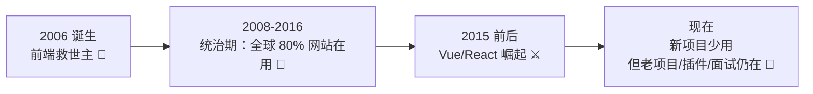
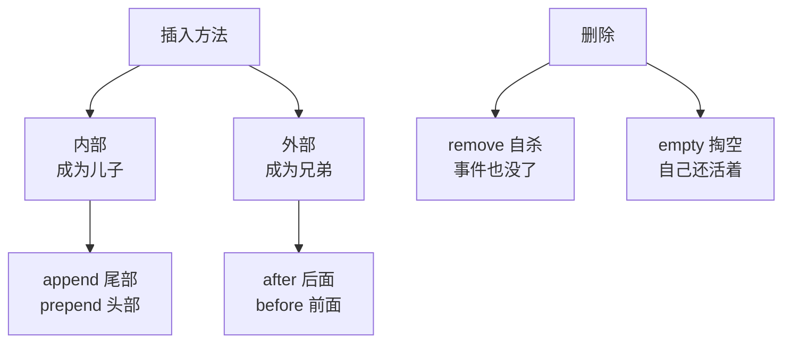
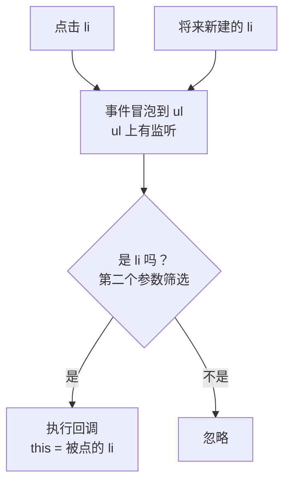
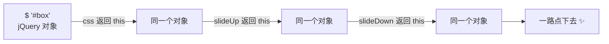
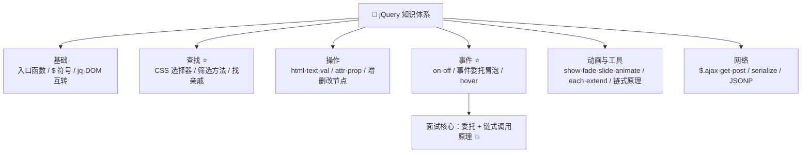

# 💎 jQuery 学习笔记 —— 曾经的前端之王 👑

> 嘿嘿～欢迎来到 jQuery 的小课堂！🎀
> "Write Less, Do More"——祖师爷级别的库！
> 虽然新项目用得少了，但老项目/面试里它依然是常客！(๑•̀ㅂ•́)و✧

---

## 📚 目录

| 章节 | 内容 | 难度 |
| --- | --- | --- |
| 一 | jQuery 是什么？为什么还要学 | ⭐ |
| 二 | 快速开始与入口函数 | ⭐ |
| 三 | 选择器 ⭐ | ⭐⭐ |
| 四 | DOM 操作 | ⭐⭐ |
| 五 | 样式与 class 操作 | ⭐⭐ |
| 六 | 事件处理 ⭐ | ⭐⭐ |
| 七 | 动画与队列 | ⭐⭐ |
| 八 | 遍历与筛选（找亲戚） | ⭐⭐ |
| 九 | AJAX ⭐ | ⭐⭐⭐ |
| 十 | 工具方法与链式调用原理 | ⭐⭐⭐ |
| 十一 | 插件机制 | ⭐⭐ |
| 十二 | jQuery vs 原生 vs Vue | ⭐⭐ |
| 十三 | 面试高频考点速览 | 🔥 |

---

## 一、jQuery 是什么？🤔

**jQuery = 一个快速小巧的 JS 库**（2006 年诞生，一个 js 文件搞定），封装了 DOM 操作、事件、动画、AJAX，让原生 JS 的啰嗦代码变得一行流～

### 1.1 诞生背景：拯救水生火热的前端

```js
// 😫 原生 JS：又长又臭，还得考虑 IE 兼容
var btns = document.getElementsByTagName('button');
for (var i = 0; i < btns.length; i++) {
  btns[i].onclick = function () {
    this.style.color = 'red';
  };
}

// ✨ jQuery：一行搞定，兼容性它来扛
$('button').on('click', function () {
  $(this).css('color', 'red');
});
```

### 1.2 辉煌与现状



### 1.3 现在还要学吗？

| 场景 | 要不要 |
| --- | --- |
| 维护老项目（一堆 jQuery 插件） | ✅ 必须 |
| 面试（事件委托/链式调用/AJAX 概念） | ✅ 高频 |
| 学 FullCalendar、Bootstrap 3/4 等依赖它的插件 | ✅ 要懂 |
| 新项目开发 | ❌ 用 Vue/React 吧 |
| 简单活动页/课程作业 | 😀 用用也无妨，确实快 |

---

## 二、快速开始与入口函数 🛠️

### 2.1 引入

```html
<!-- 方式一：CDN -->
<script src="https://cdn.jsdelivr.net/npm/jquery@3.7.1/dist/jquery.min.js"></script>

<!-- 方式二：npm -->
npm install jquery
```

### 2.2 入口函数（类比 window.onload）

```js
// DOM 准备好了就执行（不用等图片，比 onload 快！）
$(document).ready(function () {
  console.log('DOM 加载完成，可以操作了~');
});

// 💡 最简写法（常用）
$(function () {
  console.log('我是入口函数简写~');
});
```

| 对比 | window.onload | $(function(){}) |
| --- | --- | --- |
| 触发时机 | 全部资源（含图片）加载完 | **DOM 树构建完就行** |
| 速度 | 慢 | 快 ✅ |
| 可写多个 | 会覆盖（只执行最后一个） | 都执行 ✅ |

### 2.3 $ 是什么？

```js
// $ 就是 jQuery 的别名！
$ === jQuery;   // true

// 冲突时（别的库也用 $）可以放手
$.noConflict();
jQuery('div');  // 改用全名

// $() 的三种用法
$(function () {});        // ① 入口函数
$('#box');                // ② 选择器 → 返回 jQuery 对象
$('<div>新建的</div>');   // ③ 创建元素
```

### 2.4 jQuery 对象 vs DOM 对象（必考！）

```js
const $box = $('#box');       // jQuery 对象（伪数组，可存多个元素）
const box = document.getElementById('box');  // DOM 对象

// 互转 ⭐
$box[0]          // jQuery → DOM（下标取出）
$box.get(0)      // jQuery → DOM（方法取出）
$(box)           // DOM → jQuery（包一层）

// ⚠️ 方法不能混用！
$box.innerHTML       // ❌ jQuery 对象没有这属性
box.css('color')     // ❌ DOM 对象没有这方法
```

---

## 三、选择器 ⭐（CSS 选择器直接用）

> 🎀 jQuery 选择器 = CSS 选择器语法，会 CSS 就白送～

### 3.1 速查表

| 类型 | 示例 | 说明 |
| --- | --- | --- |
| 基础 | `$('#id')` `$('.class')` `$('div')` `$('div.box')` | id/类/标签/组合 |
| 全部 | `$('*')` | 所有元素 |
| 层次 | `$('ul li')` | 后代（空格） |
| 层次 | `$('ul > li')` | 直接子元素 |
| 层次 | `$('.a + .b')` | 紧邻的下一个 |
| 层次 | `$('.a ~ .b')` | 后面所有兄弟 |
| 基本过滤 | `$('li:first')` `:last` `:even` `:odd` | 第一个/最后/偶数/奇数 |
| 基本过滤 | `$('li:eq(2)')` | 下标 2 的（从 0 数） |
| 基本过滤 | `$('li:gt(1)')` `:lt(3)` | 大于/小于某下标 |
| 内容 | `$('div:contains("甜")')` | 包含文字的 |
| 可见性 | `$('div:hidden')` `:visible` | 隐藏的/可见的 |
| 属性 | `$('input[name=email]')` | 属性等于 |
| 属性 | `$('a[href^="http"]')` | 以 http 开头 |
| 属性 | `$('img[src$=".png"]')` | 以 .png 结尾 |
| 属性 | `$('input[name*=user]')` | 包含 user |
| 表单 | `$('input:text')` `:password` `:radio` | 类型快速选 |
| 表单 | `$('input:checked')` `:disabled` | 选中/禁用 |

### 3.2 筛选方法（选择器的"后摇"）

```js
$('ul li').first();        // 第一个
$('ul li').last();         // 最后一个
$('ul li').eq(2);          // 下标 2 ⭐
$('ul li').filter('.hot'); // 留下符合的
$('ul li').not('.hot');    // 排除符合的
$('ul li').has('.tag');    // 含有某后代的
```

---

## 四、DOM 操作 🧱

### 4.1 内容三兄弟：html / text / val

```js
// html()：带标签（相当于 innerHTML）
$('#box').html();                    // 取值
$('#box').html('<b>加粗的我</b>');   // 设置（解析标签）

// text()：纯文本（相当于 textContent）
$('#box').text('<b>我是字符串</b>'); // 标签按文字显示

// val()：表单的值（相当于 value）
$('input').val();                    // 取值
$('input').val('小甜');              // 设置

// 🌟 深入：可以传函数做批量处理
$('li').html(function (i, oldHtml) {
  return `第${i}项：${oldHtml}`;
});
```

### 4.2 属性：attr 与 prop（必考区分！）

```js
// attr：操作 HTML 标签属性（写在标签上的）
$('a').attr('href');                  // 取
$('a').attr('href', 'https://xx');    // 设
$('a').attr({ href: 'xx', title: '提示' });  // 批量
$('a').removeAttr('title');           // 删

// prop：操作 DOM 元素属性（JS 对象上的）
$('#cb').prop('checked');             // true/false ⭐
$('#cb').prop('checked', true);       // 勾选

// ⚠️ 经典规则：
// checked / selected / disabled 这类"真假属性" → 用 prop
// href / src / class / 自定义属性 → 用 attr
```

### 4.3 增删改节点

```js
// 创建
const $li = $('<li>我是新的</li>');

// 内部追加（成为子元素）
$('ul').append($li);          // 尾部加（儿子）
$('ul').prepend($li);         // 头部加（大儿子）
$li.appendTo($('ul'));        // 反过来写，效果同 append

// 外部插入（成为兄弟）
$('ul').after($li);           // 加到后面（弟弟）
$('ul').before($li);          // 加到前面（哥哥）

// 删除
$('li').remove();             // 自杀（连事件一起删）
$('li').empty();              // 清空内容（自己还在）
$('li').html('');             // 同 empty

// 替换与克隆
$('old').replaceWith('<div>新的</div>');
$('div').clone(true);         // true = 连事件一起复制 ⭐
```



---

## 五、样式与 class 操作 🎨

```js
// css()：读写样式
$('#box').css('color');                     // 取（第一个匹配的）
$('#box').css('color', 'pink');             // 设单个
$('#box').css({ color: 'pink', width: 200 });  // 设多个（数字自动加 px）

// class 操作四件套（比原生方便多了）
$('#box').addClass('active big');      // 加（可多个）
$('#box').removeClass('active');       // 删
$('#box').toggleClass('active');       // 有就删没就加（开关灯 💡）
$('#box').hasClass('active');          // 判断有没有

// 尺寸与位置
$('#box').width();                     // content 宽
$('#box').innerWidth();                // content + padding
$('#box').outerWidth();                // + border
$('#box').outerWidth(true);            // + margin
$('#box').offset().top;                // 相对文档的距离
$('#box').position().top;              // 相对定位父级的距离
$(window).scrollTop();                 // 页面滚动距离 ⭐
$('html').animate({ scrollTop: 0 });   // 回到顶部（经典！）
```

---

## 六、事件处理 ⭐

### 6.1 on / off（现代标配）

```js
// 基本绑定
$('#btn').on('click', function () {
  alert('点我啦~');
});

// 多个事件一起绑
$('#box').on({
  mouseenter: function () { $(this).addClass('hot'); },
  mouseleave: function () { $(this).removeClass('hot'); },
});

// 传参：data 会出现在 e.data
$('#btn').on('click', { name: '小甜' }, function (e) {
  console.log(e.data.name);   // 小甜
});

// 解绑
$('#btn').off('click');       // 解绑 click
$('#btn').off();              // 全解
$('#btn').one('click', fn);   // 只触发一次

// 主动触发（不用用户点）
$('#btn').trigger('click');
```

### 6.2 事件委托（面试高频！）⭐⭐

> 🎀 原理：事件冒泡！把监听挂在**不变的父元素**上，子元素（包括将来新建的）都能触发～

```js
// 😫 直接绑：新建的 li 没有事件！
$('ul li').on('click', function () {});   // 后加的 li 点了没反应

// ✨ 事件委托：挂在 ul 上，新老 li 都管
$('ul').on('click', 'li', function () {
  console.log($(this).text());   // this 指向触发的 li
});
```



**事件委托的好处：**
- ✅ 新增元素自动拥有事件（动态列表必用）
- ✅ 一个监听代替 100 个，省内存

### 6.3 事件对象与 hover

```js
$('a').on('click', function (e) {
  e.preventDefault();    // 阻止默认行为（a 跳转/表单提交）
  e.stopPropagation();   // 阻止冒泡
  // return false;       // jQuery 里 = 上面两个都干 ⭐
  console.log(e.type, e.target, e.pageX, e.pageY);
});

// hover = mouseenter + mouseleave 合体
$('#box').hover(
  function () { $(this).addClass('hot'); },   // 进
  function () { $(this).removeClass('hot'); } // 出
);
```

---

## 七、动画与队列 🎬

### 7.1 内置三组动画

| 组 | 显示 | 隐藏 | 切换 |
| --- | --- | --- | --- |
| 普通 | `show(ms)` | `hide(ms)` | `toggle(ms)` |
| 淡入淡出 | `fadeIn` | `fadeOut` | `fadeToggle` |
| 滑动 | `slideDown` | `slideUp` | `slideToggle` |

```js
$('#box').hide(1000);            // 1 秒藏起来（宽高透明度一起变）
$('#box').fadeIn('slow');        // 淡入（slow/normal/fast 或毫秒）
$('#box').slideUp(500);          // 上面收起来
$('#box').slideToggle(300);      // 滑动开关

// 带回调：动画完干点啥
$('#box').fadeOut(400, function () {
  console.log('消失完毕！');
});
```

### 7.2 自定义动画 animate

```js
// 只能动画"数值型"属性（left/top/width/opacity...，不能 transform！）
$('#box').animate({
  left: 500,
  opacity: 0.5,
  width: '+=100',        // 在原基础上加
}, 1000, 'swing', function () {
  console.log('动完啦~');
});
// 速度曲线：swing（默认，先慢后快） / linear（匀速）

// 淡到指定透明度
$('#box').fadeTo(1000, 0.3);
```

### 7.3 stop()：防动画堆积（实战必用）

```js
// 😫 坑：快速移入移出，动画排队越攒越多，菜单闪个不停
$('#menu').hover(
  function () { $(this).children().slideDown(); },
  function () { $(this).children().slideUp(); }
);

// ✨ 解法：动画前先 stop() 清空队列
$('#menu').hover(
  function () { $(this).children().stop().slideDown(); },
  function () { $(this).children().stop().slideUp(); }
);
```

> 💡 记忆：**动之前先 stop()**，动画才不会排队打架～

---

## 八、遍历与筛选（找亲戚）🔍

> 🎀 拿到一个元素后，经常要在 DOM 树里"找亲戚"：爸爸、儿子、兄弟～

```js
// 向上找（父辈）
$('#box').parent();             // 亲爹
$('#box').parents('.wrap');     // 一路向上找 .wrap 祖先
$('#box').closest('.wrap');     // 最近的符合条件的祖先（含自己）

// 向下找（子代）
$('#box').children();           // 亲儿子们
$('#box').find('li');           // 所有后代中找 li ⭐（必须传参）

// 平级找（兄弟）
$('#box').siblings();           // 所有兄弟姐妹
$('#box').next();               // 下一个弟弟
$('#box').prev();               // 上一个哥哥
$('#box').nextAll('.item');     // 后面所有
$('#box').prevUntil('.stop');   // 往上找到 .stop 为止（不含）

// 遍历
$('li').each(function (i, ele) {
  console.log(i, ele);          // ele 是 DOM！要 $(ele) 包一下
  // this 也指向当前 DOM
});

// 链式调用全家桶示例：点亮当前，熄灭其他（轮播小圆点经典！）
$('li').click(function () {
  $(this).addClass('active').siblings().removeClass('active');
});
```

---

## 九、AJAX ⭐（jQuery 的半壁江山）

### 9.1 $.ajax 完整体

```js
$.ajax({
  url: '/api/users',
  type: 'POST',                       // 请求方式
  data: { name: '小甜', age: 18 },    // 参数
  dataType: 'json',                   // 预期返回类型（自动解析）
  timeout: 5000,                      // 超时
  headers: { Authorization: 'Bearer xx' },
  success(res) {
    console.log('成功：', res);
  },
  error(xhr, status, err) {
    console.log('失败：', err);
  },
  complete() {
    console.log('不管成败都走这');
  },
});
```

### 9.2 快捷方法

```js
// $.get(url, 参数, 回调)
$.get('/api/user', { id: 1 }, function (res) {
  console.log(res);
});

// $.post
$.post('/api/login', { user: 'a', pwd: 'b' }, function (res) {});

// $.getJSON：直接要 JSON
$.getJSON('/api/list', function (data) {});

// 表单序列化：name=value&name2=value2 一键生成
$('form').serialize();               // 提交表单神器 ⭐
$('form').serializeArray();          // 转成 [{name, value}] 数组
```

### 9.3 跨域 JSONP（历史产物，了解）

```js
// 当年 CORS 没普及时的跨域方案：利用 script 标签不受同源限制
$.ajax({
  url: 'https://api.example.com/data',
  dataType: 'jsonp',          // 关键！
  jsonp: 'callback',
  success(res) { console.log(res); },
});
// 原理：动态创建 <script src="...?callback=xxx">，服务器返回 xxx(数据) 执行
// ⚠️ 只支持 GET，现在都用 CORS / 代理了
```

---

## 十、工具方法与链式调用原理 🧠

### 10.1 常用工具方法（$.xxx）

```js
// 遍历（数组/对象通吃）
$.each(['a', 'b'], function (i, v) { console.log(i, v); });
$.each({ name: '甜', age: 18 }, function (k, v) { console.log(k, v); });

// 去空格（老浏览器没有 trim 时）
$.trim('  hello  ');

// 判断类型
$.isArray([]);        // true
$.isFunction(fn);
$.isPlainObject({});
$.isEmptyObject({});  // 空对象？

// 合并对象
$.extend({}, { a: 1 }, { b: 2 });        // {a:1, b:2} 浅合并
$.extend(true, {}, { a: { x: 1 } }, { a: { y: 2 } });  // 深合并
// ⚠️ $.extend(target, obj) 会改 target；不传 target 返回新对象

// holdReady：暂停 ready 执行（等插件加载完再跑入口）
$.holdReady(true);
$.holdReady(false);
```

### 10.2 链式调用原理（面试爱问！）⭐

```js
// 为什么能这样连着写？
$('#box').css('color', 'red').slideUp(500).slideDown(500);

// 原理：方法内部 return this（把同一个 jQuery 对象还回去）
const myObj = {
  eat() { console.log('吃饭'); return this; },
  sleep() { console.log('睡觉'); return this; },
};
myObj.eat().sleep();   // 吃饭 → 睡觉，一个道理！
```



### 10.3 隐式迭代

```js
// 给 100 个 li 一起绑事件/改样式，不用写 for 循环！
$('li').css('color', 'red');   // 内部自动遍历所有匹配元素 → "隐式迭代"

// 取值例外：只取第一个
$('li').css('color');          // 只有第一个 li 的颜色
```

---

## 十一、插件机制 🧩

```js
// 给 jQuery 添方法：$.fn 上挂函数（fn = prototype）
$.fn.highlight = function (color) {
  // this 已经是 jQuery 对象，不用再包 $()
  this.css('background', color);
  return this;   // 返回 this 保持可链式 ⭐
};

// 使用
$('#box').highlight('yellow').css('color', 'red');

// 经典老插件生态：
// 轮播 swiper（老版）、弹层 layer、日期 laydate、表单验证 validate
// 用法基本都是：引 jquery.js → 引插件.js → 按文档调方法
```

---

## 十二、jQuery vs 原生 vs Vue/React ⚔️

| 维度 | 原生 JS | jQuery | Vue/React |
| --- | --- | --- | --- |
| 定位 | 语言本体 | DOM 操作库 | 框架（MVVM） |
| 思路 | 命令式：一步步教浏览器 | 命令式（但写得少） | **声明式：数据驱动视图** 🌟 |
| 数据更新 | 手动改 DOM | 手动改 DOM | 改数据，视图自动变 |
| 组件化 | ❌ | ❌ | ✅ |
| 适用 | 基础/性能敏感 | 老项目维护、简单页 | 现代应用开发 |

> 🎀 灵魂对比：把"用户名改成小甜"——
> jQuery：`$('#name').text('小甜')`（我亲手改页面）
> Vue：`username = '小甜'`（数据变了，页面自己变）
> 这就是**命令式 vs 声明式**的区别，面试必考！

---

## 十三、面试高频考点速览 🔥

| 考点 | 一句话答案 |
| --- | --- |
| jQuery 优缺点 | 优：兼容好/链式/隐式迭代/AJAX 封装；缺：操作 DOM 性能弱、无组件化、被框架取代 |
| $ 是什么 | jQuery 的别名，$() 返回 jQuery 对象（伪数组） |
| jQuery 对象与 DOM 互转 | `$('div')[0]` / `.get(0)` 转 DOM；`$(dom)` 转 jQuery |
| 入口函数 vs window.onload | DOM 就绪即触发（快、可多个） vs 全资源加载完（慢、会覆盖） |
| attr vs prop | attr 操作标签属性（href/src）；prop 操作 DOM 属性（checked/selected 等布尔用 prop） |
| 事件委托怎么写 | `$('ul').on('click', 'li', fn)`，利用冒泡，父挂监听子受益 |
| 事件委托好处 | 动态新增元素自动有事件；减少监听器数量省内存 |
| 链式调用原理 | 方法内部 `return this`，返回同一对象继续点 |
| 隐式迭代 | 赋值操作自动遍历所有匹配元素；取值只取第一个 |
| stop() 作用 | 清空动画队列，防止动画连击堆积 |
| remove vs empty | 自杀（事件删除） vs 清空内容（自己保留） |
| jQuery 动画能用 transform 吗 | 不能（只支持数值型属性），现代项目用 CSS transition |
| this 在 jQuery 事件里 | 指向触发事件的 DOM 元素，$(this) 包成 jQuery 对象 |
| serialize() 干嘛的 | 把表单输入一键拼成 `a=1&b=2` 提交串 |

---

## 🎁 结语：知识地图



> 🎀 恭喜通关 jQuery！学习建议：
> ① 随便开个 HTML 引上 jQuery CDN，把"找亲戚 + 事件委托 + 动画"敲一遍，10 分钟找回手感～
> ② 面试重点背三样：**事件委托、链式调用原理、attr vs prop** 💪
> ③ 理解"命令式 vs 声明式"的思想转变，就是从 jQuery 迈向 Vue/React 的第一课！
> 接下来想学 Vue3、React、Tailwind 还是原理八股（浏览器/HTTP/手写），随时喊我！(๑•̀ㅂ•́)و✧
