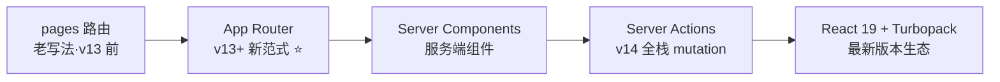
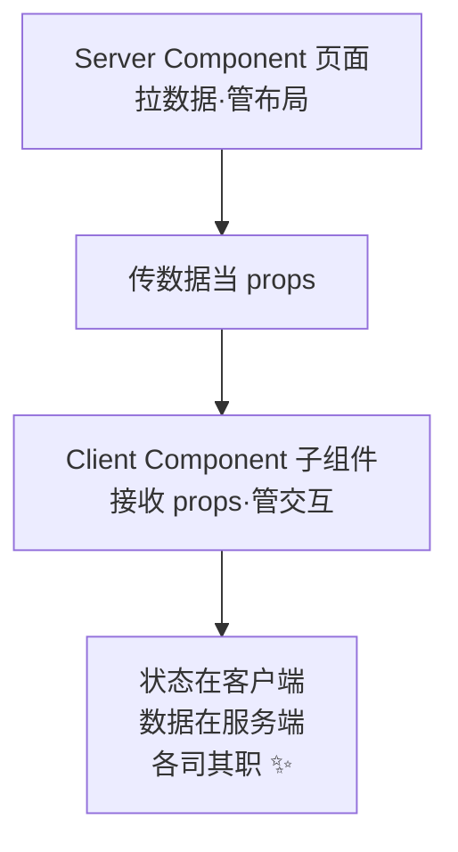
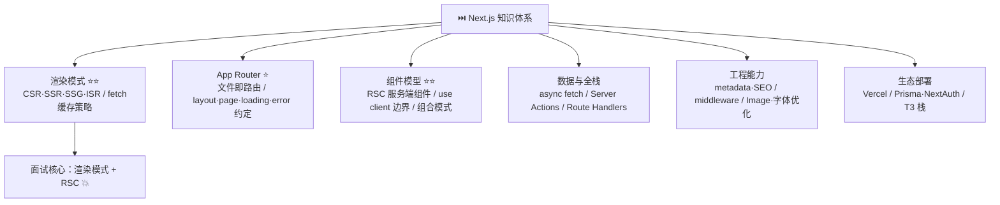

# ⏭️ Next.js 学习笔记 —— React 全栈超能力框架 🚀

> 嘿嘿～欢迎来到 Next.js 的小课堂！🎀
> React 只管画页面，Next.js 给它装上：SSR、SEO、全栈后端、文件路由！
> React 官方推荐的生产框架，学它 = 解锁全栈新姿势！(๑•̀ㅂ•́)و✧

---

## 📚 目录

| 章节 | 内容 | 难度 |
| --- | --- | --- |
| 一 | Next.js 是什么？ | ⭐ |
| 二 | 渲染模式大科普 ⭐⭐（必考！） | ⭐⭐⭐ |
| 三 | 快速上手与目录结构 | ⭐⭐ |
| 四 | App Router 文件约定 ⭐ | ⭐⭐ |
| 五 | 路由系统 | ⭐⭐ |
| 六 | 服务端组件 vs 客户端组件 ⭐⭐ | ⭐⭐⭐⭐ |
| 七 | 数据获取与 Server Actions | ⭐⭐⭐ |
| 八 | SEO 与元数据 | ⭐⭐ |
| 九 | 样式与中间件 | ⭐⭐ |
| 十 | 部署与生态 | ⭐⭐ |
| 十一 | 面试高频考点速览 | 🔥 |

---

## 一、Next.js 是什么？🤔

**Next.js = 基于 React 的全栈框架**（Vercel 出品）：
React 负责 UI，Next.js 补上路由、渲染策略、数据获取、打包优化、部署一条龙～

### 1.1 React（CRA/Vite）缺什么？

| 痛点 | React 裸奔 | Next.js 解决 |
| --- | --- | --- |
| 路由 | 要装 react-router 自己配 | **文件即路由** ✨ |
| SEO | 纯客户端渲染，搜索引擎抓不到 | SSR/SSG 服务端出 HTML |
| 首屏 | 白屏等 JS 下载完 | 服务端先吐 HTML，秒见内容 |
| 后端 | 还得另起 Node 服务 | Route Handlers 直接写接口 |
| 性能优化 | 图片/字体/代码拆分手动搞 | 内置 Image/Font/自动优化 |

### 1.2 发展脉络



> 💡 现在学 **App Router** 就对了（本笔记主角），pages 路由认识一下即可（老项目维护用）～

---

## 二、渲染模式大科普 ⭐⭐（面试必考！）

> 🎀 核心问题：**HTML 在哪生成？什么时候生成？**

### 2.1 四种渲染模式

```mermaid
flowchart TD
    A[渲染模式] --> B[CSR 客户端渲染<br/>纯 React SPA]
    A --> C[SSR 服务端渲染<br/>每次请求现做 HTML]
    A --> D[SSG 静态生成<br/>构建时做好存起来]
    A --> E[ISR 增量静态再生<br/>静态页定时更新]
    B --> B1[首屏慢·SEO 差<br/>后台管理系统用]
    C --> C1[数据实时·SEO 好<br/>每次都请求<br/>类似"现炒菜"]
    D --> D1[最快·SEO 好<br/>内容不变<br/>类似"预制菜"]
    E --> E1[静态+定时刷新<br/>博客·电商列表<br/>预制菜定期换新]
```

### 2.2 对比速查表

| 模式 | HTML 生成时机 | 首屏 | SEO | 数据新鲜度 | 场景 |
| --- | --- | --- | --- | --- | --- |
| CSR | 浏览器（JS 执行后） | 慢 😫 | 差 | 实时 | 后台管理 |
| SSR | **每次请求时**服务端生成 | 快 ✅ | 好 ✅ | 实时 | 个性化页、内容页 |
| SSG | **构建时**生成静态 HTML | 极快 ⚡ | 好 ✅ | 构建时固定 | 官网、文档、博客 |
| ISR | 构建时生成 + **定时再生成** | 极快 ⚡ | 好 ✅ | 定时更新 | 电商列表、资讯 |

> 🍜 做饭比喻：
> CSR = 自己买菜做饭（等半天）
> SSR = 进店现炒（每次等 5 分钟，热乎）
> SSG = 提前做好的便当（拿了就走）
> ISR = 便当每天换新（又快又不至于过期）

### 2.3 App Router 里怎么选？

```jsx
// 默认就是 SSG（构建时静态化）
async function Page() {
  const data = await fetch('https://api.xx.com/list');   // 默认有缓存 → 静态
  return <div>{data.length}</div>;
}

// 想要 SSR：关掉缓存，每次请求都拉新数据
fetch(url, { cache: 'no-store' });        // 动态渲染（SSR）

// 想要 ISR：定时重新生成
fetch(url, { next: { revalidate: 60 } }); // 60 秒再生一次
```

---

## 三、快速上手与目录结构 🛠️

### 3.1 创建项目

```bash
npx create-next-app@latest my-app
# 一路选择：
# ✔ TypeScript? Yes
# ✔ ESLint? Yes
# ✔ Tailwind CSS? Yes
# ✔ App Router? Yes ⭐

cd my-app
npm run dev        # 开发：http://localhost:3000
```

### 3.2 目录结构（App Router）

```
my-app/
├── app/                    # ⭐ 核心目录：文件即路由
│   ├── layout.tsx          # 根布局（包所有页面的壳）
│   ├── page.tsx            # 首页 /
│   ├── globals.css
│   ├── about/
│   │   └── page.tsx        # /about 页面
│   ├── blog/
│   │   ├── page.tsx        # /blog 列表
│   │   └── [slug]/
│   │       └── page.tsx    # /blog/xxx 动态路由
│   ├── api/
│   │   └── hello/
│   │       └── route.ts    # 后端接口 /api/hello
│   ├── loading.tsx         # 加载态（自动 Suspense）
│   └── error.tsx           # 错误边界
├── components/             # 自己的组件放这
├── public/                 # 静态资源
├── next.config.js          # Next 配置
└── package.json
```

---

## 四、App Router 文件约定 ⭐

> 🎀 app 目录里的**特殊文件名**有特殊含义，认准这张表～

| 文件名 | 作用 | 类比 |
| --- | --- | --- |
| `page.tsx` | 页面本体（路由入口） | 一个"页面" |
| `layout.tsx` | 布局（包裹子路由，导航栏放这，**不重复渲染** ⭐） | 页面的"壳" |
| `loading.tsx` | 加载 UI（自动包 Suspense） | 转圈圈 |
| `error.tsx` | 报错 UI（必须客户端组件） | 出错提示 |
| `not-found.tsx` | 404 页面 | 迷路提示 |
| `route.ts` | API 接口（后端） | 写接口的地方 |
| `template.tsx` | 类似 layout 但**每次导航都重新挂载** | 一次性壳 |
| `global-error.tsx` | 根级错误兜底 | 最后防线 |

```jsx
// app/layout.tsx —— 根布局（必须有 html + body）
export const metadata = { title: '我的网站' };

export default function RootLayout({ children }) {
  return (
    <html lang="zh-CN">
      <body>
        <nav>我是导航栏，切换页面我不重新渲染~</nav>
        {children}   {/* 页面内容在这里换 */}
      </body>
    </html>
  );
}

// app/page.tsx —— 首页（默认就是服务端组件！）
export default function Home() {
  return <h1>Hello Next.js!</h1>;
}

// app/loading.tsx —— 加载态
export default function Loading() {
  return <div>努力加载中... 🏃‍♀️</div>;
}
```

---

## 五、路由系统 🧭

### 5.1 动态路由

```jsx
// app/blog/[slug]/page.tsx —— 访问 /blog/react 时 slug='react'
export default function BlogPost({ params }) {
  return <h1>文章：{params.slug}</h1>;
}

// catch-all：app/docs/[...slug]/page.tsx
// /docs/a/b/c → params.slug = ['a', 'b', 'c']
```

### 5.2 声明式导航 Link

```jsx
import Link from 'next/link';

<Link href="/about">关于我们</Link>          // 预取+客户端导航（不整页刷新）
<Link href="/blog/react" prefetch={false}>文章</Link>
```

```jsx
// 编程式导航（要在客户端组件里）
'use client';
import { useRouter } from 'next/navigation';

const router = useRouter();
router.push('/login');      // 跳转
router.replace('/home');    // 无痕跳转
router.back();              // 后退
```

### 5.3 Route Handlers：写后端接口 🌟

```ts
// app/api/hello/route.ts —— 访问 /api/hello
export async function GET() {
  return Response.json({ msg: 'hello~' });
}

export async function POST(request) {
  const body = await request.json();
  return Response.json({ got: body });
}

// 动态接口：app/api/users/[id]/route.ts
export async function GET(request, { params }) {
  return Response.json({ id: params.id });
}
```

> 💡 前端再不用单独起 Express 了，**Next 一个项目 = 前端 + 后端**～

---

## 六、服务端组件 vs 客户端组件 ⭐⭐（核心中的核心！）

> 🎀 App Router 默认全是**服务端组件**！要交互（useState/onClick）才加 `'use client'`～

### 6.1 两者对比

| 维度 | Server Component 服务端组件 | Client Component 客户端组件 |
| --- | --- | --- |
| 声明 | 默认（不用写） | 文件顶部 `'use client'` |
| 运行位置 | **只在服务端** | 浏览器（+ SSR 预渲染） |
| 能用 useState | ❌ | ✅ |
| 能用 onClick | ❌ | ✅ |
| 能用 useEffect | ❌ | ✅ |
| 能用 async 直接拉数据 | ✅（超香 ⭐） | ❌ |
| 能直接访问数据库/密钥 | ✅ | ❌（会暴露！） |
| 打包体积 | 0（JS 不发给浏览器） | 打进 bundle |
| 场景 | 数据展示、静态内容 | 表单、动画、交互 |

### 6.2 使用示例

```jsx
// ✅ 服务端组件（默认）：直接 async 拉数据，不写 useEffect！
async function UserList() {
  const res = await fetch('https://api.xx.com/users');
  const users = await res.json();
  return <ul>{users.map(u => <li key={u.id}>{u.name}</li>)}</ul>;
}

// ✅ 客户端组件：要交互才加这句
'use client';
import { useState } from 'react';

export default function Counter() {
  const [n, setN] = useState(0);
  return <button onClick={() => setN(n + 1)}>点了 {n} 次</button>;
}
```

### 6.3 组合使用模式（重点套路！）



```jsx
// page.tsx（服务端：拉数据）
import LikeButton from './LikeButton';

async function Page() {
  const post = await getPost(1);
  return (
    <article>
      <h1>{post.title}</h1>          {/* 服务端渲染：SEO 友好 */}
      <p>{post.content}</p>
      <LikeButton count={post.likes} />  {/* 交互部分交给客户端组件 */}
    </article>
  );
}
```

> ⚠️ 边界规则：
> - `'use client'` 像"传染病边界"：它导入的所有子组件都变成客户端
> - props 从服务端传给客户端组件要**可序列化**（函数、类实例不行）
> - 交互组件尽量放叶子节点，让整棵树的"客户端部分"越小越好 🌿

---

## 七、数据获取与 Server Actions 📡

### 7.1 fetch 缓存策略

```jsx
// ① 默认：缓存（SSG 倾向）
fetch('https://api.xx.com/data');

// ② 不缓存：每次请求都拉（SSR 动态）
fetch('https://api.xx.com/data', { cache: 'no-store' });

// ③ 定时再验证（ISR）
fetch('https://api.xx.com/data', { next: { revalidate: 60 } });

// ④ 按标签批量刷新
fetch(url, { next: { tags: ['posts'] } });
// 某处数据更新后：
revalidateTag('posts');   // 所有打了 posts 标签的缓存全失效
```

### 7.2 Server Actions：不写接口也能改数据 🌟

```jsx
// app/posts/new-post-form.tsx
'use server';   // 文件级声明：里面全是服务端函数（可发到前端调用）

import { revalidatePath } from 'next/cache';
import { db } from '@/lib/db';

export async function createPost(formData) {
  'use server';   // 或函数级声明

  const title = formData.get('title');
  await db.post.create({ data: { title } });

  revalidatePath('/posts');    // 刷新列表页缓存
}

// 前端直接当 action 用（不用 fetch 调接口！）
// app/posts/page.tsx
import { createPost } from './new-post-form';

<form action={createPost}>
  <input name="title" />
  <button type="submit">发布</button>
</form>
```

> 💡 Server Actions = **"RPC 式"提交**：前端表单直接绑定服务端函数，
> 不用手写 fetch/api/接口三件套，全栈体验拉满！（渐进增强：JS 没加载也能提交）

---

## 八、SEO 与元数据 🔍

```jsx
// 静态 metadata：layout 或 page 里导出
export const metadata = {
  title: '甜品屋 - 新鲜蛋糕',
  description: '每日现做，三小时送达',
  keywords: ['蛋糕', '甜品'],
  openGraph: {                       // 分享卡片
    title: '甜品屋',
    images: ['/og.png'],
  },
};

// 动态 metadata：根据 params 生成（详情页必备 ⭐）
export async function generateMetadata({ params }) {
  const post = await getPost(params.slug);
  return { title: post.title, description: post.summary };
}
```

> 💡 对比纯 React SPA：想设 title 要用 react-helmet 在客户端改，
> Next 的 metadata **构建/请求时就写进 HTML**，搜索引擎直接看得见～

---

## 九、样式与中间件 🎨

### 9.1 样式方案

```jsx
// ① Tailwind（脚手架直接可选，主流 ⭐）
<h1 className="text-3xl font-bold text-pink-500">标题</h1>

// ② CSS Modules（xxx.module.css，天然隔离）
import styles from './page.module.css';
<div className={styles.box}>不冲突的样式</div>

// ③ 全局样式：app/globals.css
```

### 9.2 中间件 middleware（请求拦截）

```ts
// middleware.ts（项目根目录）—— 进入页面前先过我这关
import { NextResponse } from 'next/server';

export function middleware(request) {
  const token = request.cookies.get('token');

  // 没登录访问后台 → 踢回登录页
  if (!token && request.nextUrl.pathname.startsWith('/admin')) {
    return NextResponse.redirect(new URL('/login', request.url));
  }
  return NextResponse.next();
}

export const config = {
  matcher: ['/admin/:path*'],   // 只拦截这些路径
};
```

### 9.3 常用内置优化组件

```jsx
import Image from 'next/image';
import Link from 'next/link';

// 图片：自动压缩 + 懒加载 + 防 CLS（布局抖动）
<Image src="/cake.jpg" alt="蛋糕" width={400} height={300} priority />

// 字体：自动自托管，不闪字体
import { Inter } from 'next/font/google';
const inter = Inter({ subsets: ['latin'] });
```

---

## 十、部署与生态 🌍

| 方式 | 命令/说明 |
| --- | --- |
| Vercel（亲爹平台）⭐ | push 到 GitHub 自动部署，零配置 |
| Node 自托管 | `next build` → `next start`（要服务器） |
| Docker | 官方 Dockerfile 模板 |
| 静态导出 | `output: 'export'`（纯 SSG 站点） |

**生态全家桶：**
- **NextAuth.js（Auth.js）**：登录认证全家桶
- **Prisma**：类型安全的 ORM（配数据库）
- **tRPC / Server Actions**：前后端类型打通
- **Tailwind + shadcn/ui**：样式与组件（联动 shadcn 相关知识）
- **Drizzle**：轻量 ORM 新秀

> 🎀 一句话：**Next.js + Prisma + NextAuth + Tailwind** = 目前最流行的全栈 JS 栈（T3 Stack 的核心）～

---

## 十一、面试高频考点速览 🔥

| 考点 | 一句话答案 |
| --- | --- |
| Next.js 解决什么 | React 的路由/SEO/首屏/后端能力：文件路由+SSR/SSG+全栈 API |
| CSR/SSR/SSG/ISR 区别 | 浏览器渲染 vs 每次请求现做 vs 构建时做好 vs 静态+定时再生 |
| App Router vs Pages Router | 新范式（layout/RSC/流式）vs 老写法（pages 目录+getServerSideProps） |
| layout 特性 | 嵌套布局，导航时保留状态不重新渲染 |
| RSC 是什么 | React Server Component：服务端运行、不发 JS 到浏览器、可 async 直取数据 |
| Server vs Client 组件 | 默认服务端（可 async 拉数据零 bundle）vs 'use client'（有状态交互） |
| 'use client' 传染性 | 它导入的子模块都进入客户端边界，props 需可序列化 |
| 数据获取怎么做 | RSC 里 async/await fetch；客户端用 SWR/React Query |
| fetch 缓存怎么控制 | 默认缓存 / no-store（SSR）/ revalidate 秒数（ISR）/ revalidateTag 按标签刷 |
| Server Actions | 前端直接调用服务端函数改数据，免手写接口，配 revalidatePath 刷新 |
| 动态路由怎么写 | `[id]` 文件夹 + params 取值；`[...slug]` catch-all |
| Route Handlers | app/api/xx/route.ts 导出 GET/POST 函数 = 后端接口 |
| metadata 怎么用 | 静态导出 metadata 对象；动态用 generateMetadata({ params }) |
| middleware 干嘛 | 请求进页面前拦截（鉴权/重定向/A-B 测试），config.matcher 圈范围 |
| Next 图片优化 | next/image 自动压缩/懒加载/防 CLS |

---

## 🎁 结语：知识地图



> 🎀 恭喜通关 Next.js！学习建议：
> ① 用 create-next-app 建项目，把**四种渲染模式**各写一页，DevTools 里对比响应头感受差异～
> ② 重点吃透 **Server/Client 组件边界**（面试问爆）和 **fetch 缓存三件套** 💪
> ③ 前置知识回顾：React 笔记（组件/hooks）+ Node.js 笔记（服务端概念），理解 Next 就是顺水推舟～
> 接下来想学 React、Vue3、Nuxt 还是原理八股（浏览器/HTTP/手写），随时喊我！(๑•̀ㅂ•́)و✧
