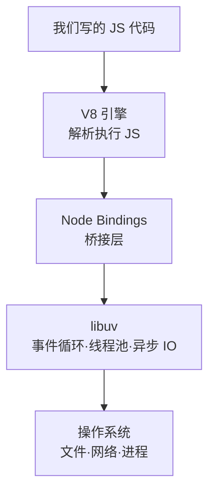
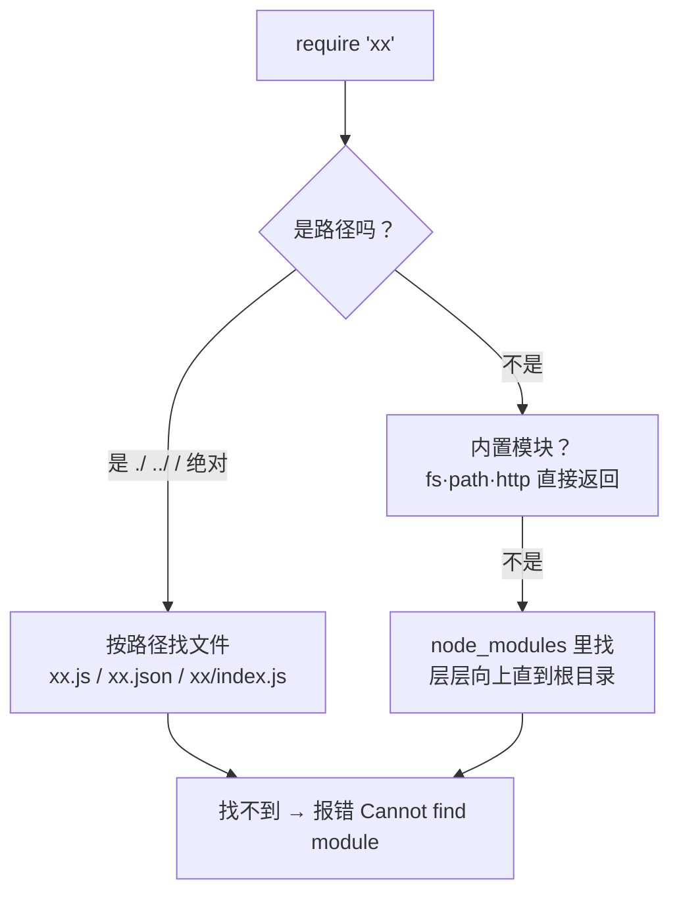
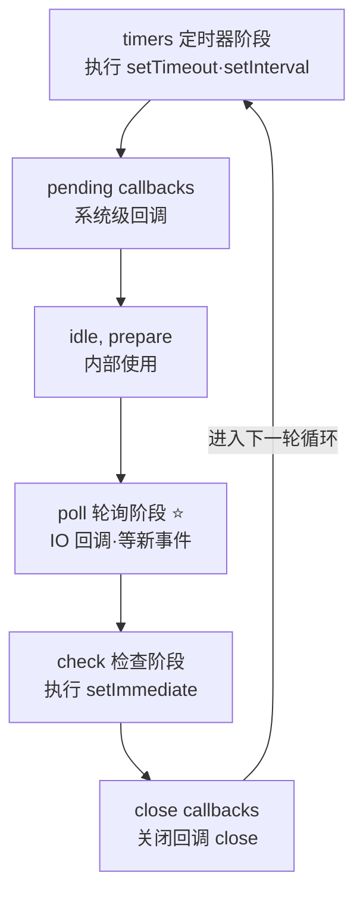
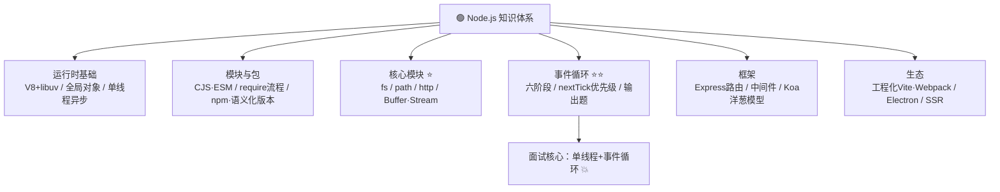

# 🟢 Node.js 学习笔记 —— 让 JS 飞出浏览器 🚀

> 嘿嘿～欢迎来到 Node.js 的小课堂！🎀
> JS 不再只能操作网页——读写文件、开服务器、写脚手架全能干！
> 前端工程化的地基，全栈之路的起点！(๑•̀ㅂ•́)و✧

---

## 📚 目录

| 章节 | 内容 | 难度 |
| --- | --- | --- |
| 一 | Node.js 是什么？ | ⭐ |
| 二 | 安装与初体验 | ⭐ |
| 三 | 模块化：CommonJS 与 ESM | ⭐⭐ |
| 四 | npm 包管理 ⭐ | ⭐⭐ |
| 五 | fs 文件系统 | ⭐⭐ |
| 六 | path 路径模块 | ⭐⭐ |
| 七 | http 模块：手搓服务器 | ⭐⭐⭐ |
| 八 | 事件循环（必考！） | ⭐⭐⭐⭐ |
| 九 | Buffer 与 Stream 流 | ⭐⭐⭐ |
| 十 | Express 上手与中间件 | ⭐⭐⭐ |
| 十一 | 生态与应用场景 | ⭐⭐ |
| 十二 | 面试高频考点速览 | 🔥 |

---

## 一、Node.js 是什么？🤔

**Node.js = 基于 V8 引擎的 JavaScript 运行时**（2009 年 Ryan Dahl 创造）
让 JS 脱离浏览器，直接在**操作系统**上跑～

### 1.1 Node 架构



> 🎀 灵魂记忆：**V8 负责"听懂 JS"，libuv 负责"干活不堵塞"**～
> libuv 就是那个"接单后厨"：烤蛋糕的时候前台还能继续接单（异步非阻塞 IO）！

### 1.2 Node vs 浏览器

| 维度 | 浏览器 | Node.js |
| --- | --- | --- |
| 全局对象 | `window` / `document` | `global`（新版也有 `globalThis`） |
| DOM/BOM | ✅ 有 | ❌ 没有 |
| 文件系统 | ❌ 不能碰 | ✅ `fs` 随便读写 |
| 网络 | fetch/XHR | ✅ 自己当服务器 |
| 模块 | ES Module | CJS + ESM 都行 |
| 运行环境 | Chrome 等 | 独立运行时 |

### 1.3 单线程还那么快？

> Node 的 JS 执行是**单线程**，但 IO 操作（文件/网络）交给 **libuv 线程池**异步处理～
> 就像一个人点单（不堵塞），后厨一群人炒菜（多线程）🍽️
> ✅ 适合 IO 密集型（接口服务）；❌ 不适合 CPU 密集型（复杂计算会卡住所有人）

---

## 二、安装与初体验 🛠️

### 2.1 安装与版本管理

```bash
# 官网下载 LTS 版（长期支持，稳！）
node -v      # 查看版本
npm -v       # npm 一起装好了

# 推荐 nvm 管理多版本（经常切项目必备）
nvm install 20        # 装 20 版
nvm use 20            # 切换
nvm ls                # 列出所有版本
```

### 2.2 三种运行方式

```bash
# ① REPL 交互环境（试验田）
node
> 1 + 1
2

# ② 运行文件
node app.js

# ③ package.json 里定义脚本（npm run dev）
"scripts": { "dev": "node app.js" }
```

```js
// app.js —— 第一个 Node 程序
console.log('Hello Node!');

// 浏览器专属的东西都没有：
// console.log(window);   // ❌ 报错！没有 window
// console.log(global);   // ✅ Node 的全局对象
```

### 2.3 Node 常用全局对象

| 全局 | 作用 |
| --- | --- |
| `global` / `globalThis` | 全局对象 |
| `process` | 进程信息（`process.env` 环境变量超常用 ⭐） |
| `__dirname` | 当前文件所在**目录**（CJS） |
| `__filename` | 当前文件完整路径（CJS） |
| `Buffer` | 二进制数据处理 |
| `console` / `setTimeout` | 和浏览器一样有 |

---

## 三、模块化：CommonJS 与 ESM 📦

### 3.1 CommonJS（Node 传统，默认）

```js
// ===== utils.js：导出 =====
function add(a, b) { return a + b; }
const PI = 3.14;

// 导出方式①：挂到 module.exports
module.exports = { add, PI };

// 导出方式②：exports.add = xxx（注意别整个覆盖 exports！）
// exports.add = add;

// ===== app.js：导入 =====
const { add, PI } = require('./utils');
console.log(add(1, 2));    // 3

// 也可以整体接收
const utils = require('./utils');
utils.add(1, 2);
```

> ⚠️ 经典坑：`exports = { add }` 这样整体赋值会断开引用，导出失败！
> 要么 `module.exports = {...}`，要么 `exports.xx = xx` 一个个挂～

### 3.2 ESM（ES 标准，新趋势）

```js
// 要先在 package.json 声明："type": "module"
// 或文件后缀用 .mjs

// ===== utils.js =====
export function add(a, b) { return a + b; }
export default const PI = 3.14;   // 默认导出

// ===== app.js =====
import add, { PI } from './utils.js';   // 注意要写 .js 后缀！
```

### 3.3 CJS vs ESM 对比（必考！）

| 维度 | CommonJS | ESM |
| --- | --- | --- |
| 语法 | `require` / `module.exports` | `import` / `export` |
| 加载时机 | **运行时**加载（可动态） | **编译时**确定（静态分析） |
| 值的特点 | 值的**拷贝**（导出后改了不影响外面） | 值的**引用**（绑定） |
| this 指向 | module.exports | undefined |
| 能否条件加载 | ✅ `if (x) require(a)` | 静态 import 不行（可用 `import()` 动态） |
| Tree-shaking | ❌ 难 | ✅ 支持（打包优化） |

### 3.4 require 的查找流程（面试爱问）



---

## 四、npm 包管理 ⭐（天天用！）

### 4.1 package.json 全解析

```jsonc
{
  "name": "my-app",              // 项目名（发布包时唯一）
  "version": "1.0.0",            // 语义化版本
  "description": "描述",
  "main": "index.js",            // 入口文件（CJS）
  "type": "module",              // module=ESM / commonjs=CJS

  "scripts": {                   // 脚本命令 ⭐
    "dev": "node app.js",
    "start": "node server.js"
  },

  "dependencies": {              // 生产依赖（打包带走）
    "express": "^4.18.0"
  },
  "devDependencies": {           // 开发依赖（只在开发用）
    "nodemon": "^3.0.0"
  }
}
```

### 4.2 常用命令

```bash
npm init -y               # 一键生成 package.json
npm install               # 装全部依赖（i 简写）
npm i express             # 装包（默认 --save 进 dependencies）
npm i -D nodemon          # 装开发依赖
npm i -g xxx              # 全局安装（工具类）
npm uninstall xxx         # 卸载
npm run dev               # 跑 scripts 里的命令
npm update                # 更新依赖

npx create-vite my-app    # npx：临时执行包的命令，不装全局也能跑 ⭐
```

### 4.3 语义化版本号（^ 和 ~）

```bash
"express": "^4.18.0"   # ^ 锁主版本：4.x.x 都行（小版本+补丁可升）
"react": "~18.2.0"     # ~ 锁次版本：18.2.x（只升补丁）
"vue": "3.4.0"         # 精确锁定：一步不升
```

| 符号 | 规则 | 示例（^4.18.0） |
| --- | --- | --- |
| `^` | 主版本不动 | 4.19.0 ✅ / 5.0.0 ❌ |
| `~` | 主+次不动 | 4.18.1 ✅ / 4.19.0 ❌ |
| 无符号 | 完全锁定 | 只认 4.18.0 |

### 4.4 依赖相关文件

| 文件 | 作用 |
| --- | --- |
| `package.json` | 项目说明书+依赖清单 |
| `package-lock.json` | 锁定精确版本（提交到 git，保证团队一致） |
| `node_modules` | 依赖实体（不提交，npm i 恢复） |

---

## 五、fs 文件系统 📁

### 5.1 同步 vs 异步 vs Promise

```js
const fs = require('fs');

// ① 同步：卡住等结果（少用，会堵塞）
const data = fs.readFileSync('./a.txt', 'utf-8');

// ② 异步回调：结果在回调里
fs.readFile('./a.txt', 'utf-8', (err, data) => {
  if (err) throw err;
  console.log(data);
});

// ③ Promise 风格（推荐 ✨）fs.promises
const fsp = fs.promises;
const read = async () => {
  const data = await fsp.readFile('./a.txt', 'utf-8');
  console.log(data);
};
```

### 5.2 常用方法速查

| 方法 | 作用 |
| --- | --- |
| `readFile / readFileSync` | 读文件 |
| `writeFile` | 写文件（覆盖） |
| `appendFile` | 追加写入 |
| `unlink` | 删除文件 |
| `mkdir / rmdir` | 建/删目录 |
| `readdir` | 读目录（返回文件名数组） |
| `stat` | 文件信息（isFile/isDirectory） |
| `existsSync` | 存在吗（只有同步版） |
| `rename` | 重命名/移动 |

```js
// 实战：遍历目录改文件
const renameAll = async (dir) => {
  const files = await fsp.readdir(dir);
  for (const f of files) {
    const stat = await fsp.stat(`${dir}/${f}`);
    if (stat.isDirectory()) renameAll(`${dir}/${f}`);
    else if (f.endsWith('.txt')) {
      await fsp.rename(`${dir}/${f}`, `${dir}/${f.replace('.txt', '.md')}`);
    }
  }
};
```

---

## 六、path 路径模块 🛣️

> 🎀 跨平台处理路径必备（Windows 用 `\`，Mac 用 `/`，手动拼字符串会翻车！）

```js
const path = require('path');

path.join('a', 'b', 'c.js');        // a/b/c.js（智能拼路径 ⭐）
path.resolve('a', 'b');             // 绝对路径（从右往左找到 / 为止）
path.basename('/a/b/c.js');         // c.js（文件名）
path.basename('/a/b/c.js', '.js');  // c（去后缀）
path.extname('/a/b/c.js');          // .js（后缀）
path.dirname('/a/b/c.js');          // /a/b（目录部分）
path.parse('/a/b/c.js');            // { root, dir, base, ext, name }

// 🌟 超高频组合：项目根目录（webpack/vite 配置常见）
path.resolve(__dirname, 'src');
```

---

## 七、http 模块：手搓服务器 🍜

### 7.1 最小服务器

```js
const http = require('http');

const server = http.createServer((req, res) => {
  // req：请求信息（谁能拿什么）
  console.log(req.method, req.url);         // GET /api/xx

  // res：响应（我要回什么）
  res.writeHead(200, { 'Content-Type': 'application/json; charset=utf-8' });
  res.end(JSON.stringify({ code: 0, data: { name: '小甜' } }));
});

server.listen(3000, () => {
  console.log('服务器开张啦：http://localhost:3000');
});
```

### 7.2 加上路由判断（认识 Express 的意义）

```js
const server = http.createServer(async (req, res) => {
  const { method, url } = req;

  if (url === '/api/users' && method === 'GET') {
    res.end(JSON.stringify([{ id: 1, name: '小甜' }]));
  } else if (url === '/api/users' && method === 'POST') {
    // 收 POST 数据：流式读取
    let body = '';
    req.on('data', (chunk) => (body += chunk));
    req.on('end', () => {
      const user = JSON.parse(body);
      res.end(JSON.stringify({ msg: `创建成功：${user.name}` }));
    });
  } else {
    res.writeHead(404);
    res.end('Not Found');
  }
});
```

> 😫 路由 if/else 越写越长、解析 body 手动拼、返回 JSON 手动 stringify...
> 这就是为什么要有 **Express/Koa**（下一章它们来拯救！）～

---

## 八、事件循环 🔄（必考重头戏！）

> 🎀 前面 ES6 笔记讲过浏览器的，Node 的事件循环更细——**libuv 六阶段模型**！

### 8.1 Node 事件循环六阶段



**每轮循环之间**：先清空 **process.nextTick 队列**，再清空 **微任务队列**（Promise.then）！

### 8.2 优先级排序（背下来！）

```
process.nextTick  >  Promise.then（微任务）
        >
timers（setTimeout/setInterval）
        >
setImmediate（check 阶段）
```

### 8.3 经典输出题 🌟

```js
setTimeout(() => console.log('1-timeout'), 0);
setImmediate(() => console.log('2-immediate'));

Promise.resolve().then(() => console.log('3-promise'));
process.nextTick(() => console.log('4-nextTick'));
console.log('5-sync');

// 输出：5-sync → 4-nextTick → 3-promise → 1/2（顺序不定！）
// setTimeout 和 setImmediate 谁先不确定（取决于环境进入哪个阶段）
// 但 fs.readFile 回调里：setImmediate 必定先于 setTimeout（在 poll 后先 check！）
```

### 8.4 宏微任务速记（联动 ES6 笔记）

| 分类 | 成员 |
| --- | --- |
| 微任务 | `Promise.then` / `queueMicrotask` / `MutationObserver`（浏览器） |
| Node 专属 VIP | `process.nextTick`（比微任务还快！） |
| 宏任务 | `setTimeout` / `setInterval` / `setImmediate` / IO 回调 |

---

## 九、Buffer 与 Stream 流 💧

### 9.1 Buffer：二进制的"集装箱"

```js
// JS 没有二进制类型，Node 用 Buffer 处理文件/网络数据
const buf = Buffer.from('Hello 小甜');     // 字符串转 buffer
console.log(buf);               // <Buffer 48 65 6c 6c ...>（十六进制字节）
console.log(buf.length);        // 字节数（中文一个字 3 字节！）
console.log(buf.toString());    // 转回字符串

Buffer.alloc(10);               // 开 10 字节空间（填 0，安全）
Buffer.allocUnsafe(10);         // 不清零（快但有脏数据）
```

### 9.2 Stream 流：大文件不断搬运 🚚

> 🎀 一次性读 2G 视频 → 内存爆炸 💥
> 流式处理 = 一勺一勺舀，舀一点处理一点～

```js
const fs = require('fs');

// 管道复制大文件：读一点写一点，内存占用极小 ✨
const rs = fs.createReadStream('大电影.mp4');
const ws = fs.createWriteStream('副本.mp4');
rs.pipe(ws);

// http 响应流：边读边发给浏览器
http.createServer((req, res) => {
  fs.createReadStream('video.mp4').pipe(res);   // 用户拖进度条就靠它！
});
```

| 流类型 | 作用 | 示例 |
| --- | --- | --- |
| Readable | 可读（出水口） | fs.createReadStream |
| Writable | 可写（进水口） | fs.createWriteStream |
| Duplex | 双工（能进能出） | net.Socket |
| Transform | 转换（流经时加工） | zlib 压缩、加密 |

---

## 十、Express 上手与中间件 🚂

### 10.1 快速开张

```bash
npm i express
```

```js
const express = require('express');
const app = express();

app.use(express.json());        // 解析 JSON 请求体的内置中间件 ⭐

// 路由：路径 + 方法 分发（再也不用 if/else！）
app.get('/api/users', (req, res) => {
  res.json({ list: [{ id: 1 }] });       // 自动 stringify
});

app.post('/api/users', (req, res) => {
  console.log(req.body);                  // 中间件解析好的请求体
  res.status(201).json({ msg: '创建成功' });
});

app.get('/api/users/:id', (req, res) => {   // 动态参数
  res.json({ id: req.params.id });          // req.params.id
});

app.listen(3000, () => console.log('3000 开张啦'));
```

### 10.2 中间件：流水线工人 👷

> 🎀 中间件 = 处理请求的函数，`next()` 交给下一个，像流水线传包裹～

```js
// 应用级中间件：所有请求都过
app.use((req, res, next) => {
  console.log(`${req.method} ${req.url} @${Date.now()}`);
  next();   // 不调用 next 就"卡"在这了！
});

// 路由级中间件：只管某路径
app.use('/api', (req, res, next) => {
  if (!req.headers.authorization) {
    return res.status(401).json({ msg: '没登录哦' });
  }
  next();
});

// 错误处理中间件：四参数（放最后）
app.use((err, req, res, next) => {
  console.error(err);
  res.status(500).json({ msg: '服务器开小差了' });
});
```

### 10.3 Express vs Koa：洋葱模型 🧅


```js
// Koa 洋葱模型：await next() 前后都有戏份（计时器经典案例）
app.use(async (ctx, next) => {
  const start = Date.now();
  await next();                          // 先放行
  const ms = Date.now() - start;         // 回来时统计耗时
  console.log(`${ctx.url} 耗时 ${ms}ms`);
});
```

| 维度 | Express | Koa |
| --- | --- | --- |
| 出品 | 社区（老牌） | Express 原班人马 |
| 异步 | 回调风格 | **async/await 原生** ✨ |
| 中间件模型 | 线性（一路 next） | **洋葱模型**（可做前后逻辑） |
| 自带功能 | 路由/静态服务等全家桶 | 极简内核（按需装配） |
| 适合 | 快速上手、教程多 | 追求优雅的现代后端 |

---

## 十一、生态与应用场景 🌍

| 场景 | 代表工具 |
| --- | --- |
| Web 服务器 | Express / Koa / NestJS（企业级） |
| 前端工程化 | Webpack / Vite / Babel 全是 Node 跑的！ |
| 脚手架 | create-vite / vue-cli / npm create |
| 桌面应用 | Electron（VSCode 就是它写的！） |
| SSR 服务端渲染 | Nuxt / Next.js |
| 工具脚本 | 批量改文件、爬虫、自动化部署 |
| 实时应用 | WebSocket 聊天室 |

> 🎀 划重点：**Vite、Webpack 这些前端工具链本质都是 Node 程序**，
> 所以前端er 学 Node 是"了解自己的工具怎么造的"～

---

## 十二、面试高频考点速览 🔥

| 考点 | 一句话答案 |
| --- | --- |
| Node 是什么 | 基于 V8 的 JS 运行时，让 JS 运行在服务端 |
| Node 为什么单线程还快 | JS 执行单线程，IO 交给 libuv 线程池+事件循环异步处理，不堵塞 |
| Node 适合什么场景 | IO 密集型（接口/实时服务）；CPU 密集会堵塞主线程（可 worker_threads） |
| CJS vs ESM | 运行时加载 vs 编译时静态；值拷贝 vs 值引用；require vs import |
| require 加载流程 | 内置模块 → 路径文件 → node_modules 层层向上 |
| exports 和 module.exports 区别 | exports 是 module.exports 的引用；整体赋值 exports 会断链 |
| nextTick vs setImmediate vs setTimeout | nextTick（循环间隙） > 微任务 > timers；check 阶段执行 setImmediate |
| fs 同步异步怎么选 | 一般用异步/Promise；同步只在启动读配置等场景 |
| Stream 好处 | 分段处理大数据，内存占用小、快（pipe 管道） |
| Buffer 是什么 | 处理二进制数据的类字节数组对象 |
| Express 中间件原理 | use 注册函数数组，next() 依次执行 |
| 洋葱模型是什么 | Koa 中间件 await next() 前后都能执行，请求响应各穿一遍 |
| process.env 干嘛用 | 读环境变量，区分开发/生产配置（配 dotenv） |

---

## 🎁 结语：知识地图



> 🎀 恭喜通关 Node.js！学习建议：
> ① 把 **http 手搓服务器 → Express 重写** 各写一遍，体会"为什么要有框架"～
> ② 事件循环输出题自己敲一遍验证，配 ES6 笔记的宏微任务一起复习 💪
> ③ 用 Node 写个"批量重命名脚本"跑跑 fs/path，工程感立刻拉满！
> 接下来想学 Vue3、React、Webpack/Vite 原理还是网络安全，随时喊我！(๑•̀ㅂ•́)و✧
