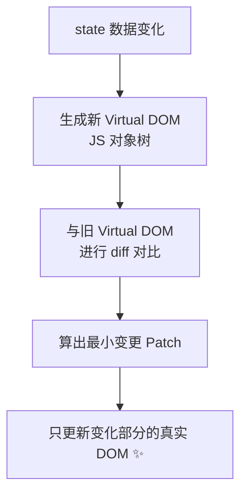
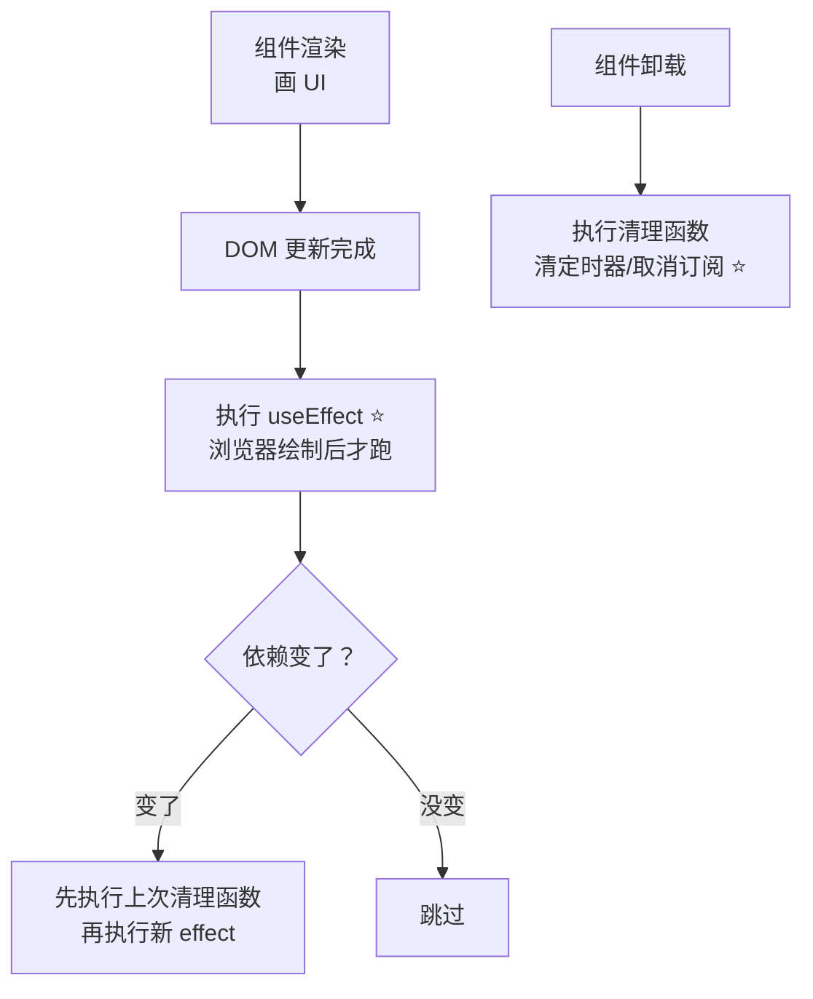
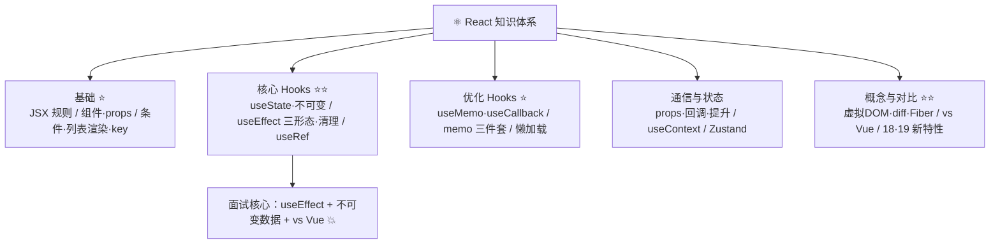

# ⚛️ React 学习笔记 —— 组件化 UI 库的全球霸主 🌍

> 嘿嘿～欢迎来到 React 的小课堂！🎀
> Facebook 出品，"一切皆组件"！Hooks 一出手，状态管理超顺手～
> 全球市占率第一，配 Vue 笔记对照食用双倍效果！(๑•̀ㅂ•́)و✧

---

## 📚 目录

| 章节 | 内容 | 难度 |
| --- | --- | --- |
| 一 | React 是什么？ | ⭐ |
| 二 | 快速上手与 JSX | ⭐⭐ |
| 三 | 组件与 Props | ⭐⭐ |
| 四 | 事件与条件/列表渲染 | ⭐⭐ |
| 五 | useState 状态 ⭐ | ⭐⭐⭐ |
| 六 | useEffect 副作用 ⭐⭐（必考！） | ⭐⭐⭐⭐ |
| 七 | 其他常用 Hooks ⭐ | ⭐⭐⭐ |
| 八 | 组件通信与 Context | ⭐⭐⭐ |
| 九 | 受控与非受控组件 | ⭐⭐ |
| 十 | 性能优化 | ⭐⭐⭐ |
| 十一 | React vs Vue ⭐⭐（必考！） | ⭐⭐⭐ |
| 十二 | React 18/19 新特性 | ⭐⭐ |
| 十三 | 面试高频考点速览 | 🔥 |

---

## 一、React 是什么？🤔

**React = 用于构建用户界面的 JavaScript 库**（注意：是"库"不是全家桶框架！）
核心三板斧：**组件化 + 声明式 + 虚拟 DOM**

### 1.1 三大特点

| 特点 | 一句话 |
| --- | --- |
| 组件化 | 页面拆成一个个积木组件，复用组合 |
| 声明式 | 只描述"UI 长什么样"，不手动操作 DOM（`UI = f(state)`） |
| 虚拟 DOM | JS 对象描述 UI，diff 后精准更新真实 DOM |

### 1.2 虚拟 DOM 工作流程（必考！）



> 🎀 虚拟 DOM = "先在草稿纸改方案，确认后再改正式稿"——避免频繁直接操作真实 DOM 的性能开销～
> 但要诚实说：**虚拟 DOM 不一定比精细的原生操作快**，它的优势是**可维护性+跨平台**（React Native）！

---

## 二、快速上手与 JSX 🛠️

### 2.1 创建项目

```bash
npm create vite@latest my-react -- --template react
cd my-react && npm i && npm run dev
# 或官方全家桶脚手架：
npx create-react-app my-app     # 老牌（现在更推荐 Vite/Next.js）
```

### 2.2 JSX 规则（JS 的"HTML 方言"）

```jsx
function App() {
  const name = '小甜';
  const list = ['奶茶', '蛋糕'];

  return (
    // ① 只能有一个根元素（可用 <></> 空标签包裹）
    <>
      {/* ② 注释长这样 */}
      {/* ③ {} 里写 JS 表达式 */}
      <h1>你好，{name}！</h1>
      <p>{1 + 1}</p>
      <p>{list.length > 1 ? '好多甜品' : '一个甜品'}</p>

      {/* ④ class 要写 className，for 要写 htmlFor */}
      <div className="box" htmlFor="xx">样式类名</div>

      {/* ⑤ style 是对象，属性驼峰 */}
      <div style={{ color: 'pink', fontSize: 20 }}>行内样式</div>

      {/* ⑥ 事件用小驼峰 onClick */}
      <button onClick={() => alert('点我')}>点我</button>
    </>
  );
}

export default App;
```

| 对比 | HTML | JSX |
| --- | --- | --- |
| 类名 | `class` | `className` |
| 行内样式 | `style="color:red"` | `style={{ color: 'red' }}` |
| 事件 | `onclick` | `onClick` |
| 根元素 | 随便 | 只能一个根（`<>...</>`） |
| 插值 | 无 | `{ 表达式 }` |

---

## 三、组件与 Props 🧩

### 3.1 函数组件

```jsx
// 组件 = 首字母大写的函数，返回 JSX
function Welcome() {
  return <h1>欢迎光临~</h1>;
}

// 使用（像 HTML 标签一样）
<Welcome />
```

### 3.2 Props：父传数据

```jsx
// 父组件
<UserCard name="小甜" age={18} tags={['可爱', '元气']} isVip />

// 子组件：props 是只读对象！
function UserCard({ name, age = 18, tags, isVip }) {   // 解构+默认值
  return (
    <div>
      <h3>{name} {isVip && '👑'}</h3>
      <p>年龄：{age}</p>
      <ul>{tags.map(t => <li key={t}>{t}</li>)}</ul>
    </div>
  );
}
```

> ⚠️ **props 单向只读**：子组件不能改 props（和 Vue 一样的规矩）～
> 组件名必须**大写开头**（小写会被当成 HTML 标签）！

---

## 四、事件与条件/列表渲染 🖱️

### 4.1 事件处理（合成事件）

```jsx
function Demo() {
  const handleClick = (e, id) => {
    e.preventDefault();          // 阻止默认
    e.stopPropagation();         // 阻止冒泡
    console.log('id:', id);
  };

  return (
    <a href="/xx" onClick={(e) => handleClick(e, 100)}>链接</a>
  );
}
```

> 💡 合成事件 = React 自己实现的事件系统（统一浏览器差异），
> 事件统一委托到根节点处理（17+ 挂在 root 上）～

### 4.2 条件渲染

```jsx
function Page({ isLogin, msgs }) {
  return (
    <div>
      {/* ① && 短路（注意别返回 0！用 !!msgs.length） */}
      {!!msgs.length && <Badge count={msgs.length} />}

      {/* ② 三元 */}
      {isLogin ? <UserCenter /> : <LoginButton />}

      {/* ③ 提前 return */}
    </div>
  );
}
```

### 4.3 列表渲染 + key（必考！）

```jsx
const list = [{ id: 1, name: '奶茶' }, { id: 2, name: '蛋糕' }];

function Menu() {
  return (
    <ul>
      {list.map(item => (
        <li key={item.id}>          {/* key 必须唯一稳定！ */}
          {item.name}
        </li>
      ))}
    </ul>
  );
}
```

> ⚠️ key 的作用：diff 算法靠 key 识别"是不是同一个节点"，实现复用。
> 用 index 当 key：中间插入/删除时顺序错乱+状态错位，要用**唯一 id** ⭐

---

## 五、useState 状态 ⭐

### 5.1 基本用法

```jsx
import { useState } from 'react';

function Counter() {
  // [状态值, 修改函数]，参数是初始值
  const [count, setCount] = useState(0);
  const [user, setUser] = useState({ name: '小甜', vip: false });

  const add = () => {
    setCount(count + 1);           // 触发重新渲染
    setCount(count + 1);           // ⚠️ 两次都基于旧值，结果只 +1！

    setCount(prev => prev + 1);    // ✅ 函数式更新：基于最新值
    setCount(prev => prev + 1);    // ✅ 这次真的 +2 了
  };

  return (
    <div>
      <p>点了 {count} 次</p>
      <button onClick={add}>+2</button>
    </div>
  );
}
```

### 5.2 不可变数据（React 的铁律！）⭐

```jsx
const [list, setList] = useState([1, 2, 3]);

// ❌ 直接修改：引用没变，React 感知不到，不重新渲染！
list.push(4);
setList(list);

// ✅ 生成新数组/新对象
setList([...list, 4]);                    // 加
setList(list.filter(id => id !== 2));     // 删
setList(list.map(x => x * 2));            // 改
setUser({ ...user, vip: true });          // 对象展开
setUser(prev => ({ ...prev, vip: true })); // 函数式+展开
```

> 🎀 记忆：**React 靠"引用比较"发现变化**——改老数组等于偷偷改，React 装看不见；
> 给个**新的**它才知道"哦，变了！"（Vue 的 Proxy 深度监听就没这烦恼，这是两者核心差异！）

---

## 六、useEffect 副作用 ⭐⭐（面试问爆！）

> 🎀 组件渲染是"纯函数"（只管画 UI），**副作用**（请求/定时器/操作 DOM）全交给 useEffect～

### 6.1 三种形态（背！）

```jsx
import { useEffect, useState } from 'react';

function Demo({ userId }) {
  // ① 无依赖数组：每次渲染后都执行（少用）
  useEffect(() => { console.log('每次渲染后') });

  // ② 空依赖 []：只在挂载后执行一次（= onMounted）
  useEffect(() => {
    console.log('只执行一次');
    const timer = setInterval(() => console.log('tick'), 1000);

    // 清理函数：卸载时执行（= onUnmounted，防内存泄漏 ⭐）
    return () => clearInterval(timer);
  }, []);

  // ③ 有依赖 [userId]：挂载后+依赖变化时执行（= watch + immediate）
  useEffect(() => {
    fetchUser(userId);
    return () => {
      // userId 变化前/卸载前执行（清理上一次）
      controller.abort();       // 取消上次的请求
    };
  }, [userId]);
}
```

### 6.2 执行时机图



### 6.3 依赖数组行为表

| 依赖数组 | 执行时机 | 类比 Vue3 |
| --- | --- | --- |
| 不写 | 每次渲染后 | - |
| `[]` | 只在挂载后一次 | onMounted |
| `[a, b]` | 挂载后 + a/b 变化时 | watch([a,b], fn, {immediate:true}) |
| 返回清理函数 | 卸载/下次执行前 | onUnmounted |

### 6.4 常见坑

```jsx
// ❌ 坑1：无限循环
const [n, setN] = useState(0);
useEffect(() => { setN(n + 1); });        // 渲染→effect→改状态→渲染→...死循环 💥

// ❌ 坑2：忘了依赖，闭包住了旧值
useEffect(() => {
  const t = setInterval(() => console.log(count), 1000);
}, []);                                    // 永远打印初始值 0！

// ✅ 解法：函数式更新 或 把 count 加进依赖
useEffect(() => {
  const t = setInterval(() => setN(prev => prev + 1), 1000);
  return () => clearInterval(t);
}, []);

// ❌ 坑3：该清理的不清理 → 内存泄漏+重复请求
```

---

## 七、其他常用 Hooks ⭐

### 7.1 useRef：双面角色

```jsx
import { useRef } from 'react';

function Demo() {
  // ① 拿 DOM（改 .current 不触发渲染）
  const inputRef = useRef(null);
  const focus = () => inputRef.current.focus();

  // ② 存"不参与渲染"的变量（跨渲染保留，像实例属性）
  const timerRef = useRef(null);

  return (
    <>
      <input ref={inputRef} />
      <button onClick={focus}>聚焦</button>
    </>
  );
}
```

### 7.2 useMemo / useCallback：缓存双雄（必考区别！）

```jsx
import { useMemo, useState, useCallback } from 'react';

function Cart({ list, onBuy }) {
  // useMemo：缓存"计算结果"（值）
  const total = useMemo(
    () => list.reduce((s, it) => s + it.price, 0),
    [list]                          // list 不变就不重算
  );

  // useCallback：缓存"函数引用"（传给子组件时不让它失效）
  const handleBuy = useCallback(
    (id) => onBuy(id),
    [onBuy]                          // 依赖不变，返回同一个函数
  );

  return <p>总价：{total}</p>;
}
```

| Hook | 缓存什么 | 返回 | 什么时候用 |
| --- | --- | --- | --- |
| useMemo | 计算结果 | 值 | 昂贵计算/保持引用一致（传给 memo 子组件的数组） |
| useCallback | 函数本身 | 函数 | 传给子组件/memo 组件的回调 |

### 7.3 useContext：跨层级传值

```jsx
// ① 创建上下文
const ThemeContext = createContext('light');

// ② 祖先提供
<ThemeContext.Provider value="dark">
  <App />
</ThemeContext.Provider>

// ③ 任意后代消费（不用一层层传 props）
function Button() {
  const theme = useContext(ThemeContext);   // 'dark'
  return <button className={theme}>按钮</button>;
}
```

### 7.4 自定义 Hook（React 版 composable！）

```jsx
// hooks/useFetch.js：use 开头是规矩！
import { useState, useEffect } from 'react';

function useFetch(url) {
  const [data, setData] = useState(null);
  const [loading, setLoading] = useState(true);

  useEffect(() => {
    setLoading(true);
    fetch(url)
      .then(res => res.json())
      .then(d => { setData(d); setLoading(false); });
  }, [url]);

  return { data, loading };      // 返回状态
}

// 任何组件里用：
const { data, loading } = useFetch('/api/users');
```

### 7.5 Hooks 速查表

| Hook | 作用 | 类比 Vue3 |
| --- | --- | --- |
| useState | 状态 | ref |
| useEffect | 副作用 | onMounted + watch + onUnmounted 三合一 |
| useRef | DOM/可变值 | ref 拿 DOM |
| useMemo | 缓存值 | computed |
| useCallback | 缓存函数 | -（Vue 不需要） |
| useContext | 跨级数据 | provide/inject |
| useReducer | 复杂状态逻辑 | - |
| useId | 生成唯一 id | - |

> ⚠️ **Hooks 规则**（必考）：
> ① 只在**顶层**调用（不能进 if/for）
> ② 只在**函数组件/自定义 Hook** 里用（不能进普通函数/类）
> 原因：React 靠**调用顺序**记录每个 Hook 的状态，顺序乱了就取错值！

---

## 八、组件通信与 Context 📡

### 8.1 通信方式速查

| 方式 | 方向 | 场景 |
| --- | --- | --- |
| props | 父 → 子 | 最常用 ⭐ |
| 回调函数 props | 子 → 父 | `onXxx={handler}` ⭐ |
| 状态提升 | 兄弟 | 共同状态搬到最近父组件 |
| Context | 祖 → 后代 | 主题/语言/登录态 |
| Zustand/Redux | 任意 | 全局状态 ⭐ |
| 事件总线 | 任意 | React 生态少用（无官方 $on） |

### 8.2 子传父（回调）

```jsx
// 父组件
function Parent() {
  const [msg, setMsg] = useState('');
  return <Child onSubmit={(text) => setMsg(text)} />;
}

// 子组件：调用父给的函数
function Child({ onSubmit }) {
  const [text, setText] = useState('');
  return (
    <button onClick={() => onSubmit(text)}>通知爸爸</button>
  );
}
```

### 8.3 Zustand（现代状态管理首选 ✨）

```bash
npm i zustand
```

```jsx
// stores/user.js
import { create } from 'zustand';

const useUserStore = create((set) => ({
  token: '',
  cart: [],
  setToken: (t) => set({ token: t }),
  addToCart: (item) => set((s) => ({ cart: [...s.cart, item] })),
}));

// 任意组件（不用 Provider 包裹！）
const token = useUserStore((s) => s.token);       // 选择器订阅
const setToken = useUserStore((s) => s.setToken);
```

---

## 九、受控与非受控组件 🎛️

```jsx
// 受控组件：值由 state 管，onChange 同步（推荐 ⭐）
function Controlled() {
  const [value, setValue] = useState('');
  return <input value={value} onChange={(e) => setValue(e.target.value)} />;
}

// 非受控组件：值由 DOM 自己管，ref 来取
function Uncontrolled() {
  const inputRef = useRef(null);
  const submit = () => console.log(inputRef.current.value);
  return (
    <>
      <input ref={inputRef} defaultValue="默认值" />
      <button onClick={submit}>提交</button>
    </>
  );
}
```

| 对比 | 受控 | 非受控 |
| --- | --- | --- |
| 数据源 | React state | DOM 自身 |
| 取值方式 | state 直接读 | ref.current |
| 即时校验 | ✅ 方便 | 麻烦 |
| 场景 | 表单（主流） | 文件上传/简单场景 |

> 💡 类比 Vue：受控组件 ≈ v-model 双向绑定；非受控 ≈ 传统拿 DOM 值～

---

## 十、性能优化 🚀

### 10.1 优化手段速查

| 手段 | 作用 | 说明 |
| --- | --- | --- |
| `React.memo(Child)` | 子组件浅比较 props，不变就不渲染 | 类似 Vue 自动依赖收集 |
| `useMemo` | 缓存计算结果 | 昂贵计算必配 |
| `useCallback` | 缓存函数 | 配 memo 使用（传引用稳定） |
| 懒加载 | `React.lazy(() => import())` | 路由/重组件分包 |
| 虚拟列表 | react-window | 万级长列表 |
| key 稳定 | 唯一 id | 帮 diff 复用节点 |

### 10.2 memo 组合拳（经典套路）

```jsx
// 子组件：memo 包一层，props 不变就不重渲染
const Child = React.memo(function Child({ data, onBuy }) {
  console.log('我渲染了');           // data/onBuy 引用不变就不打印
  return <div>{data.name}</div>;
});

// 父组件：配 useMemo/useCallback 稳住引用
function Parent() {
  const [n, setN] = useState(0);
  const data = useMemo(() => ({ name: '蛋糕' }), []);   // 不变
  const onBuy = useCallback(() => {...}, []);            // 不变

  return (
    <>
      <button onClick={() => setN(n + 1)}>+{n}</button>
      <Child data={data} onBuy={onBuy} />   {/* n 变我也懒得渲染 ✨ */}
    </>
  );
}
```

> ⚠️ 单用 memo 没用！传入的 data/onBuy 每次都是**新引用**照样触发渲染，
> 必须 **memo + useMemo + useCallback** 三件套一起上～

### 10.3 路由懒加载

```jsx
import { lazy, Suspense } from 'react';

const Detail = lazy(() => import('./pages/Detail'));

<Suspense fallback={<div>加载中...</div>}>
  <Detail />
</Suspense>
```

---

## 十一、React vs Vue ⭐⭐（必考对比！）

| 维度 | React | Vue |
| --- | --- | --- |
| 定位 | UI **库**（生态自选） | 渐进式**框架**（官方全家桶） |
| 语法 | JSX（JS 里写 HTML） | SFC 模板（HTML 里写逻辑） |
| 响应式 | **不可变数据 + setState** | **Proxy 自动响应式** ⭐ |
| 数据修改 | 生成新数组/对象 | 直接改 |
| 优化 | 手动 memo/useMemo/useCallback | 自动依赖收集（省心）⭐ |
| 学习曲线 | 上手 JS 功底要求高 | 模板好懂上手快 |
| 灵活性 | 极高（万物皆 JS） | 约定多但规范 |
| 生态 | React Router/Redux/Zustand/RN | Router/Pinia/uni-app |
| 风格 | 函数式思想 | 声明式+响应式 |
| 国际 | 全球主流（大厂外企） | 国内极流行 |

**核心差异一句话（面试满分答法）：**

> React 是"**推倒重来**"模式：状态变了重新执行整个函数生成新虚拟 DOM，靠不可变数据+diff 保证效率，**手动优化**空间大；
> Vue 是"**精准追踪**"模式：Proxy 依赖收集知道谁用了这个数据，**自动**只更新对应组件，省心但灵活度让渡给框架～

---

## 十二、React 18/19 新特性 🆕

| 特性 | 说明 |
| --- | --- |
| 并发渲染（18） | 渲染可中断，高优先级任务插队（输入框不再卡顿）⭐ |
| 自动批处理（18） | 多次 setState 合并一次渲染（17 只在事件里批处理） |
| Transitions（18） | `useTransition` 标记低优先级更新 |
| Suspense 改进（18） | 数据获取配 Suspense 更丝滑 |
| useId / useSyncExternalStore（18） | SSR 唯一 id / 订阅外部 store |
| Actions（19） | 表单直接配 action 处理 pending ⭐ |
| useOptimistic（19） | 乐观更新（点赞先上后校验） |
| Server Components | 服务端组件（配 Next.js，见 Nextjs 笔记 ⭐） |

```jsx
// 自动批处理（18+）：只渲染一次！
const handleClick = () => {
  setCount(c + 1);
  setMsg('hi');
  setList([...list, x]);    // 三次 setState 一次渲染 ✨
};
```

---

## 十三、面试高频考点速览 🔥

| 考点 | 一句话答案 |
| --- | --- |
| 虚拟 DOM 是什么 | 用 JS 对象描述真实 DOM；diff 新旧树算最小变更再精准更新 |
| 虚拟 DOM 优点 | 声明式开发、跨平台（RN）、避免频繁操作真实 DOM；但非绝对更快 |
| diff 算法策略 | 同层比较 + type/key 判断复用；key 是节点身份证 |
| key 为什么不能用 index | 增删时 key 错位导致状态错乱+性能差，用唯一 id |
| setState 同步还是异步 | 18 后都自动批处理（异步合并）；原生事件/setTimeout 里同步执行 |
| 为什么不可变数据 | React 浅比较引用发现变化；直接改引用不变感知不到 |
| useEffect 依赖数组 | 不写每次都跑 / [] 只跑一次 / [a] 挂载+a 变化跑；返回清理函数 |
| useMemo vs useCallback | 缓存值 vs 缓存函数引用；配 memo 子组件使用 |
| Hooks 规则 | 只在顶层调用（顺序定位）；只在组件/自定义 Hook 里用 |
| 为什么不能在 if 里写 Hook | React 按调用顺序对应状态，条件导致错位 |
| 受控 vs 非受控 | state 管值（v-model 感） vs ref 直接拿 DOM 值 |
| 组件通信 | props / 回调 / 状态提升 / Context / Zustand·Redux |
| 性能优化手段 | memo 三件套 / lazy 懒加载 / 虚拟列表 / 稳定 key |
| React vs Vue | 不可变+手动优化 vs Proxy 自动响应式；JSX vs 模板；库 vs 框架 |
| Fiber 是什么 | 可中断的渲染架构：把渲染拆成小任务分片执行，优先级调度 |

---

## 🎁 结语：知识地图



> 🎀 恭喜通关 React！学习建议：
> ① 亲手搭一个**待办清单**：useState + 不可变增删改 + useEffect 持久化 localStorage，基础一网打尽～
> ② 面试三大件背熟：**useEffect 依赖/清理、不可变数据原因、React vs Vue** 💪
> ③ 和 Vue 笔记对照复习：Hooks vs 组合式 API 一一对应，双倍理解！
> 进阶路线：React Router → Zustand → Next.js（笔记已备好）→ 源码（Fiber/diff）～
> 接下来想学 React Router、Redux、原理八股（浏览器/HTTP/手写）还是别的，随时喊我！(๑•̀ㅂ•́)و✧
