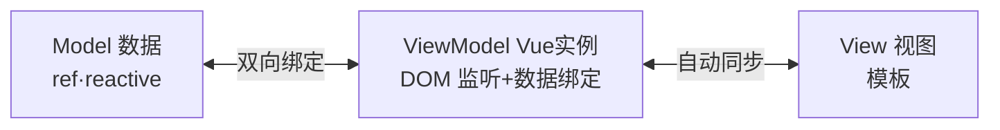
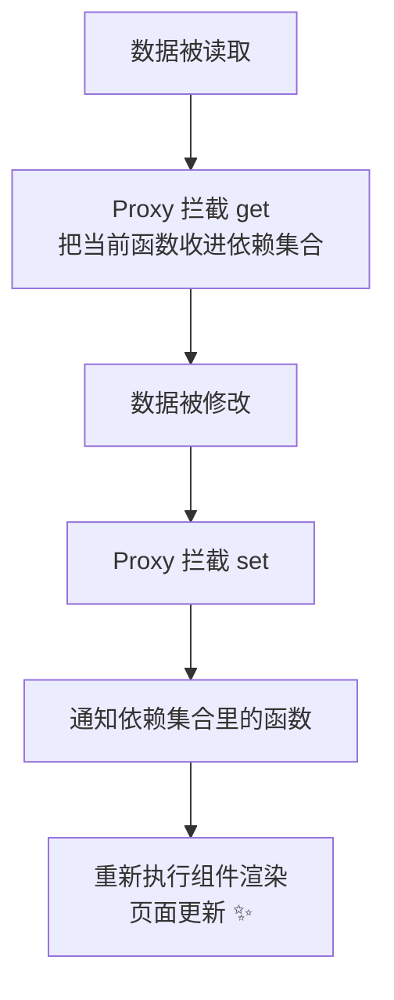
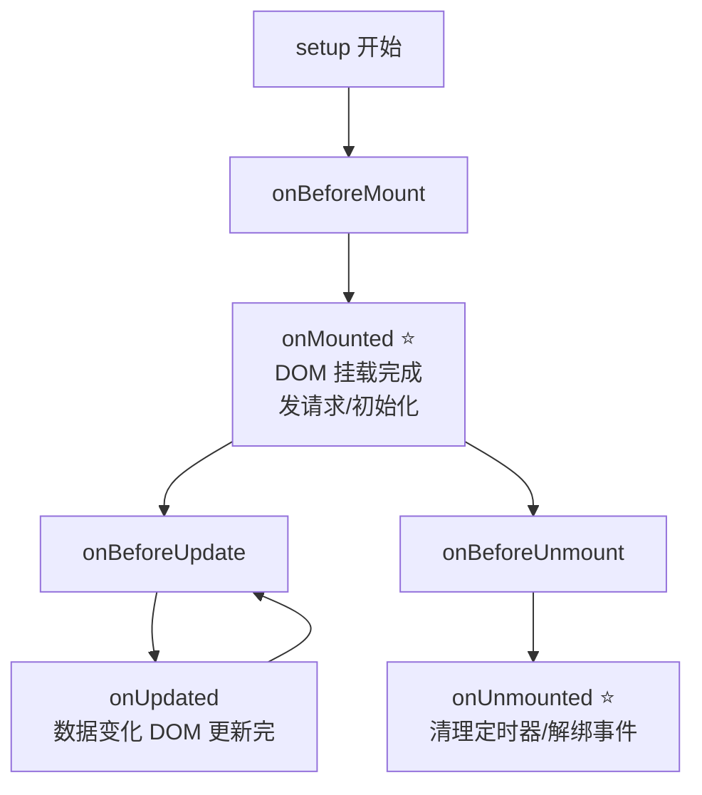
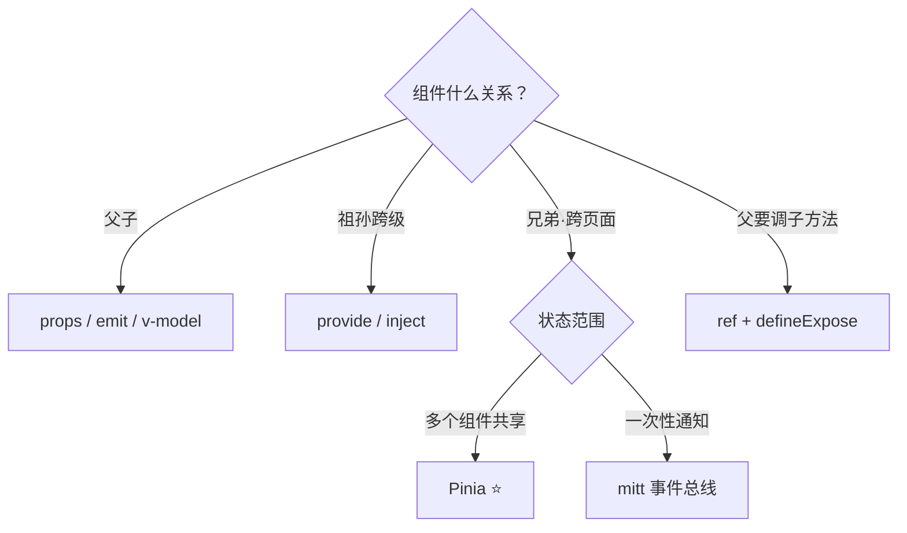
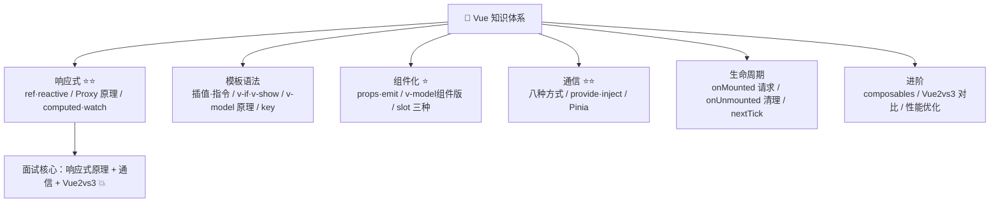

# 💚 Vue 学习笔记 —— 渐进式前端框架之王 👑

> 嘿嘿～欢迎来到 Vue 的小课堂！🎀
> 数据一动页面自动变——从此告别手动操作 DOM！
> 尤雨溪出品，国内最流行的框架，面试的重中之重！(๑•̀ㅂ•́)و✧

---

## 📚 目录

| 章节 | 内容 | 难度 |
| --- | --- | --- |
| 一 | Vue 是什么？MVVM 思想 | ⭐ |
| 二 | 快速上手与单文件组件 | ⭐ |
| 三 | 响应式核心 ⭐⭐（灵魂！） | ⭐⭐⭐⭐ |
| 四 | 模板语法与指令大全 | ⭐⭐ |
| 五 | computed 与 watch ⭐ | ⭐⭐⭐ |
| 六 | 组件化：props 与 emit | ⭐⭐ |
| 七 | 插槽 Slot | ⭐⭐ |
| 八 | 生命周期 ⭐ | ⭐⭐⭐ |
| 九 | 组件通信全家桶 ⭐⭐（必考！） | ⭐⭐⭐⭐ |
| 十 | 组合式函数与内置工具 | ⭐⭐⭐ |
| 十一 | Vue2 vs Vue3 ⭐⭐（必考！） | ⭐⭐⭐ |
| 十二 | 面试高频考点速览 | 🔥 |

---

## 一、Vue 是什么？🤔

**Vue = 渐进式 JavaScript 框架**：核心只管视图层，按需加装路由（Router）、状态（Pinia）...

### 1.1 声明式 vs 命令式

```js
// 😫 命令式（jQuery 时代）：一步步告诉浏览器怎么干
$('#name').text('小甜');

// ✨ 声明式（Vue）：只管改数据，页面自己变！
username.value = '小甜';   // 视图自动更新 ✨
```

### 1.2 MVVM 模型



> 🎀 你只写 Model（数据）和 View（模板），中间的脏活 VM（Vue）全包了～

---

## 二、快速上手与单文件组件 🛠️

### 2.1 创建项目（Vite）

```bash
npm create vue@latest my-app
# 或最简：npm create vite@latest my-app -- --template vue
cd my-app && npm i && npm run dev
```

### 2.2 单文件组件 SFC

```vue
<!-- .vue 文件 = 一个组件：结构/逻辑/样式 三段式 -->
<script setup>
// 逻辑：setup 语法糖（Vue3 标配写法）
import { ref } from 'vue';
const msg = ref('Hello Vue!');
</script>

<template>
  <!-- 结构 -->
  <h1>{{ msg }}</h1>
</template>

<style scoped>
/* 样式：scoped 隔离，只作用于本组件 */
h1 { color: pink; }
</style>
```

---

## 三、响应式核心 ⭐⭐（Vue 的灵魂！）

> 🎀 核心思想：**数据变了 → 自动更新用到它的 DOM**～

### 3.1 ref 与 reactive

```js
import { ref, reactive } from 'vue';

// ref：万能款（基本类型+对象都行），取值要 .value ⭐
const count = ref(0);
console.log(count.value);      // JS 里要 .value
count.value++;                 // 修改也要 .value
// 模板里自动解包，不用写 .value：{{ count }}

const user = ref({ name: '小甜' });
user.value.name = '小美';      // 对象内部直接改，响应式 OK

// reactive：只收对象/数组，不用 .value
const state = reactive({ list: [], page: 1 });
state.page = 2;                // 直接改

// ⚠️ reactive 三大坑：
// ① 不能整体替换：state = {...} ❌ 断开响应式
// ② 解构会丢响应式：const { page } = state ❌
//    要解构用 toRefs：const { page } = toRefs(state) ✅
// ③ 不能存基本类型：reactive(0) ❌
```

### 3.2 选谁？一句话

| 场景 | 推荐 |
| --- | --- |
| 基本类型（数字/字符串/布尔） | `ref` ✅ |
| 表单对象/批量状态 | 都行，团队统一即可 |
| 要解构 | `ref` 或 `toRefs` |
| 新手 | **全用 ref 最省心** 😝 |

### 3.3 响应式原理（必考！）⭐⭐



```js
// Vue3 核心：Proxy（代理整个对象）
const data = new Proxy({ count: 0 }, {
  get(target, key) {
    track(target, key);        // 收集依赖（谁在用我）
    return target[key];
  },
  set(target, key, value) {
    target[key] = value;
    trigger(target, key);      // 触发更新（通知用我的人）
    return true;
  },
});
```

**Vue2 vs Vue3 响应式对比（面试必背）：**

| 维度 | Vue2（Object.defineProperty） | Vue3（Proxy） |
| --- | --- | --- |
| 拦截能力 | 只能劫持**已知属性** | 代理**整个对象** |
| 新增/删除属性 | ❌ 监听不到（要 `$set/$delete`） | ✅ 直接监听 |
| 数组索引/length | ❌（要重写 7 个数组方法） | ✅ 直接监听 |
| 初始化 | 递归全部属性（慢） | 懒代理（用到才深入，快） |
| 兼容性 | 支持 IE11 | 不支持 IE |

---

## 四、模板语法与指令大全 📝

### 4.1 插值与绑定

```html
<!-- 文本插值 -->
<span>{{ msg }}</span>
<span>{{ count * 2 }}</span>          <!-- 支持表达式 -->
<span>{{ ok ? '是' : '否' }}</span>

<!-- 属性绑定：v-bind 简写 : -->

<button :disabled="loading">提交</button>

<!-- class / style 增强写法 -->
<div :class="{ active: isActive, danger: hasErr }"></div>
<div :class="['box', isActive && 'active']"></div>
<div :style="{ color: textColor, fontSize: size + 'px' }"></div>

<!-- 事件绑定：v-on 简写 @ -->
<button @click="handle">点我</button>
<button @click="handle($event, 123)">传参+事件对象</button>
<form @submit.prevent="onSubmit">.prevent 阻止默认</form>
<button @click.stop="fn">.stop 阻止冒泡</button>
<button @click.once="fn">.once 只触发一次</button>
<input @keyup.enter="search">.enter 回车修饰符</input>
```

### 4.2 条件与列表

```html
<!-- v-if：真删除/创建（切换开销大） -->
<p v-if="score >= 90">优秀</p>
<p v-else-if="score >= 60">及格</p>
<p v-else>加油~</p>

<!-- v-show：display 切换（频繁切换用） -->
<div v-show="visible">我只是藏起来了</div>

<!-- v-for：列表渲染，:key 必须给！⭐ -->
<li v-for="(item, index) in list" :key="item.id">
  {{ index }} - {{ item.name }}
</li>
<!-- 对象也能遍历：v-for="(value, key) in obj" -->
```

> ⚠️ 高频考点：
> **v-if vs v-show**：v-if 真条件渲染（惰性，切换销毁）；v-show 只切 display（初始都渲染）。
> 频繁切换 → v-show；条件很少变 → v-if。
> **为什么要有 key**：diff 算法靠 key 复用节点，用 index 当 key 在增删时会错乱（要用唯一 id）⭐

### 4.3 v-model 双向绑定

```html
<!-- 本质语法糖：:value + @input -->
<input v-model="msg" />
<!-- 等价于 -->
<input :value="msg" @input="msg = $event.target.value" />

<!-- 修饰符 -->
<input v-model.lazy="msg" />     <!-- 失焦才同步 -->
<input v-model.number="age" />   <!-- 自动转数字 -->
<input v-model.trim="name" />    <!-- 去首尾空格 -->
```

### 4.4 指令速查表

| 指令 | 作用 |
| --- | --- |
| `v-bind` / `:` | 绑定属性 |
| `v-on` / `@` | 绑定事件 |
| `v-if / v-else-if / v-else` | 条件渲染 |
| `v-show` | 显示隐藏 |
| `v-for` | 列表渲染（配 :key） |
| `v-model` | 双向绑定 |
| `v-html` | 插入 HTML（警惕 XSS ⚠️） |
| `v-text` | 插入纯文本 |
| `v-once` | 只渲染一次 |
| `v-cloak` | 防闪烁（配 CSS） |
| `v-slot` / `#` | 插槽 |

---

## 五、computed 与 watch ⭐（必考区别！）

### 5.1 computed 计算属性

```js
import { ref, computed } from 'vue';

const list = ref([80, 90, 60]);
const keyword = ref('');

// 有缓存：依赖不变就不重算 ⭐
const total = computed(() => list.value.reduce((s, n) => s + n, 0));

// 过滤列表（模板里直接用 filtered）
const filtered = computed(() =>
  list.value.filter(n => String(n).includes(keyword.value))
);

// 可写计算属性（少用但要知道）
const fullName = computed({
  get: () => firstName.value + ' ' + lastName.value,
  set: (val) => [firstName.value, lastName.value] = val.split(' '),
});
```

### 5.2 watch 侦听器

```js
import { ref, watch, watchEffect } from 'vue';

const page = ref(1);
const user = ref({ name: '小甜' });

// ① 基本监听
watch(page, (newVal, oldVal) => {
  console.log(`${oldVal} → ${newVal}`);
  getList();                       // 页码变了重新请求（经典场景）
});

// ② 监听对象内部：要 deep 或箭头函数
watch(() => user.value.name, (n) => console.log('名字变了', n));
watch(user, (n) => {}, { deep: true });        // 深度监听

// ③ 立即执行 immediate
watch(page, (n) => getList(), { immediate: true });  // 一进来先执行一次

// ④ watchEffect：自动收集依赖，立即执行
watchEffect(() => {
  console.log(page.value);   // 用了 page 就自动监听它
});
```

### 5.3 三者对比（背下来！）

| 维度 | computed | watch | watchEffect |
| --- | --- | --- | --- |
| 用途 | **根据依赖算新值** | **数据变了执行副作用**（请求/定时器） | 自动依赖的副作用 |
| 缓存 | ✅ 有（依赖不变不重算） | ❌ 无 | ❌ 无 |
| 返回值 | 有（当属性用） | 无 | 无 |
| 异步 | 不建议 | ✅ 支持 | ✅ 支持 |
| 立即执行 | 默认否 | `immediate: true` | ✅ 默认就是 |
| 场景 | 全选/总价/过滤 | 页码变化发请求 | 依赖变化就执行 |

---

## 六、组件化：props 与 emit 🧩

### 6.1 父传子：props

```vue
<!-- 父组件 -->
<UserCard :name="'小甜'" :age="18" :tags="['可爱']" :is-vip="true" />

<!-- 子组件 UserCard.vue -->
<script setup>
// 方式①：数组声明（简单）
// defineProps(['name', 'age', 'tags'])

// 方式②：对象声明（带校验，推荐 ⭐）
const props = defineProps({
  name: { type: String, required: true },
  age: { type: Number, default: 18 },
  tags: Array,
  isVip: Boolean,
});
</script>

<template>
  <div>{{ props.name }}（{{ props.age }}岁）</div>
  <!-- 模板里可不写 props. 直接用 -->
  <span>{{ name }}</span>
</template>
```

> ⚠️ 单向数据流：**props 只读**！子组件不能改父传的数据（要通知父组件去改）～

### 6.2 子传父：emit

```vue
<!-- 子组件 -->
<script setup>
const emit = defineEmits(['change', 'delete']);

const click = () => {
  emit('change', 666);          // 触发事件+传参
};
</script>
<template>
  <button @click="click">通知爸爸</button>
</template>

<!-- 父组件：监听子组件事件 -->
<UserCard @change="handleChange" @delete="handleDel" />
```

### 6.3 组件上的 v-model（Vue3 优雅写法 ⭐）

```vue
<!-- 父组件：组件直接 v-model -->
<MyInput v-model="msg" />
<MyDialog v-model:show="visible" v-model:title="dialogTitle" />

<!-- 子组件 MyInput.vue -->
<script setup>
const model = defineModel();                    // 默认 v-model
const show = defineModel('show');               // 具名 v-model:show
</script>
<template>
  <input v-model="model" />   <!-- 改它自动同步给父组件！ -->
</template>

<!-- 3.4 之前的写法（老项目）：
const props = defineProps(['modelValue']);
const emit = defineEmits(['update:modelValue']); -->
```

---

## 七、插槽 Slot 🍩

> 🎀 插槽 = 组件里留的"坑"，让使用者填内容～（类比：插槽 =手机壳的孔，放卡放钱随你）

```vue
<!-- 子组件 Card.vue -->
<template>
  <div class="card">
    <!-- ① 默认插槽 -->
    <slot>我是默认内容（没传就显示我）</slot>

    <!-- ② 具名插槽 -->
    <header><slot name="header" /></header>
    <footer><slot name="footer" /></footer>

    <!-- ③ 作用域插槽：子组件把数据传出去用 ⭐ -->
    <slot :row="item" :index="i" />
  </div>
</template>

<!-- 父组件使用 -->
<Card>
  <p>塞进默认插槽的内容</p>

  <template #header>
    <h3>这是头部</h3>
  </template>

  <template #footer>
    <button>底部按钮</button>
  </template>

  <!-- 作用域插槽：#default="{ row }" 接子组件的数据 -->
  <template #default="{ row, index }">
    {{ index }}: {{ row.name }}
  </template>
</Card>
```

| 插槽类型 | 场景 |
| --- | --- |
| 默认插槽 | 卡片容器、弹窗内容 |
| 具名插槽 | 布局组件多个区域 |
| 作用域插槽 | 表格列自定义渲染（Element 表格就靠它 ⭐） |

---

## 八、生命周期 ⭐

### 8.1 全家福



### 8.2 使用与场景

```js
import { onMounted, onUnmounted } from 'vue';

onMounted(() => {
  // DOM 准备好了：发请求、初始化 echarts、拿 ref
  console.log(box.value);        // 此时能拿到 DOM
});

onUnmounted(() => {
  // 组件销毁：清定时器、取消订阅（防内存泄漏 ⭐）
  clearInterval(timer);
});
```

| 钩子 | 时机 | 常干啥 |
| --- | --- | --- |
| setup | 创建实例时 | 全部初始化逻辑（Vue3 主场） |
| onMounted | DOM 挂载完成 | **发请求/初始化插件** ⭐ |
| onUpdated | 响应式更新完成 | 访问最新 DOM（少用） |
| onUnmounted | 卸载后 | **清理定时器/事件** ⭐ |
| onErrorCaptured | 捕获后代错误 | 边界处理 |

> 💡 Vue2 对照：`beforeCreate/created` → setup 本身；
> `mounted → onMounted`、`beforeUnmount → onBeforeUnmount`（Vue2 叫 beforeDestroy）

---

## 九、组件通信全家桶 ⭐⭐（面试最爱！）

### 9.1 八种方式速查

| 方式 | 方向 | 场景 |
| --- | --- | --- |
| props / emit | 父 ⇄ 子 | **最常用，首选** ⭐ |
| v-model | 父 ⇄ 子（语法糖） | 弹窗开关、输入框 |
| ref + defineExpose | 父 → 子 | 父直接调子方法（表单校验） |
| provide / inject | 祖 → 后代（跨级） | 主题/语言/深嵌套 ⭐ |
| mitt（事件总线） | 任意组件 | Vue3 替代 $on（跨页面通知） |
| Pinia | 任意组件 | **全局状态管理首选** ⭐⭐ |
| 插槽/作用域插槽 | 父 ⇄ 子 | 内容分发 |
| VueX（Vue2） | 任意组件 | Vue2 老项目状态管理 |

### 9.2 provide / inject

```vue
<!-- 祖先组件 -->
<script setup>
import { provide, ref } from 'vue';
const theme = ref('pink');
provide('theme', theme);            // 传响应式数据
provide('updateTheme', (v) => theme.value = v);   // 传修改方法
</script>

<!-- 任意后代组件（不用一层层传了！） -->
<script setup>
import { inject } from 'vue';
const theme = inject('theme', '默认值');   // 第二参数是默认值
const updateTheme = inject('updateTheme');
</script>
```

### 9.3 mitt 事件总线

```bash
npm i mitt
```

```js
// utils/bus.js
import mitt from 'mitt';
export const bus = mitt();

// 组件A：发送
bus.emit('refresh', { page: 1 });

// 组件B：接收
bus.on('refresh', (data) => getList(data));

// 组件B：销毁时记得解绑！
onUnmounted(() => bus.off('refresh'));
```

### 9.4 Pinia（全局状态 ⭐⭐）

```bash
npm i pinia
```

```js
// main.js
import { createPinia } from 'pinia';
app.use(createPinia());

// stores/user.js
import { defineStore } from 'pinia';
import { ref, computed } from 'vue';

// 组合式写法（推荐 ⭐）
export const useUserStore = defineStore('user', () => {
  const token = ref('');
  const isLogin = computed(() => !!token.value);

  const setToken = (t) => (token.value = t);
  const logout = () => (token.value = '');

  return { token, isLogin, setToken, logout };
});

// 任意组件使用
const userStore = useUserStore();
userStore.setToken('xxx');
console.log(userStore.isLogin);
```

### 9.5 通信方式选择图



---

## 十、组合式函数与内置工具 🧰

### 10.1 自定义 Hook：Composables（Vue3 精髓！）

> 🎀 把**可复用的有状态逻辑**抽成函数，组件直接调用——setup 的正确打开方式～

```js
// composables/useMouse.js
import { ref, onMounted, onUnmounted } from 'vue';

export function useMouse() {
  const x = ref(0);
  const y = ref(0);

  const update = (e) => { x.value = e.pageX; y.value = e.pageY; };

  onMounted(() => window.addEventListener('mousemove', update));
  onUnmounted(() => window.removeEventListener('mousemove', update));

  return { x, y };      // 返回响应式数据
}

// 任何组件里：
const { x, y } = useMouse();   // 像用了自带 hooks 一样丝滑 ✨
```

### 10.2 常用组合式 API 速查

| API | 作用 |
| --- | --- |
| `ref / reactive / toRef / toRefs` | 响应式创建/转换 |
| `computed / watch / watchEffect` | 派生与侦听 |
| `onMounted` 等生命周期 | 钩子 |
| `nextTick` | 等 DOM 更新完再执行 ⭐ |
| `defineProps / defineEmits / defineExpose` | 组件宏（不用导入） |
| `useSlots / useAttrs` | 访问插槽/属性 |
| `shallowRef / shallowReactive` | 浅层响应式（性能） |
| `readonly` | 只读代理 |

```js
// nextTick 经典场景：改完数据立刻拿最新 DOM
count.value++;
console.log(box.value.innerHTML);        // 还是旧 DOM！
await nextTick();
console.log(box.value.innerHTML);        // 新的 ✅
```

---

## 十一、Vue2 vs Vue3 ⭐⭐（必考对比！）

| 维度 | Vue2 | Vue3 |
| --- | --- | --- |
| API 风格 | Options API（data/methods） | **Composition API**（setup）⭐ |
| 响应式 | `Object.defineProperty` | `Proxy`（新增/删除/索引全监听）⭐ |
| 生命周期 | beforeDestroy/destroyed | onBeforeUnmount/onUnmounted |
| 根元素 | template 只能一个根 | **支持多根节点（Fragment）** |
| TS 支持 | 弱 | 源码 TS 重写，类型友好 ⭐ |
| 性能 | - | 更快更小（Tree-shaking/静态提升/Patch 优化） |
| 新特性 | - | Teleport 传送门/Suspense/组合式函数 |
| 状态管理 | Vuex | Pinia ⭐ |
| v-model | 一个（.sync 修饰符凑数） | **多个具名 v-model** ⭐ |
| API 调用 | `this.$xxx` | 按需 import（Composition 风格） |

```vue
<!-- Vue2 Options API 写法（认识即可） -->
<script>
export default {
  data() { return { count: 0 }; },
  methods: { add() { this.count++; } },
  mounted() { console.log('挂载了'); },
};
</script>

<!-- Vue3 Composition API 写法（主流 ⭐） -->
<script setup>
import { ref, onMounted } from 'vue';
const count = ref(0);
const add = () => count.value++;
onMounted(() => console.log('挂载了'));
</script>
```

**为什么要有 Composition API？（面试标准答案）**
- Options API 逻辑按选项分散（data/methods/computed 各一处），**同一功能代码割裂**
- Composition API **按功能组织**，相关代码聚一起，抽公共逻辑更爽（composables）
- 更好的 TS 推导和 Tree-shaking

---

## 十二、面试高频考点速览 🔥

| 考点 | 一句话答案 |
| --- | --- |
| Vue2 vs Vue3 响应式原理 | defineProperty 劫持已知属性（$set 补漏） vs Proxy 代理整个对象（增删索引全监听） |
| ref vs reactive | ref 万能要 .value（内部对象也走 reactive）；reactive 只收对象不能解构/整体替换 |
| v-if vs v-show | 条件渲染（真销毁惰性） vs display 切换（都渲染适合频繁切换） |
| key 的作用 | diff 复用节点标识；index 做 key 增删时错乱，用唯一 id |
| computed vs watch | computed 缓存+派生值；watch 监听变化执行副作用（异步），immediate/deep 配置 |
| v-model 原理 | `:value` + `@input` 语法糖；组件上是 modelValue + update:modelValue |
| 组件通信方式 | props/emit、v-model、ref+expose、provide/inject、mitt、Pinia（详见第九章表） |
| props 单向数据流 | 子不能改父数据，要 emit 通知父改；防止状态混乱难追踪 |
| 生命周期请求放哪 | onMounted（DOM 就绪）；setup 里也能发（不等 DOM 更早） |
| nextTick 干嘛 | 数据更新后 DOM 异步批量更新，nextTick 等更新完拿新 DOM |
| Pinia vs Vuex | 无 mutations、天然 TS 友好、模块扁平化、组合式写法 |
| 作用域插槽 | 子组件通过 slot 把数据传给父组件自定义渲染（表格列定制） |
| 单文件组件里 scoped 原理 | 编译时给元素加 data-v-hash 属性+对应属性选择器 |
| Teleport 是什么 | 把组件渲染到指定 DOM 节点（弹窗挂 body 防样式污染） |
| setup 为什么比 created 早 | setup 在实例创建前执行，替代 beforeCreate/created |

---

## 🎁 结语：知识地图



> 🎀 恭喜通关 Vue！学习建议：
> ① 亲手搭一个**待办清单**：ref + v-model + v-for + 组件拆分 + Pinia，一网打尽基础～
> ② 面试三大件背熟：**响应式原理（Proxy）、组件通信、Vue2 vs Vue3** 💪
> ③ 进阶路线：Vue Router（路由）→ Pinia（状态）→ 源码原理（diff/编译）～
> 接下来想学 Vue Router、Pinia 深入、React 还是原理八股（浏览器/HTTP/手写），随时喊我！(๑•̀ㅂ•́)و✧
