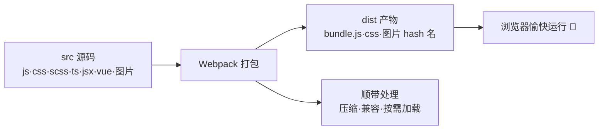
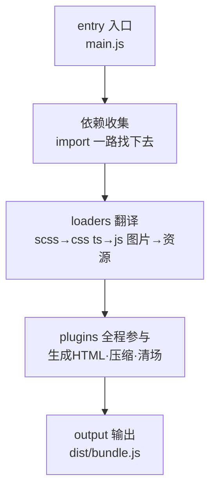
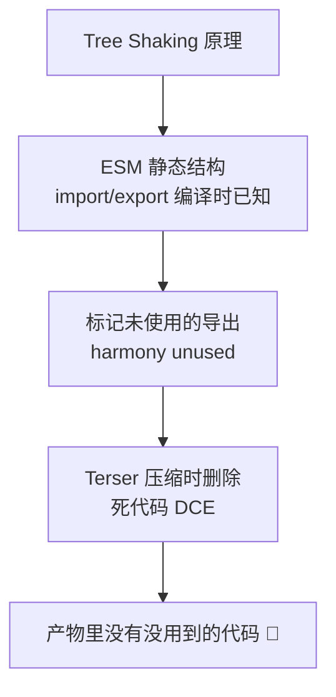
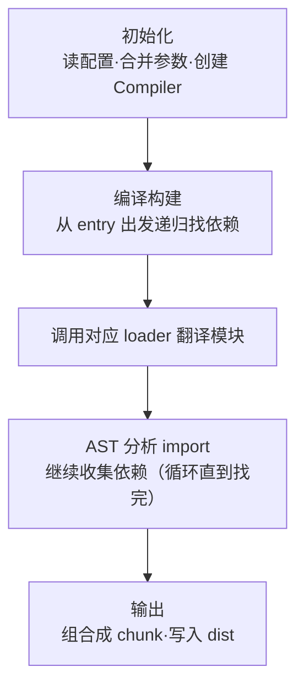
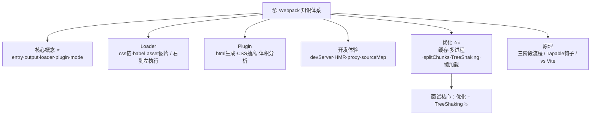

# 📦 Webpack 学习笔记 —— 前端打包的祖师爷 👑

> 嘿嘿～欢迎来到 Webpack 的小课堂！🎀
> 把散落一地的 js/css/图片/高级语法，打包成浏览器爱吃的"压缩饼干"～
> 面试工程化必考，学它就对了！(๑•̀ㅂ•́)و✧

---

## 📚 目录

| 章节 | 内容 | 难度 |
| --- | --- | --- |
| 一 | Webpack 是什么？为什么需要打包 | ⭐ |
| 二 | 五大核心概念 ⭐ | ⭐⭐ |
| 三 | 快速上手 | ⭐⭐ |
| 四 | Loader 详解 | ⭐⭐⭐ |
| 五 | Plugin 详解 | ⭐⭐⭐ |
| 六 | devServer 开发服务器 | ⭐⭐ |
| 七 | source map | ⭐⭐ |
| 八 | 性能优化 ⭐⭐（面试重点） | ⭐⭐⭐⭐ |
| 九 | 构建原理浅析 | ⭐⭐⭐ |
| 十 | Webpack vs Vite | ⭐⭐ |
| 十一 | 面试高频考点速览 | 🔥 |

---

## 一、Webpack 是什么？🤔

**Webpack = 静态模块打包工具**（bundler）：把项目里的一切资源都当"模块"，分析依赖关系，最终打包成少量浏览器能跑的文件～

### 1.1 没有打包工具的日子 😫

| 痛点 | 说明 |
| --- | --- |
| 手动引 N 个 script | 顺序错了就崩，全局变量打架 |
| 浏览器不认识新语法 | SCSS、TS、JSX、`.vue` 全员不认识 |
| 依赖关系人脑维护 | 谁先加载谁后加载？崩溃 😭 |
| 文件太大多请求 | 几百个文件 = 几百次请求，页面巨慢 |
| 上线要压缩优化 | 手动压缩？不存在的 |

### 1.2 Webpack 一站式解决



### 1.3 一句话理解

> 🎀 Webpack 就像"搬家打包公司"：
> 把你家的锅碗瓢盆（各类型资源）**分类装箱**（loader 加工）、**贴标签**（plugin 处理）、
> 最后**装车发走**（output 输出）到一个新家（dist）🚚

---

## 二、五大核心概念 ⭐（必背！）

| 概念 | 一句话 | 类比 |
| --- | --- | --- |
| **Entry** 入口 | 打包从哪个文件开始 | 搬家从主卧开始收拾 |
| **Output** 输出 | 打包结果放哪、叫啥名 | 货车开到哪个仓库 |
| **Loader** 加载器 | 让 webpack 认识非 JS 文件（翻译官） | 搬家工人会打包各种家具 |
| **Plugin** 插件 | 干更广的活（打包优化、生成 HTML...） | 增值服务（保洁、贴标签） |
| **Mode** 模式 | development / production | 白天搬还是晚上搬 |



> 💡 Loader vs Plugin 区别（面试爱问）：
> **Loader 只管"翻译文件"**（单一输入输出）；**Plugin 基于 Tapable 钩子介入整个构建生命周期**，啥都能干～

---

## 三、快速上手 🛠️

### 3.1 安装与初始化

```bash
mkdir webpack-demo && cd webpack-demo
npm init -y
npm i webpack webpack-cli -D
```

### 3.2 目录结构

```
webpack-demo/
├── src/
│   ├── index.js          # 入口
│   └── style.css
├── dist/                 # 打包产物（自动生成）
├── webpack.config.js     # 配置文件（核心！）
└── package.json
```

### 3.3 基础配置

```js
// webpack.config.js
const path = require('path');

module.exports = {
  // 入口：从这开始找依赖
  entry: './src/index.js',

  // 输出：打包到哪
  output: {
    path: path.resolve(__dirname, 'dist'),
    filename: 'bundle.js',
    clean: true,                    // 打包前清空 dist ✨
  },

  // 模式
  mode: 'development',              // development / production
};
```

```bash
npx webpack                        # 执行打包
# package.json 里加脚本更方便：
"scripts": { "build": "webpack" }
```

---

## 四、Loader 详解 🔄

> 🎀 Webpack 原生只认识 JS 和 JSON！其他文件（css/图片/ts...）全靠 loader 翻译～

### 4.1 处理 CSS（loader 链式调用）

```bash
npm i style-loader css-loader less less-loader -D
```

```js
module.exports = {
  module: {
    rules: [
      {
        test: /\.css$/,            // 匹配什么文件（正则）
        // use: 从右往左执行！先 css-loader 再 style-loader ⚠️
        use: ['style-loader', 'css-loader'],
      },
      {
        test: /\.less$/,
        use: ['style-loader', 'css-loader', 'less-loader'],
      },
    ],
  },
};
```

> 💡 执行顺序：**从右到左、从下到上**！
> `less-loader`（less→css）→ `css-loader`（让 JS 能 import css）→ `style-loader`（把 css 塞进 `<style>` 标签）

### 4.2 处理图片（webpack5 内置了！）

```js
{
  test: /\.(png|jpe?g|gif|svg)$/,
  type: 'asset',                   // webpack5 资源模块 ⭐
  parser: {
    dataUrlCondition: { maxSize: 8 * 1024 },  // 小于 8kb 转 base64
  },
  generator: {
    filename: 'images/[hash:8][ext]',         // 输出文件名
  },
},
```

### 4.3 处理 JS 新语法（babel）

```bash
npm i babel-loader @babel/core @babel/preset-env -D
```

```js
{
  test: /\.js$/,
  exclude: /node_modules/,          // 不翻译依赖包（快！）
  use: {
    loader: 'babel-loader',
    options: {
      presets: ['@babel/preset-env'],   // 按目标浏览器转译
    },
  },
},
```

### 4.4 常用 Loader 速查表

| Loader | 作用 |
| --- | --- |
| `css-loader` / `style-loader` | JS 能引 CSS / 塞进 style 标签 |
| `less-loader` / `sass-loader` | 预处理器翻译 |
| `postcss-loader` | 加前缀 autoprefixer（配 postcss.config.js） |
| `babel-loader` | ES6+ → ES5 兼容 |
| `ts-loader` / `babel` | TS 翻译 |
| `file-loader` / `url-loader` | 文件处理（webpack5 用 asset 替代） |
| `vue-loader` | 解析 .vue 单文件组件 |
| `thread-loader` | 多进程编译（性能优化） |
| `raw-loader` | 文件内容当字符串导入 |

---

## 五、Plugin 详解 🔌

### 5.1 必用三件套

```bash
npm i html-webpack-plugin mini-css-extract-plugin -D
```

```js
const HtmlPlugin = require('html-webpack-plugin');
const MiniCssExtract = require('mini-css-extract-plugin');

module.exports = {
  plugins: [
    // ① 自动生成 HTML 并引入打包后的 js/css（再也不用手动 script！）
    new HtmlPlugin({
      template: './public/index.html',   // 模板
      title: '我的应用',
    }),

    // ② CSS 抽离成单独文件（替代 style-loader，生产环境用）
    new MiniCssExtract(),
  ],
  module: {
    rules: [
      {
        test: /\.css$/,
        // 开发用 style-loader（快），生产用 MiniCssExtract.loader（抽文件）
        use: [MiniCssExtract.loader, 'css-loader'],
      },
    ],
  },
};
```

### 5.2 常用 Plugin 速查表

| Plugin | 作用 |
| --- | --- |
| `html-webpack-plugin` | 生成 HTML + 自动引产物 ⭐ |
| `mini-css-extract-plugin` | CSS 抽成独立文件 |
| `css-minimizer-webpack-plugin` | 压缩 CSS |
| `terser-webpack-plugin` | 压缩 JS（生产默认有） |
| `copy-webpack-plugin` | 复制静态资源到 dist |
| `define-plugin`（内置） | 定义环境变量 `process.env.XX` |
| `webpack-bundle-analyzer` | 打包体积可视化分析 📊 |

---

## 六、devServer 开发服务器 🛎️

> 🎀 开发时不用真打包，起个本地服务器，改代码**自动刷新**！

```bash
npm i webpack-dev-server -D
```

```js
module.exports = {
  devServer: {
    port: 8080,
    open: true,                     // 自动开浏览器
    hot: true,                      // 热更新 HMR（不刷新整页，只换模块）
    // 代理：解决本地开发跨域 ⭐⭐
    proxy: {
      '/api': {
        target: 'http://localhost:3000',   // 后端地址
        changeOrigin: true,
        pathRewrite: { '^/api': '' },      // 可选：去掉 /api 前缀
      },
    },
  },
};
```

```jsonc
// package.json
"scripts": { "dev": "webpack serve" }
```

> 💡 HMR（Hot Module Replacement）原理：
> devServer 和浏览器保持 **WebSocket 长连接**，文件一变，服务器把更新的模块推给浏览器**局部替换**，页面不刷新、状态不丢～（CSS 就是典型受益者）

---

## 七、source map 🔍

> 打包压缩后的代码没法看（`a.b=c` 都是啥？），source map = **源码地图**，报错能定位到源码行～

```js
module.exports = {
  devtool: 'eval-source-map',   // 开发：质量高（能看源码）
  // 生产建议：
  // devtool: 'hidden-source-map' 或 'nosources-source-map'
  // （只给报错行列号，不暴露源码，还要配 Sentry 等平台收集）
};
```

| 值 | 特点 | 场景 |
| --- | --- | --- |
| `none` | 不生成 | 无所谓报错 |
| `eval` | 快，只有文件名 | 追求速度 |
| `eval-source-map` | 快+能看源码 | **开发推荐** ⭐ |
| `source-map` | 完整 map 文件 | 大而全 |
| `hidden-source-map` | 生成但不引用 | 生产+监控平台 |

---

## 八、性能优化 ⭐⭐（面试重头戏！）

> 优化两方向：**构建速度↑** 和 **打包体积↓**

### 8.1 构建速度优化

```js
module.exports = {
  // ① 缓存：二次构建起飞 🚀
  cache: { type: 'filesystem' },           // webpack5 持久化缓存

  module: {
    rules: [
      {
        test: /\.js$/,
        // ② 排除 node_modules（最大的省时间项）
        exclude: /node_modules/,
        // ③ 多进程打包（大项目才划算，小项目反而慢）
        use: ['thread-loader', 'babel-loader'],
      },
    ],
  },

  // ④ 合理缩小查找范围
  resolve: {
    extensions: ['.js', '.json'],          // 少写后缀的解析列表别太长
    alias: { '@': path.resolve(__dirname, 'src') },  // 别名直接命中
  },
};
```

### 8.2 打包体积优化

```js
// ① 代码分割 splitChunks：把大包拆小，按需加载 ⭐
optimization: {
  splitChunks: {
    chunks: 'all',                          // 同步+异步都拆
    cacheGroups: {
      vendor: {
        test: /node_modules/,               // 第三方包单独打包
        name: 'vendors',
        chunks: 'all',
      },
    },
  },
},

// ② Tree Shaking：摇掉没用的导出（生产模式自动开）⭐
//    前提：ESM 语法（import/export 静态分析）
// package.json:
//   "sideEffects": ["*.css"]    // 标记哪些文件有副作用别摇

// ③ 动态导入（懒加载）：用到才加载 🌟
button.onclick = async () => {
  const { default: _ } = await import('lodash');   // 点击时才下载！
  console.log(_.chunk([1, 2, 3], 2));
};
// React 路由懒加载同款原理：
const Detail = React.lazy(() => import('./pages/Detail'));

// ④ 图片压缩：image-webpack-loader
// ⑤ gzip：compression-webpack-plugin（服务器开 gzip）
```

### 8.3 优化速记表

| 方向 | 手段 | 关键词 |
| --- | --- |---|
| 提速度 | filesystem 缓存 | 二次构建快 |
| 提速度 | exclude node_modules | 少翻译 |
| 提速度 | thread-loader | 多进程 |
| 提速度 | resolve.alias | 少搜索 |
| 减体积 | splitChunks | 拆包+公共依赖提取 |
| 减体积 | Tree Shaking | 摇树（ESM） |
| 减体积 | 动态 import | 懒加载 |
| 减体积 | MiniCssExtract+压缩 | CSS 独立压缩 |
| 分析 | bundle-analyzer | 体积可视化 |



---

## 九、构建原理浅析 🧠（面试加分！）

### 9.1 构建流程三阶段



**详细一点说：**

1. **初始化**：合并配置 → 生成 `Compiler` 对象（全局唯一，贯穿全程）
2. **编译**：从 entry 开始 → 调用 loader 翻译 → 用 `acorn` 转 AST → 找到 import 依赖 → 递归处理（依赖图 Dependency Graph）
3. **输出**：按规则组装 chunk → 转成 bundle → 写入 dist → 触发钩子（done）

### 9.2 Tapable 钩子：Plugin 的地基

```js
// Plugin 本质：一个带 apply 方法的类，往"钩子"上挂回调
class MyPlugin {
  apply(compiler) {
    // 监听某个时机（生命周期钩子）
    compiler.hooks.emit.tapAsync('MyPlugin', (compilation, cb) => {
      console.log('即将写入 dist 啦！');
      cb();
    });
  }
}
// webpack 就靠这套发布-订阅机制，让插件能在各阶段插手～
```

> 🎀 一句话原理：**Webpack = 递归构建依赖图 + loader 翻译 + plugin 钩子 + 输出 chunk**

---

## 十、Webpack vs Vite ⚔️（必考！）

| 维度 | Webpack | Vite |
| --- | --- | --- |
| 开发启动 | 全量打包后才启动（慢 🐢） | **不打包**，按需编译（快如闪电 ⚡） |
| 开发原理 | bundle → serve | 原生 ESM + esbuild 预构建 |
| 热更新 | HMR（要重新编译受影响模块链） | 精确到单模块，秒级 |
| 生产构建 | 自家打包（成熟） | Rollup 打包 |
| 配置 | 复杂 | 简单（约定优于配置） |
| 生态 | 超级成熟，老项目遍地 | 快速成长，新项目主流 |
| 适合 | 老项目、深度定制 | 新项目快速开发 ⭐ |

> 🎀 记忆点：**开发时 Webpack 先打包再服务，Vite 直接不打包**（浏览器原生支持 import，请求哪个模块现编译哪个）——这就是 Vite 快的根本原因！
> 打包术语："bundle"（捆一起）vs "nobundle"（不捆）

---

## 十一、面试高频考点速览 🔥

| 考点 | 一句话答案 |
| --- | --- |
| Webpack 是什么 | 静态模块打包工具，分析依赖打包成浏览器可运行产物 |
| 五大核心概念 | entry / output / loader / plugin / mode |
| Loader vs Plugin | loader 翻译单文件（链式右到左）；plugin 基于钩子介入整个生命周期 |
| Loader 执行顺序 | use 数组**从右往左**（compose 函数组合） |
| 常见 loader | babel/css/style/less/vue/thread/postcss |
| 常见 plugin | html-webpack-plugin/mini-css-extract/bundle-analyzer |
| HMR 原理 | WebSocket 长连接，文件变更推送模块更新，局部替换不刷新 |
| source map 是什么 | 源码与产物的映射文件，定位报错到源码 |
| 如何做体积优化 | splitChunks 拆包 / Tree Shaking / 动态 import 懒加载 / 图片压缩 / gzip |
| Tree Shaking 原理 | 基于 ESM 静态分析标记未用导出，Terser 删除死代码；需要 sideEffects 配置 |
| 如何提升构建速度 | filesystem 缓存 / exclude / thread-loader / alias / 持久化缓存 |
| 构建流程 | 初始化（Compiler）→ 编译（依赖图+loader+AST）→ 输出（chunk→bundle） |
| 热更新代理怎么配 | devServer.proxy 转发 /api 到后端，解决开发跨域 |
| webpack5 新特性 | 持久化缓存 / asset 资源模块（替代 file/url-loader）/ 模块联邦 |
| Webpack vs Vite | 开发时 bundle 慢 vs nobundle 按需编译快；生产 Vite 用 Rollup |

---

## 🎁 结语：知识地图



> 🎀 恭喜通关 Webpack！学习建议：
> ① 从零手写一遍**基础配置 → 加 loader → 加 plugin → 加 devServer**，比看十篇教程都管用！
> ② 面试重点背两块：**性能优化手段**（提速度+减体积各 4 招）和 **Tree Shaking 原理** 💪
> ③ 配合 Node.js 笔记复习（webpack 本身就是 Node 程序），再看 Vite 会发现"原来 Vite 快在这里"～
> 接下来想学 Vite、Vue3、React 还是原理八股（浏览器/HTTP/手写），随时喊我！(๑•̀ㅂ•́)و✧
