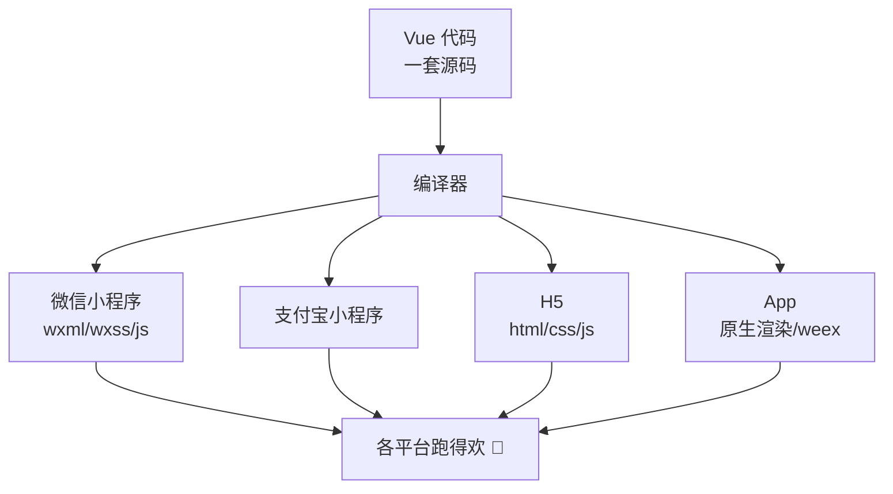
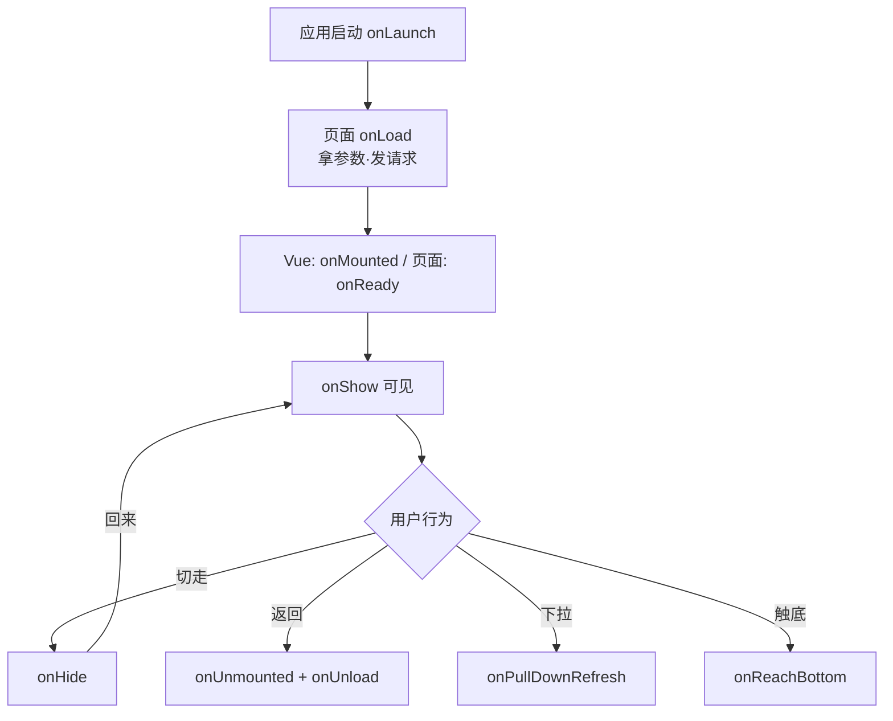
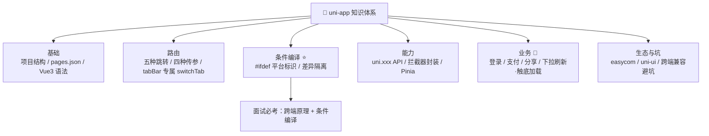

# 🦄 uni-app 学习笔记 —— 一套代码走天下 🌍

> 嘿嘿～欢迎来到 uni-app 的小课堂！🎀
> 微信/支付宝/抖音小程序 + H5 + App，一次开发全都要！
> 会 Vue 就等于会 uni-app，性价比拉满！(๑•̀ㅂ•́)و✧

---

## 📚 目录

| 章节 | 内容 | 难度 |
| --- | --- | --- |
| 一 | uni-app 是什么？跨端原理 | ⭐ |
| 二 | 创建项目两种方式 | ⭐ |
| 三 | 项目结构与核心配置 | ⭐⭐ |
| 四 | 模板语法与条件编译 ⭐ | ⭐⭐ |
| 五 | 页面路由与传参 | ⭐⭐ |
| 六 | 生命周期 | ⭐⭐ |
| 七 | 组件：easycom 与自定义 | ⭐⭐ |
| 八 | uni API 与请求封装 | ⭐⭐⭐ |
| 九 | 状态管理 Pinia | ⭐⭐ |
| 十 | 样式与 rpx 适配 | ⭐⭐ |
| 十一 | 常用业务实现 🌟 | ⭐⭐⭐ |
| 十二 | uni-ui 与插件生态 | ⭐⭐ |
| 十三 | 跨端兼容避坑指南 | ⭐⭐⭐ |
| 十四 | 面试高频考点速览 | 🔥 |

---

## 一、uni-app 是什么？🤔

**uni-app = DCloud 出品的跨端框架**：用 **Vue 语法**写一套代码，编译到 iOS、Android、Web（H5）、以及各家小程序（微信/支付宝/抖音/百度/QQ...）～

### 1.1 跨端原理：编译器 + 运行时



> 🎀 记忆点：**写的是 Vue，编的是各端**。
> 就像一份中文稿，机器自动翻译成英/日/韩文，各地读者看各自的版本 📖

### 1.2 uni-app vs 原生小程序 vs Taro

| 维度 | uni-app | 原生小程序 | Taro |
| --- | --- | --- | --- |
| 语法 | **Vue（2/3 都支持）** | 小程序原生语法 | **React**（3.x 也支持 Vue3） |
| 跨端 | 小程序+H5+App 全覆盖 | 只跑自家小程序 | 小程序+H5+RN |
| 生态 | 插件市场超丰富 🛒 | 官方组件库 | Taro UI / NutUI |
| 开发工具 | HBuilderX（或 VS Code+CLI） | 微信开发者工具 | VS Code 任意 |
| 上手成本 | 会 Vue 就会 ⭐ | 要学一套新语法 | 会 React 就会 |
| 适合 | 中小项目快速多端 | 单一微信端、追求极致 | React 党多端 |

### 1.3 为什么选 uni-app？

- ✅ 只学一套：Vue 语法直接用，`setup`、`ref`、`computed` 全都有
- ✅ 写一次，编译多端，老板狂喜 🤑
- ✅ 插件市场几千个现成模板/组件
- ✅ 条件编译处理平台差异，精细控制每个端

---

## 二、创建项目两种方式 🛠️

### 2.1 方式一：HBuilderX 可视化（新手最友好）⭐

1. 下载 [HBuilderX](https://www.dcloud.io/hbuilderx.html)（DCloud 家的 IDE）
2. 文件 → 新建 → 项目 → uni-app → 选模板（默认/uni-ui 等）
3. 运行 → 运行到浏览器 / 运行到小程序模拟器 / 运行到手机
4. 发布 → 各平台云端打包

> 💡 运行到微信小程序需要：先装微信开发者工具，并在其设置里开启"服务端口"～

### 2.2 方式二：CLI 创建（喜欢 VS Code 的宝子）

```bash
# Vue3 版本（推荐 ✨）
npx degit dcloudio/uni-preset-vue#vite my-uni-app
cd my-uni-app
npm i
npm run dev:h5           # 跑 H5
npm run dev:mp-weixin    # 跑微信小程序（产物在 dist/dev/mp-weixin）
npm run build:h5         # 打包
```

> 🎀 CLI 产物要用**微信开发者工具手动导入** `dist/dev/mp-weixin` 目录预览～

---

## 三、项目结构与核心配置 📁

```
my-uni-app/
├── src/                  # CLI 版源码在这（HBuilderX 版直接在根目录）
│   ├── pages/            # 页面
│   │   └── index/index.vue
│   ├── static/           # 静态资源（图片等）
│   ├── App.vue           # 应用入口：全局样式 + 应用生命周期
│   ├── main.js           # 入口：createSSRApp 挂载
│   ├── pages.json        # 🌟 页面路由 + 全局配置（超重要！）
│   ├── manifest.json     # 🌟 应用配置：AppID、图标、各平台设置
│   └── uni.scss          # 全局 scss 变量
```

### 3.1 pages.json（类比小程序 app.json + 更强）

```jsonc
{
  // 页面注册：第一项是首页！
  "pages": [
    { "path": "pages/index/index", "style": { "navigationBarTitleText": "首页" } },
    { "path": "pages/login/login", "style": { "navigationBarTitleText": "登录" } }
  ],

  // 底部 tabBar
  "tabBar": {
    "list": [
      { "pagePath": "pages/index/index", "text": "首页", "iconPath": "static/home.png", "selectedIconPath": "static/home-active.png" },
      { "pagePath": "pages/mine/mine", "text": "我的", "iconPath": "static/mine.png", "selectedIconPath": "static/mine-active.png" }
    ]
  },

  // 全局窗口样式
  "globalStyle": {
    "navigationBarTextStyle": "black",
    "navigationBarTitleText": "uni 小甜甜",
    "backgroundColor": "#F8F8F8",
    "enablePullDownRefresh": false
  },

  // 分包
  "subPackages": [
    { "root": "subpkg", "pages": [{ "path": "detail/detail" }] }
  ]
}
```

### 3.2 一个页面的样子（完全的 Vue 味儿 🍇）

```vue
<!-- pages/index/index.vue -->
<template>
  <view class="page">
    <text>{{ msg }}</text>
    <button @click="change">点我呀</button>
  </view>
</template>

<script setup>
import { ref } from 'vue';

const msg = ref('Hello uni-app！');
const change = () => (msg.value = '你点到我啦~');
</script>

<style lang="scss" scoped>
.page { padding: 20rpx; }
</style>
```

> ⚠️ 模板里用 **view/text/image** 等内置标签（不是 div/span/img），
> H5 端会自动转换，但小程序端没有 div，写了会踩坑！

---

## 四、模板语法与条件编译 ⭐（核心特色！）

### 4.1 模板：Vue 语法照常写

```vue
<template>
  <!-- 插值/指令全家桶 -->
  <view>{{ msg }}</view>
  <view v-if="isVip">尊贵 VIP</view>
  <view v-for="item in list" :key="item.id">{{ item.name }}</view>
  <image :src="avatar" mode="aspectFill" />
  <input v-model="keyword" placeholder="搜索" />
  <button @click="onSubmit">提交</button>
</template>
```

### 4.2 条件编译：一端一策略 🎯（必考！）

> 🎀 各平台有差异怎么办？**条件编译**！
> 用注释包裹代码，编译时只保留目标平台需要的部分～

```vue
<template>
  <view>
    <!-- #ifdef MP-WEIXIN：只在小程序端编译 -->
    <!-- #ifdef MP-WEIXIN -->
    <button open-type="getUserProfile" @click="wxLogin">微信登录</button>
    <!-- #endif -->

    <!-- 只在 H5 端编译 -->
    <!-- #ifdef H5 -->
    <button @click="h5Login">手机号登录</button>
    <!-- #endif -->

    <!-- 除了 H5 都编译 -->
    <!-- #ifndef H5 -->
    <view>我不是 H5</view>
    <!-- #endif -->

    <!-- 微信小程序 或 App -->
    <!-- #ifdef MP-WEIXIN || APP-PLUS -->
    <view>小程序和 App 专属</view>
    <!-- #endif -->
  </view>
</template>

<script setup>
// JS 里也有条件编译！
// #ifdef MP-WEIXIN
console.log('只有微信小程序控制台能看到我');
// #endif
</script>

<style>
/* 样式里同样可以 */
/*  #ifdef  H5  */
.title { cursor: pointer; }
/*  #endif  */
</style>
```

### 4.3 常用平台标识

| 标识 | 平台 |
| --- | --- |
| `H5` | 网页 |
| `MP-WEIXIN` | 微信小程序 |
| `MP-ALIPAY` | 支付宝小程序 |
| `MP-TOUTIAO` / `MP-DOUYIN` | 抖音小程序 |
| `APP-PLUS` | App（nvue 用 APP-NVUE） |
| `MP` | 所有小程序（`MP-WEIXIN || MP-ALIPAY ...` 也行） |

---

## 五、页面路由与传参 🧭

### 5.1 路由跳转 API

```js
// ① 普通跳转（保留当前页，可返回）
uni.navigateTo({ url: '/pages/detail/detail?id=1&name=奶茶' });

// ② 关闭当前页再跳（不能返回）
uni.redirectTo({ url: '/pages/login/login' });

// ③ 关闭所有页面再跳（适合登录成功进首页）
uni.reLaunch({ url: '/pages/index/index' });

// ④ 跳 tabBar 页面（专用！navigateTo 跳不过去 ⚠️）
uni.switchTab({ url: '/pages/index/index' });

// ⑤ 返回上一页（可带数据）
uni.navigateBack({ delta: 1 });
```

### 5.2 页面传参的 4 种方式

```js
// ① URL 传参（最常用）：onLoad 里接收
uni.navigateTo({ url: `/pages/detail/detail?id=${id}` });
// detail.vue
onLoad(options) {
  console.log(options.id);   // 注意：是字符串！
}

// ② 事件通道 events（navigatTo 专享，父子页通信）
uni.navigateTo({
  url: '/pages/detail/detail',
  events: {
    // 监听子页给我传数据
    someEvent: (data) => console.log('收到：', data),
  },
  success: (res) => {
    res.eventChannel.emit('sendToChild', { foo: 'bar' });  // 发给子页
  },
});

// ③ 全局状态：Pinia / globalData / storage
uni.setStorageSync('tempData', { id: 1 });

// ④ 返回传参：拿上一页实例直接改
const pages = getCurrentPages();
const prev = pages[pages.length - 2];      // 上一页
prev.$vm.refreshList();                    // 调它的方法
uni.navigateBack();
```

### 5.3 路由 API 速记表

| API | 会不会留历史 | 能跳 tabBar？ |
| --- | --- | --- |
| navigateTo | ✅ 留 | ❌ |
| redirectTo | ❌ 替换 | ❌ |
| reLaunch | ❌ 清空全部 | ✅ |
| switchTab | ❌ | ✅（专用） |
| navigateBack | 返回 | - |

---

## 六、生命周期 🔄

> 🎀 uni-app 生命周期 = **Vue 生命周期 + 小程序生命周期** 双拼全家桶！

```js
// ===== 页面（script setup 用 @dcloudio/uni-app 的钩子）=====
import { onLoad, onShow, onReady, onHide, onUnload,
         onPullDownRefresh, onReachBottom, onShareAppMessage } from '@dcloudio/uni-app';

onLoad((options) => {});      // 加载：拿 URL 参数 ⭐
onShow(() => {});             // 显示（每次可见）
onReady(() => {});            // 首次渲染完
onPullDownRefresh(() => {});  // 下拉刷新（pages.json 要开启）
onReachBottom(() => {});      // 上拉触底（加载更多）
onShareAppMessage(() => ({ title: '分享标题', path: '/pages/index/index' }));

// ===== 应用级（App.vue 里）=====
import { onLaunch, onShow, onHide } from '@dcloudio/uni-app';
onLaunch(() => {});   // 启动（一次）
onShow(() => {});     // 前台
onHide(() => {});     // 后台
```



> 💡 Vue3 组合式 API 里，**页面钩子要从 `@dcloudio/uni-app` 导入**（不是 vue），
> 而 onMounted 等 Vue 钩子照常从 `vue` 导入，两套可以混用～

---

## 七、组件：easycom 与自定义 🧩

### 7.1 easycom：免注册直接用（超爽！）✨

> 规范组件路径 → `components/组件名/组件名.vue` → **不用 import 不用注册**，模板里直接写！

```
components/
├── nav-bar/nav-bar.vue      → <nav-bar />
└── goods-card/goods-card.vue → <goods-card />
```

```vue
<template>
  <nav-bar title="首页" />
  <goods-card :item="goods" @click="onCard" />
</template>

<!-- 什么都不用 import！自动识别 🎉 -->
```

### 7.2 自定义组件（就是 Vue 组件）

```vue
<!-- components/goods-card/goods-card.vue -->
<template>
  <view class="card" @click="emit('click', item)">
    <image :src="item.img" mode="aspectFill" />
    <text>{{ item.name }}</text>
    <text class="price">￥{{ item.price }}</text>
  </view>
</template>

<script setup>
defineProps({ item: Object });          // props 接收
const emit = defineEmits(['click']);    // 事件抛出
</script>
```

### 7.3 常用内置组件

| 组件 | 说明 | 对比网页 |
| --- | --- | --- |
| `view` | 容器 | div |
| `text` | 文本（要长按复制得包它） | span |
| `image` | 图片（有 mode 裁剪模式） | img |
| `scroll-view` | 可滚动区域 | overflow 容器 |
| `swiper` | 轮播图 | 自己写轮播?不存在的 😎 |
| `input` / `picker` | 输入/选择器 | input / select |
| `button` | 按钮（小程序里能开 open-type 能力） | button |
| `rich-text` | 富文本渲染 | v-html |

```vue
<!-- 轮播图三行搞定 -->
<swiper :autoplay="true" :interval="3000" circular indicator-dots>
  <swiper-item v-for="img in banners" :key="img">
    <image :src="img" mode="aspectFill" />
  </swiper-item>
</swiper>
```

---

## 八、uni API 与请求封装 🌐

### 8.1 uni-app 把小程序 API 全部 `uni.` 化

```js
uni.request({ url });               // 请求
uni.setStorageSync('k', 'v');       // 存储
uni.showToast({ title: '成功', icon: 'success' });
uni.showLoading({ title: '加载中' });
uni.login();                        // 登录（小程序）
uni.scanCode();                     // 扫码
uni.chooseImage();                  // 选图
uni.getLocation();                  // 定位
uni.navigateTo({ url });            // 路由
```

> 💡 H5 端部分原生能力（扫码/推送）不可用或降级，用条件编译兜底～

### 8.2 封装请求（项目必备模板）⭐

```js
// utils/request.js
const BASE_URL = 'https://api.example.com';

// 请求拦截器（uni.addInterceptor，类似 axios 拦截器！）
uni.addInterceptor('request', {
  invoke(args) {
    args.url = BASE_URL + args.url;                              // 拼 baseURL
    args.header = { Authorization: `Bearer ${uni.getStorageSync('token')}` };
    uni.showLoading({ title: '加载中' });
  },
  success(args) {
    if (args.data?.code === 401) {   // token 失效 → 去登录
      uni.removeStorageSync('token');
      uni.reLaunch({ url: '/pages/login/login' });
    }
  },
  complete() {
    uni.hideLoading();
  },
});

// Promise 化封装
export const request = (url, method = 'GET', data = {}) =>
  new Promise((resolve, reject) => {
    uni.request({
      url, method, data,
      success: (res) => (res.statusCode === 200 ? resolve(res.data) : reject(res)),
      fail: reject,
    });
  });

export default request;
```

```js
// 使用
import request from '@/utils/request';
const res = await request('/goods/list', 'GET', { page: 1 });
```

---

## 九、状态管理 Pinia 🗃️

> uni-app Vue3 版直接支持 Pinia（官方推荐，比 Vuex 香）～

```js
// stores/user.js
import { defineStore } from 'pinia';
import { ref } from 'vue';

export const useUserStore = defineStore('user', () => {
  const token = ref(uni.getStorageSync('token') || '');
  const userInfo = ref({});

  const setLogin = (t, info) => {
    token.value = t;
    userInfo.value = info;
    uni.setStorageSync('token', t);   // 顺手持久化
  };

  const logout = () => {
    token.value = '';
    userInfo.value = {};
    uni.removeStorageSync('token');
  };

  return { token, userInfo, setLogin, logout };
});
```

```js
// main.js 注册
import { createSSRApp } from 'vue';
import * as Pinia from 'pinia';

export function createApp() {
  const app = createSSRApp(App);
  return { app, Pinia };   // 记得把 Pinia 也 return 出去！⚠️
}
```

```vue
<!-- 页面里使用 -->
<script setup>
import { useUserStore } from '@/stores/user';
const userStore = useUserStore();
</script>
<template>
  <view v-if="userStore.token">欢迎，{{ userStore.userInfo.name }}</view>
</template>
```

---

## 十、样式与 rpx 适配 📱

### 10.1 rpx：750 等分（和小程序同款规则）

```scss
/* 设计稿 750px 宽：量多少写多少 rpx */
.card {
  width: 690rpx;      // 左右各留 30rpx 的卡片
  padding: 24rpx;
  border-radius: 16rpx;
}
.title { font-size: 32rpx; }
```

| 场景 | 建议 |
| --- | --- |
| 布局尺寸 | rpx（自动适配） |
| 边框 1px | 用 `1px`（rpx 在高分屏会变粗细不一） |
| 字体 | rpx 或 px 按团队规范 |
| 全局变量 | `uni.scss` 里定义 `$primary: #ff6b9d;` 自动可用 |

### 10.2 uni.scss：全局变量免引入

```scss
/* uni.scss（特殊文件：所有页面自动注入，不用 @import）*/
$primary: #ff6b9d;
$bg-color: #f5f5f5;
```

---

## 十一、常用业务实现 🌟

### 11.1 登录（微信小程序端）

```js
// #ifdef MP-WEIXIN
const wxLogin = async () => {
  const { code } = await uni.login();                 // 拿 code
  const res = await request('/user/login', 'POST', { code });
  userStore.setLogin(res.token, res.userInfo);
  uni.showToast({ title: '登录成功', icon: 'success' });
};
// #endif
```

### 11.2 下拉刷新 + 上拉加载（列表页标配）

```vue
<script setup>
import { ref } from 'vue';
import { onPullDownRefresh, onReachBottom } from '@dcloudio/uni-app';

const list = ref([]);
const page = ref(1);
const finished = ref(false);

const loadList = async (reset = false) => {
  if (reset) { page.value = 1; finished.value = false; }
  if (finished.value) return;
  const res = await request('/goods/list', 'GET', { page: page.value, size: 10 });
  list.value = reset ? res.list : [...list.value, ...res.list];
  if (list.value.length >= res.total) finished.value = true;
  else page.value += 1;
};

onPullDownRefresh(async () => {
  await loadList(true);
  uni.stopPullDownRefresh();     // 记得停掉小圈圈！
});

onReachBottom(() => loadList()); // 触底自动加载
</script>

<template>
  <view v-for="item in list" :key="item.id">{{ item.name }}</view>
  <view v-if="finished">— 到底啦 —</view>
</template>
```

```jsonc
// pages.json 里对应页面开启
{ "path": "pages/index/index", "style": { "enablePullDownRefresh": true } }
```

### 11.3 分享

```js
import { onShareAppMessage, onShareTimeline } from '@dcloudio/uni-app';

onShareAppMessage(() => ({
  title: '快来看看这家宝藏小店！',
  path: '/pages/index/index',
  imageUrl: '/static/share.png',
}));
onShareTimeline(() => ({ title: '朋友圈分享' }));   // 微信朋友圈
```

### 11.4 支付（微信小程序）

```js
const pay = async (orderId) => {
  // ① 后端下单，返回支付参数
  const payParams = await request('/order/pay', 'POST', { orderId });
  // ② 唤起支付
  // #ifdef MP-WEIXIN
  await uni.requestPayment({
    provider: 'wxpay',
    timeStamp: payParams.timeStamp,
    nonceStr: payParams.nonceStr,
    package: payParams.package,
    signType: payParams.signType,
    paySign: payParams.paySign,
  });
  uni.showToast({ title: '支付成功 🎉' });
  // #endif
};
```

---

## 十二、uni-ui 与插件生态 🛒

```bash
# 方式一：HBuilderX 里右键 → 从插件市场导入
# 方式二：npm 安装（配合 easycom 自动引入）
npm i @dcloudio/uni-ui
```

```jsonc
// pages.json 配置 easycom 自动注册
"easycom": {
  "autoscan": true,
  "custom": {
    "^uni-(.*)": "@dcloudio/uni-ui/lib/uni-$1/uni-$1.vue"
  }
}
```

```vue
<!-- 直接用，不用 import！ -->
<uni-icons type="heart" size="20" />
<uni-badge text="9" />
<uni-rate :value="4" />
<uni-load-more status="loading" />
```

> 💡 插件市场 [ext.dcloud.net.cn](https://ext.dcloud.net.cn) 有几千个模板：商城、聊天、地图... CV 大法好！

---

## 十三、跨端兼容避坑指南 ⚠️（实战血泪！）

| 坑 | 解法 |
| --- | --- |
| 用了 div/span/img | 换 view/text/image（内置组件） |
| H5 有 window/document，小程序没有 | 相关代码包条件编译 `#ifdef H5` |
| 微信登录在 H5 报错 | 登录逻辑按端拆分：`#ifdef MP-WEIXIN` / `#ifdef H5` |
| navigateTo 跳 tabBar 失败 | tabBar 页面必须 `uni.switchTab` |
| 页面参数是字符串类型 | `Number(options.id)` 转换，别直接比较 😭 |
| 1px 边框在某些端变粗 | 边框用 px 不用 rpx |
| 样式不生效 | 小程序端 `*` 通配符选择器无效；scoped 影响子组件样式时用 :deep() |
| 图片不显示 | 小程序不支持本地背景图，用 image 标签或网络图片/ base64 |
| storage 存对象 | 直接存即可，但注意大小限制（单 key 1MB，总量 10MB） |
| 各端 API 返回不一致 | 关键能力用条件编译分端处理 |

> 🎀 心法：**公共逻辑抽出来，平台差异用 `#ifdef` 隔离**，
> 永远不要指望 100% 一套代码无脑跑所有端，那 5% 的差异就是条件编译存在的意义！

---

## 十四、面试高频考点速览 🔥

| 考点 | 一句话答案 |
| --- | --- |
| uni-app 跨端原理 | 编译期：Vue 代码编译成各端代码；运行期：各端渲染引擎执行（H5 走 vue runtime，小程序走双线程） |
| 条件编译是什么 | `#ifdef/#ifndef 平台标识` 注释，编译时只保留目标平台代码，处理多端差异 |
| uni-app vs 小程序原生 | Vue 语法一套代码多端 vs 每端单独开发；开发效率 vs 极致定制 |
| uni-app vs Taro | Vue 系 vs React 系，跨端能力类似，看团队技术栈 |
| easycom 是什么 | 组件规范路径 `components/xx/xx.vue` 自动注册，免 import |
| 页面生命周期 onLoad/onShow 区别 | onLoad 一次拿参数；onShow 每次可见触发 |
| tabBar 页面怎么跳 | 只能 uni.switchTab（或 reLaunch） |
| 页面间通信方式 | URL 参数 / eventChannel / Pinia / getCurrentPages 拿上级实例 |
| uni.request 怎么统一处理 | uni.addInterceptor 拦截器 + Promise 封装 |
| rpx 原理 | 屏幕宽 750 等分，设计稿 750px 量多少写多少 |
| uni-app 性能优化 | 分包、图片压缩懒加载、避免大数据频繁 setData（Vue 响应式也要克制） |
| uni-app 用什么状态管理 | Vue3 用 Pinia（main.js 返回 Pinia 实例），Vue2 用 Vuex |

---

## 🎁 结语：知识地图



> 🎀 恭喜通关 uni-app！学习建议：
> ① 用 HBuilderX 建个默认模板，**同时跑 H5 和微信小程序**，感受"一套代码两端跑"的魔法 ✨
> ② 把第十一章的**请求封装 + 列表刷新加载**敲熟，任何项目开场直接用～
> ③ 配合前面的小程序笔记复习双线程、rpx、登录流程，跨端框架题一网打尽 💪
> 接下来想学 Vue3、React、Taro 还是面试八股专题，随时喊我！(๑•̀ㅂ•́)و✧
